# S3 强一致性是怎么交付的：从最终一致到可证明的正确性

> 视频来源：[AWS Pi Week 2021: Amazon S3 Strong Consistency](https://www.youtube.com/watch?v=B0yXz6EeCaA)（YouTube · AWS Events · 讲者 Vishwas Narendra、Sardar Tasiran、Ankush Desai）｜时长约 27 分钟
> 导读：这是一场 AWS 官方工程师的「底层拆解」：S3 从 2006 年的最终一致走到 2020 年底的强一致，中间要改的是几乎每一个请求的默认行为。本文按视频顺序讲清三件事——强一致到底承诺了什么、为什么在 S3 的规模上极难、以及 AWS 用「自动推理 + 模型检查」把正确性做成可证明的。字幕为自动生成，术语已按上下文订正。

## 本讲要解决的核心问题（SCQA）

**背景**：S3 从 2006 年上线起一直是最终一致（eventual consistency）：写完之后立刻读，可能读到旧版本。数据湖用户为此写了很多绕行代码。

**冲突**：2020 年 12 月，AWS 宣布 S3 的所有操作都变成强一致（strong consistency），而且价格和性能都不变。这意味着要把发往 S3 的几乎每一个请求的默认行为改掉。

**疑问**：一个由 320 多个微服务组成、每秒处理数千万请求的系统，凭什么敢承诺「100% 一致」？改坏了怎么办？

**回答（中心思想）**：S3 的强一致不是靠「测得足够多」交付的，而是靠在三个抽象层级上做形式化建模与机器验证——协议级模型给出完整证明，详细设计模型用模型检查扫掉数十亿个边界情况，实现代码再和设计模型做一致性检查，最后把检查接进 CI/CD 持续跑。

## 一、强一致承诺的是一条很具体的规则

视频一开场就把规则说清楚了：如果应用对 S3 连续写入，那么写之后的读**一定返回最后一次成功的写入**（[【跳转到 00:27】](https://www.youtube.com/watch?v=B0yXz6EeCaA&t=27)）。这就是「读后写一致性」（read-after-write consistency）。

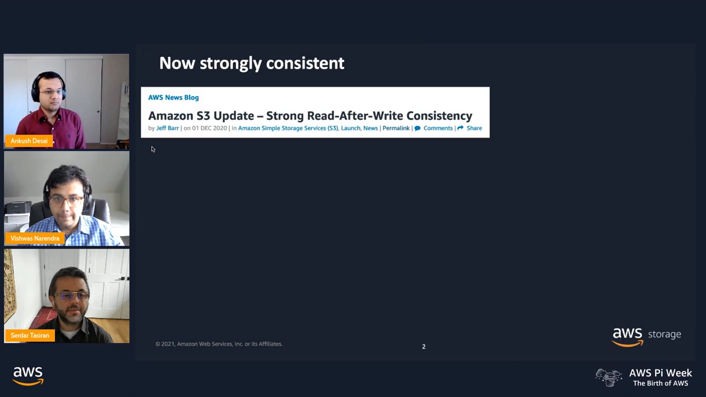

这条规则覆盖的是**所有操作**，不只是新对象。视频里强调：这是对最终一致模型的替换，而最终一致从 2006 年一直用到 2020 年底；宣布强一致时，价格和性能都没有变化（[【跳转到 00:52】](https://www.youtube.com/watch?v=B0yXz6EeCaA&t=52)）。

对上层应用来说，收益是**编程模型变简单了**（[【跳转到 01:17】](https://www.youtube.com/watch?v=B0yXz6EeCaA&t=77)）。视频列了两类典型的绕行代码，都是数据湖场景里真实存在过的：

- 在相互依赖的任务之间**插入人为的等待时间**，赌「等一会儿数据就可见了」；
- 用 **DynamoDB 这样的第二存储**记录对象清单，和 S3 里的对象保持同步，靠外部数据库来兜住一致性。

强一致之后，这些 workaround 可以删掉（[【跳转到 02:01】](https://www.youtube.com/watch?v=B0yXz6EeCaA&t=121)）。

## 二、难的不是「一致」，是「在 S3 的规模上一致」

视频很坦诚地讲了客户的怀疑：有没有例外？我真的能把 workaround 全删掉吗？工程师的回答是——在 S3 的规模上交付强一致非常困难（[【跳转到 02:26】](https://www.youtube.com/watch?v=B0yXz6EeCaA&t=146)）。

难在四个维度同时成立：

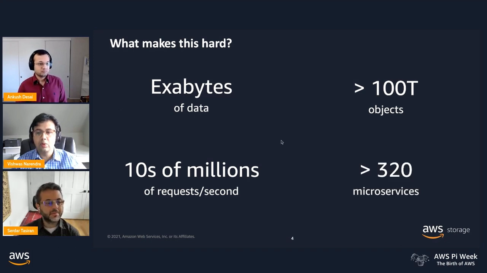

- **EB 级**（exabytes）的数据量；
- 超过 **100 万亿**（100 trillion）个对象；
- 每秒**数千万**次请求；
- 内部由 **320 多个**微服务组成。

关键的一句是：改强一致等于**改变了发往 S3 的几乎每一个请求的默认行为**（[【跳转到 03:16】](https://www.youtube.com/watch?v=B0yXz6EeCaA&t=196)）。所以问题不是「能不能实现」，而是「凭什么相信它处处都对」。

## 三、常规测试只是及格线，因为「99% 一致」不存在

团队先盘了一遍常规手段（[【跳转到 03:41】](https://www.youtube.com/watch?v=B0yXz6EeCaA&t=221)）：

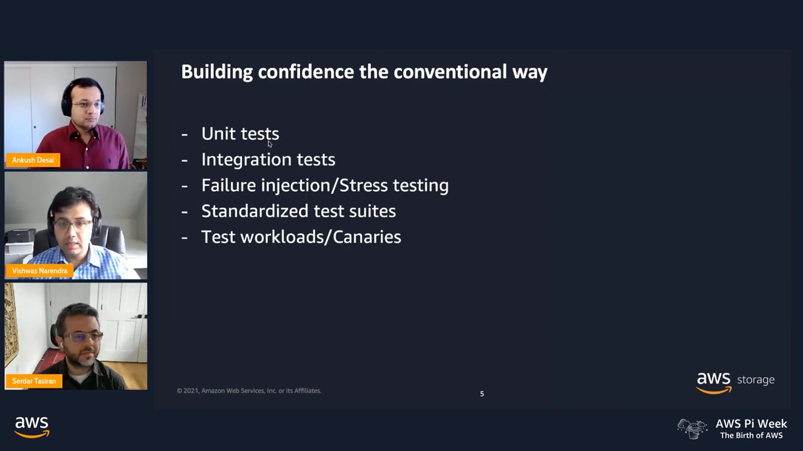

- 单元测试、集成测试；
- 故障注入（failure injection）与压力测试；
- 标准化测试套件（把业界知名的测试套件搬进来用）；
- 测试负载与 canary 灰度。

这些手段「都很好，几乎是必需的」，但被定位成**最低门槛**（[【跳转到 04:06】](https://www.youtube.com/watch?v=B0yXz6EeCaA&t=246)）。原因有两个：

1. 强一致的卖点是**简化编程模型**，而「99% 一致」这种说法在语义上不成立——要么一致，要么不一致，团队要的是真正的 100%（[【跳转到 04:31】](https://www.youtube.com/watch?v=B0yXz6EeCaA&t=271)）。
2. 系统可能的行为数量是**天文数字**：这么多微服务、这么多并发与故障的组合。常规方法只能给出有限的覆盖，依赖人的勤勉，而且可能反复走同样的代码路径，没有系统性的办法去探索所有可能行为（[【跳转到 05:46】](https://www.youtube.com/watch?v=B0yXz6EeCaA&t=346)）。

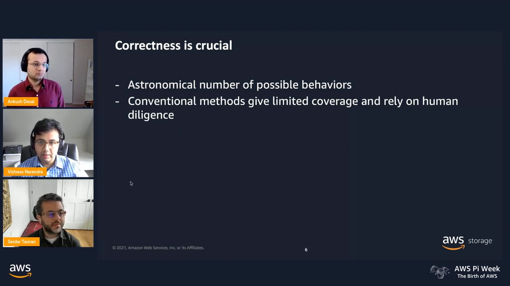

## 四、自动推理：把系统拆成三个层级分别证明

于是团队引入了**自动推理**（automated reasoning），也就是形式化方法（formal methods）。它的关键思想是对**所有可能的执行**做推理，而不是抽样执行（[【跳转到 06:11】](https://www.youtube.com/watch?v=B0yXz6EeCaA&t=371)）。手段有两类：

- 借助计算机辅助的**数学逻辑证明**；
- 用巧妙的算法**系统地探索系统状态**，保证每个状态下一致性都成立。

落到工程上，他们把 S3 拆成三个「缩放级别」，每个级别针对不同类别的潜在错误（[【跳转到 07:48】](https://www.youtube.com/watch?v=B0yXz6EeCaA&t=468)）：

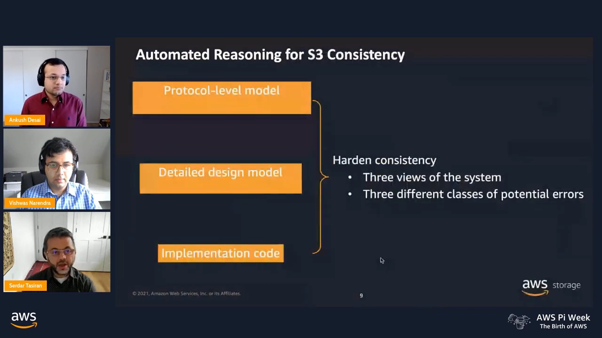

| 层级 | 建模语言 | 关心什么 | 用的方法 |
| --- | --- | --- | --- |
| 协议级模型 | Dafny（逻辑、声明式） | 系统级不变式，如「微服务 A 里的 key 在 B 里也有」 | 演绎证明，机器化证明 |
| 详细设计模型 | P（状态机） | 事件顺序，如「e1 永远发生在 e2 之前」 | 模型检查 |
| 实现代码 | 真实代码 | 表达式是否算出了状态转换所需的逻辑条件 | 代码一致性检查 |

这个拆分背后有一个很实用的权衡：**越往下细节越多，可能状态的数量就爆炸式增长，自动推理也越贵**；反过来，越往上能覆盖的行为比例越高（[【跳转到 09:28】](https://www.youtube.com/watch?v=B0yXz6EeCaA&t=568)）。所以顶层用「证明」拿 100% 覆盖，中层用「模型检查」扫海量边界情况，底层用「对照」防编码错误。

### 4.1 协议级：用逻辑写模型，用演绎证明拿 100% 覆盖

协议级模型是**声明式**的：它不写「先做什么再做什么」，只描述系统可以处于哪些状态、状态之间如何转换、受什么约束（[【跳转到 10:14】](https://www.youtube.com/watch?v=B0yXz6EeCaA&t=614)）。

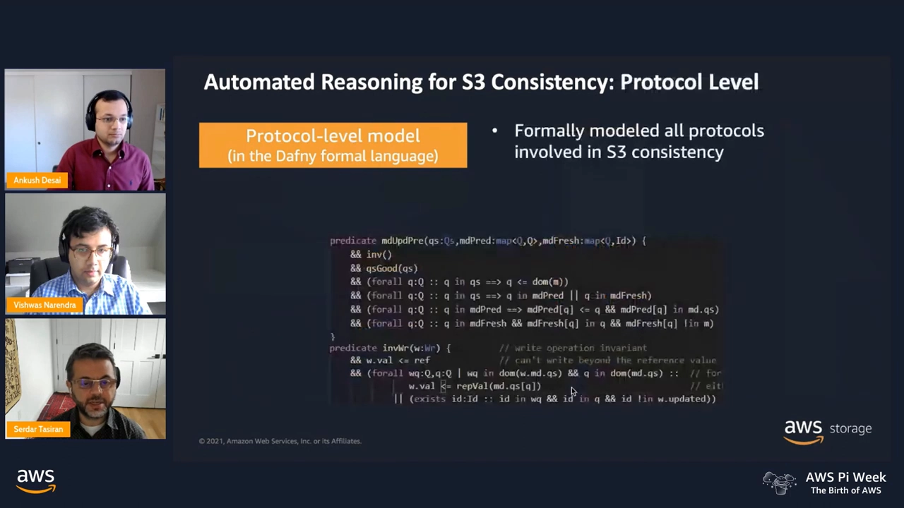

在这个层级，团队把 S3 一致性涉及的所有协议都形式化建模，然后用演绎证明方法做出机器化证明。效果是：**直观上 100% 覆盖 S3 的执行**，而且证明对任意数量的调用、key、对象、服务器都成立，完全通用（[【跳转到 11:04】](https://www.youtube.com/watch?v=B0yXz6EeCaA&t=664)）。

### 4.2 详细设计层：把协议细化成状态机，交给模型检查

详细设计模型精化协议级模型，用**状态机**表达协议逻辑（[【跳转到 11:29】](https://www.youtube.com/watch?v=B0yXz6EeCaA&t=689)）。

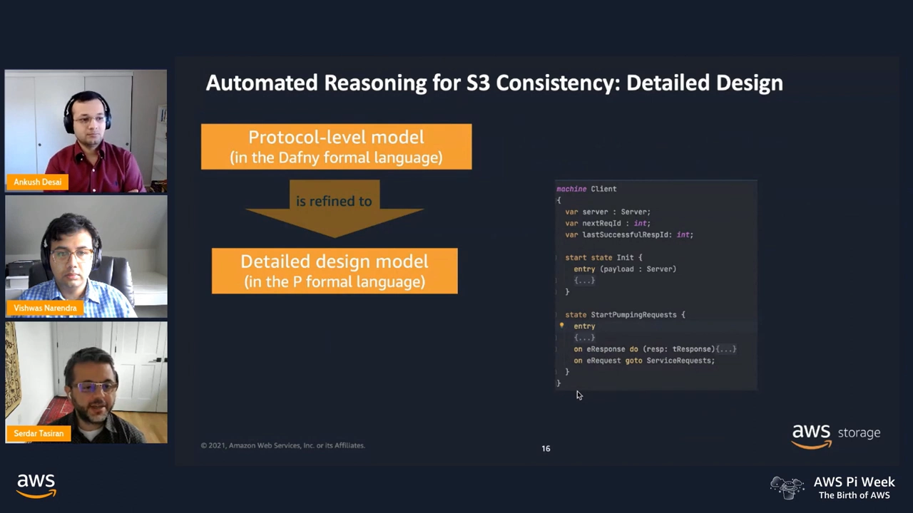

这一层用的技术是**模型检查**（model checking），能常规地探索**数十亿个边界情况**。视频里给的理由很直白：人类在「多个罕见事件同时发生」这类情形上表现很差，而这正是模型检查最强的地方（[【跳转到 12:19】](https://www.youtube.com/watch?v=B0yXz6EeCaA&t=739)）。

## 五、模型检查：把一致性当成一个搜索问题

负责这一部分的 Ankush 把模型检查讲成了一个搜索问题（[【跳转到 16:36】](https://www.youtube.com/watch?v=B0yXz6EeCaA&t=996)）：系统处在某个状态时，可能有多个并发动作同时可以发生，模型检查器要探索这些动作**所有可能的交错**——消息的交错、故障发生的交错、线程的交错。

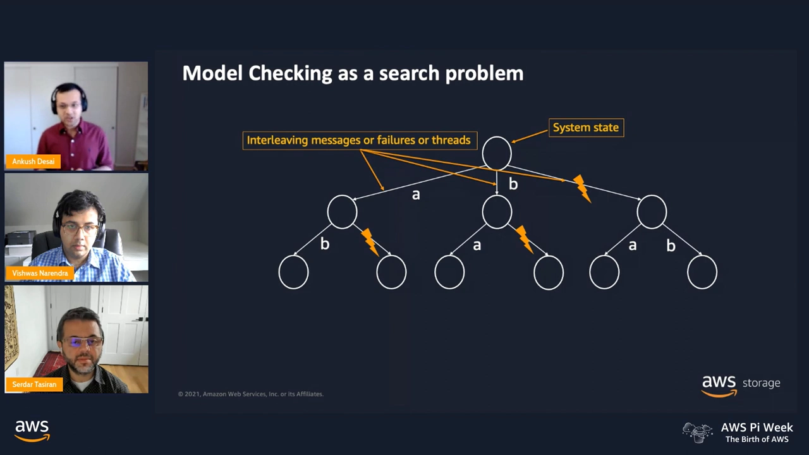

做模型检查需要两样东西（[【跳转到 14:56】](https://www.youtube.com/watch?v=B0yXz6EeCaA&t=896)）：

1. **详细的形式化设计**：把每个组件、组件之间怎么交互、各自假设什么前提、提供什么保证都写下来；
2. **正确性规约**：为每个组件写出规约，合起来就给出 S3 的强一致保证。

他们用的建模语言是 **P**——一个基于状态机的开源语言与工具链，作者读研究生时写的，现在 AWS 是主要贡献者，仓库地址在幻灯片上（`github.com/p-org/P`）（[【跳转到 15:46】](https://www.youtube.com/watch?v=B0yXz6EeCaA&t=946)）。

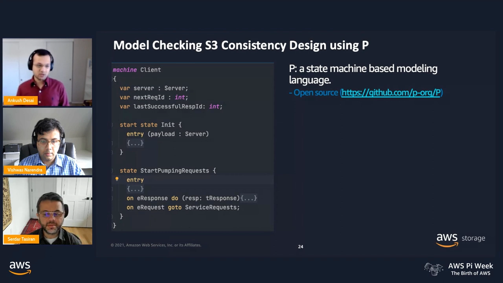

和压力测试、随机测试相比，模型检查有三个具体优势（[【跳转到 17:26】](https://www.youtube.com/watch?v=B0yXz6EeCaA&t=1046)）：

- **命中罕见组合的概率高得多**：它是系统化探索，不是随机撞；
- **重复劳动少**：常规测试会一遍又一遍重新探索同样的行为，模型检查器用高效算法以最少的重复覆盖状态空间；
- **找到 bug 时给出确定性的错误轨迹**（error trace），可以直接拿去做根因分析；找不到 bug，则意味着探索过的所有状态都满足规约（[【跳转到 18:25】](https://www.youtube.com/watch?v=B0yXz6EeCaA&t=1105)）。

## 六、代码一致性检查：别让实现悄悄偏离设计

两层建模之后还有真正跑起来的代码。要防的错误是「漏掉某个状态」或者「状态转换实现错了」，这叫**代码一致性（code conformance）问题**（[【跳转到 12:44】](https://www.youtube.com/watch?v=B0yXz6EeCaA&t=764)）。

做法是：把设计模型本身当作**可执行的参考模型**，让它和实现代码并排跑；每走一步，就看设计模型里对应的状态，检查实现是否与设计一致（[【跳转到 13:14】](https://www.youtube.com/watch?v=B0yXz6EeCaA&t=794)）。

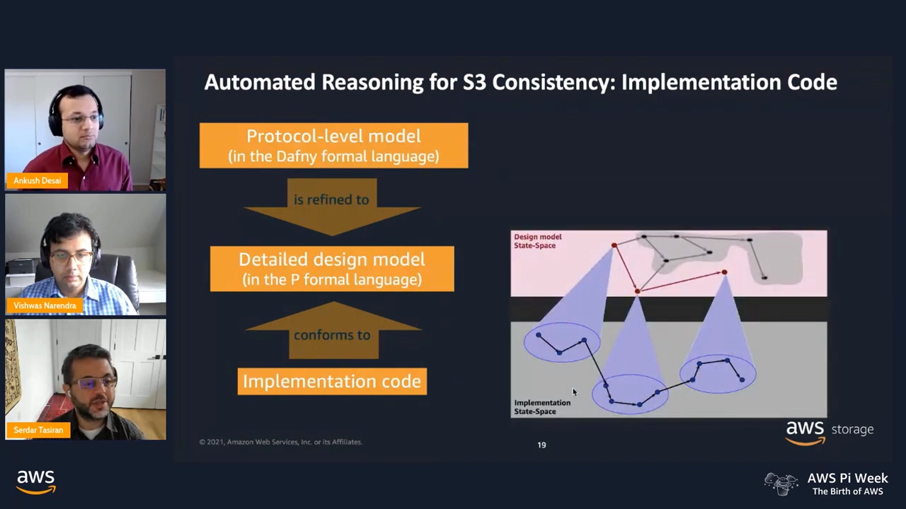

三个层级的分工可以概括为一张图（[【跳转到 13:56】](https://www.youtube.com/watch?v=B0yXz6EeCaA&t=836)）：协议级模型「被精化为」详细设计模型，详细设计模型「被遵循」于实现代码；收获最大的杠杆在中层——设计模型层。

## 七、持续保障：把模型检查接进 CI/CD

团队明确不想让这件事只做一次。任何一致性设计上的改动都要经过模型检查和自动推理，所以模型检查被集成进了构建与发布流水线（[【跳转到 19:07】](https://www.youtube.com/watch?v=B0yXz6EeCaA&t=1147)）。

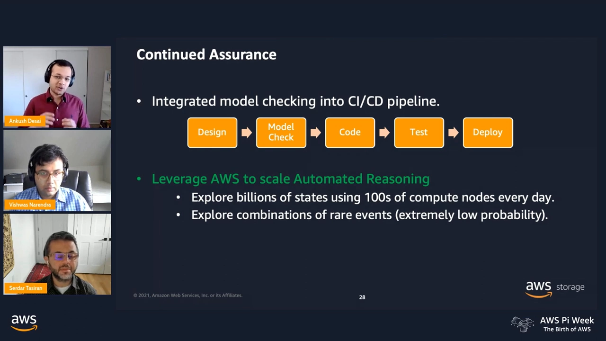

算力方面，他们用 AWS 的数百个计算节点，**几乎每天探索数十亿个状态**，专门去覆盖那些需要极低概率事件组合才会出现的场景（[【跳转到 19:32】](https://www.youtube.com/watch?v=B0yXz6EeCaA&t=1172)）。

视频还总结了模型检查在开发生命周期各阶段的价值（[【跳转到 20:22】](https://www.youtube.com/watch?v=B0yXz6EeCaA&t=1222)）：

- **设计阶段**：它是一种思考工具，逼开发者严谨地想清楚系统、写出参考规约，弥合理解上的偏差；
- **开发阶段**：系统化探索能发现不那么显然的 bug，从而建立对设计的信心；
- **上线之后**：流水线里的检查提供持续保障，反过来提高开发速度——可以快速改设计、快速迭代，在早期就消掉 bug。

## 八、这套做法对使用者的意义

最后的总结页把结论收成一句话：S3 一致性可以放心用（[【跳转到 21:37】](https://www.youtube.com/watch?v=B0yXz6EeCaA&t=1297)）。

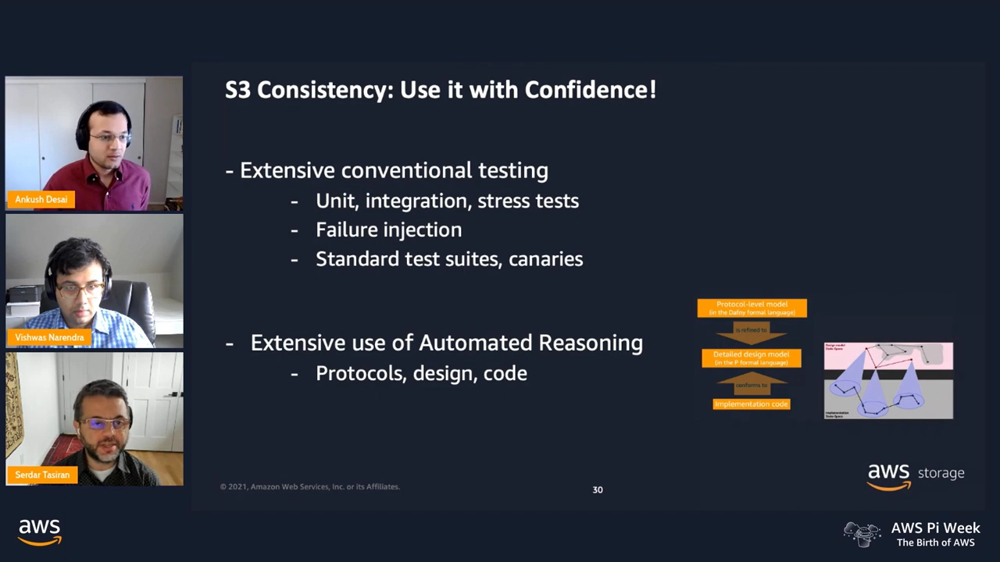

对写上层应用的人来说，这场演讲给出的是三条可以落地的判断：

1. **一致性是接口契约的一部分，不是实现细节**。当云厂商把「读后写」写进契约，应用侧的等待、二次校验、外部索引都可以删掉；反过来，如果某个 S3 兼容实现只承诺最终一致，这些绕行代码就得留着。
2. **「强一致」不等于「并发安全」**。强一致保证的是「写成功之后的读能看到它」，它不阻止两个客户端互相覆盖——那要靠条件写之类的机制（见本小节另一篇关于 ETag 条件写的博客）。
3. **正确性可以用工程手段逼近**。把系统分层建模、把检查接进流水线，这套方法不专属于 S3：问答环节里工程师确认，模型检查可以用在软件开发的各个层级，从设计到代码；他们用的工具已经开源（[【跳转到 22:46】](https://www.youtube.com/watch?v=B0yXz6EeCaA&t=1366)）。

## 小结

- 2020 年 12 月起，S3 的所有操作都是强一致的：写成功之后的读一定返回最后一次成功的写入，价格与性能不变。
- 强一致最大的收益是**编程模型变简单**：数据湖里「人为等待」和「DynamoDB 第二存储」这类 workaround 可以删掉。
- 难点在规模：EB 级数据、100 万亿对象、每秒数千万请求、320 多个微服务，等于改掉几乎每个请求的默认行为。
- 常规测试（单元、集成、故障注入、压力、标准化套件、灰度）只是最低门槛；「99% 一致」在语义上不成立。
- 自动推理分三层：协议级用演绎证明拿 100% 覆盖，详细设计层用模型检查扫数十亿边界情况，实现代码与设计模型做一致性检查。
- 模型检查把一致性当成状态空间搜索问题，优势是命中罕见组合、少做重复劳动、出错时给出确定性错误轨迹。
- 检查被接进 CI/CD，用数百个计算节点每天探索数十亿状态，形成持续保障。

## 关键术语速查

| 术语 | 一句话解释 |
| --- | --- |
| 最终一致（eventual consistency） | 写完之后的一段时间内读可能拿到旧值，但最终会收敛到新值；S3 从 2006 到 2020 年底用的就是它 |
| 读后写一致性（read-after-write） | 写成功之后发起的读，一定返回最后一次成功写入的内容 |
| 强一致（strong consistency） | 系统对外承诺的、比最终一致更强的保证；S3 现在对所有操作提供 |
| 自动推理 / 形式化方法 | 用数学逻辑或状态空间搜索来推理「所有可能的执行」，而不是抽样测试 |
| 协议级模型 | 最抽象的模型，用声明式逻辑描述状态与转换约束，可做演绎证明 |
| 模型检查（model checking） | 系统地搜索状态空间，检查每个状态是否满足规约；能探索数十亿边界情况 |
| 状态机建模语言 P | 基于状态机的开源建模语言与工具链，用于写详细设计模型 |
| 代码一致性检查（code conformance） | 把设计模型当可执行参考模型，与实现代码并排跑，逐步比对状态 |
| 错误轨迹（error trace） | 模型检查发现违例时给出的确定性执行序列，可直接用于根因分析 |