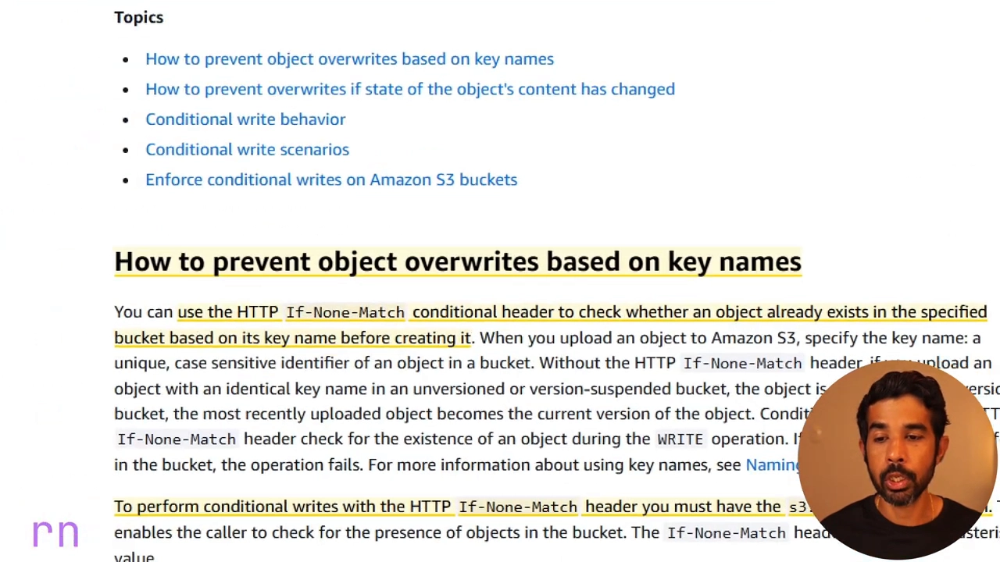
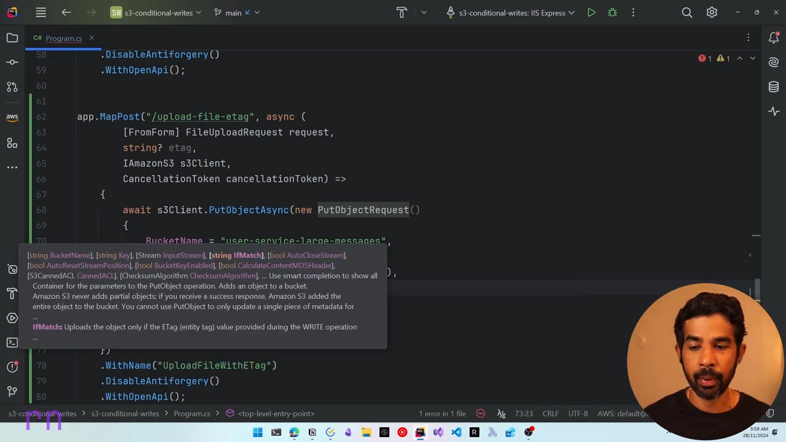
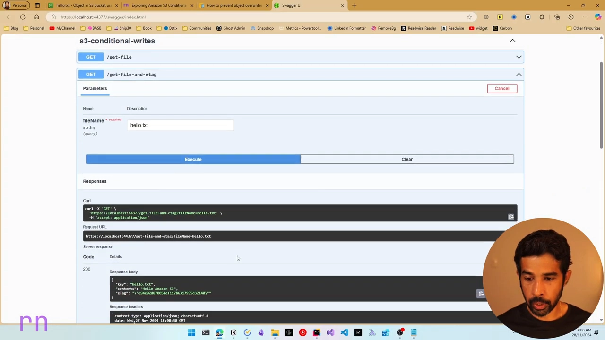
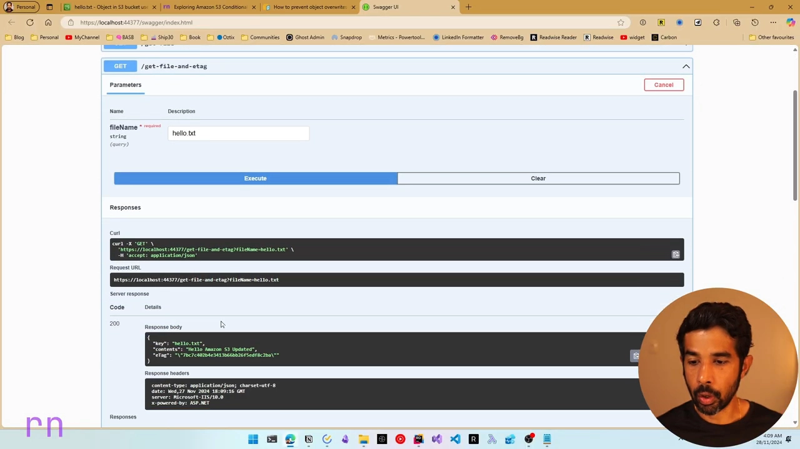
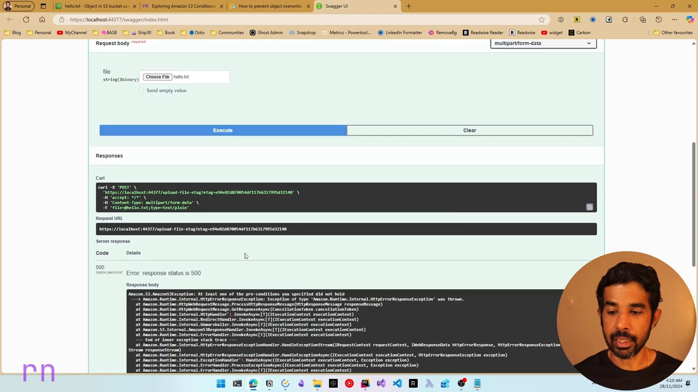
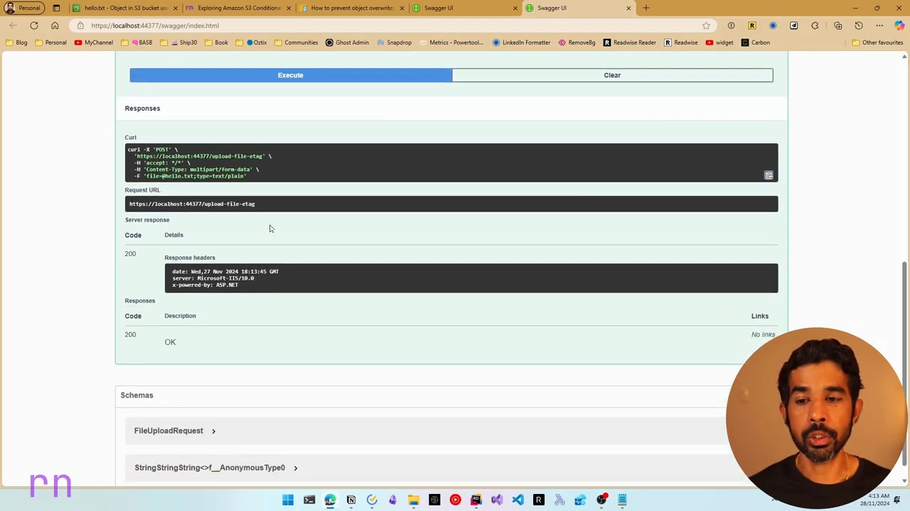
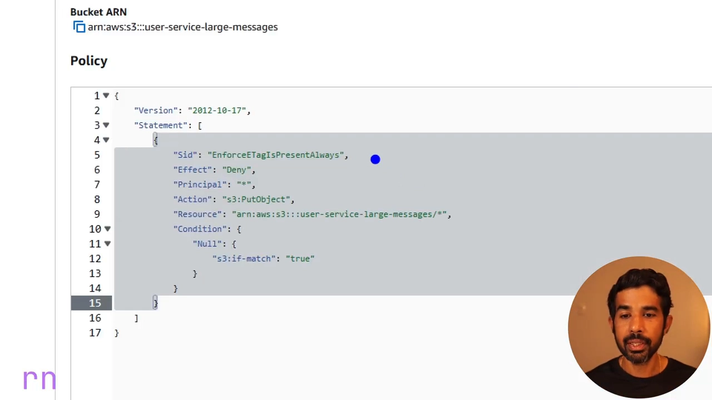
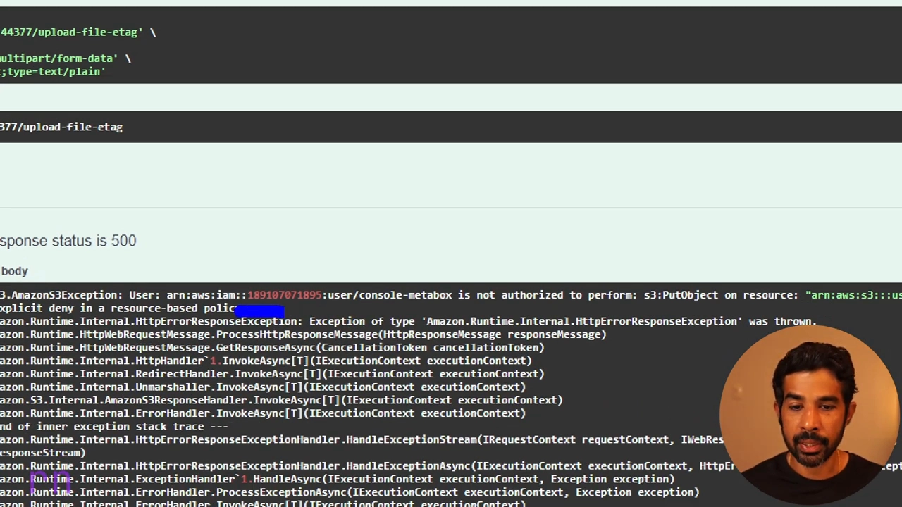
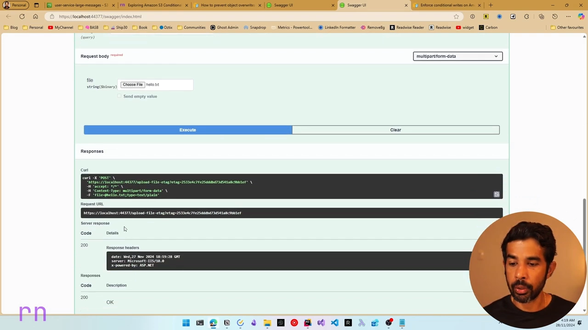

# S3 的 ETag 条件写：并发覆盖与丢失更新怎么防

> 视频来源：[Amazon S3 ETags | .NET ON AWS](https://www.youtube.com/watch?v=UrGuKGxu9sY)（YouTube · Rahul Nath）｜时长约 12 分钟
> 导读：S3 变成强一致之后，「读到的总是最新版本」这件事不用操心了；但两个客户端同时改同一个 key，后写的仍然会覆盖先写的。这篇跟着视频在 .NET 应用里跑一遍 ETag 条件写：用 `If-None-Match` 防止重复创建、用 `If-Match` 做「改之前先确认内容没变」，最后用桶策略把「必须带 ETag」变成桶级别的硬约束。字幕为自动生成，术语已按上下文订正。

## 本讲要解决的核心问题（SCQA）

**背景**：S3 现在对所有操作提供强一致：写成功之后的读一定返回最后一次成功的写入。

**冲突**：强一致只保证「读到最新」，它不阻止两个客户端同时写同一个 key——后写的那次会安静地覆盖先写的那次，先写的改动就丢了（丢失更新，lost update）。

**疑问**：怎么让「更新」变成有条件的行为，而不是无脑覆盖？

**回答（中心思想）**：用 ETag 做条件写。`If-None-Match` 保证对象不存在时才创建，`If-Match` 保证「我改的是我读到的那一版」；再用桶策略（bucket policy）强制每次 `PutObject` 都必须带 `If-Match`，把这条规则从「靠自觉」变成「写不进去」。

## 一、强一致解决的是「读到最新」，不是「写不冲突」

视频开篇一句话点题：S3 现在支持用 ETag 做条件写（conditional writes），在更新对象之前先检查它是否被改过；**多个用户同时写同一个对象时，这个特性可以防止误覆盖**（[【跳转到 00:00】](https://www.youtube.com/watch?v=UrGuKGxu9sY&t=0)）。

这里要分清两件事：

- **一致性**回答「我读到的是不是最新值」——S3 已经用强一致回答了；
- **并发控制**回答「我要写的时候，值有没有被别人改过」——这需要客户端带上「我读到的是哪一版」的凭据，也就是 ETag。

AWS 文档里把条件写拆成几个主题（[【跳转到 01:11】](https://www.youtube.com/watch?v=UrGuKGxu9sY&t=71)）：



- 怎么按 **key 名**防止对象被覆盖；
- 怎么在**对象内容已经变化**时防止覆盖；
- 条件写的行为与典型场景；
- 怎么在 **S3 桶**上强制条件写。

## 二、两个头，两种语义：`If-None-Match` 与 `If-Match`

视频先回顾了上一期讲过的 `If-None-Match`：它检查对象是否已经存在，再决定要不要写；但这个能力**只对新对象生效**，作用是避免用完全相同的 key 再创建一个新对象（[【跳转到 00:45】](https://www.youtube.com/watch?v=UrGuKGxu9sY&t=45)）。

两者可以这样对照：

| 头 | 语义 | 典型用途 |
| --- | --- | --- |
| `If-None-Match` | 同一个 key 下只允许存在一个对象，已有对象时写入失败 | 防止重复创建、防止覆盖 |
| `If-Match` | 把你提供的 ETag 和桶里对象的 ETag 比较，不一致就失败 | 更新已存在的对象，防止丢失更新 |

也就是说：要**挡住覆盖**就用 `If-None-Match`；要**安全地更新**就用新支持的 `If-Match`——它把请求里提供的 ETag 值和 S3 桶里对象的 ETag 值做比较（[【跳转到 01:32】](https://www.youtube.com/watch?v=UrGuKGxu9sY&t=92)）。

## 三、把 ETag 接进应用：读的时候带出来，写的时候带回去

演示项目是上一期的 .NET 应用。原来的 `PutObject` 请求还不支持 `If-Match`，升级 NuGet 包（到 3.7.485.215 版）后 SDK 就有了这个能力（[【跳转到 02:12】](https://www.youtube.com/watch?v=UrGuKGxu9sY&t=132)）。

改造分两步。

**第一步：新增一个带 ETag 的更新端点。** 复制原来的 POST 端点，命名为 `update-file-etag`；这里不再指定 `If-None-Match`（因为要更新已存在的对象），而是把 ETag 作为可选参数传进来，放进 `If-Match` 头（[【跳转到 02:48】](https://www.youtube.com/watch?v=UrGuKGxu9sY&t=168)）。



**第二步：新增一个会返回 ETag 的读端点。** 复制 GET 端点，命名为 `get-file-and-etag`，返回文件 key、内容以及**实际返回的 ETag**（[【跳转到 04:07】](https://www.youtube.com/watch?v=UrGuKGxu9sY&t=247)）。



这条链路就是条件写的工程形态：

```
读对象 ──► 拿到 ETag ──► 连同新内容一起提交 ──► 服务端比对 ETag
                                              ├─ 一致：写入成功
                                              └─ 不一致：拒绝，客户端重读后重试
```

视频里特意强调：**每次把对象读出来展示给用户时，都要把 ETag 一起传下去**，记住「上次读到的是哪个版本」；用户提交更新时，再把当初那个 ETag 带回来（[【跳转到 06:52】](https://www.youtube.com/watch?v=UrGuKGxu9sY&t=412)）。

## 四、ETag 是内容的指纹，内容一变它就变

演示从本机上传一个 `hello.txt`（内容是一句「hello Amazon S3」），然后用 `get-file-and-etag` 读回来，拿到 ETag（[【跳转到 05:08】](https://www.youtube.com/watch?v=UrGuKGxu9sY&t=308)）。

接着做一次正常更新：复制这个 ETag，把内容改成「updated」，通过 `update-file-etag` 提交，返回 200；再读一次，**ETag 变了，内容也变了**（[【跳转到 05:43】](https://www.youtube.com/watch?v=UrGuKGxu9sY&t=343)）。



视频顺带说了一句原理：**ETag 是根据文件内容算出来的，元数据属性不影响 ETag 值**（[【跳转到 05:48】](https://www.youtube.com/watch?v=UrGuKGxu9sY&t=348)）。所以 ETag 天然就是「这一版内容」的指纹——这正是它能用来做并发控制的原因。

## 五、拿旧 ETag 去写：预条件失败

接下来是整段演示最关键的一幕：用**旧的** ETag（也就是更新之前那个值）再提交一次更新。请求被拒绝，接口返回 500，异常信息是「At least one of the pre-conditions you specified did not hold」（至少有一个前置条件不满足）（[【跳转到 06:12】](https://www.youtube.com/watch?v=UrGuKGxu9sY&t=372)）。



原因很直接：上次取到文件之后 ETag 已经变了，你手里的 ETag 描述的是旧版本。要成功，必须**重新读一次、拿到最新 ETag、再提交**（[【跳转到 06:42】](https://www.youtube.com/watch?v=UrGuKGxu9sY&t=402)）。

这就是条件写对上层应用的意义：它把「静默覆盖」变成「显式失败」。失败之后怎么办，是应用自己的策略——重读再改、合并两个人的改动、或者报错让人来处理，但至少**丢失更新不会再悄悄发生**。

## 六、不传 ETag，就退回到 last-writer-wins

演示接着做了一次反向操作：更新时**完全忽略 ETag**，把它留空。结果写入成功，文件被直接覆盖（[【跳转到 07:51】](https://www.youtube.com/watch?v=UrGuKGxu9sY&t=471)）。



视频的解释是：没有 ETag 要匹配，连这个头都没指定，S3 就认为这次请求**没有使用条件写特性**，于是照旧覆盖（[【跳转到 07:56】](https://www.youtube.com/watch?v=UrGuKGxu9sY&t=476)）。

这暴露了一个现实问题：条件写是**可选**的。只要有一个客户端选择不传 ETag，它就能覆盖别人的改动。所以光有 API 不够，还要有强制手段。

## 七、用桶策略把「必须带 ETag」变成硬约束

做法是给桶加一条基于资源的策略（bucket policy）：只要请求里没有 `s3:if-match` 头，就拒绝这次 `PutObject`（[【跳转到 08:14】](https://www.youtube.com/watch?v=UrGuKGxu9sY&t=494)）。



这条策略的要素可以逐行读：

- `Effect: Deny`、`Principal: "*"`——对所有主体生效；
- `Action: s3:PutObject`——只管写对象这个动作；
- `Resource` 限定在这个桶下的对象；
- `Condition` 用的是 Null 判断，键为 `s3:if-match`、值为 true——意思是**这个头不存在时条件成立**，于是拒绝。

加上策略之后再试一次不带 ETag 的更新，请求直接被拒：错误信息是「not authorized to perform `s3:PutObject` on resource」，并说明是**被基于资源的策略显式拒绝**（`explicit deny in a resource-based policy`）（[【跳转到 10:15】](https://www.youtube.com/watch?v=UrGuKGxu9sY&t=615)）。



被强制之后，流程就闭环了：先读拿 ETag，再带着它写；ETag 过期就重读；忘了带就写不进去（[【跳转到 11:03】](https://www.youtube.com/watch?v=UrGuKGxu9sY&t=663)）。



## 八、这套做法能推广到什么程度

视频结尾把结论收在一句话上：ETag 条件写在**多人同时操作同一个对象**时非常有用，可以防止误覆盖，而且可以在桶上用策略强制（[【跳转到 11:13】](https://www.youtube.com/watch?v=UrGuKGxu9sY&t=673)）。

把它放到对象存储的语义里看，有几条边界值得记住：

1. **条件写是乐观并发控制**（optimistic concurrency），不是锁。它不阻塞别人写，只在提交时检查「世界有没有变」；冲突了由客户端重试。所以它不会带来锁服务那样的死锁与租约问题，但也**不能当分布式锁用**——它保护的是单个对象的单次写入，不是一段临界区。
2. **粒度是单个对象**。多个对象要一起改，S3 没有跨对象的原子事务；这种需求通常得靠「写新 key + 用指针对象切换」或者外部数据库来兜。
3. **把 ETag 当成不透明的版本标识**。视频里演示的是普通上传，ETag 由内容算出；工程上更稳的做法是只做「相等/不等」的比较，把它当版本号用，而不是自己按内容重算一遍去推断。
4. **强制比约定可靠**。同一套 API 只要有一个客户端偷懒不传 ETag，保护就漏了；用桶策略把「必须带 `If-Match`」变成硬约束，才谈得上「这个桶里的写都是安全的」。

## 小结

- 强一致保证「写后读能读到最新」，但不阻止并发写互相覆盖；丢失更新要靠条件写来防。
- `If-None-Match` 用于「不存在才创建」，`If-Match` 用于「按我读到的版本更新」，两者语义不同，别混用。
- 工程链路是：读对象时把 ETag 一起带出来，写回时放进 `If-Match`；ETag 过期就重读再改。
- 拿旧 ETag 写会失败（前置条件不满足），这正是把静默覆盖变成显式失败的关键。
- 不传 ETag 就退回 last-writer-wins；用桶策略 `Deny` 掉没有 `s3:if-match` 的 `PutObject`，才能强制所有人遵守。
- 它是乐观并发控制，粒度是单个对象，不能替代分布式锁或跨对象事务。

## 关键术语速查

| 术语 | 一句话解释 |
| --- | --- |
| ETag（entity tag） | 对象的版本标识，普通上传时由内容算出；内容一变它就变 |
| 条件写（conditional write） | 在写入时附带前置条件（如 ETag 匹配），不满足就拒绝写入 |
| `If-None-Match` | 仅当对象不存在时才写入，用于防止重复创建与覆盖 |
| `If-Match` | 仅当对象的 ETag 与请求里给的一致时才写入，用于防止丢失更新 |
| 丢失更新（lost update） | 两个客户端先后写同一对象，后写者把前者的改动覆盖掉 |
| last-writer-wins | 不带任何前置条件时 S3 的默认行为：最后一次写入生效 |
| 桶策略（bucket policy） | 基于资源的访问策略，可用来强制 `PutObject` 必须带 `s3:if-match` |
| 乐观并发控制 | 不预先加锁，提交时才检查版本是否变化；冲突由客户端重试 |