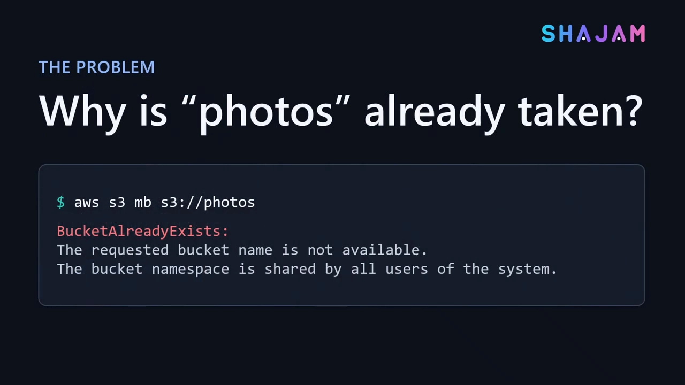
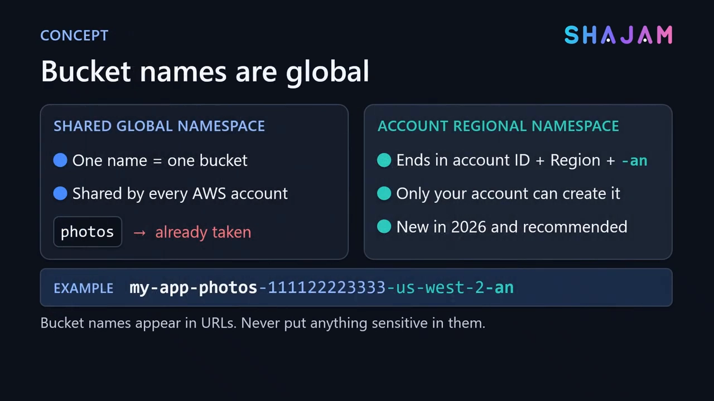
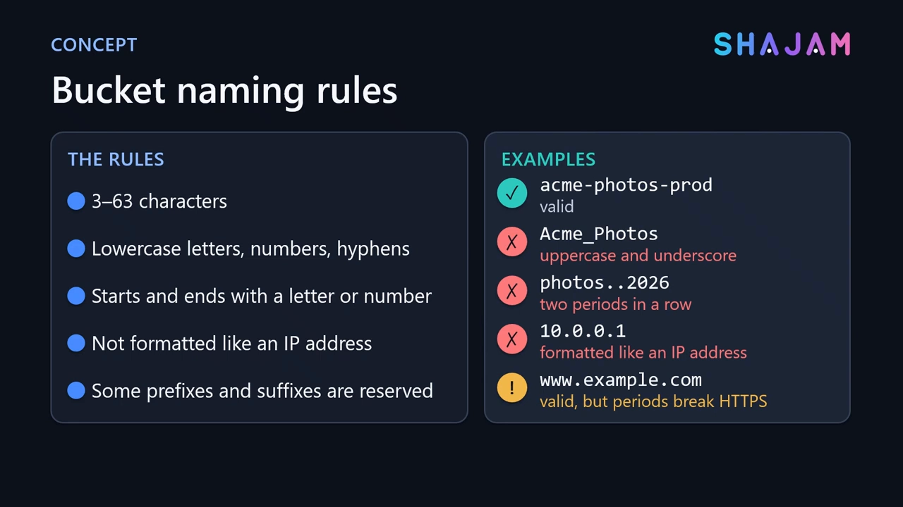
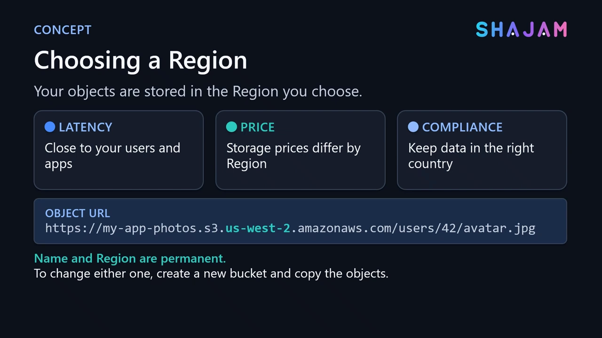
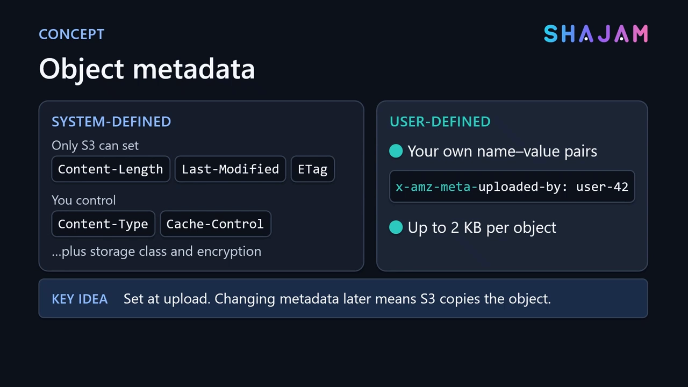
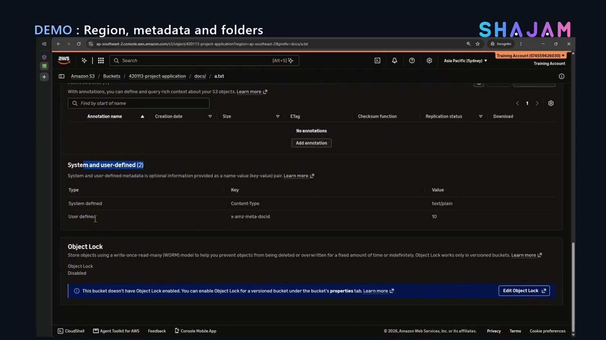
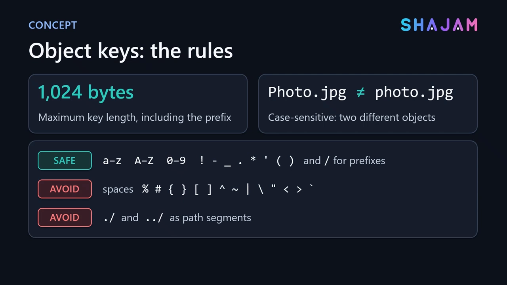
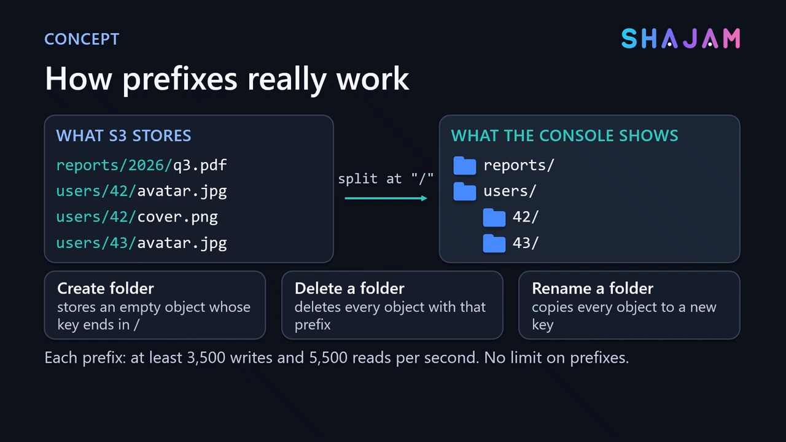
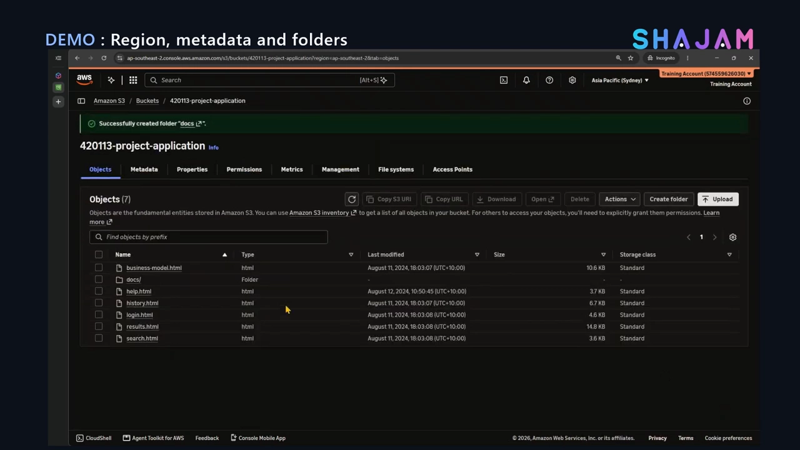
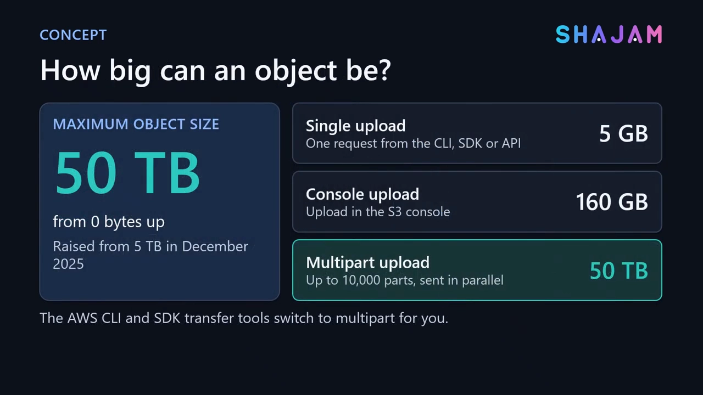

# S3 的三个基本构件：桶名、对象元数据与键前缀

> 视频来源：[Why Is Your S3 Bucket Name Taken? Naming Rules, Metadata & Prefixes](https://www.youtube.com/watch?v=fazfVf1A3iQ)（YouTube · SHAJAM）｜时长约 11 分钟
>
> 导读：这是一节 AWS S3 系列课的第二讲，专门拆「桶、对象、键」这三个基本构件。它的讲法很规整：每条规则先给结论，再给反例，最后进控制台做一遍演示。本文按「桶名 → 对象元数据 → 键与前缀 → 对象大小」的顺序重组，只保留与**数据模型**有关的部分；分片上传只在「对象能多大」处提一句，不展开成独立话题。

## 本讲要解决的核心问题（SCQA）

**背景**：对象存储对外只有一层结构——**桶（bucket）+ 键（key）→ 对象（object）**。你要么按名字取一个对象，要么按前缀列一批对象，没有第三条路。

**冲突**：你执行 `aws s3 mb s3://photos`，S3 回你一句 `BucketAlreadyExists`：这个名字不可用。可你从来没建过叫 `photos` 的桶——名字是被**别人**占掉的。另一方面，控制台里明明有「文件夹」图标，点进去还能一层层往下走。

**疑问**：桶名为什么会被人抢走？既然 S3 没有目录，那些「文件夹」又是从哪来的？一个对象除了字节，还带着什么东西？

**回答（中心思想）**：S3 的数据模型只有三层——**全局唯一的桶名、桶内唯一的键、以及键指向的「字节 + 元数据」**。「文件夹」不是容器，而是控制台在**显示**时把键按 `/` 切开、把切出来的前半段画成目录；因此建文件夹只是写一个空对象，删文件夹是删一批对象，改文件夹名是把一批对象全部复制一遍。理解了这一点，桶名规则、元数据的不可变性、前缀与吞吐的关系，都是同一个模型的推论。

## 一、桶名是全局的，而且一旦创建就不能改

### 1.1 一个名字全世界只能有一个桶

先看那个报错现场 [【跳转到 00:18】](https://www.youtube.com/watch?v=fazfVf1A3iQ&t=18)：

```
$ aws s3 mb s3://photos
BucketAlreadyExists: The requested bucket name is not available.
The bucket namespace is shared by all users of the system.
```

最后那句是关键：**桶的命名空间由系统里所有用户共享**。所以「普通桶名」是一个**全局**命名空间——每个名字在**所有 AWS 账号**里只能属于一个桶。别人已经拥有 `photos`，你就再也拿不到它。



这也顺带解释了对象地址的构成：**桶名 + 对象键**才给出一个对象的唯一地址 [【跳转到 00:40】](https://www.youtube.com/watch?v=fazfVf1A3iQ&t=40)。桶名全球唯一，键在桶内唯一，两者拼起来才全球唯一。

### 1.2 两种命名空间：共享全局 与 账号区域

全局命名空间带来一个现实问题：好名字早被抢光了。所以从 2026 年 3 月起，S3 提供了第二种选择——**账号区域命名空间（account regional namespace）** [【跳转到 01:03】](https://www.youtube.com/watch?v=fazfVf1A3iQ&t=63)。

| 命名空间类型 | 唯一性范围 | 形式 | 适用场景 |
| --- | --- | --- | --- |
| 共享全局命名空间 | 全世界所有 AWS 账号 | `acme-photos-prod` | 需要对外暴露稳定域名 |
| 账号区域命名空间 | 只有你自己的账号 | `my-app-photos-111122223333-us-west-2-an` | CI/CD、多账号同构部署 |

账号区域命名空间的做法是：在名字末尾接上**账号 ID + 区域 + 字母 `-an`**。这段后缀只有你的账号能创建，所以不会撞名；AWS 现在推荐新桶都用它。对 CI/CD 尤其方便——不同账号里可以用**同一个业务名**，靠参数把账号 ID 换掉即可，配置保持一致。



### 1.3 命名规则：为什么 `photos` 能用、`Acme_Photos` 不能用

桶名本身还有一套字符规则 [【跳转到 01:28】](https://www.youtube.com/watch?v=fazfVf1A3iQ&t=88)：

- 长度 **3 到 63** 个字符；
- 只允许**小写字母、数字、连字符**；
- 必须以字母或数字**开头和结尾**；
- 不能长得像一个 **IP 地址**（例如 `10.0.0.1`）；
- 某些前缀和后缀是保留的。

句点（`.`）虽然允许，但**建议避免**：它会让桶的 Web 地址在 HTTPS 上出问题（证书通配不匹配），所以句点基本只适合做静态网站托管。大写字母和下划线**完全不允许**。



### 1.4 建桶时还要选区域，而且名字和区域都改不了

创建桶时要选一个 **Region（区域）**，对象就存在那里，除非你显式复制或跨区复制 [【跳转到 02:18】](https://www.youtube.com/watch?v=fazfVf1A3iQ&t=138)。区域的选择同时影响三件事：

1. **延迟**——挑离用户和应用近的；
2. **价格**——不同区域单价不同；
3. **合规**——数据必须留在某个国家时，区域就是硬约束。

区域还会出现在对象 URL 里：`https://my-app-photos.s3.us-west-2.amazonaws.com/users/42/avatar.jpg`。



最要紧的一条：**桶创建之后既不能改名，也不能换区域**。唯一的办法是新建一个桶，把对象全部复制过去。所以桶名和区域都是「一次性决定」的。

## 二、对象 = 字节 + 元数据，而元数据在写入时就定死了

### 2.1 两类元数据：系统定义 与 用户定义

每个对象都带元数据，分两类 [【跳转到 02:43】](https://www.youtube.com/watch?v=fazfVf1A3iQ&t=163)。

**系统定义元数据（system-defined metadata）**由 S3 管理，其中一部分**只有 S3 能设置**：

- `Content-Length`（大小）
- `Last-Modified`（最后修改时间）
- `ETag`（对象的实体标签，通常用于判断内容是否变化、校验完整性）

另一部分由**你**在写入时指定：

- `Content-Type`（MIME 类型，如 `text/plain`）
- `Cache-Control`
- 存储类别（storage class）
- 加密方式

**用户定义元数据（user-defined metadata）**是你自己的键值对，名字统一以 `x-amz-meta-` 开头，例如 `x-amz-meta-uploaded-by: user-42`，每个对象最多 **2 KB**。



### 2.2 改元数据等于复制对象

这里有个容易被忽略的坑：**元数据是在上传那一刻设定的**。之后想改，S3 的做法是**把对象连同新元数据一起复制一遍**——也就是整份字节重新写一次。

这正好呼应对象存储「不可部分修改」的语义：对象是一个整体，没有一个「只改这几十个字节」的请求，元数据也挂在同一个整体上，所以改元数据只能整体重写。

### 2.3 演示：tags 能改，metadata 不能改

讲师进控制台做了一遍对比 [【跳转到 07:10】](https://www.youtube.com/watch?v=fazfVf1A3iQ&t=430)。上传对象时，界面上「Tags」和「Metadata」是两块独立区域：

- 在 Tags 里填 `application = training`；
- 在 Metadata 里选 **User defined**，界面会自动补上 `x-amz-meta-` 前缀，然后填 `docID = 10`。

两者的区别在于**可变性**：**标签（tags）随时可以改**，**元数据（metadata）是固定值**——要改只能带着新元数据重新上传对象。如果某些标签你需要经常调整，就该用 tags 而不是 metadata。

上传完成后打开对象的属性页，能看到两类元数据并列 [【跳转到 08:25】](https://www.youtube.com/watch?v=fazfVf1A3iQ&t=505)：

| 类型 | 键 | 值 | 来源 |
| --- | --- | --- | --- |
| System defined | `Content-Type` | `text/plain` | S3 按文件内容推断 |
| User defined | `x-amz-meta-docid` | `10` | 上传时手填 |



注意 `Content-Type` 是 S3 **根据文件内容自动推断**出来的（这个文件是纯文本，所以是 `text/plain`），而 `x-amz-meta-docid` 完全来自上传时的输入。同一个对象身上，这两类元数据的「归属权」是不同的。

## 三、键是一个字符串，斜杠只是约定

### 3.1 键的长度、大小写与安全字符

键（key）是对象在桶内的名字，规则如下 [【跳转到 03:33】](https://www.youtube.com/watch?v=fazfVf1A3iQ&t=213)：

- 最长 **1,024 字节**，**包含前缀**在内；
- **大小写敏感**：`Photo.jpg` 和 `photo.jpg` 是**两个不同的对象**；
- 前缀建议只用字母、数字、连字符、下划线、句点和斜杠；
- **避开空格**以及百分号、井号、花括号这类字符——它们需要特殊编码，容易在应用和工具里出 bug；
- 避免把 `.` 和 `..` 当作路径段。



### 3.2 前缀：控制台把斜杠画成文件夹

这是整节课的核心一问：**S3 是扁平的，那文件夹是怎么来的？** [【跳转到 03:58】](https://www.youtube.com/watch?v=fazfVf1A3iQ&t=238)

答案是：**S3 里存的只有键**。控制台在列举时，把每个键**按 `/` 切开**，把切开后的前一段**显示成文件夹**。那一段就叫**前缀（prefix）**。



对照这张图：真实存的只有 `reports/2026/q3.pdf`、`users/42/avatar.jpg`、`users/42/cover.png`、`users/43/avatar.jpg` 这四个字符串；控制台把它们切开，画成了 `reports/`、`users/`、`users/42/`、`users/43/` 这样的目录树。**目录树是渲染出来的视图，不是存储结构。**

### 3.3 建、删、改名文件夹的真实代价

既然文件夹只是前缀的显示，那三个「文件夹操作」在底层就都变成了对**一批对象**的操作：

| 控制台操作 | 底层实际发生的事 |
| --- | --- |
| 新建文件夹 | 写入一个**空对象**，其键以 `/` 结尾 |
| 删除文件夹 | 删除**所有以该前缀开头的对象** |
| 重命名文件夹 | 把**每个对象**复制到新键 |

演示里能直接看到这一点 [【跳转到 06:20】](https://www.youtube.com/watch?v=fazfVf1A3iQ&t=380)：讲师在控制台「Create folder」建了 `docs`，讲师的原话是——底层 S3 其实就是创建了一个前缀，也就是**一个内容为空的对象**。回到对象列表，`docs/` 这一行的类型列写着 **Folder**，大小列是空的，它和旁边那些 `.html` 文件排在同一个列表里。



这就是「没有目录」的直接证据：**文件夹和文件在同一个命名空间里，只是键的结尾不同。** 也正因为如此，删一个「目录」不是删一条记录，而是删一批对象；改一个「目录名」不是改一条记录，而是把里面每个对象都重新写一遍——代价与目录里对象的数量和总字节数成正比。

### 3.4 前缀还决定吞吐

前缀不只是显示问题，它还是**分区键** [【跳转到 04:23】](https://www.youtube.com/watch?v=fazfVf1A3iQ&t=263)。每个前缀至少支持 **3,500 次写**和 **5,500 次读**每秒，而前缀的数量**没有上限**。

这条规则的实际含义是：当你的请求速率打不满时，不要急着换更大的桶，而要考虑把键的**前缀打散**（例如在最前面加一段哈希或分片号），让请求落到更多分区上。这一点在后面的「S3 接口能力」一节还会再遇到。

## 四、对象能有多大：从 0 字节到 50 TB

对象的大小上限是 **50 TB**，下限是 0 字节 [【跳转到 04:48】](https://www.youtube.com/watch?v=fazfVf1A3iQ&t=288)。这个上限是从 5 TB 提上来的（2025 年 12 月）。

不同写入路径的上限不同：

| 写入路径 | 单次上限 |
| --- | --- |
| 单次上传请求（CLI / SDK / API） | 5 GB |
| 控制台上传 | 160 GB |
| 分片上传（multipart upload） | 50 TB |



超过 5 GB 就必须走**分片上传**：文件被切成最多 **10,000 片**并行上传，最后由 S3 拼回一个对象。AWS CLI 和 SDK 的传输工具会自动切换，用户通常感知不到——所以这里只当作「对象大小上限的实现方式」记一笔，分片上传本身的流程属于另一节的内容。

## 五、把规则变成习惯

讲师最后把整节课压成三条习惯和三个坑 [【跳转到 09:08】](https://www.youtube.com/watch?v=fazfVf1A3iQ&t=548)：

**该做的三件事**

1. 用**账号区域命名空间**或**独有后缀**给桶起名，保证名字只属于你；
2. **有意识地选区域**——延迟、价格、合规三条都要过一遍；
3. **在第一次上传之前就设计好键的命名方案**，把最常用来过滤的维度（用户 ID、日期）放在最前面。

**该避开的三个坑**

1. 桶名里放句点，或者放敏感信息（桶名会出现在 URL 里）；
2. 键里放空格和特殊字符；
3. **删掉一个你以后还要用的桶名**——别的账号可以立刻把它抢注，然后接收本该发给你桶的请求。正确做法是**清空桶但保留桶**。

最后的自测题也围绕命名规则 [【跳转到 10:10】](https://www.youtube.com/watch?v=fazfVf1A3iQ&t=610)：`Acme_Photos`（大写 + 下划线）、`acme-photos-prod`、`10.0.0.1`（像 IP 地址）三个里哪个合法？答案是第二个。

## 小结

- **桶名是全局资源**：普通桶名在所有 AWS 账号间共享一个命名空间，一个名字全世界只能有一个桶；账号区域命名空间（后缀 `账号ID-区域-an`）是 2026 年起的替代方案。
- **桶名和区域都是永久的**：建完不能改名、不能换区域，只能新建 + 复制。
- **对象 = 字节 + 元数据**：系统定义元数据里 `Content-Length`/`Last-Modified`/`ETag` 只能由 S3 设，`Content-Type`/`Cache-Control`/存储类别/加密由你设；用户定义元数据以 `x-amz-meta-` 开头，上限 2 KB。
- **元数据在写入时定死**：要改只能整体复制对象；需要经常调整的标签请用 tags。
- **键是一个最长 1024 字节、大小写敏感的字符串**：`/` 只是约定，不是层级。
- **前缀是显示出来的目录**：控制台按 `/` 切键画成文件夹；建文件夹 = 写一个空对象，删文件夹 = 删一批对象，改文件夹名 = 复制一批对象。
- **前缀同时是分区键**：每个前缀至少 3,500 写 / 5,500 读每秒，前缀数量无上限。

## 关键术语速查

| 术语 | 一句话解释 |
| --- | --- |
| Bucket（桶） | 对象的容器，名字在全局命名空间里唯一，创建后不可改名、不可换区域 |
| Object（对象） | 一段不可分割的字节 + 一组元数据，是对象存储的最小读写单位 |
| Key（键） | 对象在桶内的名字，最长 1024 字节、大小写敏感的字符串 |
| Prefix（前缀） | 键里 `/` 之前的那一段；控制台按它渲染出「文件夹」，本身不是容器 |
| System-defined metadata | S3 管理的元数据，含 Content-Length、Last-Modified、ETag、Content-Type 等 |
| User-defined metadata | 以 `x-amz-meta-` 开头的自定义键值对，每对象上限 2 KB，写入后不可改 |
| ETag | 对象的实体标签，由 S3 设置，用于判断内容是否变化与校验完整性 |
| Object tag | 可随时修改的对象标签，与不可变的 metadata 相对 |
| Account regional namespace | 以「账号 ID + 区域 + -an」结尾的桶名空间，只有本账号能创建 |
| Multipart upload | 把大对象切成最多 10,000 片并行上传再合并，是 50 TB 上限的实现方式 |