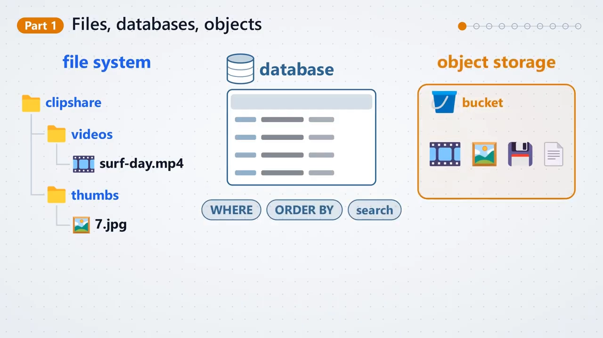
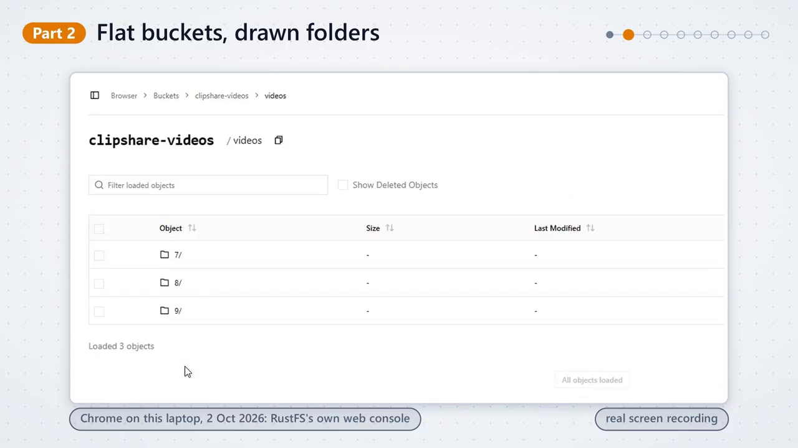
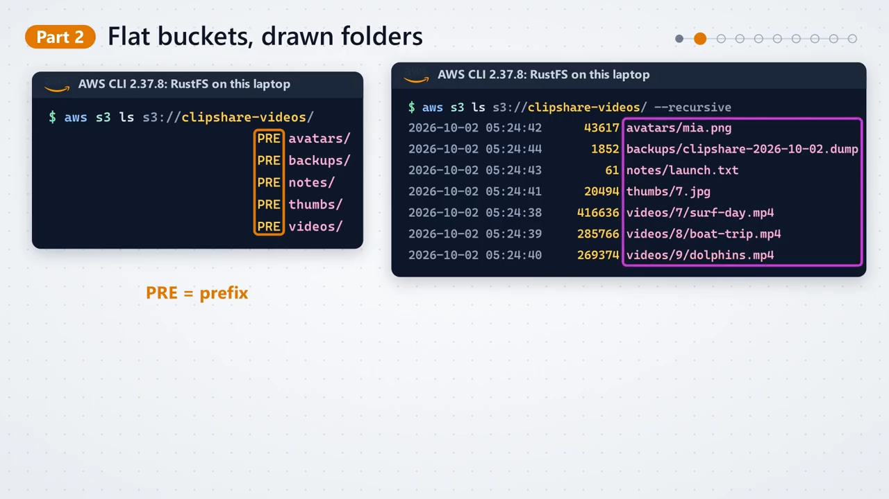
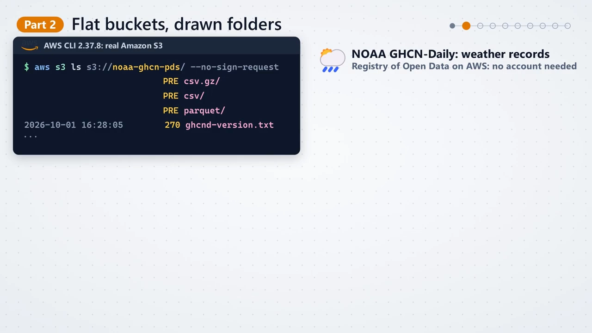
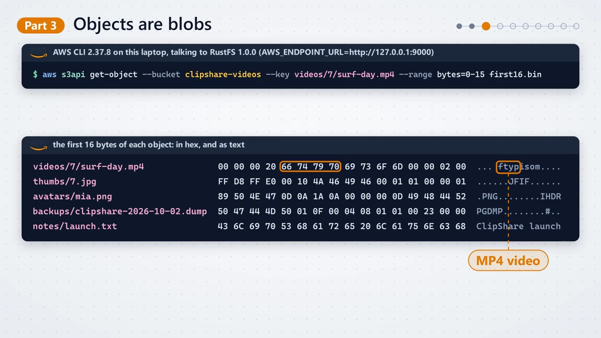
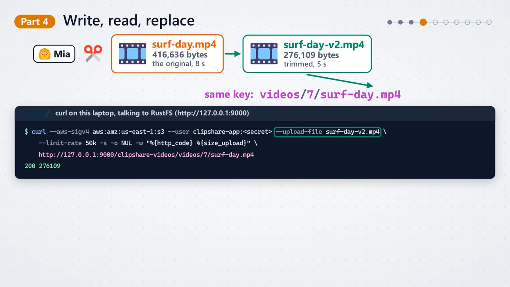
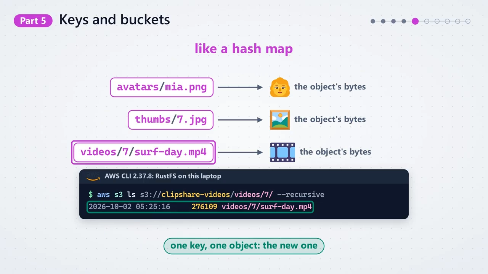
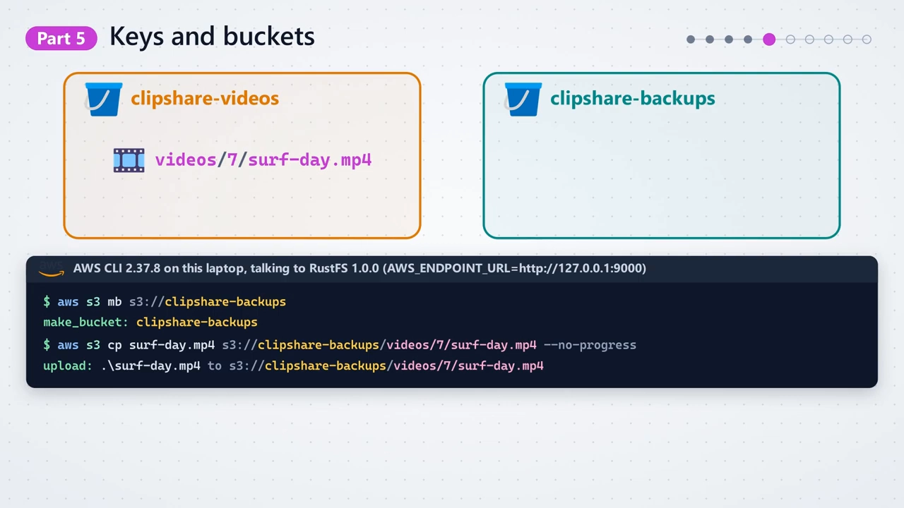
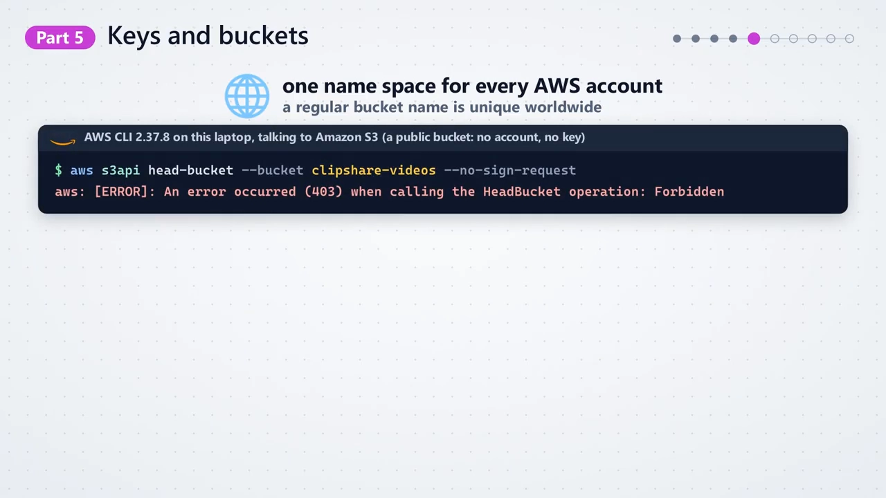
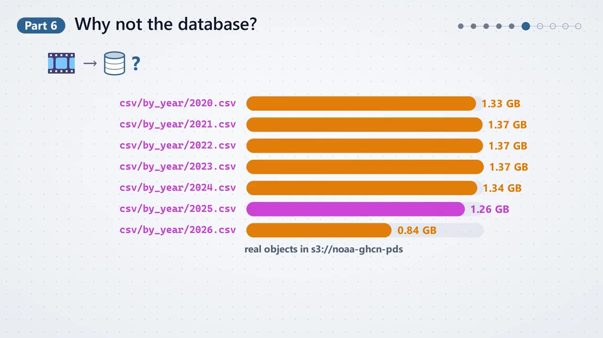

# 桶加键就是地址：对象存储为什么是扁平的

> 视频来源：[Object Storage Explained on a Real S3 Server: Buckets, Keys & Links](https://www.youtube.com/watch?v=_D-FD8l1o4I)（YouTube · kodblok · System Design Lesson 19）｜时长约 11 分钟
>
> 导读：这支视频不讲云厂商的营销话术，而是在一台笔记本上跑起一个兼容 S3 的开源对象存储（RustFS），用真实的 `aws` 命令把「桶、键、对象」逐条验证一遍：控制台里的文件夹为什么是假的、为什么没有一个「改这几个字节」的请求、为什么同一个键可以在两个桶里各存一份。本文只取**数据模型**这条线，签名链接与访问控制只在必要处点到为止。

## 本讲要解决的核心问题（SCQA）

**背景**：应用要存的东西越来越「大而整」——视频、缩略图、头像、数据库备份、日志。这些东西写一次、读很多次，几乎不改。

**冲突**：文件系统是**树**，数据库是**表**，而对象存储看起来两不像：控制台里有文件夹，可是命令行列出来的东西前面写着 `PRE`；你说「改一下视频里的一行字幕」，对象存储没有这个操作。

**疑问**：没有目录，一个对象凭什么被找到？「文件夹」到底是什么？为什么改一个字节要重传整个文件？

**回答（中心思想）**：对象存储只有一层——**桶里放对象，每个对象有一个名字叫键**。键是一个**完整的字符串**，斜杠只是字符串里的一个普通字符；找对象是**按名字查哈希表**，不是沿目录逐级走；对象是**一个整体**，只能被整体写入、整体替换、整体删除。所谓「文件夹」是客户端在**显示**时按斜杠切出来的；所谓「改文件」在底层是「用同一个键上传一份新的完整对象」。

## 一、三种存法，三种形状

应用存数据只有三条常见路子 [【跳转到 00:27】](https://www.youtube.com/watch?v=_D-FD8l1o4I&t=27)：

| 存法 | 形状 | 你怎么取数据 |
| --- | --- | --- |
| 文件系统 | **树**：文件在文件夹里，文件夹又在文件夹里 | 给一条完整路径，逐级往下走 |
| 数据库 | **表**：一行行记录 | 用 `WHERE` / `ORDER BY` / 全文检索去筛 |
| 对象存储 | **扁平**：桶里放对象，每个对象一个名字 | 报出名字，直接拿到整个对象 |

对象存储其实**更接近文件系统而不是数据库** [【跳转到 00:52】](https://www.youtube.com/watch?v=_D-FD8l1o4I&t=52)：你存的是**整个文件**，取回来的也是**整个文件**，你**不能查询文件里面有什么**。它也是三者里最年轻的——文件系统可以追到 1960 年代，S3 是 2006 年。但「更新」不等于「更好」：一个真实的应用会**三种都用**，各取所长。

## 二、扁平：桶里只有对象，对象只有一个名字

### 2.1 控制台画出了文件夹，命令行告诉你那是前缀

实验环境是一台笔记本上跑的 **RustFS**（开源、兼容 S3 API），配真实的 AWS 命令行 [【跳转到 01:17】](https://www.youtube.com/watch?v=_D-FD8l1o4I&t=77)。先建桶 `clipshare-videos`，再上传五个对象：视频、缩略图、头像、备份、一条笔记。

打开 RustFS 的 Web 控制台，你会看到文件夹 [【跳转到 01:58】](https://www.youtube.com/watch?v=_D-FD8l1o4I&t=118)：先 `videos`，再 `7`，最后才是文件。

但点开那个文件，它的名字是**整条路径**：`videos/7/surf-day.mp4`。也就是说，**名字里本来就带着斜杠**，控制台只是把斜杠前面那段画成了目录。

命令行说得更直白：`aws s3 ls` 列出来的每一项前面都标着 **`PRE`**，也就是 **prefix（前缀）** [【跳转到 02:14】](https://www.youtube.com/watch?v=_D-FD8l1o4I&t=134)。加一个 `--recursive`，文件夹就全不见了，剩下的只有**带斜杠的完整名字**。

### 2.2 一个 404 证明文件夹不是对象

最硬的证据在这里：直接去取一个叫 `videos/` 的对象，得到的是 **404 Not Found** [【跳转到 02:14】](https://www.youtube.com/watch?v=_D-FD8l1o4I&t=134)。

如果 `videos/` 真的存在，它就应该能被取到。取不到，说明它**不是一个独立的东西**——它是从 `videos/7/surf-day.mp4` 这类键里**推导**出来的。

### 2.3 真实的 Amazon S3 一模一样

这不是 RustFS 的怪癖。换到真实的 Amazon S3，公开桶 `noaa-ghcn-pds`（NOAA 的每日气象记录）也是一样的表现 [【跳转到 02:30】](https://www.youtube.com/watch?v=_D-FD8l1o4I&t=150)：上面显示 `csv.gz/`、`csv/`、`parquet/` 三个「文件夹」，底下是一个 270 字节的 `ghcnc-version.txt`；而真实的键是 `csv/by_year/2025.csv` 这样的整串。

Google Cloud Storage 和 Azure Blob Storage 也是同一套模型，只是名字不同（Azure 直接把它叫 Blob Storage）。

## 三、对象里装的是任意字节

对象里可以装**任何东西** [【跳转到 03:01】](https://www.youtube.com/watch?v=_D-FD8l1o4I&t=181)。对象常被叫作 **blob**，是 Binary Large Object（二进制大对象）的缩写。

视频里做了一件很朴素但很有说服力的事：用 `get-object --range bytes=0-15` 把每个对象的**前 16 个字节**取出来看。

| 对象 | 前 16 字节里的特征 | 说明 |
| --- | --- | --- |
| `videos/7/surf-day.mp4` | `66 74 79 70` = `ftyp` | MP4 容器 |
| `thumbs/7.jpg` | `FF D8 FF E0` | JPEG |
| `avatars/mia.png` | `89 50 4E 47` | PNG |
| `backups/clipshare-2026-10-02.dump` | `PGDMP` | PostgreSQL 转储 |
| `notes/launch.txt` | `ClipShare launch` | 纯文本 |

**对象存储完全不需要知道里面是什么。** 它不解析、不索引、不压缩你的内容，只负责把字节原样存住、按名字原样取回。这正是它适合图片、视频、音频、备份和日志的原因——**写一次、读很多次**的大文件。反过来，一个「每几秒就要改一次」的文件就不适合放进去，下一节解释为什么。

顺带澄清一个常见误解：**blob storage 不是被 object storage 取代的旧东西**，它基本就是同一个概念的另一个名字。Azure 把自家服务叫 Blob Storage，很多数据库也有存原始字节的 BLOB 列。

## 四、对象只能整体替换，不能局部修改

### 4.1 没有「改这几个字节」这个请求

对对象，你能做的事只有三件：**写、读、删** [【跳转到 03:41】](https://www.youtube.com/watch?v=_D-FD8l1o4I&t=221)。你**做不到**的是「改其中一部分」——API 里根本没有「把第 100 到 200 字节换成这些」这样的请求。

所以当 Mia 把视频剪短之后，应用做的事情是：**把整个新文件上传到同一个键**。视频里用 `curl` 发了一个普通的 HTTP `PUT`，并且故意把速度限到 50 KB/s，好让上传过程慢到可以观察。

### 4.2 边传边读：19 次下载全是旧的

这是全片最漂亮的一个实验 [【跳转到 04:00】](https://www.youtube.com/watch?v=_D-FD8l1o4I&t=240)。在上传进行的同时，客户端不停去下载同一个键：

- 上传过程中一共下载了 **19 次**，每一次拿到的都是**完整的旧视频**（约 417,000 字节）；
- 上传**刚结束**的那一次，拿到的是**完整的新视频**（276,000 字节）；
- 中间**从来没有**出现过新旧混合的字节。

结论一句话：**对象要么被整体替换，要么完全没变**。这也解释了为什么对象存储的「更新」在语义上其实是「用同一个名字写一份新的」——旧的那份被整个换掉，而不是被就地修改。

有些服务会在这个基本模型上**加料**：保留旧版本（版本控制），或者允许往对象末尾追加。但**基本模型是不变的：上传一份完整的新副本**。

## 五、桶 + 键才是完整地址

### 5.1 找对象像查哈希表

找对象的方式是「**交出键，拿到值**」，中间**不需要走过任何文件夹** [【跳转到 04:37】](https://www.youtube.com/watch?v=_D-FD8l1o4I&t=277)。

而且**每个键只出现一次**：用同一个键再 `PUT` 一次，就是**替换**那个对象——这正是上一节实验里发生的事。

### 5.2 键只在桶内唯一

但键的「唯一」是有范围的：**键只在它自己的桶里唯一** [【跳转到 04:50】](https://www.youtube.com/watch?v=_D-FD8l1o4I&t=290)。

视频里又建了一个桶 `clipshare-backups`，把**原始视频**放进去，用的**是同一个键** `videos/7/surf-day.mp4`。于是：

**同一个键、两个桶、两个对象**：一个 276,000 字节，一个 417,000 字节。所以一个对象的**完整地址 = 桶 + 键**，两者缺一不可。

### 5.3 桶名全球唯一：用 403 和 404 探测

桶名有它自己的规则：在 Amazon S3 上，**普通桶名必须在全世界所有 AWS 账号之间唯一** [【跳转到 05:20】](https://www.youtube.com/watch?v=_D-FD8l1o4I&t=320)。

视频用一个很巧的办法验证了这一点——对一个公开桶发 `head-bucket`，看返回码：

| 请求结果 | 含义 |
| --- | --- |
| `403 Forbidden` | 桶**存在**，但你没有权限（说明名字已被别人占用） |
| `404 Not Found` | 桶**不存在**，这个名字是**空的、可以用** |

`clipshare-videos` 返回 403——已经有人占了这个名字；`clipshare-videos-mia-7f3k2q` 返回 404——这个名字还是空的。顺便说一句，这个「403 与 404 的差别」本身也说明了一件事：**桶的存在性是全局可见的**，所以桶名里不要放任何敏感信息。

从 2026 年起，S3 也可以给每个账号一块**自己的命名空间**（形如 `clipshare-videos-123456789012-us-east-1-an`），从而绕开全球抢名的问题。

### 5.4 「像哈希表」说的是用法，不是实现

这里有一句很重要的提醒 [【跳转到 05:30】](https://www.youtube.com/watch?v=_D-FD8l1o4I&t=330)：**哈希表描述的是你怎么用它，不是它怎么被造出来**。

两个可观察的差别：

- **列举（listing）是按 key 排序返回的**——这是有序结构的行为，不是哈希表的行为；
- 字节实际上**分散在很多块盘、很多台机器上**。

也就是说：**寻址是「按名字直达」，但底层是一个分布式的、按键有序的存储**。这个区别在讨论前缀与分区时很关键——前缀之所以能当分区键用，正是因为键是有序的。

## 六、那为什么不干脆放进数据库

### 6.1 大小与代价

既然数据库也能存字节，为什么还要对象存储？先从**大小**看 [【跳转到 05:54】](https://www.youtube.com/watch?v=_D-FD8l1o4I&t=354)：那个气象桶里，**每一年就是一个对象**，2025 年那个是 **1.26 GB**；而单个 S3 对象的上限是 **50 TB**。

数据库**确实能存字节**。视频做了一次对照实验：把上一节课那个 **112 MB** 的视频塞进 PostgreSQL 表，`INSERT 0 1` 成功了。但代价立刻显现 [【跳转到 06:03】](https://www.youtube.com/watch?v=_D-FD8l1o4I&t=363)：

| 指标 | 放入 112 MB 视频之前 | 之后 |
| --- | --- | --- |
| 表大小 | — | 111 MB |
| 备份大小 | 2 KB | 126 MB |
| 备份耗时 | 0.2 秒 | 10 秒 |

而且**读一次视频要把 112 MB 全部穿过数据库、再穿过应用**，才能送到每个观众手里。好消息是「只查标题」仍然在 1 毫秒以内，因为 PostgreSQL 会把大的值**单独放到一边**（TOAST）。

所以结论是个权衡：**少量小文件放数据库没问题；大量大媒体，对象存储是常规选择**。

### 6.2 元数据留在数据库里

那数据库还留着干什么？留**关于视频的信息**——标题、标签、发布者 [【跳转到 06:57】](https://www.youtube.com/watch?v=_D-FD8l1o4I&t=417)。

`videos` 表里存的是标题、所有者、标签，以及**视频住在哪**：桶 + 键。Mia 那一行只有 **136 字节**，而她的视频是 **417,000 字节**。

于是检索路径变成两步：先在数据库里 `search "surf"`，拿回**一行**（里面带着键）；再拿这个键去对象存储取字节。**数据库负责找到视频，对象存储负责存放视频。**

这也顺便回答了一个常见的设计问题：**该搜索的元数据不要塞进对象存储**。对象存储的元数据（上一节讲的 `x-amz-meta-` 那套）是挂在单个对象上的，不能用来做跨对象的检索。

## 七、接口就是 HTTP

对象存储的接口就是**普通的 HTTP** [【跳转到 07:25】](https://www.youtube.com/watch?v=_D-FD8l1o4I&t=445)：对对象的 URL 发 `PUT` 就是存，发 `GET` 就是读。**没有 SQL，没有过滤条件——你只能报出你要的那个对象的名字。**

- 对公开桶里的气象文件发 `GET`，返回 270 字节，响应头里写着 `Server: AmazonS3`；
- 对自己的私有桶**不带凭证**发 `GET`，得到 `403 Access Denied`。

这两条合起来说明：**HTTP 是「怎么跟对象存储说话」，而「谁被允许说话」是另外配置的东西**。真实服务还会用 HTTPS，让字节在路上就是加密的。

## 小结

- **三种存法三种形状**：文件系统是树，数据库是表，对象存储是**扁平的桶**；对象存储更接近文件系统（整存整取、不能查询内容），而不是数据库。
- **桶里只有对象，对象只有一个名字**：键是一个**完整字符串**，斜杠只是字符串里的一个字符。
- **「文件夹」是画出来的**：控制台按斜杠切键渲染目录，命令行把那些条目标成 `PRE`（前缀）；直接取 `videos/` 会得到 404，证明它不是一个独立对象。
- **对象里是任意字节**：对象存储不解析内容，所以适合图片、视频、备份、日志这类「写一次读多次」的大文件。
- **对象只能整体替换**：没有「改这几个字节」的请求；剪完视频就整体重传同一个键，上传过程中读到的永远是完整的旧版或完整的新版，绝不混合。
- **完整地址 = 桶 + 键**：键只在桶内唯一，同一个键可以在两个桶里各存一份；普通桶名在全球所有 AWS 账号间唯一，用 403 / 404 就能探测一个名字是否已被占用。
- **「像哈希表」说的是用法**：列举是按 key 有序返回的，字节分散在多机多盘上。
- **数据库不该存大媒体**：112 MB 的视频能把备份从 2 KB 撑到 126 MB、把备份耗时从 0.2 秒拉到 10 秒；数据库该留的是**元数据 + 桶 + 键**。

## 关键术语速查

| 术语 | 一句话解释 |
| --- | --- |
| Bucket（桶） | 平铺存放对象的容器，普通桶名在全世界所有 AWS 账号间唯一 |
| Key（键） | 对象的完整名字，一个字符串；斜杠只是字符串里的普通字符，不是层级 |
| Object（对象） | 键所指向的「任意字节 + 元数据」，只能整体写入、整体替换、整体删除 |
| Blob | Binary Large Object 的缩写，对象存储里对「一段原始字节」的常见叫法 |
| Prefix（前缀） | 键里斜杠之前的那一段；客户端用它渲染「文件夹」，本身不是容器 |
| PRE | `aws s3 ls` 输出里标记前缀的那一列，出现即表示「这不是文件，是前缀」 |
| Flat namespace（扁平命名空间） | 桶内没有层级，所有键平铺在同一层名字空间里 |
| Immutability（不可变性） | 对象不能被局部修改，只能被一份新对象整体替换 |
| Listing | 列举桶内对象，按 key 有序返回，可加前缀过滤 |
| Multipart / range GET | 按字节区间读取对象的一部分；视频播放器的 `206 Partial Content` 就来自这里 |