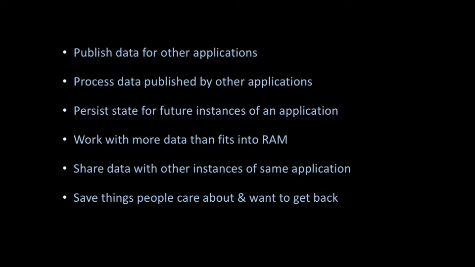
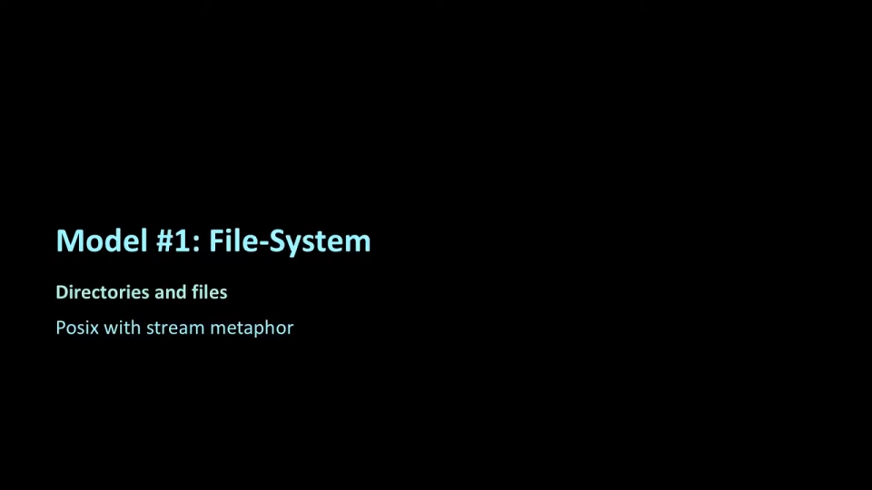
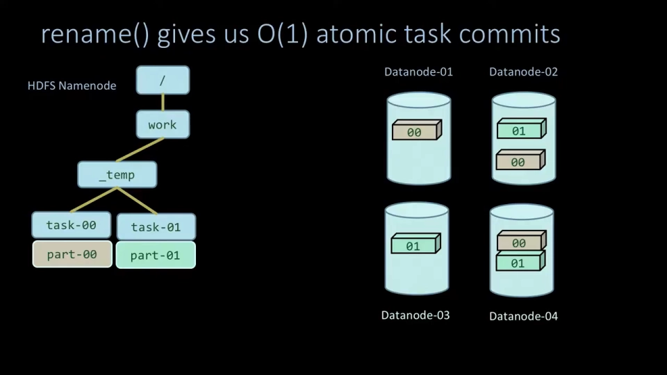
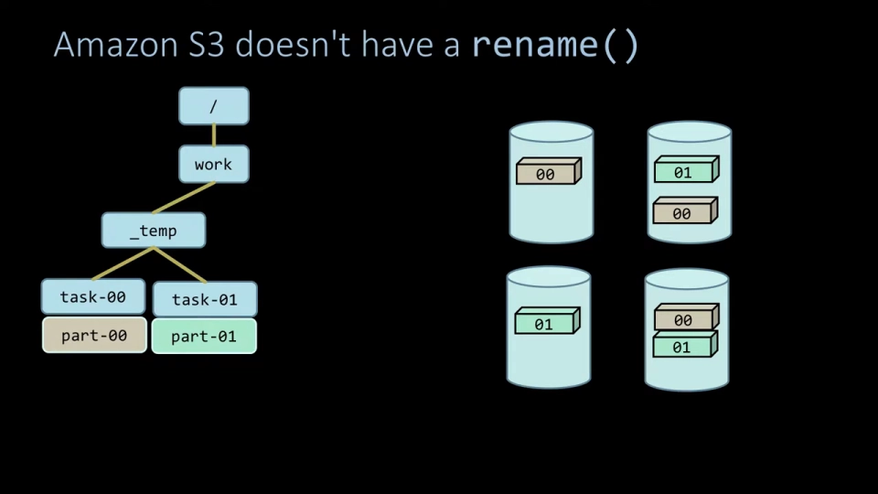
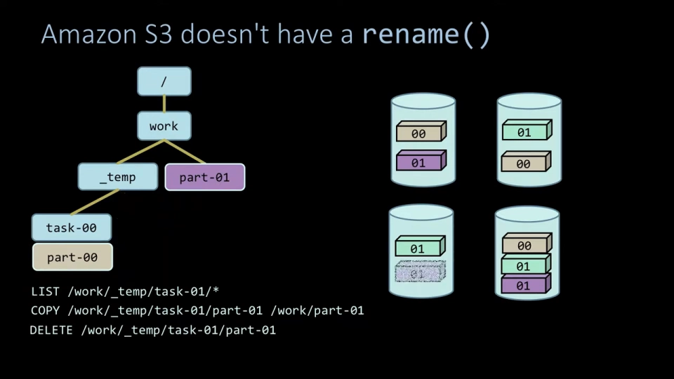
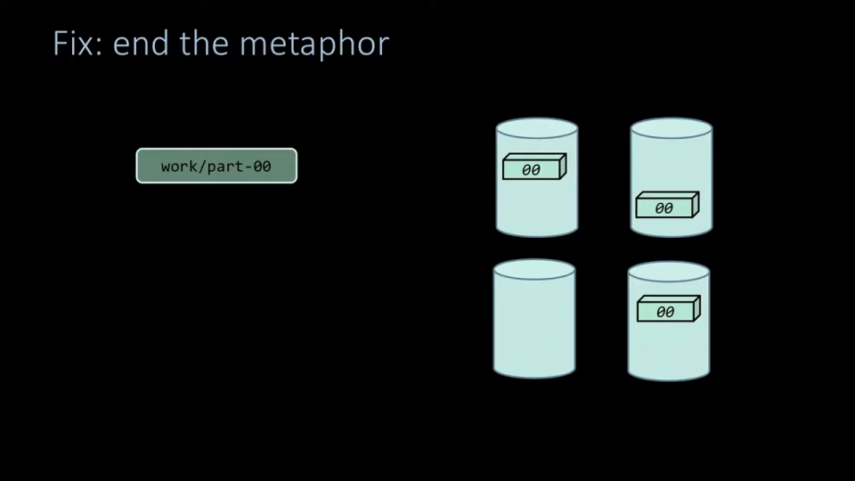
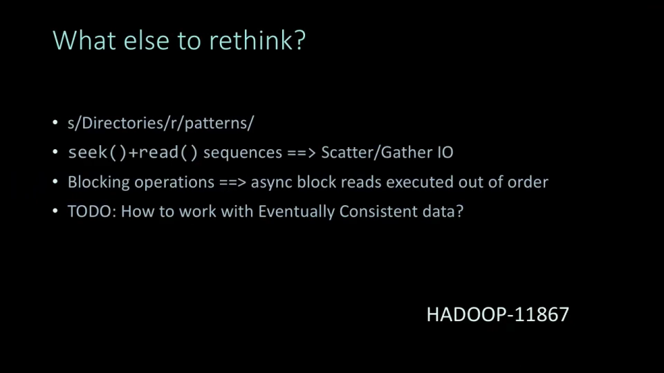
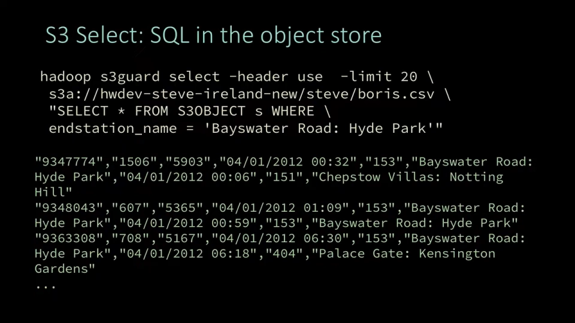
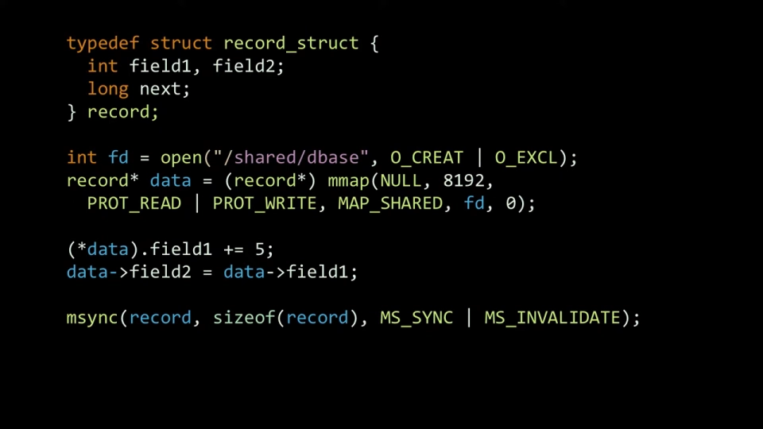
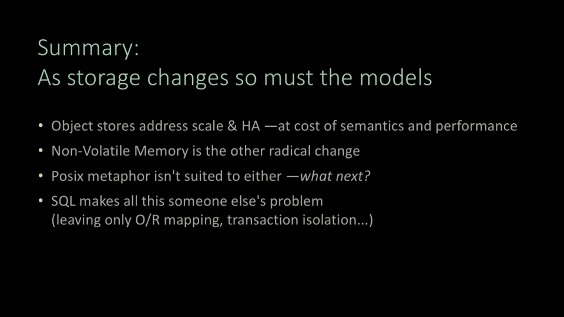

# rename 的终结：对象存储丢掉了哪些文件系统语义

> 视频来源：[Steve Loughran - The age of rename() is over](https://www.youtube.com/watch?v=7MmJQkZ8qB0)（YouTube · Steve Loughran，Hadoop S3A 连接器维护者）｜时长约 35 分钟
> 导读：讲者从"人为什么要持久化"讲到"目录树为什么能当提交协议的地基"，再逐条拆开对象存储拿不走的语义：没有目录、没有 rename、listing 最终一致、seek 昂贵。本文按这条线整理，并补上他给出的翻译层做法（multipart upload 延迟提交）与上层格式的应对（Iceberg、S3 Select）。

## 本讲要解决的核心问题（SCQA）

**背景**：几十年来，我们处理数据的方式是"文件 + 目录 + POSIX"。写数据就是打开文件、往里写流；提交一份工作就是先写到临时目录，满意之后再 `rename` 到最终位置。

**冲突**：对象存储只提供整对象的写入与读取，没有目录，也没有 `rename`；它的 listing 还是最终一致的，覆盖之后也可能读到旧数据。

**疑问**：如果把文件系统那套提交协议原样搬到对象存储上，会丢掉哪些语义？丢掉之后要靠什么补？

**回答（中心思想）**：对象存储丢掉的核心不是"目录"这个好看的外壳，而是**原子重命名这个 O(1) 的提交原语**。一旦它没了，所有"先写临时文件再改名"的提交协议都会退化成 `LIST + COPY + DELETE` 三步，既不原子又慢；正确的补法是**放弃文件系统隐喻**，直接写最终路径，把"让对象出现"的那一步推迟到协议最后（multipart upload 的最后一次 POST），并把 `seek + read` 换成 scatter-gather、把递归下降目录换成扁平 listing。

## 一、我们为什么离不开"文件"这个模型

### 1.1 持久化的六种动机

讲者先问了一个更基本的问题：我们到底为什么要持久化？他给出的清单很朴素，但正好覆盖了后面所有讨论的场景 [【跳转到 00:58】](https://www.youtube.com/watch?v=7MmJQkZ8qB0&t=58)：

- 把自己的数据发布给别的应用；
- 处理别的应用发布的数据；
- 为应用的未来实例保存状态；
- 处理比内存大得多的数据；
- 在同一个应用的多个实例之间共享数据；
- 保存人们在意、并且希望能取回来的东西。



注意最后一条："人们在意、并且希望能取回来"。持久化从一开始就不只是"写下去"，还包含"以后还能按原样读回来"——这正是语义问题的起点。

### 1.2 POSIX 的流隐喻：一切都是文件

讲者把文件系统称作"模型 #1"：目录和文件，加上 POSIX 的流隐喻 [【跳转到 03:07】](https://www.youtube.com/watch?v=7MmJQkZ8qB0&t=187)。



他认为这是 C 和 UNIX 最伟大的发明之一：处理数据的 API 被统一成"一切都是流、一切都是文件"，你可以打开它、读它、拷贝它。做得不算出色，但基本上是同一件事。这个隐喻强到什么程度？强到今天我们面对 HDFS、对象存储时，仍然在努力保留它——讲者自己就负责 Hadoop 的 S3A 连接器，"我们所有东西都说：它们都只是文件系统" [【跳转到 03:54】](https://www.youtube.com/watch?v=7MmJQkZ8qB0&t=234)。

### 1.3 目录树隐含的三个假设

真正的问题在于，目录树不只是"看起来整齐"，它偷偷给了你三个性能与语义上的承诺：

1. **列目录很快**：`ls` 一个目录是常见操作；
2. **树遍历可行**：按 `年/月/日` 逐层下降去找数据是常规做法；
3. **rename 又快又原子**：这是最关键的一条——它让"提交"变成一个 O(1) 的元数据操作。

前两条影响性能，第三条影响正确性。讲者后面所有的讨论，本质都是在说：对象存储把这三条同时拿掉了。

## 二、rename 是分布式提交的地基

### 2.1 一段看起来毫无意义的代码

讲者用一段 Scala 代码开场：在法兰克福的 S3 上建一个很深的临时目录，打开 `output.par` 写个 hello，关掉；过一会儿文件存在了，可以流式写入、变大、结束；然后列出目录，把它 `rename` 到另一个目录 [【跳转到 03:54】](https://www.youtube.com/watch?v=7MmJQkZ8qB0&t=234)。

单看这段代码，最后那个 rename 像是无用功。但它其实是 Apache Spark 分布式提交协议的根本：

- 有一个 driver 管理整个 job，把工作分给集群里所有 task；
- 每个 task 先把自己的结果写进临时目录；
- 写完之后向 driver 报告"我可以提交输出吗"；
- driver 可能让它等一下，也可能去执行提交，然后回消息说"已提交"；
- 如果超时就有问题：task 可能被重分区、可能失败，于是再起一个；
- **task 直到整个 job 准备好提交时，才会把结果提交到最终目的地**——因为如果 job 失败，你不希望目的地被搞乱。



### 2.2 为什么 rename 能撑起这套协议

关键在于两点：**快**和**原子**。

- 快：rename 只改元数据。数据块可能散落在集群各处，但 rename 只是对目录树加个锁、把名字挪一下，是 O(1) 的。
- 原子：要么改成功，要么没改。所以"目的地要么是旧的完整结果，要么是新的完整结果"，不存在中间态。

讲者说，这几乎是地球上每个数据库的基础语义：**避免覆盖旧数据，而是把新数据写在旁边，满意之后再 rename 过去**。你所有代码里一直在这么干，这就是你提交工作的方式。

### 2.3 MapReduce 的版本更复杂

如果觉得 Spark 这套已经复杂，MapReduce 的更复杂：一个查询可能跑 14 小时，中途失败要能重启恢复；而且还有计费问题，账单不能错。于是提交协议里还要处理"确保没有发生分区，否则不能提交"，以及多个 job 之间的先后关系。讲者的结论是：生活变得非常非常复杂，而我们**完全依赖 rename 让它工作**。

## 三、对象存储没有 rename：一次提交退化成三步

### 3.1 只有路径，没有目录

进入对象存储世界，讲者的第一句话是："人们以为我们在做 rename，我们在努力假装它是文件系统。"你可以读也可以写，但它没有目录，甚至没有 rename，你只有路径 [【跳转到 07:00】](https://www.youtube.com/watch?v=7MmJQkZ8qB0&t=420)。



### 3.2 LIST + COPY + DELETE

于是"提交"这个动作被拆成了三步 [【跳转到 07:25】](https://www.youtube.com/watch?v=7MmJQkZ8qB0&t=445)：

```text
LIST  /work/_temp/task-01/*
COPY  /work/_temp/task-01/part-01  /work/part-01
DELETE /work/_temp/task-01/part-01
```



讲者给出的拷贝速度是 **6 到 10 MB/s**。如果一次提交要搬运的数据量是 $S$，那么这段伪 rename 的耗时近似为

$$
T_{\text{commit}} \approx \frac{S}{B}, \qquad B \approx 6\text{–}10\ \text{MB/s}
$$

而真正的 rename 是 $T_{\text{commit}} = O(1)$。这就是"语义丢失"最直接的代价：**提交成本从常数级变成了与数据量成正比**。

### 3.3 三个坑

这三步看起来能凑合，但有三个坑 [【跳转到 07:25】](https://www.youtube.com/watch?v=7MmJQkZ8qB0&t=445)：

1. **listing 是最终一致的**：刚创建的文件可能还看不见。于是"有人写了东西、提交了，而我们漏掉了那个文件、忘了拷贝它"。
2. **耗时长**：6–10 MB/s 的拷贝，数据一大就不可接受。
3. **不是原子的**：逐位拷贝，中途失败系统就处于混乱状态，你不知道它是什么状态；再起一个 task 重做可能更乱，数据会损坏。

### 3.4 官方建议：不要把 S3 当目的地

所以 Hadoop、Hortonworks 的文档里基本写着：**不要把 S3 当作目的地**。但人们还是照做，然后打电话来说"这太慢了"——讲者的回答是："对，那是因为我们在做拷贝。" [【跳转到 08:01】](https://www.youtube.com/watch?v=7MmJQkZ8qB0&t=481)

这句话值得单独记住：**慢不是对象存储的 bug，而是你在用它模拟一个它没有的原语**。

## 四、翻译层：把"让对象出现"推迟到最后一刻

### 4.1 摧毁隐喻：直接写到最终路径

讲者后来的做法是"把整个隐喻彻底摧毁"：不再有目录，只有路径；与其 rename，不如**直接写到最终位置** [【跳转到 08:31】](https://www.youtube.com/watch?v=7MmJQkZ8qB0&t=511)。



这听起来像是放弃了原子性，其实不是——它把原子性交给了对象存储自己的一个原语：multipart upload。

### 4.2 multipart upload 的语义

做法是 [【跳转到 08:56】](https://www.youtube.com/watch?v=7MmJQkZ8qB0&t=536)：

1. 发起一次 multipart upload，拿到这个文件最终的路径；
2. 一块一块（每次几 MB）把数据推上去；
3. **在最终完成（complete）之前，这些数据是不可见的**；
4. 最后发一次 POST，对象才真正出现。

讲者特意提醒：即使数据还不可见，Amazon 从数据上传那一刻起就开始计费，所以别以为自己很聪明。他还提到一个更极端的例子：可以上传 4 TB 的数据、task 在那里把数据都放上去，但只要不发最后的 POST，对象就不存在。

### 4.3 提交只需要一个 upload ID

既然对象在 complete 之前不存在，那么"提交"这个动作就只剩下：**拿到 upload ID 和已上传块的列表，把 complete 推迟到协议的最后** [【跳转到 09:47】](https://www.youtube.com/watch?v=7MmJQkZ8qB0&t=587)。

于是提交变成"每个文件一次 POST"，而且可以并行。这就是翻译层的核心思路：

- 数据面：提前、并发地把块传上去（贵的是带宽，不是延迟）；
- 控制面：把"可见性切换"压缩成最后一次 POST（贵的是原子性，而这一次 POST 是原子的）。

### 4.4 演示：6 秒完成提交

讲者用 spark shell 现场演示：把本地一份 Landsat CSV 数据写到 Amazon 爱尔兰的数据中心，按年月分区成文件，然后提交 [【跳转到 11:23】](https://www.youtube.com/watch?v=7MmJQkZ8qB0&t=683)。结果是提交只花了 **6 秒**，即使是在长途连接上。

他还强调：如果中间出错，演示就毁了，但**数据会是安全的**——这正是原子提交要保证的东西。

### 4.5 副产品：`_SUCCESS` 换成真实统计

传统上，job 结束会写一个 0 字节的 `_SUCCESS` 标记文件。但因为现在可以做原子写，讲者的实现改为把所有统计收集起来、在最后一次性推上去：有多少字节存在、读了多少字节 [【跳转到 12:01】](https://www.youtube.com/watch?v=7MmJQkZ8qB0&t=721)。

他们还会把限流统计一起写进去。这解决了一个长期扯皮的问题：人们常说"这个 job 很慢"，而答案是"你被限流了，不是我们的问题"。**对象存储把"提交"变成了一个可以携带元数据的原子动作**，这是文件系统隐喻下做不到的。
## 五、POSIX 的其它假设也要重写

讲者说，POSIX 也快走到寿命尽头了。你走一遍代码就会问：为什么任何 SQL 查询都这么慢？因为一切都在递归下降目录 [【跳转到 12:31】](https://www.youtube.com/watch?v=7MmJQkZ8qB0&t=751)。他把需要重写的东西列成了一张清单：



### 5.1 递归下降目录 → 扁平 listing

按 `年/月/日` 逐层下降去找数据，在本地文件系统上是常规做法；但在对象存储上，树遍历不是正确的做法——尤其当你可以做一次**扁平的深层 listing** 就把整棵路径树拿到手的时候。讲者的说法是"我们想办法把它偷偷加进去而不让人发现"，因为这是一个性能杀手。

### 5.2 seek + read 是灾难

第二个性能杀手是所有人写 I/O 的方式：从 CEO 往下，标准 I/O 库都是先 `open` 一个文件，然后 `seek` 到某个偏移、读一些字节，再 `seek` 到另一个偏移、再读一些 [【跳转到 13:21】](https://www.youtube.com/watch?v=7MmJQkZ8qB0&t=801)。

在本地磁盘上，seek 贵，但没那么贵。**在对象存储上，每一次 seek 你都在打断已有的 HTTP 连接、再开一个新的，发一个带 Content-Length 的 HTTP GET**，启动开销极高，会在 I/O 里留下巨大的空隙。这就是为什么"把块设备式的随机读直接映射到对象存储"注定低效：块设备的随机读是扇区寻址，对象存储的随机读是"重新建立一次 HTTP 事务"。

### 5.3 应用其实知道要读什么，但 API 挡在中间

真正令人沮丧的地方在于：应用其实知道自己要读哪些位。比如读 Parquet 这种列式格式的列条带时，应用知道它要读这个块、那个块、那个块；它知道要读哪些位、要不要下推过滤条件——这些信息都存在，但**没法传给文件系统，因为 API 挡在中间** [【跳转到 14:08】](https://www.youtube.com/watch?v=7MmJQkZ8qB0&t=848)。

于是讲者的提案是转向 scatter-gather I/O：不再"seek 然后 read"，而是提交一组读操作（范围、偏移、目标缓冲区），返回一组异步 Java 回调，因为数据返回的顺序取决于对象存储那边怎么调度。这个工作对应 HADOOP-11867。

### 5.4 最终一致性：覆盖之后可能读到旧数据

最后一个坑是一致性。所有代码都假设：你写完一个文件，它立刻就在那里；你覆盖它，立刻拿到最新数据。**但这不一定成立**：你可能拿到旧数据，更糟的是，你在 seek 的过程中可能在新旧数据之间来回跳 [【跳转到 14:54】](https://www.youtube.com/watch?v=7MmJQkZ8qB0&t=894)。

他们做过很多变通，比如用 DynamoDB 让 S3 稍微一致一点，但讲者的评价是"很痛苦，也很危险"。这里要区分清楚：**"没有 rename"是接口层面的缺失，"listing 与覆盖不一致"是语义层面的缺失**，后者更难在客户端补齐。

## 六、上层格式已经在改：Iceberg 与 S3 Select

### 6.1 Iceberg：用"新文件名"代替 rename

讲者提到 Netflix 做的 Iceberg：他们不再依赖目录树——目录树只是表示数据的一种非正式方式——而是把**元数据和真实数据文件的存储分开**，并且每次用新名字重命名生成文件 [【跳转到 15:18】](https://www.youtube.com/watch?v=7MmJQkZ8qB0&t=918)。

这其实是在对象存储上重建"原子提交"的另一种方式：既然不能原子地 rename 一个名字，那就**让"当前版本"由一份元数据文件指向一组不可变的数据文件**，切换版本 = 切换元数据文件。对象本身永远不被原地修改，这正好符合对象存储"整对象写入"的约束。

### 6.2 S3 Select：把 SQL 下推到存储侧

另一个方向是把计算推到存储侧。讲者演示了 S3 Select [【跳转到 21:24】](https://www.youtube.com/watch?v=7MmJQkZ8qB0&t=1284)：

```text
hadoop s3guard select -header use -limit 20 \
  s3a://hwdev-steve-ireland-new/steve/boris.csv \
  "SELECT * FROM S3OBJECT s WHERE \
   endstation_name = 'Bayswater Road: Hyde Park'"
```



对比很直观：用传统方式把 400 MB 文件从美国东海岸拉到本地再过滤，讲者一分钟就 Ctrl-C 放弃了；改用 S3 Select 之后，遍历同一个 400 MB 文件只花了 **11.52 秒**，因为重活都在存储侧做了，客户端只下载答案 [【跳转到 25:57】](https://www.youtube.com/watch?v=7MmJQkZ8qB0&t=1557)。

### 6.3 顺带一个格式教训：CSV 与 Parquet

讲者对 CSV 的评价很刻薄：它是大数据里的"暗物质"，可能是最流行的文件格式，但它很糟——表示日期时间很糟（他举的例子是查询结果里出现字符串 "January 1st 1970"），解析转义字符串是噩梦。

而 Parquet 这类列存格式的好处是结构化的：文件尾部有 footer，记录了列在哪里切分；查询时只读 footer，就知道要投影哪些列、过滤哪些列，然后只跳到对应位置读那些列，读的数据少得多；再加上按列压缩，他见过 50 倍的压缩比，而"用 CPU 解压比从旋转磁盘上读便宜" [【跳转到 23:08】](https://www.youtube.com/watch?v=7MmJQkZ8qB0&t=1388)。

这段看起来是格式之争，其实和本节主题直接相关：**对象存储只支持整对象读写，所以"一次能少读多少"直接决定了性能**。列裁剪、footer、压缩，都是在弥补"没有随机读"这件事。

## 七、非易失内存：另一场地震

讲者把非易失内存（NVM）称为另一个根本性变化，并给了一段很有代表性的代码 [【跳转到 16:19】](https://www.youtube.com/watch?v=7MmJQkZ8qB0&t=979)：

```c
typedef struct record_struct {
    int field1, field2;
    long next;
} record;

int fd = open("/shared/dbase", O_CREAT | O_EXCL);
record* data = (record*) mmap(NULL, 8192,
    PROT_READ | PROT_WRITE, MAP_SHARED, fd, 0);

(*data).field1 += 5;
data->field2 = data->field1;

msync(record, sizeof(record), MS_SYNC | MS_INVALIDATE);
```



### 7.1 mmap 是"假装它只是文件"的老办法

这段代码的意思是：把一块持久内存映射成文件，直接改里面的字段，最后 `msync` 落盘。讲者说这个 API 我们有了很久，但它不理想——因为它仍然假设"你有一块可以按字节寻址、可以原地改的内存"。

### 7.2 现有数据结构不能直接搬过去

更关键的是：**你不能把今天应用里用的数据结构魔法般地直接搬到非易失内存上，必须从头设计**。原因包括：

- 现有代码把持久的数据位和瞬时的位混在一起，模糊了界限，还用指针交叉引用其他记录；
- 单条记录的事务性写很难做对。平时你写个字段、做点同步就算了，但你必须考虑让整个写变成原子的，这样应用在中间崩溃时持久数据不会损坏；
- Intel 提供过事务内存指令，几个 CPU 版本支持过，后来又在里面发现了 bug——因为这件事真的很难做对。现代 CPU 有多核、多 socket，等于要在单个 CPU 内部做分布式协调。

### 7.3 单指针切换 = 内存里的 rename

讲者给出的一个思路是：在 NVM 里建一块新结构，只更新一个指针，于是可以构建整棵树再切换过去。**一个指针的原子切换，实际上就是内存里的 rename**；那些不做原地更新的做法，在这个世界里大概更安全。

这条线索很有意思：**rename 这个原语的价值，不在于"改名"，而在于"用一次原子操作切换可见性"**。对象存储拿掉了它，于是大家用 multipart upload 的最后一次 POST、用 Iceberg 的元数据文件来重建它；NVM 里则用一次指针切换来重建它。

## 八、结论：一份"no POSIX 宣言"

讲者的总结页写得很直接 [【跳转到 27:00】](https://www.youtube.com/watch?v=7MmJQkZ8qB0&t=1620)：



- 对象存储用**语义和性能**换来了规模与高可用；
- 非易失内存是另一个根本性变化；
- POSIX 隐喻对这两者都不适用——那接下来用什么？
- SQL 把这些都变成"别人的问题"（只剩下 O/R 映射、事务隔离这些）。

他最后说：你们脑子里那个围绕软盘、快速文件系统、目录树建立起来的世界模型，已经结束了。你可以假装它还在，很多人在做工具时努力让它看起来还在，这样你能把全部技能和假设搬到新世界；但仔细看，你必须承认那些假设不再成立。**试图维持这个隐喻，对"提交工作"这类事情来说是潜在危险的；而放弃隐喻反而能让事情快很多** [【跳转到 27:25】](https://www.youtube.com/watch?v=7MmJQkZ8qB0&t=1645)。有人会因此指责他，他的回应是：这基本上就是一份 "no POSIX 宣言"。

## 小结

- **对象存储丢的第一样东西是目录**：只有路径，没有层级；"列目录"变成对前缀的一次 listing，而且 listing 可能是最终一致的。
- **第二样、也是最致命的一样，是 rename**：它把"提交"从 O(1) 的原子元数据操作，变成 `LIST + COPY + DELETE` 三段式，拷贝速度只有 6–10 MB/s，且中途失败会留下损坏状态。
- **翻译层的核心思路是"把可见性切换推迟到最后一刻"**：直接写最终路径，用 multipart upload 把数据先传上去，最后用一次 POST 让对象出现；提交只需 upload ID 加块列表，实测 6 秒完成。
- **还有一批 POSIX 假设要重写**：递归下降目录换成扁平 listing；`seek + read` 换成 scatter-gather；阻塞读换成异步乱序读；覆盖之后可能读到旧数据，需要额外的协调。
- **上层格式在替我们补语义**：Iceberg 用"元数据文件 + 不可变数据文件"代替 rename；S3 Select 把过滤下推到存储侧；Parquet 的 footer 与列裁剪让"少读"成为可能。
- **同一个原语在别处重现**：NVM 里用一次指针切换代替 rename，本质都是"用一次原子操作切换可见性"。
- **代价是明确的**：对象存储用语义和性能换规模与高可用；把块设备或文件系统直接"搬"上去，慢和错都不是 bug，而是语义缺口在收费。

## 关键术语速查

| 术语 | 一句话解释 |
| --- | --- |
| POSIX | UNIX 定义的文件接口标准，"一切都是文件、一切都是流"这套隐喻的来源 |
| rename 的原子性 | 改名要么完成要么没发生，因此可以当作"提交"的开关使用 |
| 最终一致（eventual consistency） | 写入成功后，短时间内读或 listing 可能还看不到这次写入 |
| multipart upload | 把一个大对象分块上传，在 complete 之前对象不可见；complete 是原子的 |
| 提交协议（commit protocol） | 分布式作业保证"要么整体可见、要么完全不可见"的一套步骤 |
| scatter-gather I/O | 一次提交一组读请求（范围、偏移、缓冲区），而不是逐个 seek 再读 |
| Iceberg | 用元数据文件指向一组不可变数据文件的表格式，用元数据切换代替 rename |
| S3 Select | 把 SQL 过滤下推到对象存储侧执行，客户端只取回结果 |
| NVM（非易失内存） | 断电不丢、可按字节寻址的内存，可 mmap，但现有数据结构不能直接复用 |
