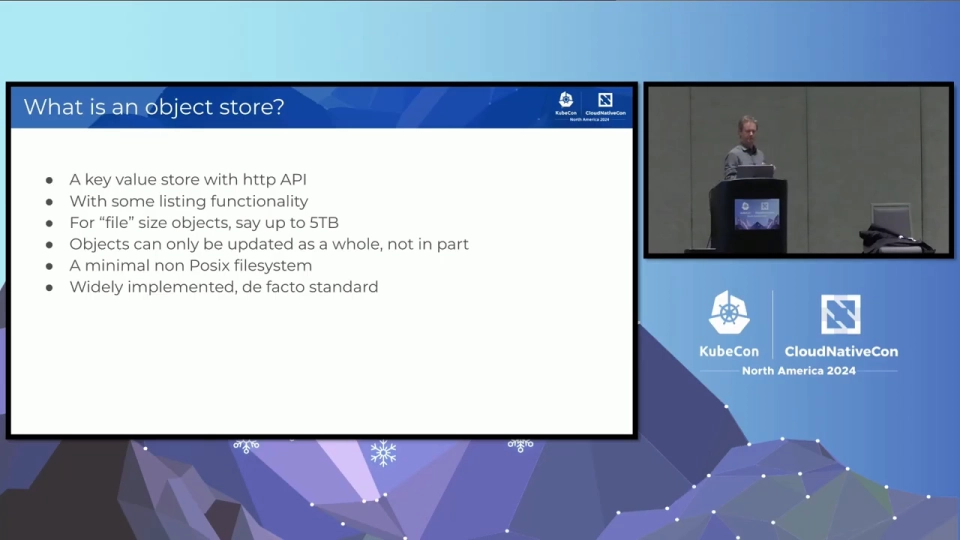
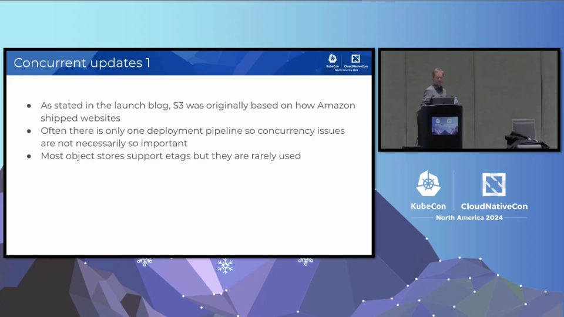
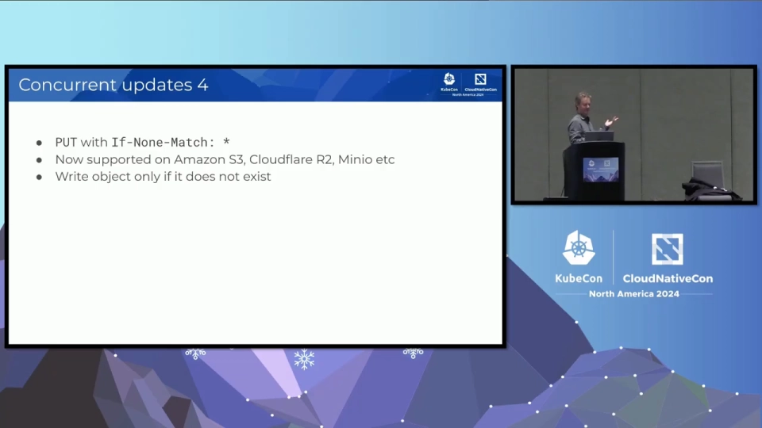
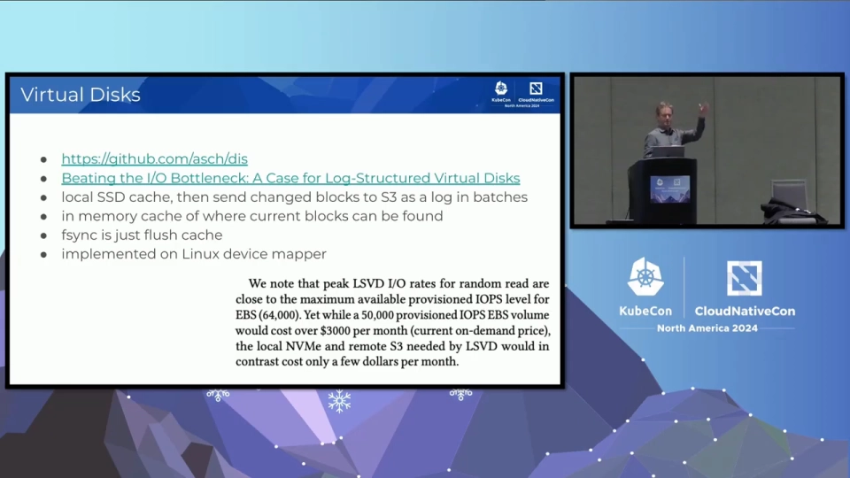
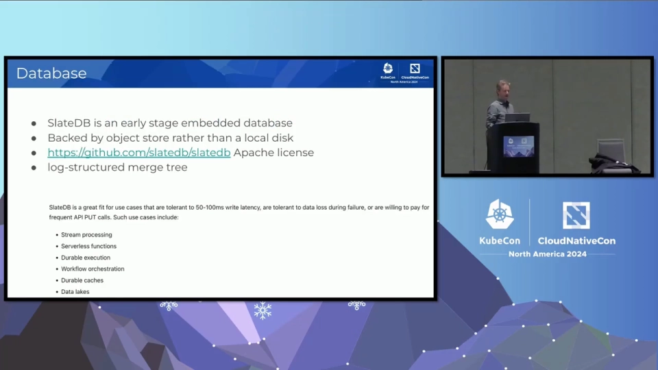
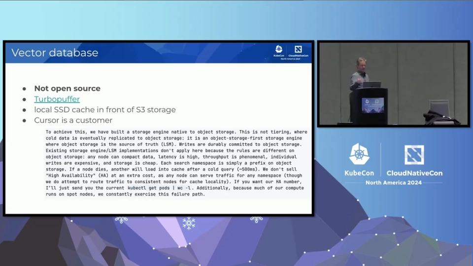
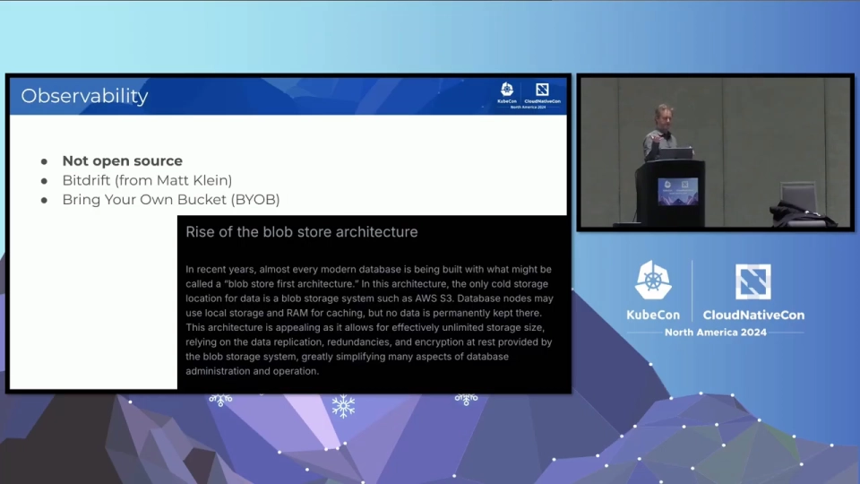

# 对象存储的语义边界：整对象写入，与为它让路的架构

> 视频来源：[Object Storage Is All You Need - Justin Cormack, Docker](https://www.youtube.com/watch?v=ei0wwTy6_G4)（YouTube · KubeCon + CloudNativeCon North America 2024 · Justin Cormack，Docker CTO）｜时长约 32 分钟
> 导读：讲者把对象存储当作"云原生最基础的原语"来复盘：先讲它为什么被设计得这么"残废"（只能整对象更新），再讲性能与成本的形状，最后用六个真实系统说明——虚拟磁盘、嵌入式数据库、向量数据库、Kafka、可观测性后端——是怎么靠"日志 + 条件写 + 本地缓存"把缺掉的语义补回来的。

## 本讲要解决的核心问题（SCQA）

**背景**：S3 从 2006 年发布起就是"给互联网用的 malloc"：分配一块空间、把东西放进去、它就在那里。今天几乎所有分析型数据库都建在对象存储之上。

**冲突**：但对象存储不是文件系统。它只能整体更新一个对象，不能改其中一段；延迟很高；早期连"两个客户端同时写"都很难处理。

**疑问**：一个只提供整对象 PUT/GET/DELETE 的存储，凭什么承担虚拟磁盘、数据库、消息队列这些天生要求"随机写、原地改"的负载？

**回答（中心思想）**：因为对象存储把可靠性、跨可用区复制、无限扩容这些最难的事都做掉了，剩下的语义缺口可以用三种模式补回来——**内容寻址**（按哈希命名，天然幂等）、**条件写**（`PUT if-none-match` 提供互斥）、**有序日志 + 批量提交**（把随机写聚合成大块顺序写）。代价是写放大、延迟和一层本地缓存。

## 一、对象存储到底是什么

### 1.1 一张幻灯片说清它的语义边界

讲者的定义非常克制 [【跳转到 04:32】](https://www.youtube.com/watch?v=ei0wwTy6_G4&t=272)：

- 一个带 HTTP API 的键值存储；
- 有一些列举（listing）功能；
- 单个对象最大约 5TB；
- **对象只能整体更新，不能更新其中一部分**；
- 一个"极简的非 POSIX 文件系统"；
- 已被广泛实现，成为事实标准。

这张清单就是本节要讨论的"语义差异"本身。注意第 4 条：不是"不支持随机写"这么模糊的说法，而是更准确的**没有部分更新（no partial update）**——你要改一个字节，代价是重写整个对象。

### 1.2 为什么它被设计得这么"残废"

讲者的解释是：这不是偷懒，而是为了把可靠性做到极致。S3 的持久性声明是 **11 个 9**，这背后需要巨量的工程投入。你必须认真想清楚：这个服务能做到多简单、你能验证它没有 bug 到什么程度 [【跳转到 04:57】](https://www.youtube.com/watch?v=ei0wwTy6_G4&t=297)。

换句话说，**语义的贫乏是可靠性的代价**：接口越少，能出错的地方越少；而"部分更新"恰恰是最难做到高可靠的那类操作——它需要锁、需要版本、需要在多个副本之间协调一个字节的落点。

### 1.3 历史：给互联网用的 malloc

S3 最初的需求描述是"给互联网用的 malloc"（这是 Jeff Bezos 提的要求），意思是你可以在互联网上分配一块空间存东西，它就在那里，之后你也许可以再释放掉 [【跳转到 02:27】](https://www.youtube.com/watch?v=ei0wwTy6_G4&t=147)。

这个原语极其简单，但能横向扩展、对所有人可用，是那种每个应用都会用到的基础设施。很多年里 S3 最大的用例就是"在上面跑网站"——这也解释了后面并发问题的由来：网站更新通常只有一条部署流水线。

## 二、性能与成本的形状

### 2.1 高延迟、高并行、高吞吐

讲者说，对象存储的性能特征对习惯传统文件系统的人来说"很奇怪" [【跳转到 07:02】](https://www.youtube.com/watch?v=ei0wwTy6_G4&t=422)：

- **高延迟**：一部分是网络，很大一部分来自可靠性——每次写入，数据都要复制到多个位置；读的时候还要去找到数据。数据量巨大，有不同存储层、不同数量的缓存，还有热点带来的扩容，后台有大量工作在跑 [【跳转到 07:27】](https://www.youtube.com/watch?v=ei0wwTy6_G4&t=447)。
- **高并行**：你可以开任意多条连接，把云主机上的 100G 以太网打满；也可以让成千上万台机器同时访问。单条到 S3 的连接能跑到 5 Gbit/s，但真正的吞吐来自并行 [【跳转到 08:17】](https://www.youtube.com/watch?v=ei0wwTy6_G4&t=497)。
- **动态扩容**：如果你越来越多地访问某个部分，就会有更多服务器来提供带宽。

### 2.2 由此得到的第一条设计规则

**不要做大量很小的顺序写，而应该做尺寸足够大的写来摊薄延迟** [【跳转到 08:42】](https://www.youtube.com/watch?v=ei0wwTy6_G4&t=522)。

这句话是整个"翻译层"设计的出发点。块设备的写是 4 KiB 级别的、随机的、可以原地覆盖的；对象存储的写是"整个对象"级别的、要付一次完整往返的。两者的粒度差了几个数量级，所以任何"把块设备搬到对象存储"的方案，第一件事都是**把小块攒成大块**。

### 2.3 成本也是"形状"的一部分

讲者列出的成本特征很实用 [【跳转到 10:22】](https://www.youtube.com/watch?v=ei0wwTy6_G4&t=622)：

- 出口带宽可能主导成本（Cloudflare R2 因为不收出口费而受欢迎）；
- 分层存储的成本通常还算合理；
- **跨可用区流量免费**，因为复制已经包含在服务里；
- 对非常小的事务，**按 API 调用计费会主导成本**；
- **listing 相对昂贵**。

后面几条直接决定了架构：因为每次 PUT 都要钱，"大量小对象"是最贵的形状；因为 listing 贵，"用列目录来实现索引"是错误做法；因为跨 AZ 免费，"把副本交给对象存储"比自己维护副本便宜。

## 三、并发写：三种补法

### 3.1 早期：没人关心并发

S3 刚发布时的用例是网站，那相对简单：通常只有一个部署流水线，你不用担心同一时间有多个更新，一页一页地写新版本就行 [【跳转到 11:12】](https://www.youtube.com/watch?v=ei0wwTy6_G4&t=672)。

幻灯片上还有一句很关键的话：**大多数对象存储支持 ETag，但很少被使用**。ETag 本来可以当作乐观锁的版本号，但因为没有"条件写"的语义配合，它长期只是个校验和。

### 3.2 补法一：内容寻址

随着人们在对象存储上构建更多应用，并发问题就多了起来。讲者在 OCI registry 里大量使用的一种做法是**内容寻址存储**：如果每一份数据都以内容哈希命名，并发就变得容易得多——要么东西已经在那里了（比如哈希 `ABCDE` 已经写好了），要么你就需要去写它。

在 AWS 上还可以生成预签名 URL，只允许向某个位置写入与哈希匹配的内容，没有别的权限。这解决了一部分 registry 基础存储的并发问题，但**没有解决"并发更新 tag"这类问题**——因为 tag 是一个会被反复覆盖的名字，而覆盖恰恰是对象存储最不擅长的事。

### 3.3 补法二：用数据库管并发（曾经的 hack）

于是很多人用数据库来管理并发，比如在 Amazon 上用 DynamoDB 管理并发和处理锁。讲者的评价是"有点 hack" [【跳转到 12:52】](https://www.youtube.com/watch?v=ei0wwTy6_G4&t=772)。

这其实是一个信号：**当存储缺少一个原语时，人们会用另一个系统去补**。补的代价是多了一个组件、多了一次跨系统调用、多了一致性边界。

### 3.4 补法三：条件写 `PUT if-none-match`

最近，很多对象存储实现新增了一个原语：Cloudflare 早就有，MinIO 在今年早些时候也有了，Amazon 在 8 月加了支持 [【跳转到 13:42】](https://www.youtube.com/watch?v=ei0wwTy6_G4&t=822)。

`PUT with If-None-Match: *` 的语义是"对象不存在时才创建"。这给了你一个**互斥的并发原语**：多个应用同时想写同一个东西时，要么成功，要么必须退避重试，去写下一个对象。

讲者的评价是："这是个很好的并发控制原语，现在被广泛支持，你不必再依赖数据库，可以直接用对象存储。" [【跳转到 14:12】](https://www.youtube.com/watch?v=ei0wwTy6_G4&t=852)

### 3.5 从互斥到日志

有了这个原语之后，最简单的用法就是创建有序编号的文件：`000000`、`000001`、`000002`……每次应用过来，尝试 PUT 序列里的下一个文件；要么成功，要么别人抢先了，那它就必须重新读取别人写的数据、调整自己的动作再重试 [【跳转到 14:32】](https://www.youtube.com/watch?v=ei0wwTy6_G4&t=872)。

这看起来只是个"分布式计数器"，但它其实是**日志**：一个只能追加、不能修改的有序对象序列。讲者说，正是这个模式让他在读到 Delta Lake 论文时非常兴奋——"我们可以在对象存储上构建数据库应用"。

## 四、日志：对象存储上的通用原语

### 4.1 有序文件序列就是日志

讲者把这件事讲得很透 [【跳转到 16:12】](https://www.youtube.com/watch?v=ei0wwTy6_G4&t=972)：

- 这种有序编号的文件序列，在数据库技术里就是**日志（log）**；
- 日志是一个有序的文件集合，里面记录了你对数据库所做的变更；
- **你可以从日志构建出任何数据存储系统**，这就是它们内部真实的构建方式；
- 在日志之上你还会想要索引等等，但日志是根本的存储原语。

他还推荐了两份材料：LinkedIn 那篇关于日志的经典文章，以及 Phil Eaton 用大约 500 行 Go 代码把这件事骨架跑通的博客。

### 4.2 开放表格式：把 schema 变更也写进日志

讲者说，所有分析型数据库（Snowflake、Databricks 等）其实都构建在对象存储之上，而且今年打起了"开放格式之战" [【跳转到 19:07】](https://www.youtube.com/watch?v=ei0wwTy6_G4&t=1147)。这些格式的构成大同小异：

- 一堆 Parquet 文件（可索引的列式数据格式）；
- 加上记录在日志里的 schema 变更信息；
- 加上一大堆 compaction 之类的处理。

好处也很直接：因为它在对象存储上就是一份**不可变日志**，如果你不做 compaction、不删东西，你就可以查询数据库在任意时间点的状态；甚至可以 fork 一条不同的日志，从历史时间线的某个检查点分叉出去，做出类似 Git 的 checkpoint 与 branch。

### 4.3 这就是"整对象写入"的正用法

注意这里的设计哲学：**不去改对象，而是不断产生新对象**。对象存储不支持部分更新，那就让每个对象都是不可变的；需要"更新"时，就写一个新对象，再让日志指向它。这跟文件系统里"原地覆盖"的思路正好相反，却完美贴合对象存储的约束。

## 五、把块设备搬到对象存储：虚拟磁盘

这是本节最贴近"块设备语义"的一段。讲者介绍了一个与 SEF 项目合作的开源项目，做的是**虚拟磁盘（virtual disc）** [【跳转到 20:47】](https://www.youtube.com/watch?v=ei0wwTy6_G4&t=1247)。

它的做法是：

- 本地有一层 SSD 缓存；
- 把**变更块**成批地作为日志发到 S3；
- 在内存里缓存"当前块在哪里"的索引；
- `fsync` 的语义变成"刷缓存"；
- 实现挂在 Linux device mapper 上。

于是，块设备上任意位置的文件系统写操作，都能以流的形式发到 S3，本地还有缓存，你实际上得到了一个**几乎无限的虚拟磁盘**。

幻灯片上还引了一组对比数字：随机读的峰值 I/O 速率接近 EBS 预置 IOPS 的上限（64,000）；而一块 50,000 预置 IOPS 的 EBS 卷按需价格每月要 3000 美元以上，本地 NVMe 加远端 S3 的方案只要每月几美元。

### 5.1 这个翻译层补了哪些语义

对照块设备的语义，可以看到每一处都在做转换：

| 块设备语义 | 对象存储缺什么 | 虚拟磁盘怎么补 |
| --- | --- | --- |
| 定长扇区、按偏移读写 | 只能整对象读写 | 把块映射成对象，按块批量写 |
| 随机写、原地覆盖 | 不能部分更新 | 写新对象（新块），更新内存索引 |
| 可 mmap、可按字节寻址 | 没有地址空间 | 本地 SSD 缓存 + device mapper 暴露块设备 |
| fsync 保证落盘 | 没有 fsync | fsync 变成"刷缓存 + 等日志批量提交" |
| 低延迟 | 高延迟 | 本地缓存吸收读，写入异步批量 |

代价也很清楚：**写放大**（一次小块写最终可能触发一整个批次的日志写）、**延迟**（fsync 要等一次远端提交）、以及**缓存需求**（本地 SSD 不是可选项，而是正确性/性能的一部分）。

### 5.2 为什么值得

讲者说，这个抽象在很多场景里很有用：每次 sync 你都在 S3 上有一份备份，还能很容易地复制到另一台机器，因为数据就在对象存储里 [【跳转到 22:02】](https://www.youtube.com/watch?v=ei0wwTy6_G4&t=1322)。他提到 Docker 内部也在做一个非常相似的模型。

这就是"把块设备搬到对象存储"的完整答案：**不是让对象存储变成块设备，而是在中间放一层翻译层，把块语义翻译成"日志 + 缓存"**。

## 六、把数据库搬到对象存储

### 6.1 SlateDB：嵌入式数据库，后端换成对象存储

SlateDB 有点像 SQLite，但后端是对象存储而不是本地磁盘，采用 log-structured merge tree [【跳转到 23:21】](https://www.youtube.com/watch?v=ei0wwTy6_G4&t=1401)。它的定位很明确：**适合能容忍 50–100 ms 写延迟、能容忍故障时丢数据、或者愿意为频繁 API 调用付费的场景**——流处理、serverless 函数、持久化执行、工作流编排、持久缓存、数据湖。

讲者补充说，它的写延迟和对象存储一样高，但取决于你多频繁地把写打包成块、你能接受多少延迟和成本 [【跳转到 23:46】](https://www.youtube.com/watch?v=ei0wwTy6_G4&t=1426)。

### 6.2 TurboPuffer：向量数据库，对象存储是唯一真相源

TurboPuffer 是构建在对象存储上的向量数据库，Cursor 是早期客户之一，扩展性极好 [【跳转到 24:11】](https://www.youtube.com/watch?v=ei0wwTy6_G4&t=1451)。幻灯片上那段引文把架构讲得很清楚：

- 对象存储是**唯一真相源**（source of truth），写入直接持久化到对象存储；
- 现有的存储引擎/LSM 实现不适用，因为规则不同：**按对象的写很贵、存储很便宜**；
- 每个命名空间只是对象存储上的一个前缀；
- 节点挂掉后，冷查询约 500 ms 就能把数据重新加载进缓存；
- 他们不卖"高可用"，因为任何节点都能服务任何命名空间的流量；
- 因为大量计算跑在 spot 实例上，他们经常演练这条故障路径。

### 6.3 WarpStream：Kafka 兼容，用"更贵一点的延迟"换成本

WarpStream 是一个 Apache Kafka 的实现，最近被 Confluent 收购，作为"Kafka 到处跑"的一部分，采用"自带云、自带对象存储桶"的模式 [【跳转到 25:51】](https://www.youtube.com/watch?v=ei0wwTy6_G4&t=1551)。

它的卖点是：因为对象存储本身跨可用区复制，你**免费得到了跨 AZ 复制**，不用付跨区流量费；代价是延迟比其他 Kafka 实现高，但便宜、运维简单。讲者引用 Jack Vanlightly 的文章说，Confluent 很长时间不愿意做 on-prem，因为他们在多租户方案上投入很重；但 WarpStream 足够简单——对象存储加临时计算——让他们觉得可以可靠地在客户环境里支持。

这里有个很重要的运维观点：**当你在自己观测和控制能力较弱的地方（客户现场）跑东西时，架构的简单性本身就是可靠性**。

### 6.4 Bitdrift 与"blob store 优先"的架构

最后一个例子是 Matt Klein（Envoy 的作者）做的 Bitdrift，同样采用"自带桶"的模式 [【跳转到 27:36】](https://www.youtube.com/watch?v=ei0wwTy6_G4&t=1656)。幻灯片引用的那段话值得整段记住：

> 近年来，几乎所有现代数据库都在按所谓的"blob store 优先"架构构建。在这个架构里，数据的唯一冷存储位置就是 S3 这样的 blob 存储系统。数据库节点可以用本地存储和 RAM 做缓存，但没有任何数据永久保存在那里。这种架构之所以有吸引力，是因为它能提供几乎无限的存储容量，依赖 blob 存储系统提供的复制、冗余和加密，从而极大简化了数据库管理和运维的许多方面。

这段话正好回答了本节的问题：**对象存储丢掉的是"细粒度写入语义"，换来的是"把持久化这件事整体外包"**。数据库不再需要自己做副本、做校验、做跨 AZ 复制，只需要做缓存和索引。
## 七、这条路线的代价与边界

### 7.1 延迟换成了"批大小"这个旋钮

讲者在讲 SlateDB 时说得很直白：写延迟和对象存储一样高，但**取决于你多频繁地把写打包成块、你能接受多少延迟和成本** [【跳转到 23:46】](https://www.youtube.com/watch?v=ei0wwTy6_G4&t=1426)。

这句话可以写成一个很朴素的权衡：如果把每 $n$ 次逻辑写合并成一次对象写，那么

$$
\text{提交延迟} \approx \text{攒批等待} + \text{一次对象写往返}, \qquad
\text{写放大} \approx \frac{\text{一次对象写的字节数}}{\text{一次逻辑写的字节数}}
$$

$n$ 越大，单位成本越低、吞吐越高，但用户感知到的延迟越大；$n$ 越小，延迟越接近一次对象写往返（几十到上百毫秒），但 API 调用成本会迅速上升。所有"在对象存储上跑数据库"的系统，本质上都在调这个旋钮。

### 7.2 成本结构决定了"不能写小对象"

把成本拆开看：

$$
\text{成本} \approx N_{\text{put}} \cdot p_{\text{api}} + S \cdot p_{\text{GB}}
$$

当对象很小时，$N_{\text{put}}$ 很大而 $S$ 很小，第一项主导——这就是为什么"把 4 KiB 的块直接写成一个 4 KiB 的对象"在经济上是不可行的，也是为什么虚拟磁盘方案一定要"成批"发送变更块。

### 7.3 写放大从哪来

把前面几个方案放在一起看，写放大的来源有三处：

1. **整对象重写**：改一个字节要重写整个对象（对象存储的 no partial update）；
2. **compaction**：开放表格式要不断把小文件合并成大文件，同一份数据被反复读写；
3. **批量与日志**：为了摊薄延迟，小块被攒成大块、被写进日志，同一份数据在缓存、日志、最终对象里各存在一次。

这三处都不是实现缺陷，而是**用对象存储替换块设备/文件系统时必须支付的语义税**。

### 7.4 换来的东西：不用自己实现 Raft

讲者说，他曾经想过把 CNCF 全景图拿出来标记一下，哪些东西运维起来不烦人——因为它们内部实现了 Raft [【跳转到 28:44】](https://www.youtube.com/watch?v=ei0wwTy6_G4&t=1724)。

如果你能避免，你真的不想自己去做那些事。**把持久化层建在对象存储上，就意味着你不用做这些**：副本、选主、日志复制、跨 AZ 同步，全都由对象存储承担；你的系统只剩"缓存 + 索引 + 计算"，可以随时被杀掉重启。

这就是"对象存储就够了"这句话的真实含义：不是"对象存储能替代一切"，而是"**把最难的那部分外包出去，剩下的部分可以做得非常简单**"。

### 7.5 边界在移动：更低延迟的对象存储

讲者也承认延迟是个问题，并指出这个边界正在移动：对象存储原本是建在机械硬盘上的，人们在用 SSD 重建它们，这能砍掉一部分延迟；另一部分是网络延迟。Amazon 最近发布了这类对象存储，另一家云厂商也很快要发 [【跳转到 29:09】](https://www.youtube.com/watch?v=ei0wwTy6_G4&t=1749)。

这意味着"哪些负载能跑在对象存储上"的答案不是固定的：**随着底层介质和网络变化，语义缺口的代价在变小**。

## 八、结论：简单原语 + 把难事外包

讲者的收尾回到了"为什么这很云原生" [【跳转到 29:59】](https://www.youtube.com/watch?v=ei0wwTy6_G4&t=1799)：

- 我们看到越来越多的数据库和应用直接构建在对象存储上；
- 如果你想构建的东西有数据——而几乎所有东西都有数据——这真的是个很有吸引力的选项；
- 这是非常云原生的思维方式：**用简单原语，把难的事情卸载给云，或者卸载给一个专门做这件事的系统**；
- 即使你自己跑 MinIO，它仍然是一个你可以卸载过去的点。

他还提到自己花了不少时间和这个领域的人聊，很乐意帮忙，也有兴趣建立一个对此感兴趣的人群社区——因为这里能构建的应用非常多，而且是一种完全不同的构建应用的思维方式 [【跳转到 29:34】](https://www.youtube.com/watch?v=ei0wwTy6_G4&t=1774)。

## 小结

- **对象存储的语义边界只有一句话**：带 HTTP API 的键值存储，对象只能整体更新，不能部分更新；它是个"极简的非 POSIX 文件系统"。
- **这种贫乏是可靠性的代价**：11 个 9 的持久性要求接口尽可能少、尽可能可验证。
- **性能形状是"高延迟 + 高并行 + 高吞吐"**，因此第一条设计规则是：不要做大量小写，要把写攒大。
- **并发写的三种补法**：内容寻址（按哈希命名，天然幂等）、条件写 `PUT if-none-match`（互斥原语）、有序编号文件（日志）。
- **日志是对象存储上的通用原语**：不可变对象序列 + 追加，就能构建数据库、表格式、消息队列；Delta Lake / Iceberg 就是"Parquet 文件 + 更新日志"。
- **块设备要靠翻译层**：虚拟磁盘用"本地 SSD 缓存 + 变更块批量日志 + device mapper"把块语义翻译成对象语义，代价是写放大、延迟和缓存需求。
- **数据库要靠"blob store 优先"**：对象存储是唯一真相源，节点只用本地存储和 RAM 做缓存，副本、复制、加密全部外包。
- **代价是明确的**：写放大（整对象重写、compaction、批量日志）、延迟（几十到上百毫秒一次往返）、成本（小对象下 API 调用费主导）。

## 关键术语速查

| 术语 | 一句话解释 |
| --- | --- |
| 整对象更新（no partial update） | 对象存储只能整体替换一个对象，改一个字节也要重写整个对象 |
| 非 POSIX 文件系统 | 有类似路径的键名和 listing，但没有目录、没有 rename、没有部分写 |
| 内容寻址存储 | 用内容的哈希作为对象名，写入天然幂等，并发容易处理 |
| `PUT if-none-match` | 只有对象不存在时才写入，等价于一个分布式互斥锁 |
| 日志（log） | 只能追加、不能修改的有序对象序列，是数据库最基本的存储原语 |
| 开放表格式 | Delta Lake / Iceberg / Hudi 这类"Parquet 文件 + 更新日志"的表格式 |
| 虚拟磁盘（LSVD） | 本地 SSD 缓存 + 变更块批量写入对象存储 + device mapper 暴露块设备 |
| blob store 优先架构 | 唯一冷存储是对象存储，节点只用本地存储和 RAM 做缓存 |
| 写放大 | 实际写入字节数除以有效写入字节数，来自整对象重写、compaction 与批量日志 |
| 跨 AZ 复制 | 对象存储自带的多可用区复制，对使用者表现为跨 AZ 流量免费 |
