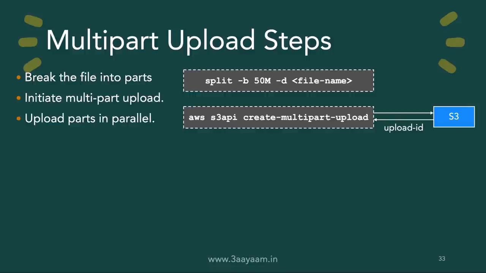
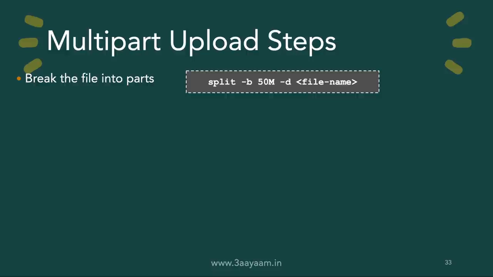
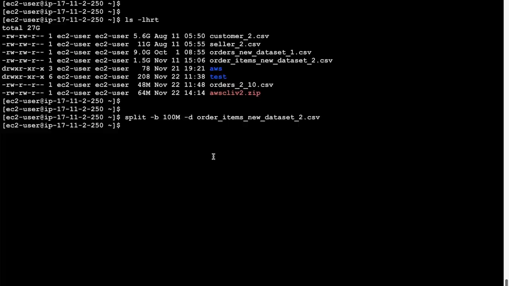
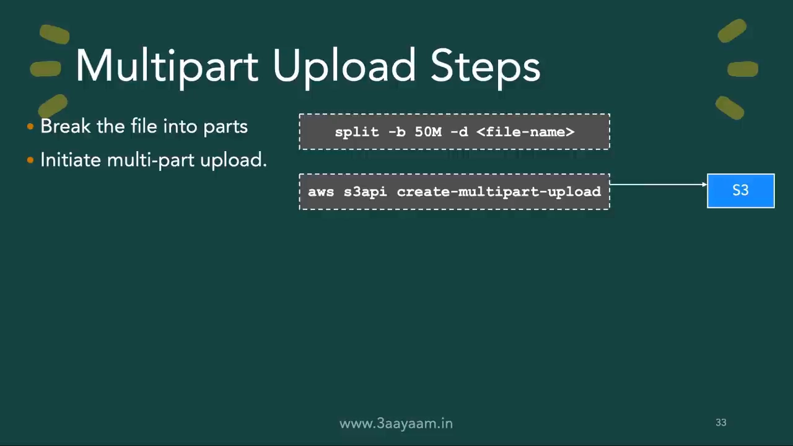
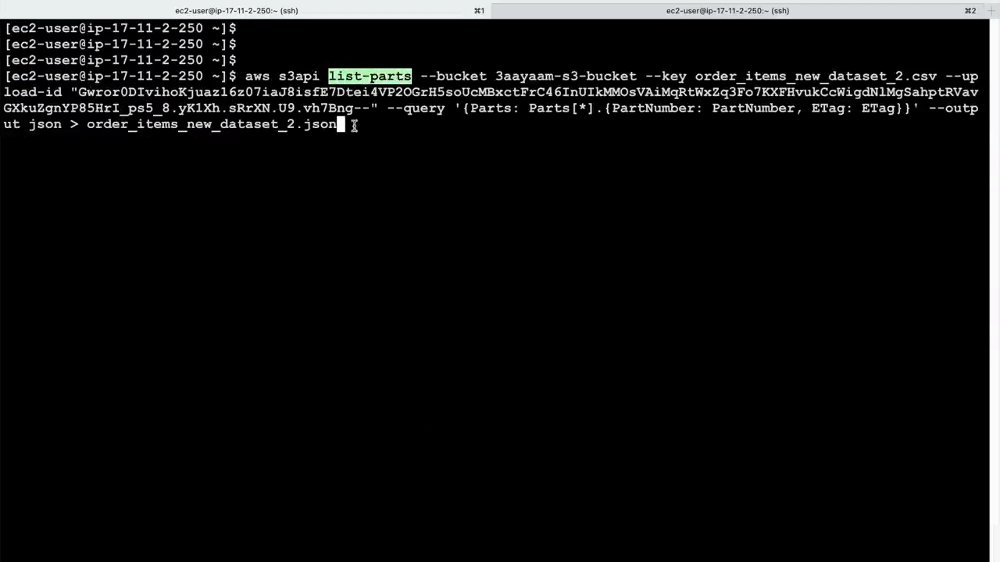
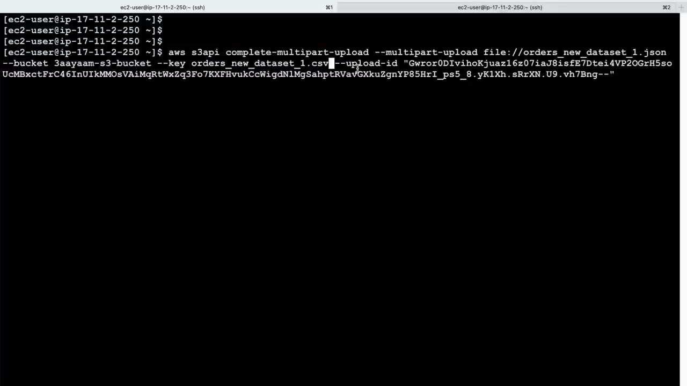
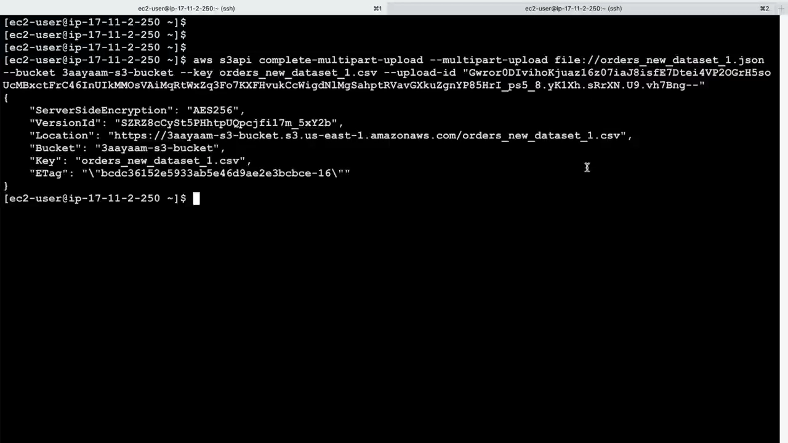
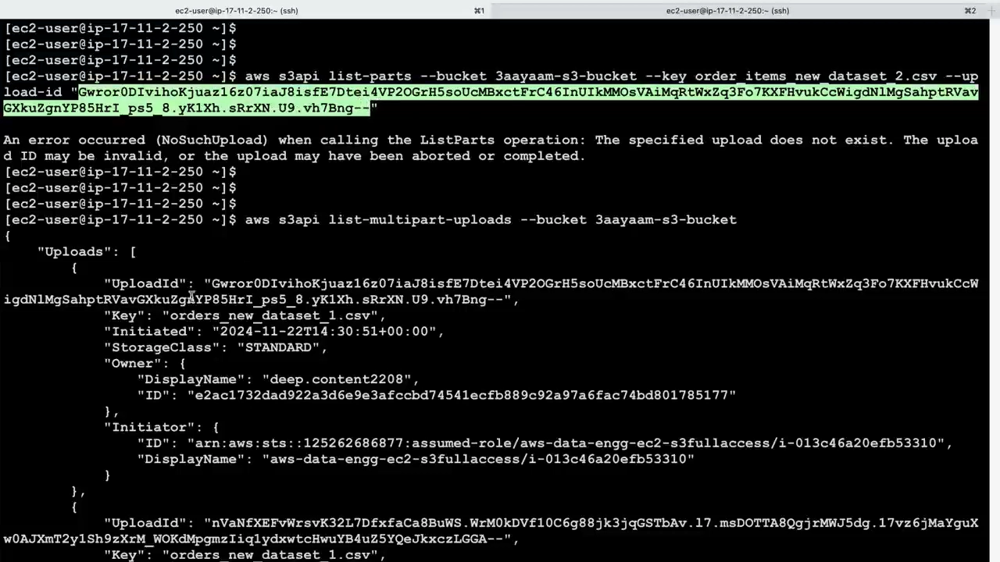
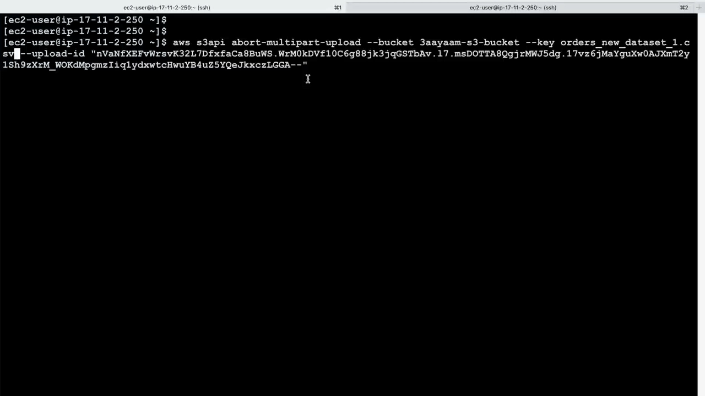
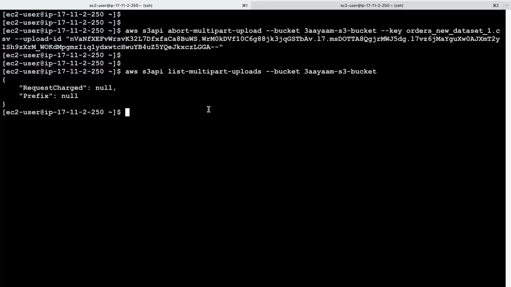

# aws s3api 分片上传实操：uploadId 是唯一线索，list-parts 是唯一账本

> 视频来源：[S3 8. S3 Multipart Upload](https://www.youtube.com/watch?v=HMz7TD_W-XY)（YouTube · 3aayaam）｜时长约 13 分钟
> 导读：这支视频不画架构图，而是直接在 EC2 上敲 `aws s3api` 命令，用一个 1.5 GB 的 CSV 把分片上传从切文件一路做到拼装完成，中途还踩了一个真实的坑。本文跟着它的命令行顺序走，重点讲清两件事：**`uploadId` 为什么是所有后续操作的唯一线索**，以及**`list-parts` 的输出为什么就是续传要用的账本**。

## 本讲要解决的核心问题（SCQA）

**背景**：把文件丢进 S3 桶，最直接的办法是上传一次就完事。文件小的时候这样没问题。

**冲突**：文件一大，这条路就很难走。讲者举了个很具体的例子：传 200 GB 的文件时，你必须保证控制台一直开着、机器不休眠、网络一刻不断——这三件事任何一件出问题，前面的传输就白费了。[【跳转到 01:06】](https://www.youtube.com/watch?v=HMz7TD_W-XY&t=66)

**疑问**：能不能把文件拆开传，让某一片失败时只重传那一片？拆开之后，「这是哪一次上传」「已经传了哪几片」这些信息由谁记着？

**回答（中心思想）**：分片上传在命令行下没有「一条命令搞定」的写法，它是一串必须按顺序执行的调用。串起这一串调用的**唯一线索是 `uploadId`**，而「已经传了哪些片」的**唯一账本是 `list-parts` 的输出**——它既是拼装对象时的输入，也是断点续传时判断「还缺哪片」的依据。



## 一、什么时候该分片

### 1.1 经验阈值：100 MB

讲者给的门槛很干脆：**文件超过 100 MB 就不该一次传完，应该用分片上传**。[【跳转到 00:00】](https://www.youtube.com/watch?v=HMz7TD_W-XY&t=0)

这不是硬性限制，而是一个经验判断：小于这个量级，分片带来的额外调用开销（创建会话、列分片、拼装）不划算；大于这个量级，一次失败重来的代价开始变得难以接受。

### 1.2 分片的三个好处

讲者在开头把好处讲成了三条：

1. **可以并行**。多个分片同时上传，把单条连接的带宽用满。
2. **顺序无关**。先传 part 3 再传 part 1 完全可以，因为**拼装是 S3 的事**，不是客户端的事。[【跳转到 00:41】](https://www.youtube.com/watch?v=HMz7TD_W-XY&t=41)
3. **失败只影响一片**。某一片失败，只重传那一片，不用重传整个文件。[【跳转到 01:31】](https://www.youtube.com/watch?v=HMz7TD_W-XY&t=91)

第 2 条值得多想一步：正因为顺序无关，客户端才能「哪个线程抢到带宽就先传哪个」，而不必排队等前一片。

## 二、命令行下的分片上传：四步加一次查询

讲者反复强调：**分片上传没有一条直接命令**。用 SDK 时这些步骤被封装在库里，一次调用就帮你走完；用 CLI 时，每一步都得自己来，或者自己写成脚本。[【跳转到 02:07】](https://www.youtube.com/watch?v=HMz7TD_W-XY&t=127)

### 2.1 第一步：切文件（这不是 S3 的命令）



```bash
split -b 100M -d order_items_new_dataset_2.csv
```

`split` 是 Linux 自带的命令，跟 S3 没有关系——**切分是客户端的责任**。`-b 100M` 指定每片 100 MB，`-d` 让后缀用数字编号。切完之后目录里会多出 `x00`、`x01`… 这样的文件，1.5 GB 的文件大约得到 16 片。[【跳转到 04:53】](https://www.youtube.com/watch?v=HMz7TD_W-XY&t=293)



片数同样可以用 $\lceil S / P \rceil$ 估算：$1.5\ \text{GB} / 100\ \text{MB} \approx 15$，加上末尾不足一片的部分，实际是 16 片。

> 讲者在幻灯片里演示的是 `split -b 50M -d`，实操时改成了 100 MB。片大小的选择没有绝对标准，它决定了「重传一次要多久」和「调用次数有多少」之间的平衡。

### 2.2 第二步：创建会话，拿到 uploadId

```bash
aws s3api create-multipart-upload --bucket <bucket> --key <key>
```

这条命令发给 S3，返回一个 **`uploadId`**。讲者对它的解释是：**这是一次特定上传的唯一标识，S3 最后拼装对象时就是按这个 ID 来认的**。[【跳转到 03:22】](https://www.youtube.com/watch?v=HMz7TD_W-XY&t=202)

所以拿到之后必须**抄下来存好**。讲者说得很实在：用 Python SDK、Java SDK 时程序会自己记住，但用 CLI 时只能手动复制保存。[【跳转到 06:00】](https://www.youtube.com/watch?v=HMz7TD_W-XY&t=360)



这一步之后，S3 里存在的是一个**未完成的分片上传**：它占着存储、能被列出来，但还不是一个可读的对象。

### 2.3 第三步：逐片上传

```bash
aws s3api upload-part \
  --bucket <bucket> --key <key> \
  --part-number 1 --body x00 \
  --upload-id <uploadId>
```

四个参数各有含义：

- `--bucket` 与 `--key`：对象最终的位置和名字；
- `--part-number`：这一片在对象里的**序号**（从 1 开始，不是文件名里的 00）；
- `--body`：本地这一片文件的路径；
- `--upload-id`：**从这一步开始，每一次调用都必须带上它**，否则 S3 不知道你在往哪一次上传里塞数据。[【跳转到 03:47】](https://www.youtube.com/watch?v=HMz7TD_W-XY&t=227)

讲者把这条命令跑了 16 次，对应 16 个分片。[【跳转到 07:27】](https://www.youtube.com/watch?v=HMz7TD_W-XY&t=447)

### 2.4 第四步：list-parts，把账本落成 JSON

所有分片传完之后，先查一遍服务端到底收到了什么：

```bash
aws s3api list-parts --bucket <bucket> --key <key> --upload-id <uploadId>
```

讲者在这里遇到了一次报错，正好把问题暴露出来（下一节细说）。改对之后，输出里能看到大约 16 个 part，与预期一致。[【跳转到 09:25】](https://www.youtube.com/watch?v=HMz7TD_W-XY&t=565)

关键的一步是**把输出裁剪成 Complete 需要的形状**：

```bash
aws s3api list-parts --bucket <bucket> --key <key> --upload-id <uploadId> \
  --query '{Parts: Parts[*].{PartNumber: PartNumber, ETag: ETag}}' \
  --output json > order_items_new_dataset_2.json
```

`--query` 只留下 `PartNumber` 和 `ETag` 两个字段——这恰好就是 `CompleteMultipartUpload` 需要的「零件清单」。讲者的说法是：**输出文件里只有片号和 ETag，这就够了**。[【跳转到 09:50】](https://www.youtube.com/watch?v=HMz7TD_W-XY&t=590)



这一步是整支视频里最值得学的技巧：**「查进度」和「生成拼装清单」用的是同一条命令**。这解释了为什么断点续传在 S3 上是天然的——服务端本来就存着这份账本，客户端只要会读。

### 2.5 第五步：complete，对象才真正出现

```bash
aws s3api complete-multipart-upload \
  --multipart-upload file://order_items_new_dataset_2.json \
  --bucket <bucket> --key <key> \
  --upload-id <uploadId>
```

`--multipart-upload file://...` 指向刚才生成的 JSON。S3 收到后按清单把分片拼成一个对象，返回结果里包含最终的 `Location`、`Bucket`、`Key` 和整个对象的 `ETag`。[【跳转到 10:40】](https://www.youtube.com/watch?v=HMz7TD_W-XY&t=640)



讲者特意指出：因为分片是并行传的，**1.5 GB 的文件很快就传完了**。[【跳转到 10:51】](https://www.youtube.com/watch?v=HMz7TD_W-XY&t=651)



## 三、一个真实的坑：NoSuchUpload 不是 uploadId 错了，是 key 错了

这是整支视频最有价值的一段。

讲者用 `list-parts` 查询时，S3 返回：

> An error occurred (NoSuchUpload) when calling the ListParts operation: The specified upload does not exist. The upload ID may be invalid, or the upload may have been aborted or completed.

但 `uploadId` 明明就是刚才 `create-multipart-upload` 返回的那一个，而且 `upload-part` 也用它成功跑过 16 次。[【跳转到 08:05】](https://www.youtube.com/watch?v=HMz7TD_W-XY&t=485)

排查的办法是换一条命令：`list-multipart-uploads` 把桶里所有未完成的分片上传都列出来。

```bash
aws s3api list-multipart-uploads --bucket <bucket>
```

输出里每条记录带着 `UploadId`、`Key`、`Initiated`、`StorageClass`、`Owner`、`Initiator`。讲者拿 `uploadId` 一比对——**完全一致**，可 `list-parts` 还是报错。[【跳转到 08:30】](https://www.youtube.com/watch?v=HMz7TD_W-XY&t=510)

真正的差异在 `Key` 上：S3 里这次上传的 key 是 `orders_new_dataset_1.csv`，而讲者在命令里写的是 `order_items_new_dataset_2.csv`。**key 写错了，所以「这个 key 下没有这次上传」**。改对 key 之后，`list-parts` 立刻正常返回 16 个 part。[【跳转到 09:20】](https://www.youtube.com/watch?v=HMz7TD_W-XY&t=560)



这个坑的教训可以提炼成两条：

1. **一次分片上传的身份是 `(bucket, key, uploadId)` 三元组**，不是单独的 `uploadId`。后续每一次调用（`upload-part`、`list-parts`、`complete`、`abort`）都必须把三者写对，否则 S3 会认为「没有这次上传」。
2. **`NoSuchUpload` 这个错误名有误导性**。它不只表示「ID 不存在」，还覆盖「key 对不上」「已被 abort」「已经 complete」几种情况。排查顺序应该是：先核对 key，再用 `list-multipart-uploads` 确认这次上传是否还活着。

## 四、未完成的分片上传：看得见、占着空间、要主动清

讲者在收尾时发现桶里还有一次**之前没做完的分片上传**，于是演示了清理：

```bash
aws s3api abort-multipart-upload \
  --bucket <bucket> --key <key> --upload-id <uploadId>
```



执行后再 `list-multipart-uploads`，列表变空，说明这次上传连同它已上传的分片一起被丢弃了。[【跳转到 11:22】](https://www.youtube.com/watch?v=HMz7TD_W-XY&t=682)



这一点在工程上很重要：**未完成的分片上传是服务端可见的实体**，它占着存储空间，但不出现在普通对象列表里。也就是说，光看「桶里有哪些对象」是发现不了它们的，必须专门用 `list-multipart-uploads` 去查。上传中断后如果没人清理，这些分片就会一直留在那里。

## 五、SDK 与 CLI 的分工

讲者在开头和中间两次提到同一件事，值得单独记一句：**分片上传的这些步骤，SDK 会替你走完，CLI 不会**。

- 用 SDK（Python / Java / JavaScript）：把切分、创建、逐片上传、查询、完成写进程序，跑一次就全自动，`uploadId` 也不需要人手抄。
- 用 CLI：每一步都要手动执行，`uploadId` 要自己复制保存，出错也要自己一步步排查。

这也解释了为什么生产环境里几乎不会手敲这些命令——但**理解命令行下的每一步，才能理解 SDK 在背后做了什么**，尤其是出问题时该看哪一个返回值。

## 六、回顾：一条链、一本账

把整支视频压成一句话：**`uploadId` 把所有调用串成一条链，`list-parts` 的输出是这条链上唯一的账本。**

- `create-multipart-upload` 产生线索（`uploadId`）；
- `upload-part` 消耗线索，逐片写入数据；
- `list-parts` 读出账本，既用于查看进度，也用于生成拼装清单；
- `complete-multipart-upload` 用账本拼出对象；
- `abort-multipart-upload` 丢弃线索和已写入的数据。

对「大快照 / 大镜像上传」这类场景，这套流程的意义在于：**进度是服务端的一等公民**。客户端崩了、换机器了，只要 `(bucket, key, uploadId)` 还留着，就能用 `list-parts` 接着往下传；反过来，如果这个三元组丢了，服务端那些分片就成了只能靠 `list-multipart-uploads` 才看得见的残留。

## 小结

- 文件超过 100 MB 就该考虑分片；分片带来并行、顺序无关、单片重试三个好处。
- 命令行下分片上传没有一条命令，必须按「切文件 → 创建会话 → 逐片上传 → 查清单 → 完成」的顺序走。
- 切文件用的 `split` 是操作系统命令，不是 S3 命令；切分是客户端的责任。
- `uploadId` 是贯穿所有后续调用的唯一线索，CLI 下必须自己保存。
- `list-parts` 的输出既是进度查询，也是 `complete-multipart-upload` 的输入——用 `--query` 裁剪成「片号 + ETag」即可。
- 一次分片上传的身份是 `(bucket, key, uploadId)` 三元组；`NoSuchUpload` 常常是 key 写错，而不是 ID 失效。
- 未完成的分片上传占空间但不出现在对象列表里，需要 `list-multipart-uploads` 才能发现，用 `abort-multipart-upload` 清理。

## 关键术语速查

| 术语 | 一句话解释 |
| :--- | :--- |
| 分片上传（multipart upload） | 把一个大对象拆成多个 part 分别上传，最后由服务端拼装的机制 |
| `uploadId` | 一次分片上传会话的唯一标识，后续所有调用都要带上 |
| key | 对象在桶里的名字，与 `uploadId` 一起构成这次上传的身份 |
| part number | 分片在对象中的序号，从 1 开始，决定拼装顺序 |
| ETag | 每个分片上传成功后返回的标识，Complete 时用来核对「拼的是不是这几片」 |
| `list-parts` | 列出某次上传已收到的分片，是进度账本，也是 Complete 的输入来源 |
| `list-multipart-uploads` | 列出桶里所有未完成的分片上传，用来找残留、核对 key |
| `complete-multipart-upload` | 提交分片清单，让 S3 拼装出最终对象 |
| `abort-multipart-upload` | 放弃一次分片上传，释放已上传的分片 |
| `NoSuchUpload` | 报错名，实际覆盖「ID 不存在 / key 不匹配 / 已 abort / 已完成」多种情况 |