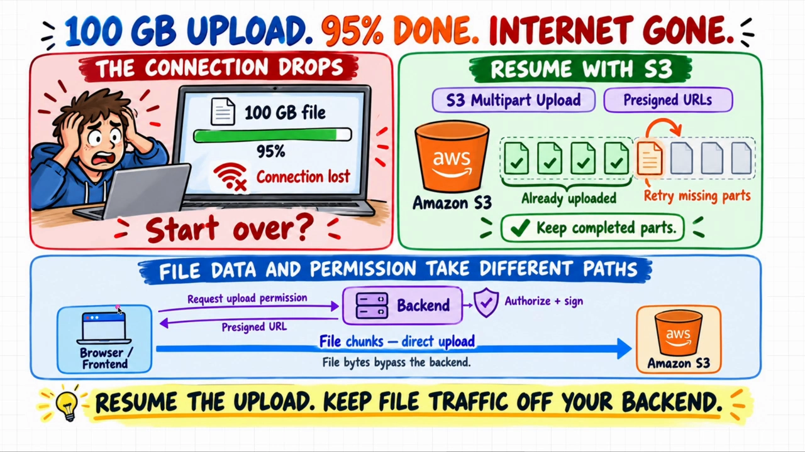
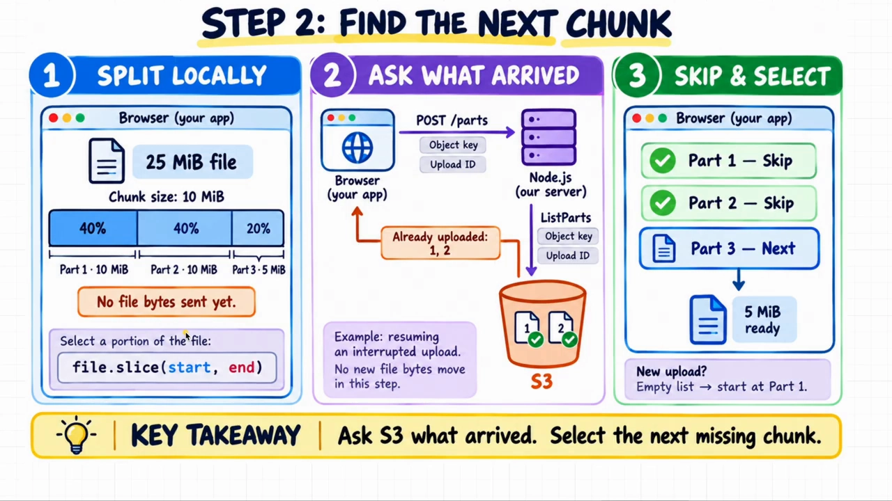
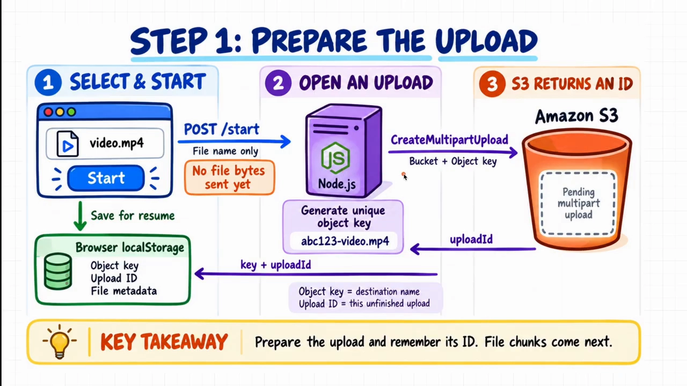
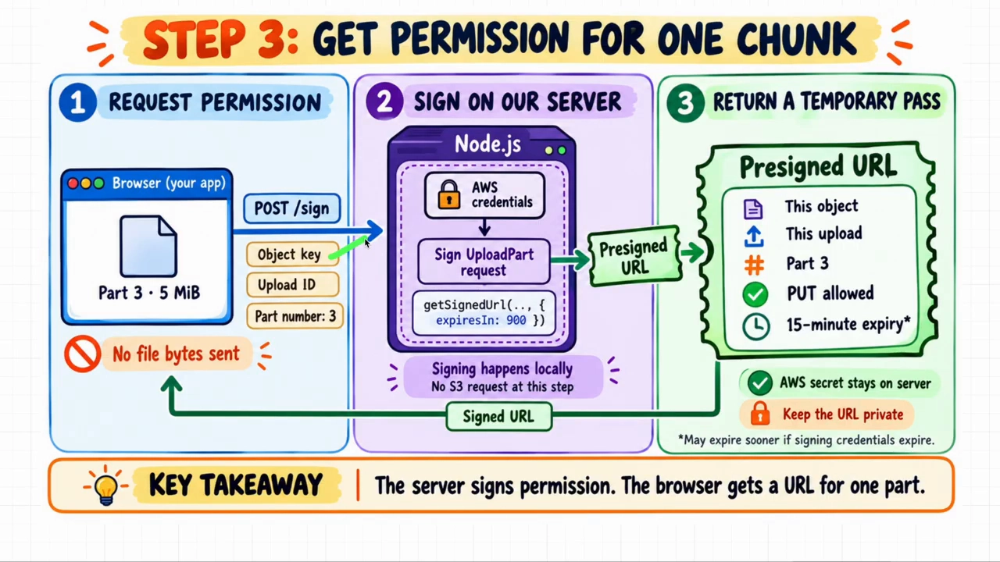
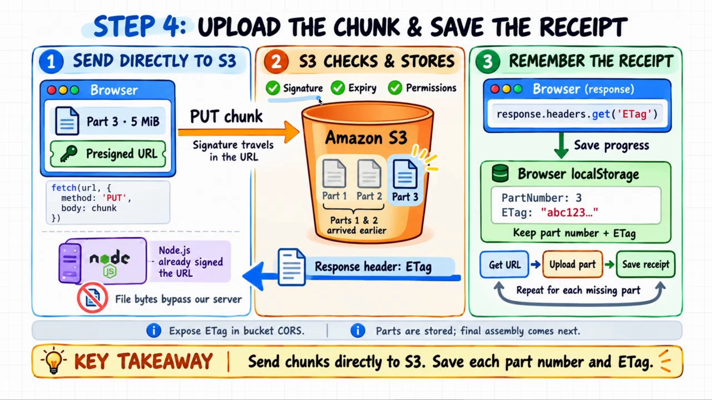
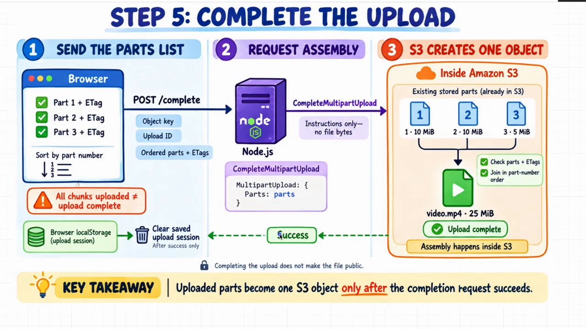
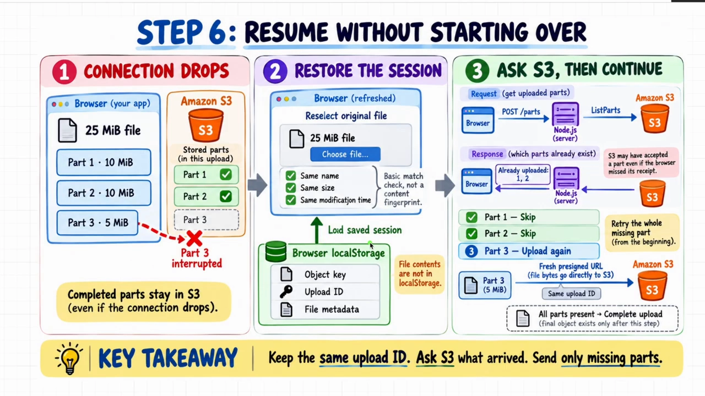
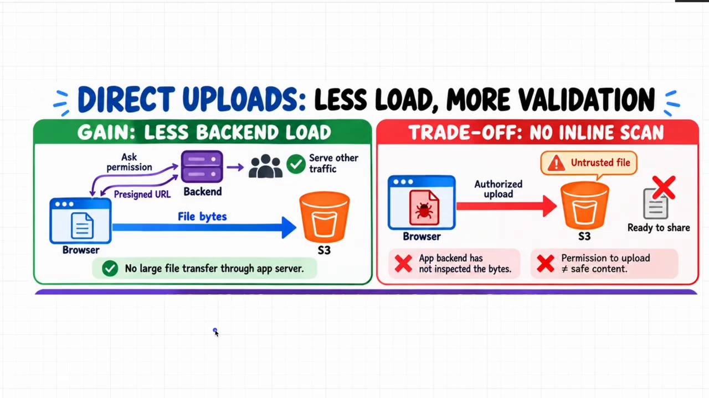

# 断点续传的状态存在哪：S3 分片上传的六个步骤

> 视频来源：[S3 Multipart Upload & Presigned URLs Explained | Resumable Uploads](https://www.youtube.com/watch?v=jePr5-vxj2k)（YouTube · Rahul）｜时长约 13 分钟
> 导读：这支视频用一个「100 GB 传到 95% 断网」的场景，把 S3 分片上传拆成六个步骤，重点回答一件事——**续传的状态到底记在哪里**。本文只讲分片上传与断点续传这条线；视频里顺带提到的预签名 URL 只作为「单片许可」一笔带过，签名算法本身不在本文范围内。视频没有展开 part 大小与数量的具体上下限，需要时请查官方文档。

## 本讲要解决的核心问题（SCQA）

**背景**：往对象存储上传大文件是慢活。一个 100 GB 的文件，按普通宽带的上传速度，传几个小时很正常。

**冲突**：传到 95% 的时候网络断了。如果上传是「一个请求把整个文件塞进去」，那么这个请求失败就等于**全部白传**——前面 95 GB 的数据在服务端没有任何可复用的痕迹。

**疑问**：能不能让已经传上去的部分不白费，断线后只补没传完的那一段？要做到这一点，**「传到哪里了」这个状态必须被记在某个地方**，它记在哪、谁负责维护？

**回答（中心思想）**：S3 的分片上传把一次大上传拆成「一次会话 + 若干个可独立重试的分片」，续传状态因此分成两半——**客户端记住 `uploadId` 和文件身份（本地存储），服务端记住哪些 part 已经收下（`ListParts` 查询）**。客户端负责「认出这是同一个文件、同一次上传」，服务端负责「说出还缺哪几片」。两边对不上时，一律以服务端为准。

## 一、为什么大文件必须分片

### 1.1 单次上传的失败代价是「全部」

讲者给的是一个很具体的画面：100 GB 的文件传到 95%，连接断了。如果整份文件是一个请求体，那么这个请求没有完成，服务端就什么都没有——**失败代价与文件大小成正比**。[【跳转到 00:00】](https://www.youtube.com/watch?v=jePr5-vxj2k&t=0)

这正是分片要解决的问题：把「一个大请求」换成「很多个小请求」，让失败的影响范围从「整个文件」缩小到「一个分片」。

### 1.2 分片把失败代价压到一片

做法很朴素：**在本地把大文件切成若干块（chunk），一块一块传**。这样连接断了，只需要从断掉的那一块接着传，而不是从第 0 字节开始。[【跳转到 00:50】](https://www.youtube.com/watch?v=jePr5-vxj2k&t=50)

讲者举的例子是 25 MiB 的文件按 10 MiB 切片，得到 10 MiB、10 MiB、5 MiB 三片。片数可以用一个式子算出来：

$$
n = \left\lceil \frac{S}{P} \right\rceil
$$

其中 $S$ 是文件大小，$P$ 是分片大小。$S = 25\ \text{MiB}$、$P = 10\ \text{MiB}$ 时 $n = 3$，最后一片只有 5 MiB 是正常的——**最后一片通常比前面的小**。

这里有个容易忽略的细节：**切片是客户端自己的事**。浏览器用 `file.slice(start, end)` 从本地文件里取一段，这一步不产生任何网络请求，也不产生任何服务端状态。[【跳转到 02:59】](https://www.youtube.com/watch?v=jePr5-vxj2k&t=179)

## 二、分片上传的六个步骤

讲者把整个流程拆成六步。前五步是一次正常上传，第六步才是「断线之后怎么办」。这个拆分方式的好处是：**前五步建立的每一样东西，第六步都要用到**。

### 2.1 第一步：准备上传，拿到 uploadId

浏览器先给后端发一个只带文件名的请求（不带文件内容），后端做两件事：

1. 生成一个唯一的对象键（object key），比如 `abc123-video.mp4`，作为这个对象最终在桶里的名字；
2. 向 S3 发 `CreateMultipartUpload`，带上桶名和这个对象键。

S3 返回一个 **`uploadId`**。讲者的定义很直接：`uploadId` 就是用来追踪「这一次上传」的 ID。[【跳转到 02:24】](https://www.youtube.com/watch?v=jePr5-vxj2k&t=144)

拿到之后，**对象键和 `uploadId` 一起被写进浏览器的 local storage**。这是全文第一个关键点：续传要用的「会话标识」在第一步就落地了。

注意这一步之后 S3 里出现的是一个**「待完成的分片上传」**，还不是对象。它占着空间、能被列出来，但还没有拼装成可读的对象——这个区别在第五步会变得很重要。

### 2.2 第二步：问 S3 哪些片已经到了

切片完成后，浏览器并不急着传，而是先问一句「已经收到哪几片」。请求经由后端转发到 S3 的 `ListParts`，带上对象键和 `uploadId`。

S3 的回答形如：「part 1、part 2 已收到，从 part 3 继续」。于是浏览器知道**只需要传 part 3**。[【跳转到 03:24】](https://www.youtube.com/watch?v=jePr5-vxj2k&t=204)

如果这是一次全新的上传，S3 返回的是一个**空列表**，浏览器据此知道要从第一片开始。[【跳转到 03:49】](https://www.youtube.com/watch?v=jePr5-vxj2k&t=229)

这一步是整个设计的枢纽：**「传到哪里了」的权威答案不在客户端，而在服务端**。客户端本地记的东西只用来「认出这是同一次上传」，真正缺哪几片必须问 S3。

### 2.3 第三步：为「这一片」单独申请许可

浏览器要传 part 3，但它手里没有 AWS 凭据——凭据不能放到浏览器里。所以它向后端请求一个**只对这一片有效的临时许可**，请求里带上对象键、`uploadId`、片号。

后端用自己的凭据签发一个预签名 URL（presigned URL），这个 URL 里绑定了：哪个对象、哪一次上传、第几片、允许 PUT、以及一个过期时间（讲者的示例是 15 分钟）。签发在服务端本地完成，**这一步并不向 S3 发请求**。[【跳转到 04:42】](https://www.youtube.com/watch?v=jePr5-vxj2k&t=282)

> 预签名 URL 的鉴权原理与有效期约束属于相邻小节的内容，这里只需要记住它在分片上传里的角色：**把「授权」和「传数据」拆开，让数据不经过后端**。

### 2.4 第四步：直传分片，把 ETag 当回执收好

浏览器拿着这张 URL，直接把 part 3 的字节 PUT 到 S3。S3 先校验三件事——签名对不对、URL 过没过期、权限够不够——通过之后收下这一片，并在**响应头里返回一个 `ETag`**。

讲者对 ETag 的比喻很贴切：它是一张**收据**，说明「part 3 我已经收下了，可以继续 part 4」。ETag 里包含片号和一个特定的标识。[【跳转到 06:19】](https://www.youtube.com/watch?v=jePr5-vxj2k&t=379)

浏览器拿到 ETag 后，把「片号 + ETag」这一对存进本地存储。**每传完一片，就多一张收据**。

这一步还藏着一个工程细节：**要读响应头里的 ETag，桶的 CORS 配置必须把它暴露出来**，否则浏览器侧的 JavaScript 拿不到这个头，收据就丢了。

### 2.5 第五步：显式 Complete，对象才诞生

所有分片传完之后，**上传并没有完成**。这是讲者反复强调的一句话：「所有 chunk 都传上去了，不等于上传完成」。

浏览器要把「对象键 + `uploadId` + 按片号排好序的 (片号, ETag) 列表」以 JSON 形式发给后端，后端再调用 `CompleteMultipartUpload`。S3 收到之后，**按片号顺序把已存下的分片拼成一个对象**，这时桶里才真正出现那个文件。[【跳转到 07:09】](https://www.youtube.com/watch?v=jePr5-vxj2k&t=429)

三个要点：

- **顺序由清单决定**。分片可以乱序上传，但拼装顺序由 Complete 请求里的列表决定，所以列表必须按片号排序。
- **ETag 必须带全**。S3 用它们核对「你让我拼的这几片，是不是我真正收下的那几片」。
- **Complete 成功之后才能清本地状态**。讲者特意说：成功响应回来之后，浏览器本地存储里的会话记录才可以删掉。

### 2.6 第六步：断点续传 = 恢复会话 + 再问一次

现在回到开头的场景：part 1、part 2 传完，part 3 传到一半断线。

**已经传上去的分片留在 S3 里**，断线不会让它们消失。用户刷新页面、重新选择同一个文件，浏览器靠本地存储认出「这是同一个文件、同一次上传」，然后**再发一次 `ListParts`**，问出「part 1、2 已收到」，于是只补 part 3。[【跳转到 08:12】](https://www.youtube.com/watch?v=jePr5-vxj2k&t=492)

这张图里有四个细节值得单独拎出来：

1. **`uploadId` 必须保持不变**。换了 `uploadId` 就等于换了一次上传，之前的分片全部作废。
2. **认文件靠的是「同名 + 同大小 + 同修改时间」这类基本比对，不是内容指纹**。文件名、大小、修改时间都对得上，才认为是同一个文件。
3. **本地存储里没有文件内容**。它只存对象键、`uploadId` 和文件元数据；字节始终在用户磁盘上。
4. **S3 可能已经收下了某一片，但浏览器没收到回执**（响应丢了）。所以「本地记录说没传完」不代表真的没传完，**以 `ListParts` 的结果为准**；重传时按整片重传，而不是从半片接着传。

## 三、状态存在哪：两处状态，各管一件事

把上面六步里的状态抽出来，其实只有两处。

### 3.1 客户端本地：负责「认出是同一次上传」

浏览器本地存储里放三样东西：**对象键、`uploadId`、文件元数据**。[【跳转到 09:02】](https://www.youtube.com/watch?v=jePr5-vxj2k&t=542)

它的职责是**身份识别**：用户重新选文件时，靠它判断「这是上次没传完的那个文件」，而不是一个同名的新文件。没有它，即使 S3 里还留着分片，客户端也不知道该去问哪一次上传。

它的局限也很清楚：换浏览器、清缓存、换设备，这份记录就没了。此时**旧的 `uploadId` 就丢了**，只能重新发起一次上传，之前的分片变成无人认领的残留。

### 3.2 服务端：负责「说出还缺哪几片」

真正的进度账本在 S3 这边。`ListParts` 返回的是服务端**实际收下**的分片列表，它不受客户端记录准确性的影响。

所以两处状态的分工可以概括成一句话：

| 状态 | 存在哪 | 回答什么问题 | 丢了会怎样 |
| :--- | :--- | :--- | :--- |
| 对象键 + uploadId + 文件元数据 | 客户端本地存储 | 这是不是同一次上传 | 找不到旧会话，只能重传 |
| 已完成分片列表（片号 + ETag） | 服务端（ListParts 可查） | 还缺哪几片 | 客户端无法确认进度，需要重新查询 |

### 3.3 两边不一致时，以服务端为准

讲者点出的两个「必须理解」的地方，正好对应这两处状态：**本地存储用来判断「要不要全传」，S3 查询用来判断「具体缺哪片」**。[【跳转到 10:17】](https://www.youtube.com/watch?v=jePr5-vxj2k&t=617)

工程上的含义是：客户端记录只能是**提示**，不能是**依据**。任何「续传」的实现都应该在开始补传之前先查一次服务端，否则就会出现「本地以为传完了、实际少一片」的静默损坏。

## 四、绕开后端的代价：没有内联扫描

这套设计有一个明确的取舍：文件字节**不经过后端**，直接从浏览器进 S3。好处是后端不用扛 100 GB 的流量、不用维持长连接，可以专心服务其他请求。

代价是**没有内联扫描（no inline scan）**。后端没看过这些字节，也就没有机会在落盘前检查恶意文件；而「有上传权限」不等于「内容是安全的」。[【跳转到 11:15】](https://www.youtube.com/watch?v=jePr5-vxj2k&t=675)

讲者给的处理方式是：如果环境里确实存在不可信文件，就得把文件先过一遍后端或隔离环境做扫描，再放进 S3——**用一点架构复杂度换安全性**。

## 五、这套设计对「快照 / 镜像上传」意味着什么

把视角从网页上传挪到存储后端，会发现结构是一样的：一份卷快照或一个镜像文件，动辄几十 GB 到上百 GB，同样经不起「传到最后失败重来」。

分片上传在这类场景里提供三样东西：

- **可重试的最小单位**：失败只影响一个分片，重试成本从 $O(S)$ 降到 $O(P)$。
- **可并行的传输**：多个分片可以同时上传，把单连接的带宽瓶颈摊开。
- **可持久化的进度**：进度记在服务端，客户端崩了、换机器了，只要 `uploadId` 还在，就能接着传。

而它要求使用方必须自己补上的部分，也正是本文反复强调的两处状态：**`uploadId` 要可靠保存**（往往要落到数据库而不是浏览器里），**补传前必须查一次服务端**。

## 小结

- 大文件必须分片，根本原因是**单次请求的失败代价与文件大小成正比**；分片把失败范围压缩到一片。
- 分片上传是「一次会话 + 多个可独立重试的分片」：`CreateMultipartUpload` 拿 `uploadId`，`UploadPart` 逐片上传并收 ETag，`CompleteMultipartUpload` 才把分片拼成对象。
- **传完所有分片不等于上传完成**，必须显式 Complete；Complete 的清单要按片号排序并带全 ETag。
- 续传状态分两半：**客户端本地存对象键 + `uploadId` + 文件元数据（认身份）**，**服务端用 `ListParts` 给出已完成清单（给依据）**。
- 两边冲突时以服务端为准：S3 可能已收下分片而客户端丢了回执，重传按整片重来。
- 直传绕开后端换来负载下降，代价是失去内联扫描能力。

## 关键术语速查

| 术语 | 一句话解释 |
| :--- | :--- |
| 分片上传（multipart upload） | 把一个大对象拆成多个 part 分别上传，最后在服务端拼成一个对象的机制 |
| part | 分片，对象数据的一段连续区间，可独立上传、独立重试 |
| `uploadId` | 一次分片上传会话的唯一标识，后续所有操作都要带上它 |
| object key | 对象在桶里的名字；分片上传期间每次调用都必须与创建时一致 |
| ETag | 每个分片上传成功后返回的校验标识，相当于这一片的收据，Complete 时要交回去 |
| `ListParts` | 查询某次上传已收到哪些分片，是断点续传的权威依据 |
| `CompleteMultipartUpload` | 提交「按片号排序的分片清单」，S3 据此拼装出最终对象 |
| 预签名 URL | 后端签发的、限定对象/分片/操作/有效期的临时上传地址，让数据不经过后端 |
| 内联扫描 | 文件落盘前由后端检查内容；直传架构默认没有这一步 |