# SigV4 签名是怎么算出来的：六步把一条请求压成一串十六进制

> 视频来源：[How to sign AWS API request using SigV4 signature](https://www.youtube.com/watch?v=INE05cykRgY)（YouTube · Middleware Technologies）｜时长约 31 分钟
> 本文覆盖：SigV4 的完整计算流程——canonical request、canonical request 哈希、credential scope 与 string to sign、四级派生签名密钥、签名与 Authorization 头，最后落到一段可运行的 Python 脚本。视频以 AWS 官方博客的图解为线索，逐张图讲，节奏偏慢但每一步都落到了具体字段。

## 本讲要解决的核心问题（SCQA）

**背景**：用 AWS SDK 或 CLI 调 AWS 服务时，请求会被自动签名，你从来不用管签名是怎么算的。

**冲突**：但有些场合装不了 SDK——IoT 设备、嵌入式设备、只有几十 KB 运行时的脚本。这些地方只能用最原始的 HTTP 请求，而**一条不带签名信息的请求会被 AWS 直接拒绝**。

**疑问**：那签名到底怎么手算？为什么 AWS 的文档里写了一大堆 canonical request、string to sign、credential scope，却很少讲清楚它们之间的关系？

**回答（中心思想）**：SigV4 是**六步流水线**——把请求拍平成 canonical request → 哈希它 → 拼出 string to sign → 用 secret 四级 HMAC 派生签名密钥 → 用密钥签 string to sign → 把结果装进 `Authorization` 头。**核心只有一句话：服务端用同一份 secret 走同样的六步，算出同样的签名，就证明请求确实来自持有 secret 的人。**

## 一、什么时候需要自己算签名

### 1.1 SDK 与 CLI 已经替你签好了

平时调 AWS 服务，`aws` 命令行或 SDK 会**把请求转换成 API 请求并自动签名**[【跳转到 00:31】](https://www.youtube.com/watch?v=INE05cykRgY&t=31)，服务端据此校验请求来自合法来源。这也是为什么大多数人从没关心过签名。

### 1.2 没有 SDK 的场合才需要手算

视频明确划了边界 [【跳转到 00:56】](https://www.youtube.com/watch?v=INE05cykRgY&t=56)：只有**装不了 SDK 或 CLI** 的场景才需要手写签名，典型是 IoT 设备与嵌入式设备。这些设备只能发裸 HTTP 请求，而裸请求没有签名就会被拒。

> 这也是本系列要关心它的原因：一个存储客户端如果跑在受限环境里（比如一个精简的 CSI 插件容器、一个 initramfs 里的恢复工具），手写 SigV4 是绕不开的。

### 1.3 两种请求体风格，和"服务端点"这个概念

发往 AWS 的 API 请求有两种风格：

- **JSON 协议**：数据以 JSON 放在 body 里 [【跳转到 03:01】](https://www.youtube.com/watch?v=INE05cykRgY&t=181)。视频说这是主流，因为 JSON 的序列化/反序列化更快也更简单。
- **Query 协议**：数据以查询参数的形式放在 URL 里。

要和某个服务通信，得先知道它的**服务端点（service endpoint）**[【跳转到 03:51】](https://www.youtube.com/watch?v=INE05cykRgY&t=231)——也就是那个服务的入口 URL。端点分两类：

- **区域级端点**：像 SQS 这种区域资源，每个 region 有一个自己的端点；
- **全局端点**：像 CloudFront 这种全局资源，只有一个全局端点。

端点会直接进签名（`host` 是被签的头），所以端点点错了，签名一定对不上。

## 二、第一步：把请求拍平成 canonical request

### 2.1 先看一条普通的 HTTP 请求

任何 HTTP 请求都有基本结构：方法（GET/POST）、要访问的端点、带授权信息的头、以及 POST 时的请求体。

视频给出的是**签名之前的请求**长这样 [【跳转到 08:14】](https://www.youtube.com/watch?v=INE05cykRgY&t=494)：

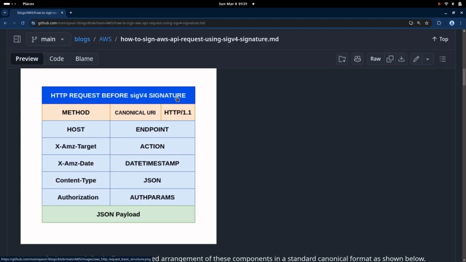

逐行读：

- `METHOD` / `CANONICAL URI` / `HTTP/1.1`：方法、路径、协议版本；
- `HOST`：服务端点；
- `X-Amz-Target`：要执行的动作（创建、列举、描述某个资源）——这是 AWS 特有的"操作名"头；
- `X-Amz-Date`：请求的时间戳；
- `Content-Type`：这里是 JSON；
- `Authorization`：**这一行现在是空的**，签名算完才有值；
- `JSON Payload`：真正的业务数据。

### 2.2 canonical request 的六行

**canonical request（规范请求）** 就是把这些组件按固定格式重新排列成一段文本 [【跳转到 10:32】](https://www.youtube.com/watch?v=INE05cykRgY&t=632)。之所以要"规范化"，是因为同一个请求可以有无数种写法（参数顺序、头的大小写、空格的多少），必须先约成唯一形式，签名才可能稳定。

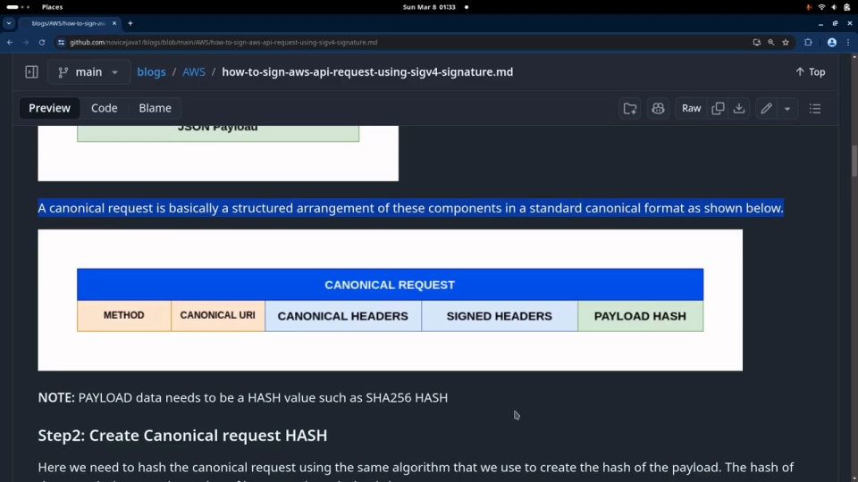

六段依次是：

1. **HTTP 方法**，如 `POST`；
2. **Canonical URI**，即路径；
3. **Canonical query string**，查询参数按规范排序拼接；
4. **Canonical headers**，参与签名的头及其值，按规范格式拼成字符串；
5. **Signed headers**，参与签名的头的**名字列表**（分号分隔，只有名字，没有值）；
6. **Payload hash**，请求体的哈希。

第 6 段有个关键要求：**payload 不能原样放进去，必须先做哈希** [【跳转到 11:10】](https://www.youtube.com/watch?v=INE05cykRgY&t=670)。视频提到可以用 MD5 或 SHA256，实际用的是 **SHA256**。原因很实际——请求体可能有几 MB，而哈希固定 64 个十六进制字符，签名计算量就与请求体大小无关了。

第 4、5 段的关系容易混：`canonical headers` 是"头名: 头值"的完整内容，`signed headers` 只是"哪些头参与了签名"的名单。名单必须和内容一一对应。

## 三、第二步：给 canonical request 做一次 SHA256

canonical request 是一段文本，接下来对它做 **SHA256**[【跳转到 12:13】](https://www.youtube.com/watch?v=INE05cykRgY&t=733)，得到一个**小写十六进制字符串**，叫 **canonical request hash**。

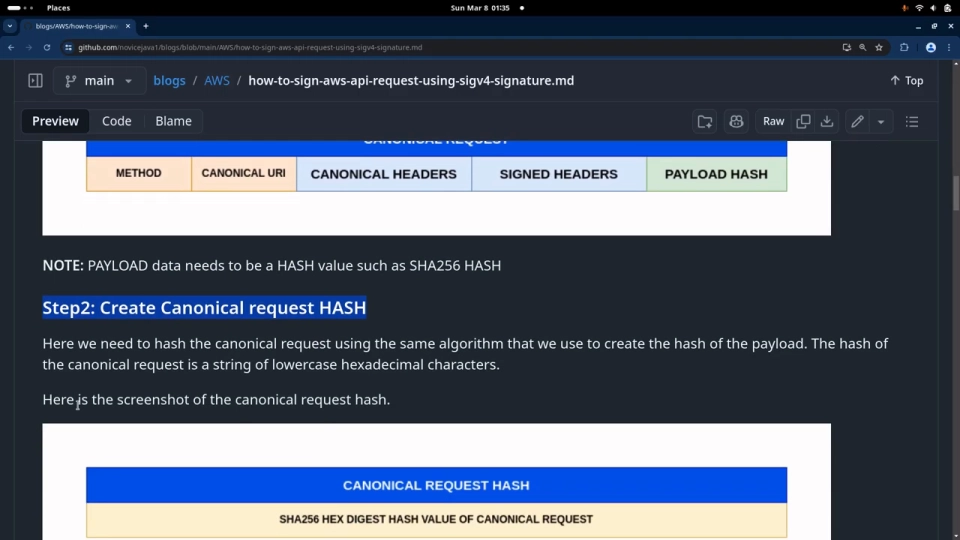

这一步的意义是"压缩"：不管 canonical request 有多长，后面参与签名的永远是一个定长摘要。这也意味着**canonical request 里任何一个字节变了，哈希就完全不同**——这是"改一个字节签名就失效"的数学基础。

## 四、第三步：credential scope 与 string to sign

### 4.1 credential scope 把签名钉在"某天、某区域、某服务"

在拼 string to sign 之前，要先构造 **credential scope（凭证范围）**[【跳转到 14:54】](https://www.youtube.com/watch?v=INE05cykRgY&t=894)。它的作用是**把这条签名限制在指定的区域和服务上**。

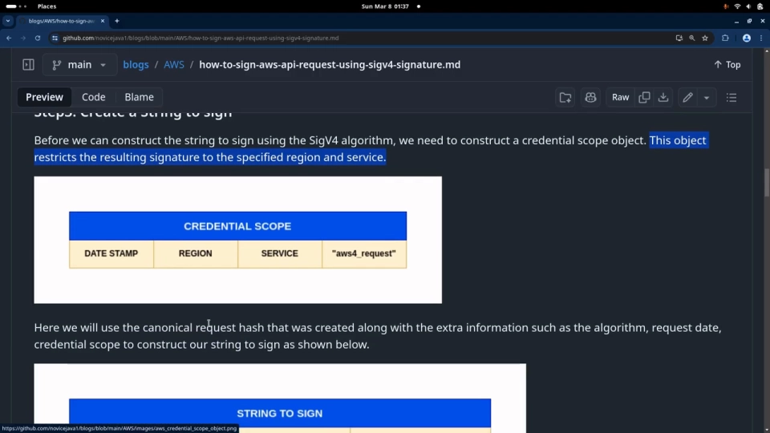

四段是：日期戳 / 区域 / 服务 / aws4_request。

这里有个容易错的细节 [【跳转到 15:19】](https://www.youtube.com/watch?v=INE05cykRgY&t=919)：**date stamp 和 date time stamp 不是一回事**。

- **date time stamp**：`YYYYMMDDTHHMMSSZ`，带时分秒，用在 `X-Amz-Date` 和 string to sign 里；
- **date stamp**：只有 `YYYYMMDD`，用在 credential scope 和派生密钥里。

为什么 scope 只到"天"？因为派生密钥也是按天算的——同一份 secret 每天派生出不同的签名密钥，这样即使某天的签名密钥泄露，影响范围也被限制在那一天。

顺带一个概念：SigV4 还有一个扩展叫 **SigV4A**，用于多区域服务。视频的建议是先吃透 SigV4，SigV4A 会容易得多。

### 4.2 string to sign 的四行

有了 credential scope，就能拼 **string to sign（待签字符串）**[【跳转到 15:49】](https://www.youtube.com/watch?v=INE05cykRgY&t=949)：

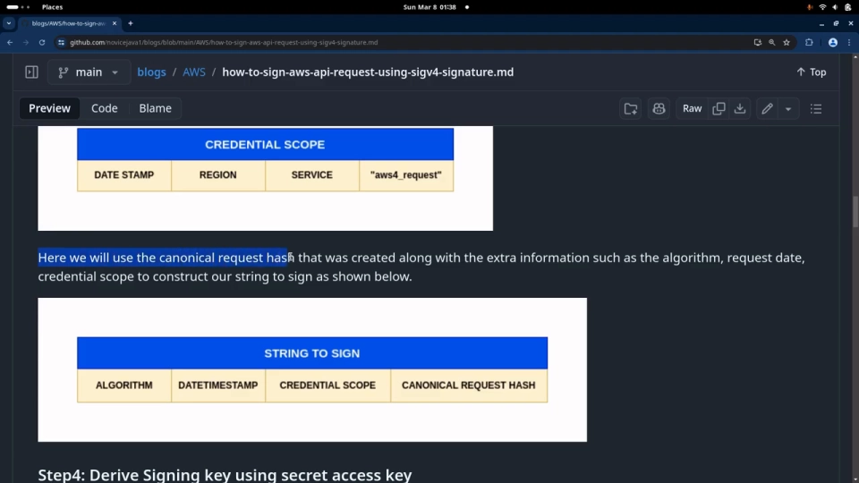

四行是：

1. **Algorithm**：`AWS4-HMAC-SHA256`；
2. **Date time stamp**：和 `X-Amz-Date` 一致；
3. **Credential scope**：上一小节拼出来的那四段；
4. **Canonical request hash**：第二步算出的摘要。

这段文本就是**最终要被签名的那段"消息"**。它把"用什么算法、什么时候、在哪个区域和服务的范围内、对哪条请求"这四件事全部绑在了一起。

## 五、第四步：用 secret 四级 HMAC 派生签名密钥

这是整个流程里最"反直觉"的一步 [【跳转到 17:04】](https://www.youtube.com/watch?v=INE05cykRgY&t=1024)：**签名用的密钥不是 secret access key 本身**，而是从 secret 逐级派生出来的。

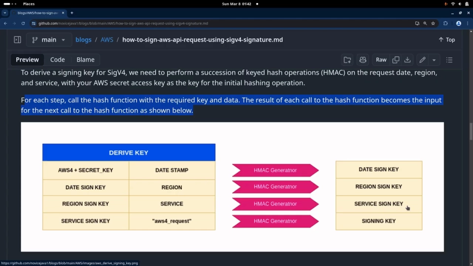

派生链条是：

$$
k_{\text{date}} = \mathrm{HMAC}( \text{"AWS4"} \| \text{secret},\ \text{date stamp} )
$$

$$
k_{\text{region}} = \mathrm{HMAC}( k_{\text{date}},\ \text{region} )
$$

$$
k_{\text{service}} = \mathrm{HMAC}( k_{\text{region}},\ \text{service} )
$$

$$
k_{\text{signing}} = \mathrm{HMAC}( k_{\text{service}},\ \text{"aws4\_request"} )
$$

其中 HMAC 是**带密钥的哈希**：同一份密钥加同一段消息，永远得到同一个值；不知道密钥就推不出来。

每一步的**输出**都成为下一步的**密钥**[【跳转到 18:20】](https://www.youtube.com/watch?v=INE05cykRgY&t=1100)，消息则依次是日期、区域、服务、`aws4_request`。视频强调的正是这个"链式"结构：第一次用 `AWS4` 前缀拼上 secret 作为密钥，之后每次都用上一次的结果当密钥。

为什么要这么绕？因为这样一来，**签名密钥天然带上了"日期 + 区域 + 服务"三个坐标**。用 `us-east-1` 的密钥算不出 `eu-west-1` 的有效签名，用今天的密钥算不出昨天的有效签名。secret 本身从头到尾没离开过本地。

## 六、第五、六步：算出签名，装进 Authorization 头

### 6.1 第五步：签 string to sign

签名就是把上一步的签名密钥当密钥、把 string to sign 当消息，做一次 HMAC-SHA256，再取十六进制 [【跳转到 19:43】](https://www.youtube.com/watch?v=INE05cykRgY&t=1183)：

$$
\text{signature} = \mathrm{HMAC}( k_{\text{signing}},\ \text{string to sign} )
$$

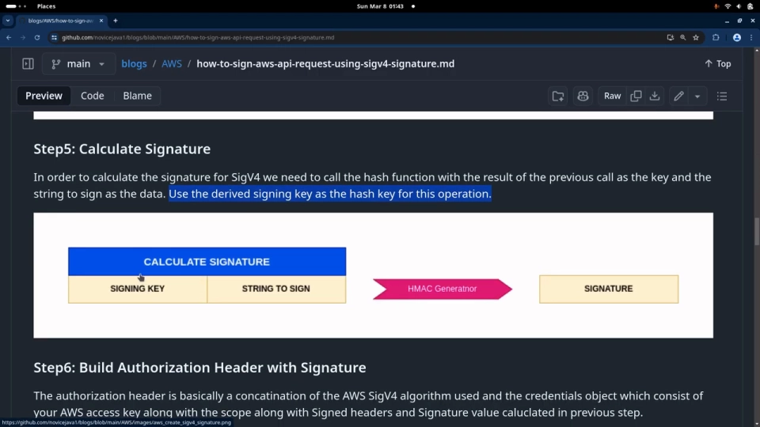

### 6.2 第六步：拼 Authorization 头

签名算出来后要放进 `Authorization` 请求头 [【跳转到 21:08】](https://www.youtube.com/watch?v=INE05cykRgY&t=1268)。这个头的结构是固定的：

```text
AWS4-HMAC-SHA256 Credential=<ACCESS_KEY>/<credential_scope>, SignedHeaders=<signed_headers>, Signature=<signature>
```

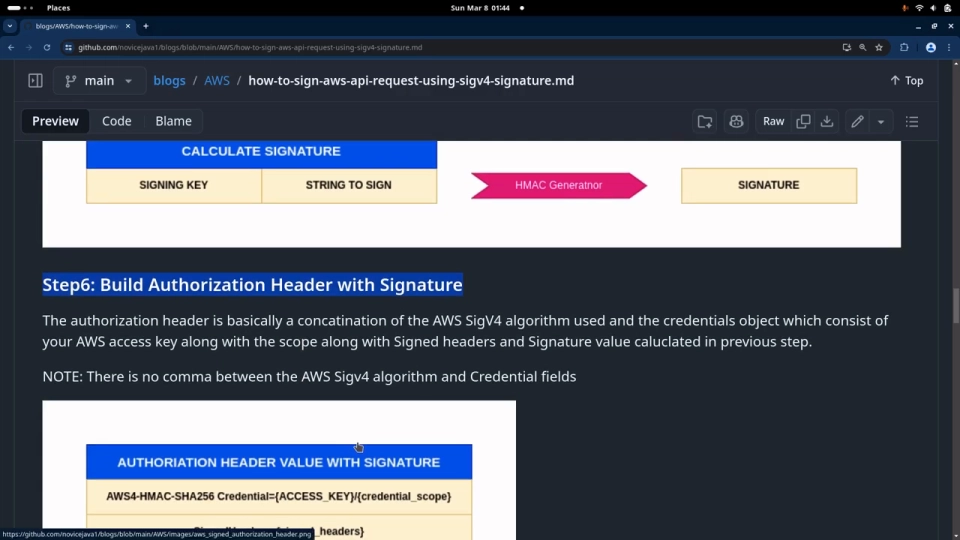

三段用逗号分隔：

1. `AWS4-HMAC-SHA256` 加 `Credential=`，后面是 access key 和 credential scope（**算法名和 Credential 之间没有逗号**，视频专门提醒了这一点）；
2. `SignedHeaders=`，被签的头的名单；
3. `Signature=`，上一步算出的签名值。

### 6.3 第七步：把签名后的请求发出去

对比一下签名前后的请求，差别只在 `Authorization` 那一行 [【跳转到 22:45】](https://www.youtube.com/watch?v=INE05cykRgY&t=1365)：

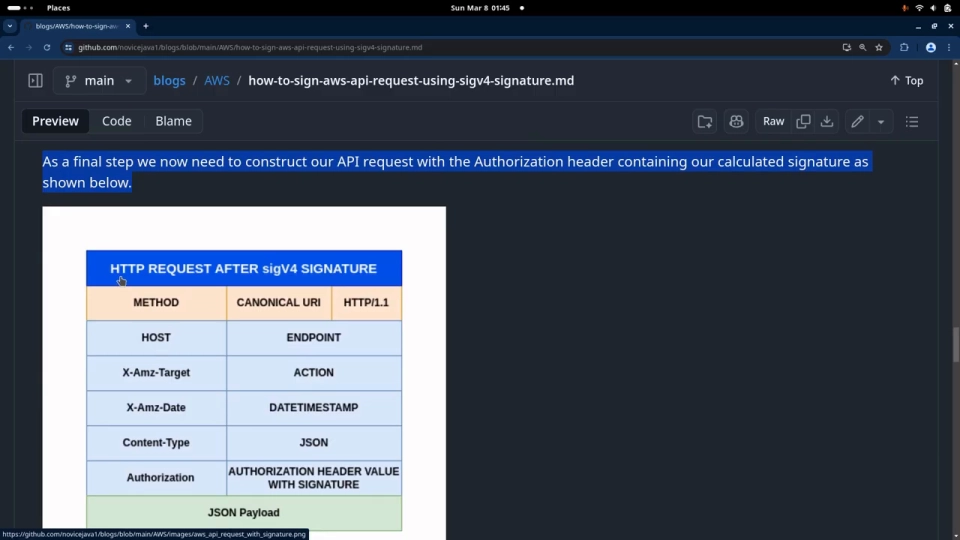

方法、路径、host、`X-Amz-Target`、`X-Amz-Date`、content-type、JSON body 全部原样保留——因为它们**已经在签名里了**，改了任何一个，服务端重算出的签名就对不上。

## 七、第八步：一段可运行的 Python 脚本

视频最后给了一份完整脚本 [【跳转到 23:44】](https://www.youtube.com/watch?v=INE05cykRgY&t=1424)，用 SQS 的 `CreateQueue` 做演示。结构正好对应前面六步。

**准备阶段**：从环境变量读 access key、secret key、region、service；把 payload 转成 bytes 并算 SHA256；准备 host、target、method、canonical URI；生成 `amz_date` 和 `date_stamp` 两种时间格式。

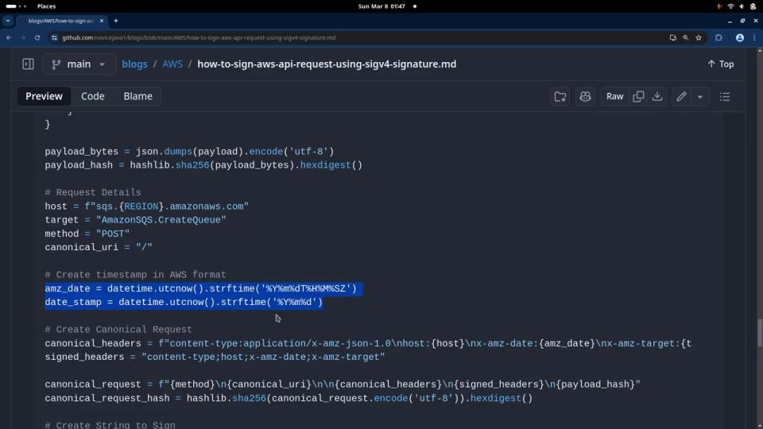

**拼 canonical request**：把 canonical headers、signed headers、payload hash 按格式拼起来，再哈希得到 `canonical_request_hash`。

**派生密钥用一个统一的小函数**，链式调用四次 [【跳转到 25:54】](https://www.youtube.com/watch?v=INE05cykRgY&t=1554)：

```python
def sign(key, msg):
    return hmac.new(key, msg.encode('utf-8'), hashlib.sha256).digest()

kDate    = sign(("AWS4" + SECRET_KEY).encode('utf-8'), date_stamp)
kRegion  = sign(kDate, REGION)
kService = sign(kRegion, SERVICE)
kSigning = sign(kService, "aws4_request")

signature = hmac.new(kSigning, string_to_sign.encode('utf-8'), hashlib.sha256).hexdigest()
```

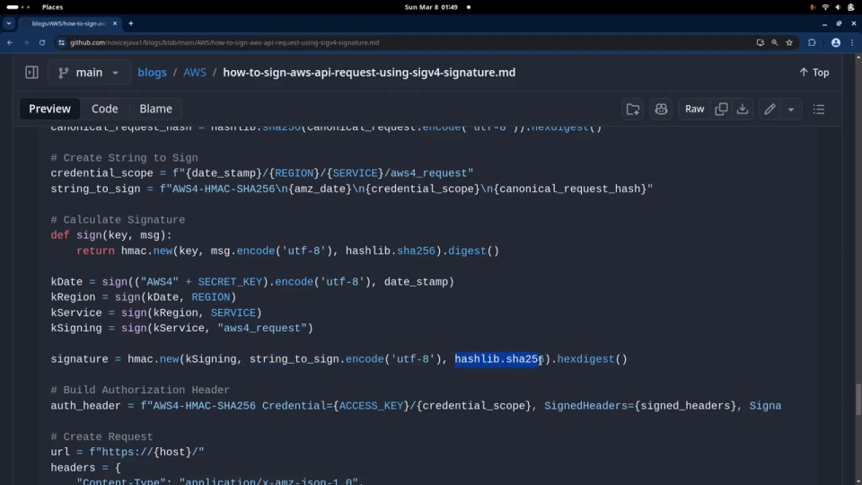

**发请求**：拼好 `Authorization` 头，用 `requests.post` 把端点、payload、headers 发出去，成功就打印返回的 JSON，失败则分别捕获请求异常、JSON 解析异常和一般异常。

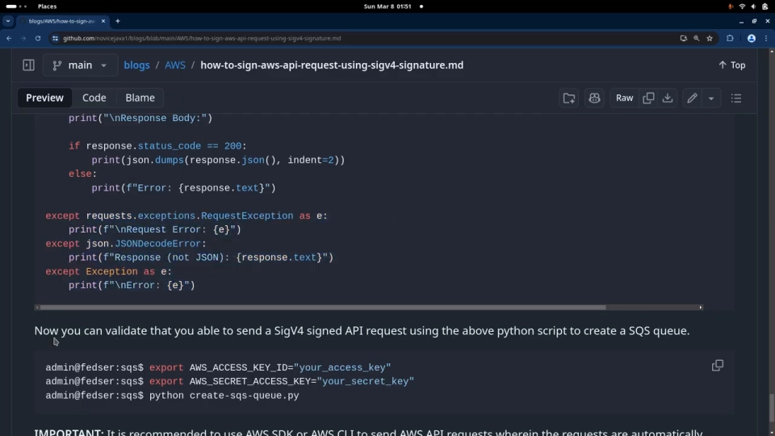

## 八、什么时候不该手写

视频结尾给了一条很实在的建议 [【跳转到 29:14】](https://www.youtube.com/watch?v=INE05cykRgY&t=1754)：**能不用手写就别手写。**

用 SDK 或 CLI 的好处不只是"省事"：

- 签名是自动的，不会因为漏签一个头而失败；
- 自带**重试**机制；
- 自带**错误处理**。

手写 SigV4 是一件复杂且容易出错的事，只在确实装不了 SDK 的场景（IoT、嵌入式）才值得做。换句话说，**SigV4 值得理解，但不值得日常手写**[【跳转到 30:04】](https://www.youtube.com/watch?v=INE05cykRgY&t=1804)——理解它是为了在签名失败时能定位问题，而不是为了取代 SDK。

## 小结

- SigV4 是给 API 请求加认证信息的签名协议；不带签名信息的请求会被 AWS 直接拒绝。
- 流程是六步：**canonical request → 哈希 → credential scope + string to sign → 派生签名密钥 → 算签名 → 装 Authorization 头**。
- canonical request 有六段：方法、canonical URI、canonical 查询串、canonical 头、被签的头、payload 哈希。payload 必须先哈希，签名计算量才与请求体大小无关。
- credential scope 是 日期戳 / 区域 / 服务 / aws4_request，它把签名钉死在"某天、某区域、某服务"上；date stamp 只有日期，date time stamp 带时分秒。
- 签名密钥不是 secret，而是 **secret 经日期、区域、服务、`aws4_request` 四级 HMAC 派生**出来的；每一步的输出是下一步的密钥。
- `Authorization` 头的三段是：算法与凭证范围（注意算法名后没有逗号）、被签的头名单、签名值。
- 服务端校验的方式就是**用同一份 secret 重走一遍**，算出同样的签名即放行。
- 日常应该用 SDK/CLI（自动签名 + 重试 + 错误处理），手写只留给装不了 SDK 的受限设备。

## 关键术语速查

| 术语 | 一句话解释 |
| --- | --- |
| SigV4 | AWS 签名算法第 4 版，用 HMAC-SHA256 对规范化请求签名 |
| service endpoint | 服务的入口 URL，区域资源每区一个，全局资源只有一个 |
| canonical request | 把请求按固定格式拍平成的文本，是签名的输入 |
| canonical headers | 参与签名的头及其值，规范化后的完整内容 |
| signed headers | 参与签名的头的名字列表，只有名字没有值 |
| payload hash | 请求体的 SHA256 摘要，用来把任意长度的 body 压成定长 |
| credential scope | 日期戳 / 区域 / 服务 / aws4_request，限定签名的作用范围 |
| string to sign | 待签字符串，由算法、时间戳、credential scope、canonical request 哈希拼成 |
| signing key | 由 secret 四级 HMAC 派生出的密钥，不是 secret 本身 |
| Authorization 头 | 承载算法、凭证范围、被签头和签名值的请求头 |
| SigV4A | SigV4 的扩展，用于多区域服务 |