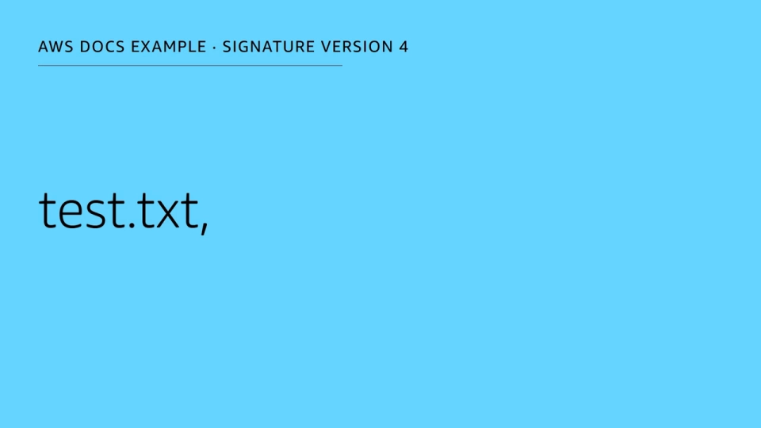
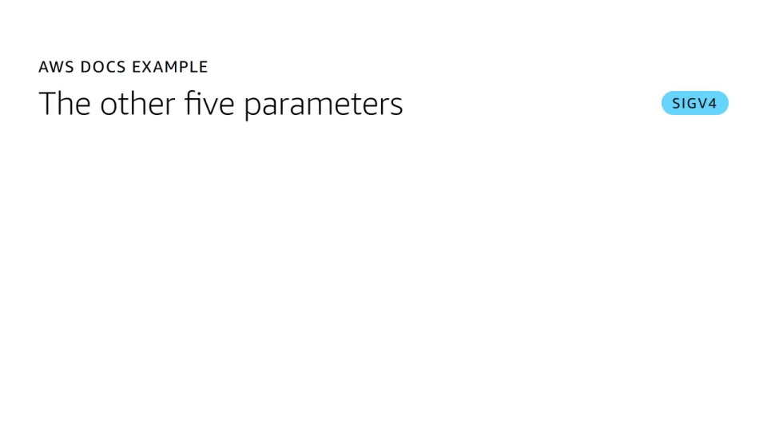
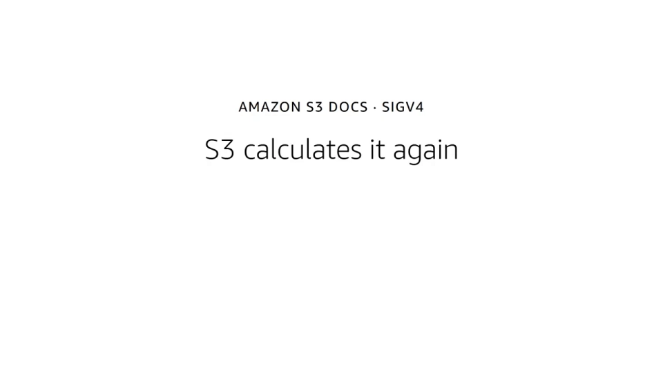
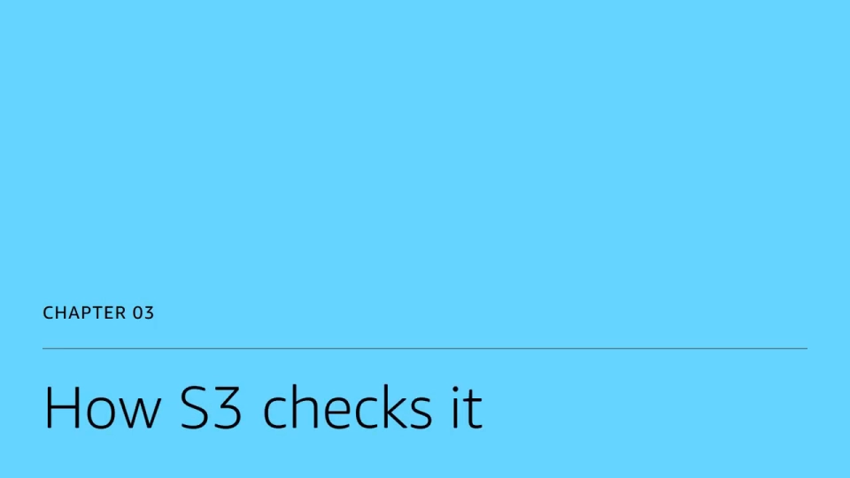
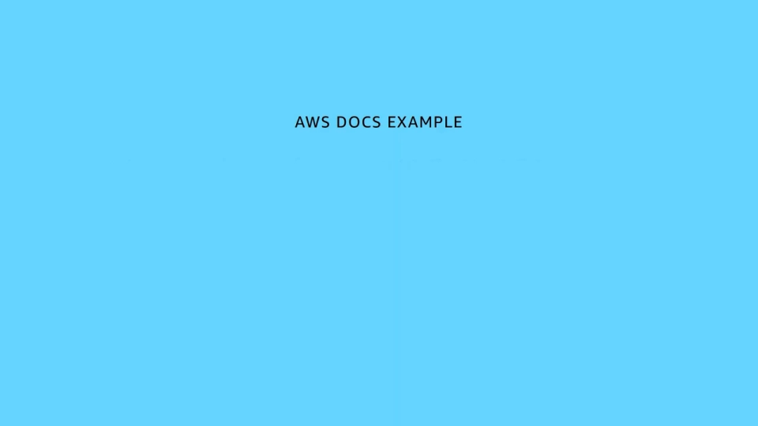
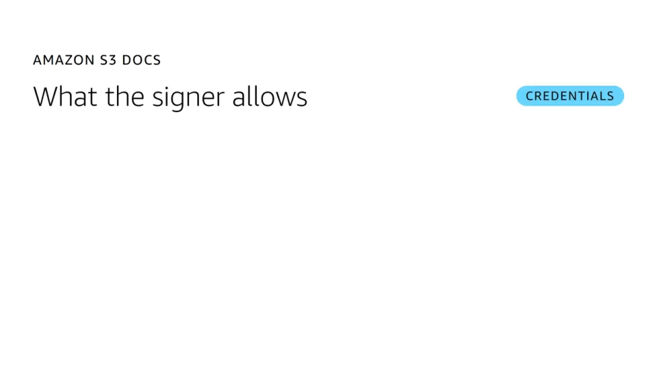

# 预签名 URL 为什么会在到期前失效

> 视频来源：[How S3 presigned URLs work (and why they expire early)](https://www.youtube.com/watch?v=3DSG4T9h1s4)（YouTube · Explainer Cloud）｜时长约 5 分钟
> 本文覆盖：预签名 URL 的鉴权原理、有效期上限从哪来、上传场景的约束、访问控制的层次与常见误用。视频是极简动效讲解（画面多为单句字幕卡），配图按"这句话在讲哪一步"挑选，信息以字幕解说为准。

## 本讲要解决的核心问题（SCQA）

**背景**：S3 里的对象默认是私有的，只有属主能读。想让别人（浏览器、第三方、临时任务）读一个对象，正常做法是给他一套 AWS 凭证，或者把桶改成公开。

**冲突**：两件事都不能干。凭证不能给出去，桶更不能公开。但业务又确实需要一个"只在这段时间内、只对这个对象有效"的访问许可。

**疑问**：能不能签一条链接，把"我的权限"临时借给别人，而且到期自动作废？

**回答（中心思想）**：预签名 URL 就是**一条已经签好名的完整请求**——它把你的 access key、签名、过期时间全部塞进 URL 的查询参数里，服务端收到后用同一份 secret 重算签名，一致就放行。所以它有两个硬约束：**签名与请求内容绑定**（改一个字节就失效），**有效期不会超过签发它的那套凭证**（你要 7 天，凭证 1 小时就过期，链接也只能活 1 小时）。

## 一、预签名 URL 是把一整条请求签好交给别人

### 1.1 对象默认私有，链接自带身份

S3 的每个对象一开始都是私有的，只有属主能读 [【跳转到 00:18】](https://www.youtube.com/watch?v=3DSG4T9h1s4&t=18)。所以一个陌生人点开 `https://example-bucket.s3.us-east-1.amazonaws.com/test.txt` 时，服务端的第一反应是拒绝。

预签名 URL 改变的不是这个默认值，而是**这次请求里带上了身份**：

> "A pre-signed URL is a whole request, already signed, that you hand to someone else."
> （预签名 URL 是一整条已经签好名的请求，你把它交给别人。）[【跳转到 00:25】](https://www.youtube.com/watch?v=3DSG4T9h1s4&t=25)


官方文档把它叫作 **bearer token（持有者令牌）**：谁拿到这条链接，谁就有这条链接所代表的权限，不需要再出示任何身份。链接在过期之前可以反复使用，不是一次性的 [【跳转到 00:35】](https://www.youtube.com/watch?v=3DSG4T9h1s4&t=35)。

这也解释了一个常见误解：预签名 URL 不是"给某个用户开的权限"，而是"复制了一份权限，放进了链接里"。链接被谁捡到，权限就被谁捡到。

### 1.2 URL 里有什么：五个参数加一个签名

文档里的示例是把 `test.txt`（位于 `example-bucket`、`us-east-1`）签成一条 24 小时有效的链接，整条 URL 的参数结构就是本节要拆的东西 [【跳转到 00:41】](https://www.youtube.com/watch?v=3DSG4T9h1s4&t=41)。



问号之后的查询参数承担全部鉴权信息：

```text
https://example-bucket.s3.us-east-1.amazonaws.com/test.txt
  ?X-Amz-Algorithm=AWS4-HMAC-SHA256
  &X-Amz-Credential=<ACCESS_KEY>/20240101/us-east-1/s3/aws4_request
  &X-Amz-Date=20240101T000000Z
  &X-Amz-Expires=86400
  &X-Amz-SignedHeaders=host
  &X-Amz-Signature=<64 位十六进制>
```

逐个看：

- `X-Amz-Algorithm`：签名算法名，这里是 **Signature Version 4**（缩写 SigV4），即 `AWS4-HMAC-SHA256`。
- `X-Amz-Credential`：签发者是谁、什么时候签的、签给哪个区域哪个服务 [【跳转到 01:07】](https://www.youtube.com/watch?v=3DSG4T9h1s4&t=67)。它由 **access key id**、日期、region、服务名（这里是 `s3`）拼成。
- `X-Amz-Date`：签名的时刻，也是有效期的起点。
- `X-Amz-Expires`：从签名时刻起算多少秒后失效，示例是 `86400`，即 24 小时 [【跳转到 00:56】](https://www.youtube.com/watch?v=3DSG4T9h1s4&t=56)。
- `X-Amz-SignedHeaders`：哪些请求头被签进了签名。示例只有 `host`——**host 总是被签的**。
- `X-Amz-Signature`：最终签名值。

注意这里**没有 secret access key**。URL 里只有 access key id（相当于用户名，本来就是公开可见的标识）和一段由 secret 算出来的签名。secret 只存在于签发者和服务端，谁都不给。




## 二、服务端怎么验：用同一份 secret 重算一遍

### 2.1 签名封住了方法、路径、查询和 host

签名的输入不是这条 URL 的字符串本身，而是从请求里**规范化**出来的一段文本，叫 **canonical request**（规范请求）。对这条链接来说，它包含四样东西：HTTP 方法、路径、查询参数、host。



canonical request 的最后一行是 `UNSIGNED-PAYLOAD` [【跳转到 01:26】](https://www.youtube.com/watch?v=3DSG4T9h1s4&t=86)，意思是**请求体不参与签名**——对 GET 下载来说这很合理，本来就没有 body。



请求到达 S3 时，S3 做的是"重算一遍" [【跳转到 01:21】](https://www.youtube.com/watch?v=3DSG4T9h1s4&t=81)：

1. 用收到的请求重建 canonical request；
2. 拼出 **string to sign**（待签字符串，含算法、时间戳、凭证范围、canonical request 的哈希）；
3. 用自己保存的那份 secret **派生签名密钥**；
4. 算出签名，和你 URL 里的 `X-Amz-Signature` 比对。

**一致就放行，不一致就拒绝。** 整个过程没有"查表"、没有"会话"，服务端只做一次纯计算——这也是预签名 URL 能无限扩展、且不需要任何服务端状态的原因。

### 2.2 签名密钥是四级 HMAC 派生出来的

签名密钥不是 secret 本身，而是用 secret 逐级 HMAC 出来的 [【跳转到 01:51】](https://www.youtube.com/watch?v=3DSG4T9h1s4&t=111)：

$$
k_{\text{date}} = \mathrm{HMAC}( \text{"AWS4"} \| \text{secret},\ \text{date} )
$$

$$
k_{\text{region}} = \mathrm{HMAC}( k_{\text{date}},\ \text{region} )
$$

$$
k_{\text{service}} = \mathrm{HMAC}( k_{\text{region}},\ \text{service} )
$$

$$
k_{\text{signing}} = \mathrm{HMAC}( k_{\text{service}},\ \text{"aws4\_request"} )
$$

（HMAC 是带密钥的哈希：同一份密钥和同一段消息，永远算出同一个值；没有密钥就猜不出来。）

四级派生的作用是把签名**钉死在"某天、某个区域、某个服务"上**。用 us-east-1 的日期派生出的密钥，算不出 eu-west-1 的有效签名。



### 2.3 改一个字节就失效，这正是它安全的原因

因为方法、路径、查询参数、被签的头都在签名里 [【跳转到 02:00】](https://www.youtube.com/watch?v=3DSG4T9h1s4&t=120)，所以：

- 把 GET 改成 PUT —— 签名不匹配；
- 把路径从 `/test.txt` 改成 `/other.txt` —— 签名不匹配；
- 往查询串里加一个参数、或者把参数顺序打乱 —— 签名不匹配；
- 中间有个代理重写了 URL —— 签名不匹配。

反过来说，**只要"按签名的样子原样使用"，签名就匹配**。所以签名对时钟漂移是敏感的：`X-Amz-Date` 是签名的一部分，客户端和服务端时间差太大时，请求会被判为过期或签名无效。

这条性质有两个直接推论，都非常重要：

1. **一条 URL 只能用于一个对象、一种方法。** 你不能把"下载 A 的链接"改造成"下载 B 的链接"，也不能把下载链接当上传链接用。
2. **URL 一旦泄露就等于对象泄露。** 因为不需要任何额外凭证，持有即有权。

## 三、有效期：你申请的不是最终答案

### 3.1 上限 7 天，来自签名密钥的寿命

`X-Amz-Expires` 的取值范围是 **1 秒到 7 天**。7 天不是随便定的上限——签名密钥是按**日期**派生的，日期一变密钥就变，所以一条签名的"寿命上限"天然被限制在这个派生周期里。

绝对过期时刻由两个参数共同决定：

$$
t_{\text{expire}} = t_{\text{X-Amz-Date}} + \text{X-Amz-Expires}
$$

也就是说，有效期是**相对签名时刻**的偏移量，不是"到某个日期为止"。同一份文件今天签 1 小时、明天签 1 小时，得到的是两条完全不同的 URL。

### 3.2 真正先到期的，往往是凭证

这里是最容易踩的坑：**你申请的有效期，不代表链接真能活那么久。**

> "A mistake to avoid: trusting the expiry you asked for. The URL also dies when its credentials do."
> （要避免的错误：相信你申请的那个有效期。凭证死掉的时候，链接也会跟着死。）[【跳转到 03:17】](https://www.youtube.com/watch?v=3DSG4T9h1s4&t=197)

因为签名是用**签发者的凭证**派生的，凭证一失效，服务端就算不出同一个签名了 [【跳转到 03:23】](https://www.youtube.com/watch?v=3DSG4T9h1s4&t=203)。各类凭证的寿命差别很大：

| 凭证类型 | 典型寿命 | 对预签名 URL 的影响 |
| --- | --- | --- |
| IAM 用户的长期 access key | 长期有效 | 可以签满 7 天 |
| AssumeRole 得到的临时凭证 | 默认 1 小时 | 申请 7 天也没用，1 小时就失效 |
| EC2 实例角色凭证 | 通常 6 小时 | 链接最多活到凭证轮换 |
| ECS 任务凭证 | 通常 1~6 小时轮换 | 同上 |
| 控制台会话 | 最长 12 小时 | 会话结束链接即失效 |

所以正确的心智模型是：

$$
t_{\text{失效}} = \min(\ t_{\text{签名}} + \text{X-Amz-Expires},\ t_{\text{凭证失效}}\ )
$$

顺带一个好消息：**吊销、删除、停用凭证，会让它签出的所有 URL 一起失效** [【跳转到 03:33】](https://www.youtube.com/watch?v=3DSG4T9h1s4&t=213)。这是预签名 URL 唯一的"撤销"手段——链接本身撤不掉，但可以掐掉它的根。

### 3.3 过期是按请求检查的

过期检查发生在**每一次请求**上 [【跳转到 03:47】](https://www.youtube.com/watch?v=3DSG4T9h1s4&t=227)，而不是连接建立时：

- 一个正在进行的下载会继续跑完；
- 中断后重新发起的请求会被拒绝。

对"分片上传"这类长任务，这条规则很关键：每个分片都是一次独立请求，所以要么把有效期设得足够覆盖整个上传窗口，要么在过程中重新签发。

## 四、上传场景：PUT 预签名 URL 的四个约束

预签名 URL 不只用于下载 [【跳转到 02:19】](https://www.youtube.com/watch?v=3DSG4T9h1s4&t=139)。更常见的用法是**让浏览器直传对象存储**，绕开自己的应用服务器：应用签一条 PUT URL 交给浏览器，浏览器带着文件直接发给 S3，全程浏览器手上没有任何 AWS 凭证。


文档里的 Python 示例调用 `generate_presigned_url`，指定 `put_object`、桶名、key，**同时把 content-type 也签了进去**，有效期 1000 秒。

### 4.1 一条 URL 只对一个 key

签名里含路径，所以这条 PUT URL 只能写它被签的那个 key。想传第二个文件，就得签第二条。

### 4.2 content-type 被签进去了

既然 content-type 在签名里，上传时就必须发**一模一样的 content-type** [【跳转到 02:43】](https://www.youtube.com/watch?v=3DSG4T9h1s4&t=163)，否则签名不匹配。这是有意为之的安全设计：签发者可以借此限制"这个位置只能放图片"。

### 4.3 单次 PUT 最多 5 GB，跨域要配 CORS

- 一次 PUT 最大 5 GB。更大的文件要走分片上传（见同节 3.2.1）。
- 浏览器从你的域名向桶的域名发请求属于跨域 [【跳转到 02:51】](https://www.youtube.com/watch?v=3DSG4T9h1s4&t=171)，必须由**桶的 CORS 配置允许你的 origin**，否则浏览器会直接拦掉这个 PUT。文档示例允许 `www.example.com` 发起 PUT，并把预检结果缓存 3000 秒。

### 4.4 重复上传会覆盖

PUT 是"写这个 key"，不是"新建这个 key"。同一个 URL 用两次，**第二个文件会覆盖第一个** [【跳转到 04:00】](https://www.youtube.com/watch?v=3DSG4T9h1s4&t=240)。要防覆盖，靠两条：开版本控制（旧版本保留），或用条件写（conditional write）拒绝覆盖。

## 五、访问控制的四层，与"委托"的边界

到这里可以把 S3 的访问控制摆成一张图。它不是一个开关，而是四层叠加：

| 层次 | 回答的问题 | 作用范围 |
| --- | --- | --- |
| IAM policy | **谁**能做什么 | 身份侧（用户、角色） |
| Bucket policy | 这个**资源**允许谁做什么 | 资源侧（桶） |
| ACL | 单个对象/桶的粗粒度授权 | 对象级（S3 已弱化，新场景不建议用） |
| 预签名 URL | 把已有权限**临时转交**出去 | 一条请求 |

预签名 URL 在这一层里是**委托（delegation）**，不是授权源。它有两个必须记住的边界：

1. **签发者必须自己有权限。** 一个只能读 `a/` 前缀的角色，签不出能读 `b/` 的 URL。
2. **签出的 URL 权限不会超过签发者。** 它只是把签发者已有的权限原样复制一份，加上时间限制。

而 bucket policy 还能从**资源侧**给预签名 URL 加一道天花板。文档示例里有一条策略，**拒绝签名年龄超过 600000 毫秒（10 分钟）的请求** [【跳转到 04:15】](https://www.youtube.com/watch?v=3DSG4T9h1s4&t=255)：



这条策略的意义在于：即使某个应用签了一条 7 天的 URL，只要桶策略写着"签名超过 10 分钟就拒"，链接照样 10 分钟就死。**有效期是签发者申请的，上限是资源侧规定的。**[【跳转到 04:40】](https://www.youtube.com/watch?v=3DSG4T9h1s4&t=280)

## 六、常见误用与风险

把上面的机制反过来读，就是这个功能最容易出事的地方：

**1. 把 URL 写进日志、错误上报、前端源码。**
预签名 URL 是 bearer token，持有即有权。它会出现在访问日志、APM 的请求记录、浏览器的历史与 Referer 里。一旦落进日志系统，等于把对象权限复制到了日志系统里——而日志的访问控制通常比对象存储松得多。

**2. 有效期设得过长。**
7 天的链接等于 7 天的公开对象。能设 10 分钟就不要设 1 天。CLI 的默认值是 1 小时，这个默认值本身就是一个"别设太长"的提示。

**3. 用长期凭证签发。**
用 IAM 用户的长期 access key 签发，意味着链接的寿命只受 7 天限制，而且**没法通过轮换凭证来止损**。正确做法是用 STS 临时凭证（AssumeRole）签发，让链接的寿命自然收敛到会话寿命。

**4. 以为可以撤销。**
预签名 URL 没有撤销接口。链接签出去之后，你只能：等它过期、吊销/轮换背后的凭证、或者用 bucket policy 拒绝过老的签名。所以签发之前就要想清楚"这条链接会流到哪里"。

**5. 忘记对象本身的生命周期。**
链接有效不等于对象还在。如果对象被生命周期规则转到了冷层或删掉了，链接会返回对象不存在——这是下一节 3.2.3 的话题。

## 小结

- 预签名 URL 是**一整条已经签好名的请求**，用签发者的凭证换来一段限时访问；它是 bearer token，持有即有权，过期前可反复使用。
- URL 里只有 **access key id 和签名**，secret 从不出现；服务端用同一份 secret **重算**签名，一致即放行，全程无状态。
- 签名封住了**方法、路径、查询参数、被签的头**，所以改一个字节就失效——这既是它的安全性来源，也是"一条 URL 只能用于一个对象"的原因。
- 有效期 1 秒到 7 天，上限来自签名密钥的派生周期；绝对过期时刻等于签名时刻加上 `X-Amz-Expires`。
- 真正先到期的往往是**凭证**：STS 默认 1 小时、EC2 角色约 6 小时、ECS 1~6 小时轮换。吊销凭证是唯一有效的"撤销"手段。
- 过期按**每次请求**检查：正在跑的下载不中断，重连的请求会失败。
- 访问控制是 IAM policy、bucket policy、ACL、预签名 URL 四层叠加；预签名 URL 是**委托**，权限不超过签发者，而 bucket policy 可以从资源侧给签名年龄封顶。
- 最大的风险是**泄露**：日志、前端代码、有效期过长、长期凭证签发，这四件事都会把"限时访问"变成"长期公开"。

## 关键术语速查

| 术语 | 一句话解释 |
| --- | --- |
| 预签名 URL（presigned URL） | 把一条请求连同签名和过期时间打包成 URL，交给别人限时使用 |
| bearer token | 持有者令牌：谁持有谁有权，不需要再出示身份 |
| SigV4 | AWS 的签名算法第 4 版，用 HMAC-SHA256 对规范化请求做签名 |
| canonical request | 从请求里规范化出来的文本，是签名的输入 |
| string to sign | 待签字符串，由算法名、时间戳、凭证范围和 canonical request 哈希拼成 |
| 签名密钥（signing key） | 由 secret 经日期、区域、服务四级 HMAC 派生出的密钥，不是 secret 本身 |
| `X-Amz-Expires` | 从签名时刻起算的有效期秒数，S3 上限 7 天 |
| STS 临时凭证 | 通过 AssumeRole 等拿到的短期凭证，会话结束即失效 |
| CORS | 跨域资源共享，浏览器直传对象存储时必须在桶上放行来源 |
| 委托（delegation） | 把已有权限临时转交出去，转交出去的权限不会超过自己 |