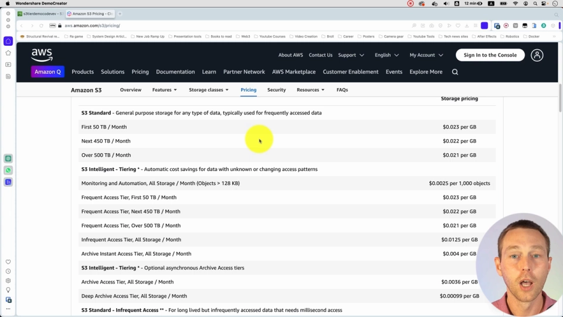
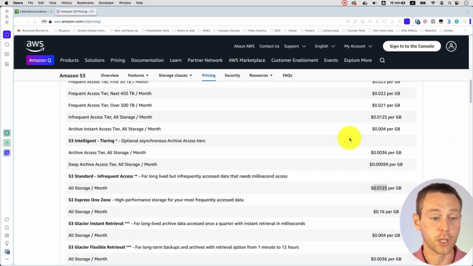
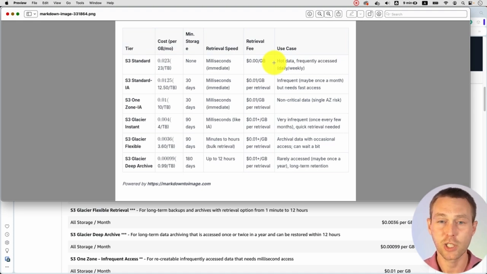
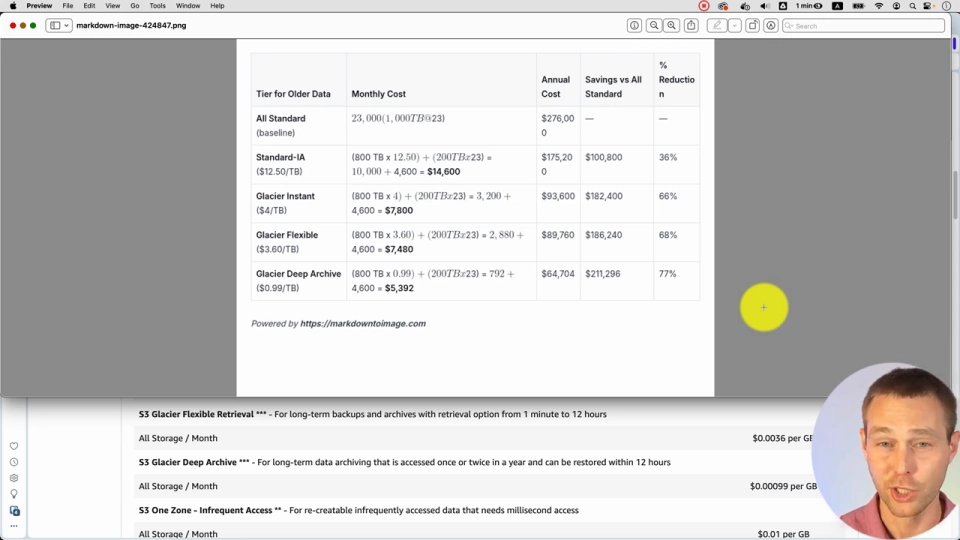
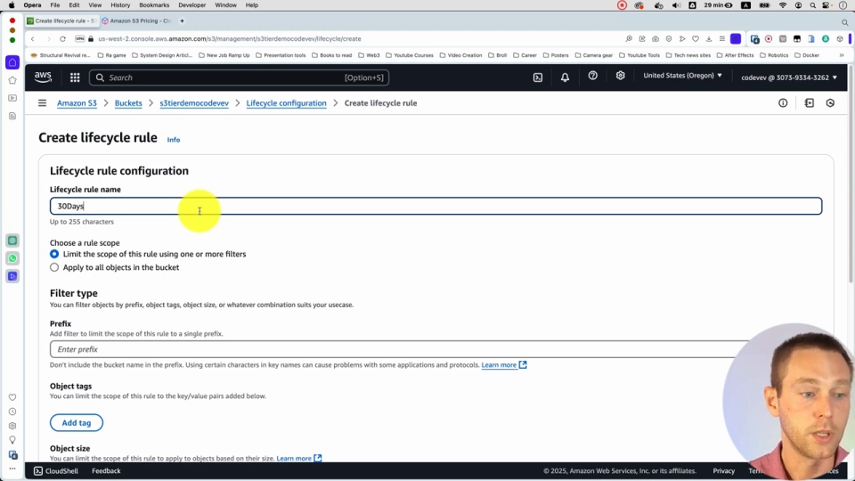
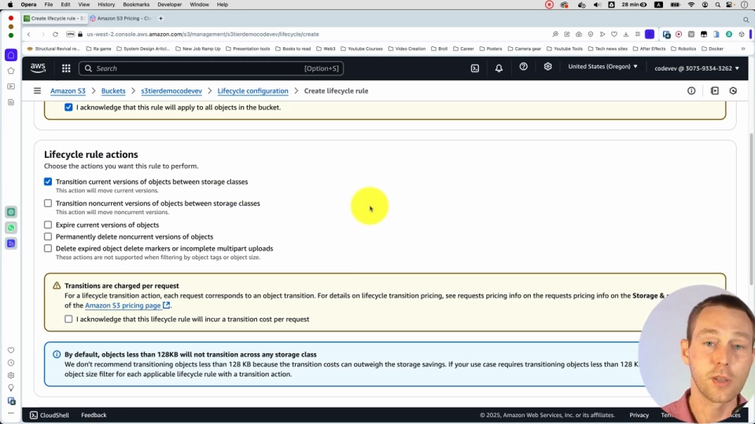
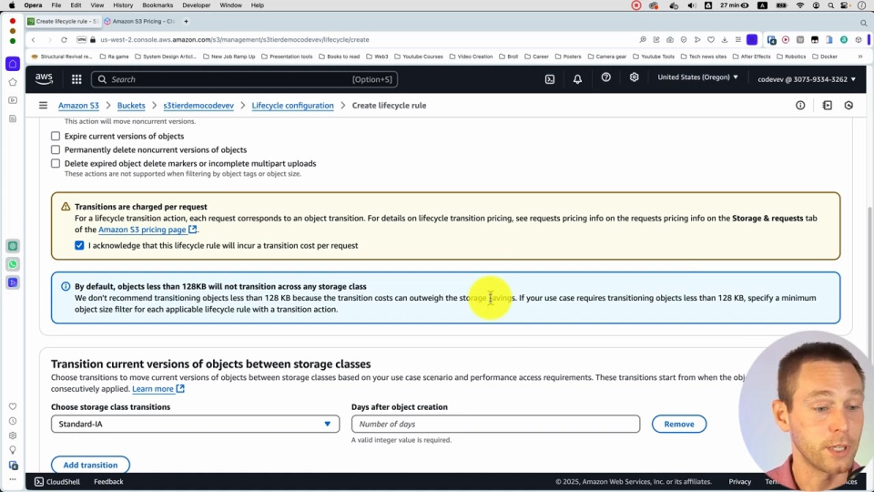
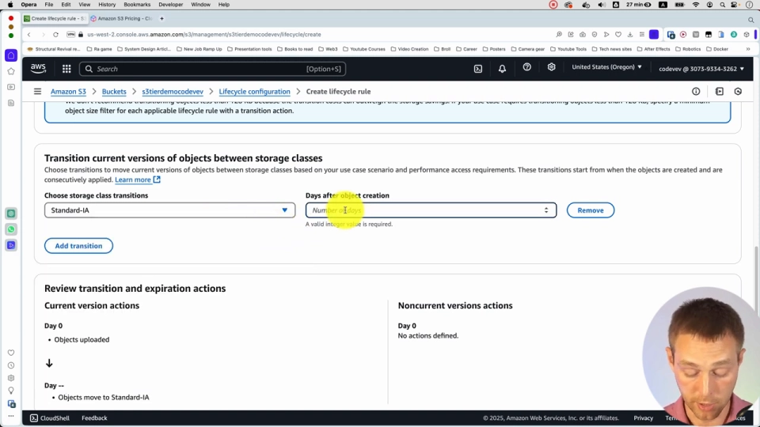

# 便宜一半不是白来的：S3 存储成本的四个组成部分

> 视频来源：[S3 Storage Classes Explained with Real Cost Math](https://www.youtube.com/watch?v=hYb4q2-Rphw)（YouTube · codevev）｜时长约 10 分钟
>
> 导读：这支视频的讲法很直接——打开 AWS 定价页，把每一档的单价抄下来，再列一张"单价 / 最短计费时长 / 取回速度 / 取回费"的表，然后用 1 PB 的例子算一遍能省多少，最后进控制台把生命周期规则建出来。本文保留它全部的数字，并把 1 PB 的算例换算成**一份 1 TiB 快照**的账，因为这才是卷快照的真实规模。存储类的取舍逻辑见同节的《六个存储类的取舍：S3 分层与生命周期规则》。

## 本讲要解决的核心问题（SCQA）

**背景**：上传到 S3 的对象默认进 **Standard** 类，单价约 **2.3 美分/GB·月**。往下一档的 Standard-IA 是 **1.25 美分**，再往下的 Glacier Deep Archive 只要 **0.099 美分**——差了二十多倍。

**冲突**：既然有便宜二十倍的档位，为什么不把所有东西都放过去？因为账单上除了"存储费"，还会冒出**取回费、转层请求费、提前删除的罚金**。这三项在单价表里看不见，却能在某个月突然变成主要支出。

**疑问**：一份快照从 Standard 挪到冷层，到底能省多少？省下来的钱，又会在什么情况下被吃回去？

**回答（中心思想）**：S3 的账单由**四部分**构成——**存储费 + 请求费 + 取回费 + 提前删除罚金**。只盯存储单价会算错账：IA 类每 GB 便宜一半，但**每取回一次就按 GB 收 1 美分**，一份 1 TiB 的快照完整取回一次要 USD 10.24，而它一个月只省 USD 10.75——**一个月恢复超过一次，IA 就等于白省**。冷层的价值不在"单价低"，而在"**你确实不会去读它**"。

## 一、先把单价摆出来

讲者打开的是 AWS 的 S3 定价页（[【跳转到 00:25】](https://www.youtube.com/watch?v=hYb4q2-Rphw&t=25)）。Standard 的存储费是**阶梯价**：前 50 TB 每 GB 0.023 美元，接下来 450 TB 每 GB 0.022，超过 500 TB 每 GB 0.021。**量越大单价越低**，但降幅很有限。

继续往下翻，就是整个"温度阶梯"（[【跳转到 00:50】](https://www.youtube.com/watch?v=hYb4q2-Rphw&t=50)）：

把这些数字和讲者自己整理的表对齐，就得到一张可以直接拿来算账的表（[【跳转到 01:08】](https://www.youtube.com/watch?v=hYb4q2-Rphw&t=68)）：

| 档位 | 单价（美元/GB·月） | 最短计费时长 | 取回速度 | 取回费 |
| --- | --- | --- | --- | --- |
| S3 Standard | 0.023 | 无 | 毫秒 | 0 |
| S3 Standard-IA | 0.0125 | 30 天 | 毫秒 | 0.01 美元/GB |
| S3 One Zone-IA | 0.01 | 30 天 | 毫秒 | 0.01 美元/GB |
| S3 Glacier Instant | 0.004 | 90 天 | 毫秒 | 0.01 美元/GB 起 |
| S3 Glacier Flexible | 0.0036 | 90 天 | 分钟到小时 | 0.01 美元/GB 起 |
| S3 Glacier Deep Archive | 0.00099 | 180 天 | 最长 12 小时 | 0.01 美元/GB 起 |

这张表最值得看的是**后三列**。讲者的说法是：**"nothing comes for free"（没有什么是免费的）**——单价降下去的部分，会从取回费、取回时延和最短计费时长里长回来。

## 二、四个成本项，一项一项拆

### 2.1 存储费：按 GB·月计，按"档位 × 容量"算

这是唯一写在单价表上的部分。它的特点是**可预测**：容量不变，账单就不变。也正因为可预测，它是最容易被优化的部分——把不读的数据挪走，这一项立刻下降。

### 2.2 请求费：转层不是免费的搬家

第二项是**请求费**。它有两个来源：

- **转层请求费**：每一次转层动作，对每一个对象都要收一次请求费。讲者在控制台勾选转层动作时，系统专门要求确认一句"我知悉这条规则会按请求产生转层费用"（[【跳转到 08:51】](https://www.youtube.com/watch?v=hYb4q2-Rphw&t=531)）。
- **Intelligent-Tiering 的监控费**：如果不想自己写规则，交给智能分层，它按**每 1,000 个对象 2.5 美分**收监控费，转层时再另收一次转层费（[【跳转到 07:15】](https://www.youtube.com/watch?v=hYb4q2-Rphw&t=435)）。

对快照的映射很直接：**快照被切成多少个对象，就乘多少次请求费**。一个 1 TiB 的快照如果切成 1,000 个 1 GB 的块，转一次层就是 1,000 次请求；如果切成 100 万个 1 MB 的块，就是 100 万次请求——**分块策略直接决定了请求费的量级**。

### 2.3 取回费：便宜档位的真正代价

第三项是**取回费（retrieval fee）**。Standard 没有这一项；从 Standard-IA 开始，**每取回 1 GB 收 1 美分**，Glacier 各档也是从 1 美分/GB 起，取回越快越贵。

讲者在这里给了一个很实用的判断：**为什么不能把所有东西都塞进最便宜的档？** 答案就是取回费加上最短计费时长——"这两样会把你杀死"（[【跳转到 04:53】](https://www.youtube.com/watch?v=hYb4q2-Rphw&t=293)）。

### 2.4 提前删除罚金：存一小时，付满 30/90/180 天

第四项是**最短计费时长**带来的罚金。讲者的表述非常直白：**"哪怕这个文件在这一档里只待了一个小时，你也会被按整段 90 天计费"**（[【跳转到 05:18】](https://www.youtube.com/watch?v=hYb4q2-Rphw&t=318)）。

这一项在账单上通常显示为"提前删除费（early delete charge）"，它不属于"存储费"，也不属于"取回费"，而是独立的一笔。**它的存在意味着：转层是一个承诺，不是一个可以随时反悔的动作。**

## 三、算一笔账：从 1 PB 到 1 TiB

### 3.1 视频里的原例：1 PB，挪走 80%

讲者的算例是 **1 PB（1,000 TB）** 数据，假设其中 **80%** 可以挪到更冷的层（[【跳转到 06:08】](https://www.youtube.com/watch?v=hYb4q2-Rphw&t=368)）：

| 方案 | 月成本 | 年成本 | 相对 Standard 节省 |
| --- | --- | --- | --- |
| 全放 Standard | USD 23,000 | USD 276,000 | — |
| 80% 转 Standard-IA | USD 14,600 | USD 175,200 | 36% |
| 80% 转 Glacier Instant | USD 7,800 | USD 93,600 | 66% |
| 80% 转 Glacier Flexible | USD 7,480 | USD 89,760 | 68% |
| 80% 转 Deep Archive | USD 5,392 | USD 64,704 | 77% |

注意这张表的一个细节：**省下的比例远小于单价降的比例**。Glacier Instant 的单价是 Standard 的 17%（0.004 vs 0.023），但因为只挪了 80%，整体只省 66%。**"能挪多少"和"单价降多少"是同等重要的两个乘数。**

### 3.2 换成一份 1 TiB 快照

1 PB 离卷快照太远。把同一套单价换成 **1 TiB（1024 GB）**，就是一份典型卷快照的规模：

| 档位 | 1 TiB 每月存储费 |
| --- | --- |
| Standard | USD 23.55 |
| Standard-IA | USD 12.80 |
| Glacier Instant | USD 4.10 |
| Glacier Flexible | USD 3.69 |
| Deep Archive | USD 1.01 |

**先看最朴素的对比**：一份 1 TiB 的快照一直放 Standard，一年是 USD 282.6；挪到 Glacier Instant，一年是 USD 49.2。差价 USD 233——这就是"分层"这件事的全部诱惑力。

**再算一条真实规则**：假设生命周期规则是"**7 天后转 Standard-IA、30 天后转 Glacier Instant、180 天后删除**"，那么这一份快照在 180 天里的存储费是：

| 阶段 | 实际天数 | 计费天数 | 计算 | 小计 |
| --- | --- | --- | --- | --- |
| Standard | 7 天 | 7 天 | USD 23.55 × 7/30 | USD 5.50 |
| Standard-IA | 23 天 | **30 天** | USD 12.80 × 30/30 | USD 12.80 |
| Glacier Instant | 150 天 | 150 天 | USD 4.10 × 5 | USD 20.48 |
| **合计** | 180 天 | | | **USD 38.78** |

注意第二行：IA 里只待了 23 天，**不够 30 天的最短计费时长**，所以按 30 天收——这一档多付了 USD 2.99。这就是"提前删除罚金"在一个看起来很合理的规则里悄悄出现的样子。

同样这 180 天，如果一直放 Standard，是 USD 23.55 × 6 = **USD 141.31**。**省下 USD 102.5，约 73%**——比不算罚金时的 75% 少一点，但结论不变。

### 3.3 但这笔账还没算完

上面只算了**存储费**。把另外三项加进来，结论会变：

**第一，取回费。** 一份 1 TiB 的快照完整取回一次，是 1024 GB × USD 0.01 = **USD 10.24**。这意味着：

- 放在 Standard-IA，每月比 Standard 省 USD 10.75；**一个月完整恢复超过一次，IA 就白省了**；
- 放在 Glacier Instant，每月省 USD 19.45；**一个月恢复超过两次，Glacier Instant 也不划算**。

这就是"便宜不是白来的"最具体的形态：**省下的钱是"不读"换来的，一读就要还回去。**

**第二，提前删除罚金。** 如果这份快照在第 40 天就被删掉——它在 Glacier Instant 里只待了 10 天——账单仍按 **90 天**计：USD 4.10 × 3 = USD 12.29，实际只该是 USD 1.37，**多付约 USD 10.9**。再加上 IA 那 7 天的缺口，一次提前删除就能吃掉大半年的收益。**保留策略短于最短计费时长的规则，是负收益的规则。**

**第三，请求费。** 两次转层 × 对象数量。视频没有给出转层请求的具体单价，只强调"按请求计费"，所以这里只能定性：**对象越多，这笔钱越大**，分块粒度是它的放大器。

## 四、规则怎么落地：控制台里的四个字段

讲者在控制台里把规则建了一遍，流程本身就是对"规则由什么组成"的回答（[【跳转到 08:01】](https://www.youtube.com/watch?v=hYb4q2-Rphw&t=481)）：

**第一步，命名与范围。** 规则名叫 `30days`，作用范围可以选"用过滤器限定"或"应用到桶内所有对象"。过滤器支持**前缀**、**对象标签**、**对象大小**三种条件（[【跳转到 08:26】](https://www.youtube.com/watch?v=hYb4q2-Rphw&t=506)）。

**第二步，选动作。** 可以转**当前版本**，也可以转**非当前版本**；此外还有过期删除、永久删除旧版本、清理删除标记与未完成分片上传。讲者在这里补了一句：非当前版本"我们大概率不在乎毫秒取回速度"，所以可以单独给它一条更冷的规则（[【跳转到 08:51】](https://www.youtube.com/watch?v=hYb4q2-Rphw&t=531)）。

这里出现了两个必须注意的提示：

- **"Transitions are charged per request"**——转层按请求计费，要勾选确认；
- **"objects less than 128 KB will not transition to any storage class"**——小于 128 KB 的对象**默认不转层**。讲者的解读是：AWS 已经替你算过账了，**这么小的对象转过去是亏的**。

**第三步，选目标档位和天数。** 第一条规则选 Standard-IA、30 天（[【跳转到 09:16】](https://www.youtube.com/watch?v=hYb4q2-Rphw&t=556)）。

**第四步，看预览。** 控制台会把规则翻译成一条时间线：**Day 0 对象上传 → Day 30 对象移动到 Standard-IA**（[【跳转到 09:41】](https://www.youtube.com/watch?v=hYb4q2-Rphw&t=581)）。

最后一句是本节关于"生效时机"的唯一依据：**规则建好之后，S3 会自动找出已经该转层的对象，并且"每天检查一次"是否需要移动**（[【跳转到 09:41】](https://www.youtube.com/watch?v=hYb4q2-Rphw&t=581)）。也就是说，**规则不是到点立刻生效的定时器，而是每天跑一遍的批处理**——天数写 30，不代表第 30 天那一秒就转完。

## 五、回到快照：这套账该怎么用

把四个成本项和快照的访问特征对齐，可以得到三条可执行的结论：

1. **恢复路径上只放 Standard 和 Standard-IA**。这两档都是毫秒取回，取回费前者为零、后者 1 美分/GB。Glacier Instant 虽然也是毫秒，但 90 天的最短计费时长意味着它只适合"确定不会在三个月内删掉"的快照。
2. **冷层是归档层，不是备份层**。Glacier Flexible 是分钟到小时、Deep Archive 是最长 12 小时。任何承诺"快速恢复"的方案，都不能把最新快照放在这两档里。
3. **相邻两档之间的间隔，必须大于等于前一档的最短计费时长**。上面那个例子里，7 天转 IA、30 天转 Glacier Instant，IA 只待了 23 天，就吃了 7 天的罚金；把第二次转层推到第 37 天以后，这笔钱就没了。同理，如果快照在第 60 天就被删，它在 Glacier Instant 里只待了 30 天（不足 90 天），罚金立刻出现。**先算保留期，再选档位，最后写天数。**

## 小结

- S3 账单由**四部分**构成：**存储费 + 请求费 + 取回费 + 提前删除罚金**。只看单价表会算错。
- 单价阶梯：Standard 0.023 → Standard-IA 0.0125 → One Zone-IA 0.01 → Glacier Instant 0.004 → Glacier Flexible 0.0036 → Deep Archive 0.00099（美元/GB·月）。
- 便宜档位的代价是**取回费（1 美分/GB 起）+ 最短计费时长（30/90/180 天）+ 更慢的取回**。
- 1 PB 挪走 80% 的例子：转 Standard-IA 省 36%，转 Glacier Instant 省 66%，转 Deep Archive 省 77%。**"能挪多少"和"单价降多少"同样重要。**
- 1 TiB 快照：Standard 每月 USD 23.55；按"7 天转 IA、30 天转 Glacier Instant、180 天删"走完 180 天约 USD 38.78（含 IA 少待 7 天的罚金），比全放 Standard 的 USD 141.31 省约 73%。
- 但一次完整取回要 USD 10.24——**IA 每月只省 USD 10.75，恢复超过一次就白省**；提前删除按整段最短时长计费，能吃掉全部收益。
- 规则由**过滤器（前缀/标签/大小）+ 动作（转层/过期/删旧版本/清分片）+ 目标档位与天数**组成；转层按请求计费，小于 128 KB 的对象默认不转层，规则每天检查一次而不是到点即生效。

## 关键术语速查

| 术语 | 一句话解释 |
| --- | --- |
| 存储费 | 按 GB·月计的容量费，是账单里最可预测的一项 |
| 取回费（retrieval fee） | 从 IA / Glacier 读出数据时按 GB 另收的钱，Standard 没有 |
| 最短计费时长 | 对象在该档位至少要按这么多天计费，提前删不退，形成"提前删除罚金" |
| 转层请求费 | 每次把对象从一个档位搬到另一个档位按请求收的钱，与对象数量成正比 |
| 生命周期规则 | 按对象年龄自动转层/删除的策略，由过滤器、动作、目标档位与天数组成 |
| 过滤器（filter） | 用前缀、对象标签、对象大小限定规则的作用范围 |
| 128 KB 门槛 | 小于 128 KB 的对象默认不转层，因为转层成本会超过省下的存储费 |
| Intelligent-Tiering | 自动分层的档位，按每 1,000 个对象 2.5 美分收监控费，转层另计费 |
| 提前删除费 | 对象未待满最短计费时长就被删除时产生的费用，账单上独立列示 |