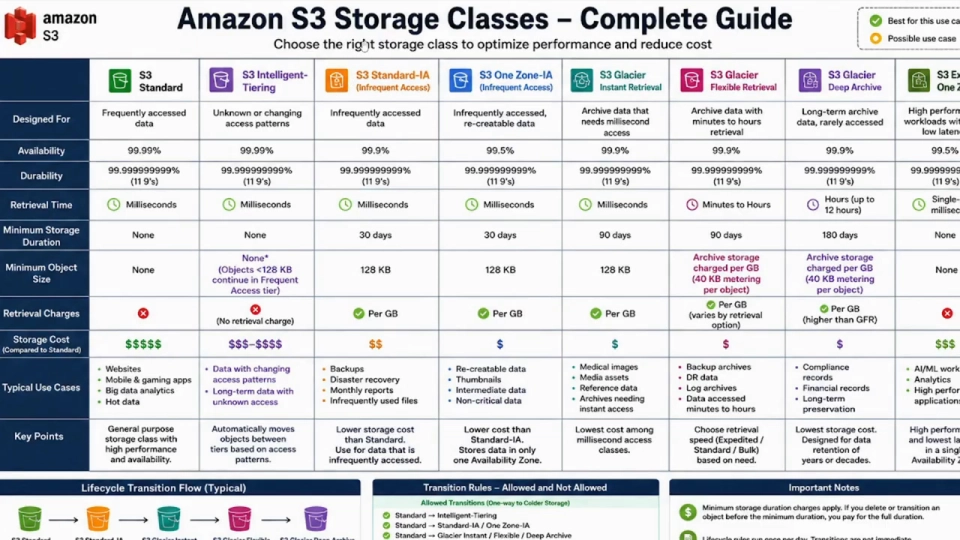
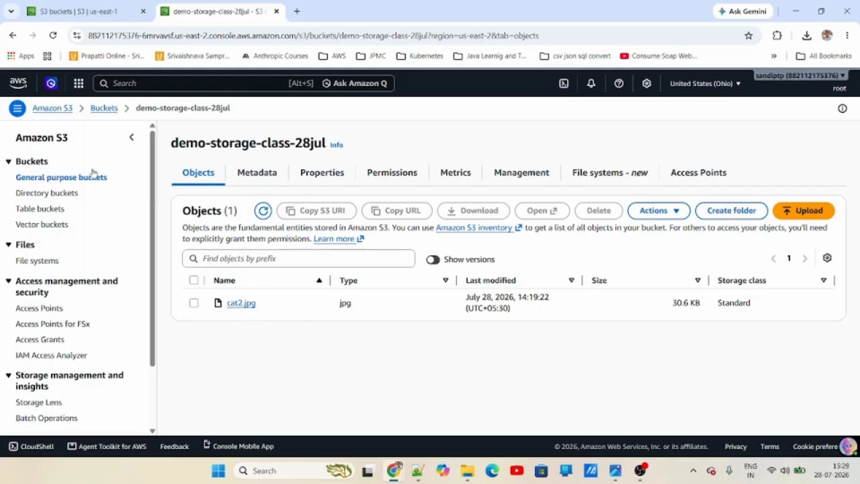
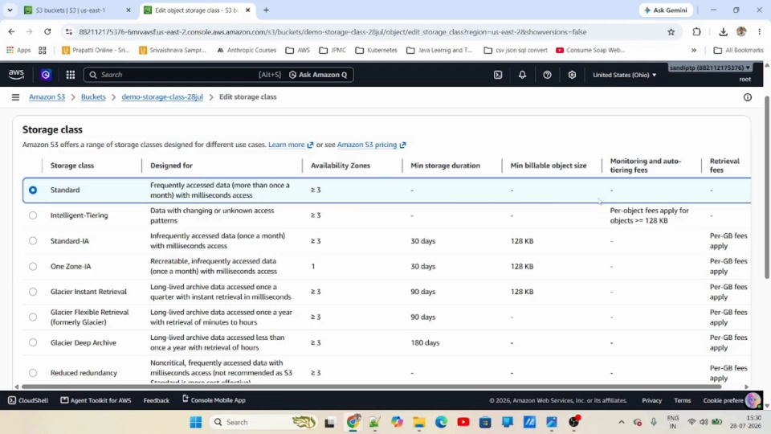
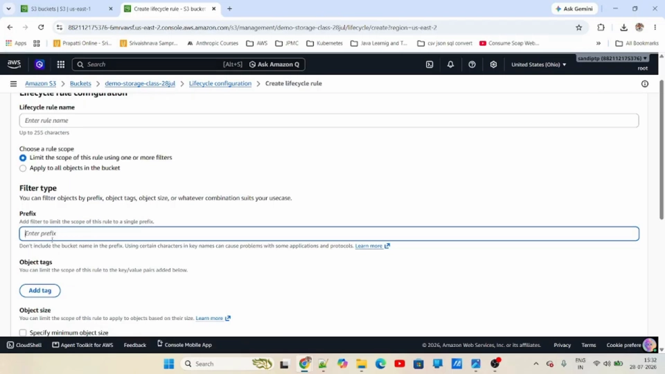
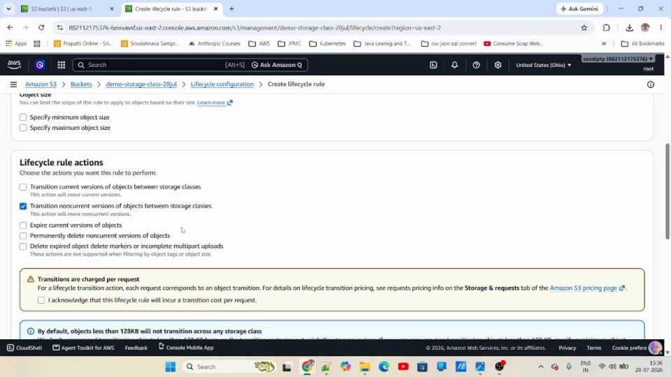
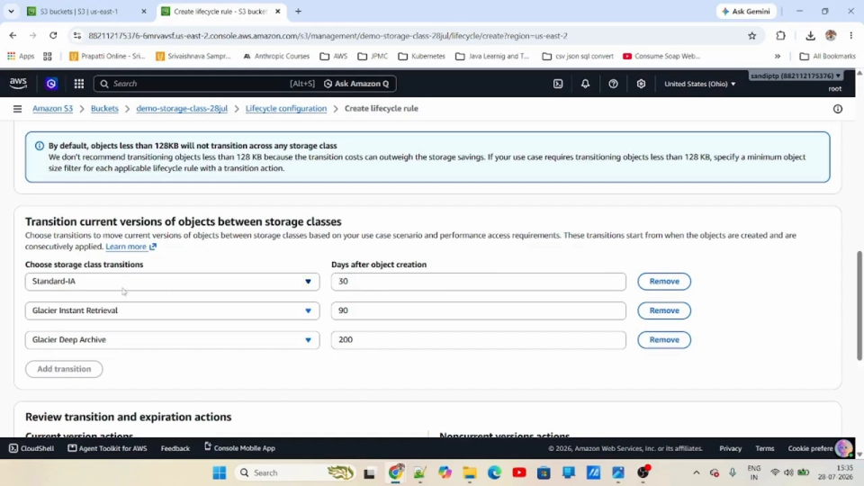
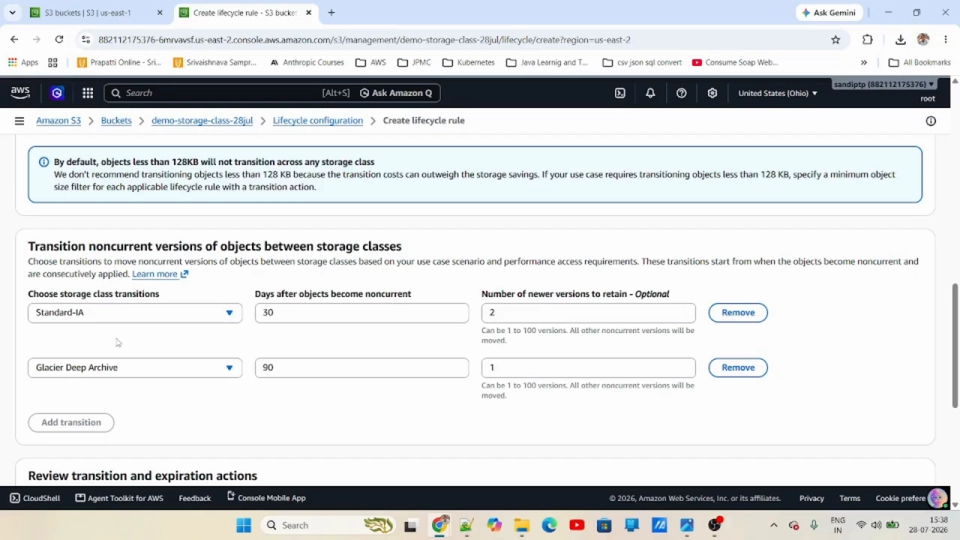
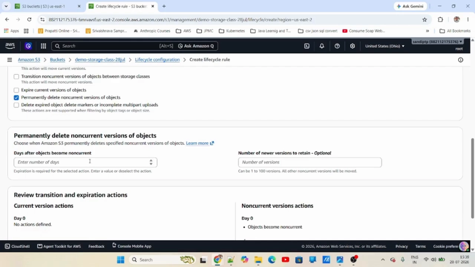
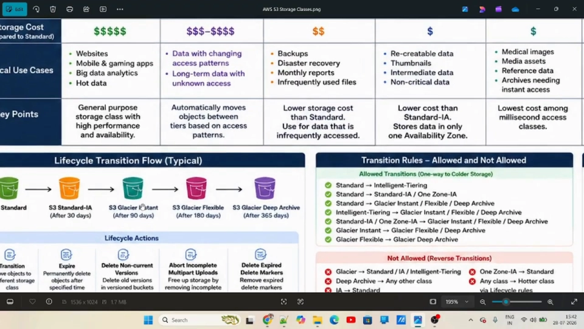

# 六个存储类的取舍：S3 分层与生命周期规则

> 视频来源：[AWS S3 Storage Classes & Lifecycle Transitions | Lifecycle Rules, Glacier & Cost Optimization](https://www.youtube.com/watch?v=Aesx9Re8eM8)（YouTube · Advanced Tech Tutor）｜时长约 24 分钟
>
> 导读：这是一节把 S3 的存储类逐个过一遍、再进控制台把生命周期规则配一遍的课。讲者先给每个类的"最短计费时长、最小计费对象、取回时延、取回费"，再演示规则里那五个勾选项分别对应什么。本文按"**先看六个类的交换关系 → 再看两个容易被忽略的罚金 → 最后看规则怎么写**"重组，落到本系列关心的场景：**冷快照怎么自动变便宜**。单价与账单的算术放在同节的另一篇《便宜一半不是白来的：S3 存储成本的四个组成部分》里。

## 本讲要解决的核心问题（SCQA）

**背景**：把卷快照写进对象存储时，最省事的做法是什么都不选——S3 的默认存储类是 **Standard**，上传即落在这里。快照有一个天然的时间分布：最近几天的可能天天被恢复，一周前的偶尔被翻出来，一个月前的几乎不动，但要按合规要求留半年。

**冲突**：这些"几乎不动"的快照，和"天天被读"的快照付的是同一个单价。S3 明明有便宜到 Standard 五分之一的存储类，可一旦挪过去，取回时延从毫秒变成分钟甚至小时，最短计费时长也从"没有"变成 30 天、90 天、180 天。

**疑问**：这些存储类到底在交换什么？把冷快照挪到便宜层，代价具体落在哪几个数字上？规则又该怎么写，才能让"挪"这件事自动发生？

**回答（中心思想）**：S3 的六个存储类不是"六档价格"，而是**四个维度的联动交换**——存储单价下降，必然伴随**取回费上升、取回时延上升、最短计费时长上升**（[【跳转到 00:10】](https://www.youtube.com/watch?v=Aesx9Re8eM8&t=10)）。生命周期规则（lifecycle rule）把这套交换写成"**按对象创建时间**触发的单向转层 + 到期删除"，因此它天然适配快照"热—温—冷"的分布；但规则是**单向**的（只能往更冷的层走），转层**按请求计费**，小于 128 KB 的对象**默认不转层**。

## 一、六个存储类：便宜是用"取回"和"时长"换来的

### 1.1 Standard：唯一"什么都不欠"的类

Standard 是默认类，也是后面所有比较的基线。它在四个维度上都是最"干净"的（[【跳转到 00:35】](https://www.youtube.com/watch?v=Aesx9Re8eM8&t=35)）：

- **没有取回费**（retrieval charge）——读对象不再额外收钱；
- **没有最短存储时长**——存一天算一天，删了不罚；
- **取回时延是毫秒级**；
- 持久性 99.999999999%（11 个 9），可用性 99.99%，数据分布在**至少三个可用区**。

代价只有一个：**存储单价最高**。所以判断"该不该用 Standard"的标准非常朴素——**这个对象会不会被频繁读**。会，就留在 Standard；不会，往下走。

### 1.2 Standard-IA 与 One Zone-IA：毫秒不变，单价腰斩，代价是取回费和 30 天

**IA = Infrequent Access（不频繁访问）**。它保留 Standard 的毫秒级取回，但把存储单价降下来，代价是两条（[【跳转到 01:25】](https://www.youtube.com/watch?v=Aesx9Re8eM8&t=85)）：

1. **每次取回按 GB 收一笔取回费**；
2. **最短存储时长 30 天**——哪怕你只存了 10 天就删，账单也按 30 天算。

还有一条容易被忽略的：**最小计费对象是 128 KB**。讲者在这里给了一个很具体的算例：你有 10,000 个 5 KB 的小文件，直觉上总大小是 50 MB，但在 IA 里计费按"每个对象至少 128 KB"算——$10000 \times 128\text{ KB}$，也就是 1.2 GB 以上（[【跳转到 02:09】](https://www.youtube.com/watch?v=Aesx9Re8eM8&t=129)）。**对象越小、数量越多，IA 越不划算**——这条规则后面会变成生命周期规则里的一个硬门槛。

**One Zone-IA** 在 IA 的基础上再便宜一档，代价是**只存一个可用区**（[【跳转到 03:09】](https://www.youtube.com/watch?v=Aesx9Re8eM8&t=189)）。讲者的说法是：Standard-IA 的数据在多个可用区各有一份，One Zone-IA 只有一份；那个可用区挂了，你就读不到这份数据。所以它适合"**丢了也能重建**"的数据——对快照来说，如果源卷还在、快照只是副本，这一定位是成立的；如果这份快照是唯一副本，就不该放这里。

### 1.3 Glacier 三档：从"毫秒"一路退到"小时"

Glacier 是归档层，一共三档，讲者按"取回时延"把它们排开（[【跳转到 03:59】](https://www.youtube.com/watch?v=Aesx9Re8eM8&t=239)）：

| 档位 | 最短存储时长 | 取回时延 | 定位 |
| --- | --- | --- | --- |
| Glacier Instant Retrieval | 90 天 | 毫秒 | 归档的价格，在线的速度 |
| Glacier Flexible Retrieval | 90 天 | 分钟到小时 | 备份、合规归档 |
| Glacier Deep Archive | 180 天 | 小时到天（最长约 12 小时） | 只为"留着"而留 |

**Glacier Instant Retrieval** 是这三档里最容易被误用的一个：它便宜，而且**取回仍是毫秒级**，看起来像是"白捡的便宜"。讲者的例子是医疗影像——需要，但不常需要（[【跳转到 04:55】](https://www.youtube.com/watch?v=Aesx9Re8eM8&t=295)）。但它的最短存储时长是 **90 天**，比 IA 的 30 天又长了三倍。

**Glacier Flexible Retrieval** 的取回时延是分钟到小时，而且**取回本身还分三档速度**（[【跳转到 06:14】](https://www.youtube.com/watch?v=Aesx9Re8eM8&t=374)）：

- **Expedited（加急）**：3~5 分钟；
- **Standard（标准）**：约 5 分钟到 3~4 小时；
- **Bulk（批量）**：约 4~12 小时。

三档的取回费依次下降——**你为"快"单独付钱**。这一点很关键：在 Glacier 里，"取回"不是一个动作，而是一个**带档位的、要花钱的任务**。

**Glacier Deep Archive** 是全场最便宜的一档，代价是取回要**小时到天**（表里写的是最长约 12 小时），最短存储时长 **180 天**（[【跳转到 07:10】](https://www.youtube.com/watch?v=Aesx9Re8eM8&t=430)）。讲者给它的定位非常窄：**只为合规而留**——十年前的银行流水、审计要查的记录，你知道它几乎不会被读，但必须留着。

### 1.4 还有两个"不在主线上"的类

- **S3 Express One Zone**：属于**目录桶（directory bucket）**，只存一个可用区，提供**个位数毫秒**的延迟，比 Standard 还快，面向 AI/ML 训练这类高性能负载（[【跳转到 08:04】](https://www.youtube.com/watch?v=Aesx9Re8eM8&t=484)）。它和快照归档无关，列在这里只是提醒：**"只有一个可用区"不等于"便宜"**——同样是单区，One Zone-IA 是省钱，Express One Zone 是花钱买速度。
- **Intelligent-Tiering（智能分层）**：你不知道访问模式、也不想自己写规则时的选项。它按实际访问情况自动移动对象，**没有取回费**、仍是毫秒延迟，但要收**监控费**，而且只有**大于等于 128 KB** 的对象才纳入（[【跳转到 08:46】](https://www.youtube.com/watch?v=Aesx9Re8eM8&t=526)）。讲者的评价是：比自己写规则"稍微贵一点"，换来的是不用猜访问模式。

### 1.5 控制台里这张表，就是本节的全部结论

先看桶里的对象列表：每个对象都带一列 **Storage class**，上传时没选，它就是 Standard——**"什么都没选"等于"选了最贵的那一档"**（[【跳转到 10:22】](https://www.youtube.com/watch?v=Aesx9Re8eM8&t=622)）。

再打开对象的"编辑存储类"页面（[【跳转到 10:47】](https://www.youtube.com/watch?v=Aesx9Re8eM8&t=647)），一屏之内把六个类的四个维度并排列出：设计用途、可用区数量、**最短存储时长**、**最小计费对象**、监控费、**取回费**。

这张表值得记住的地方在于：**它把"便宜"的代价写在明面上**。最短存储时长那一列，Standard 和 Express One Zone 是空的，IA 是 30 天，Glacier Instant/Flexible 是 90 天，Deep Archive 是 180 天——**越冷，锁得越久**。

## 二、两个容易被忽略的"罚金"

### 2.1 最短存储时长：存了 10 天，按 30 天收

这是 IA 类最反直觉的一条。讲者的原话是：**哪怕你只存了 10 天，账单也按 30 天算**（[【跳转到 01:50】](https://www.youtube.com/watch?v=Aesx9Re8eM8&t=110)）。Glacier Instant 和 Flexible 是 90 天，Deep Archive 是 180 天。

对快照来说，这条规则直接决定了一件事：**别把"短期快照"往冷层扔**。如果快照的保留策略是"留 7 天"，那它连 IA 的门槛都够不上——转过去不但省不下钱，反而因为按 30 天计费而多付。

### 2.2 最小计费对象：128 KB 以下不划算

第二条是**最小计费对象 128 KB**——IA 类（Standard-IA 与 One Zone-IA）按这个门槛计费，哪怕对象只有 5 KB，也按 128 KB 算。Glacier 三档的计量单位不同，表里写的是**按 40 KB 计量**，但计费方式同样是"按对象"。

更直接的一条限制在控制台里：创建规则时会弹一条提示，**默认情况下，小于 128 KB 的对象不会在存储类之间转层**，因为 AWS 算过账，转层的成本会超过省下的存储费（[【跳转到 10:47】](https://www.youtube.com/watch?v=Aesx9Re8eM8&t=647)）。想转，就得在规则里显式指定一个更小的最小对象大小过滤器。

这条对快照的映射非常具体：**快照在对象存储里通常被切成很多个块对象**。如果块切得很小（比如 64 KB 一块），这些对象根本进不了冷层；**分块大小决定了生命周期规则能不能生效**——这是存储实现层和成本层之间一个真实的耦合点。

## 三、生命周期规则：Filter + 五种动作

### 3.1 规则先划范围：前缀、标签、对象大小

规则建在桶的 Management 页面下。第一条要填的是**作用范围**（[【跳转到 12:02】](https://www.youtube.com/watch?v=Aesx9Re8eM8&t=722)）：

- **前缀（prefix）**：只对某个"文件夹"生效，比如 `snapshots/`；
- **对象标签（tag）**：按标签筛选，比如 `department=finance`、`environment=production`；
- **对象大小**：可以设最小/最大对象大小，把太小的对象排除在外。

对快照场景，最自然的做法是**按前缀分**：`snapshots/daily/`、`snapshots/weekly/` 各一条规则，保留策略不同，规则也就不同。

### 3.2 五种动作，对应快照的"转、删、清"

规则能执行的动作一共五类（[【跳转到 20:47】](https://www.youtube.com/watch?v=Aesx9Re8eM8&t=1247)）：

1. **Transition current versions**——当前版本转层；
2. **Transition noncurrent versions**——非当前版本转层（版本化桶才有）；
3. **Expire current versions**——当前版本到期删除；
4. **Permanently delete noncurrent versions**——永久删除旧版本；
5. **Delete expired object delete markers / incomplete multipart uploads**——清理删除标记与未完成的分片上传。

前两条是"省钱"，后三条是"止损"。**未完成的分片上传**这一条尤其值得记住：一个上传到一半的大快照，分片会一直占着空间、一直被计费，直到被显式清理。

### 3.3 转层以"对象创建时间"为基准，不是"上次转层时间"

这是本讲里最容易算错的一点。讲者用了一个具体日期（[【跳转到 14:32】](https://www.youtube.com/watch?v=Aesx9Re8eM8&t=872)）：假设对象在 **6 月 1 日**创建，规则写"30 天后转 Standard-IA、90 天后转 Glacier Instant"。

- 30 天后（7 月 1 日前后）转 IA；
- 90 天后（9 月 1 日）转 Glacier Instant。

注意：**90 天是从 6 月 1 日算起，不是从"转进 IA 的那天"再算 90 天**。所有天数都以对象的**创建时间**为原点。

由此还引出一个"补课"行为：如果你在对象已经存在 95 天之后才建这条规则，规则执行时会发现"它已经该在 Glacier Instant 了"，于是**按顺序补走一遍**——先转 IA、再转 Glacier Instant（[【跳转到 15:22】](https://www.youtube.com/watch?v=Aesx9Re8eM8&t=922)）。规则不是"从今天开始计时"，而是"按对象的年龄对齐"。

### 3.4 非当前版本：可以只留最近几个

版本化桶里，同一个键会有多个版本：最新的是**当前版本（current version）**，其余是**非当前版本（noncurrent version）**。规则对这两类分别处理，而且非当前版本那条多了一个参数：**保留多少个更新的版本（number of newer versions to retain）**（[【跳转到 16:37】](https://www.youtube.com/watch?v=Aesx9Re8eM8&t=997)）。

讲者的例子是：4 个版本，规则写"30 天后把非当前版本转 Standard-IA，保留 2 个更新的版本；90 天后转 Deep Archive，保留 1 个"。这样最新的两三个版本被保护住，更老的才被挪走。

删除侧同理：**Expire current versions** 在版本化桶里只是打一个**删除标记（delete marker）**，对象并没有真的消失；要真正回收空间，得再加一条"永久删除非当前版本"，以及一条"清理过期的删除标记"（[【跳转到 18:42】](https://www.youtube.com/watch?v=Aesx9Re8eM8&t=1122)）。

**对快照的含义**：如果快照桶开了版本控制，每覆盖一次同名快照就多一个版本；只写"过期删除"而不写"永久删除旧版本"，空间不会真的释放——账单上看到的仍然是增长。

### 3.5 转层是单向的，而且按请求计费

规则里最硬的一条约束是**方向**：转层**只能往更冷的层走**，不能回头（[【跳转到 22:10】](https://www.youtube.com/watch?v=Aesx9Re8eM8&t=1330)）。

允许的方向：

- Standard → Intelligent-Tiering
- Standard → Standard-IA / One Zone-IA
- Standard → Glacier Instant / Flexible / Deep Archive（可以一步到位）
- Intelligent-Tiering → Glacier 任意档
- Standard-IA / One Zone-IA → Glacier 任意档
- Glacier Instant → Glacier Flexible / Deep Archive
- Glacier Flexible → Deep Archive

不允许的方向：**Glacier Flexible → Glacier Instant**、**Deep Archive → 任何其他类**、**IA → Standard**。

另一条成本约束是：**转层按请求计费**。控制台在勾选转层动作时会要求你确认一句"我知悉这条规则会按请求产生转层费用"（[【跳转到 21:04】](https://www.youtube.com/watch?v=Aesx9Re8eM8&t=1264)）。也就是说，**转层不是免费的搬家**——对象数量越多，这笔钱越明显。

## 四、落到快照：热—温—冷正好对应三段

把上面这些拼起来，快照的存储策略其实是一条很自然的曲线：

| 快照年龄 | 访问特征 | 该放哪一层 | 理由 |
| --- | --- | --- | --- |
| 0~7 天 | 可能被频繁恢复 | Standard | 无取回费、无最短时长，随时删 |
| 7~30 天 | 偶尔回滚 | Standard-IA | 毫秒不变，单价降下来 |
| 30~180 天 | 几乎不动，但要能查 | Glacier Instant Retrieval | 归档价 + 毫秒取回 |
| 180 天以上 | 只为合规留存 | Deep Archive | 最便宜，但取回要小时级 |

这条曲线之所以成立，是因为**快照的访问频率天然随年龄衰减**——这正是生命周期规则的设计前提。

但有两个边界必须说清：

1. **冷层不能放在恢复路径上**。Glacier Flexible 的取回是分钟到小时、Deep Archive 是小时到天，而且还要先发起一个"取回任务"、等它完成才能读。一个承诺"百毫秒恢复"的卷快照方案，如果最新快照躺在 Deep Archive 里，这个承诺当场破产。**冷层只适合归档，不适合当恢复源**。
2. **最短计费时长决定了"多冷"的上限**。如果快照保留策略本来就是 7 天，那它连 IA 的 30 天门槛都过不去，硬转只会多付钱。**规则的每一档天数，都必须大于等于目标层的最短存储时长**，否则省下的单价会被罚金吃掉。

至于"转层到底省多少钱、四个成本项怎么算"，那是数字问题，放在同节的《便宜一半不是白来的：S3 存储成本的四个组成部分》里算。

## 小结

- S3 的六个存储类是**四个维度的联动交换**：存储单价降，取回费、取回时延、最短计费时长必然升。没有"又便宜又快"的档位。
- **Standard** 是唯一无取回费、无最短时长的类，适合放在恢复路径上；**IA** 保留毫秒但加了取回费和 30 天门槛；**Glacier 三档**依次用"分钟—小时—天"的取回时延换更低的单价。
- 两个罚金要记住：**最短存储时长**（10 天也按 30 天收）与**最小计费对象 128 KB**（小于它的对象默认不转层）。
- 生命周期规则 = **Filter（前缀/标签/大小）+ Transition（转层）+ Expiration（过期）+ NoncurrentVersion 相关动作**，另外还能清理删除标记与未完成的分片上传。
- 所有天数以**对象创建时间**为原点，不是以上次转层时间为原点；规则晚建时会**按顺序补走**前面的层。
- 转层**单向**（只能更冷）、**按请求计费**；版本化桶里"过期"只打删除标记，要真正释放空间还得永久删除旧版本。
- 对快照：热—温—冷的分布正好匹配规则，但**冷层只能归档、不能进恢复路径**，且每一档天数都要大于等于目标层的最短存储时长。

## 关键术语速查

| 术语 | 一句话解释 |
| --- | --- |
| 存储类（storage class） | 对象在 S3 里的"档位"，决定存储单价、取回费、取回时延与最短计费时长 |
| IA（Infrequent Access） | 不频繁访问层，单价低但每次取回按 GB 收费，最短计费 30 天 |
| One Zone-IA | 只存一个可用区的 IA，更便宜，但那个可用区故障时数据不可读 |
| Glacier Instant Retrieval | 归档价、毫秒取回，最短计费 90 天 |
| Glacier Flexible Retrieval | 分钟到小时取回，取回分 Expedited / Standard / Bulk 三档速度，越快越贵 |
| Glacier Deep Archive | 最便宜的一档，取回小时到天，最短计费 180 天，只适合合规留存 |
| 最短存储时长 | 对象在该层至少要按这么多天计费，提前删除不退钱 |
| 最小计费对象 | 小于 128 KB 的对象按 128 KB 计费，且默认不参与转层 |
| 生命周期规则 | 按对象创建时间自动执行转层与删除的策略，由 Filter + 动作组成 |
| 当前版本 / 非当前版本 | 版本化桶里最新的那个版本是当前版本，其余都是非当前版本 |
| 删除标记（delete marker） | 版本化桶里"删除"只是插一个标记，对象数据仍在，要另行清理 |
| Intelligent-Tiering | 按实际访问自动分层的类，无取回费但收监控费，只覆盖 128 KB 以上对象 |