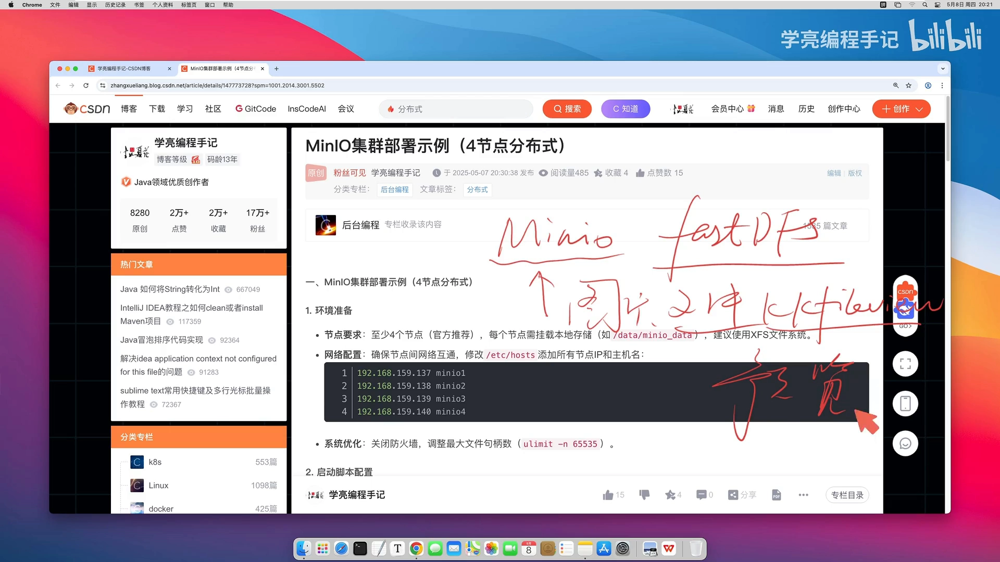
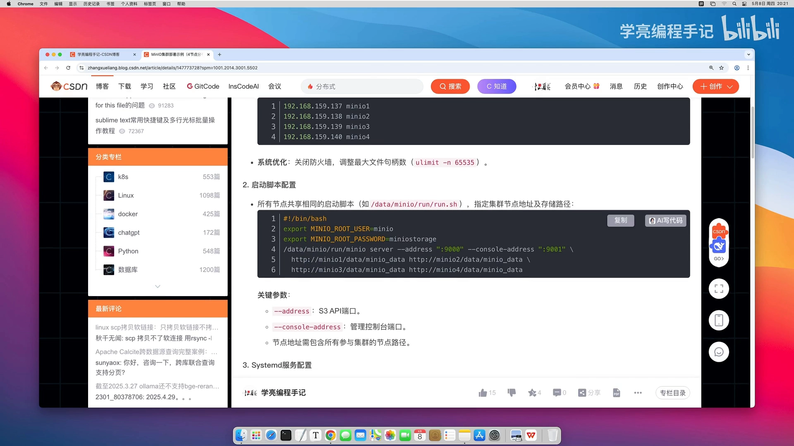
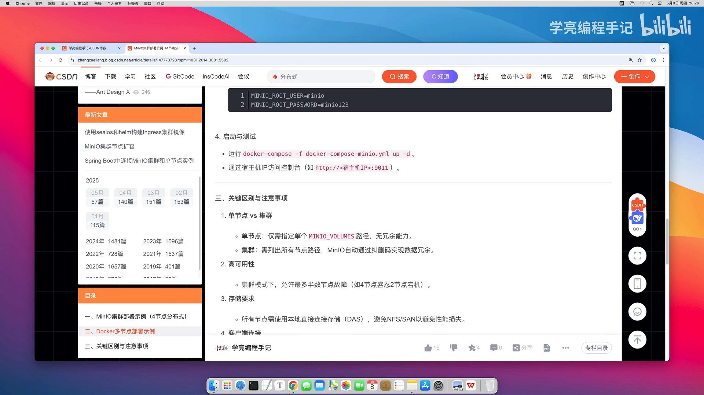
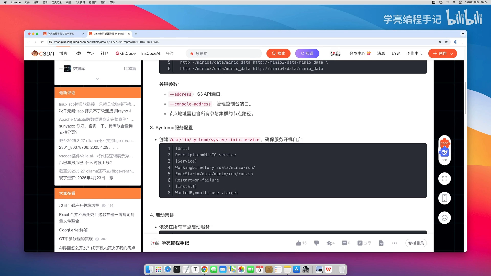
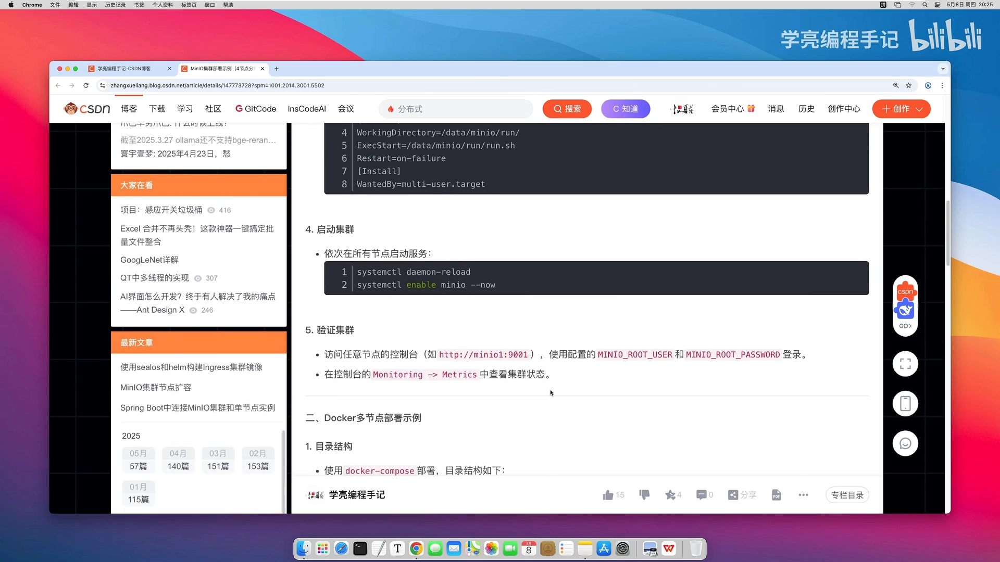
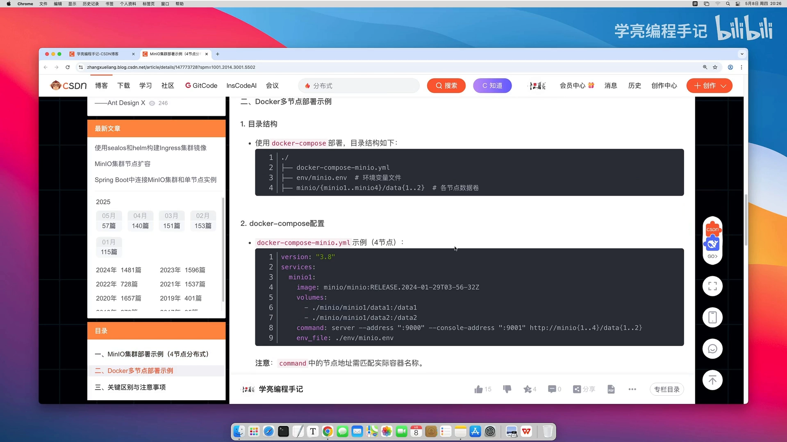
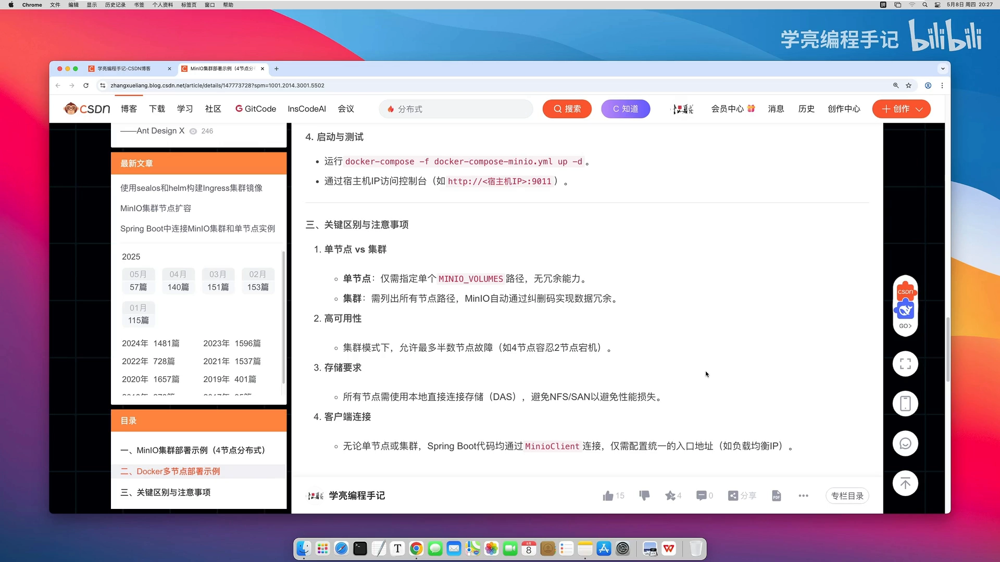
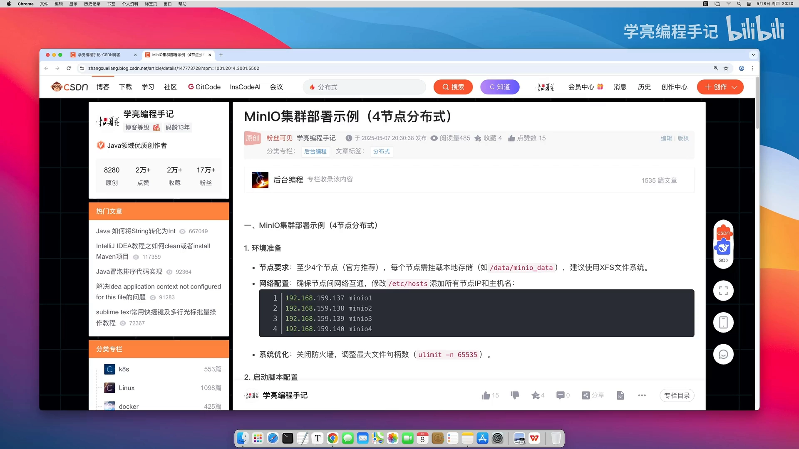

# MinIO 的三种部署形态：从单机单盘到四节点集群

> 视频来源：[MinIO集群部署示例（4节点分布式）](https://www.bilibili.com/video/BV1u65KznEj8/)（Bilibili · 学亮编程手记）｜时长约 8.5 分钟
> 本文覆盖：MinIO 单机单盘与四节点分布式两种部署形态的实操过程——四个节点怎么准备、启动脚本怎么写、9000 与 9001 两个端口分别是谁、systemd 怎么纳管、Docker Compose 与二进制该怎么选、单节点与集群在冗余上的本质差别、以及客户端该连哪个节点。视频是"照着文档点一遍"的实录，本文按"为什么这么做"重排。

## 本讲要解决的核心问题（SCQA）

**背景**：MinIO 是一个 S3 兼容的对象存储，常被拿来替代 FastDFS 这类老方案，用来存图片、文件包、文档，并对外提供可访问的链接。

**冲突**：MinIO 的启动命令看起来简单到不可思议——一个二进制文件、一个数据路径就起来了。但一旦要上集群，问题立刻变多：路径要写几个？节点要不要都写进去？两个端口谁管什么？挂了以后数据还在不在？

**疑问**：MinIO 到底有几种部署形态？它们之间差的是"配置写法"，还是"数据有没有冗余"这个本质区别？

**回答（中心思想）**：MinIO 的部署形态只有两类——**单机（单节点）** 和 **多节点分布式**，区别不在命令长度，而在于 **`MINIO_VOLUMES` 里列了几个路径**：只列一个路径就是单机，没有冗余；列出所有节点的路径，MinIO 就自动用纠删码在这些盘之间做冗余。剩下的所有工程细节（端口、systemd、Docker、负载均衡）都是围绕这两类形态的服务化包装。

## 一、先认清两个端口：9000 是数据面，9001 是控制面

### 1.1 一个进程，两个监听

视频开篇先给了四个节点：`192.168.159.137` 到 `.140`，分别对应 minio1 到 minio4 [【跳转到 00:40】](https://www.bilibili.com/video/BV1u65KznEj8/?t=40)。为了演示方便，视频建议先关掉防火墙；但讲者强调，**生产环境不要关防火墙，放开端口就行**。



这里有两件事值得记住：

- **主机名要能互相解析**。MinIO 的集群参数里写的是 http://minio1/data/minio_data 这种地址，节点之间要靠主机名找到对方，所以 `/etc/hosts` 必须齐。
- **文件句柄数要调**（`ulimit -n 65535`）。对象存储是典型的"大量小文件 + 大量并发连接"负载，默认的句柄上限很容易成为第一个瓶颈。

### 1.2 9000 与 9001 分别是什么

启动脚本里有两个地址参数 [【跳转到 01:09】](https://www.bilibili.com/video/BV1u65KznEj8/?t=69)：

```bash
#!/bin/bash
export MINIO_ROOT_USER=minio
export MINIO_ROOT_PASSWORD=miniostorage
/data/minio/run/minio server --address ":9000" --console-address ":9001" \
  http://minio1/data/minio_data http://minio2/data/minio_data \
  http://minio3/data/minio_data http://minio4/data/minio_data
```

- `--address ":9000"` 是 **S3 API 端口**。你的应用、SDK、`mc` 客户端连的都是它 [【跳转到 02:29】](https://www.bilibili.com/video/BV1u65KznEj8/?t=149)。
- `--console-address ":9001"` 是 **管理控制台端口**。浏览器打开它、输入账号密码，就能看到桶和对象 [【跳转到 02:09】](https://www.bilibili.com/video/BV1u65KznEj8/?t=129)。



这两个端口的分工是初学者最容易混的地方：**上传下载走 9000，看界面走 9001**。视频里讲者特意在脚本上标注了"9000"和"9001 web"，因为很多人第一次部署时会拿浏览器去敲 9000，然后困惑为什么没有界面 [【跳转到 01:49】](https://www.bilibili.com/video/BV1u65KznEj8/?t=109)。


### 1.3 账号密码为什么写在环境变量里

`MINIO_ROOT_USER` / `MINIO_ROOT_PASSWORD` 这两个环境变量，是 MinIO 进程启动时自动读取的根账号。视频说得很直白：**你在运行之前设置好，程序里就会自动读**；写在脚本里，脚本一执行就在同一个解释器里生效了 [【跳转到 01:29】](https://www.bilibili.com/video/BV1u65KznEj8/?t=89)。

注意这里的 `MINIO_ROOT_PASSWORD` 在有些版本的文档里叫 `MINIO_ROOT_SECRET_KEY`，两者是同一个东西的不同代际命名——照抄网上教程时如果变量名对不上，先确认版本。

## 二、`MINIO_VOLUMES` 里写几个路径，决定了你是哪种形态

### 2.1 路径 = 盘，不是目录

视频里讲者反复强调一个容易被糊弄过去的点：**"四块盘"指的是四个挂载点**。

> "如果说你这个路径是真正的四块盘，你挂载的是硬盘，准确来说是四个挂载点，对应四块盘，那你弄四个是可以的。但如果说你只有一块盘，一块盘分四个路径，那也没太大意义。" [【跳转到 04:09】](https://www.bilibili.com/video/BV1u65KznEj8/?t=249)

这句话是全篇最关键的一句。MinIO 的冗余单位是"盘"，它假设每个路径背后是一块可能独立损坏的物理设备。如果你在一块盘上切四个目录喂给它，那么这块盘坏了，四个"盘"一起坏——纠删码能容忍 4 块盘故障，但容忍不了"4 块盘其实是同一块"。

同理，**在同一个节点里起多个 MinIO 进程也没有意义**：节点一挂，进程和盘一起没。

### 2.2 单机与集群：差的是有没有冗余

视频用一节专门讲这个区别 [【跳转到 06:28】](https://www.bilibili.com/video/BV1u65KznEj8/?t=388)：

| 形态 | `MINIO_VOLUMES` | 冗余 | 适用 |
| --- | --- | --- | --- |
| 单节点 | 只写一个路径 | 无。节点坏了数据就没了 | 开发、测试、单机小规模 |
| 多节点分布式 | 列出所有节点的所有路径 | 有。自动用纠删码做数据冗余 | 生产 |

集群形态下，**最多容忍半数节点故障**：四个节点可以坏两个，剩下两个节点依然保证数据不丢 [【跳转到 06:52】](https://www.bilibili.com/video/BV1u65KznEj8/?t=412)。这个"半数"是 MinIO 写仲裁的直接结果，下一篇《纠删码为什么能用 4 块校验盘顶住 4 块坏盘》会把背后的 N=K+M 分片数学和仲裁规则拆开讲。



### 2.3 必须用本地盘直连，别用 NFS / SAN

视频给了一条硬性建议：**所有节点都要用本地直接连接的存储（DAS），避免 NFS 和 SAN，以免性能损失** [【跳转到 07:12】](https://www.bilibili.com/video/BV1u65KznEj8/?t=432)。

原因不难推：MinIO 的冗余逻辑建立在"每块盘会独立损坏"这个假设上，而网络存储把多块盘的故障域合并成了一个——存储设备挂了，所有节点的所有"盘"同时不可用，纠删码的容错设计直接失效，还会额外叠一层网络时延。

## 三、把进程变成服务：systemd 与 Docker 两条路

### 3.1 systemd：一个 unit 文件就够

二进制部署的收尾动作是让 systemd 纳管 [【跳转到 04:16】](https://www.bilibili.com/video/BV1u65KznEj8/?t=256)：

```ini
[Unit]
Description=MinIO service
[Service]
WorkingDirectory=/data/minio/run/
ExecStart=/data/minio/run/run.sh
Restart=on-failure
[Install]
WantedBy=multi-user.target
```

要点只有三个：`WorkingDirectory` 指向脚本所在目录、`ExecStart` 指向那个 `run.sh`、`Restart=on-failure` 保证进程崩了会被拉起来。再加 `systemctl enable --now minio` 就实现了开机自启 [【跳转到 04:44】](https://www.bilibili.com/video/BV1u65KznEj8/?t=284)。



### 3.2 四个节点，随便访问哪一个

集群起来之后有个很自然的问题：**四个节点，我该访问哪个？**

答案是**任意一个**。账号密码是全局通用的，控制台在哪个节点上打开都一样；集群状态可以在控制台的 Metrics 里看 [【跳转到 04:53】](https://www.bilibili.com/video/BV1u65KznEj8/?t=293)。



### 3.3 Docker Compose：能用，但视频不推荐

视频对容器化部署的态度很明确：**通用场景下不推荐**。

> "就是一个二进制文件，一个二进制文件就搞定了，你为什么要搞到 Docker 里面去呢？" [【跳转到 05:31】](https://www.bilibili.com/video/BV1u65KznEj8/?t=331)

理由是三条：

1. **命令没变短**。Compose 里的 `command:` 还是那句服务启动命令——`--address` 指 9000、`--console-address` 指 9001，后面跟四个节点乘两块盘的卷地址（花括号展开的写法），"看脚本跟看 YAML 有什么区别吗" [【跳转到 06:02】](https://www.bilibili.com/video/BV1u65KznEj8/?t=362)。
2. **多了一层要学**。不熟容器的人还得额外理解卷挂载、网络、镜像。
3. **它本来就是跟操作系统的文件系统打交道**。MinIO 要的是裸盘路径，容器只是把这层关系又包了一遍。



但讲者也留了余地：**如果你的环境本来就是云原生环境，容器化部署无可厚非** [【跳转到 05:39】](https://www.bilibili.com/video/BV1u65KznEj8/?t=339)。换句话说，选二进制还是选容器，取决于你的运维体系，而不是 MinIO 本身。

## 四、客户端连谁：一个 upstream 解决

### 4.1 连一个节点也能跑，但不是生产做法

Spring Boot 侧用的是 MinIO Client，配置一个统一的入口地址就行。四个节点里连一个也是可以的，数据会自动均衡 [【跳转到 07:52】](https://www.bilibili.com/video/BV1u65KznEj8/?t=472)。

但更合理的生产做法是：**用 Nginx 对四个节点做负载均衡**，客户端只连 Nginx [【跳转到 08:12】](https://www.bilibili.com/video/BV1u65KznEj8/?t=492)。



### 4.2 为什么这一层代理是必要的

只连一个节点，等于把这个节点变成了单点：它挂了，客户端就连不上了——尽管数据本身还在其他节点上。加一层 Nginx，客户端配置里写的是 `http://minio.internal:9000` 这样的稳定地址，后端节点怎么增减、哪个挂了，对应用透明。

这也解释了为什么视频开头要把四个节点的主机名写进 `/etc/hosts`：无论直连还是走代理，寻址的稳定性都是第一位的。



## 小结

- MinIO 只有两类部署形态：**单机（一个路径，无冗余）** 与 **多节点分布式（列出全部节点路径，自动纠删码冗余）**；区别在 `MINIO_VOLUMES` 里写了几个路径。
- **9000 是 S3 API 端口，9001 是控制台端口**，上传下载走前者，看界面走后者。
- **路径必须对应真实的盘**。一块盘切四个目录，等于把四个故障域合并成一个，纠删码的容错假设失效。
- **必须本地盘直连（DAS）**，不要用 NFS / SAN，否则故障域合并 + 多一层网络时延。
- 集群形态**最多容忍半数节点故障**（四节点坏两个仍可用），背后是纠删码的写仲裁规则。
- 二进制 + systemd 是最贴合 MinIO 的部署方式；容器化适合本来就是云原生的环境。
- 客户端不要直连某个节点，**前面放一层 Nginx**，把节点增减和故障挡在应用之外。

## 关键术语速查

| 术语 | 一句话解释 |
| --- | --- |
| 对象存储 | 以"对象"（数据 + 元数据 + 唯一 ID）为单位存取的存储，用 HTTP API 访问，没有真正的目录层级 |
| MinIO | 一个开源的、S3 API 兼容的对象存储服务，单个二进制即可运行 |
| S3 API 端口 | MinIO 对外提供对象读写接口的端口，示例中为 9000 |
| 控制台端口 | MinIO 自带 Web 管理界面的端口，示例中为 9001 |
| `MINIO_VOLUMES` | 声明 MinIO 使用哪些存储路径的参数；列一个路径是单机，列全部节点路径是分布式集群 |
| 纠删码（erasure coding） | 把对象切成数据分片与校验分片分散到多块盘，丢失部分分片仍可还原的冗余技术 |
| 故障域 | 会一起失效的一组设备；一块盘切多个目录、或用 NFS，都会把多个故障域合并成一个 |
| DAS | Direct Attached Storage，直连存储，即服务器本地挂载的硬盘 |
| systemd unit | 描述如何启动、重启、开机自启一个服务的配置文件 |
| 负载均衡入口 | 客户端统一连接的地址，后端转发到多个 MinIO 节点，避免单点 |