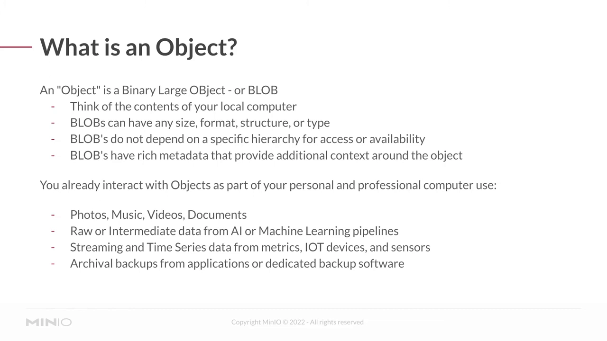
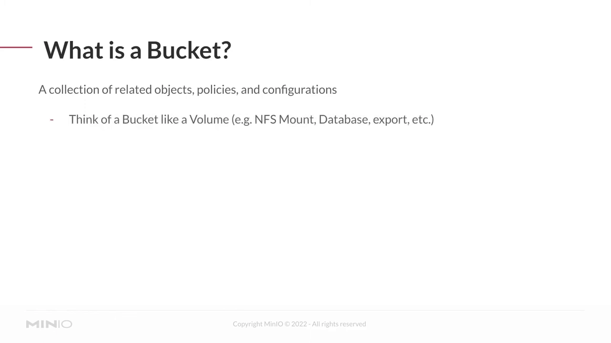
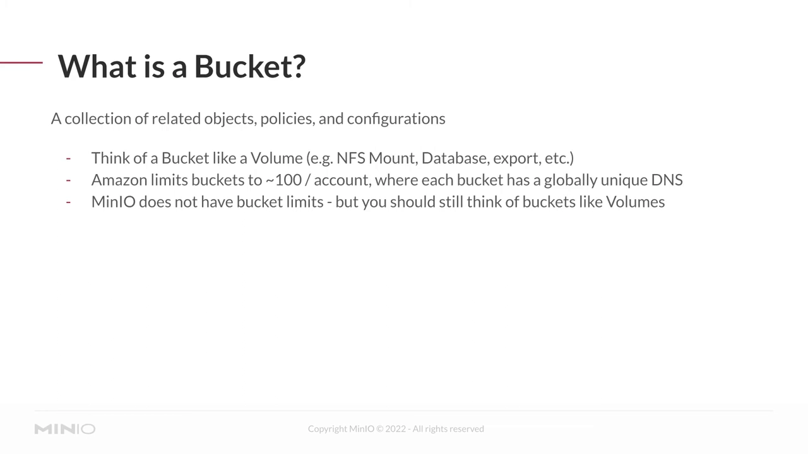
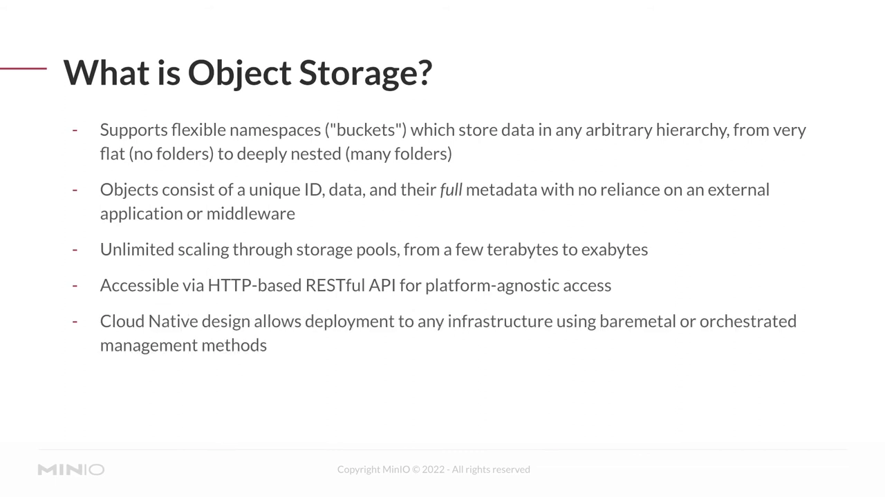
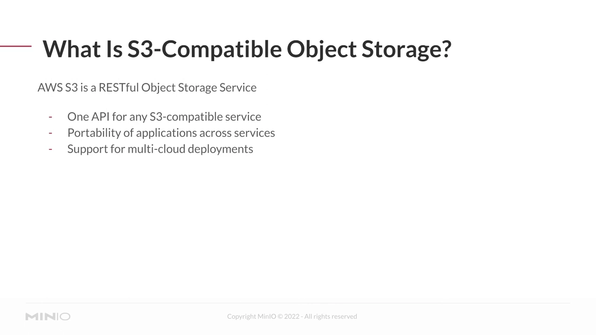
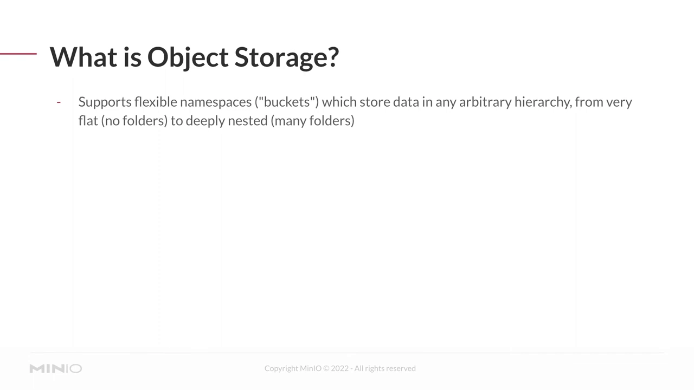
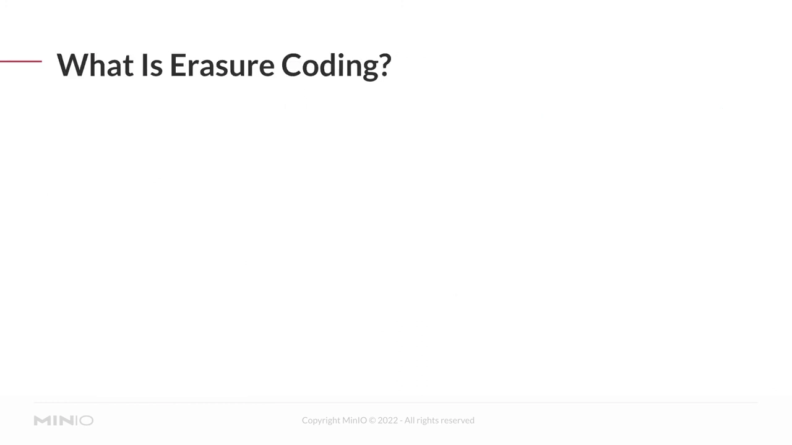
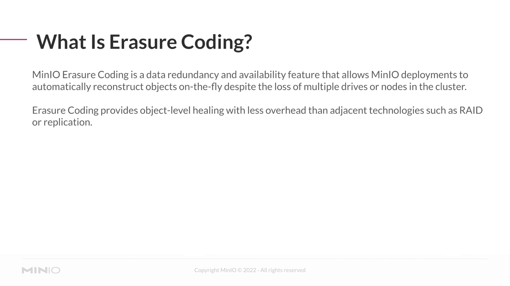
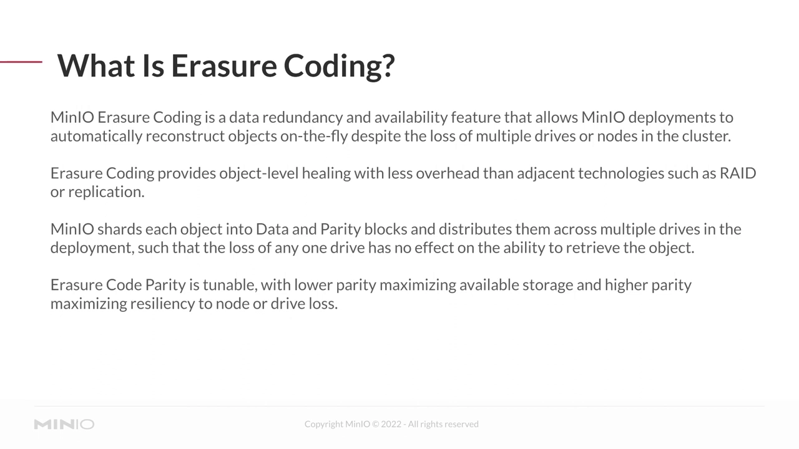

# S3 兼容不等于 S3 等价：MinIO 与公有云 S3 的边界

> 视频来源：[MinIO Essentials for Admins - Session 1: Object Storage Core Concepts](https://www.youtube.com/watch?v=0qpVjKj1Mgw)（YouTube · MinIO 官方）｜时长约 8.5 分钟
> 本文覆盖：对象与桶的概念、对象存储必须具备的五个属性、S3 兼容到底兼容了什么、以及为什么"兼容"必须靠测试和逆向工程来验证；最后落到 MinIO 用纠删码替代副本这件事，说明它在冗余实现上与公有云的根本差异。视频是 MinIO 官方管理员课程的第一讲，讲法偏概念，本文只取与"自建 vs 公有云差异"相关的部分，对象与桶的基础模型不重复展开。

## 本讲要解决的核心问题（SCQA）

**背景**：S3 API 已经是对象存储事实上的标准。绝大多数自建方案——MinIO、Ceph、各种"兼容 S3"的产品——都宣称自己"支持 S3 API"，应用也大多能直接跑起来。

**冲突**：跑起来之后，差异开始出现。桶的数量上限不一样、桶名的约束不一样、某些管理接口的行为不一样。你按公有云的文档写好的运维脚本，换到自建环境里就会撞墙。

**疑问**：所谓"S3 兼容"，到底兼容的是哪一部分？剩下的那部分差异，该从哪里确认？

**回答（中心思想）**：**兼容的是 API 的形状，不是实现的行为**。S3 的 API 是公开的，但 S3 本身不开源——实现细节和底层行为只能靠测试和逆向工程去确认。所以"兼容 S3"意味着"应用能连上、基本的 put/get 能跑"，而不意味着"所有边界行为与公有云一致"。差异集中在三处：**桶的约束**、**未公开的行为细节**、**冗余的实现方式**。

## 一、兼容的是一套 HTTP API，不是一个实现

### 1.1 对象是什么

MinIO 官方课程对"对象"的定义很朴素：对象就是二进制大对象（BLOB），别被"大"字吓到，它其实就是你本地计算机里的内容——照片、音乐、视频、文档，AI 流水线里的原始数据和中间数据，IoT 设备产生的时序数据，以及应用或备份软件产生的归档 [【跳转到 00:27】](https://www.youtube.com/watch?v=0qpVjKj1Mgw&t=27)。

对象有几个关键属性 [【跳转到 00:47】](https://www.youtube.com/watch?v=0qpVjKj1Mgw&t=47)：

- 大小、格式、结构、类型都没有限制；
- **不依赖特定的层级结构**来访问或存在；
- 带有**丰富的元数据**，提供"它是什么、它是怎么产生的"这类上下文。

"不依赖层级"这一点，是对象存储与文件系统最根本的分野，也是后面所有兼容性问题的源头：既然没有目录，那么"桶"就成了唯一的命名空间边界。

### 1.2 桶是什么

桶（bucket）是**一组相关对象、策略与配置的集合**。应用读写对象时永远是在某个桶里进行，桶上关联的策略与配置决定访问权限和行为 [【跳转到 02:07】](https://www.youtube.com/watch?v=0qpVjKj1Mgw&t=127)。

官方课程给了一个很好用的类比：**把桶想成文件系统里的一个卷**——类似 NFS 挂载、数据库、或者 S3 世界里的一个 export [【跳转到 01:47】](https://www.youtube.com/watch?v=0qpVjKj1Mgw&t=107)。

这个类比还带出一个职责划分：**应用通常不创建卷，而是消费卷**。也就是说，对象存储管理员负责为应用创建桶、配置策略，然后用控制台、CLI 或 S3 API 完成这些动作；应用只做 put 和 get [【跳转到 03:07】](https://www.youtube.com/watch?v=0qpVjKj1Mgw&t=187)。

## 二、差异一：桶的约束，MinIO 比公有云宽松得多

### 2.1 AWS 的两道约束

公有云 S3 对桶有两条硬约束 [【跳转到 02:27】](https://www.youtube.com/watch?v=0qpVjKj1Mgw&t=147)：

1. **一个账号大约 100 个桶**；
2. **每个桶必须有全球唯一的 DNS 名称**（因为桶名会直接进 `bucket.s3.region.amazonaws.com` 这样的主机名）。

第二条是很多人踩过的坑：你想用的桶名如果被别人占了，就只能换一个。这是"全球共享一个命名空间"的必然结果。

### 2.2 MinIO 没有这两条

MinIO 的桶没有这类限制 [【跳转到 02:47】](https://www.youtube.com/watch?v=0qpVjKj1Mgw&t=167)：

> "MinIO 没有这类桶数量限制，因为我们是部署在你想用的任何基础设施上。所以既没有每个桶的 DNS 名称风险约束，也没有 MinIO 在任一部署上能承载的桶数量约束。"

原因很直接：MinIO 跑在你自己的基础设施上，桶名不需要全球唯一，也不需要挤进公有云的 DNS 命名空间。

### 2.3 但"能建很多"不等于"应该建很多"

官方课程紧接着补了一句提醒：**把桶当成卷来想仍然是个好习惯**。如果你有几百甚至几千个桶，就像有几百上千个卷挂载一样，那可能说明你该重新审视数据是怎么存的、考虑更高效的用法 [【跳转到 02:47】](https://www.youtube.com/watch?v=0qpVjKj1Mgw&t=167)。

这就是"行为差异"的典型形态：**限制消失了，但设计约束还在**。公有云用硬限制逼你想清楚分桶策略；自建环境把限制拿掉了，判断责任回到了你自己身上。

## 三、差异二：S3 不开源，行为要靠测试和逆向

### 3.1 兼容的只是"一个 API"

官方课程对 S3 兼容的定义是 [【跳转到 05:07】](https://www.youtube.com/watch?v=0qpVjKj1Mgw&t=307)：

- S3 本身是一个 RESTful 的对象存储服务；
- 它是**一个 API**，任何 S3 兼容的服务都可以尝试去实现它；
- 好处是应用有了可移植性——依赖 S3 API 的应用通常能在不同对象存储之间搬来搬去；
- 这也天然支持多云部署。

### 3.2 关键的一句：S3 不是开源的

这是整段视频里最该被记住的一句话 [【跳转到 05:47】](https://www.youtube.com/watch?v=0qpVjKj1Mgw&t=347)：

> "不是所有对象存储服务都 S3 兼容，有些最多只提供部分兼容。更进一步说，**S3 并不是开源的：API 本身是公开的，但实现细节和底层行为需要靠测试和逆向工程才能确认真正的兼容性**。"

这句话解释了为什么"兼容 S3"会出现那么多细微差异：

| 层面 | 是否公开 | 结果 |
| --- | --- | --- |
| API 的形状（路径、参数、签名、错误码格式） | 公开，有文档 | 各家容易做到一致 |
| 实现细节与底层行为（边界情况、并发语义、管理接口行为） | 不公开，只能观察 | 各家容易不一致 |

### 3.3 这对自建意味着什么

如果你的应用只做 put/get/list，兼容性通常没问题。但只要用到更靠边的能力——桶级别的策略配置、事件通知、生命周期规则、跨集群复制——就进入了"API 公开、行为不公开"的地带。

官方课程没有逐条列出这些差异，但它给出了正确的态度：**兼容性是需要被验证的，不是被宣称的**。落地做法就是：把关键操作在自己的 MinIO 上跑一遍，而不是假设"和公有云一样"。

## 四、为什么兼容性值得付出这些代价

既然兼容不彻底，为什么还要用 S3 兼容的存储？官方课程的回答是：**S3 是一个通用的集成点** [【跳转到 06:07】](https://www.youtube.com/watch?v=0qpVjKj1Mgw&t=367)。

- 软件厂商越来越多地把 S3 兼容作为自己服务的一部分；
- 把 S3 兼容的对象存储部署成中心资源，就能同时服务整个应用生态；
- 典型例子是 Spark：它过去依赖 Hadoop 分布式文件系统（HDFS）做大规模高性能存储，而**最新版本的 Hadoop 已经包含一个健壮、高性能的 S3 连接器**，可以直接对 S3 兼容存储读写 [【跳转到 06:39】](https://www.youtube.com/watch?v=0qpVjKj1Mgw&t=399)。

反过来，课程也给了警告：**如果你的对象存储没有在整个 S3 API 上做到兼容，那你使用这些新软件环境的能力必然会受到限制** [【跳转到 06:59】](https://www.youtube.com/watch?v=0qpVjKj1Mgw&t=419)。

这就是"兼容性"这件事的真实份量：它不是一句营销词，而是"你能不能用上某个生态"的门票。

## 五、差异三：冗余的实现方式——纠删码而不是副本

### 5.1 对象存储该有的五个属性

在进入冗余之前，课程先列了对象存储必须具备的五个属性 [【跳转到 04:07】](https://www.youtube.com/watch?v=0qpVjKj1Mgw&t=247)：

1. **灵活的名字空间（桶）**，能以任意层级存放数据——可以极扁平，也可以嵌套很深；
2. **对象由三部分组成**：唯一 ID、真正的对象数据、完整的元数据，且不依赖外部应用或中间件把三者串起来；
3. **存储资源可无限扩展**，通过存储池这类技术从几个 TB 长到 EB 级；
4. **基于 HTTP 的 RESTful API**，做到平台无关访问；
5. **云原生**，能部署到任何基础设施——裸金属或被编排的环境。

### 5.2 MinIO 的冗余是对象级的

公有云 S3 的底层冗余实现是不公开的（正如上一节所说）。MinIO 则把它的实现摊开讲：**纠删码（erasure coding）** [【跳转到 07:15】](https://www.youtube.com/watch?v=0qpVjKj1Mgw&t=435)。

课程给的定义是：纠删码让 MinIO 部署能在集群里丢掉多块盘甚至多个节点的情况下，**自动、即时地重建对象**；这是一种**对象级的修复过程**，开销比 RAID 或副本这类相邻技术更小 [【跳转到 07:35】](https://www.youtube.com/watch?v=0qpVjKj1Mgw&t=455)。

具体做法是：**把每个对象切成数据块和校验块，分散到部署中的多块盘上，这样丢任何一块盘都不影响该对象的读取与重建** [【跳转到 07:35】](https://www.youtube.com/watch?v=0qpVjKj1Mgw&t=455)。

### 5.3 校验比例是可调的，这是一个取舍

课程特别强调：**纠删码的校验比例是可调的**——选较低的校验值来最大化可用容量，或选较高的校验值来最大化对节点/磁盘故障的韧性。这永远是一个取舍，因为校验本身就要占存储空间 [【跳转到 07:55】](https://www.youtube.com/watch?v=0qpVjKj1Mgw&t=475)。

这一层差异常被忽略，但它比 API 差异更实质：**同样一份数据，在公有云上你买的是"服务商承诺的持久性"，在自建 MinIO 上你买的是"自己配出来的 $K$ 与 $M$"**。容量效率、故障容忍度、修复开销，全都由这个比例决定，也全都由你自己负责。

## 小结

- **S3 兼容兼容的是 API 的形状，不是实现的行为**。API 公开，实现细节与底层行为只能靠测试和逆向工程确认。
- **桶的约束不同**：AWS 每账号约 100 个桶且桶名全球唯一 DNS；MinIO 没有这两条限制，但"把桶当卷"的设计约束仍然成立。
- **桶是唯一的命名空间边界**，应用消费桶、管理员创建桶；控制台、CLI、S3 API 三条路等价。
- **兼容性值得付出代价**，因为 S3 是通用集成点——Spark/Hadoop 这类生态直接以 S3 API 为入口，只做部分兼容就会限制你能用上的软件。
- **冗余实现不同**：MinIO 用对象级纠删码替代副本，把对象切成数据块与校验块分散到多块盘，丢盘不影响读取，修复粒度是对象。
- **校验比例是取舍**：低校验换容量，高校验换韧性；这个比例在自建环境里由你自己定，也由你自己承担后果。

## 关键术语速查

| 术语 | 一句话解释 |
| --- | --- |
| 对象（object） | 二进制大对象，由唯一 ID、数据、元数据组成，不依赖目录层级 |
| 桶（bucket） | 一组相关对象、策略与配置的集合，是对象存储的命名空间边界 |
| BLOB | Binary Large Object，二进制大对象，对象的另一种叫法 |
| S3 兼容 | 实现了 AWS S3 那套 RESTful API；只保证接口形状，不保证底层行为一致 |
| 逆向工程 | 在没有源码与规范的情况下，通过观察外部行为反推实现细节 |
| 名字空间（namespace） | 用来给对象命名的层级结构；对象存储里由桶提供边界 |
| 存储池（storage pool） | 让存储资源横向扩展的一组设备，是"从 TB 到 EB"的扩展手段 |
| 纠删码（erasure coding） | 把对象切成数据块与校验块分散存放，丢失部分块仍可重建的冗余技术 |
| 对象级修复（object-level healing） | 以单个对象为单位重建缺失块，而不是整盘重建 |
| 校验比例（parity） | 校验块在总分块中的占比；越高越耐故障，可用容量越小 |