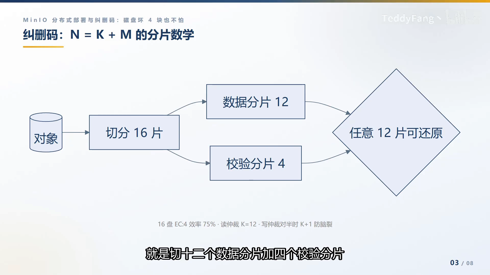
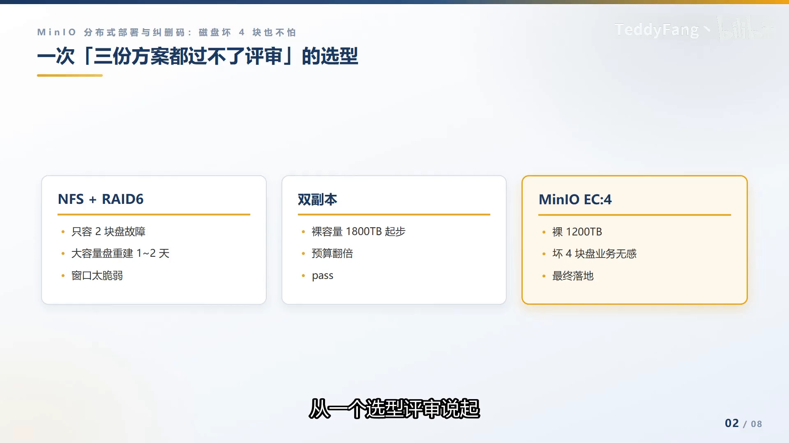
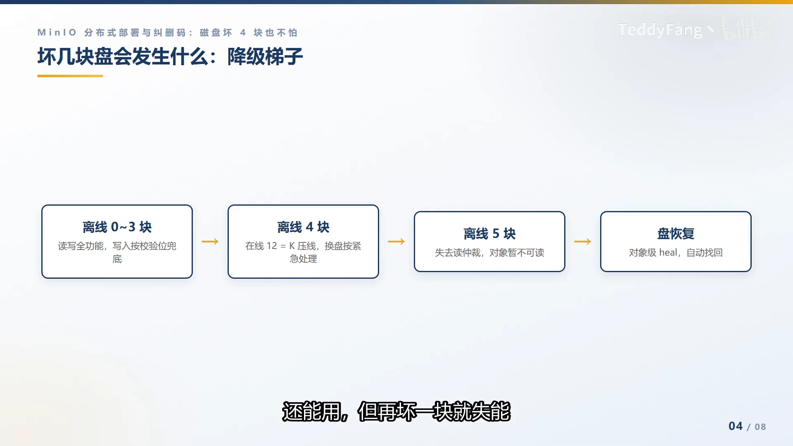
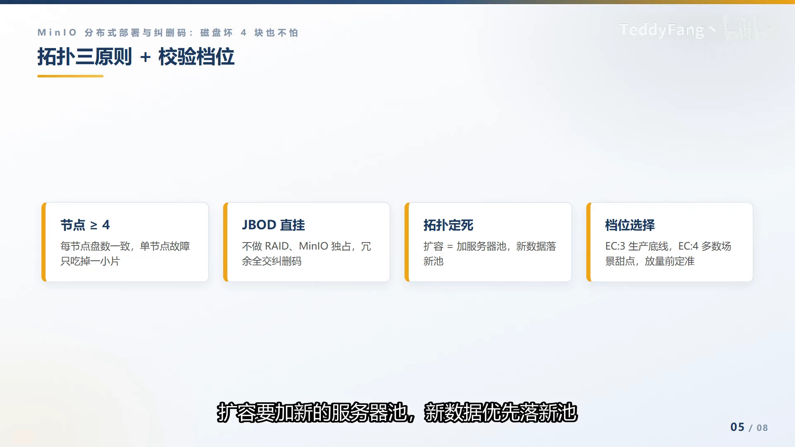
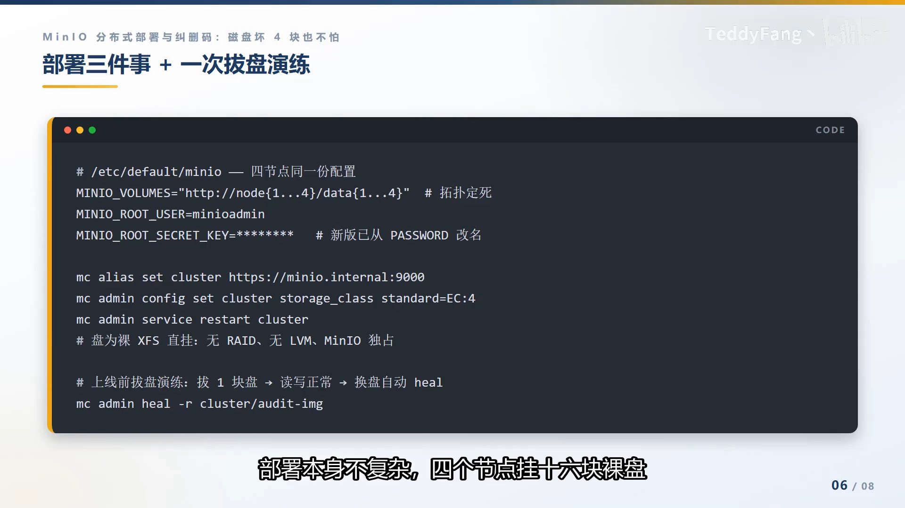
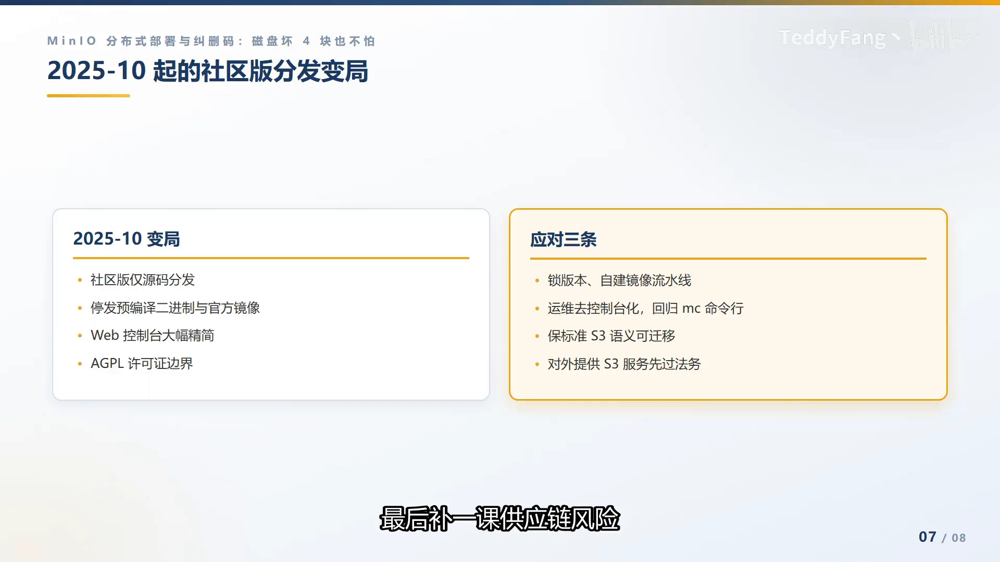
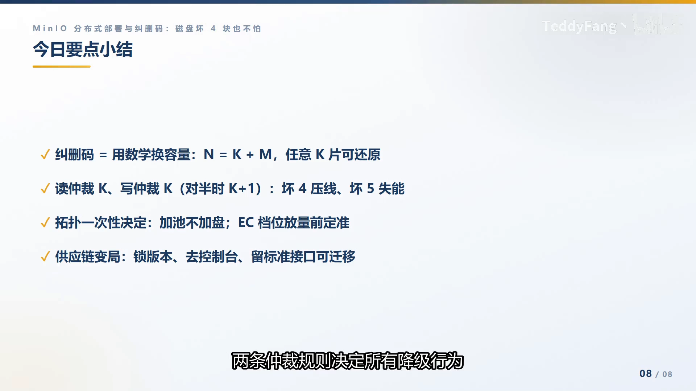

# 纠删码为什么能用 4 块校验盘顶住 4 块坏盘

> 视频来源：[架构师微课程第23期·MinIO 分布式部署与纠删码：磁盘坏 4 块也不怕](https://www.bilibili.com/video/BV1jDeJ6zEHH/)（Bilibili · TeddyFang丶）｜时长约 4 分钟
> 本文覆盖：纠删码的 N=K+M 分片数学、可用容量换算、读/写两条仲裁规则、坏盘后的降级阶梯、分布式拓扑的三条铁律与扩容方式、部署时的三个动作，以及 2025 年 10 月社区版分发方式的变局。视频极短但信息密度很高，是幻灯片驱动的讲解，本文按"数学 → 降级 → 拓扑 → 运维"重排。

## 本讲要解决的核心问题（SCQA）

**背景**：分布式存储要防盘坏，最直觉的办法是做副本——存两份、三份，坏一份还有别的。

**冲突**：副本的代价是容量直接翻倍甚至三倍。一个 900TB 的影像审计平台，双副本就要 1800TB 的裸容量，预算过不去；退回去用 NFS + RAID6，又只能容忍两块盘故障，而大容量盘重建要一到两天，重建窗口里再坏一块就整卷丢；上云对象存储则有合规问题。

**疑问**：有没有一种办法，既不用把容量翻倍，又能容忍比 RAID6 更多的盘同时坏掉？

**回答（中心思想）**：有，就是**纠删码（erasure coding）**——把对象切成 $N = K + M$ 个分片，其中 $K$ 个是数据分片、$M$ 个是校验分片，校验分片是前面数据分片的数学变换结果。**任意凑齐 $K$ 个分片（不管它是数据还是校验）就能还原完整对象**。代价是 $M/N$ 的容量，换来的是 $M$ 块盘同时损坏仍可读写。16 块盘配 4 个校验分片时，存储效率 75%，能容忍 4 块盘坏掉，比双副本省三分之一容量，容错能力还翻倍 [【跳转到 00:00】](https://www.bilibili.com/video/BV1jDeJ6zEHH/?t=0)。

## 一、N = K + M：把"备份"换成"方程"


### 1.1 一个 16 块盘的例子

MinIO 把参与纠删码的一组盘叫**纠删集（erasure set）**。纠删集里的盘数等于数据分片加校验分片 [【跳转到 00:40】](https://www.bilibili.com/video/BV1jDeJ6zEHH/?t=40)：

$$
N = K + M
$$

视频给的配置是 16 块盘、纠删档位 4（即 EC:4），于是切成 **12 个数据分片 + 4 个校验分片**。



### 1.2 可用容量怎么算

存储效率就是数据分片占总分片的比例 [【跳转到 01:00】](https://www.bilibili.com/video/BV1jDeJ6zEHH/?t=60)：

$$
\text{存储效率} = \frac{K}{N} = \frac{K}{K + M}
$$

16 块盘、EC:4 的情况下：

$$
\frac{12}{16} = 75\%
$$

也就是说，**16 块盘的裸容量，实际能存的数据是它的 75%**。反过来算：要存 900TB 可用数据，需要 $900 \div 0.75 = 1200$ TB 裸容量。这正是视频开头那个案例里"裸 1200TB"的由来——而双副本方案要 1800TB 起步。



### 1.3 校验分片不是备份

这是理解纠删码的关键一步。校验分片**不是某块数据盘的副本**，而是根据一个模型、由前面多块盘的数据综合推算出来的结果 [【跳转到 01:00】](https://www.bilibili.com/video/BV1jDeJ6zEHH/?t=60)。

打个比方：已知 $a + b + c = s$，你手里有 $a$、$b$ 和 $s$，就能算出 $c$。这里的 $s$ 就是校验分片，它不"等于"任何一块数据，但它携带了足够的信息，让缺失的那块可以被解出来。当校验分片有 4 个时，就是 4 个这样的方程，能解出 4 个未知数——所以**最多能同时丢 4 个分片**。

## 二、两条仲裁规则，决定所有降级行为

### 2.1 读仲裁 = K，写仲裁一般也是 K

分片丢失之后还能不能干活，取决于"在线分片数"是否达到**仲裁（quorum）**门槛：

- **读仲裁**：至少要有 $K$ 个分片在线，才能凑出完整对象 [【跳转到 01:00】](https://www.bilibili.com/video/BV1jDeJ6zEHH/?t=60)。
- **写仲裁**：一般也是 $K$，**但当校验分片恰好占一半时要加一**，即 $K+1$ [【跳转到 01:20】](https://www.bilibili.com/video/BV1jDeJ6zEHH/?t=80)。

### 2.2 为什么"校验占一半"要加一

这条规则看起来莫名其妙，其实是为了防脑裂（split-brain）。

假设数据分片 8 个、校验分片也是 8 个，总数 16。如果网络分区把集群劈成两半，每边各 8 个分片——两边都认为自己凑够了仲裁所需的 8 个，于是**两边都允许写入**，逻辑立刻混乱 [【跳转到 01:20】](https://www.bilibili.com/video/BV1jDeJ6zEHH/?t=80)。

把写仲裁提到 $K+1 = 9$，任何一边都凑不出 9 个分片，就只可能有一边能写。这就是"多数派"思路：**写操作必须拿到超过一半的票，才不会有两个人同时当选**。

### 2.3 坏盘降级阶梯

把两条仲裁规则套进 16 盘 / EC:4 的配置，就得到一张可以直接背下来的表 [【跳转到 01:20】](https://www.bilibili.com/video/BV1jDeJ6zEHH/?t=80)：

| 离线盘数 | 在线分片 | 状态 | 该做什么 |
| --- | --- | --- | --- |
| 0~3 块 | 13~16 | 读写全功能，写入按校验位兜底 | 正常换盘，按计划处理 |
| 4 块 | 12 | 刚好压在读仲裁线上，读写仍可用 | 换盘按紧急事件处理 |
| 5 块 | 11 | 失去读仲裁，对象暂时读不出来，但数据没丢 | 尽快恢复盘，恢复后自动找回 |
| 盘恢复 | — | 对象级 heal，自动修复 | 观察修复进度 |



这里有个容易误解的地方：**"坏到第 5 块"不等于"数据丢了"**。数据分片和校验分片还在剩下的盘上，只是凑不齐读仲裁，暂时读不出来；盘修好、或者换上新盘让 MinIO 完成 heal 之后，对象会自动回来。

### 2.4 修复粒度是对象，不是整盘

相比 RAID 的整盘重建，纠删码的修复粒度细得多：**MinIO 修复的是单个对象**，只重建这个对象缺失的那几个分片，而不是把整块盘的内容重算一遍 [【跳转到 01:40】](https://www.bilibili.com/video/BV1jDeJ6zEHH/?t=100)。

这带来两个直接好处：

- **影响面小**。重建一块 20TB 盘要一两天，这段时间整卷都在降级；而对象级修复是逐个对象完成的，大部分数据几乎立刻恢复可用。
- **修复窗口短**。RAID6 重建期间再坏一块就整卷丢，纠删码把这段"最脆弱的窗口"压缩到了单个对象的尺度。

## 三、拓扑三条铁律：部署前就要想清楚

纠删码的容错能力，很大程度上取决于盘是怎么分布的。视频给了三条铁律 [【跳转到 02:00】](https://www.bilibili.com/video/BV1jDeJ6zEHH/?t=120)：

### 3.1 节点至少 4 个，每个节点盘数一致

节点数少于 4，单节点故障就会吃掉纠删集里太大一片盘。**每个节点盘数一致**，是为了让"一个节点挂掉"这件事对纠删集的影响是可预测的、均匀的 [【跳转到 02:00】](https://www.bilibili.com/video/BV1jDeJ6zEHH/?t=120)。

### 3.2 裸盘直挂（JBOD），不做 RAID

> "不做 RAID、MinIO 独占，冗余全交纠删码。"

如果底层已经做了 RAID 冗余，上层再叠一层纠删码，等于**把同一份冗余买了两遍**，浪费一倍空间。RAID 控制器还会掩盖单盘故障，让 MinIO 看不到真实的盘健康状态。

### 3.3 拓扑初始化后不可改：扩容是加池，不是加盘

这条最反直觉：**拓扑一旦初始化就固定了，不能往老的纠删集里塞盘**。要扩容，得**新增一个服务器池（server pool）**，新数据优先落到新池 [【跳转到 02:00】](https://www.bilibili.com/video/BV1jDeJ6zEHH/?t=120)。



原因还是纠删码的数学：分片数是按纠删集的盘数算出来的，往里加盘会改变 $N$，已经按旧 $N$ 切好的对象就对不上了。所以 MinIO 选择"另起一个池"，让新旧池各自保持自己的一致性。

### 3.4 档位选择：3 是底线，4 是甜点位

校验分片数（档位）怎么定？视频给的结论很干脆：**EC:3 是生产底线，EC:4 是多数场景的甜点位**，而且**必须在放量之前定准**——改档位只对新写入的对象生效，老对象还是按旧档位存着 [【跳转到 02:20】](https://www.bilibili.com/video/BV1jDeJ6zEHH/?t=140)。

档位定得越低，可用容量越大、容错越弱；定得越高则相反。这就是"配置跟着对象走"的含义：**你的数据重要到什么程度，决定你愿意为它付多少容量**。

## 四、部署三件事与一次拔盘演练

### 4.1 配置长什么样

视频给的部署配置非常短 [【跳转到 02:35】](https://www.bilibili.com/video/BV1jDeJ6zEHH/?t=155)：

```bash
# /etc/default/minio —— 四节点同一份配置
MINIO_VOLUMES="http://node{1...4}/data{1...4}"   # 拓扑定死
MINIO_ROOT_USER=minioadmin
MINIO_ROOT_SECRET_KEY=********                    # 新版已从 PASSWORD 改名

mc alias set cluster https://minio.internal:9000
mc admin config set cluster storage_class standard=EC:4
mc admin service restart cluster
# 盘为裸 XFS 直挂：无 RAID、无 LVM、MinIO 独占
```

http://node{1...4}/data{1...4} 这一行就是拓扑：4 个节点 × 4 块盘 = 16 块盘，正好对应前面 12+4 的纠删集。



### 4.2 三个必须做的动作

1. **纠删档位在放量前设置好**。放量之后再改，只影响新对象，集群里会长期存在两种档位的数据。
2. **运维全部走命令行工具，别依赖网页控制台**。理由在下一节。
3. **上线前做一次拔盘演练**：拔一块盘，确认读写正常；换上新盘，看自动修复能不能跑起来 [【跳转到 02:55】](https://www.bilibili.com/video/BV1jDeJ6zEHH/?t=175)。

第 3 条最容易被跳过，也最值得做。纠删码的容错是"设计上应该成立"，而不是"你的环境里已经验证过"——盘是不是真的独立、heal 会不会真的触发、监控能不能看到，只有拔一次才知道。

### 4.3 监控：把离线盘数设成高危告警

> "监控上把离线盘数设成高危告警，离写仲裁只差一步的时刻，必须有人知道。" [【跳转到 02:55】](https://www.bilibili.com/video/BV1jDeJ6zEHH/?t=175)

离线盘数是这个系统里最该被盯住的指标：它不是"容量还剩多少"这种慢性指标，而是"再坏一块就失能"的悬崖式指标。EC:4 的 16 盘配置下，坏 4 块是压线，坏 5 块就失能，中间没有缓冲。

## 五、2025 年 10 月的变局：社区版只剩源码

视频最后补了一课供应链风险 [【跳转到 03:06】](https://www.bilibili.com/video/BV1jDeJ6zEHH/?t=186)：

- **从 2025 年 10 月起，MinIO 社区版改为仅源码分发**，不再提供官方安装包和镜像；
- **网页控制台的管理功能大幅精简**。

这直接改变了运维方式：以前 `docker pull` 一下就有新版本，现在要自己构建；以前控制台上点点就能管用户和策略，现在得回到 `mc` 命令行。



视频给的应对是三条：

| 应对 | 具体做法 |
| --- | --- |
| 锁定版本 | 不追最新，把当前版本固定下来 |
| 自建镜像流水线 | 自己构建、自己扫描漏洞，把漏洞跟踪纳入自己的流程 |
| 保留标准接口的可迁移性 | 运维全面转向命令行和 API，不依赖控制台；数据保持标准 S3 语义 |

第三条是真正的底牌：**只要数据是标准 S3 语义，退出成本就可控**。控制台没了、镜像不发了，都只是工具层的变化；数据层的可迁移性才是长期安全的来源。视频还补了一句：对外提供 S3 服务之前，先过法务——AGPL 的许可证边界需要提前确认。



这张小结把全篇压成了四行：纠删码是用数学换容量；两条仲裁规则决定所有降级行为；拓扑一次性决定，加池不加盘；供应链变局下要靠锁版本、去控制台、留标准接口 [【跳转到 03:26】](https://www.bilibili.com/video/BV1jDeJ6zEHH/?t=206)。

## 小结

- 纠删码的本质是**用数学换容量**：$N = K + M$，任意 $K$ 个分片就能还原对象，可用容量是裸容量的 $K/N$。
- 16 盘配 EC:4 就是 12 数据 + 4 校验，**效率 75%，容忍 4 块盘故障**；要存 900TB 需 1200TB 裸容量，而双副本要 1800TB。
- **读仲裁 = K，写仲裁 = K（校验占一半时 K+1）**，后者是为了防脑裂；这两条规则决定了所有降级行为：坏 4 块压线运行，坏 5 块暂时失能但数据不丢。
- 修复粒度是**单个对象**，比 RAID 整盘重建影响小得多。
- 拓扑三条铁律：**节点 ≥ 4、每节点盘数一致、JBOD 直挂不做 RAID**；拓扑初始化后不可改，**扩容是加服务器池，不是加盘**。
- 档位 EC:3 是生产底线、EC:4 是甜点位，**放量前定准**，改档位只对新对象生效。
- 上线前做一次**拔盘演练**，监控把**离线盘数**设成高危告警。
- 2025-10 起社区版仅源码分发、控制台精简：**锁版本、自建镜像、保留标准 S3 接口的可迁移性**是三条底线。

## 关键术语速查

| 术语 | 一句话解释 |
| --- | --- |
| 纠删码（erasure coding） | 把对象切成数据分片与校验分片分散存放，丢失部分分片仍可数学还原的冗余技术 |
| 纠删集（erasure set） | 参与同一组纠删码计算的一组盘，盘数 $N = K + M$ |
| 数据分片 / 校验分片 | 前者是对象切开后的原始数据块，后者是由数据块推算出的冗余块，不是备份 |
| 存储效率 | $K/N$，即裸容量中真正能存数据的比例；16 盘 EC:4 时为 75% |
| 读仲裁 / 写仲裁 | 完成读或写所需的最少在线分片数；读为 $K$，写一般为 $K$，校验占一半时为 $K+1$ |
| 脑裂（split-brain） | 网络分区导致集群两半各自认为自己是主体、都接受写入的状态 |
| 降级（degraded） | 部分盘离线但仍在仲裁线以上的运行状态 |
| heal | MinIO 的对象级自动修复，用剩余分片重建缺失分片 |
| JBOD | Just a Bunch Of Disks，裸盘直挂，不做 RAID 冗余 |
| 服务器池（server pool） | 扩容时新增的一组节点；新数据优先写入新池 |
| 纠删档位（EC level） | 校验分片的个数，如 EC:4 表示 4 个校验分片 |