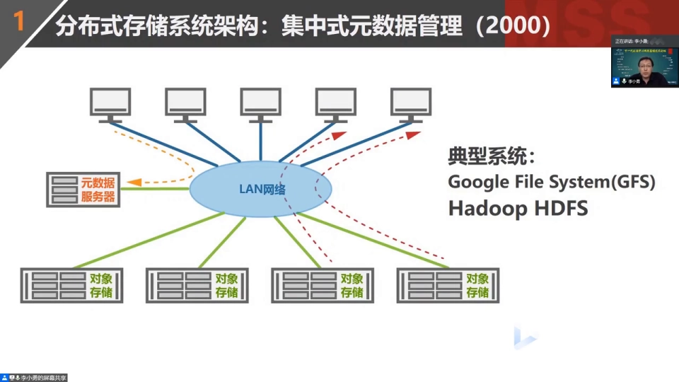
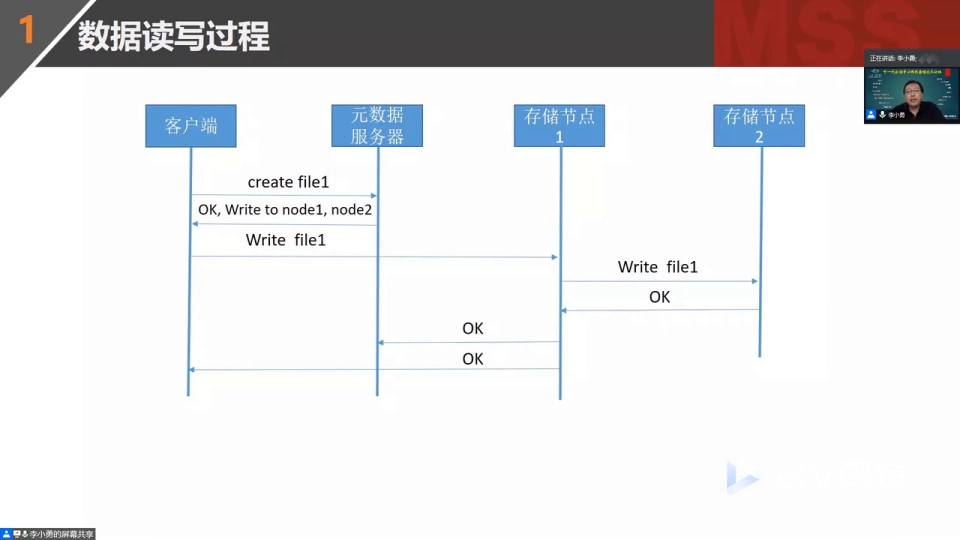
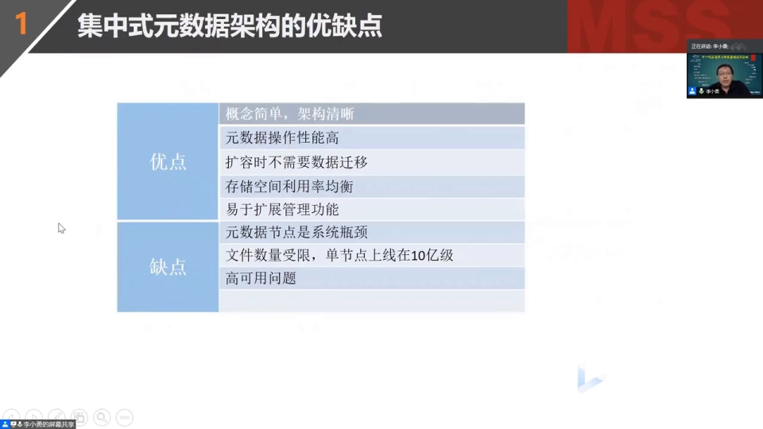
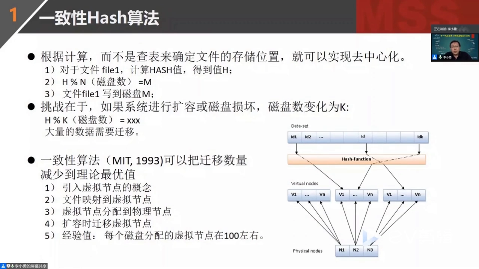
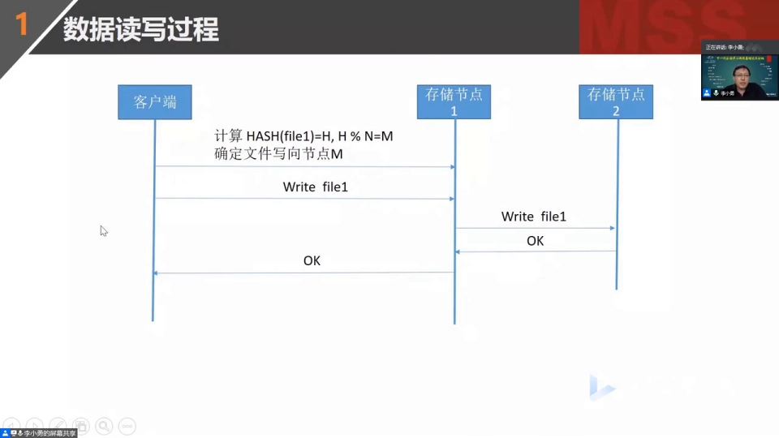
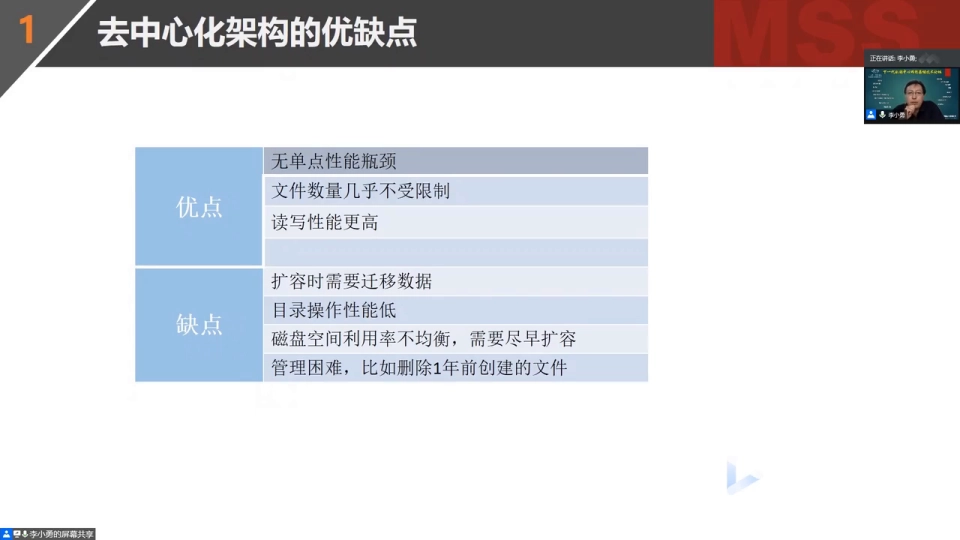
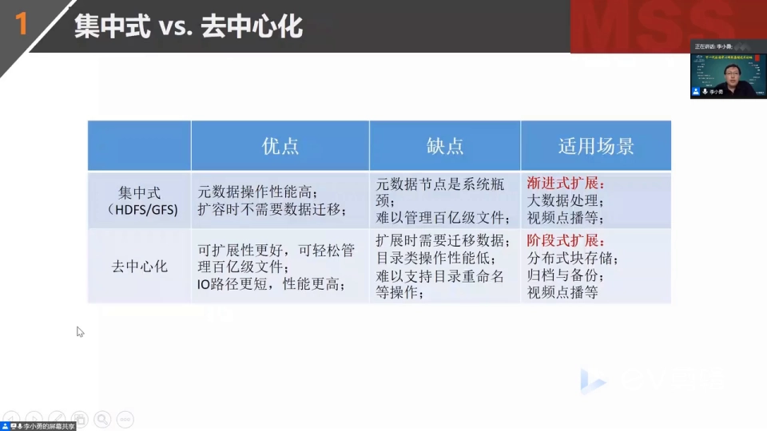
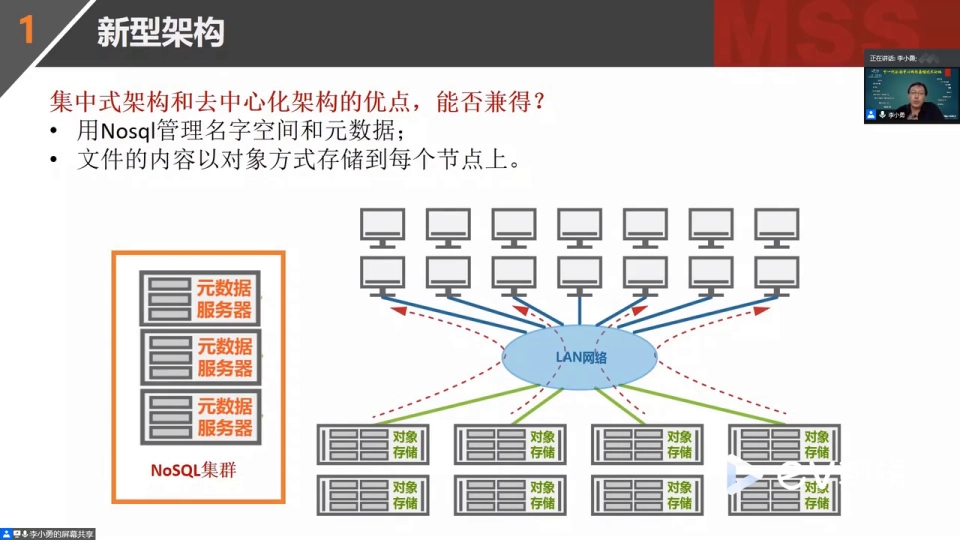

# 元数据服务为什么是分布式文件系统的天花板

> 视频来源：[分布式存储系统的一些关键问题](https://www.bilibili.com/video/BV1VfKUzfE3k/)（Bilibili · 上海交通大学 李小勇）｜时长约 19 分钟
> 导读：讲者用「集中式元数据 → 去中心化哈希 → 再回到元数据服务」这条二十年弯路，讲清了分布式文件系统为什么非拆不可、拆开之后瓶颈落在哪。本文按「动机 → 两种实现 → 瓶颈条件 → 量化」重组，只讨论**这个类别**的通用问题；JuiceFS 的组件架构与读写路径属于本系列 4.2，两种布局的静态对照已在本系列 1.1.2 讲过，本文不重复。

## 本讲要解决的核心问题（SCQA）

**背景**：单机文件系统里，元数据（名字、属性、目录结构、数据块位置）和数据（文件内容）都在同一块盘上，一次 `stat` 就是一次本地访问，几乎不需要为它单独操心。

**冲突**：一旦数据量超过一台机器，这两样东西就必须被放到不同的机器、甚至不同的系统里。可拆开之后，**数据层可以靠加机器线性扩展，元数据层却往往还是那一个中心节点**——于是元数据服务从"顺带管一下"变成了整个系统的天花板。

**疑问**：为什么非拆不可？拆开之后，元数据引擎究竟在什么条件下成为瓶颈？

**回答（中心思想）**：拆分的本质不是"把元数据挪到别处"，而是**按负载特征分而治之**——数据面要大块顺序 IO、控制面要低延迟小随机 IO，两者的扩展方式根本不同。而元数据之所以成为天花板，是因为它的开销**与文件个数成正比**，而数据面的开销**与字节数成正比**；在小文件负载下，前者比后者贵一到两个数量级，于是元数据先撞墙。

## 一、拆分的三个不可回避的约束

讲者把 2000 年之前的存储概括为"硬件厂商做的事"，2003 年 Google File System 的论文是分水岭：用通用的 x86 服务器、用一大批服务器做成大规模存储，开启了软件定义存储的时代 [【跳转到 02:14】](https://www.bilibili.com/video/BV1VfKUzfE3k/?t=134)。

要理解为什么必须拆，得先看单机文件系统在哪三件事上做不到。

### 1.1 数据量要求水平扩展，单机文件系统做不到

单机文件系统的容量上限就是你能插进这台机器的盘数。想再大，只能换更大的机器——这是**垂直扩展**，而垂直扩展有物理上限。分布式文件系统要的是**水平扩展**：加机器就加容量和吞吐，且扩容时最好不动已有数据。

### 1.2 命名空间必须全局唯一，而且要被多客户端并发访问

文件系统和对象存储最本质的差别是**目录树**。多台机器要共享同一棵目录树，这棵树就只能有一份权威副本；而这份副本必须能被所有客户端并发地读、并发地改。单机文件系统靠内核锁解决这件事，跨机器时这把锁就变成了网络上的一个服务。

### 1.3 数据面和控制面的负载特征完全不同

这是最容易被忽略、却最能解释"为什么拆完就快了"的一条：

| 维度 | 数据面（读写文件内容） | 控制面（元数据操作） |
| :--- | :--- | :--- |
| 请求大小 | 大块，MB 到 GB 级 | 极小，几十到几百字节 |
| IO 模式 | 大块顺序 IO，可流水线 | 小随机 IO，要求低延迟 |
| 扩展方式 | 加盘、加节点，近似线性 | 单点内存与锁，难线性 |
| 瓶颈资源 | 磁盘带宽、网络带宽 | 内存容量、CPU、锁、RTT |
| 失败影响 | 一次读慢一点 | 整个命名空间不可用 |

把这两类负载塞进同一批机器，等于让大块顺序 IO 和小随机 IO 抢同一份资源。拆开的收益不是"少了一次查表"，而是**两类负载可以各自用最合适的硬件和扩展方式**。

## 二、集中式元数据服务：把目录树放进内存

### 2.1 架构：一个中心节点管名字空间，数据分散在各节点

2000 年初那一代系统（GFS、HDFS）的形态非常统一：一个集中的元数据服务器像一棵目录树，但它**只管理名字空间，不保存文件数据**；数据分散存储在每一个 x86 存储节点上 [【跳转到 02:44】](https://www.bilibili.com/video/BV1VfKUzfE3k/?t=164)。

### 2.2 一次写文件：控制面一次决策，数据面一条流水线

写一个文件的流程是：客户端先问元数据服务器"我要写一个文件，应该放哪里"；元数据服务器知道每个存储节点的状态、知道哪个节点还有空余空间，把地址返回给客户端；客户端再把数据推送到节点一，节点一以流水线方式投送到节点二 [【跳转到 03:14】](https://www.bilibili.com/video/BV1VfKUzfE3k/?t=194)。

这张图值得多看一眼：**元数据服务器只在最前面被访问一次，后面所有的字节传输都不经过它**。这就是分离式设计最原始也最有效的形态——控制面和数据面在物理上就是两条路。

### 2.3 优点清单，以及清单最后两行的代价

优点很实在：概念简单、架构清晰；元数据操作性能高（因为全在内存里，目录列举特别快）；扩容不需要迁移数据；存储空间利用率均衡；容易扩展管理功能 [【跳转到 04:04】](https://www.bilibili.com/video/BV1VfKUzfE3k/?t=244)。

但缺点栏里那两行是致命的：**元数据节点是系统瓶颈**、**文件数量受限，单节点上线在 10 亿级**。

### 2.4 天花板是内存，不是磁盘

原因很直接：为了提高性能，元数据全放在内存里，而**内存容量和磁盘容量差了好几个数量级** [【跳转到 05:19】](https://www.bilibili.com/video/BV1VfKUzfE3k/?t=319)。

讲者给了一个可以自己验算的数字：一台服务器能配到几百 GB 内存，实战下来一个单点元数据服务器能管理的文件数量大概就是 **10 亿级别** [【跳转到 05:44】](https://www.bilibili.com/video/BV1VfKUzfE3k/?t=344)。

反过来推一下：几百 GB 除以 10 亿，平均每个文件占 **300 到 400 字节**。这就是一个 inode 加上它在内存里的对象开销、再加上块位置信息的真实成本。记住这个数字，后面算瓶颈时要用。

文件数超过 10 亿怎么办？讲者的回答很朴素：**再建一个新集群**。

## 三、去中心化：把"查表"换成"计算"

### 3.1 2010 年的那次反向浪潮

到 2010 年，架构出现了一次新的变革浪潮，核心思想是**去中心化**：既然查表式的元数据管理虽然简单、但元数据服务器是个单点瓶颈，那能不能把它去掉？那个年代典型的开源系统——GlusterFS、Ceph，还有早期的对象存储 Swift——基本上都是这个思路 [【跳转到 06:33】](https://www.bilibili.com/video/BV1VfKUzfE3k/?t=393)。

没有元数据服务器，客户端写文件时怎么知道该放哪块盘？

### 3.2 用计算定位，而不是查表定位

答案是哈希。对文件名做哈希得到整数 H，假设集群里总共有 N 块盘，把 H 对 N 取模得到 M，就把文件写到 M 号盘 [【跳转到 07:28】](https://www.bilibili.com/video/BV1VfKUzfE3k/?t=448)。

这个思想非常简单，单点瓶颈确实被消除了。但分布式系统有两点是必须做的：**存储空间用光时要扩容**，**磁盘坏了要从系统里切除**——两件事都会改变盘的数量 [【跳转到 08:18】](https://www.bilibili.com/video/BV1VfKUzfE3k/?t=498)。

盘数从 N 变成 K 之后，原来算出的哈希值对 K 取模，**几乎所有的值都变了**。原来落在 8 号盘的文件可能就要迁到 11 号盘。在大规模系统里，这样的数据迁移是不能接受的：时间太长、严重影响性能，迁移过程中如果再遇到磁盘损坏就是灾难性后果 [【跳转到 08:43】](https://www.bilibili.com/video/BV1VfKUzfE3k/?t=523)。

### 3.3 一致性哈希：把迁移量压到理论最优

MIT 在 1993 年提出的一致性哈希解决了这个问题：扩容时迁移的数据量是理论上的最优值——从 10 台扩到 11 台，大概只需要迁移 1/11 的数据量 [【跳转到 09:33】](https://www.bilibili.com/video/BV1VfKUzfE3k/?t=573)。

实现上引入一层**虚拟节点**：文件先哈希映射到虚拟节点，虚拟节点再分配到物理节点；扩容或磁盘损坏时，只要迁移虚拟节点即可。讲者给了一个经验值——估计系统最大规模约 100 块盘，每块盘分约 100 个虚拟节点，这样迁移时磁盘之间的均衡度大概是 1% [【跳转到 10:23】](https://www.bilibili.com/video/BV1VfKUzfE3k/?t=623)。

### 3.4 读写路径确实更短了

去中心化之后，客户端自己就知道算法：把文件名算一个哈希再取模，直接把文件写向 M 号节点，M 节点再推送给另一个副本节点。**交互次数比有元数据节点时要少，所以性能更高**；而且没有集中式元数据节点，文件数量基本不受限制——只要磁盘有空间，就可以无限往上写 [【跳转到 12:11】](https://www.bilibili.com/video/BV1VfKUzfE3k/?t=731)。

对比 2.2 那张图：同样是一次写，控制面从"一次网络往返 + 一次查表"变成了"一次本地计算"。

## 四、代价：目录树被拆散之后，树上的操作全变贵了

去中心化的优缺点同样鲜明 [【跳转到 14:12】](https://www.bilibili.com/video/BV1VfKUzfE3k/?t=852)：

表格里那几行"缺点"，其实是同一件事的四种表现：**目录树被哈希打散了，任何需要"看全局"的操作都要跨节点聚合**。

- **目录操作性能低**：要列举一个目录下的文件，得从各个分布式节点上把文件访问一遍，拿到本地合并排序再显示给客户端。讲者说得很直白——用过 GlusterFS 的人都知道，**目录列举是最慢的操作**。
- **管理困难**：比如"删除一年之前创建的文件"。有元数据服务器时这是一条查询；没有的时候，基本相当于在每一个节点上暴力扫一遍 [【跳转到 15:52】](https://www.bilibili.com/video/BV1VfKUzfE3k/?t=952)。
- **空间利用率不均衡**：按哈希放盘，如果文件大小差异大，就可能出现系统整体还有 30% 容量、但个别盘已经写到 99% 的情况，所以这类系统可能到 60% 就要启动扩容 [【跳转到 15:02】](https://www.bilibili.com/video/BV1VfKUzfE3k/?t=902)。
- **扩容必须迁数据**：虽然一致性哈希把迁移量压到了理论最优，但你还是不得不迁。

### 4.1 顺带回答"分片键选路径还是选 inode"

讲者的哈希是**对文件名做的**——也就是按路径分片。这决定了上面那些代价的形状。如果把分片键换成 inode 号，代价不会消失，只是**挪到另一处**：

| 分片键 | 目录列举 | rename | 路径解析（`open a/b/c`） | 数据落点均衡 |
| :--- | :--- | :--- | :--- | :--- |
| 按路径（文件名）哈希 | 目录内文件散在各分片，要跨节点聚合排序，O(n) 网络 | 父目录项与子项可能同时换分片，要跨分片协调 | 一次哈希即可定位，最省 | 只按名字散列，与文件大小无关，易不均衡 |
| 按 inode 号分片 | 目录项集中在一个分片，列举是本地扫描 | 只改父目录的目录项，子项 inode 不动，最省 | 要逐级查目录项拿 inode，目录越深往返越多 | 新 inode 递增分配，天然均匀 |

一句话概括：**路径分片让 rename 变难，inode 分片让目录列举和路径解析变难**。视频里 GlusterFS 选择的是前者，所以它最慢的操作是目录列举；而集中式元数据服务（GFS/HDFS）本质上是"整棵树都在一个分片里"，所以列举和 rename 都很便宜，代价是那个分片有上限。

## 五、元数据引擎什么时候成为瓶颈：五个具体条件

把上面的线索收拢，元数据服务成为瓶颈有五个可观测的条件。前三个是"服务端扛不住"，后两个是"调用方等不起"。

### 5.1 每秒元数据操作数打满

`open`、`stat`、`lookup`、`create` 这些操作的 QPS 打满，请求开始排队。这是最直观的一个条件，也是监控上最先看到的。

### 5.2 锁竞争：同一目录下的并发创建与重命名争同一把锁

目录树的修改是**结构性修改**，天然需要互斥。同一个目录下并发创建文件、并发 rename，都会争同一把锁。集中式设计的典型做法是一把覆盖整棵目录树的大锁——正确性没问题，但所有写元数据的请求被串行化了。这就是为什么"元数据 QPS 很高"和"元数据写 QPS 很高"是两件完全不同的事：读可以靠加只读副本，写只能排队。

### 5.3 热目录：几百万文件挤在一个目录里，列举变成 O(n)

目录列举的复杂度是 O(目录下的条目数)。一个目录里放几百万个文件（大数据场景里非常常见，比如按小时分区的临时文件），一次 `ls` 就要把这几百万条目录项读出来。在分离式设计里，这个 O(n) 还要乘上网络往返。

### 5.4 元数据本身的内存占用

按 2.4 算出来的每文件 300 到 400 字节，十亿文件就是几百 GB，百亿文件就是几 TB。**这部分内存是常驻的**——因为元数据服务要靠它来保证低延迟。所以元数据服务的容量规划，本质上是"内存能买多大"的规划，而不是"磁盘能买多大"的规划。

### 5.5 客户端与元数据服务之间的 RTT 乘上每次操作次数

一次 `open a/b/c.txt` 要逐级解析，每一级都是一次（或多次）网络往返；目录越深，往返越多。这条成本在**小文件、深目录**的负载下会被放大得非常明显。这也是为什么分离式设计几乎必然要配缓存和请求合并——那是 4.1.2 的话题，这里只指出它是瓶颈的一部分。

## 六、量化：为什么元数据总是先撞墙

把两条路径的成本写成公式，差别一目了然：

$$
\text{数据面成本} \propto \text{总字节数} \qquad \text{控制面成本} \propto \text{文件个数} \times \text{每次操作的往返数}
$$

也就是说，**数据面的开销跟"存了多少 GB"成正比，控制面的开销跟"有多少个文件"成正比**。这两个量在真实负载里可以差好几个数量级。

拿两个具体例子估算一下（数量级估算，用来说明趋势）：

**一个 4 KB 的小文件。** 数据面要传 4 KB，按一块 NVMe 顺序读 3 GB/s 算，传输时间约 1.3 微秒。控制面至少要 3 次元数据操作（create、写入时的块分配、close），即使元数据服务能扛 10 万 QPS、摊到每次 10 微秒，也是 30 微秒。**控制面比数据面贵 20 倍以上。**

**一个 1 GB 的大文件。** 数据面要传 1 GB，约 0.33 秒。控制面是 1 次 create、按 4 MB 一块算 256 次块分配、1 次 close，约 258 次操作，按同样口径约 2.6 毫秒，占比不到 1%。**控制面几乎可以忽略。**

这就是"小文件负载下元数据先成为瓶颈"的全部原因：文件越小，数据面的成本越低，而控制面的成本一分不少。一个存了 10 亿个 4 KB 文件的集群，数据总量只有 4 TB——一块盘就装得下——但它需要的元数据内存是几百 GB，需要的元数据 QPS 是数据面带宽需求的几十倍。

反过来看带宽：一块普通 HDD 顺序读约 200 MB/s，一块 NVMe 约 3 GB/s，加盘几乎线性增长；而元数据服务的 QPS 增长要靠更细的锁、更强的单机、或者分片，每一步都更难。**数据带宽可以靠"多"，元数据 QPS 只能靠"巧"。**

## 七、两条路都到不了终点，于是有了第三种

讲者最后给了一张对比表，把两种架构的适用场景摆在一起 [【跳转到 16:23】](https://www.bilibili.com/video/BV1VfKUzfE3k/?t=983)：

- **集中式**：优点是元数据操作性能高、扩容不迁数据；缺点是元数据节点是瓶颈、难以管理百亿级文件。适合**渐进式扩展**的场景——大数据处理、视频点播这类数据线性增长、文件少而大的负载。
- **去中心化**：优点是扩展性好、可轻松管理百亿级文件、IO 路径更短；缺点是扩容要迁数据、目录类操作性能低、**难以支持目录重命名等操作**。适合**阶段性扩展**的场景——分布式块存储、归档与备份。

两者的优缺点非常互补，没有一种方法是完美的 [【跳转到 16:17】](https://www.bilibili.com/video/BV1VfKUzfE3k/?t=977)。

于是讲者提出了第三种可能：既然对象存储已经足够成熟、NoSQL 数据库在 2010 年前后也已经把性能、容量、可靠性解决得比较彻底，那能不能**用分布式数据库管理元数据，用对象存储存文件数据**？[【跳转到 18:14】](https://www.bilibili.com/video/BV1VfKUzfE3k/?t=1094)

这个思路的价值在于：它把"元数据必须是一个中心节点"和"元数据必须可扩展"这对矛盾，交给了**一个本来就擅长水平扩展的系统**去解决。讲者提到 Oracle 在两三年前的 FAST 会议上提出过类似思想，并认为 2020 年之后设计的系统值得尝试 [【跳转到 18:39】](https://www.bilibili.com/video/BV1VfKUzfE3k/?t=1119)。

用今天的眼光看，这就是 TiKV、FoundationDB、ZippyDB 这一类分布式 KV 在元数据层的角色——而它们各自怎么分片、分片键怎么选，又回到了 4.1 那张表里的取舍。

## 小结

- 拆分的本质是**按负载特征分而治之**：数据面要大块顺序 IO 且可线性扩展，控制面要低延迟小随机 IO 且必须全局唯一，两者塞在一起会互相拖累。
- 集中式元数据服务把目录树放进内存，因此**快，但天花板是内存**：几百 GB 内存对应约 10 亿文件，平均每文件 300 到 400 字节。
- 去中心化用哈希把"查表"换成"计算"，消除了单点、文件数不受限，但**目录树被打散**，于是目录列举、rename、按时间批量删除这些"要看全局"的操作全都变贵。
- 分片键的选择决定代价落在哪：**路径分片让 rename 变难，inode 分片让目录列举和路径解析变难**。
- 元数据成为瓶颈的五个条件：QPS 打满、同目录写操作的锁竞争、热目录的 O(n) 列举、常驻内存容量、RTT 乘以逐级解析次数。
- 量化的关键结论：**数据面开销与字节数成正比，控制面开销与文件个数成正比**。小文件负载下控制面比数据面贵一个数量级以上，所以元数据总是先撞墙。
- 两条路都到不了终点，于是有了第三种：用可水平扩展的分布式 KV 管元数据、用对象存储存数据，把"全局唯一"和"可扩展"分给两层各自实现。

## 关键术语速查

| 术语 | 一句话解释 |
| :--- | :--- |
| 元数据 | 描述文件的数据：名字、属性、权限、目录结构、数据块位置，不含文件内容本身 |
| 元数据服务器 | 集中保存目录树与块位置的节点，GFS 里叫 master，HDFS 里叫 NameNode |
| 名字空间 | 所有路径构成的命名空间，分布式文件系统要求它全局唯一、多客户端共享 |
| 数据面 / 控制面 | 数据面搬文件内容（大块顺序 IO），控制面做元数据操作（小随机 IO） |
| 一致性哈希 | 1993 年 MIT 提出的哈希方案，扩容时只迁移 1/N 的数据，靠虚拟节点实现均衡 |
| 虚拟节点 | 哈希环上的逻辑节点，一个物理盘对应上百个虚拟节点，迁移时以虚拟节点为单位 |
| 目录列举 | 读出一个目录下的所有条目，复杂度是 O(条目数)，分离式设计里还要跨节点聚合 |
| 分布式 KV | 可水平扩展的键值存储（TiKV、FoundationDB 等），常被用作元数据的底座 |