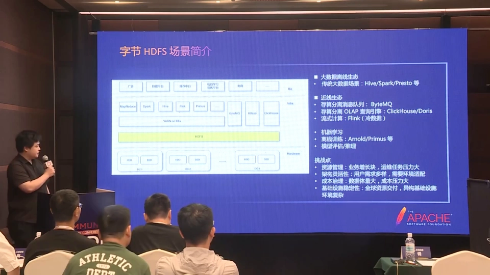
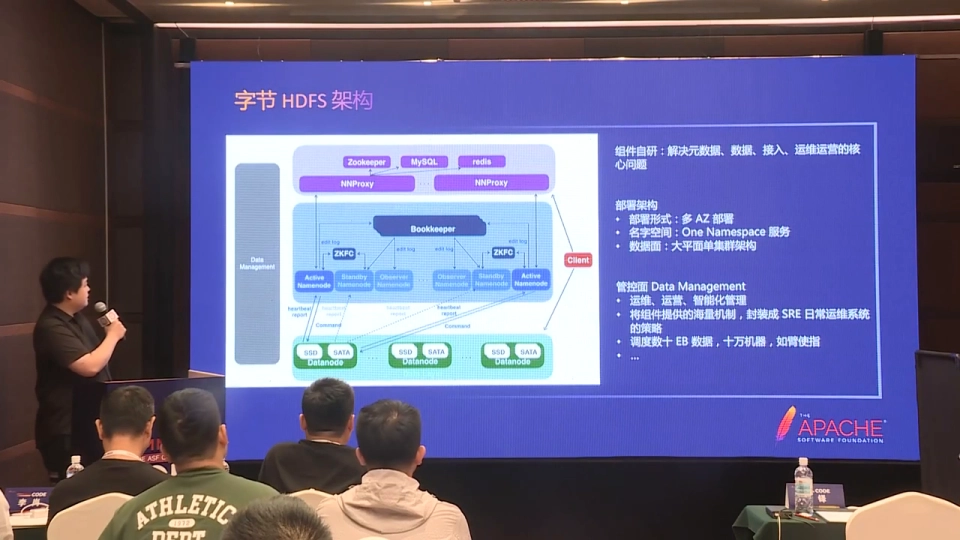
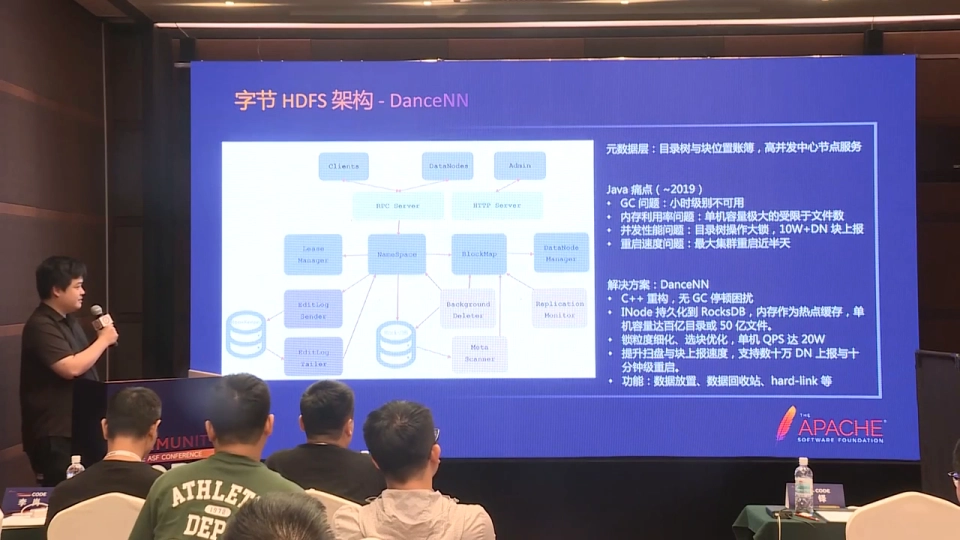
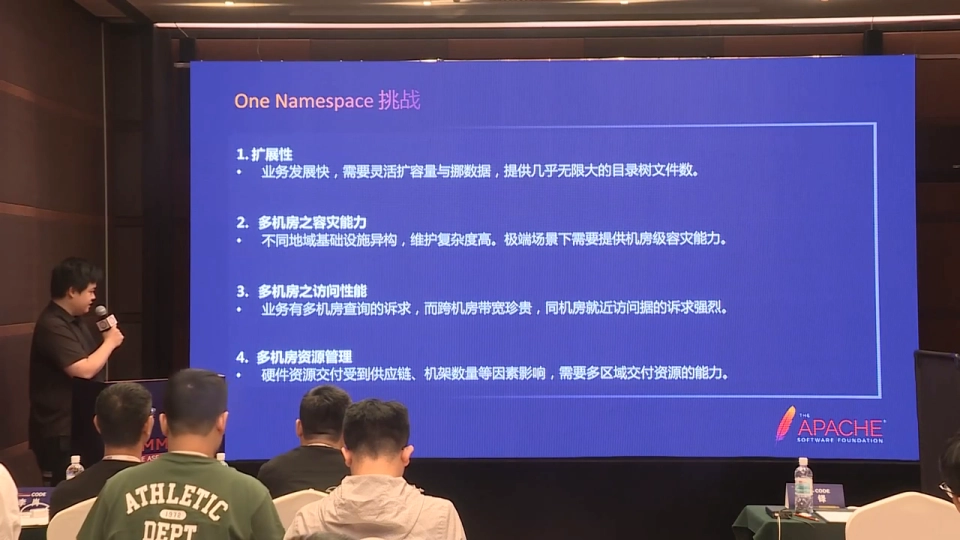
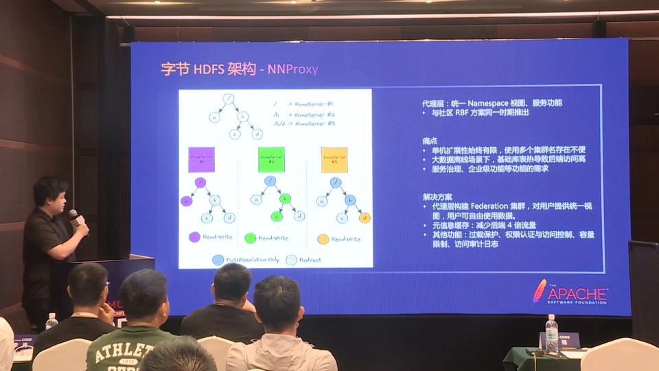
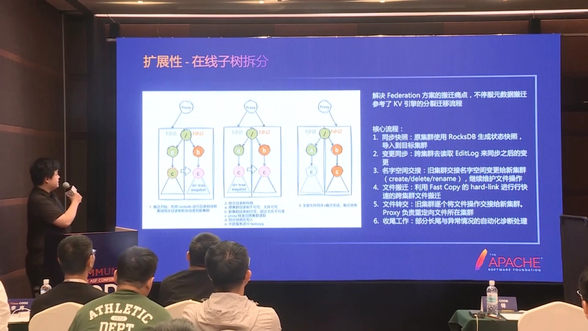
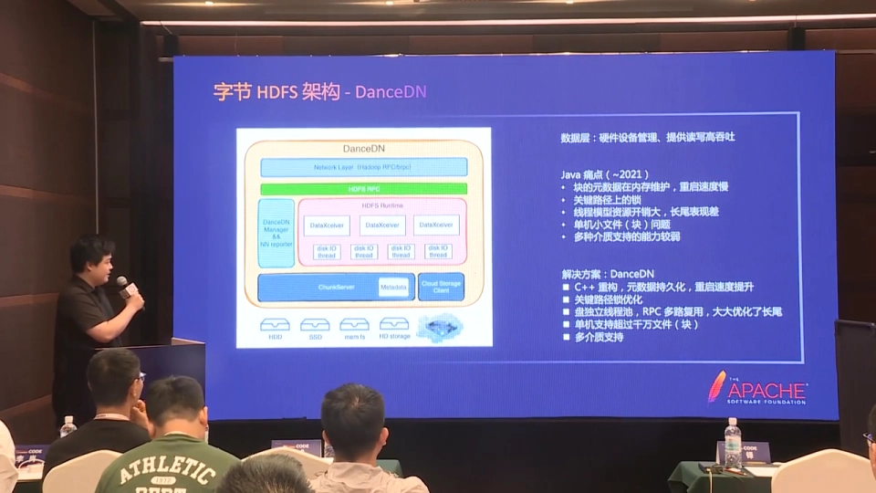
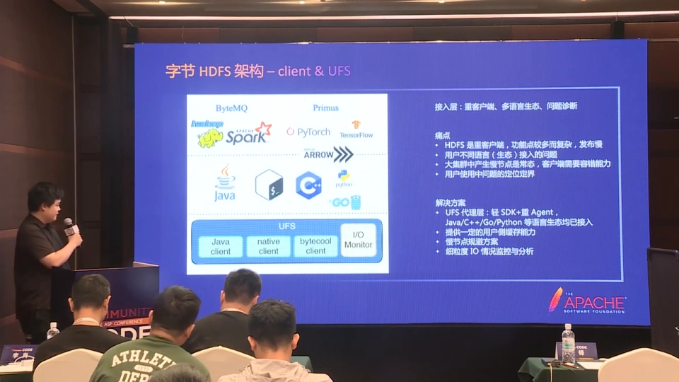

# 千亿文件之后瓶颈全在元数据层

> 视频来源：[字节跳动千亿文件 HDFS 集群实践｜CommunityOverCode Asia 2023](https://www.bilibili.com/video/BV1MG411m7zm/)（Bilibili · 字节跳动 HDFS 团队）｜时长约 43 分钟
> 导读：这是一份"元数据服务被真实负载压到极限之后怎么改"的工程记录。本文只取讲稿前半段——元数据层与数据层的瓶颈与改造，因为后半段的多机房容灾、分级存储、EC 与云上版本属于其他小节的范围。文中数字全部来自幻灯片与讲者口述，字幕有明显识别错误处已按幻灯片订正。

## 本讲要解决的核心问题（SCQA）

**背景**：HDFS 的元数据层是一个高并发的中心节点服务，负责存好那棵目录树以及每个块的位置。这套设计在 PB 级集群上跑了十几年，一直是可靠的。

**冲突**：当集群长到 **10 万多个 DataNode、上千亿个文件**，这个中心节点开始从"性能稍差"变成"整个集群不可用"——线上出现过小时级别整个集群都在那里等 GC 的事故，也出现过一次重启要近半天的情况。

**疑问**：元数据层到底卡在哪几个点上？把元数据从内存搬到磁盘、把单机扩成集群，够不够？

**回答（中心思想）**：元数据层的瓶颈有四个彼此独立的来源——**GC 停顿、内存容量、目录树锁竞争、重启恢复时间**。字节的解法不是换一个更快的元数据引擎，而是把**内存从"唯一副本"降级成"缓存"**（持久化下沉到 RocksDB），再在它之上叠两层：一层 Proxy 把多个集群拼成一棵目录树，一层在线拆分把"搬目录树"变成不停服操作。

## 一、先把规模摆出来

讲者给出的数字是：10 万多个 DataNode、上千亿个文件，管控面要调度数十 EB 的数据、十万台机器 [【跳转到 01:45】](https://www.bilibili.com/video/BV1MG411m7zm/?t=105)。

这张图解释了为什么这套 HDFS 难改：它同时承载三类负载——传统离线分析（文件少而大、吞吐优先）、近线存算分离（要求 tailing read、recover lease、hard link 这些额外语义）、机器学习训练（持续高吞吐、对预热和长尾极敏感）。**一套元数据服务要同时满足三种完全不同的访问模式**，这是后面所有矛盾的根源。

## 二、架构：把系统切成四个可以独立演进的面

从上往下看 [【跳转到 09:32】](https://www.bilibili.com/video/BV1MG411m7zm/?t=572)：

- **接入层**：NNProxy，提供与社区 RBF（Router-based Federation）类似的能力。
- **元数据层**：经典的 master-slave 结构，通过 ZooKeeper 和 BookKeeper 提供元数据存储与日志同步，通过主备提供高可用。
- **数据层**：一个"大平面"的单集群 DataNode 架构。
- **管控面**：Data Management，不管集群上下线，而是管数据该放哪、该往哪腾挪。

这里最值得学的是"大平面"这个选择：所有 DataNode 不管在哪个机房，几乎都会给所有的 NameNode 汇报。好处是资源扩充非常容易——管理 10 万台机器时不用细致划分哪台 DataNode 汇报给哪几个小集群，用户也能有一个取之不尽的资源池 [【跳转到 10:22】](https://www.bilibili.com/video/BV1MG411m7zm/?t=622)。

代价则全部压到元数据层：**每个 NameNode 都要处理数十万台机器的块上报**。这是理解后面瓶颈的关键——在一个"大平面"里，元数据层的负载不是随文件数线性增长的，而是随**文件数 × 节点数**一起增长。

## 三、元数据层的四个瓶颈，一个比一个硬

讲者把 2019 年之前 Java 版本遇到的问题列成了四条 [【跳转到 11:37】](https://www.bilibili.com/video/BV1MG411m7zm/?t=697)：

### 3.1 GC 停顿：不是慢，是"整个集群不可用"

最明显的是 Java 语言本身带来的 GC 问题。线上出现过**小时级别整个集群都不可用、在那里等着 GC** 的事故 [【跳转到 12:02】](https://www.bilibili.com/video/BV1MG411m7zm/?t=722)。

这一条的严重性容易被低估。元数据服务是**所有客户端的第一跳**：它停顿的时候，不是"某些请求变慢"，而是所有 `open`、`stat`、`create` 全部挂住，整个集群在业务侧表现为"存储挂了"。一个几十 GB 堆的 Full GC 可以轻松跑到秒级甚至更长，而元数据服务的 SLA 通常以毫秒计。

### 3.2 内存容量：目录树和块信息全在内存里

传统 HDFS 把文件的目录树和块信息全部存在内存里，于是**单机容量极大受限于内存大小和文件数量**。

这和本系列 4.1.1 另一篇里算过的账是同一笔：每个文件平均占几百字节，十亿文件就是几百 GB。区别在于，字节这里的量级是**上千亿文件**——按同样口径，需要的常驻内存是几十 TB 级别，任何单机都放不下。

### 3.3 并发性能：一把大锁，加十万台机器的上报

第三条有两个来源：

- 社区比较旧的版本**用一个大的全局锁去操作目录树**。目录树的修改是结构性修改，天然需要互斥；一把覆盖整棵树的大锁保证了正确性，代价是所有写元数据的请求被完全串行化。
- **10 万多个 DataNode 的块上报**，社区版本很难支撑这么大的规模。

注意这两条是叠加的：块上报本身要更新块位置信息（写元数据），于是它也要抢那把大锁。**节点数越多，抢锁的并发源越多**。

### 3.4 重启速度：一次重启近半天

重启时需要重新载入 fsimage，然后等待块上报。在字节线上的规模，**一个集群做一次重启需要近半天时间** [【跳转到 12:27】](https://www.bilibili.com/video/BV1MG411m7zm/?t=747)。

这一条最容易被忽略，但它决定了系统的**可运维性上限**：遇到机房掉电这类事故，恢复时间以半天计，意味着任何一次故障都会变成一次长事件。而且它还限制了你做变更的意愿——没人敢频繁重启一个重启要半天的服务。

## 四、DanceNN：把内存从"唯一副本"降级成"缓存"

四条瓶颈指向同一个根因：**元数据只有内存里那一份，所以内存既是性能来源，也是容量、停顿和恢复时间的来源**。

解法的核心动作只有一个：**把 INode 持久化到 RocksDB，内存只做热点缓存** [【跳转到 12:52】](https://www.bilibili.com/video/BV1MG411m7zm/?t=772)。

这个改动同时解掉了四件事：

| 原瓶颈 | 改动 | 为什么有效 |
| :--- | :--- | :--- |
| GC 停顿 | C++ 重构，去掉 JVM 堆 | 没有托管堆就没有 GC 停顿 |
| 内存容量 | INode 落 RocksDB，内存只缓存热数据 | 容量上限从"内存大小"变成"磁盘大小" |
| 锁竞争 | 锁粒度细化、选块优化 | 大锁拆成细锁，不同目录的写操作可以并行 |
| 重启时间 | 扫盘与块上报流程优化 | 不必等全量块上报就能提供服务 |

改造后的指标 [【跳转到 13:17】](https://www.bilibili.com/video/BV1MG411m7zm/?t=797)：

- **单机容量：百亿目录，或 50 亿文件**。讲者补了一句很关键的注解——"文件带有块，会更消耗资源一点"，所以文件数上限比目录数上限低一个量级。
- **单机 QPS：20 万**，再搭配 Observer（只读 NameNode）这样的功能，一个集群可以提供非常强的读能力 [【跳转到 13:42】](https://www.bilibili.com/video/BV1MG411m7zm/?t=822)。
- **支撑 10 万 DataNode**，讲者估算到四五十万也没问题；在这个规模下**整个集群重启可以 10 分钟完成**。

把这几个数字和 3.x 的痛点对起来看，会发现一个有意思的地方：**20 万 QPS 并不是一个特别惊人的数字**——单机 Redis 可以做到更高。真正被解决的是"内存不够"和"重启半天"，也就是**容量与可运维性**，而不是纯粹的吞吐。

这也解释了一个常见误解：很多人以为元数据服务的瓶颈是 QPS，其实在超大规模下，**内存容量和恢复时间往往先到**。

## 五、单机再快也有上限：NNProxy 把多集群拼成一棵树

### 5.1 用户要的是一棵树，而不是一堆集群名

讲者把 One Space 的诉求概括成四点，第一点就是元数据问题 [【跳转到 21:27】](https://www.bilibili.com/video/BV1MG411m7zm/?t=1287)：

注意第一条的措辞——**提供几乎无限大的目录树文件数**。这不是一个容量指标，而是一个**元数据指标**：用户理解的"存储无限大"，在实现上是"目录树能无限长"。剩下三条（容灾、同机房访问、容量调度）本质上也都要靠元数据层知道"哪个文件在哪个集群、哪个机房"才能做到。

### 5.2 加一层代理，把挂载点拼起来

单机优化到百亿目录之后，下一个问题立刻出现：**单个 NameNode 的扩展性始终是有限的**；而且如果你有多个集群，用多个不同的集群名去访问非常不方便 [【跳转到 14:24】](https://www.bilibili.com/video/BV1MG411m7zm/?t=864)。

做法是加一层代理，把多个后端集群**按目录挂载点拼成一棵树** [【跳转到 14:49】](https://www.bilibili.com/video/BV1MG411m7zm/?t=889)：

- 根目录挂在一号集群上；
- `/B` 挂在二号集群上；
- `/B/D` 挂在三号集群上（注意它和第二个是嵌套关系）。

请求分发规则就是**最长前缀匹配**：访问 `/A` 只能匹配到根目录，转发给一号集群；访问 `/B/C` 最多匹配到二号集群，转到二号；访问 `/B/D` 则转到三号。

这一层还顺带解决了两个问题：**元信息缓存让后端流量减少 4 倍**；以及过载保护、权限认证、访问控制、容量限制、访问审计日志这些企业级功能。

### 5.3 为什么这套方案没被 rename 拖死

按目录挂载的联邦有一个天然弱点：**跨后端的 rename 做不了**。讲者的解释是，HDFS 上的用户更多是框架用户（Hive、Spark），他们的数据访问组织结构非常固定，单个库表的读写基本可以在单个集群内闭环，所以实际的 rename 需求比较少 [【跳转到 21:57】](https://www.bilibili.com/video/BV1MG411m7zm/?t=1317)。

这是一个很值得记住的设计判断：**联邦的可行性不只取决于技术，还取决于负载里 rename 的占比**。如果是大量个人用户随机改目录名的场景，按目录挂载的联邦会立刻撞墙。

## 六、拆分本身成了瓶颈：在线子树拆分

联邦解决了"读得到"，但没解决"搬得动"。默认集群上有大量历史任务，要把一个数据集（一棵目录树）搬到另一个集群，传统做法是让业务停掉读写、人工搬目录——**主要靠人去做，不能自动化完成** [【跳转到 22:47】](https://www.bilibili.com/video/BV1MG411m7zm/?t=1367)。

于是有了在线子树拆分，它参考的是 **KV 引擎分裂迁移**的流程 [【跳转到 23:12】](https://www.bilibili.com/video/BV1MG411m7zm/?t=1392)：

1. **同步快照**：源集群用 RocksDB 生成状态快照，导入目标集群。讲者特别强调，"因为元数据全部放到了 RocksDB 里，生成状态快照的步骤非常快"——这是第四节那个改动的直接红利。
2. **变更同步**：目标集群跨集群去读源集群的 EditLog，同步快照之后的变更。
3. **名字空间交接**：等目标集群追上（体现在 transaction id 相等），发起交接。交接之后，**旧集群不能再做目录树操作，只能做文件操作**；新集群可以创建新文件、删除老文件。
4. **文件搬迁**：用社区的 Fast Copy 方案，靠 hard link 快速把 DataNode 上的文件从一个名字空间移到另一个。
5. **文件转交**：把文件逐一交给新集群。这期间 Proxy 会向两个集群都发起询问，确定文件到底在哪个集群可访问，再转发。
6. **收尾**：长尾与异常情况的自动化诊断处理。

这套流程值得单独看一眼的原因是：它把"搬迁"从一个**停机的人工操作**变成了一个**可以边跑边做的状态机**。而它成立的前提，是元数据已经是一个**能拍原子快照的持久化存储**——如果元数据还全在内存里，第一步就做不了。

## 七、数据面是另一套瓶颈：锁、线程模型、小文件

讲者把数据层的职责概括为"管理好那些硬件，提供读写的高吞吐"。它的问题和元数据层**完全不同** [【跳转到 16:04】](https://www.bilibili.com/video/BV1MG411m7zm/?t=964)：

- **块元数据在内存中维护**，启动时要扫整个磁盘，启动速度非常慢。
- **关键路径上的锁**，以及一线程一 socket 的线程模型：一个请求到了，一个线程负责处理，最终也负责把它写到盘上去。这种模型资源开销很大，因为会有非常多的线程一起去访问 HDD，**对 HDD 很不友好** [【跳转到 16:29】](https://www.bilibili.com/video/BV1MG411m7zm/?t=989)。
- **单机小文件问题**：DataNode 的本地文件系统用两层 256 做多级目录哈希，于是产生了 65536 乘以集群数量这么多的中间目录 IO；而这些中间目录在下面的数据文件删掉之后**不会被删除**，本地文件系统的 IO 被极大消耗 [【跳转到 16:54】](https://www.bilibili.com/video/BV1MG411m7zm/?t=1014)。

对应的 DanceDN 做了五件事：C++ 重构并把元数据持久化到 RocksDB（重启变快）、把关键路径的锁优化掉、**给每块盘一个独立的 disk IO 线程池**（大大优化 HDD 上的长尾）、去掉过多中间目录的结构（单机可支撑更多文件块）、支持多介质。

请注意这里的对照关系：**元数据层的瓶颈是"一棵全局的树"，数据层的瓶颈是"每块盘的队列"**。前者要靠拆锁、拆集群，后者要靠隔离——两者用的完全是不同的手段。这就是第一节说的"按负载特征分而治之"在工程上的样子。

## 八、接入层：客户端太重，也是一个瓶颈

最后一个组件是 client 与 client agent UFS。问题不在服务端，而在**客户端本身太重**：HDFS 客户端功能点很多、很复杂，做一次线上发布很麻烦；再加上用户有 Java、C++、Python、Go 各种语言生态，不可能每种语言都开发一套完整客户端 [【跳转到 18:09】](https://www.bilibili.com/video/BV1MG411m7zm/?t=1089)。

解法是 UFS 代理层：把接口抽象出来，把原本复杂的管理部分都放进 UFS agent，各语言只实现一个非常薄的 SDK [【跳转到 19:24】](https://www.bilibili.com/video/BV1MG411m7zm/?t=1164)。它还提供一定的缓冲能力，以及慢节点规避与细粒度 IO 监控。

这一层看起来和元数据无关，但它决定了**元数据服务的每一次改动能不能落到客户端**——一个发不出去的客户端，等于一个改不动的协议。

## 九、把这条演进线收拢

从 2019 年到现在，字节这套 HDFS 的演进可以概括成四步，每一步解的都是"上一个方案留下的天花板"：

| 阶段 | 动作 | 解掉的天花板 | 新引入的代价 |
| :--- | :--- | :--- | :--- |
| 单机元数据 | 目录树与块信息全在内存 | 无（这是起点） | 内存容量、GC、重启时间 |
| DanceNN | INode 落 RocksDB，内存做缓存 | 单机容量、GC、重启 | 单机仍有上限 |
| NNProxy | 多集群按目录挂载成一棵树 | 单机扩展性、统一视图 | 跨后端 rename 做不了 |
| 在线子树拆分 | 快照 + EditLog 追平 + 名字空间交接 | 搬目录树要停机 | 流程复杂，需要收尾与诊断 |

讲者在最后的展望里还提了一条很有意思的方向：把块的信息（数据在哪个位置）彻底持久化，使重启**完全无需等待块上报**，做到秒级重启 [【跳转到 39:13】](https://www.bilibili.com/video/BV1MG411m7zm/?t=2353)。这是把"内存做缓存"这条思路推到极致的形态——**连恢复过程都不需要内存里的状态**。

## 小结

- 规模是理解一切的前提：10 万多个 DataNode、上千亿文件、数十 EB 数据，而且元数据层是"大平面"单集群，**每个 NameNode 都要接数十万台机器的块上报**。
- 元数据层的四个瓶颈彼此独立：GC 停顿（小时级不可用）、内存容量（目录树与块信息全在内存）、锁竞争（目录树大锁叠加十万级上报）、重启时间（近半天）。
- DanceNN 的核心动作只有一个：**把 INode 持久化到 RocksDB，内存只做热点缓存**，于是一次性解掉容量、停顿与恢复时间；单机达到百亿目录或 50 亿文件、20 万 QPS、10 分钟重启。
- 20 万 QPS 并不惊人，真正被解决的是**容量与可运维性**——超大规模下，内存和恢复时间往往比 QPS 先到顶。
- NNProxy 用最长前缀匹配把多个集群挂成一棵树，代价是跨后端 rename 做不了；这个方案能成立，靠的是 HDFS 上 rename 需求本来就少。
- 在线子树拆分把"搬目录树"从停机的人工操作变成状态机：快照、追 EditLog、名字空间交接、Fast Copy、文件转交、收尾——**前提是元数据已经是能拍原子快照的持久化存储**。
- 数据层是另一套瓶颈：块元数据在内存、关键路径锁、一线程一 socket 的模型、两层 256 目录哈希留下的中间目录。它的解法是隔离（每盘一个 IO 线程池），不是拆分。

## 关键术语速查

| 术语 | 一句话解释 |
| :--- | :--- |
| NameNode | HDFS 的元数据服务，保存目录树与块位置映射 |
| DataNode | HDFS 的数据节点，实际存块并定期向 NameNode 上报块列表 |
| fsimage / EditLog | NameNode 的元数据快照文件与增量操作日志，重启时靠它们恢复 |
| RocksDB | 一个嵌入式的持久化 KV 引擎，常被用作元数据的落盘底座 |
| GC 停顿 | 托管语言（Java）回收内存时暂停应用线程的时间，堆越大停顿越长 |
| Observer | HDFS 的只读 NameNode，分担读请求而不参与写 |
| RBF / Federation | 把多个独立 NameNode 集群组织成一个逻辑名字空间的方案 |
| 大平面单集群 | 所有 DataNode 向所有 NameNode 汇报，不做小集群划分，换取扩容简单 |
| Fast Copy | HDFS 的跨名字空间快速拷贝方案，靠 hard link 避免搬数据 |
| EC（纠删码） | 用校验块替代多副本的冗余方式，省空间但读取时要多路并发 |