# 元数据进数据库、数据进对象存储：JuiceFS 的组件分工与读写路径

> 视频来源：[代码级解析：JuiceFS 读写原理 - OfficeHours0814](https://www.bilibili.com/video/BV14jetevExY/)（Bilibili · JuiceFS 官方 · 讲者黄杰峰，JuiceFS 系统工程师）｜时长约 39 分钟
>
> 导读：这是一场拿着幻灯片和源码逐层下钻的技术分享——先给架构图，再给 Chunk / Slice / Block 三层数据结构，然后一段一段走完写入与读取的调用链，最后讲 compact、回收站和排障工具。本文按本小节的题目重排：**先讲三个组件各管什么，再讲一次 `write` 和一次 `read` 分别落到哪几个系统上**。缓存与预读的细节留给本系列 4.2.3，POSIX 调用如何翻译留给 4.2.2，本文只在必要处点到为止。

## 本讲要解决的核心问题（SCQA）

**背景**：一个文件系统要做三件事——记住名字和目录（元数据）、存住字节（数据）、把用户的 `read` / `write` 翻译成前两件事。单机文件系统把这三件事都放在一个内核里、一块盘上，`stat` 就是一次本地访问。

**冲突**：JuiceFS 把后两件事拆给了两个**外部系统**：元数据放 Redis / TiKV / MySQL / PostgreSQL / SQLite，数据放 S3 / OSS / MinIO / Ceph。这两个系统各有各的脾气——元数据引擎只会做小键值读写，对象存储只会整对象读写、不能原地改第 100 万字节。可用户那边看到的仍然只有 `open` / `write` / `read`。

**疑问**：拆成两个不听话的外部系统之后，一次 `write` 到底在哪一步落到元数据引擎、哪一步落到对象存储？一次 `read` 又怎么从「某个偏移的几百字节」找回「某个对象里的某一段」？

**回答（中心思想）**：JuiceFS 靠**三层逻辑结构**把「文件偏移」翻译成「对象 key」——文件切成最大 64 MB 的 **Chunk**，每次连续写入记成一个 **Slice**，Slice 再按 4 MB 切成 **Block**，Block 才是对象存储里的一个对象。写路径是「**先写数据、后写元数据**」：客户端在内存里攒够一个 Block 就异步上传对象存储，全部传完才把 Slice 追加进元数据引擎。读路径反过来：先问元数据引擎要 Slice 列表，把重叠的 Slice 打平成不重叠区间，再按 Block 粒度去缓存和对象存储取数据。一句话——**元数据引擎负责「哪一段在哪」，对象存储负责「那一段是什么」**，两者之间只有一条单向依赖：元数据永远指向已经写成功的对象。

## 一、三个组件，三种职责

讲者一上来就把社区版架构拆成三个模块，并且强调这张图在官方文档上也有、代码结构也照着它分 [【跳转到 00:36】](https://www.bilibili.com/video/BV14jetevExY/?t=36)。

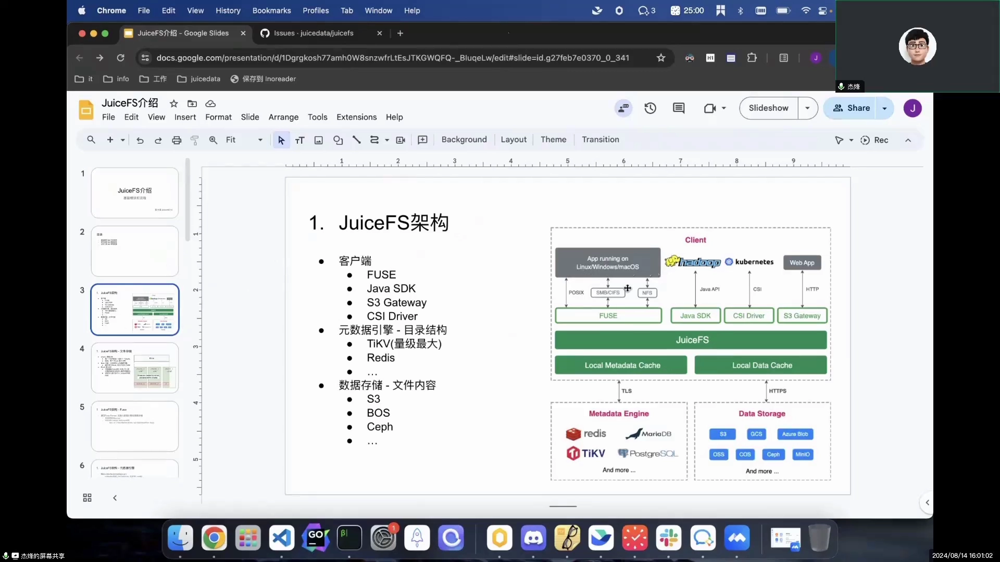

### 1.1 客户端：唯一「懂文件系统」的那一层

客户端是唯一实现了文件系统语义的组件。它有四种接入形态：

- **FUSE**：挂载成一个本地目录，所有 POSIX 调用都从这里进来，是最常用的一种；
- **Java SDK**：给 Hadoop、Spark 这类 JVM 生态用，走 Java API 而不是 POSIX；
- **CSI Driver**：给 Kubernetes 用，把 JuiceFS 变成 PV；
- **S3 Gateway**：对外提供 S3 协议，让不能装客户端的应用也能读写。

讲者说明今天主要讲 FUSE 这一条，因为「最常用的应该也是走 FUSE 的请求」[【跳转到 03:31】](https://www.bilibili.com/video/BV14jetevExY/?t=211)。社区版用的是 `go-fuse`，挂载时会启动一个 fuse server，核心实现集中在一个叫 `VFS` 的文件里，`lookup`、`getattr`、`create`、`link`、`mkdir` 这些 POSIX 操作全在里面 [【跳转到 04:47】](https://www.bilibili.com/video/BV14jetevExY/?t=287)。请求的流向是：**内核 → FUSE → JuiceFS 用户态进程 → 分发到具体的文件操作**。

这里有个容易忽略的点：客户端不持有任何**权威**数据，只持有缓存。权威状态全在元数据引擎里——连「哪些客户端还活着」都是靠元数据引擎里的 `sessions` 心跳记录的（见 3.3 节）。所以同一份数据可以被成百上千个客户端同时挂载，挂载点在哪台机器上都不影响正确性。

### 1.2 元数据引擎：一个可插拔的「目录树 + 文件索引」数据库

元数据引擎不是 JuiceFS 自己写的数据库，而是一个**接口**。讲者说只要实现 `meta interface` 这个接口，任何存储都能接进来；目前实现了三大类 [【跳转到 05:59】](https://www.bilibili.com/video/BV14jetevExY/?t=359)：

| 实现类 | 抽象出来的东西 | 已支持的后端 |
| :--- | :--- | :--- |
| `kvMeta` | KV 客户端 + 事务接口 | TiKV、etcd 等 |
| `dbMeta` | SQL（用 ORM 访问） | MySQL、SQLite3、PostgreSQL 等 |
| `redisMeta` | Redis 协议 | Redis |

这个设计的好处是**元数据引擎的性能天花板可以由用户自己选**：小集群用 SQLite 单文件就够，中等规模用 Redis，量级最大的用 TiKV——讲者说社区版里「现在量级最大的应该是 TiKV」[【跳转到 01:26】](https://www.bilibili.com/video/BV14jetevExY/?t=86)。

### 1.3 对象存储：只负责「存住一堆不可变的对象」

数据存储这一侧同样被抽象成了 `ObjectStorage` 接口，实现类覆盖 S3、Ceph、OSS、BOS 等一长串后端 [【跳转到 10:17】](https://www.bilibili.com/video/BV14jetevExY/?t=617)。它对上层只承诺最基本的几件事：**PUT 一个对象、GET 一个对象（可以指定 Range）、DELETE 一个对象、LIST 一批对象**。

注意这里没有任何「原地改」的能力。这个限制不是缺陷，而是整个设计的支点：因为对象不可变，**每次写入都产生新对象，旧对象永远不会被就地覆盖**，所以读到的数据天然不会被并发写破坏，回收旧对象可以完全异步地交给 GC。

### 1.4 为什么非要拆开

把三者放在一张表里看，拆分的动机就很直白了：

| 维度 | 元数据引擎 | 对象存储 |
| :--- | :--- | :--- |
| 存什么 | inode、目录项、属性、Slice 索引、会话、锁 | 文件的实际字节 |
| 请求大小 | 几十到几百字节 | 4 MB 级的 Block |
| 延迟要求 | 极低（每次 `ls` 都要问它） | 可以容忍几十毫秒 |
| 扩展方式 | 加内存、换更强的引擎 | 加容量，近乎无限 |
| 单位成本 | 贵 | 便宜 |
| 一致性 | 必须强一致（否则目录树会错乱） | 对象不可变，天然最终一致 |

一句话：**元数据要的是低延迟和高并发，数据要的是大容量和便宜**。这两件事的最优解在物理上就不在同一个系统里，硬塞在一起只会两头都做不好。

## 二、文件被切成三层：Chunk、Slice、Block

在讲读写路径之前必须先讲清楚这三个概念，因为后面所有的路径都是围绕它们展开的。讲者说这是「JuiceFS 这边文件存储结构比较重要的三个概念」[【跳转到 03:06】](https://www.bilibili.com/video/BV14jetevExY/?t=186)。

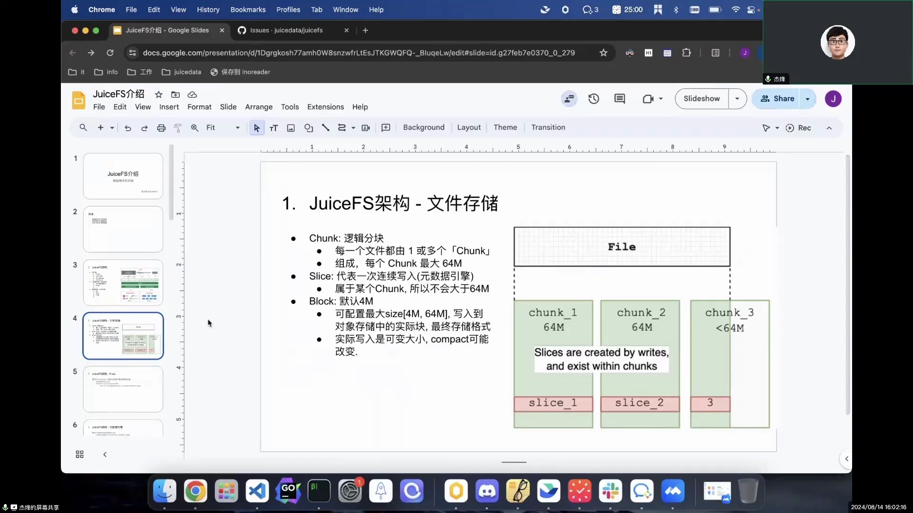

### 2.1 Chunk：64 MB 的逻辑分块

一个文件按 64 MB 切成若干 Chunk，第 $n$ 个 Chunk 覆盖文件偏移 $[64n, 64n+64)$ MB。Chunk 是**纯逻辑**的——它不对应任何物理对象，只是一个地址空间的划分单位。它的作用是给「文件偏移」一个粗粒度的坐标系：给定偏移 $o$，落在第 $\lfloor o / 64\,\text{MB} \rfloor$ 个 Chunk 里。

为什么要有这一层？因为元数据引擎里存的是「Chunk 索引 → Slice 列表」的映射。如果不做 Chunk 划分，一个文件的 Slice 列表会是一条无限长的链，一次随机读就要扫全部；有了 Chunk，查一次就定位到一个 64 MB 的窗口，窗口内的 Slice 数量是有上限的。

### 2.2 Slice：一次连续写入的记录

Slice 是**元数据引擎里真正被存下来的东西**。它的定义很简单：一次连续的写入就是一条 Slice 记录，字段是

- `id`：全局唯一 ID；
- `pos`：在 Chunk 内的起始偏移；
- `size` / `len`：这次写入的长度（两者一致）；
- `off`：在对象里的偏移（刚写时是 0）。

讲者给了一个具体例子 [【跳转到 20:31】](https://www.bilibili.com/video/BV14jetevExY/?t=1231)：

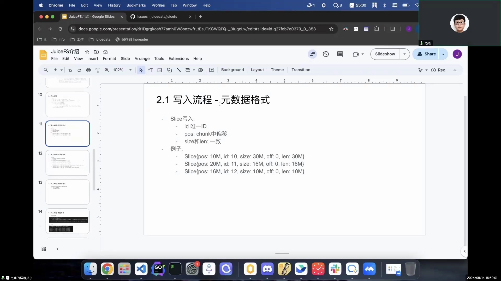

```
Slice{pos: 10M, id: 10, size: 30M, off: 0, len: 30M}
Slice{pos: 20M, id: 11, size: 16M, off: 0, len: 16M}
Slice{pos: 16M, id: 12, size: 10M, off: 0, len: 10M}
```

三条记录互相重叠：第二条（20M 起 16M）压住了第一条的后半段，第三条（16M 起 10M）又压住了第二条的前半段。这就是 Slice 的本质——**它记录的是「写过什么」，而不是「现在是什么」**。谁覆盖谁，要靠 `pos` 排序在读取时算出来。

讲者也点明了这么做的代价：如果一个 Chunk 里的某个位置被反复写了上万次，Slice 列表就会变得极长，元数据引擎里存的东西也会很大，读写性能都会变差 [【跳转到 23:26】](https://www.bilibili.com/video/BV14jetevExY/?t=1406)。这就是后面 compact 存在的理由。

### 2.3 Block：4 MB 的物理对象

Block 是**唯一会出现在对象存储里的东西**。默认 4 MB，可配置范围 4 MB 到 64 MB。讲者解释了为什么默认选 4 MB：时延不会太大，写入速度也还 OK，而且这个值和对象存储的写入并发也有关系 [【跳转到 03:06】](https://www.bilibili.com/video/BV14jetevExY/?t=186)。

于是三层的关系可以写成：

$$
\text{File} \;\supset\; \text{Chunk}_{64\,\text{MB}} \;\supset\; \text{Slice}_{\text{一次写入}} \;\supset\; \text{Block}_{4\,\text{MB}}
$$

前两层活在元数据引擎里，最后一层活在对象存储里。**Chunk 和 Slice 是逻辑概念，Block 是物理概念**——这句话是理解整篇的关键。

## 三、元数据引擎里到底存了什么

讲者把元数据引擎的存储内容分成两块：**目录树结构**和**文件索引** [【跳转到 08:25】](https://www.bilibili.com/video/BV14jetevExY/?t=505)。

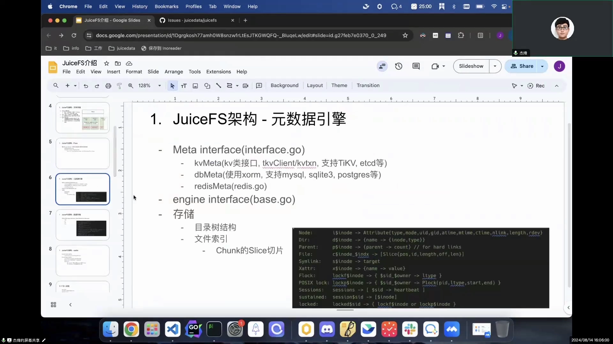

### 3.1 目录树：一层一层 lookup

目录树的存法非常朴素，就是几个键值对：

- `i<inode>` → `Attribute{type, mode, uid, gid, atime, mtime, ctime, nlink, length, rdev}`：inode 到属性的映射；
- `d<inode>` → `{name → {inode, type}}`：目录项，一个目录的所有孩子；
- `p<inode>` → `{parent → count}`：父目录与硬链接计数；
- `s<inode>` → `target`：符号链接的目标。

于是 `lookup` 的过程就是：从根 inode 出发，用父目录的 inode 加上子文件的名字，拿到子文件的 inode，再拿 inode 去取属性，一层一层往下走 [【跳转到 08:43】](https://www.bilibili.com/video/BV14jetevExY/?t=523)。这个结构对元数据引擎的要求很明确：**单个 key 的读写要快，前缀扫描要快**。Redis 的 hash 和 TiKV 的有序 KV 都满足。

### 3.2 文件索引：inode + Chunk 索引 → Slice 列表

第二块才是 JuiceFS 特有的东西：`c<inode>_<chunk_index>` → `Slice{pos, id, length, off, len}` 的列表 [【跳转到 09:27】](https://www.bilibili.com/video/BV14jetevExY/?t=567)。

也就是说，给定一个文件和一个偏移，客户端要做两次查询：

1. 用 `inode` 和 $\lfloor \text{offset} / 64\,\text{MB} \rfloor$ 拼出 key，取回这个 Chunk 的 Slice 列表；
2. 在列表里按 `pos` 找出覆盖目标偏移的那几条 Slice，算出每条对应对象里的哪一段。

这就是「元数据指向数据」的全部机制。**元数据里没有一字节的文件内容，只有「哪个 Slice 的哪一段对应文件偏移的哪一段」**。

### 3.3 还有会话和锁

同一个 key 空间里还住着另外几类东西，它们解释了「多客户端同时挂载」为什么能工作：

- `sessions` → `{sid → heartbeat}`：每个挂载的客户端有一个会话，靠心跳证明自己还活着；
- `sustained` → `{session_sid → [inode]}`：这个会话还持有哪些文件的打开状态；
- `lock<i>inode` / `lockp<inode>`：BSD 文件锁与 POSIX 记录锁；
- `delFiles`、`detachedNodes`、`sliceRefs`：待删除文件、脱离的节点、Slice 引用计数。

这些 key 的存在说明一件事：**元数据引擎不只是「存目录」，它还承担了协调**。多个客户端同时打开同一个文件、同时写同一个 Chunk，靠的就是元数据引擎上的锁和引用计数，而不是客户端之间互相通信。
## 四、写路径：一次 write 走完的七步

讲者把写入流程拆成两页幻灯片，正好对应两个阶段：**攒数据**和**交元数据** [【跳转到 13:51】](https://www.bilibili.com/video/BV14jetevExY/?t=831)。

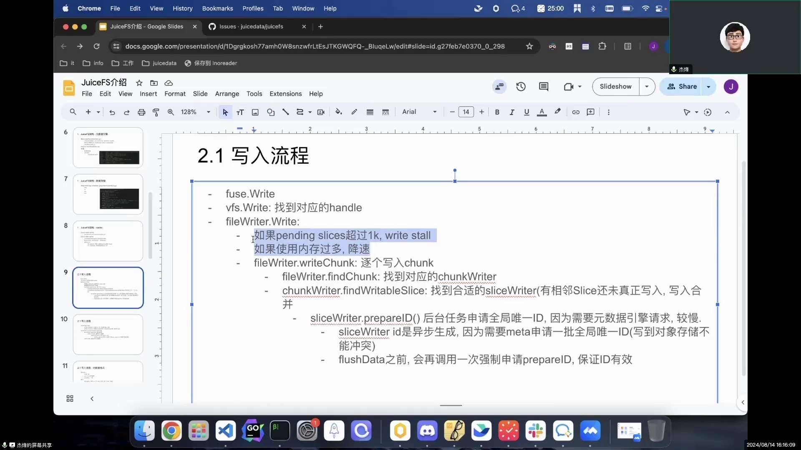

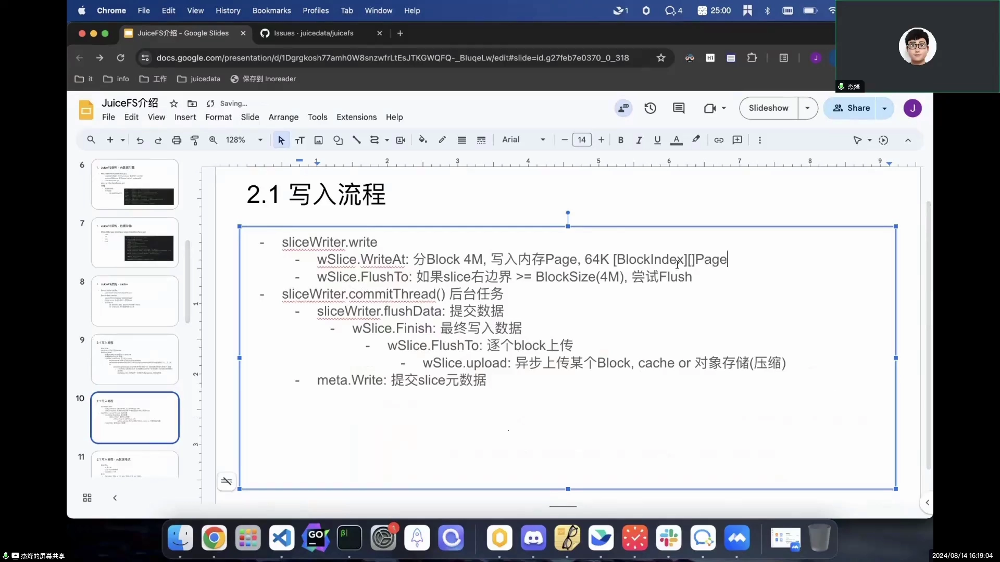

### 4.1 第一步：从 VFS 到 fileWriter

一次写请求先到 `VFS` 的 `Write`，找到对应的 handle，handle 底下封装的其实是 `fileWriter`。这一层做的事情是**限流保护**：

- 如果 pending 的 Slice 超过 1k，这里会多出等待（write stall）；
- 如果使用的内存过多，这里会有一定的降速。

讲者解释这两个保护针对的是同一个场景：**对象存储那边上传的速度跟不上** [【跳转到 15:56】](https://www.bilibili.com/video/BV14jetevExY/?t=956)。数据在内存里攒着等上传，攒得越多内存压力越大；限住 pending 的 Slice 数量，就等于限住了「未落盘的数据量」。

### 4.2 第二步：按 Chunk 切分

`fileWriter.writeChunk` 按 64 MB 的 Chunk 边界把这次写入切开，逐个 Chunk 处理。一次写入如果跨过了 Chunk 边界，就会被拆成两段——这就是第 2.1 节说的「跨 Chunk 会做拆分」。

### 4.3 第三步：找一个能合并的 Slice

`chunkWriter.findWritableSlice` 找的不是「空闲位置」，而是**一个还没真正上传的 sliceWriter**。如果上一个请求写了 0~4 KB、这个请求写 4~8 KB，两次写入会被合并进同一条 Slice，而不是产生两条 [【跳转到 16:46】](https://www.bilibili.com/video/BV14jetevExY/?t=1006)。

这个合并极其重要：没有它，一次 1 GB 的顺序写会产生 26 万条 Slice 记录，元数据引擎先崩。有了它，顺序写通常只产生很少几条 Slice。

### 4.4 第四步：申请全局唯一 ID（异步，但 flush 前必须到）

每条 Slice 需要一个全局唯一 ID。这个 ID 不是本地生成的，而是**向元数据引擎申请一段连续的 ID**——因为 ID 会被写进对象 key，必须全局不冲突 [【跳转到 17:31】](https://www.bilibili.com/video/BV14jetevExY/?t=1051)。

讲者特别强调这里有两个设计：一是**异步**（申请 ID 要发一次元数据请求，比较慢，所以放在后台任务里做），二是**flush 之前会强制再申请一次**，保证真正落盘时 ID 一定有效。

### 4.5 第五步：写进内存 Page，攒成 Block

`wSlice.WriteAt` 把数据按 4 MB 分 Block，再按 64K 切成 Page 写进内存。内存里的缓冲区用的是**内存池**，结构大致是「blockIndex + bg + 配置」[【跳转到 18:01】](https://www.bilibili.com/video/BV14jetevExY/?t=1081)。

这里出现了一个值得记住的细节：**Block 是 4 MB，但内存页是 64 KB**。所以「攒一个 Block」实际上是攒 64 个 64 KB 的 Page。

### 4.6 第六步：什么时候真正上传

这一步最容易误解。讲者的原话是：写的时候**不是立马 flush**，除非用户主动调 `flush` 或 `fsync`；正常的连续写入有一个 `commitThread` 后台任务盯着提交数据 [【跳转到 18:51】](https://www.bilibili.com/video/BV14jetevExY/?t=1131)。

于是三个语义可以分开看：

| 调用 | 做了什么 | 数据在哪 |
| :--- | :--- | :--- |
| `write()` | 写进内存 Page，攒 Block | 客户端内存 |
| `flush()` | 触发 `flushData`，把攒着的 Block 传上去，再提交 Slice 元数据 | 对象存储 + 元数据引擎 |
| `fsync()` | 同上，并且要等真正落盘完成才返回 | 对象存储 + 元数据引擎 |

按这个模型可以推出：关闭文件时必然要触发一次 flush，否则数据就丢了。反过来说，只要没 flush，数据就只在客户端内存里——这也解释了为什么客户端进程被 kill 掉会丢最近的数据。

### 4.7 第七步：先传数据，后写元数据

`flushData` 之后，`wSlice.Finish` 逐个 Block 调 `wSlice.upload`，异步并发地上传，可以走本地缓存也可以直接进对象存储（还支持压缩）[【跳转到 19:41】](https://www.bilibili.com/video/BV14jetevExY/?t=1181)。

**全部 Block 上传成功之后**，才调 `meta.Write` 把这条 Slice 追加进元数据引擎。写进 Redis 里的形态就是 `inode + chunk_index` → Slice 列表追加一条。

这个顺序不能反，理由很硬：

- 如果先写元数据、后传数据，那么中途失败会留下一条**指向不存在的对象**的 Slice，读的时候直接报错；
- 如果先传数据、后写元数据，中途失败只会留下一个**没人引用的孤儿对象**，读不到它，但也不会读错，最后由 GC 回收。

这就是「元数据永远指向已经写成功的对象」这句话的工程含义——**用空间泄漏换一致性**，而泄漏是可回收的。

## 五、对象存储里的对象长什么样

讲者打开了本地缓存的目录来展示对象 key 的命名规则 [【跳转到 25:25】](https://www.bilibili.com/video/BV14jetevExY/?t=1525)。

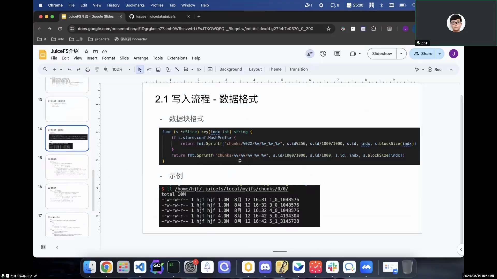

没有开启哈希前缀时，key 的生成规则是：

```
chunks/<slice_id/1000/1000>/<slice_id/1000>/<slice_id>/<block_idx>_<block_size>
```

拆开看：

- 前缀 `chunks/` 把数据对象和元数据分开；
- 中间三级目录是 `slice_id` 的十进制分段（除以 $10^6$、除以 $10^3$、原值），效果相当于把 ID 高位当目录名——这样单个目录下的对象数量不会爆炸，LIST 也不会慢；
- 最后一段 `<block_idx>_<block_size>` 说明**同一个 Slice 的多个 Block 是各自独立的对象**。

幻灯片下方的示例很直观：

```
-rw-rw-r-- 1 hjf hjf 1.0M  8月 12 16:31 1_0_1048576
-rw-rw-r-- 1 hjf hjf 1.0M  8月 12 16:32 3_0_1048576
-rw-rw-r-- 1 hjf hjf 1.0M  8月 12 16:32 4_0_1048576
-rw-rw-r-- 1 hjf hjf 4.0M  8月 12 16:42 5_0_4194304
-rw-rw-r-- 1 hjf hjf 3.0M  8月 12 16:42 5_1_3145728
```

注意最后两行：Slice 5 有两个 Block，第一个是完整的 4 MB（`4194304`），第二个只有 3 MB（`3145728`）。这印证了第 2.3 节的说法——**Block 大小是可变的，4 MB 只是上限**，最后一块通常不满。

如果开启了哈希前缀，key 前面会多一层 `%02X`（`slice_id % 256`），目的是把对象打散到更多前缀下，缓解对象存储的请求热点。

## 六、读路径：从偏移到字节

读路径的调用链和写路径是对称的，讲者说「整个调用链是差不多的」，所以只讲有影响的部分 [【跳转到 25:50】](https://www.bilibili.com/video/BV14jetevExY/?t=1550)。

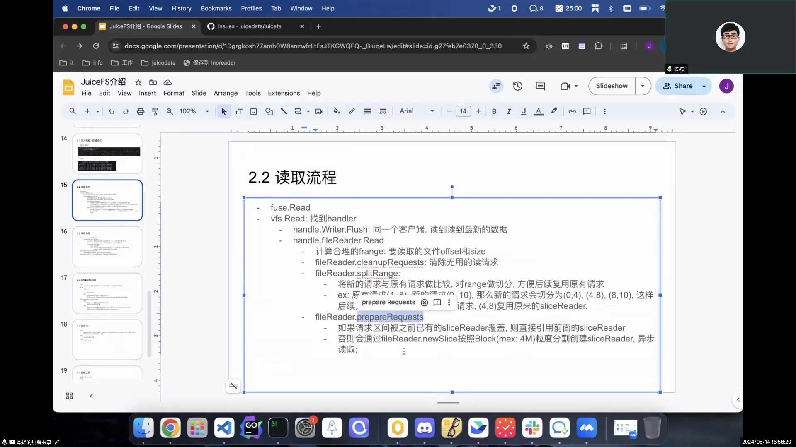

### 6.1 第一步：先 flush 同一个客户端的写

`handle.Writer.Flush` 这一行很容易被跳过，但它是读一致性的关键：**同一个客户端读之前，先把自己还没提交的写 flush 掉**，这样才能读到最新数据。这一步也说明第 4.6 节「`write()` 之后数据可能还在内存里」不是一个抽象的说法——它真的会在读路径上被补一次。

### 6.2 第二步：切分与复用请求

`fileReader.Read` 先算出要读的 `offset` 和 `size`，然后做两件优化：

- `cleanupRequests`：清掉已经无用的读请求；
- `splitRange`：把新请求和已有请求做比较，对 range 做切分，**能复用就复用**。

讲者给的例子：原有请求是 `(4, 8)`，新的请求是 `(0, 10)`，那么新请求会被切成 `(0, 4)`、`(4, 8)`、`(8, 10)` 三段，其中 `(4, 8)` 直接复用原来的 `sliceReader`，不再重复发起 IO [【跳转到 26:50】](https://www.bilibili.com/video/BV14jetevExY/?t=1610)。对「连续读同一个文件的相邻区间」这种模式，这个复用省掉的是重复的网络往返。

### 6.3 第三步：按 Block 粒度创建 sliceReader

`prepareRequests` 决定每个区间怎么读：

- 如果请求区间已经被已有的 `sliceReader` 覆盖，直接引用前面的；
- 否则通过 `fileReader.newSlice` **按 Block（最大 4 MB）粒度**创建新的 `sliceReader`，异步读取。

注意这里又回到了 Block：**读的并发单位是 Block，不是 Slice**。一个 Slice 可能有 30 MB，读它的一小段只会触发那一段所在 Block 的读取。

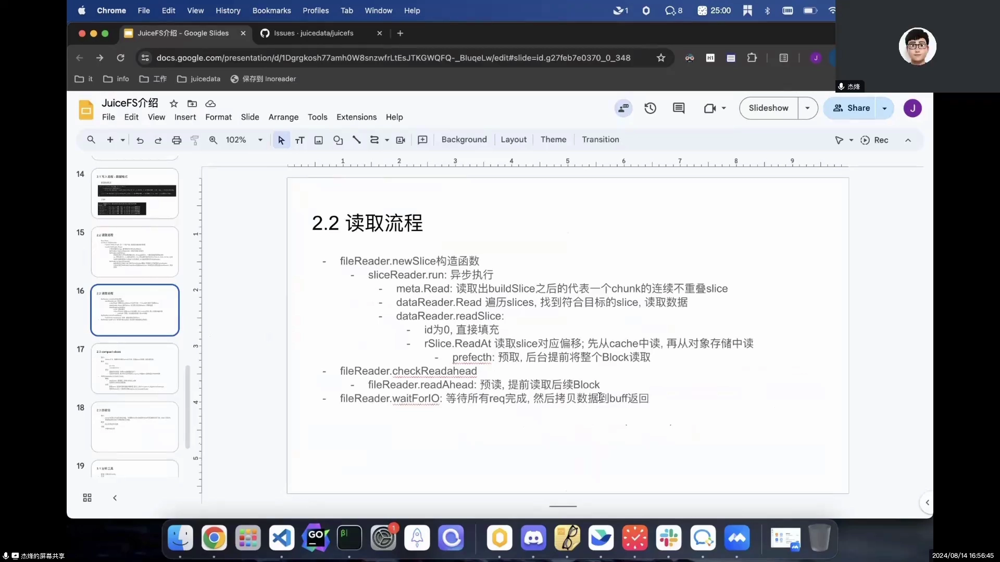

### 6.4 第四步：sliceReader.run 里的四件事

`sliceReader.run` 是异步执行的，里面依次做四件事：

1. `meta.Read`：向元数据引擎要这个 Chunk 的 Slice 列表，**并做 buildSlice**（下一节讲）；
2. `dataReader.Read`：遍历 Slice，找到符合目标的那些；
3. `rSlice.ReadAt`：读 Slice 对应的偏移，**先查本地缓存，再从对象存储读**；如果开了 prefetch，后台会把整个 Block 提前读下来；
4. `fileReader.waitForIO`：等所有请求返回，然后拼接拷贝到用户的 buffer。

第 3 步里的「先缓存后对象存储」就是 `--cache-dir` 起作用的地方。讲者在架构部分讲过，客户端有两级本地缓存：`meta cache`（attr 和 chunks，实现在 `openfile.go`）和 `BlockCache`（以 Block 为单位缓存在本地磁盘，实现在 `cachedStore`，支持多个目录并用一致性哈希分片）[【跳转到 11:04】](https://www.bilibili.com/video/BV14jetevExY/?t=664)。缓存策略的细节属于本系列 4.2.3，这里只点明它在读路径上的位置。

### 6.5 一个容易忽略的细节：readahead 窗口

讲者提到读路径里还有一个 `readahead` 逻辑：读 0~1 MB 时，它可能会把后面几个 Block 提前读出来；这个窗口「可以类比 TCP 的窗口」，命中率变高时会逐渐变大，但最大 size 可配置，也受 `bufferSize` 和内存上限约束 [【跳转到 27:45】](https://www.bilibili.com/video/BV14jetevExY/?t=1665)。

把它和 prefetch 区分开：

- **prefetch** 是「读 4 KB，把所在的整个 4 MB Block 拉下来」——**块内补齐**；
- **readahead** 是「读这一段，把后面几个 Block 也拉下来」——**块间预取**。

前者对随机小读是纯浪费，后者对顺序读是纯收益。这也解释了为什么讲者在配置部分说「随机读的场景应该把 prefetch 关掉」。

## 七、buildSlice：把「写过什么」还原成「现在是什么」

这是整篇里最需要动脑的一步。元数据引擎里存的是**一堆互相重叠的写入记录**，而读的时候需要的是**一份不重叠的、覆盖全 Chunk 的区间表**。这两者之间的转换就是 `buildSlice`。

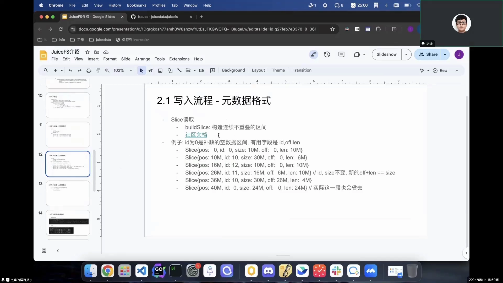

### 7.1 算法在做什么

输入是第 2.2 节那三条重叠记录，输出是六段互不重叠的区间：

```
Slice{pos:  0M, id: 0,  size: 10M, off:  0, len: 10M}   // id 0 = 空洞
Slice{pos: 10M, id: 10, size: 30M, off:  0, len:  6M}
Slice{pos: 16M, id: 12, size: 10M, off:  0, len: 10M}
Slice{pos: 26M, id: 11, size: 16M, off:  6M, len: 10M}
Slice{pos: 36M, id: 10, size: 30M, off: 26M, len:  4M}
Slice{pos: 40M, id: 0,  size: 24M, off:  0, len: 24M}   // 实际这一段也会省去
```

几件事值得注意：

- **`id: 0` 是空洞**。文件中间没写过的部分不占任何对象，读到这里直接返回零——这就是稀疏文件在 JuiceFS 里的实现方式。
- **一条 Slice 可以被切成多段**。id 10 原本是 30 MB，被 id 11 和 id 12 覆盖掉中间 20 MB 后，只剩 `[10M, 16M)` 和 `[36M, 40M)` 两段有效，各 6 MB 和 4 MB。
- **`off` 会跟着变**。id 11 原本 `off: 0`，打平后第二段变成 `off: 6M`——因为前 6 MB 被 id 12 盖住了，剩下的部分在对象里的偏移要往后挪。
- **末尾的空洞会被省掉**。文件长度由 inode 的 `length` 决定，不需要用 Slice 补到文件末尾。

### 7.2 为什么不在写入时就打平

因为写入时打平意味着**每次写都要改一堆已有记录**。元数据引擎里做「读—改—写」的事务，代价远高于追加一条记录。而追加是幂等的、可并发的、失败重试也安全的。

所以 JuiceFS 选择了**写时追加、读时合并**：写路径尽量简单（追加一条 Slice），把复杂度推给读路径的一次性计算。而这次计算的结果可以缓存在客户端的 `meta cache` 里（`openfile.go` 里的 chunks），同一个 Chunk 反复读不会重复计算。

### 7.3 代价：Slice 会越叠越多

打平的计算量正比于 Slice 数量。一个 Chunk 里被写了上万次，Slice 列表就有上万条，每次 `buildSlice` 都要排序和切分一遍，元数据引擎里存的东西也会很大 [【跳转到 23:26】](https://www.bilibili.com/video/BV14jetevExY/?t=1406)。这就是下一节要解决的问题。

## 八、compact：把重叠的 Slice 合并掉

compact 的目标很直接：**Slice 太多的时候，把无效的 Slice 合并掉，压缩 Slice 元数据，提高读性能**。

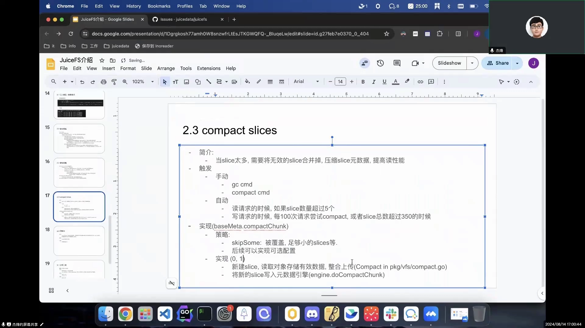

### 8.1 什么时候触发

讲者列了两类触发方式：

- **手动**：`juicefs gc` 和 `juicefs compact` 命令；
- **自动**：读请求时如果某个 Chunk 的 Slice 数量超过 5 个；写请求时每 100 次尝试一次，或者 Slice 总数超过 350 时。

### 8.2 怎么做

实现在 `baseMeta.compactChunk`，流程是：

1. 按一定策略挑出需要 compact 的 Slice（目前策略比较固定，讲者说后续可能做成可配置的多种策略）；
2. **新建一个 Slice**；
3. 从对象存储读出这些 Slice 的**有效数据**（也就是 buildSlice 之后留下的那些段）；
4. 整合成一个完整的块，重新上传；
5. 把新 Slice 写入元数据引擎，替换掉原来那一堆。

### 8.3 compact 自己的写放大

这是本节最值得记住的一条：**compact 会把「稀疏的写」变成「连续的写」**。

讲者的例子：一开始只在 `offset 0` 写了一兆，然后在 `offset 7 MB` 又写了一兆。compact 之后可能变成一个 8 MB 的、从 0 到 8 的整块上传——**中间补零的那 6 MB 也被写进去了** [【跳转到 31:14】](https://www.bilibili.com/video/BV14jetevExY/?t=1874)。

所以 compact 是一个权衡：

| 收益 | 代价 |
| :--- | :--- |
| Slice 数量下降，`buildSlice` 变快 | 对象存储的读放大（要把有效数据读回来） |
| 元数据引擎占用下降 | 对象存储的写放大（补零部分也上传） |
| 顺序读更连续 | 一次 compact 要占用带宽和 CPU |

对「随机写很多、但每个 Chunk 只写几小块」的负载，compact 的放大可能比收益更贵。这也是为什么它的自动触发条件设得比较保守（读时 >5 条、写时每 100 次或总数 >350）。

## 九、删除不等于回收：回收站与 GC

这是讲者说群里问得最多的一个问题：**删了数据，对象存储的占用没降下来**。

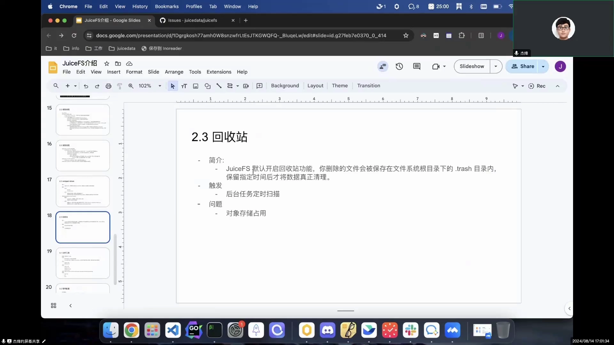

原因有两层：

1. **回收站默认是开的**。删除的文件会被临时保存在根目录下的 `.trash` 里，保留指定时间之后才真正清理，清理由后台任务定时扫描完成。所以「GC 的时间不太一定」，也可以手动触发 [【跳转到 32:04】](https://www.bilibili.com/video/BV14jetevExY/?t=1924)。
2. **对象存储是异步回收的**。元数据删掉之后，那些 Block 对象要等 GC 扫到才删。这正好呼应第 4.7 节的设计——先传数据后写元数据会留下孤儿对象，孤儿对象也只能靠 GC 收。

所以「容量对不上」在 JuiceFS 里是**正常现象**，只是时间差。真要立刻回收，就手动跑 `juicefs gc`。

## 十、出问题先看哪里：配置、日志与压测工具

讲者用最后几分钟列了一套排障路径，这部分对实际使用很有价值。

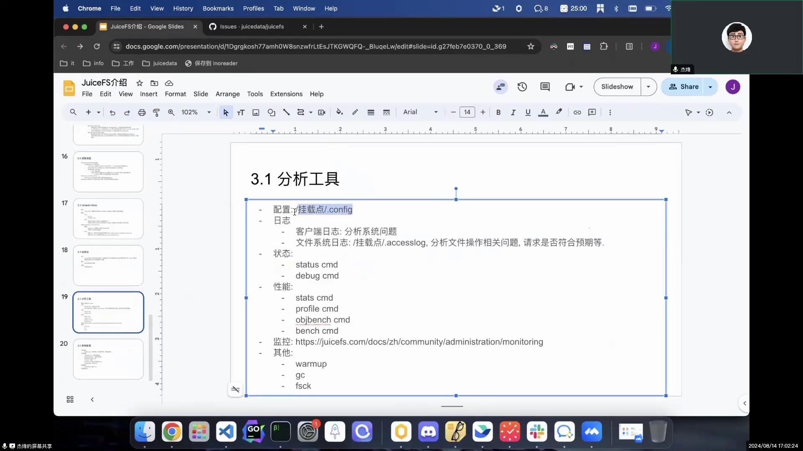

### 10.1 先看配置

挂载点底下有一个 `.config` 文件，里面有完整的全部配置项，可以逐项检查是不是配置问题 [【跳转到 33:19】](https://www.bilibili.com/video/BV14jetevExY/?t=1999)。

### 10.2 再看日志

日志有两种，对应两类问题：

- **客户端日志**（写到 `syslog`）：用来分析**系统层面**的问题；
- **文件系统日志**：挂载点下的 `.accesslog`，**每个文件操作都会记一条**，包括 uid、gid 这些执行者和请求次数，用来分析**文件操作相关**的问题。

`.accesslog` 的用法是「验证行为是否符合预期」：比如你怀疑某个进程在疯狂 `stat`，直接看这个文件就能确认。

### 10.3 再看状态与性能

讲者把工具按「状态」和「性能」两组分开：

- **状态**：`status` 看客户端整体状态；`debug` 收集很多数据，包括整个 Go 的 goroutine、脏页；
- **性能**：`stats`、`profile`、`objbench`、`bench`。

其中 `stats` 会显示资源占用、JuiceFS 请求数、延迟、读写次数，以及 meta cache、数据 cache、对象存储请求的情况 [【跳转到 35:00】](https://www.bilibili.com/video/BV14jetevExY/?t=2100)；`profile` 类似，官方文档有介绍。

讲者对 `stats` 的评价是「可以比较明确地做一些性能分析，包括为什么性能不符合正常的预期」——因为它把时间拆到了元数据、缓存、对象存储三段上，一眼能看出瓶颈在哪一段。

### 10.4 最后压测

- `juicefs objbench`：压测对象存储那边的性能。讲者强调「JuiceFS 的上限大部分时候取决于对象存储的性能」，所以觉得慢的时候**先压对象存储**，看带宽和时延够不够；
- `juicefs bench`：对一些基础的文件场景做压测，跑一下看是否符合预期。

### 10.5 还有几个常用工具

- `juicefs warmup`：提前预热 BlockCache，或者强制让缓存失效；
- `juicefs gc`：就是前面说的回收；
- `juicefs fsck`：做一些修复，也看健康状态。

### 10.6 几个影响最大的配置项

讲者最后点了几组：

| 类别 | 参数 | 影响 |
| :--- | :--- | :--- |
| 内存 | `bufferSize` | 控制内存用量，影响 readahead 和内存缓存；并发大时要调大 |
| 对象存储 | 上传/下载带宽限制 | 直接限住吞吐 |
| 对象存储 | `maxUpload` | 上传并发，负载变化大时要调 |
| 缓存 | `writeback` | 先写磁盘再后台上传，能吸收对象存储的抖动 |
| 预取 | `prefetch` | 提前拉整个 4 MB Block；随机读场景应关掉，否则是纯读放大 |
| 预读 | `readahead` | 预读窗口大小 |
| 缓存 | `cacheSize` | 本地缓存容量 |

## 十一、部署形态：一条 format，一条 mount

讲者没有专门讲部署，但幻灯片和终端里露了两次，正好能拼出最小可用的形态。终端里跑的是：

```
$ ./juicefs format sqlite3:///test.db myfs
```

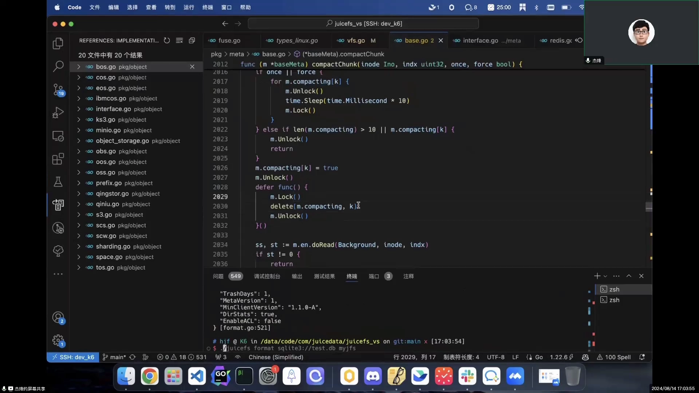

这条命令的含义是：**元数据引擎用本地 SQLite 文件 `/test.db`，文件系统命名为 `myfs`**。format 只需要做一次，它把「元数据引擎在哪」和「文件系统叫什么」绑定起来，同时把数据存储的配置写进元数据。

之后每次挂载用 `juicefs mount`，指定同一个元数据引擎地址即可——**多台机器挂载同一个元数据引擎，看到的就是同一个文件系统**。这也是为什么第 1.1 节说客户端是无状态的：所有权威状态都在元数据引擎里。

## 十二、和 S3FS、CephFS、NFS 的一句话对照

> 这一节不是视频内容，是为呼应小节主题补的静态对照，帮助定位 JuiceFS 在几种「把远端存储挂成本地目录」的方案里站在哪。

- **S3FS**：也是 FUSE + 对象存储，但**没有独立的元数据引擎**，目录树靠对象 key 的前缀模拟，`ls` 就是一次 LIST。所以小文件多、目录深的场景极慢，也做不出真正的原子 rename。
- **CephFS**：元数据也是独立的（MDS），但元数据服务和数据服务**同属一个 Ceph 集群**，元数据存在 RADOS 对象里。JuiceFS 则把元数据交给一个完全外部的通用数据库，把数据交给一个完全外部的通用对象存储——**两边都可以换成现成的产品**。
- **NFS**：元数据和数据都在服务端，客户端只做协议翻译，没有本地数据缓存层（除非用 pNFS）。JuiceFS 的客户端有完整的 Block 级本地缓存，这是它在 AI 训练这类「同一份数据被反复读」的场景里的主要优势来源。

## 小结

- JuiceFS 把文件系统拆成**客户端 + 元数据引擎 + 对象存储**三块：客户端是唯一懂 POSIX 的一层且无状态，元数据引擎是可插拔的数据库（Redis / TiKV / MySQL / PostgreSQL / SQLite），对象存储是可插拔的对象服务（S3 / OSS / MinIO / Ceph）。
- 文件被切成三层：**Chunk（64 MB，逻辑）→ Slice（一次连续写入，逻辑）→ Block（默认 4 MB，物理对象）**。前两层活在元数据引擎里，最后一层活在对象存储里。
- 元数据引擎存两样东西：**目录树**（`i<inode>`、`d<inode>`、`p<inode>`）和**文件索引**（`c<inode>_<chunk>` → Slice 列表），外加会话和锁。
- 写路径是**先写数据、后写元数据**：`write()` 进内存 Page → 攒成 4 MB Block → 异步上传对象存储 → 全部成功后 `meta.Write` 追加 Slice。中途失败只会留下可回收的孤儿对象，不会留下指向空气的元数据。
- 读路径是**先问元数据、再取数据**：`meta.Read` 取 Slice 列表 → `buildSlice` 打平成不重叠区间 → 按 Block 粒度异步读缓存/对象存储 → `waitForIO` 拼接返回。
- `buildSlice` 是「写时追加、读时合并」的兑现方式：`id: 0` 是空洞，一条 Slice 可以被切成多段，`off` 跟着变。
- Slice 会越叠越多，靠 **compact** 合并；compact 自己也有读写放大（补零部分也要上传）。
- 删除不等于回收：**回收站默认开启**（`.trash` 保留一段时间）+ **对象存储异步 GC**，所以容量对不上是正常的时间差。
- 排障顺序：`.config` → `syslog` / `.accesslog` → `stats` / `profile` → `objbench` / `bench`。JuiceFS 的上限大部分时候取决于对象存储。

## 关键术语速查

| 术语 | 一句话解释 |
| :--- | :--- |
| Chunk | 文件的逻辑分块，最大 64 MB，只存在于元数据的坐标系里 |
| Slice | 一次连续写入的记录，存在元数据引擎里，字段是 `id / pos / size / off / len` |
| Block | 对象存储里的一个对象，默认 4 MB，可配 4–64 MB，是唯一物理落盘的单位 |
| `meta interface` | 元数据引擎的抽象接口，实现它就能接入 JuiceFS |
| `kvMeta` / `dbMeta` / `redisMeta` | 元数据引擎的三大实现类，分别对应 KV、SQL、Redis |
| `ObjectStorage` 接口 | 数据存储的抽象，只承诺 PUT / GET(Range) / DELETE / LIST |
| `buildSlice` | 把重叠的 Slice 打平成连续不重叠区间的函数，读路径上必做 |
| 空洞（`id: 0`） | 文件里没写过的区间，不占对象，读时返回零 |
| compact | 合并重叠 Slice、重写对象的维护操作，有读写放大 |
| `writeback` | 写缓存模式：先写本地磁盘，后台再上传对象存储 |
| prefetch | 读一个小片段时把所在的整个 Block 拉下来（块内补齐） |
| readahead | 读一段时把后面几个 Block 也拉下来（块间预取），窗口可自适应 |
| `.trash` | 回收站目录，删除的文件先放这里，到期才真正清理 |
| `objbench` | 压测对象存储性能的工具；JuiceFS 的上限通常由它决定 |
