# 对象存储慢三个数量级：JuiceFS 的三层数据缓存与预读怎么补回来

> 视频来源：[JuiceFS 缓存原理：从元数据到数据，如何减少重复访问？](https://www.bilibili.com/video/BV1mQ4u6kERa/)（Bilibili · JuiceFS 官方账号）｜时长约 15 分钟
> 导读：这一讲把 JuiceFS 的缓存拆成「元数据缓存」和「数据缓存」两条线，再把数据缓存分成内核页缓存、客户端内存缓冲区、本地磁盘缓存三层，最后讲预读、预取、预热、淘汰与写缓存。本文只讨论**对象存储后端这个具体场景下**怎么配缓存与预读；缓存层次与一致性的一般性讨论属于 4.1.2，接口契约属于 S04，这里不重复。

## 本讲要解决的核心问题（SCQA）

**背景**：JuiceFS 采用数据与元数据分离的架构——文件被切成规则的数据块写进对象存储，文件属性与「文件内容到数据块的对应关系」写进独立的元数据引擎。应用读写文件时，这两样东西都要拿到。

**冲突**：对象存储的每一次读都是一次网络往返。本地磁盘取一块数据是微秒级，跨网络取一个对象是几十毫秒级，差了三四个数量级。而 AI 训练这类负载会对同一批数据做多轮读取，如果每轮都重新下载，等待时间会一轮一轮累加。

**疑问**：既然对象存储这么慢，为什么 JuiceFS 还能跑得比本地盘更快？这些等待是被什么机制吃掉的？

**回答（中心思想）**：JuiceFS 用**两层缓存（元数据缓存 + 数据缓存）把「已经读过的数据」留在本地，用预读和预取把「马上要读的数据」提前搬到本地**。缓存决定的是「重复访问不付第二遍网络费」，预读决定的是「第一次访问也不必逐段等」。两者相加，才把对象存储的高时延从关键路径上挪开。

---

## 一、先看清慢在哪里：一次读要跨一次网络

### 1.1 本地没有数据时，读文件就是读对象存储

应用通过挂载目录打开和读写文件。当客户端本地没有所需的数据时，就需要经由网络从对象存储取回相应的数据块——这条路径上多了一次网络往返，也就是多了一份网络开销 [【跳转到 00:00】](https://www.bilibili.com/video/BV1mQ4u6kERa/?t=0)。

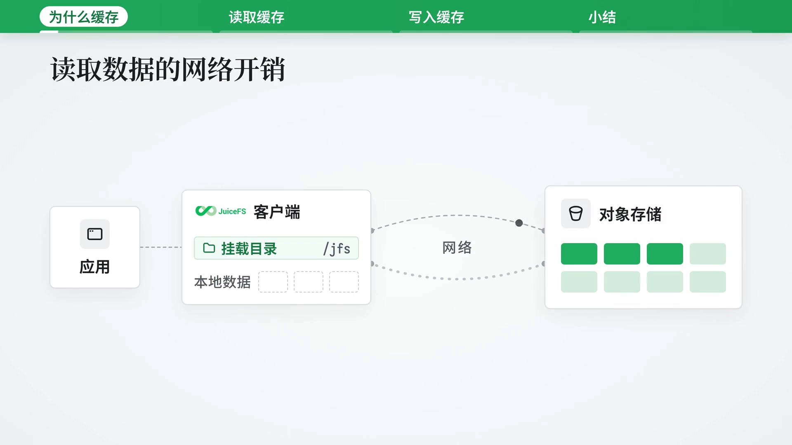

### 1.2 反复读同一批数据时，等待会累积

单次网络开销也许可以忍，真正的问题是它会被乘上读取次数。一个模型训练任务需要对训练数据做多轮读取，如果每次都要重新从对象存储下载相同的数据，那么随着读取次数不断增加，网络传输带来的等待也会逐渐累积 [【跳转到 00:12】](https://www.bilibili.com/video/BV1mQ4u6kERa/?t=12)。

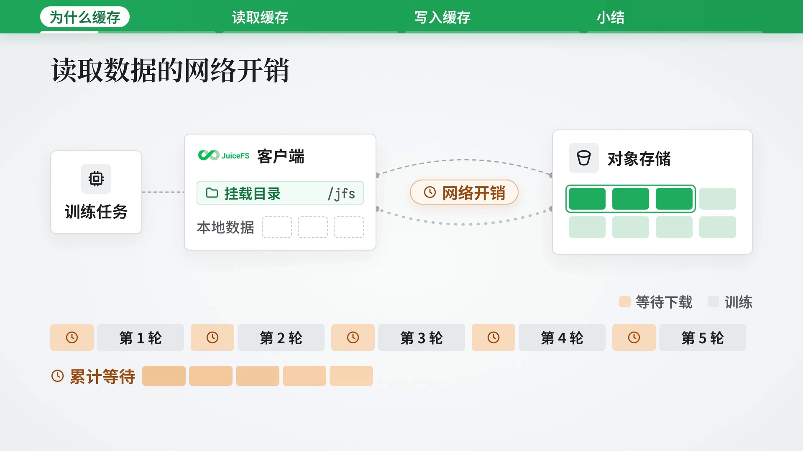

缓存要解决的正是这个乘数效应：**把等待从「每一轮都付一次」变成「只付第一轮」**。命中缓存时，应用直接从本机取得数据，既减少重复访问对象存储的次数，也降低网络传输带来的等待和相关开销 [【跳转到 00:37】](https://www.bilibili.com/video/BV1mQ4u6kERa/?t=37)。

---

## 二、两条缓存线：元数据缓存省查询，数据缓存省传输

### 2.1 为什么要分成两条线

因为一次文件访问要拿两样东西：元数据（文件属性 + 内容映射）和数据本身。JuiceFS 分别提供了元数据缓存和数据缓存，以减少不必要的远程访问，提升文件查询和数据读取时的性能 [【跳转到 01:27】](https://www.bilibili.com/video/BV1mQ4u6kERa/?t=87)。

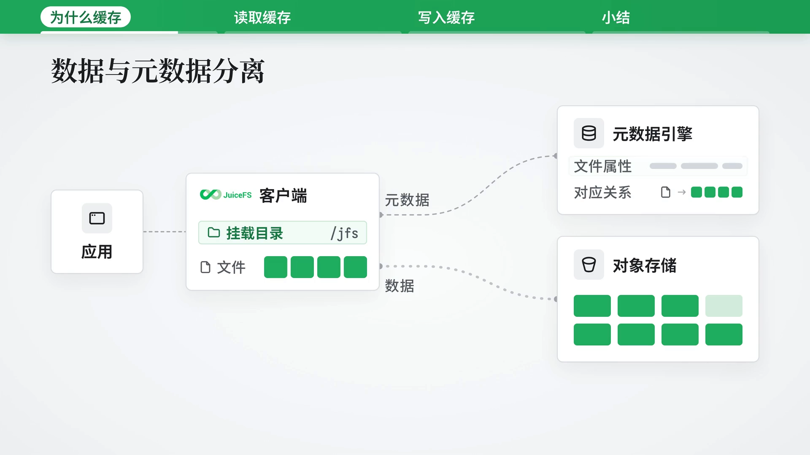

两者的分工可以用一句话概括：

| 缓存 | 省掉的是什么 | 存在哪里 |
| --- | --- | --- |
| 元数据缓存 | 查询文件大小、修改时间、内容映射的远程请求 | 操作系统内核 + 客户端内存 |
| 数据缓存 | 真正取回文件数据块的网络传输 | 内核页缓存 + 客户端内存缓冲区 + 本地磁盘 |

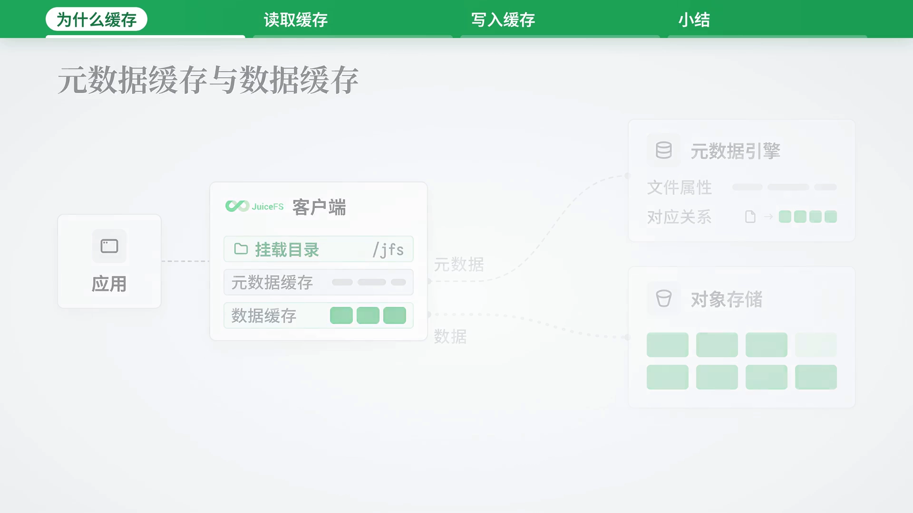

### 2.2 元数据缓存：默认给的是「关闭再打开一致性」

元数据缓存看起来简单，但它一上来就撞上一致性问题：一台机器改了文件，另一台机器怎么知道？

JuiceFS 的默认做法是**不缓存「打开」这个动作**——客户端每次打开文件，仍然会从元数据引擎获取最新的文件内容映射 [【跳转到 02:17】](https://www.bilibili.com/video/BV1mQ4u6kERa/?t=137)。于是就有了下面这条保证：一个客户端完成写入并成功关闭文件之后，其他客户端再打开同一个文件，就能读到修改后的内容，这就是**关闭再打开一致性**（close-to-open consistency）[【跳转到 02:42】](https://www.bilibili.com/video/BV1mQ4u6kERa/?t=162)。

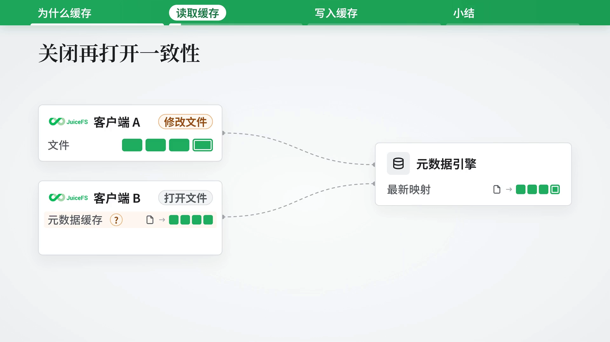

对那些很少发生修改的文件，可以进一步启用**文件打开缓存**，把「打开」这个动作也缓存起来，减少查询开销。但代价很明确：这会改变其他客户端对文件更新的可见性。要不要开，取决于应用对数据一致性的要求 [【跳转到 03:07】](https://www.bilibili.com/video/BV1mQ4u6kERa/?t=187)。

一句话记住这个取舍：**打开缓存省的是每次 open 的一次元数据往返，换掉的是「别人改完我立刻能看到」这个保证。**

---

## 三、数据缓存的三层：谁在什么时候命中

### 3.1 三层结构与命中顺序

数据缓存不是一个东西，而是三层 [【跳转到 03:32】](https://www.bilibili.com/video/BV1mQ4u6kERa/?t=212)：

1. **操作系统内核页缓存（page cache）**：内核替所有文件系统统一做的缓存，JuiceFS 不用自己实现，但也管不了它。
2. **客户端进程内的内存缓冲区**：JuiceFS 自己的读缓冲，同时也是预读的落脚点。
3. **本地磁盘缓存**：以对象存储的数据块为单位落盘，可以用 SSD 等本地存储设备。

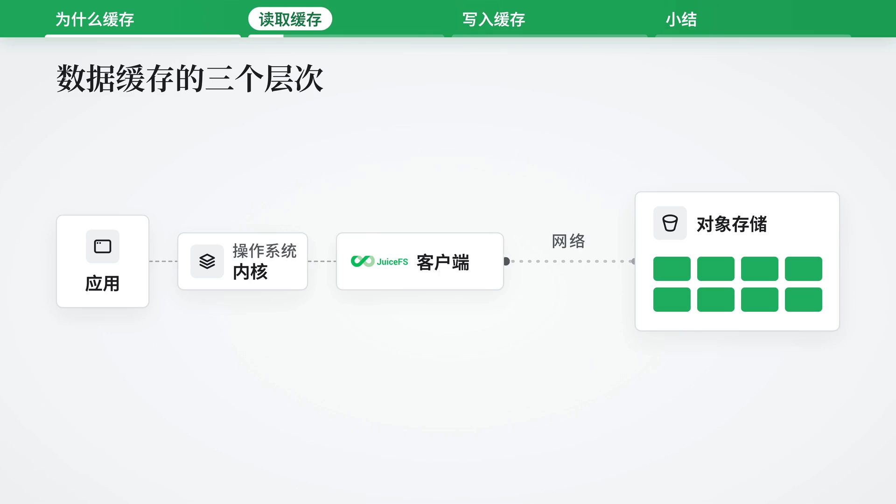

命中顺序是自上而下的：先试内核页缓存，命中就直接返回；没命中才进入 JuiceFS 客户端，继续检查进程内的预读缓冲区和本地磁盘缓存；只有这些地方都没有所需的数据时，客户端才需要从对象存储下载 [【跳转到 03:57】](https://www.bilibili.com/video/BV1mQ4u6kERa/?t=237)。

这个顺序解释了各层「什么时候命中」：

- **页缓存命中**：同一台机器上刚读过、且内存没被挤掉。最快，也最不可控。
- **内存缓冲区命中**：预读刚刚拉下来、应用还没读完的部分。这是预读真正发挥作用的地方。
- **本地磁盘缓存命中**：跨进程、跨重启都还在，是「多轮训练只付一次网络费」的主力。
- **都没命中**：回源对象存储，付出一次网络往返。

### 3.2 首次回源：一边返回一边建缓存

第一次读取某个文件时，本地还没有对应的数据，JuiceFS 就从对象存储下载，并把读取结果返回给应用。与此同时，客户端会在后台建立本地缓存——等到下一次再读相同的数据，如果缓存仍然有效，就有机会直接从内存或者本地缓存盘中取得 [【跳转到 04:22】](https://www.bilibili.com/video/BV1mQ4u6kERa/?t=262)。

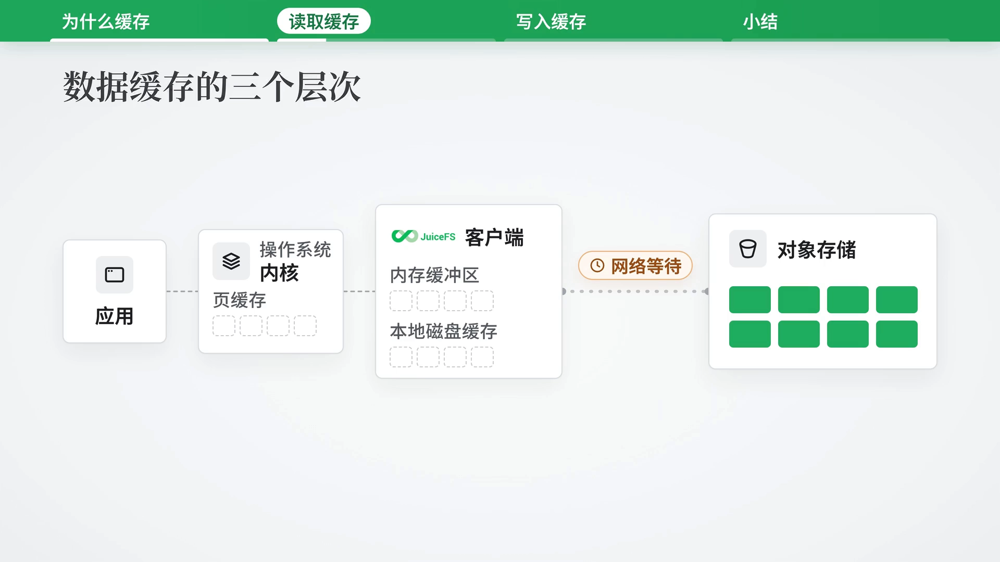

注意「以对象存储的数据块为单位」这个限定：本地磁盘缓存不是按文件、也不是按 4 KB 页存的，而是按数据块整块存。所以缓存的空间单位、淘汰单位、预取单位，都是这个块。

### 3.3 缓存不会读到旧数据：因为数据块不可变

这里有个必须回答的疑问：文件已经被修改了，本地缓存盘上还留着旧数据，应用会不会读到旧内容？

答案来自数据块的管理方式。JuiceFS 会为写入对象存储的数据块分配唯一标识；当文件内容发生修改时，客户端会生成**新的数据块**，原有的数据块保持不变；与此同时，元数据会更新文件与数据块之间的对应关系 [【跳转到 05:12】](https://www.bilibili.com/video/BV1mQ4u6kERa/?t=312)。

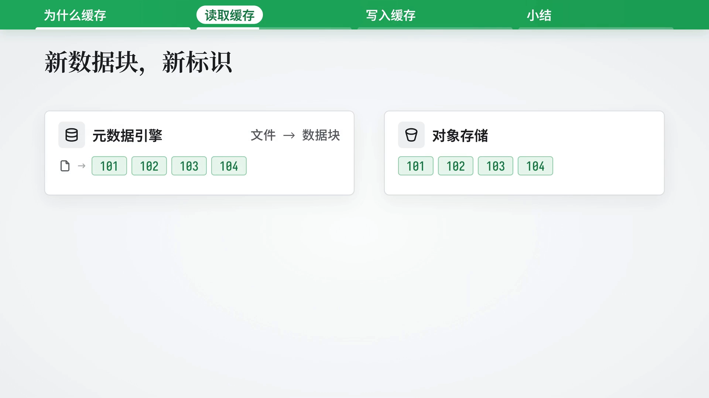

于是客户端在取得最新元数据之后，就会按照新的数据块标识查找内容，即使旧数据还保存在本地缓存中，也不会被误认为是修改后的数据 [【跳转到 05:37】](https://www.bilibili.com/video/BV1mQ4u6kERa/?t=337)。

这是整套缓存能安全复用的地基：**缓存的有效性靠「块标识」而不是靠「时间戳失效」来保证**。数据块写进去就不再改，改了就是新块，所以旧缓存永远不会被错认成新内容。

---

## 四、预读与预取：把「逐段等待」变成本地命中

### 4.1 缓存救不了第一次读

前面讲的机制都是「把已经访问过的数据留下来」。但缓存能复用的前提，是数据已经进了缓存。应用第一次读一个大文件时，本地什么都没有，如果每读一段都要等这一段下载完成，整个读取过程就会一直卡在网络延迟上 [【跳转到 06:02】](https://www.bilibili.com/video/BV1mQ4u6kERa/?t=362)。

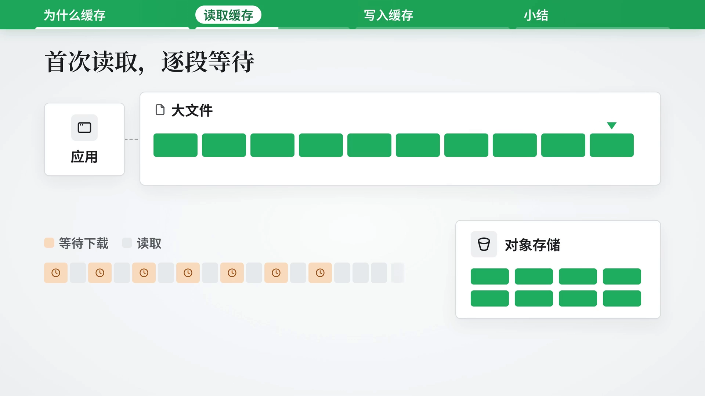

这就是预读要解决的问题：**让「等」和「读」重叠起来**。

### 4.2 预读：按读取进度提前下载后面的内容

应用顺序读一个大文件时，JuiceFS 客户端会根据当前的读取进度，提前从对象存储下载后面的内容并放入内存缓冲区。这样当应用继续向后读取时，所需的数据可能已经准备好了，可以直接从缓冲区取得，不必每次都等待对象存储返回 [【跳转到 06:52】](https://www.bilibili.com/video/BV1mQ4u6kERa/?t=412)。

预读能提前准备多少数据、能同时执行多少下载任务，取决于**客户端缓冲区大小**和**并发下载的能力** [【跳转到 07:17】](https://www.bilibili.com/video/BV1mQ4u6kERa/?t=437)。这句话是后面调优的总纲：缓冲区大 → 预读窗口大 → 同时发出的块请求多 → 顺序读吞吐高。

### 4.3 预取：随机读时按「块」补齐

不是所有应用都按顺序读。一些数据分析任务只需要访问大文件中特定位置的内容，读取位置还不断变化 [【跳转到 07:42】](https://www.bilibili.com/video/BV1mQ4u6kERa/?t=462)。

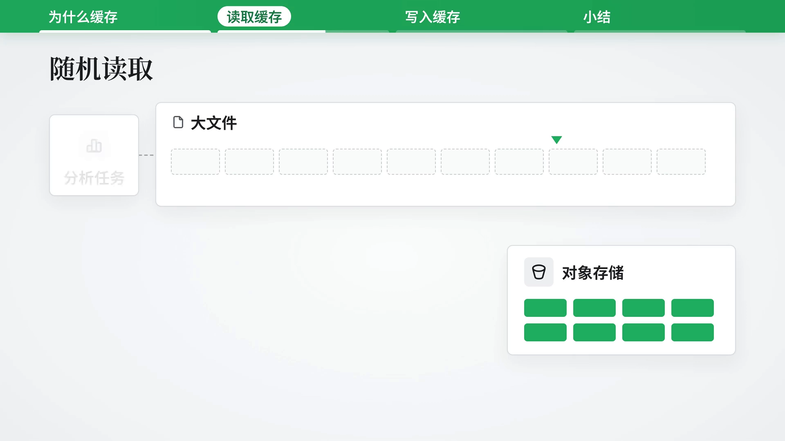

对这种随机读，JuiceFS 用的是另一种机制——**预取**：应用只读了某个数据块中的一小部分内容，客户端就在后台把这个块的完整内容下载下来存到本地缓存。这样如果应用接下来还要访问同一个块里的其他部分，就可以直接复用，减少再次访问对象存储的等待 [【跳转到 08:07】](https://www.bilibili.com/video/BV1mQ4u6kERa/?t=487)。

预读和预取的区别值得记一下：

- **预读（readahead）**：沿着「读取进度」往后拉，假设你会继续顺序读。粒度是连续的窗口。
- **预取（prefetch）**：沿着「当前块」补齐，假设你还会碰这个块的其他部分。粒度是单个块。

### 4.4 反面：预取会带来读放大

预取不是免费的。如果应用每次只读取相距很远的一小段数据，那么提前下载的完整数据块可能只有很少一部分真正被用到，这就产生了额外的网络传输和缓存占用，也就是**读放大** [【跳转到 08:32】](https://www.bilibili.com/video/BV1mQ4u6kERa/?t=512)。

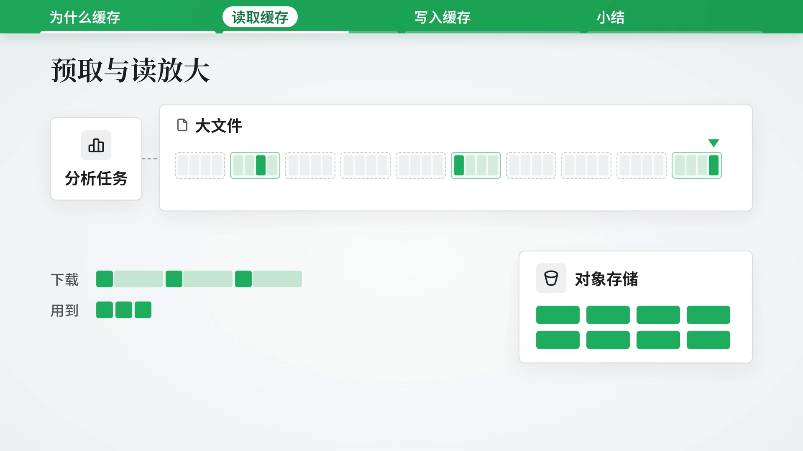

对这类读取模式，处理办法是适当调整预取的并发数量，或者直接关闭预取功能。**「预读开得越大越好」是错的**：预读的收益正比于「后续真的会读到」，反比于「跳读的跨度」。

---

## 五、主动预热与缓存淘汰

### 5.1 预热：把「第一次读」也变成命中

预读和预取都是应用开始读之后，客户端根据读取行为自动准备数据。但如果任务开始前就已经知道要读哪些文件，就可以更进一步——**缓存预热**。

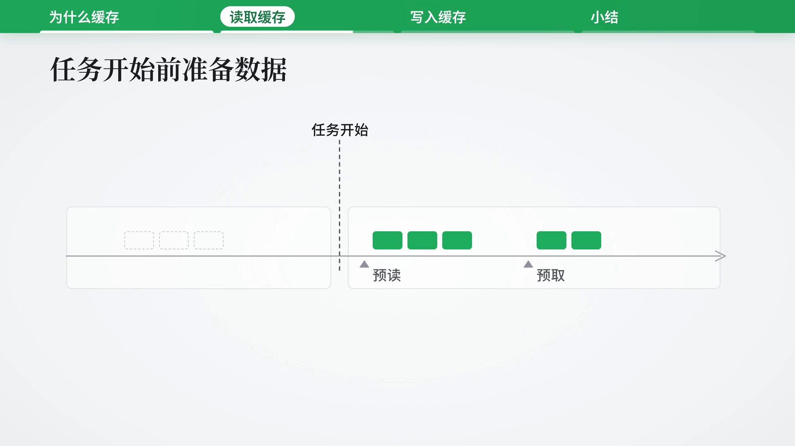

做法是：确定某个模型训练任务需要使用哪些文件后，在任务开始之前用 `juicefs warmup` 命令提前把这些文件的数据下载到本地缓存盘中。这样等任务真正开始读取时，即使是第一次访问这些文件，也有机会直接从本机取得数据 [【跳转到 08:57】](https://www.bilibili.com/video/BV1mQ4u6kERa/?t=537)。

预热的价值在于它把「冷启动的那一轮」从关键路径上挪走了：训练脚本第一行读数据时，数据已经在盘上。

### 5.2 淘汰：容量上限与磁盘剩余空间

无论是正常读取建立的缓存，还是提前预热的数据，都会占用本地缓存盘的空间，而本地磁盘容量有限。随着应用不断读取新文件，缓存盘里的数据越来越多，JuiceFS 提供了自动淘汰机制：根据设置的**缓存容量上限**和**磁盘剩余空间**，逐步清理较早的读缓存，为新的数据腾出空间 [【跳转到 09:39】](https://www.bilibili.com/video/BV1mQ4u6kERa/?t=579)。

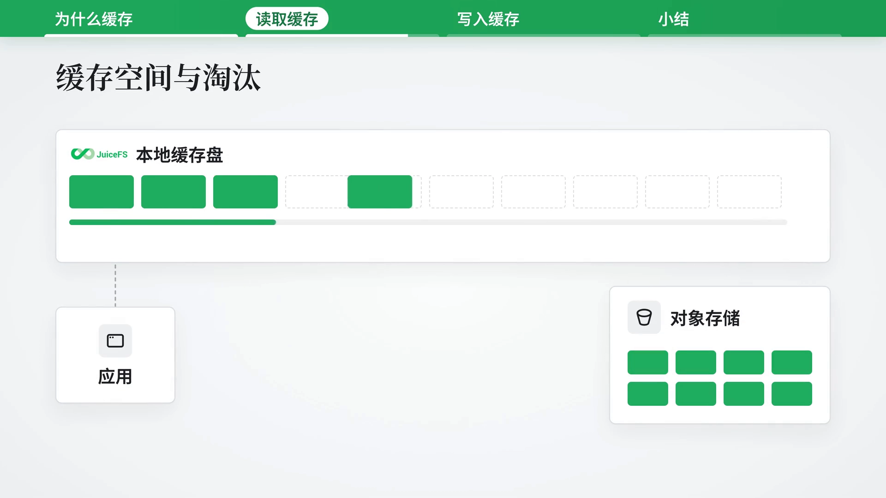

淘汰的代价是可控的：这些数据块本来就保存在对象存储里，淘汰掉的只是本地缓存副本，后面再次需要时可以重新从对象存储下载 [【跳转到 10:04】](https://www.bilibili.com/video/BV1mQ4u6kERa/?t=604)。换句话说，**淘汰不丢数据，只丢「已经付过的网络费」**。

### 5.3 缓存优先级：别让热点数据被临时数据挤走

不同数据对缓存的需求并不一样：一些训练数据需要被反复读取，另一些临时数据可能只会访问几次。如果它们共用同一块缓存盘，随着新数据不断进入，那些需要反复使用的数据就有可能被提前淘汰 [【跳转到 10:29】](https://www.bilibili.com/video/BV1mQ4u6kERa/?t=629)。

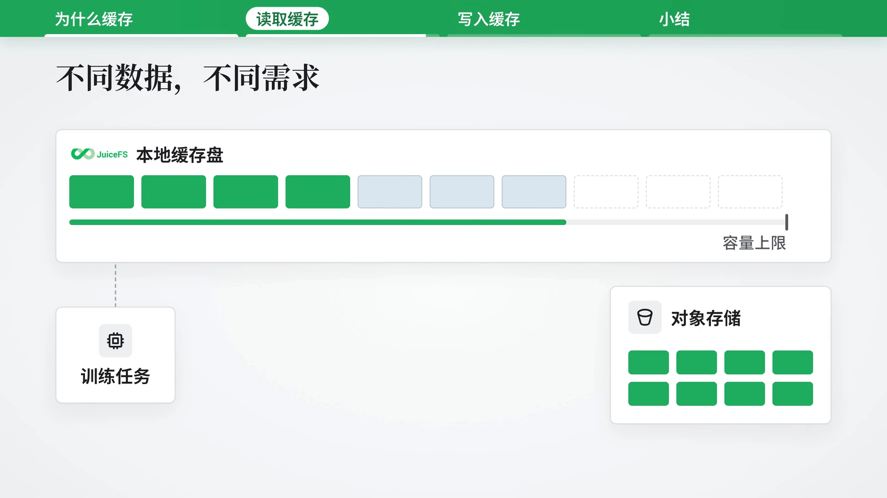

JuiceFS 企业版 5.0.14 提供了**缓存优先级**功能：可以在挂载文件系统或执行缓存预热时，为不同的数据缓存设置优先级。缓存空间不足时，优先淘汰低优先级的数据，尽可能保留那些需要反复使用的缓存，减少重要数据被重复下载的次数 [【跳转到 10:54】](https://www.bilibili.com/video/BV1mQ4u6kERa/?t=654)。

---

## 六、写路径：写缓存换来的速度与风险

### 6.1 默认写流程：先上传，再提交元数据

写入时数据同样要上传到对象存储，应用也可能因此等待。默认流程是：应用写入的数据先进客户端的内存缓冲区（注意：一次 `write` 返回成功只代表客户端已接收，**不代表已持久化到对象存储**）；客户端先把数据块上传到对象存储，等上传成功之后再提交相应的元数据 [【跳转到 11:19】](https://www.bilibili.com/video/BV1mQ4u6kERa/?t=679)。

应用通过 `fsync` 或关闭文件等操作触发提交，并根据操作的返回结果确认数据是否已经成功写入。对大文件的连续写入，客户端可以通过缓冲区和并发上传等机制提高传输效率 [【跳转到 11:44】](https://www.bilibili.com/video/BV1mQ4u6kERa/?t=704)。

### 6.2 大量小文件时，等待会累积成灾难

一个数据处理任务需要连续创建成千上万个小文件时，情况就变了：这些文件数据量小，每个文件可能都要单独完成上传和元数据提交。如果等每个文件写完，大量小文件产生的等待时间就会持续累积，进而影响整个任务的完成速度 [【跳转到 12:09】](https://www.bilibili.com/video/BV1mQ4u6kERa/?t=729)。

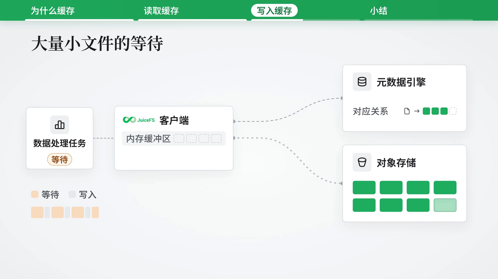

### 6.3 写缓存（writeback）：把上传挪到后台

针对这种情况，JuiceFS 提供了可选的**客户端写缓存**：开启后，客户端先把数据保存到本地缓存盘并提交对应的元数据，再由后台把数据块异步上传到对象存储。这样应用不必每次都等远端上传完成，可以更快地结束写入操作 [【跳转到 12:34】](https://www.bilibili.com/video/BV1mQ4u6kERa/?t=754)。

但它有三条明确的代价 [【跳转到 13:24】](https://www.bilibili.com/video/BV1mQ4u6kERa/?t=804)：

1. **可靠性绑在本地盘上**：后台上传完成之前，数据实际只存在当前客户端的本地缓存盘里，磁盘损坏或待上传数据被意外删除就可能造成数据丢失。
2. **跨节点读会卡住**：其他客户端在数据尚未上传完成时尝试读取，可能因为所需数据还没进对象存储而长时间等待，甚至读取失败。
3. **只适合特定场景**：比较适合大量小文件写入；需要保证数据持久化、或需要多客户端实时访问写入结果的应用要谨慎使用。

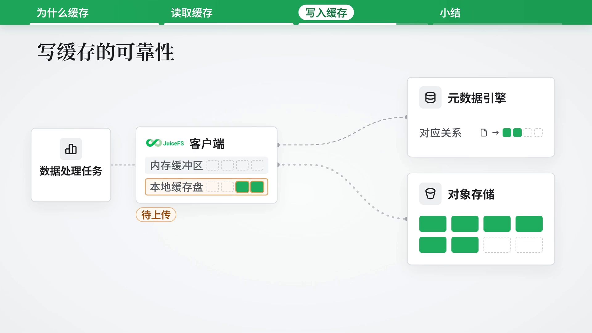

---

## 七、量化：命中与不命中的差距有多大

这一讲本身讲机制，不给数字。同一系列的另一讲（《缓存命中率决定性能上限：JuiceFS 在 AI 场景下的缓存与预读调优》）给出了实测，可以直接拿来对照：

- 4 KB 单并发随机冷读：**8 IOPS**，对象存储延迟约 **125 ms**。8 × 125 ms ≈ 1000 ms，说明这条负载的并发度就是 1——每个请求都在等上一个。
- 同一负载用 `juicefs warmup` 预热到本地缓存后：**12K IOPS**，即本地盘的 IOPS。差距约 **1500 倍**。
- 高并发随机冷读（libaio，队列深度 128）：约 **6800 IOPS**，正好顶到对象存储的 IOPS 上限；预热到缓存后可以到 **2 万多 IOPS**。

这三个数字说明的是同一件事：**对象存储的瓶颈是「延迟 × 并发度」的天花板，缓存把延迟从几十毫秒压到本地盘的微秒级，天花板就整体抬高了。**

---

## 小结

- 对象存储的每一次读都是一次网络往返，而训练类负载会把这份开销乘上读取轮数，所以缓存是必需品而不是优化项。
- 缓存分两条线：元数据缓存省查询，数据缓存省传输。默认的元数据一致性保证是「关闭再打开一致性」，打开缓存能省 open 的往返，但会放宽多客户端可见性。
- 数据缓存有三层：内核页缓存 → 客户端内存缓冲区 → 本地磁盘缓存。命中顺序自上而下，只有全都没命中才回源对象存储。
- 缓存能安全复用，靠的是**数据块不可变 + 修改即生成新块标识**，而不是靠时间戳失效。
- 预读解决顺序读的「逐段等待」，预取解决随机读的「块内补齐」；预取过度会产生读放大，跳读跨度大时应调小并发或关闭。
- 预热把「第一次读」也变成命中；淘汰只丢缓存副本不丢数据；缓存优先级防止热点数据被临时数据挤走。
- 写缓存（writeback）用「异步上传」换写入速度，代价是可靠性绑在本地盘、跨节点读可能卡住，只适合大量小写。

## 关键术语速查

| 术语 | 一句话解释 |
| --- | --- |
| 元数据引擎 | 存文件属性与「文件内容到数据块」映射的独立数据库，与对象存储分开部署 |
| 内核页缓存（page cache） | 操作系统统一为文件系统做的内存缓存，对 JuiceFS 透明、不可精细控制 |
| 本地磁盘缓存 | 客户端把数据块整块落到本地 SSD 的缓存，跨进程、跨重启有效，是重复读的主力 |
| 关闭再打开一致性 | 写入方关闭文件后，其他客户端再打开一定能看到新内容；默认由「每次 open 都取最新映射」保证 |
| 预读（readahead） | 按当前读取进度提前下载后续内容到内存缓冲区，提升顺序读性能 |
| 预取（prefetch） | 读到某个块的一小部分时，后台把整块拉下来，服务块内后续访问 |
| 读放大 | 提前下载的数据里只有一小部分被真正用到，浪费带宽与缓存空间 |
| 缓存预热（warmup） | 任务开始前用 `juicefs warmup` 把已知要用的文件先下载到本地缓存盘 |
| 写缓存（writeback） | 先写本地缓存盘并提交元数据，后台异步上传对象存储，用可靠性换写入速度 |