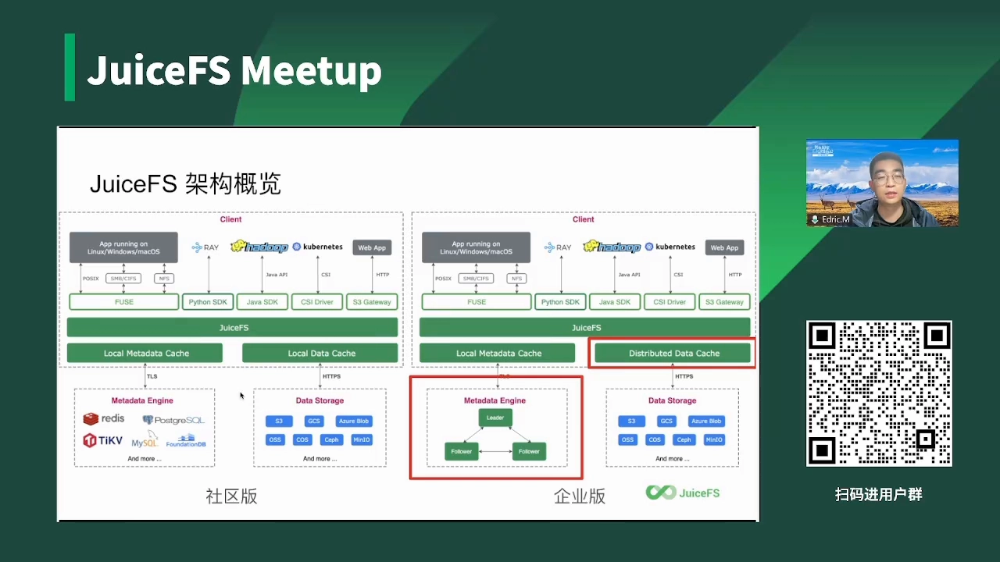
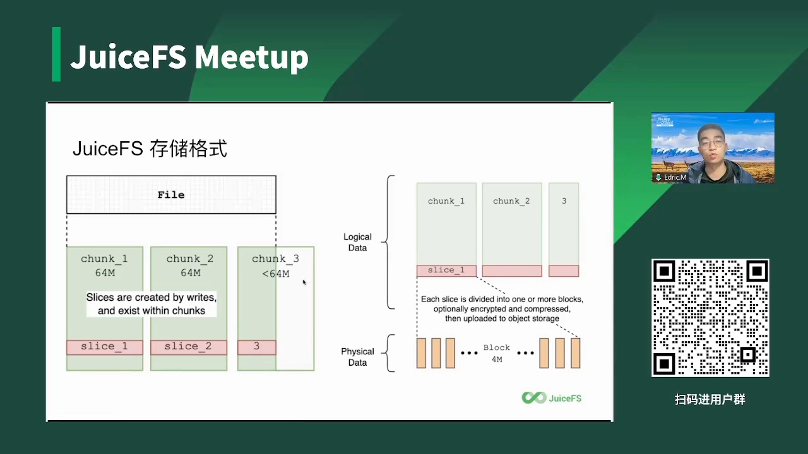
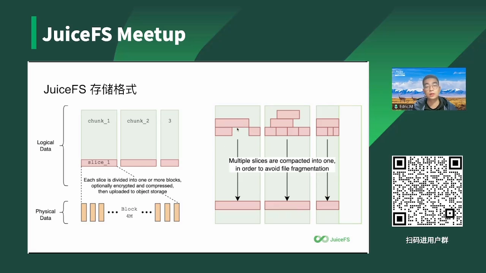
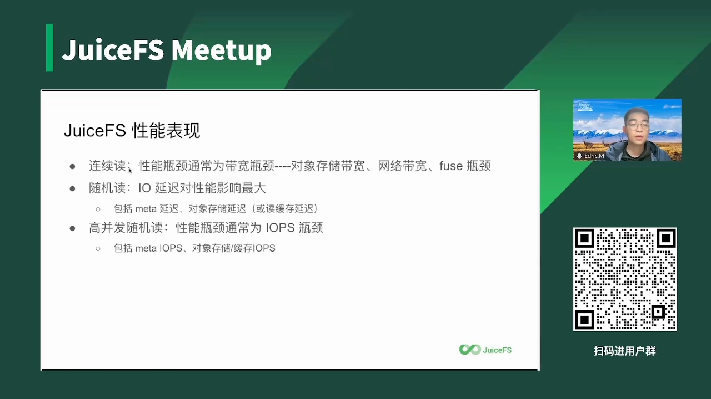
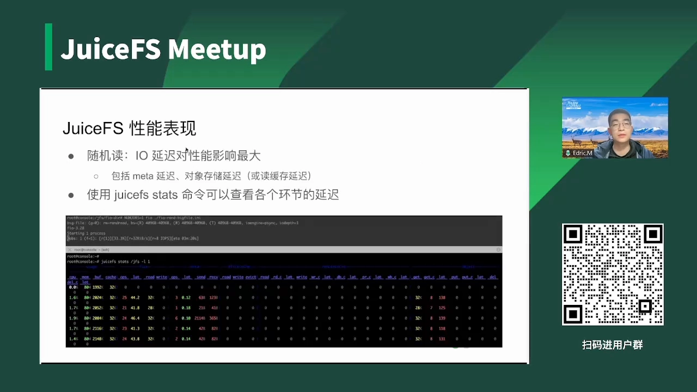
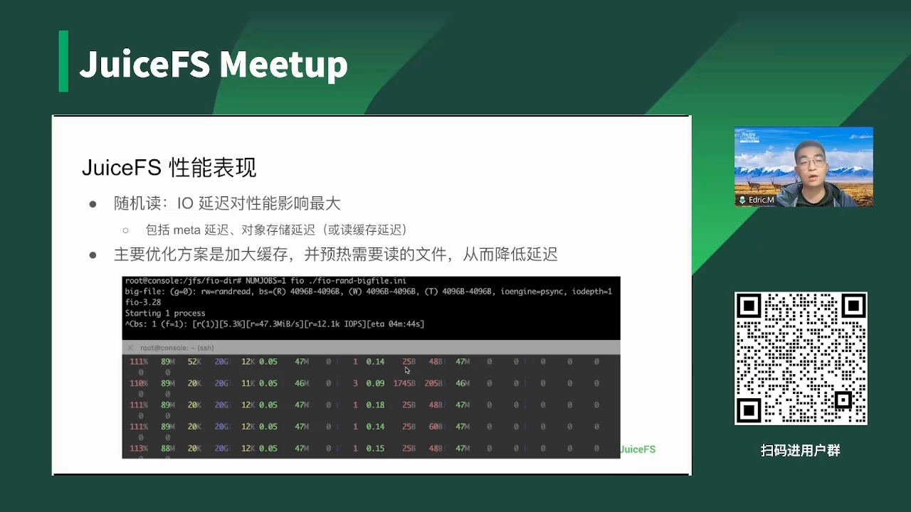
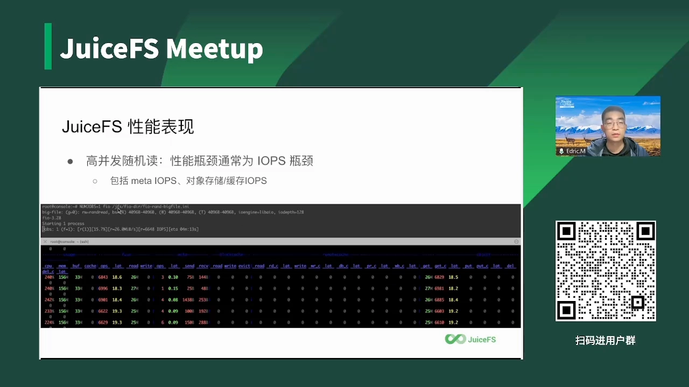
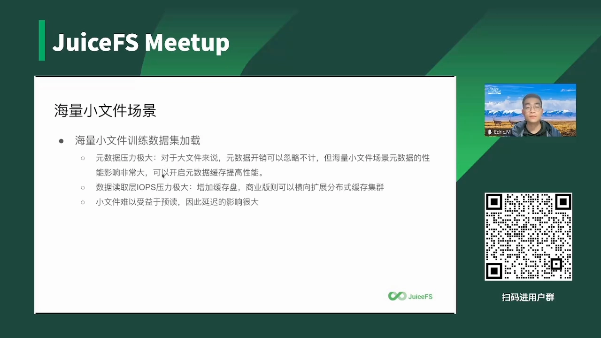
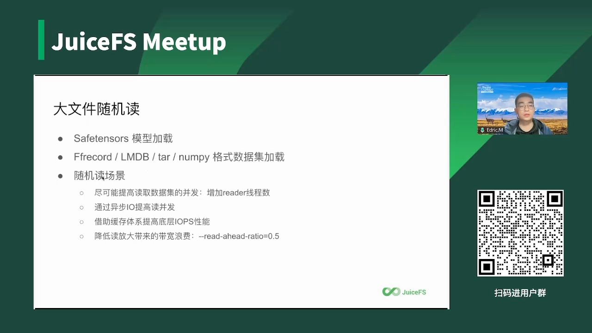

# 缓存命中率决定性能上限：JuiceFS 在 AI 场景下的缓存与预读调优

> 视频来源：[架构设计与性能调优：JuiceFS 如何支撑 AI 高效计算与存储](https://www.bilibili.com/video/BV1jRAEzuEeT/)（Bilibili · JuiceFS 官方账号）｜时长约 30 分钟
> 导读：这是一场性能调优实战。讲者先交代 JuiceFS 的存储格式（chunk / slice / block）与缓存体系的全套参数，再把 AI 负载拆成连续读、低并发随机读、高并发随机读三类，逐类给出瓶颈判据与实测数字。本文只讲**缓存与预读**这一段；组件架构与读写路径见 4.2.1，FUSE 挂载见 4.2.2，缓存层次的一般性讨论见 4.1.2。

## 本讲要解决的核心问题（SCQA）

**背景**：AI 场景的文件规模很大、对读写性能要求很高，单机文件系统既存不下也共享不了；对象存储便宜、易用、没有文件规模上限、可以按需扩展，很适合做冷存储。JuiceFS 把两者拼起来：数据在对象存储，元数据在独立引擎，客户端做缓存。

**冲突**：拼起来不等于快。同一个 4 KB 随机读，冷读时只有 **8 IOPS**；高并发随机冷读能到 **6800 IOPS**，看起来不错，但那是对象存储的上限，不是 JuiceFS 的上限。默认配置下，你很可能连自己环境的性能上限在哪都不知道。

**疑问**：一次读慢，到底是慢在元数据、慢在对象存储、慢在网络、还是慢在 FUSE？该动哪个参数？

**回答（中心思想）**：**先按访问模式把负载分成「连续读 / 低并发随机读 / 高并发随机读」三类，它们分别卡在带宽、延迟、IOPS 三种瓶颈上；再用缓存把瓶颈整体抬高，用预读参数把抬高的上限真正吃满。** 缓存决定上限，预读决定你能不能用满这个上限。

---

## 一、先认清基础：缓存的最小单位是一个 4 MB 的 block

### 1.1 三种存储各自的短板

讲者用一句话把选型讲清楚了 [【跳转到 00:40】](https://www.bilibili.com/video/BV1jRAEzuEeT/?t=40)：

- **单机文件系统**：AI 场景文件规模太大，不适用。
- **对象存储**：便宜易用、没有文件规模上限、按需扩展，适合冷存储；但处理小文件、或面对高并发读取、高带宽读取时，性能往往不够用。
- **纯本地存储**：性能足够好，但存不下规模太大的数据，也没法在多台机器上共享。

JuiceFS 的位置就在这三者之间：用对象存储兜住容量与共享，用本地缓存补上性能。

### 1.2 社区版与企业版：缓存能力的差别在哪

两版的框架很像，都是「数据与元数据分开存储」，客户端是**胖客户端**——承担相当多的逻辑，包括元数据的一部分处理和元数据缓存，以及数据缓存模块 [【跳转到 02:45】](https://www.bilibili.com/video/BV1jRAEzuEeT/?t=165)。

对缓存这一讲来说，两版最关键的差异是：企业版有**分布式缓存**组件，可以把同组客户端的本地缓存互相共享，在一个机房内形成一个可横向扩展的缓存池，基于一致性哈希实现。这样一次任务中大部分需要用到的数据可以提前预热到缓存组中 [【跳转到 06:05】](https://www.bilibili.com/video/BV1jRAEzuEeT/?t=365)。社区版则是每台机器各管各的本地缓存。

### 1.3 存储格式：为什么缓存单位是 4 MB

调缓存参数之前必须先知道缓存的是什么单位。JuiceFS 的存储格式分四层 [【跳转到 07:45】](https://www.bilibili.com/video/BV1jRAEzuEeT/?t=465)：

- **File**：文件。
- **Chunk**：文件被切成 64 MB 的逻辑分区，只用于定位「文件不同分块的数据」。
- **Slice**：chunk 内部管理数据的数据结构，由写入产生。
- **Block**：slice 再切成若干 **4 MB** 的 block，block 才是最终 PUT 到对象存储的分块数据。

**关键点**：默认情况下，数据缓存就是以 block 为单位的，社区版和企业版都是如此 [【跳转到 09:00】](https://www.bilibili.com/video/BV1jRAEzuEeT/?t=540)。所以后面所有「预读窗口」「预取」「读放大」的计算，分母都是 4 MB。

### 1.4 slice 只追加不修改，碎片靠 compaction 收

文件后续不停有更新时，新写入不会去改之前的 slice——写入之后它是 flush 进去的，就不可再更改。新写入的 slice 因为比较新，在文件中处于最上层；读取时从下往上看，形成一个新的视图 [【跳转到 09:25】](https://www.bilibili.com/video/BV1jRAEzuEeT/?t=565)。

碎片太多时会做 **compaction**，合并成「一个 chunk 只有一个 slice」的理想状态 [【跳转到 10:15】](https://www.bilibili.com/video/BV1jRAEzuEeT/?t=615)。这件事与缓存的关系是：**slice 越多，一个逻辑读要拼的 block 越多**，读路径上的元数据开销也越大。

---

## 二、缓存体系的两个部件与它们的参数

讲者的判断很直接：JuiceFS 相比原生对象存储，性能提升帮助最大的就是缓存体系 [【跳转到 10:40】](https://www.bilibili.com/video/BV1jRAEzuEeT/?t=640)。缓存体系由两个部件组成。

### 2.1 部件一：本地 cache 模块

既然数据在本地（或在本机房的分布式缓存里），读延迟就能大幅降低、读带宽就能大幅提高。相关配置 [【跳转到 11:05】](https://www.bilibili.com/video/BV1jRAEzuEeT/?t=665)：

| 参数 | 作用 | 该什么时候动它 |
| --- | --- | --- |
| `--cache-dir` | 指定缓存目录 | 想把缓存放到独立 SSD 上时 |
| `--cache-size` | 用多少空间做缓存 | 缓存盘越大，命中率越高；这是最直接的性能杠杆 |
| `--prefetch` | 预取：某个 block 被命中时，后台线程把整块拉下来 | 随机读为主、且块内还会被继续访问时 |
| `--writeback` | 数据块先写本地 cache，再异步 PUT 到对象存储 | 大量小文件写入、能接受可靠性下降时 |

`--prefetch` 值得单独说：它是一个 cache 模块里的参数，逻辑是「当你一个请求命中到了某一个 block（那个 4 MB），就交给后台的 prefetch 线程把这一整块拉下来」[【跳转到 11:30】](https://www.bilibili.com/video/BV1jRAEzuEeT/?t=690)。这就是上一节说的「以 block 为单位的补齐」。

`--writeback` 是提高写 IOPS 用的：把需要 PUT 上对象存储的数据块先写到本地 cache，再异步上传 [【跳转到 11:55】](https://www.bilibili.com/video/BV1jRAEzuEeT/?t=715)。代价（可靠性绑本地盘、跨节点读可能卡住）在另一篇《对象存储慢三个数量级》里讲得更细。

### 2.2 分布式缓存组：把缓存池横向扩起来

企业版还有两个与缓存组相关的参数 [【跳转到 12:20】](https://www.bilibili.com/video/BV1jRAEzuEeT/?t=740)：

- `--cache-group`：把哪一批客户端的本地缓存配置成同一个分布式缓存组，组内共享缓存数据。
- `--no-sharing`：我这个客户端只从缓存组读数据，但自己不作为成员提供数据读取服务。

指定 `--no-sharing` 之后，相当于有了**两级缓存**：第一级是自己的本地缓存，第二级是缓存组里其他节点上的缓存 [【跳转到 12:45】](https://www.bilibili.com/video/BV1jRAEzuEeT/?t=765)。这个设计适合「计算节点很多、但只有少数几台适合当缓存提供者」的集群。

### 2.3 部件二：内存 buffer（读 buffer）

第二个带来性能提升的是内存 buffer，它有三个作用 [【跳转到 13:10】](https://www.bilibili.com/video/BV1jRAEzuEeT/?t=790)：

1. **合并 IO 请求**：多个连续的请求在这一层可能直接命中之前的 IO，实际从系统来了三个请求，真正发出去的只有一个。
2. **自适应预读**：一个更大、更合适的预读范围，可以提高请求的并发数。
3. **承载预读数据**：预读拉下来的内容就放在这里，等应用来取。

### 2.4 预读的四个参数

这是本讲最需要记住的一组配置 [【跳转到 14:50】](https://www.bilibili.com/video/BV1jRAEzuEeT/?t=890)：

| 参数 | 含义 | 默认与调法 |
| --- | --- | --- |
| `--buffer-size` | 内存 buffer 大小，直接决定预读范围与并发度 | 高性能场景适当增大 |
| `--max-readahead` | 预读的最大范围 | 顺序读为主时调大 |
| `--initial-readahead` | 开启预读时的初始窗口 | 默认 4 MB，即一个 block |
| `--readahead-ratio` | 预读窗口相对读取量的比例 | 随机读为主时调小（如 0.5） |

讲者特别强调 `--readahead-ratio` 是较新的一个参数，专门用来解决**大文件随机读取时读放大带来的带宽瓶颈**：太过激进的预读会对随机读产生负面影响，这个参数就是来解决这个问题的 [【跳转到 15:15】](https://www.bilibili.com/video/BV1jRAEzuEeT/?t=915)。

### 2.5 预读窗口怎么换算成并发度

这里有一个很好用的心算方法：**预读窗口 ÷ 4 MB = 后台同时在读的 block 数 = 请求并发度**。

讲者举的例子是：预读做到 400 MB，每个 block 是 4 MB，400 ÷ 4 就是总共有 100 个块对应的请求在后台读取，并发度提高之后整体性能就上升 [【跳转到 21:30】](https://www.bilibili.com/video/BV1jRAEzuEeT/?t=1290)。

这条换算解释了为什么 `--buffer-size` 是最划算的一个旋钮：它同时放大了「预读多远」和「同时在飞多少个请求」。对高延迟后端来说，**并发度就是吞吐**。

---

## 三、三类负载、三种瓶颈

讲者把性能问题分三大类，这个分类是整场分享的骨架 [【跳转到 16:30】](https://www.bilibili.com/video/BV1jRAEzuEeT/?t=990)。

| 负载类型 | 瓶颈 | 具体卡在哪 | 缓存能做什么 |
| --- | --- | --- | --- |
| 连续读 | 带宽 | 对象存储带宽（冷读）、网络带宽（分布式缓存）、FUSE | 把冷读变成热读，把带宽瓶颈搬到本地盘 |
| 低并发随机读 | 延迟 | 元数据延迟、对象存储延迟（或缓存延迟） | 预热，把几十毫秒的延迟换成微秒级 |
| 高并发随机读 | IOPS | 元数据 IOPS、对象存储/缓存 IOPS | 预热 + 加缓存盘，把 IOPS 上限整体抬高 |

### 3.1 连续读：先撞 FUSE，再撞网络

连续读的瓶颈通常是带宽，而带宽瓶颈有三个来源：对象存储带宽、网络带宽、FUSE。

讲者给了一张实测表：**单线程读一个文件，通过 FUSE 这一层带宽只能到 3.5 GB/s**，随着线程数上升，带宽才逐渐把网络跑满 [【跳转到 20:15】](https://www.bilibili.com/video/BV1jRAEzuEeT/?t=1215)。他还给了网络侧的量级：一台 40 Gb 网卡的机器，带宽最大可能只有不到 5 GB/s [【跳转到 17:20】](https://www.bilibili.com/video/BV1jRAEzuEeT/?t=1040)。

想先摸清自己环境的上限，可以用 `juicefs objbench` 子命令测对象存储的带宽 [【跳转到 20:40】](https://www.bilibili.com/video/BV1jRAEzuEeT/?t=1240)。**先测上限，再看业务跑到哪，才知道该调什么。**

### 3.2 低并发随机读：延迟 × 并发度 = 吞吐

这是全场最有说服力的一段。讲者做了一个 **4 KB 随机冷读**，IOPS 只有 **8** [【跳转到 21:53】](https://www.bilibili.com/video/BV1jRAEzuEeT/?t=1313)。

用 `juicefs stats` 看各环节延迟，最右边是对象存储相关的数据，`lat` 那一栏单位是毫秒，延迟基本上是 125 ms 左右或更高 [【跳转到 22:18】](https://www.bilibili.com/video/BV1jRAEzuEeT/?t=1338)。

然后是这段推导 [【跳转到 22:43】](https://www.bilibili.com/video/BV1jRAEzuEeT/?t=1363)：

$$
\text{IOPS} \times \text{延迟} = 8 \times 125\ \text{ms} = 1000\ \text{ms}
$$

一秒 1000 ms 被一个请求占满，说明这条负载的**并发度是 1**——每个请求都在等前一个完成。这种单并发、前后请求互相阻塞的场景，唯一能做的就是**降低延迟**，而降低延迟最好的方法就是预热到缓存中 [【跳转到 23:08】](https://www.bilibili.com/video/BV1jRAEzuEeT/?t=1388)。

用 `juicefs warmup` 预热到本地缓存后，IOPS 直接到了 **12K**，也就是本地盘的 IOPS [【跳转到 23:26】](https://www.bilibili.com/video/BV1jRAEzuEeT/?t=1406)。

**8 → 12000，约 1500 倍。** 这不是调参调出来的，是「换了一个存储介质」换来的。

### 3.3 高并发随机读：撞对象存储的 IOPS 天花板

高并发随机读用 libaio 测，冷读时最右侧的 IOPS 是 **6800 左右**，而讲者用 objbench 测出的对象存储 IOPS 上限是「7000 不到一些」——也就是说这里已经碰到了对象存储的上限 [【跳转到 24:13】](https://www.bilibili.com/video/BV1jRAEzuEeT/?t=1453)。

同样使用缓存空间并预热之后，IOPS 可以直接到 **2 万多** [【跳转到 24:27】](https://www.bilibili.com/video/BV1jRAEzuEeT/?t=1467)。

这一组的启示和上一组不同：**高并发下你不是在等延迟，你是在排队抢后端的 IOPS 配额。** 加并发没用（已经打满了），只能换后端——把请求从对象存储挪到本地缓存盘。

---

## 四、方法：用 stats 把瓶颈定位到「哪一环」

讲者反复用同一个动作：跑负载 → `juicefs stats` 看各列 → 找到最慢的那一环。stats 输出里同时有 meta 相关列、cache 相关列和 object storage 相关列（`lat_obj`、`get_obj` 等），延迟单位是毫秒 [【跳转到 22:18】](https://www.bilibili.com/video/BV1jRAEzuEeT/?t=1338)。

判读逻辑可以总结成三步：

1. 看 **IOPS 是否等于「1 / 延迟」**。如果是，说明并发度为 1，瓶颈是延迟，去预热、去加缓存。
2. 看 **后端 IOPS 是否已接近 objbench 测出的上限**。如果是，说明瓶颈是后端配额，加并发无效，只能换后端或加缓存盘。
3. 看 **FUSE 侧带宽是否卡在 3.5 GB/s 附近**。如果是，加预读也没用，必须加读并发（多线程/多进程）。

除了这三类，也可能是客户端所在机器的 CPU 和内存不够，导致客户端发挥不出能力——这个比较容易观察到，讲者没有展开 [【跳转到 19:50】](https://www.bilibili.com/video/BV1jRAEzuEeT/?t=1190)。

---

## 五、四类 AI 场景的调优处方

前面是通用框架，这一段是落地到具体负载。

### 5.1 PyTorch 模型加载：顺序读，但被 pickle 和单线程锁死

PyTorch 的模型是 `.pt` 文件，用 pickle 序列化保存。用 `torch.load` 加载模型时，一方面受 pickle 反序列化的性能限制，另一方面**它只能单线程地读数据** [【跳转到 25:04】](https://www.bilibili.com/video/BV1jRAEzuEeT/?t=1504)。

由此产生两个后果：第一，单线程读无法突破 FUSE 的带宽上限（就是前面那个 3.5 GB/s）；第二，反序列化本身还要吃 CPU。**这时调预读参数是没用的**，因为请求根本发不出去那么多。解法只能是加并发：分片加载，把模型分成分层保存之类的方法，从而实现多并发 IO [【跳转到 25:29】](https://www.bilibili.com/video/BV1jRAEzuEeT/?t=1529)。

> 这条很值得记住：**预读只能放大「已经发出的请求」，救不了「发不出请求」的应用。**

### 5.2 大文件顺序读数据集：调大 buffer size，最好全缓存

纯读数据的大文件顺序读场景其实比较好办：增大 `--buffer-size` 去调节预读即可；当然如果能完全缓存到本地是最好的 [【跳转到 25:54】](https://www.bilibili.com/video/BV1jRAEzuEeT/?t=1554)。

### 5.3 海量小文件：元数据压力 + IOPS 压力 + 预读失效

海量小文件训练数据集加载是三重打击 [【跳转到 26:19】](https://www.bilibili.com/video/BV1jRAEzuEeT/?t=1579)：

1. **元数据压力极大**：大文件读数据时元数据开销几乎可以忽略不计，但海量小文件场景下元数据性能影响非常大。可以开启元数据缓存并把时间开高一点——前提是只读负载 [【跳转到 27:09】](https://www.bilibili.com/video/BV1jRAEzuEeT/?t=1629)。
2. **数据层 IOPS 压力极大**：每个小文件都没法很好地预读起来，请求打到后端更碎、更小，整体 IOPS 更大。对策是增加缓存盘；商业版可以横向扩展分布式缓存集群 [【跳转到 27:34】](https://www.bilibili.com/video/BV1jRAEzuEeT/?t=1654)。
3. **小文件难以受益于预读**，所以延迟的影响相对来说更大。

注意第 3 点与前文的呼应：预读的前提是「后面还会顺序读」，小文件读一次就结束了，预读没有可预读的对象。

### 5.4 大文件随机读：加并发、加缓存，再用 readahead-ratio 削读放大

safetensors 模型加载（按 mmap 加载）、FFRecord / LMDB / tar / numpy 格式的数据集加载都属于这一类 [【跳转到 27:59】](https://www.bilibili.com/video/BV1jRAEzuEeT/?t=1679)。它们的共性是：每次随机读读取的大小就是「一个 sample 的大小」。

如果 sample 是 1 MB 到 4 MB 的图片或短视频，在预读机制中就会带来读放大的带宽浪费 [【跳转到 28:24】](https://www.bilibili.com/video/BV1jRAEzuEeT/?t=1704)。四条动作 [【跳转到 28:49】](https://www.bilibili.com/video/BV1jRAEzuEeT/?t=1729)：

1. 增加数据加载的 reader 线程数。
2. 用异步 IO 提高并发——这两条都是尽量把 IOPS 打满。
3. 尽量把缓存体系建好，能 warmup 就提前 warmup，用它提高底层的 IOPS 性能。
4. 用 `--readahead-ratio` 削掉读放大。

第 4 条的具体算法讲得很清楚：原先 4 MB 的顺序读会往后预读 4 MB；把 ratio 改成 **0.5** 之后，4 MB 的顺序读只往后预读 **2 MB** [【跳转到 29:14】](https://www.bilibili.com/video/BV1jRAEzuEeT/?t=1754)。这样就直接降低了读放大带来的带宽浪费。

用公式表达就是：

$$
\text{预读窗口} = \text{本次读取量} \times \text{readahead-ratio}
$$

ratio = 1 时预读量等于读取量；ratio = 0.5 时预读量减半，带宽浪费减半，代价是顺序读时更容易「预读跟不上」。

---

## 小结

- 调缓存之前先认清单位：数据缓存以 **4 MB 的 block** 为单位，预读窗口 ÷ 4 MB 就是后台并发请求数。
- 缓存体系分两个部件：本地 cache 模块（`--cache-dir` / `--cache-size` / `--prefetch` / `--writeback`，企业版还有 `--cache-group` / `--no-sharing`）和内存 buffer（`--buffer-size` / `--max-readahead` / `--initial-readahead` / `--readahead-ratio`）。
- 三类负载三种瓶颈：连续读卡带宽（含 FUSE 单线程 3.5 GB/s 的上限）、低并发随机读卡延迟、高并发随机读卡 IOPS。
- 低并发随机读的判据是「IOPS × 延迟 ≈ 1000 ms」，说明并发度为 1；这时唯一有效的手段是预热。实测 4 KB 随机冷读 8 IOPS → 预热后 12K IOPS。
- 高并发随机读的判据是「后端 IOPS 已接近 objbench 测出的上限」；实测 6800 → 预热后 2 万多。这时加并发无效，只能换后端。
- 预读只能放大已经发出的请求：PyTorch `.pt` 单线程加载这类应用，先解决并发（分片加载），再谈预读。
- 海量小文件难以受益于预读，要单独处理元数据缓存与 IOPS 压力。
- 随机读遇到读放大，用 `--readahead-ratio`（如 0.5）把预读窗口按比例缩下来。

## 关键术语速查

| 术语 | 一句话解释 |
| --- | --- |
| chunk / slice / block | 文件切成 64 MB 的 chunk，chunk 内由写入产生 slice，slice 再切成 4 MB 的 block 落对象存储 |
| compaction | 把同一 chunk 内过多的碎片 slice 合并成一个，避免文件碎片影响读路径 |
| `--cache-size` | 本地缓存盘可用空间上限，直接决定缓存命中率 |
| `--prefetch` | 命中某个 block 时后台把整块拉下来的预取开关 |
| `--buffer-size` | 读 buffer 大小，决定预读范围与后台并发请求数 |
| `--readahead-ratio` | 预读窗口相对本次读取量的比例，用来压制随机读的读放大 |
| `objbench` | JuiceFS 自带的对象存储带宽/IOPS 压测子命令，用来摸清后端上限 |
| `juicefs stats` | 实时查看各环节延迟与 IOPS 的命令，定位瓶颈的主要工具 |
| 读放大 | 预读/预取拉下来的数据里只有一小部分被真正用到，浪费带宽 |
| 并发度 | 同时在飞的 IO 请求数；低并发时吞吐 = 并发度 ÷ 延迟 |