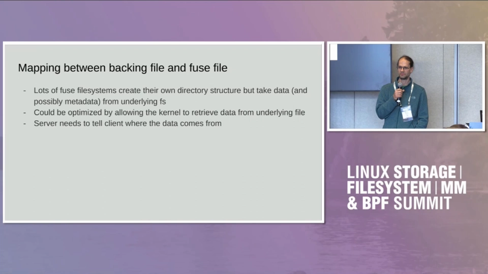
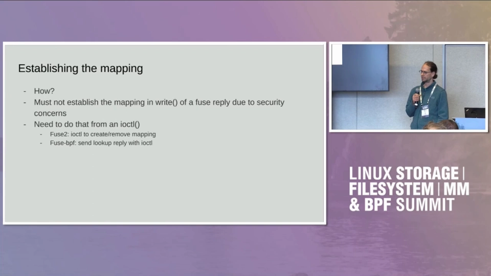
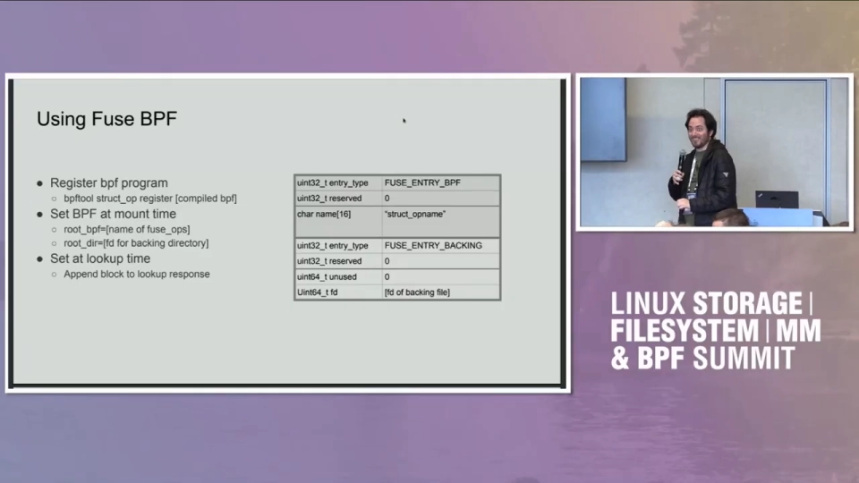
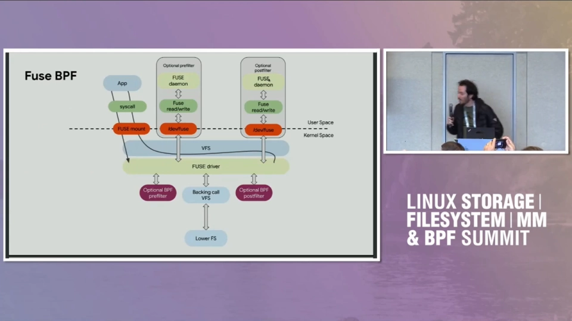

# FUSE passthrough：让数据面绕过用户态守护进程，只把元数据留在用户态

> 视频来源：[FUSE passthrough solutions and status - Miklos Szeredi / Daniel Rosenberg](https://www.youtube.com/watch?v=3IjdxsFPoHE)（YouTube · The Linux Foundation，LSF/MM/BPF Summit 2023）｜时长约 28 分钟
> 这是一场设计讨论（不是讲稿），前半段是 Miklos Szeredi 讲 passthrough 的设计约束，后半段是 Daniel Rosenberg 讲 FUSE-BPF 的实现形态。本文按"为什么需要 → 映射怎么建 → 三条路线 → 遗留问题"重排了顺序，把讨论中反复出现的岔路（安全性、生命周期、可见性、命名空间）单独归类，便于理解为什么这个特性讨论了这么久。

## 本讲要解决的核心问题（SCQA）

**背景**：大量 FUSE 文件系统其实是"半透传"的——它们自己造一套目录结构、在元数据上做文章（重定向、权限、加密、快照视图），但**文件数据本身完全来自底层文件系统**，一个字节都不改。

**冲突**：即使数据完全没变，当前所有 I/O 也要绕一圈：请求送到用户态守护进程，守护进程再去读底层文件，数据再拷回来。这显然比内核直接访问慢。既然数据没变，这趟路就是白走的。[【跳转到 00:30】](https://www.youtube.com/watch?v=3IjdxsFPoHE&t=30)

**疑问**：能不能让内核自己去底层文件取数据，只把元数据判断留在用户态？如果行，内核怎么知道"这个 FUSE 文件对应哪个底层文件"？这个映射由谁、在什么时候、用什么系统调用建立？建立之后生命周期怎么算？

**回答（中心思想）**：这就是 FUSE passthrough——**由守护进程告诉内核"这个 FUSE 文件的数据来自哪个底层文件"**，此后数据读写由内核直接打到下层文件系统，用户态只处理元数据。设计上的关键约束有三个：映射必须通过 **ioctl** 而不是 write 回复来建立（否则可被利用来传递任意 FD）；粒度可以是整文件也可以是块/区间；映射一旦建立，就带来生命周期、对外可见性、跨命名空间权限等一串必须回答的问题。目前有三条并行路线，社区的共识是**先落一个不含 BPF 的纯 passthrough，再在其上叠 FUSE-BPF**。

## 一、要优化的是什么：一条白走的数据通路

把问题写成一句话：**FUSE 的元数据逻辑是有价值的，FUSE 的数据通路是浪费的**。

- 有价值的部分：自建的目录结构、元数据变换、权限判断、快照视图——这些必须留在用户态，因为那是文件系统作者的业务逻辑。
- 浪费的部分：数据本身。既然底层文件系统里已经有这份数据，让内核直接去读就行。

所以 passthrough 的目标很明确：**内核从底层文件取数据，服务端只负责告诉内核"数据来自哪里"**。[【跳转到 00:55】](https://www.youtube.com/watch?v=3IjdxsFPoHE&t=55)

这和"把整个文件系统搬到内核"是两件事：元数据路径不动，只把数据面短路。

## 二、映射的粒度：整文件，还是块/字节区间

第一个设计问题是：这个"FUSE 文件 → 底层文件"的映射，粒度应该多粗？

- **整文件**：最简单，`open` 之后整个文件的数据都走 passthrough；
- **块或字节区间**：更灵活。粒度更细还有一个额外好处——**可以支持"块设备型"的文件系统**：把块设备的一部分映射到文件系统里的文件。[【跳转到 01:20】](https://www.youtube.com/watch?v=3IjdxsFPoHE&t=80)

粒度越细，内核侧要维护的映射结构越复杂，但表达能力越强。这个取舍在后面的 FUSE-BPF 里体现得很明显：BPF 的 prefilter 可以按 offset/长度决定"这一段直接走底层文件，那一段 defer 回用户态"。

## 三、怎么建立映射：不能用 write，必须用 ioctl

### 3.1 直觉方案与它的安全漏洞

最直觉的做法是：守护进程在处理 `open` 时，把底层文件的 fd 通过 **write 回复** 传给内核。FUSE 的回复本来就是用 write 写回 `/dev/fuse` 的。

这个方案被否掉了，理由是安全：**write 是"任意程序都会做的事"**。攻击者可以劫持一次写操作、诱使一个高权限程序把某个它本不想发送的 FD 写出去，而这个 FD 随后就被挂到文件上。[【跳转到 03:09】](https://www.youtube.com/watch?v=3IjdxsFPoHE&t=189)

演讲里把差别讲得很清楚：

- 普通场景下，你想以 root 身份往某个文件写，重定向写要求非特权进程先 `open` 那个文件用于写——**这就过了 open-for-write 的权限检查**；
- 但在"写特殊魔法数据"的场景里，你实际上让一个进程执行了**管理性操作**，改变了系统其它部分的行为，这性质完全不同。[【跳转到 05:14】](https://www.youtube.com/watch?v=3IjdxsFPoHE&t=314)

换句话说：**write 通道的语义是"数据"，不是"控制指令"**。往里塞 FD 相当于开了一个隐式的控制通道。

### 3.2 结论：走 ioctl

于是设计改成：**映射的建立与撤销都通过 ioctl 完成**。

- 诱使程序调用一个**特定的 ioctl**，比诱使程序"随便写点数据"难得多——后者程序天天在做；
- 这也和内核里已有的做法一致：FUSE 的 notifier 通道需要传结构化数据（含 FD）时，同样用 ioctl，理由相同。[【跳转到 04:24】](https://www.youtube.com/watch?v=3IjdxsFPoHE&t=264)

幻灯片把三条路线的差异压缩成了一张表：

- **Fuse2**：用 ioctl 创建/删除映射；
- **FUSE-BPF**：用 ioctl 发送 lookup 回复（映射在 lookup 时建立）。

[【跳转到 02:35】](https://www.youtube.com/watch?v=3IjdxsFPoHE&t=155)

## 四、三条并行路线

讨论里反复出现的是三条路线，它们的差别主要在"映射在哪一步建立、由谁建立"：

| 路线 | 建立映射的时机与方式 | 特点 |
| --- | --- | --- |
| 注册 fd（Fuse2 原型） | 先用 ioctl 把底层 fd 注册进来，之后用它建立映射 | 映射与注册分离，映射可显式创建/删除 |
| FUSE-BPF | 在 `lookup` 回复里通过 ioctl 带上底层 fd，映射在 lookup 时建立 | 与 BPF 钩子结合，可按请求内容选择是否 passthrough |
| Android 的 open passthrough | 在 `open` 时附加 filter | 已 upstream 的补丁只覆盖 read/write 的 passthrough |

[【跳转到 07:13】](https://www.youtube.com/watch?v=3IjdxsFPoHE&t=433)

三条路线都在解决同一个问题，但接口形态不同，这也是为什么社区在讨论"要不要合并、以哪个为基准"。

## 五、FUSE-BPF 的形态：注册程序 + 在 lookup 回复里带 FD

### 5.1 使用步骤

Daniel 讲的那一半给出了具体用法：

1. **注册 BPF 程序**：`bpf_tool` 的 `struct_op_register`，把编译好的 BPF 程序注册进内核；
2. **挂载时设置**：`root_bpf` 指向注册名（`struct_opname`），`root_dir` 指向底层目录的 fd，用来取得底层 inode 的访问权；
3. **lookup 时**：在 lookup 回复里追加一个 block，把底层文件的 fd 带上。

[【跳转到 14:32】](https://www.youtube.com/watch?v=3IjdxsFPoHE&t=872)

右侧那张结构表值得读：`FUSE_ENTRY_BPF` 带 `name[16]`（`struct_opname`），`FUSE_ENTRY_BACKING` 带一个 `fd`（底层文件的 fd）。也就是说**"用哪个 BPF 程序"和"数据来自哪个文件"是两种不同类型的条目**，都挂在回复里。

### 5.2 整体架构：prefilter / postfilter

架构图里有两条路径：

- **快路径**：`FUSE mount` → `ioctl/open` → `FUSE driver` → `backing call VFS` → `Lower FS`，中间可以插 **BPF prefilter / postfilter**；
- **慢路径**：`FUSE daemon`（可选带 prefilter/postfilter）→ `Fuse read/write` → `ioctl/open`，也就是回到用户态。

设计目标是"**像 FUSE 一样易用**"：尽管图比 FUSE 复杂，但对外提供的调用集合基本是镜像 FUSE 用户态调用的，只多两个钩子：

- **prefilter**：改输入参数；
- **postfilter**：改返回码/返回内容。

[【跳转到 16:37】](https://www.youtube.com/watch?v=3IjdxsFPoHE&t=997)

两个具体例子说明了它们的价值：

- **read 的 prefilter**：对某段 offset/长度，判断"这段我们可以直接处理"，于是直接打到下层文件；对另一段则 defer 回用户态。
- **read 的 postfilter**：比如某段数据需要脱敏（redact），在返回前改掉。[【跳转到 17:27】](https://www.youtube.com/watch?v=3IjdxsFPoHE&t=1047)

### 5.3 与"纯 passthrough"的关系

有人问得很尖锐：如果去掉 BPF，剩下的不就是"直接 passthrough"，那和 bind mount 有什么区别？

回答是：**去掉 BPF 确实就是直接 passthrough，差不多是"更贵的 bind mount"**。BPF 的价值在于**选择性**：

- 你不想 passthrough 全部操作（补丁的默认行为是全部 passthrough，但那没意义）；
- 你想表达"除了 rename 全部 passthrough"，或"除了这个文件全部 passthrough"；
- 这种逻辑要么写进挂载选项，要么写成 BPF 程序。[【跳转到 20:45】](https://www.youtube.com/watch?v=3IjdxsFPoHE&t=1245)

同样的机制可以扩展到目录结构：如果某个目录里有一个文件，你不想让某些用户**知道它存在**，可以在 `readdir` 里把它 purge 掉；prefilter 也可以直接返回错误码来拒绝一次 open。[【跳转到 23:57】](https://www.youtube.com/watch?v=3IjdxsFPoHE&t=1437)

## 六、映射建立之后：生命周期、可见性、命名空间

这一节是整场讨论里最有价值的部分——它解释了为什么一个"看起来很简单"的优化拖了这么久。

### 6.1 生命周期挂在底层 inode 上

- 映射的生命周期与**底层 inode 的生命周期**绑定；
- 目前**不允许**在程序运行期间更换 backing path：要换就得先让已有连接失效；
- 也不允许通过这条路径诱使守护进程加载任意 BPF 脚本（尤其是远程加载）：BPF 程序必须**事先注册**，之后只能引用已注册的对象。[【跳转到 18:36】](https://www.youtube.com/watch?v=3IjdxsFPoHE&t=1116)

### 6.2 可见性：`ls`/`lsof` 看不到底层的那个"打开文件"

passthrough 会在内核里产生一个"打开的文件"（或至少一个指向路径的引用），但它**对外不可见**：

- 你只能看到 FUSE 文件是打开的，看不到它背后引用的那个底层文件；
- 这带来一类管理问题：**句柄泄漏时你不知道谁拿着它**。演讲者承认这在开发 FUSE-BPF 的过程中一直是个麻烦。[【跳转到 09:46】](https://www.youtube.com/watch?v=3IjdxsFPoHE&t=586)

对比一下 overlayfs：它的底层文件引用可以从挂载信息推导出来；而 passthrough 的映射是**服务端给的任意值**，推导不出来。[【跳转到 11:28】](https://www.youtube.com/watch?v=3IjdxsFPoHE&t=688)

讨论里甚至提到一种极端做法：构造一个完全隐藏的挂载命名空间，把 fd bind mount 进去再关掉，宿主上的进程（包括 `lsof`）就完全看不到它。[【跳转到 10:11】](https://www.youtube.com/watch?v=3IjdxsFPoHE&t=611)

结论是：这不是 FUSE 独有的问题，而是"内核里存在不可见的文件引用"这个更普遍的问题，应该单独修。

### 6.3 命名空间：跨 namespace 的 fd 会让人困惑

如果守护进程在一个命名空间里，而挂载点在另一个 mount namespace 里，那么"这个 fd 指向谁"就变得可疑：

- 你 `ls` 能看到 FD，但它指向的挂载点不在你的命名空间里；
- 或者它指向的东西属于另一个 user namespace / network namespace。

目前的处理有两条：要么要求特定的权限检查，要么沿用现有规则——**发送方必须位于接收方的 user namespace 层级之内**。[【跳转到 12:42】](https://www.youtube.com/watch?v=3IjdxsFPoHE&t=762)

演讲者的总结很直白："namespaces are just horrible"（命名空间就是很麻烦）。[【跳转到 13:14】](https://www.youtube.com/watch?v=3IjdxsFPoHE&t=794)

## 七、路线取舍：先纯 passthrough，再叠 BPF

最后一段讨论落到"补丁怎么排"。共识大致是：

- Android 已经 upstream 的补丁只做 **read/write 的 passthrough**——而这恰恰是最影响性能的部分；
- 更理想的顺序是：**先在 FUSE 里实现一个独立的、不含 BPF 的 passthrough**，再把 FUSE-BPF 建在它上面。这样有一个"没有 BPF 也能用"的基线方案，加 BPF 只是锦上添花。[【跳转到 26:23】](https://www.youtube.com/watch?v=3IjdxsFPoHE&t=1583)
- 从工作量看，把 passthrough 铺好（处理所有 FUSE 调用在 passthrough 模式下的行为）是主要工作，之后加 filter 只是"两行代码"的事。[【跳转到 27:13】](https://www.youtube.com/watch?v=3IjdxsFPoHE&t=1633)
- 两条路线的行为差异主要在"**是否允许更换 backing file**"。[【跳转到 28:00】](https://www.youtube.com/watch?v=3IjdxsFPoHE&t=1680)

## 八、把这场讨论的结论收拢

| 设计问题 | 讨论结论 |
| --- | --- |
| 优化什么 | 只短路数据面；元数据逻辑仍留在用户态守护进程 |
| 映射粒度 | 可整文件，也可块/字节区间；细粒度还能支持块设备型文件系统 |
| 用什么系统调用建立映射 | 必须 ioctl；绝不能用 write 回复（可被劫持传任意 FD） |
| 映射何时建立 | Fuse2 显式注册 fd 后建立；FUSE-BPF 在 lookup 回复里建立；Android 在 open 时附加 filter |
| 生命周期 | 绑定底层 inode；不支持运行期更换 backing path |
| 可见性 | 底层"打开文件"对 `ls`/`lsof` 不可见，句柄泄漏难排查 |
| 命名空间 | 跨 namespace 的 fd 语义混乱，需权限检查或沿用 user namespace 层级规则 |
| 与 bind mount 的区别 | 纯 passthrough ≈ 更贵的 bind mount；价值在"选择性 passthrough" |
| 落地顺序 | 先落纯 passthrough（read/write 优先），再叠 FUSE-BPF |

## 小结

- passthrough 型 FUSE 文件系统的数据通路是白走的：数据没变，却要经用户态转发一次。
- FUSE passthrough 的做法是让守护进程告诉内核"数据来自哪个底层文件"，之后数据 I/O 由内核直接打到下层文件系统。
- 建立映射**必须走 ioctl**：write 通道的语义是数据，塞 FD 等于开了隐式控制通道，可被利用。
- 映射粒度可选整文件或块/区间；细粒度能支持块设备型文件系统。
- 三条路线：注册 fd + ioctl 建映射、FUSE-BPF 在 lookup 回复里带 fd、Android 在 open 时附加 filter。
- FUSE-BPF 用 prefilter/postfilter 表达"哪些操作 passthrough、哪些回用户态"，从而避免退化成"更贵的 bind mount"。
- 真正的难点不在数据通路，而在映射带来的生命周期、可见性、跨命名空间权限这些边角，以及"先做纯 passthrough 还是先做 BPF"的落地顺序。

## 关键术语速查

| 术语 | 一句话解释 |
| --- | --- |
| passthrough | 数据读写绕过用户态守护进程、由内核直接访问底层文件的机制 |
| backing file | FUSE 文件背后真正的底层文件，数据实际存放在这里 |
| 映射（mapping） | 内核里"FUSE 文件 → 底层文件（或其中一段）"的对应关系 |
| ioctl | 用于建立/撤销映射的系统调用，避免用 write 传递 FD 的安全风险 |
| FUSE-BPF | 在 FUSE 请求路径上挂 BPF 程序、按逻辑选择 passthrough 的方案 |
| prefilter / postfilter | 请求进入前后的两个 BPF 钩子，分别改输入参数与返回结果 |
| `FUSE_ENTRY_BACKING` | lookup 回复里携带底层文件 fd 的条目类型 |
| readdir purge | 在目录列举时隐藏某些目录项，使特定用户看不到其存在 |
| bind mount | 把一个目录挂到另一处；纯 passthrough 常被类比为"更贵的 bind mount" |