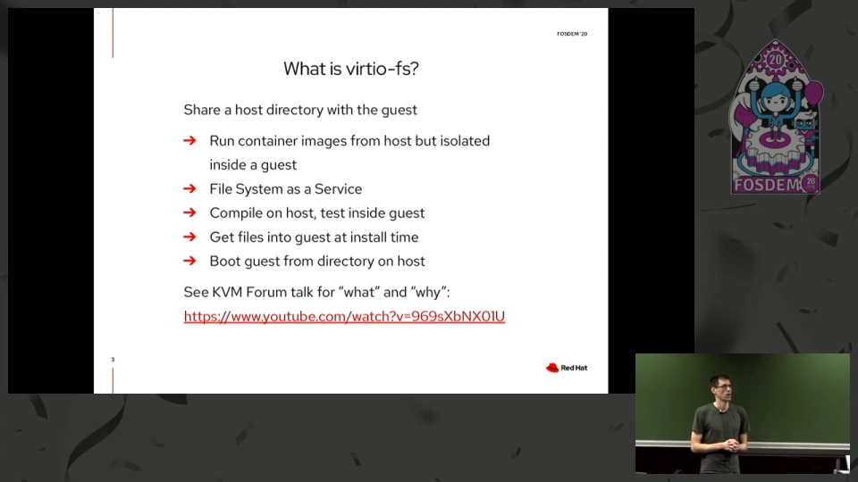
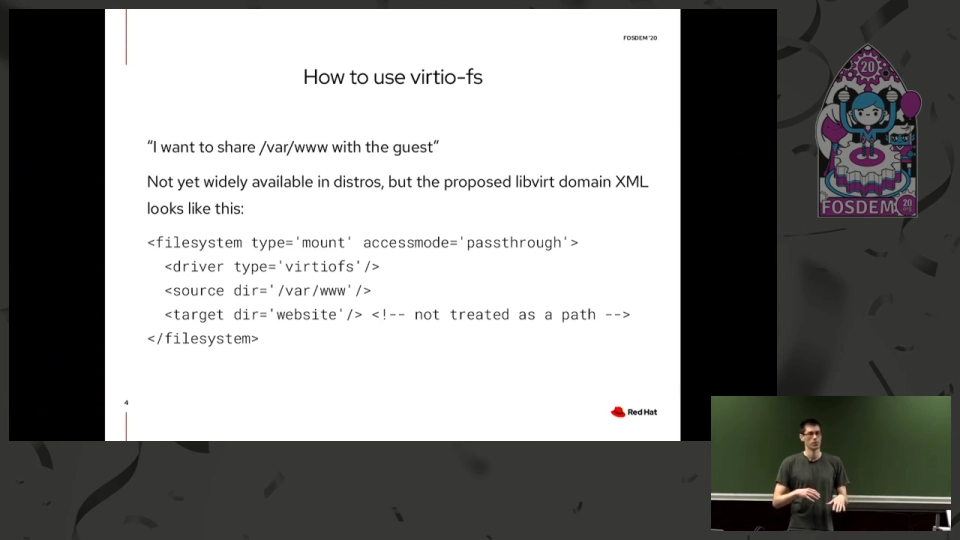
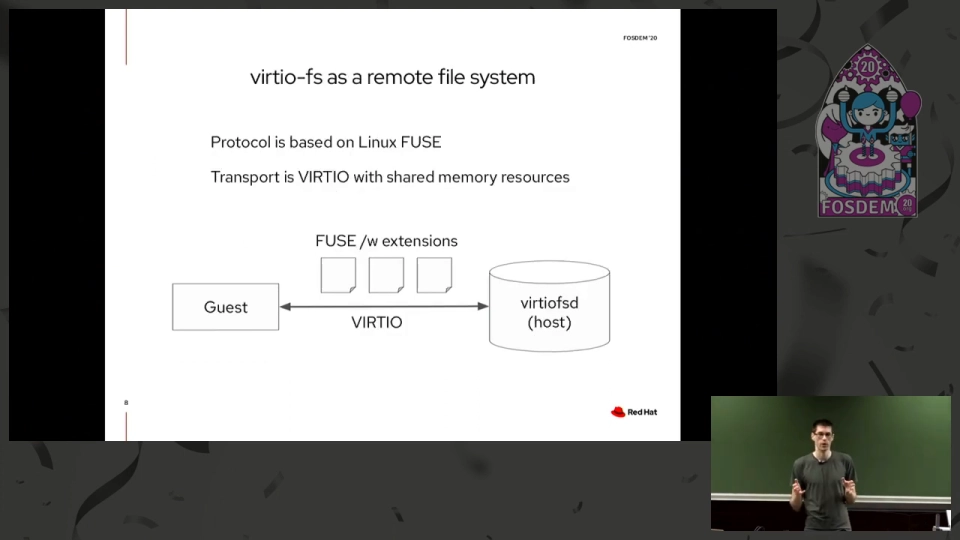
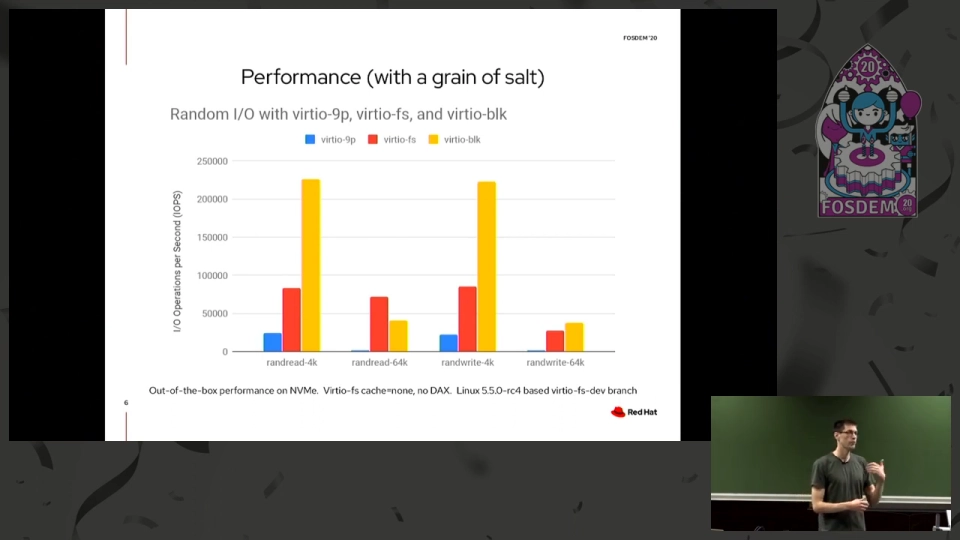
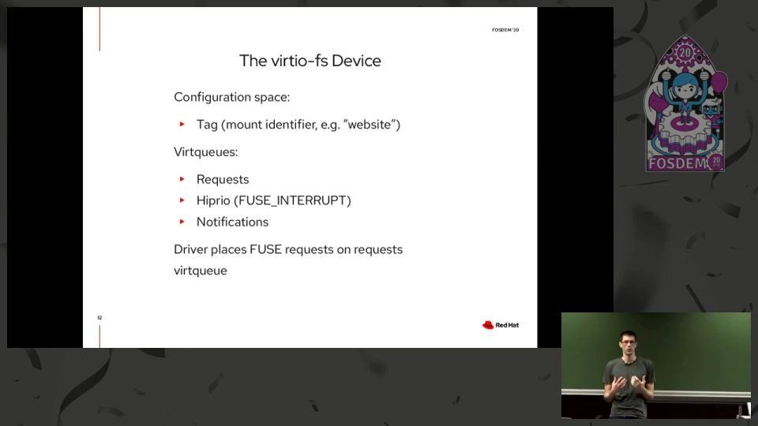
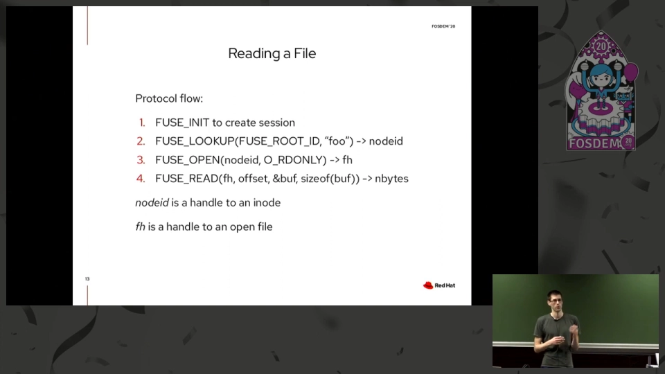
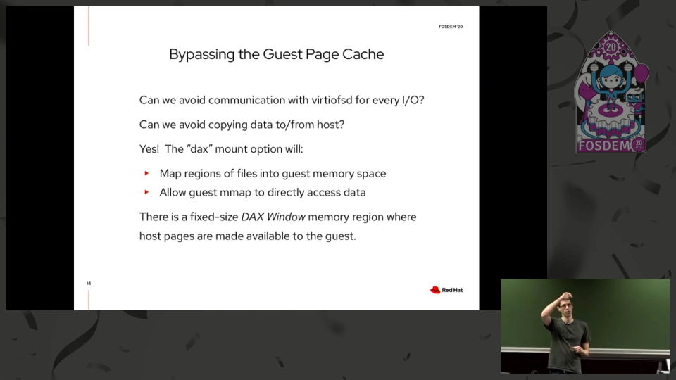
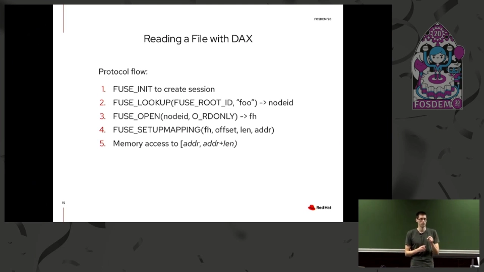

# virtio-fs 与 DAX：把宿主机页映射进虚拟机，共享目录才不必每次 I/O 都通信

> 视频来源：[virtio-fs: A shared file system for virtual machines](https://www.youtube.com/watch?v=EIVOzTsGMMI)（YouTube · FOSDEM 2020 · Red Hat）｜时长约 25 分钟
> 这支演讲回答的是"FUSE 搬进虚拟机之后，那笔固定开销还剩多少、怎么再砍一刀"。本文只取"性能开销与优化"这条线：为什么用 FUSE 协议、benchmark 差在哪、DAX 如何把"每次 I/O 一次通信 + 一次拷贝"变成一次映射。FUSE 协议本身的请求路径见同小节另一篇博客。

## 本讲要解决的核心问题（SCQA）

**背景**：虚拟机要访问宿主机上的目录，传统办法要么给虚拟机做一块磁盘镜像、在镜像里再建文件系统，要么用 `virtio-9p` 这类共享文件系统。前者快但要复制数据、不共享；后者能共享但慢。

**冲突**：`virtio-fs` 换了个思路——**协议直接用 Linux FUSE，传输用 virtio**。它比 `virtio-9p` 快好几倍，但在随机小 I/O 上仍然明显落后于 `virtio-blk`（裸块设备）。[【跳转到 02:52】](https://www.youtube.com/watch?v=EIVOzTsGMMI&t=172)

**疑问**：差距来自哪里？一个跑在虚拟机里的 FUSE 客户端，开销结构和本机 FUSE 一样吗？能不能既保留"共享目录"的语义，又拿到接近本地块设备的性能？

**回答（中心思想）**：差距来自 FUSE 语义自带的两笔固定成本——**每一次 I/O 都要和宿主机的 `virtiofsd` 通信，且 read/write 都要在宿主内存与 guest 内存之间拷贝一次**。`virtio-fs` 的 DAX 特性把这两笔一起去掉：给设备开一块固定大小的共享内存区（DAX window），把文件的一段映射到 guest 地址空间，之后读文件就是普通的 load/store 指令，既不通信也不拷贝，多个虚拟机还能共享同一份宿主页缓存。



## 一、用法：一条 mount 命令，挂的是宿主目录

`virtio-fs` 的目标很具体：**把宿主机上的一个目录树，直接给虚拟机用**，不需要磁盘镜像。libvirt 里给 domain 加一段 XML 即可：

```xml
<filesystem type='mount' accessmode='passthrough'>
  <driver type='virtiofs'/>
  <source dir='/var/www'/>
  <target dir='website'/> <!-- 不是路径，是标签 -->
  <filesystem>
```

注意 `<target dir='website'/>` 里的 `website` **不是路径，而是标签（tag）**。虚拟机里只要：

```bash
guest# mount -t virtiofs website /var/www
```

就挂上了。之后应用照常访问 `/var/www`，没有任何特殊之处。[【跳转到 00:47】](https://www.youtube.com/watch?v=EIVOzTsGMMI&t=47)



关键的安全性质是：**guest 只能看到被共享的那棵子树**，出不去，也访问不到宿主机上的其它文件。这是这类共享文件系统最基本的要求。[【跳转到 02:02】](https://www.youtube.com/watch?v=EIVOzTsGMMI&t=122)

## 二、把"远程文件系统"拆成传输与协议两件事

演讲先给了一个很有用的分析框架：任何远程/共享文件系统都由两部分组成。

- **传输（transport）**：通信链路，让客户端能挂载服务端的文件系统。例子有 TCP、USB、RDMA——有的擅长消息传递，有的提供共享内存。
- **协议（protocol）**：客户端能表达的"词汇表"，即它能对文件做哪些操作。NFS 是最有名的文件系统协议，SMB 在 Windows 文件共享里用得极广。

这里有个关键区分：FTP、MTP 这类是**传输协议**，它们只会"整文件地取和放"，很像对象存储（比如 S3）；而 NFS 实现的是完整的 POSIX 文件系统语义——可以 `open` 一个文件，然后在这个文件上做细粒度的 `read` 等操作。[【跳转到 04:57】](https://www.youtube.com/watch?v=EIVOzTsGMMI&t=297)

**协议选得对不对，直接决定应用兼容性和性能**，所以这是设计时第一个要定的事。



`virtio-fs` 的选择是：

- **协议 = Linux FUSE + 扩展**。但注意，它不是"把现成的 FUSE 文件系统跑在 virtio 上"——架构有改动，协议也加了新特性（比如 DAX 需要的 `FUSE_SETUPMAPPING`）。
- **传输 = virtio + 共享内存资源**。为了 DAX，virtio 本身也被扩展了：加了共享内存区域（shared memory region）这个概念。

宿主机上跑的那个服务端进程叫 **`virtiofsd`**，它负责模拟这个 virtio-fs 设备。[【跳转到 06:12】](https://www.youtube.com/watch?v=EIVOzTsGMMI&t=372)

### 2.1 为什么选 FUSE

理由有四条，都是"工程上省事"的角度：

1. **语义完整**：FUSE 是 Linux 内核模块，和原生 Linux 文件系统的能力高度对齐，不只是 POSIX，还有 Linux 扩展（如 copy offload 一类新特性），这样才能兼容已有应用；
2. **成熟**：2005 年合入内核，无处不在——你插上手机时用的 MTP 实现就是个 FUSE 文件系统；
3. **可扩展**：协议本身允许加新特性（DAX 就是这么加的）；
4. **ABI 稳定**：`linux/fuse.h` 是导出给用户态的内核 API，内核不许随意改这些结构体定义。所以"新 guest + 老宿主"或反过来也能通信，还带特性协商。[【跳转到 09:07】](https://www.youtube.com/watch?v=EIVOzTsGMMI&t=547)

代价是：这个头文件**没有文档**，只有常量和结构体，写底层实现得读 FUSE 源码。不过大多数人用的是 libfuse 之类的绑定，那些有文档。

## 三、性能：比 9p 快很多，但仍落后于裸块设备

演讲给的 benchmark 有一个很重要的前提说明：**"with a grain of salt"**。这些栈的配置项极多，代码路径完全不同，很难做真正的同条件对比；图里是各家的默认配置。测试条件是 NVMe 上的 out-of-the-box 性能，`virtiofs` 用 `cache=none`，**没有开 DAX**，内核是 5.5.0-rc4 的 virtio-fs 开发分支。[【跳转到 03:42】](https://www.youtube.com/watch?v=EIVOzTsGMMI&t=222)



从图上看（数值为目测近似）：

| 场景 | virtio-9p | virtio-fs | virtio-blk |
| --- | --- | --- | --- |
| 4K 随机读 | 约 2.5 万 IOPS | 约 8 万 IOPS | 约 22 万 IOPS |
| 64K 随机读 | 约 2 千 IOPS | 约 7 万 IOPS | 约 3.8 万 IOPS |
| 4K 随机写 | 约 2 万 IOPS | 约 8 万 IOPS | 约 22 万 IOPS |
| 64K 随机写 | 约 1 万 IOPS | 约 2.2 万 IOPS | 约 3.5 万 IOPS |

两个结论：

- 如果你现在用 `virtio-9p`，换 `virtio-fs` 至少不会更差，多数场景快一个量级；
- 但在 4K 随机读写这种"每次 I/O 都要走一趟协议"的场景，`virtio-fs` 只有 `virtio-blk` 的三分之一左右——因为块设备没有"每 I/O 一次请求/响应"这层。[【跳转到 03:17】](https://www.youtube.com/watch?v=EIVOzTsGMMI&t=197)

## 四、设备模型：三个 virtqueue 与一个标签

理解开销要先理解设备长什么样。virtio 的核心概念是 **virtqueue**：一条消息队列，让 guest 里的驱动把消息放进队列，宿主上实现的设备去处理。

`virtio-fs` 设备的组成：

- **配置空间（configuration space）** 里有一个 **tag**，就是挂载标识（如 `website`）。一台虚拟机可以挂 10 个 virtio-fs 设备，靠 tag 区分。
- **三个 virtqueue**：
  - **requests**：正常 FUSE 请求走这里；
  - **hiprio**：专放 `FUSE_INTERRUPT`（请求取消）；
  - **notifications**：反向的、服务端发起的消息。

为什么需要单独的高优先级队列？因为 FUSE 支持取消请求：如果你排了 50 个 I/O 请求，然后杀掉那个应用，这些请求就该被取消。但 **virtqueue 是 append-only 的**——一旦放进 vring 就不能改，没法把中断消息插到队首，所以只能另开一条高优先级队列。[【跳转到 12:02】](https://www.youtube.com/watch?v=EIVOzTsGMMI&t=722)



## 五、开销的根源：每次 I/O 一次通信 + 一次拷贝

### 5.1 一次读文件的协议流程

在 `virtio-fs` 里读一个文件，最小流程是四步：

```text
1. FUSE_INIT                                   建立会话、协商参数
2. FUSE_LOOKUP(FUSE_ROOT_ID, "foo") -> nodeid  把路径解析成 inode
3. FUSE_OPEN(nodeid, O_RDONLY)      -> fh      拿到文件句柄
4. FUSE_READ(fh, offset, &buf, size) -> nbytes 真正读数据
```

其中 `nodeid` 是 inode 的句柄，`fh` 是打开文件的句柄。[【跳转到 14:57】](https://www.youtube.com/watch?v=EIVOzTsGMMI&t=897)



这里要解释一个"路径 vs inode"的细节：POSIX 文件系统里，一个文件可以有多个名字（硬链接），也可以**没有名字**（打开后 unlink，句柄仍然有效）。所以 FUSE 的做法是先把路径解析成 nodeid，再对 nodeid 做操作——这也是为什么一次 `open` 会变成多次 `LOOKUP`。

### 5.2 两笔固定成本

这个流程暴露了两件事：

- **每一比特 I/O 都要通信**。guest 想读文件的任何一段，都得和 `virtiofsd` 说一次话。
- **`FUSE_READ`/`FUSE_WRITE` 都要碰 guest 内存**，也就是数据要从宿主拷进 guest RAM，或从 guest RAM 拷到宿主。

拷贝的代价在多虚拟机场景下尤其明显：假设有一个只读目录要共享给 10 台甚至 100 台虚拟机，难道每台都要把数据拷进自己的 RAM 才能用？[【跳转到 16:12】](https://www.youtube.com/watch?v=EIVOzTsGMMI&t=972)

## 六、DAX：把"每次通信 + 每次拷贝"换成"一次映射"

### 6.1 机制

`virtio-fs` 的 DAX 特性（当时还是实验性的，未 upstream）就是针对上面两笔成本：

- 不再为每次 I/O 发命令、不再拷数据；
- 让 guest 驱动**建立一次映射**，把文件的一段映射进 guest 的内存空间；
- 之后 guest 直接访问这些页——用 **load/store 指令**，不再和 `virtiofsd` 通信。



实现上，设备有一块叫 **DAX window** 的内存区域，是一块**共享内存**——这正是前面说的"给 virtio 加共享内存资源"扩展的用途。

### 6.2 协议流程的变化

对比 5.1 的四步，DAX 版只多了一步 `FUSE_SETUPMAPPING`，然后就没有 `FUSE_READ` 了：

```text
1. FUSE_INIT                                   建立会话
2. FUSE_LOOKUP(FUSE_ROOT_ID, "foo") -> nodeid
3. FUSE_OPEN(nodeid, O_RDONLY)      -> fh
4. FUSE_SETUPMAPPING(fh, offset, len, addr)    把文件段映射到 guest 地址 addr
5. 之后直接访问 [addr, addr+len) 这段内存
```

[【跳转到 17:02】](https://www.youtube.com/watch?v=EIVOzTsGMMI&t=1022)



### 6.3 收益

- **频繁 I/O 场景**：映射建立后没有协议往返，读就是访存；
- **内存占用**：多台虚拟机共享同一份宿主页缓存（host page cache）页，不再各拷一份。[【跳转到 17:27】](https://www.youtube.com/watch?v=EIVOzTsGMMI&t=1047)

### 6.4 限制（这部分同样重要）

- **当时未 upstream**：功能能跑，但还需要性能优化和更多 code review；
- **需要 virtio 共享内存**：不是所有传输都支持。virtio 有 PCI 传输（x86 常用）、MMIO 传输、s390 主机用的另一种；共享内存是否可用取决于传输。共享内存区域怎么映射（是否走 PCI）也是设备/平台相关的事。
- **DAX 是可选的**：完全可以不开 DAX 跑 virtio-fs，此时不使用共享内存。
- **建立共享内存是 hypervisor 的职责**，不是 guest 自己能决定的。[【跳转到 20:09】](https://www.youtube.com/watch?v=EIVOzTsGMMI&t=1209)

顺带一个通用性说明：共享内存区域是 **virtio 的通用特性**，任何 virtio 设备都能用（virtio-gpu 已经有类似用法），不是 virtio-fs 专属。[【跳转到 21:24】](https://www.youtube.com/watch?v=EIVOzTsGMMI&t=1284)

## 七、工程细节：启动、UID、xattr、unlink

这些问答内容看似零散，但都是"能不能真的用起来"的门槛：

- **能从 virtio-fs 启动整个 guest**。相当于 chroot/容器环境：把完整根文件系统放在宿主一个目录里，直接从它启动。当时 Linux 侧语法还不够优雅（作者提了 patch）。[【跳转到 19:19】](https://www.youtube.com/watch?v=EIVOzTsGMMI&t=1159)
- **UID/GID 一对一透传**。`virtiofsd` 的做法是：给它一个子目录，就允许 guest 在这个子目录里自行设置 UID/GID，正常应用、甚至完整系统都能跑起来。它**不做 ID 映射**；要做映射得靠 UID shifting 之类的额外手段（比如叠加内核模块）。[【跳转到 22:39】](https://www.youtube.com/watch?v=EIVOzTsGMMI&t=1359)
- **SELinux 依赖扩展属性透传**。要支持 SELinux，起点是打开 xattr 支持；作者没有实测透传效果，但认为这是重要特性、迟早要解决。[【跳转到 23:29】](https://www.youtube.com/watch?v=EIVOzTsGMMI&t=1409)
- **unlink 之后 fd 仍可用**。这是 POSIX 语义，FUSE 协议本身就支持：目录项可以删掉，inode 和文件句柄继续有效。[【跳转到 24:19】](https://www.youtube.com/watch?v=EIVOzTsGMMI&t=1459)

## 八、可替换的服务端：virtiofsd 只是一个实现

最后一个设计点值得单独说：`virtiofsd` 现在做的事只是"拿一个子目录共享给 guest"，但 **virtio-fs 是一个标准规范**，你可以自己实现服务端：

- 后端是分布式存储系统，想把它接进来；
- 想导出一个"合成文件系统"（synthetic filesystem），只暴露和 guest 相关的数据。

做法上，可以拿 `virtiofsd` 代码库当起点，也可以按规范用别的语言从零写——规范里定义了 virtio 设备怎么工作。[【跳转到 18:17】](https://www.youtube.com/watch?v=EIVOzTsGMMI&t=1097)

这一点和 FUSE 的生态是同构的：**协议稳定 + 服务端可替换**，才有上面那一堆文件系统。

## 小结

- `virtio-fs` = **FUSE 协议 + virtio 传输**：复用 FUSE 的完整 POSIX 语义、Linux 扩展和稳定 ABI，用 virtio 队列做通信。
- 设备模型是"一个 tag + 三个 virtqueue"：requests、hiprio（放 `FUSE_INTERRUPT`，因为 virtqueue 只能追加）、notifications。
- 默认配置下它比 `virtio-9p` 快约一个量级，但 4K 随机 I/O 仍只有 `virtio-blk` 的三分之一左右。
- 差距的根源是 FUSE 语义的两笔固定成本：**每次 I/O 一次通信**、**每次 read/write 一次数据拷贝**。
- DAX 用一块共享内存（DAX window）+ `FUSE_SETUPMAPPING` 把文件段映射进 guest 地址空间，之后读文件就是 load/store，不再通信、不再拷贝，多虚拟机还能共享宿主页缓存。
- DAX 的代价：当时未 upstream、依赖 virtio 共享内存扩展（受传输类型限制）、由 hypervisor 负责建立、且是可选项。
- 工程细节：UID/GID 一对一透传、SELinux 依赖 xattr、支持从 virtio-fs 启动、服务端实现可替换。

## 关键术语速查

| 术语 | 一句话解释 |
| --- | --- |
| virtio-fs | 把宿主目录共享给虚拟机的文件系统，协议基于 FUSE，传输基于 virtio |
| virtiofsd | 宿主上模拟 virtio-fs 设备的服务端进程 |
| virtqueue | virtio 的消息队列，guest 驱动把请求放进去，宿主设备取出来处理 |
| tag | 配置空间里的挂载标识，用来区分同一虚拟机上的多个 virtio-fs 设备 |
| hiprio 队列 | 专放 `FUSE_INTERRUPT` 的高优先级队列，因为 virtqueue 只能追加 |
| DAX | 把文件区域直接映射进 guest 内存的特性，绕开每次 I/O 的通信与拷贝 |
| DAX window | 设备暴露给 guest 的一块固定大小共享内存区，宿主页在这里对 guest 可见 |
| FUSE_SETUPMAPPING | DAX 下建立"文件段 → guest 地址"映射的协议命令 |
| nodeid / fh | 前者是 inode 的句柄，后者是打开文件的句柄 |
| virtio-9p | 更早的共享文件系统方案，性能明显低于 virtio-fs |