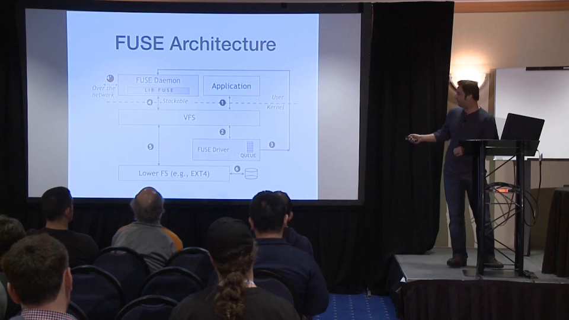
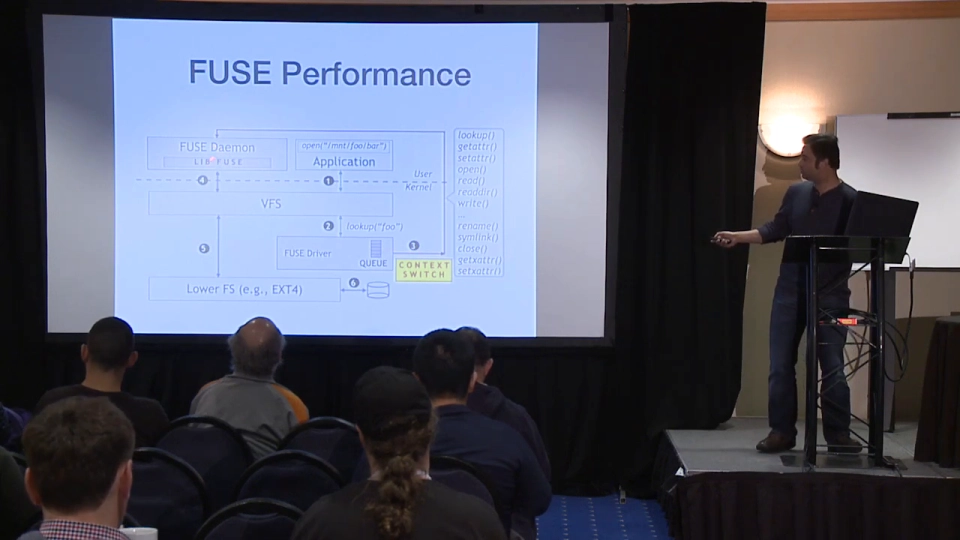
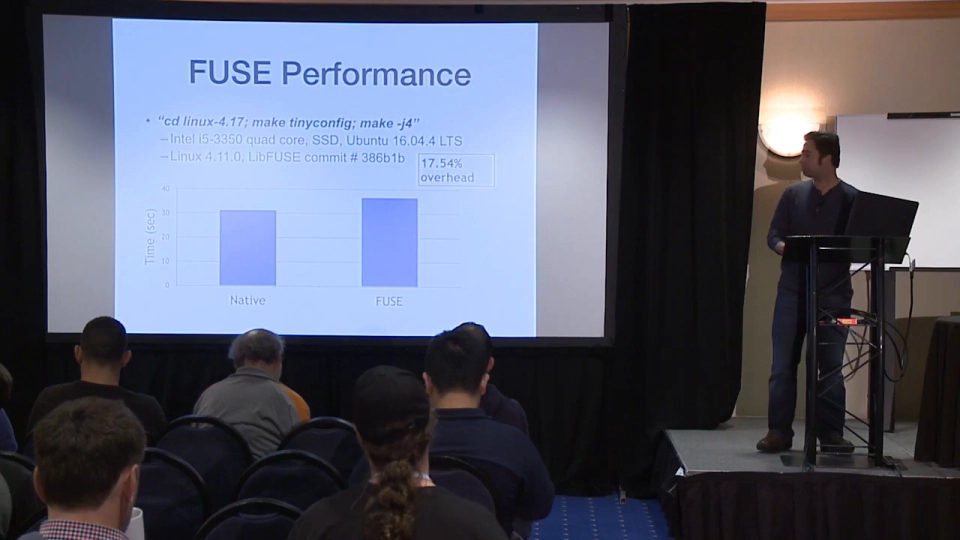
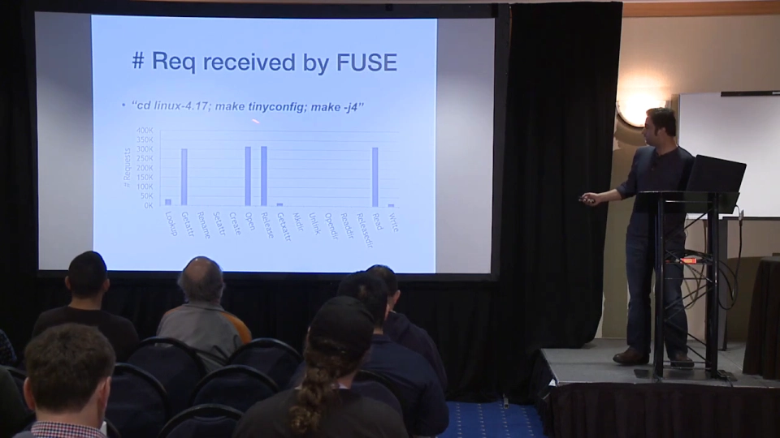
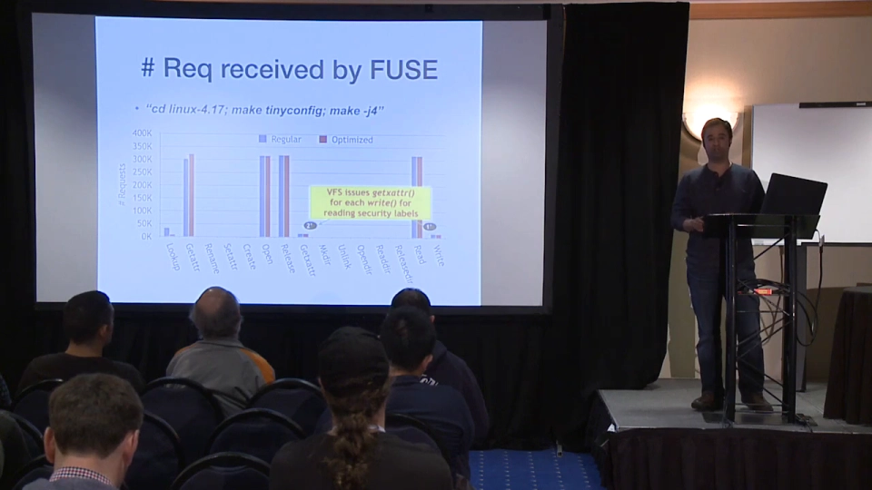
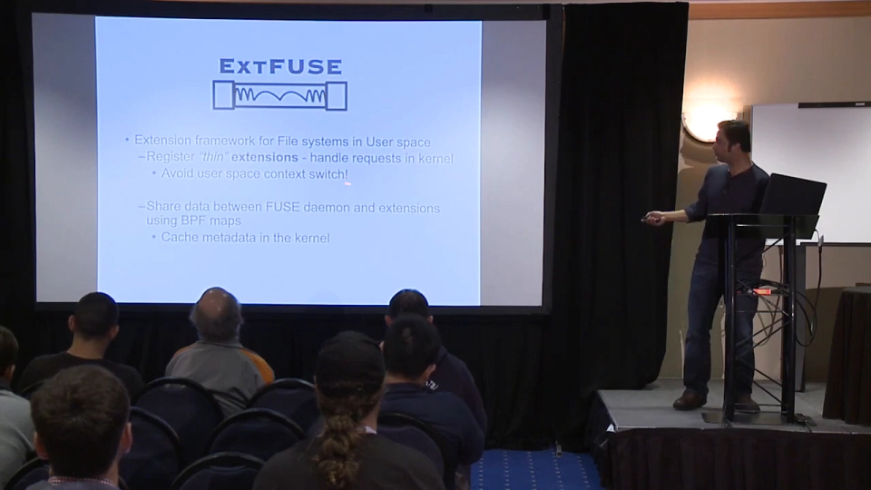
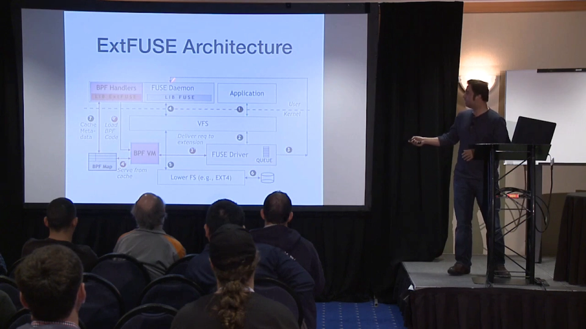
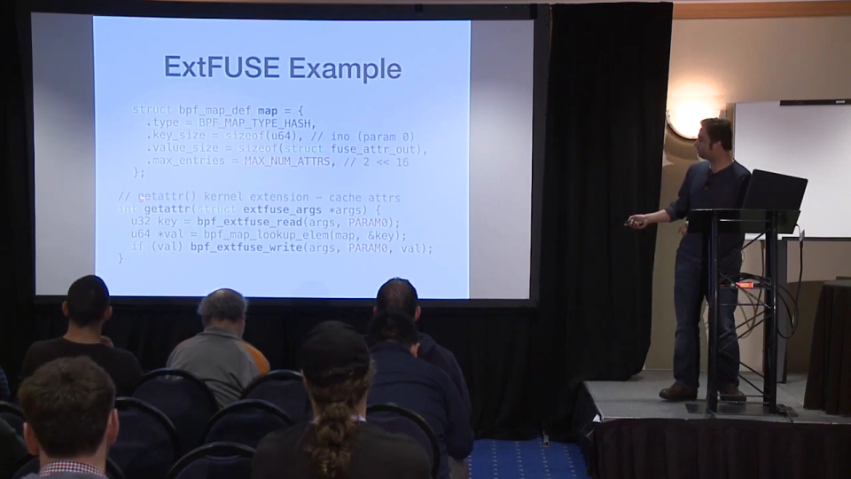
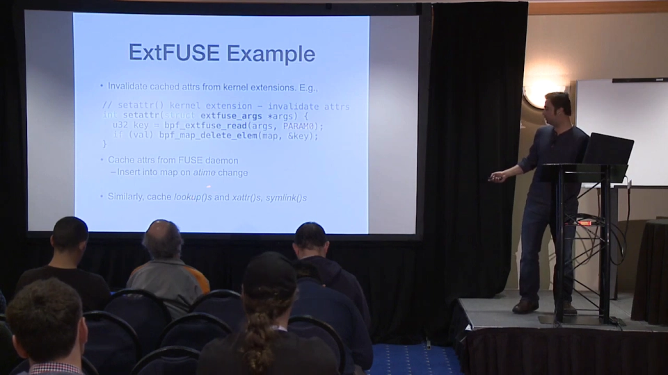

# FUSE 的 17.5% 开销主要花在上下文切换上：用 eBPF 把它压到 5.71%

> 视频来源：[LPC2018 - When eBPF meets FUSE: Improving Performance of User File Systems](https://www.youtube.com/watch?v=XmoJCHNEp2w)（YouTube · Linux Plumbers Conference · Ashish Bijlani，Georgia Tech）｜时长约 38 分钟
> 本文按视频的实验顺序走：先量出 FUSE 比 ext4 慢多少，再拆开请求画像看钱花在哪，然后说明为什么 `splice`、`entry_timeout` 这类"标准优化"几乎无效，最后讲用 eBPF 把元数据处理搬进内核的 ExtFUSE 方案。FUSE 协议本身的请求路径与内核数据结构见同小节另一篇关于 FUSE 请求路径的博客，本文只关心"开销"与"怎么压下去"。

## 本讲要解决的核心问题（SCQA）

**背景**：FUSE 让文件系统可以写在用户态——一个内核里的 FUSE 驱动把 VFS 的请求转发给用户态的守护进程（daemon），守护进程实现 `lookup`、`open`、`read`、`write` 等处理函数。这条路上跑着上百个文件系统，从 Android 的 `sdcardfs` 到 Gluster。

**冲突**：方便是有代价的。同一台机器、同一个编译任务，FUSE 上的耗时比本地 ext4 多出 **17.54%**。更反直觉的是，把社区推荐的优化参数全打开——`max_write` 设为 128K、打开 `splice_read`/`splice_write`/`splice_move`、`entry_timeout` 与 `attr_timeout` 都设为非零——构建时间几乎没变。[【跳转到 08:19】](https://www.youtube.com/watch?v=XmoJCHNEp2w&t=499)

**疑问**：这 17.5% 到底花在哪个环节？为什么"标准优化"没能把它拿回来？还有没有别的办法？

**回答（中心思想）**：开销主要不是花在拷贝上，而是花在**每个请求一次的用户态/内核态上下文切换**上；而编译内核这种负载的请求绝大多数是元数据请求（`lookup`、`getattr`、`getxattr`），所以切换次数由元数据决定。`entry_timeout` 只压住了 `lookup`，`atime` 变更却让 `getattr` 反弹，`getxattr` 更是每次 `write` 都要来一次，总量因此没降。把"处理元数据"这件事用 eBPF 扩展搬进内核、让它在缓存命中时根本不返回用户态，才是对症的优化：开销从 17.54% 降到 **5.71%**。

## 一、两层结构决定了 FUSE 的性能上限

### 1.1 内核里只有一层"薄薄的转接层"

FUSE 的架构只有两个关键部件：

- **FUSE 驱动**（在内核里）：一层很薄的转接层（thin interposition layer），对上接 VFS；
- **FUSE 守护进程**（在用户态）：实现全部文件系统处理函数，真正干活。

应用发起系统调用后，VFS 把请求交给 FUSE 驱动，驱动**只是把请求转发**给用户态守护进程；如果这个 FUSE 文件系统是"可堆叠"（stackable）的，守护进程再去访问底层的真实文件系统（比如 ext4）来服务请求；如果是"网络型"（networked）的，就去访问远端服务器。[【跳转到 02:29】](https://www.youtube.com/watch?v=XmoJCHNEp2w&t=149)

视频把讨论范围限定在**可堆叠**这一类上——也就是"数据来自底层本地文件系统，FUSE 层只加一点功能"的情况，这正是 `sdcardfs`、容器镜像层、各种"加一层权限/加密/重定向"的文件系统所处的形态。

### 1.2 一次 `open` 不是一次请求，而是一串请求

理解开销的关键在这里：**用户态看到的一次系统调用，在内核里会拆成多次跨边界往返**。

应用 `open` 打开 `/mnt/foo/bar` 时，VFS 并不认识"路径"，它需要逐级解析：先 `lookup` 解析 `foo` 拿到 inode 号，再 `lookup` 解析 `foo/bar`。路径有几段，就有几次 `lookup`。每一次 `lookup` 都要从 FUSE 驱动跨到用户态守护进程，守护进程再问底层文件系统，然后把结果跨回来。[【跳转到 04:34】](https://www.youtube.com/watch?v=XmoJCHNEp2w&t=274)

所以"上下文切换"这个词在 FUSE 语境下不是抽象的：它是**每个请求一次**的固定成本，而请求数量由路径深度和元数据操作数决定。

## 二、把开销量化：17.54% 与它的请求画像

### 2.1 实验设置

视频用的基准是**编译 Linux 内核**（`cd` 进 `linux-4.17`，`make tinyconfig` 后 `make -j4`），机器是 Intel i5-3350M 四核、SSD、Ubuntu 16.04.4 LTS，内核 4.11.0，libfuse commit `386b1b`。横轴是 native（ext4）与 FUSE，纵轴是构建耗时（秒）。[【跳转到 03:44】](https://www.youtube.com/watch?v=XmoJCHNEp2w&t=224)

结果就是那个 **17.54%** 的额外开销。注意这个数字的含义：不是"读写慢 17%"，而是端到端的构建时间多了 17.54%——对一个以元数据操作为主的负载来说，这已经是很重的税。

### 2.2 请求画像：元数据占绝对多数

要解释这 17.54%，得看请求都由什么组成。视频统计了编译过程中送到 FUSE 守护进程的请求数量（横轴是请求类型，纵轴是千次）：`lookup`、`getattr`、`getxattr` 各自在 30 万到 40 万量级，`open`、`read`、`write` 也各有几十万次。[【跳转到 06:14】](https://www.youtube.com/watch?v=XmoJCHNEp2w&t=374)

这张图直接给出了优化方向：**想减少上下文切换，就得减少元数据请求**。读写的单次成本高，但次数受块大小影响；元数据的次数则由"路径解析 + 属性查询"的语义决定，天然频繁。

## 三、标准优化为什么几乎无效

### 3.1 几项"教科书级"优化全开

FUSE 提供的挂载/库参数里，常被推荐的有这几项，视频把它们全部打开：

- `max_write` 设为 128K：放大单次写请求的上限，减少写请求次数；
- `splice_read` / `splice_write` / `splice_move`：用 `splice` 在管道与页缓存之间搬数据，减少用户态/内核态之间的拷贝；
- `entry_timeout` 设为非零：让内核缓存 `lookup` 结果（目录项）；
- `attr_timeout` 设为非零：让内核缓存属性（`getattr` 结果）。

[【跳转到 08:19】](https://www.youtube.com/watch?v=XmoJCHNEp2w&t=499)

结果：Native、Regular、Optimized 三根柱子几乎一样高。**优化没有带来可见收益。**

### 3.2 请求数一拆就明白：`lookup` 降了，`getattr` 涨了

把"Regular"和"Optimized"的请求数并排画出来，原因就清楚了：`lookup` 确实少了约 4 倍（`entry_timeout` 生效了），但 `getattr` **反而变多**，`getxattr` 基本不变。[【跳转到 09:09】](https://www.youtube.com/watch?v=XmoJCHNEp2w&t=549)

两个原因：

1. **`atime` 让属性缓存失效**。文件被读时 `atime` 会变，FUSE 驱动要更新它，于是缓存的属性被判为过期；下一次访问就得重新发 `getattr`。所以属性缓存不是"缓存住了就省事"，而是"每次读都在把缓存冲掉"。[【跳转到 09:34】](https://www.youtube.com/watch?v=XmoJCHNEp2w&t=574)
2. **每次 `write` 都附带一次 `getxattr`**。守护进程在用户态实现了扩展属性（xattr）处理函数，而 VFS 在每次写系统调用时都要读安全标签（security label，SELinux 一类机制用），于是内部就发一次 `getxattr`。内核当前**没有 xattr 缓存**，所以 `getxattr` 的次数几乎等于 `write` 的次数。[【跳转到 10:24】](https://www.youtube.com/watch?v=XmoJCHNEp2w&t=624)

这就是本节最重要的一个判断：**FUSE 的开销结构由"内核愿意缓存什么"决定**。只要有一类请求内核不肯缓存（xattr），或者缓存会被别的操作冲掉（`atime` 冲 `attr`），上下文切换就降不下来。

## 四、eBPF：把处理函数搬进内核

### 4.1 eBPF 是什么

eBPF 源自 Berkeley Packet Filter，是一个伪机器（pseudo-machine）架构；eBPF 把它扩展成了一个**通用的内核扩展框架**，目前被 tracing、perf 和网络子系统使用。用法是：

1. 用 C 写扩展，用 LLVM 工具链编译成字节码；
2. 通过系统调用把字节码装进内核，装之前先过**校验器**（verifier）：检查完整性、不允许缓冲区溢出、不允许循环（限制极严）；
3. 字节码在 BPF 虚拟机里执行，可以调用白名单内的**内核 helper 函数**；
4. 内核侧和用户态共享一个 key-value 结构 **BPF map**，两边靠它通信。

[【跳转到 10:49】](https://www.youtube.com/watch?v=XmoJCHNEp2w&t=649)

视频用"统计 `open` 系统调用次数"举例：在 `sys_enter_open` 上挂一个钩子，用 `BPF_MAP_TYPE_ARRAY` 建一个只有一项的 map，每次 `open` 就把那一项加一。这个例子说明 eBPF 的典型形态——**在内核的某个点上执行一小段逻辑，并把结果放进 map 供用户态读取**。

### 4.2 ExtFUSE：给 FUSE 加一层"内核快路径"

ExtFUSE 是作者博士研究的一部分，思路是：允许 FUSE 文件系统的开发者**额外注册一层薄扩展（thin extensions）到内核里**，接口和参数与常规 FUSE 操作完全一致；这些扩展在内核里执行，从而避免上下文切换。同时提供一类**只有 FUSE 守护进程能访问的特殊 BPF map**，作为内核扩展与用户态守护进程之间的通信通道。[【跳转到 14:59】](https://www.youtube.com/watch?v=XmoJCHNEp2w&t=899)

架构上有两个新部件：

- **libextfuse**：类似 libfuse 的辅助库，把细节藏起来，让开发者用同样的接口写扩展；扩展编译成字节码、过校验器，在**挂载时**装入内核；
- **快路径 / 慢路径**：挂载后，这个 FUSE 文件系统有两类处理函数——原来的守护进程处理函数（慢路径），和新注册到内核的扩展（快路径）。请求到达 FUSE 驱动时，先走快路径：`open` 请求执行 open 扩展，`lookup` 请求执行 lookup 扩展。[【跳转到 17:04】](https://www.youtube.com/watch?v=XmoJCHNEp2w&t=1024)

扩展内部先查 BPF map：命中就直接在核心里把结果填好返回；不命中才走慢路径回到守护进程。守护进程处理完之后，可以**顺手把结果写进 BPF map**，让后续同类请求在内核里被满足。[【跳转到 18:19】](https://www.youtube.com/watch?v=XmoJCHNEp2w&t=1099)

## 五、一个具体例子：缓存 `getattr` 并正确失效

### 5.1 用 hash map 存"inode 号 → 属性"

`getattr` 扩展要能直接回答"这个 inode 的属性是什么"，所以先要有一张表。视频用 `BPF_MAP_TYPE_HASH`：

- key 是 inode 号（`u64`，来自请求参数 `PARAM0`）；
- value 是 `fuse_attr_out` 结构——正是 FUSE 驱动期望的结构；
- `max_entries` 取 `MAX_NUM_ATTRS`，例子中是 $2^{16}$。

扩展被调用时，先读参数拿到 inode 号，`bpf_map_lookup_elem` 查表；命中就调用 `bpf_extfuse_write` 把值写回给驱动，请求到此结束，**没有跨边界**。[【跳转到 19:09】](https://www.youtube.com/watch?v=XmoJCHNEp2w&t=1149)

### 5.2 缓存必须有失效路径

缓存了就必须能失效，否则读到脏属性。视频的做法是让**开发者自己注册对应的扩展**：什么操作会让属性失效？典型是 `setattr`（改属性）。于是注册一个 `setattr` 扩展，从参数里读出 inode 号，`bpf_map_delete_elem` 把这一项删掉。[【跳转到 22:29】](https://www.youtube.com/watch?v=XmoJCHNEp2w&t=1349)

这里有个容易忽略但很重要的性质：因为**快路径是请求进入内核后的第一站**，失效和后续请求之间不会出现竞态——后续请求一定先经过这个扩展，才可能去用户态。同理，`read` 会改 `atime`，所以 `read` 的处理函数在用户态做完之后要**把新属性重新插回 map**，否则下一次 `getattr` 又会掉回慢路径。

同样的套路可以用来缓存 `lookup` 回复、扩展属性，甚至兄弟目录项。

## 六、效果与代价

### 6.1 17.54% → 5.71%

同样的编译基准、同样的机器和 libfuse 版本，把 Native、Regular、Optimized、ExtFUSE 放在一起比：ExtFUSE 把开销从 **17.54% 压到 5.71%**。[【跳转到 22:54】](https://www.youtube.com/watch?v=XmoJCHNEp2w&t=1374)

请求数图能对上这个结果：ExtFUSE 这一组的 `getattr` 几乎消失，`getxattr` 也大幅减少。[【跳转到 24:09】](https://www.youtube.com/watch?v=XmoJCHNEp2w&t=1449)

### 6.2 三个必须承认的代价

- **缓存大小直接决定收益**：例子用了 $2^{16}$ 项的大 map；换成小 map 又没做好淘汰，开销会从 5.71% 回到 7%~8%。也就是说"能缓存"不等于"缓存得划算"，淘汰策略和命中率是关键。[【跳转到 23:19】](https://www.youtube.com/watch?v=XmoJCHNEp2w&t=1399)
- **内存**：大 map 的最坏情况是 50 MB 常驻（缓存 `lookup` 回复、属性回复和扩展属性）。
- **缓存一致性的责任转移给了开发者**：内核只提供机制，什么时候失效、失效哪些，由文件系统作者写扩展决定。写漏了就是脏数据。

## 七、这条路还能往哪走

视频最后给了几个方向，都能看出"把工作留在内核"这条主线：

1. **自定义权限检查**。`sdcardfs` 在 ext4 之上做基于 UID 的安全检查，维护一份已安装应用的包名/ID 哈希表。用 BPF map 把这张表放进内核，就能在 `lookup`、`open` 时直接做 UID 检查，还能用 helper 函数从内核取 UID、取应用名。[【跳转到 25:24】](https://www.youtube.com/watch?v=XmoJCHNEp2w&t=1524)
2. **连数据面也绕开守护进程**（进行中）。如果文件系统是可堆叠的，能不能在 `open` 之后把底层文件描述符安全地装进内核，让后续 `read`/`write` 直接打到下层文件系统？这正是后来 `FUSE_PASSTHROUGH` 一类方案要解决的问题。[【跳转到 27:29】](https://www.youtube.com/watch?v=XmoJCHNEp2w&t=1649)
3. **缓存读结果**（进行中）。Gluster 这类场景可以把读回复缓存在内核，后续 `read`/`direct read` 直接由内核满足。
4. **主动缓存（proactive caching）**。现在的模型全是"反应式"：第一次请求走慢路径、缓存住，之后才快。开发者其实知道哪些属性、哪些目录项会被访问（比如 Gluster 的读请求），可以在访问发生前就把它们塞进 map。

## 八、问答里暴露的边界条件

这些问答很值得记下来，因为它们标出了这套方案"不适用"或"还没验证"的地方：

- **FUSE 不认 `noatime`**。有人问能不能用 `noatime` 挂载绕开 `atime` 失效，回答是 FUSE 并不真正遵守 `noatime`，所以这条路走不通。[【跳转到 28:44】](https://www.youtube.com/watch?v=XmoJCHNEp2w&t=1724)
- **测试没有 drop caches**。被问到是否在测试间清空缓存，作者承认没做，并同意"清空后上下文切换更多、结论可能变化"，准备补测。[【跳转到 29:51】](https://www.youtube.com/watch?v=XmoJCHNEp2w&t=1791)
- **并发保护交给框架**。扩展执行时 eBPF 框架自己拿 RCU 锁，作者没有额外加锁。[【跳转到 30:41】](https://www.youtube.com/watch?v=XmoJCHNEp2w&t=1841)
- **接入成本很低**。文件系统作者不需要大改：加一个"内核支持 ExtFUSE"的 flag，在 init 里检测后装入扩展，估计不到 50 行代码。[【跳转到 32:53】](https://www.youtube.com/watch?v=XmoJCHNEp2w&t=1973)
- **BPF map 是定长的，没有淘汰策略**。作者承认没时间做高效缓存算法，只用固定大小，也没深入评估不同尺寸下的表现。[【跳转到 34:08】](https://www.youtube.com/watch?v=XmoJCHNEp2w&t=2048)
- **内核缓存与"按用户做权限"天然冲突**。内核缓存的 inode/目录项是**为第一个访问它的用户**验证过的；如果第二个用户的权限不同，缓存无法按用户失效。所以像 `sdcardfs` 这种按 UID 判权的文件系统，光靠 `entry_timeout` 缓存是错的——必须用扩展把自定义检查也搬进内核。[【跳转到 36:55】](https://www.youtube.com/watch?v=XmoJCHNEp2w&t=2215)

## 小结

- FUSE 的固定成本是**每个请求一次的用户态/内核态上下文切换**；一次 `open` 会因为路径逐级解析变成多次 `lookup`，成本被放大。
- 编译内核这类负载的请求以元数据为主（`lookup`/`getattr`/`getxattr` 各几十万次），所以优化要冲着元数据去。
- `max_write` 放大到 128K、打开 `splice` 系列、给 `entry_timeout` 与 `attr_timeout` 设非零值，这套标准优化在这个负载上几乎无效：`lookup` 降了 4 倍，但 `atime` 冲掉属性缓存让 `getattr` 反弹，`getxattr` 又因为每次 `write` 都要读安全标签而无法减少。
- 根因是**内核只缓存了部分请求类型**：目录项和属性有超时缓存，xattr 完全没有。
- ExtFUSE 用 eBPF 把元数据处理函数搬进内核，配合 BPF map 做元数据缓存，命中即返回，把开销从 17.54% 降到 5.71%。
- 收益有前提：缓存要够大或有好的淘汰策略（否则回到 7%~8%），内存最坏 50 MB，缓存失效逻辑由文件系统作者负责。
- 这条路继续走下去就是数据面也绕过守护进程（后来的 passthrough 方向）和主动缓存。

## 关键术语速查

| 术语 | 一句话解释 |
| --- | --- |
| FUSE 驱动 | 内核里的薄转接层，把 VFS 请求转发给用户态守护进程 |
| FUSE 守护进程 | 用户态进程，实现 `lookup`/`open`/`read`/`write` 等处理函数 |
| 可堆叠文件系统 | 在底层真实文件系统之上加功能（权限、加密、重定向）的 FUSE 文件系统 |
| 上下文切换（本文语境） | 一次请求从内核态 FUSE 驱动跨到用户态守护进程再回来的固定成本 |
| `entry_timeout` | 让内核缓存目录项（`lookup` 结果）的挂载参数 |
| `attr_timeout` | 让内核缓存属性（`getattr` 结果）的挂载参数 |
| `max_write` | 单次写请求允许的最大字节数，放大它可以减少写请求次数 |
| `splice` | 在管道与页缓存之间搬数据、减少一次拷贝的系统调用族 |
| `getxattr` | 读扩展属性；VFS 在每次 `write` 时读安全标签会触发一次 |
| eBPF | 通用内核扩展框架：C 编译成字节码、过校验器、在 BPF 虚拟机里执行 |
| BPF map | 内核与用户态共享的 key-value 存储，ExtFUSE 用它缓存元数据 |
| ExtFUSE | 把 FUSE 处理函数以 eBPF 扩展形式注册进内核的框架 |
| 快路径 / 慢路径 | 快路径在内核命中缓存直接返回；慢路径回用户态守护进程 |