# ZFS 的树根指针：uberblock、块指针与 DSL 数据集如何定位数据

> 视频来源：[ZFS Internal Structures](https://www.youtube.com/watch?v=nhtkHCN7qzg)（YouTube · 讲者为 Sun Microsystems 资深工程师）｜时长约 41 分钟
> 导读：这是一场把 ZFS 的磁盘结构从"盘上的第一块"讲到"文件里的第一个字节"的讲座。讲者按 **vdev label → uberblock → 块指针 → dnode → DSL 数据集** 的顺序逐层展开，中间穿插 `zdb` 的真实输出。本文只保留与"快照怎么落盘、怎么按逻辑地址找到数据块"相关的部分，前面关于校验和与自愈的段落压缩成背景。

## 本讲要解决的核心问题（SCQA）

**背景**：ZFS 常被介绍成"自带卷管理器的文件系统"，它把镜像、raidz、校验和、事务都做进了文件系统内部。这些特性听起来互不相干，但在磁盘上它们共用同一套寻址结构。

**冲突**：和"每个字节一一对应"的 raw 镜像不同，ZFS 盘上没有任何一个位置叫"第 N 个字节"。数据在哪、元数据在哪、快照的数据又在哪，全部要靠指针一层层走。一旦某个指针走错，你读到的可能是另一个块、甚至是上一代的数据——而校验和只能告诉你"这个块坏了"，不能告诉你"该去哪里找对的块"。

**疑问**：一个 zpool 的入口在哪里？从入口到某个文件的一个数据块，中间要经过几层指针？快照在这套结构里占什么位置——它是"另存一份数据"，还是"另存一个指针"？

**回答（中心思想）**：ZFS 的全部结构是**一棵只在叶子放数据的树**，树的入口是 **uberblock**，树的内节点是 **块指针**（block pointer），每个块指针自带校验和、类型、大小、事务组号和"数据虚拟地址"（DVA，指明在哪个 vdev 的第几个块）。从 uberblock 往下依次是：**Meta Object Set → DSL Directory → DSL Dataset → Object Set → dnode → 块指针 → 数据块**。快照不是数据的副本，而是 **DSL Dataset 上挂着的一个链表节点**——它自己就是一棵树的根，所以"回到某个时刻"这件事，在结构上等价于"换一个根指针往下走"。

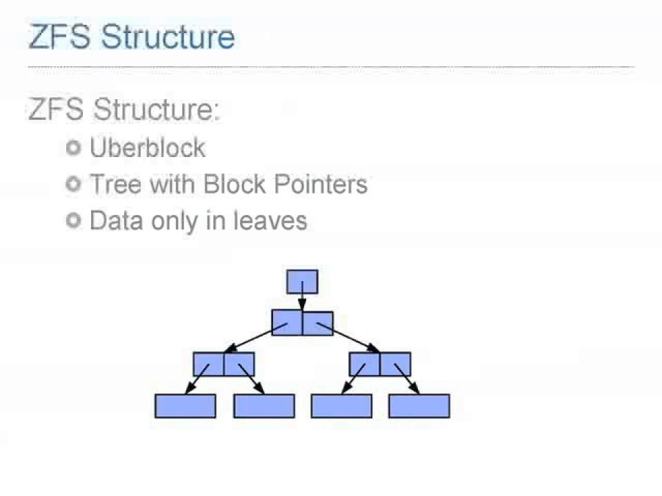

## 一、为什么块指针里要放校验和

在讲结构之前，讲者先解释了 ZFS 为什么要"在每个块指针里塞一个大校验和"。[【跳转到 06:18】](https://www.youtube.com/watch?v=nhtkHCN7qzg&t=378)

读一个块的流程是：按块指针找到块 → 对读到的内容算校验和 → 和块指针里存的校验和比对 → 一致就认为"这就是指针指向的块"，不一致就认为"这个块是错的"。错的原因可能是盘面坏、可能是读的时候磁头定位错了、也可能是当初写的时候定位错了。[【跳转到 06:43】](https://www.youtube.com/watch?v=nhtkHCN7qzg&t=403)

关键在于**判定之后还能修**：因为卷管理器是内置的，ZFS 知道这个块在镜像里的另一份在哪，或者知道 raidz 的校验信息在哪，于是可以读另一份、或者算出来，然后把坏的那份覆盖掉。讲者把这叫"结构完整性"（structural integrity），并强调这是"内置卷管理器 + 冗余 + 大校验和"三者结合才有的能力，单独的 ext4/XFS/UFS 都做不到。[【跳转到 07:58】](https://www.youtube.com/watch?v=nhtkHCN7qzg&t=478)

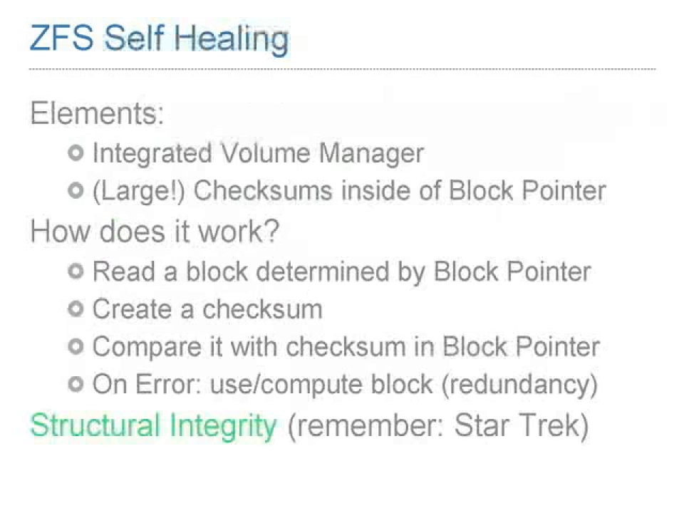

这段背景对后面很重要：**块指针不只是一个地址，它同时是这个块的"身份证"**——地址、类型、大小、校验和、生成它的事务组号，全在一起。

## 二、盘上的第一块：vdev label 与 uberblock

### 2.1 每个 vdev 的固定布局

一个 zpool 由若干个 vdev 组成。vdev 可以是整块盘、一个分区，甚至一个文件（讲者特意提到"测试时可以用文件搭一个很小的 zpool"，而且他们阻止了工程团队删掉这个特性）。[【跳转到 09:42】](https://www.youtube.com/watch?v=nhtkHCN7qzg&t=582)

每个物理 vdev 的开头和结尾都有固定的元数据区：

- **4 个 vdev label**，每个 256 KB：**开头 2 个、结尾 2 个**；
- 一个 **3.5 MB 的空洞**，原本是留给引导代码的，现在没用到；
- 剩下的空间按 **128 KB 的块**划分给 zpool 用，块还可以再切成 512 字节的小块，也可以重新拼回大块。

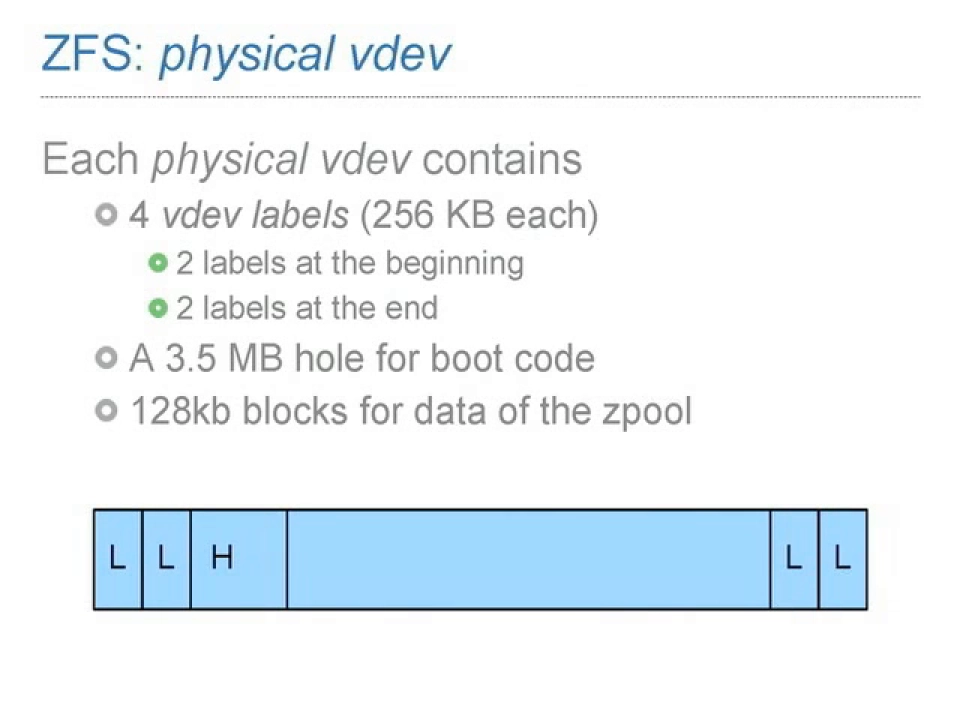

为什么前后各放两份？讲者的解释很直白：**管理员手滑**把数据写到了盘头，开头的 label 就毁了，但结尾的两份还活着，zpool 还有救。这是"元数据冗余"最朴素的一种形式——不靠算法，靠位置分散。[【跳转到 13:08】](https://www.youtube.com/watch?v=nhtkHCN7qzg&t=788)

### 2.2 label 里有什么

一个 vdev label 分三段：

1. **gap**：前两个 8 KB 块不用，留给 Sun 磁盘标签或 x86 引导代码；
2. **nvlist**：一个 name-value 列表，128 KB，装的是"这个 zpool 是怎么拼起来的"；
3. **uberblock array**：**128 个条目，每个 1 KB**。

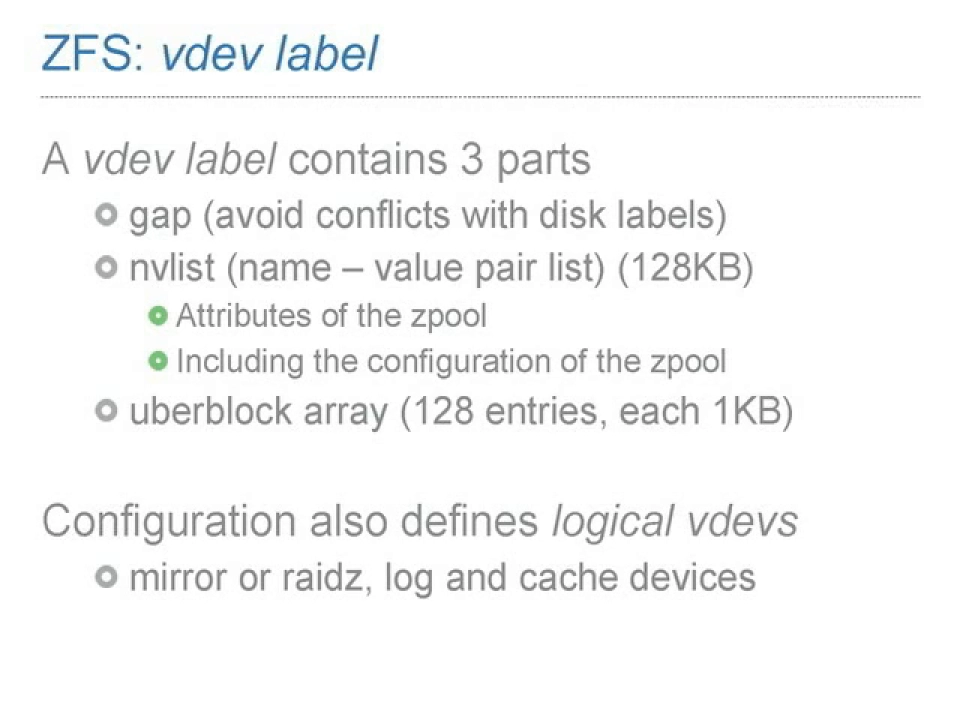

nvlist 的内容可以用 `zdb -v -v` 直接看：

```
$ zdb -v -v data
version=4
    name='data'
    state=0
    txg=162882
    pool_guid=1442865571463645041
    hostid=13464466
    hostname='nunzio'
    vdev_tree ...
```

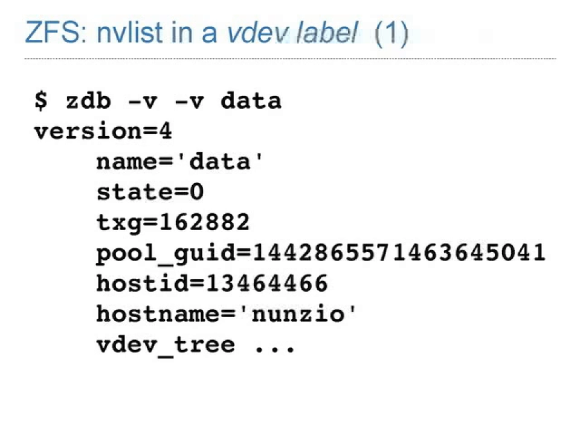

几个字段值得记住：

- **`state`**：0 = 已导入，1 = 已导出，2 = 已销毁；
- **`txg`**：当前事务组号。ZFS 的每一次改动都是一个事务，事务再打包成事务组，事务组号是一个单调递增的 64 位数——讲者的算法是"就算每纳秒一个事务，也够用到公元一万年"；
- **`pool_guid`**：zpool 的全局唯一 ID。同名 zpool 靠它区分；如果两个 zpool 的 GUID 也相同，那就真的分不开了；
- **`vdev_tree`**：整棵 vdev 树。每个节点有类型（root / disk / mirror / raidz）、GUID、设备路径、`devid`（带磁盘序列号，所以盘换了位置还能找到）、物理路径，以及 `metaslab_array`、`metaslab_shift`、`ashift`、`asize` 这些空间管理参数。[【跳转到 22:28】](https://www.youtube.com/watch?v=nhtkHCN7qzg&t=1348)

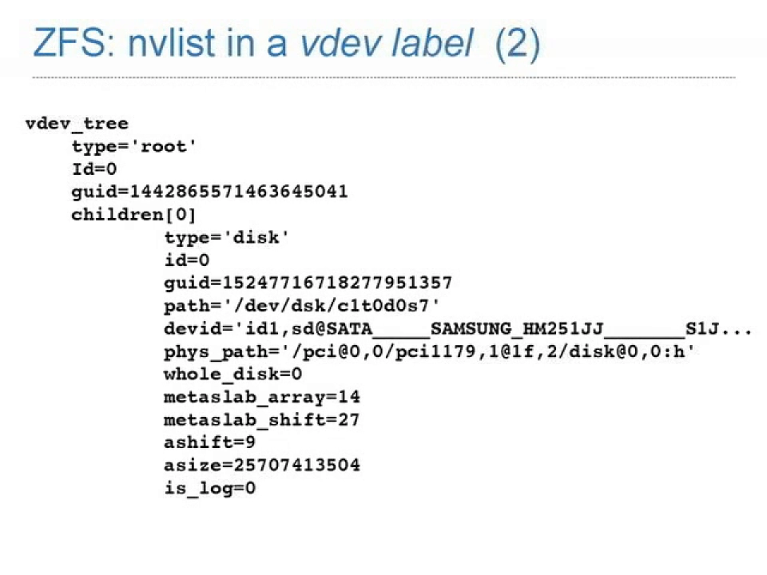

顺带一提，nvlist 里还存着**逻辑 vdev 的配置**：镜像、raidz、log 设备、cache 设备都在这里定义。也就是说，"这块盘属于哪个镜像"这件事，是在 label 这一层就定好的，zpool 的其余部分根本不需要知道。[【跳转到 16:50】](https://www.youtube.com/watch?v=nhtkHCN7qzg&t=1010)

### 2.3 uberblock：整棵树的根

uberblock 是全场最重要的结构，讲者的原话是"它只有一个内容：**指向 zpool 树根的指针**"。[【跳转到 24:08】](https://www.youtube.com/watch?v=nhtkHCN7qzg&t=1448)

它的字段分两组：

**用于校验自身的一组**：

- `magic` = `0x00bab10c`（读作 "uberblock"），顺带用来判断字节序——SPARC 是大端、x86 是小端，魔数的字节顺序能告诉你这个块是在哪种机器上写的；
- `version`；
- `txg`：事务组号；
- `timestamp`：写入时间；
- `checksum`：整个 uberblock 的校验和。

**唯一的内容**：`rootbp`，指向 zpool 树根的那个块指针。

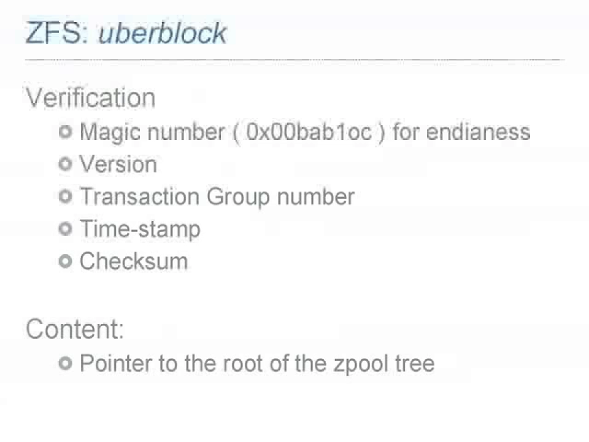

恢复时"找最新状态"的算法就建立在这组字段上：**在 128 个 uberblock 里挑 txg 最大的那个，再用时间戳和自校验确认它自身是完好的**，然后用它的 `rootbp` 往下走。[【跳转到 24:33】](https://www.youtube.com/watch?v=nhtkHCN7qzg&t=1473)

128 个条目是**轮转使用**的：新事务写下一个槽位，旧的自然被覆盖。因为每个 vdev 有 4 个 label、每个 label 各写一次，所以**一次事务要在每个设备上写 4 次**；这也解释了为什么事务组大约每 5 秒才提交一次——平均下来每秒不到一次写，对磁盘来说几乎可以忽略。[【跳转到 16:00】](https://www.youtube.com/watch?v=nhtkHCN7qzg&t=960)

## 三、块指针：一个块到底怎么被找到

从 uberblock 往下走，每一层都是"块指针"。讲者把块指针的字段逐条列了出来。[【跳转到 26:29】](https://www.youtube.com/watch?v=nhtkHCN7qzg&t=1589)

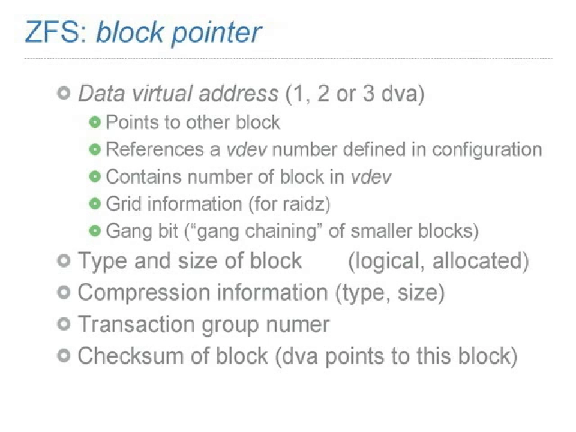

### 3.1 DVA：数据虚拟地址

一个块指针里有 **1 到 3 个 DVA**（data virtual address）。每个 DVA 回答"去哪找这个块"：

| DVA 字段 | 含义 |
| :--- | :--- |
| vdev 编号 | 这个块在配置里的哪个 vdev 上 |
| vdev 内的块号 | 偏移（以块为单位） |
| grid 信息 | 用 raidz 时，这个块占了几个盘、用的是哪几块 |
| gang 位 | 这个指针指向的不是数据块，而是一个"聚合块" |

**gang 位**值得单独说。正常情况下块是 128 KB 的；如果系统碎片太多、凑不出连续的 128 KB，ZFS 就把若干小块"用铁链串起来"（讲者用美国修路队 chain gang 打比方），用一个 512 字节的 gang block 收集这些小块的指针，对外仍然表现为一个 128 KB 的块。[【跳转到 28:04】](https://www.youtube.com/watch?v=nhtkHCN7qzg&t=1684)

### 3.2 类型、大小、压缩、事务组号

除了地址，块指针还带着这些信息：

- **类型**：目录、数据、元数据……讲者说有大约 50 种，规范文档里有完整列表；
- **大小**：逻辑大小和分配大小（allocated size）分开记。压缩之后只需要分配压缩后的大小，但分配大小可以比压缩后更大——"用空间换速度"；
- **压缩信息**：是否压缩、用什么算法、原始多大、压缩后多大；
- **事务组号**：这个块是在哪个事务组里"出生"的（birth txg）；
- **校验和**：这个块内容的校验和。

### 3.3 一个真实的块指针

讲者用 `zdb` 打出了根块指针：

```
rootbp = [L0 DMU objset]
    400L/200P
    DVA[0]=<0:5c8087800:200>
    DVA[1]=<0:4c81a2a00:200>
    DVA[2]=<0:3d002ca00:200>
    fletcher4 lzjb LE
    Contiguous  birth=262711
    Fill=324
    cksum=914be711d:3ab1cae4571:c07d93434c9b:1ab1618a08eccd
```

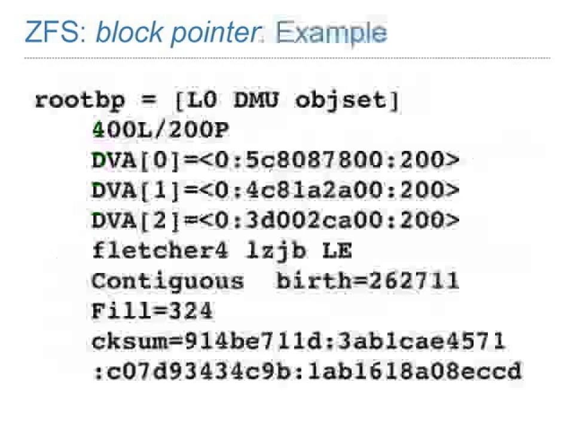

逐行读：

- `400L/200P`：逻辑大小 400 字节，物理（压缩后）200 字节；
- **三个 DVA，指向同一个块的三份副本**，都在 vdev 0 上，偏移不同；
- `fletcher4 lzjb LE`：校验算法 fletcher4、压缩算法 lzjb、小端；
- `Contiguous`：连续存放，不是 gang；
- `birth=262711`：这个块诞生于事务组 262711。

### 3.4 副本数：元数据三份，数据一份

上面那个例子之所以有三个 DVA，是因为**副本数（copies）**被设成了 3。规则是：

- **zpool 自身的元数据**：永远 3 份；
- **ZFS 文件系统的关键元数据**：永远 2 份；
- **普通数据**：默认 1 份（冗余交给镜像/raidz），但可以用 `copies` 属性调大。

上限是 3，原因很朴素：**一个块指针里最多只有 3 个 DVA**。[【跳转到 31:23】](https://www.youtube.com/watch?v=nhtkHCN7qzg&t=1883)

## 四、从根往下：dnode 与对象集

块指针解决"块在哪"，接下来要解决"这个块是什么"。

### 4.1 dnode：对象的定义

ZFS 里所有数据都组织成**对象**，对象由 **dnode**（data management unit）定义。一个 dnode 里有：

- **类型和大小**：这个对象是目录、是数据、还是别的；
- **间接层级**（indirection depth）：这棵树有几层；
- **块指针列表**：最多 3 个；
- **bonus buffer**：附加数据。对象是文件时，里面装的是 Unix 文件属性；对象是 objset 时，里面装的是指向 DSL 的指针。

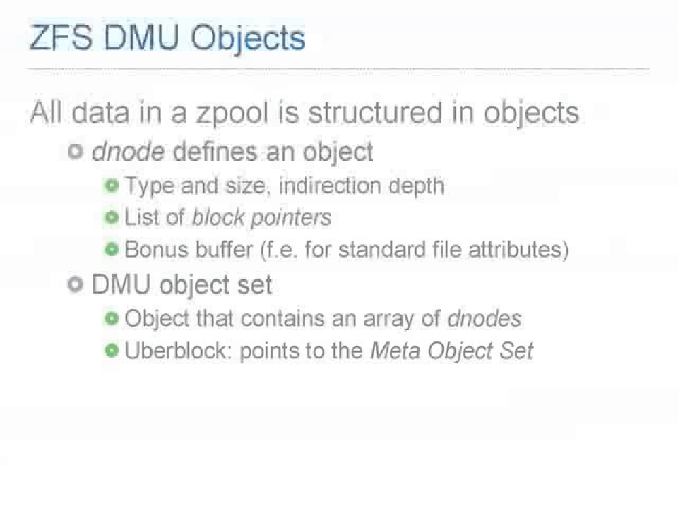

### 4.2 object set：dnode 的数组

**object set** 是一个只装 dnode 的对象。dnode 定长 **512 字节**，所以"第 N 号对象"就是"第 N 个 512 字节槽位"——用下标直接寻址，不需要查找。[【跳转到 33:48】](https://www.youtube.com/watch?v=nhtkHCN7qzg&t=2028)

一个 dnode 只有 3 个块指针，装不下大文件怎么办？靠**间接层级**：块指针指向的块里再放块指针，一层层往下，**数据只在最底下的叶子上**。这就是开头那张树状图的实际含义。

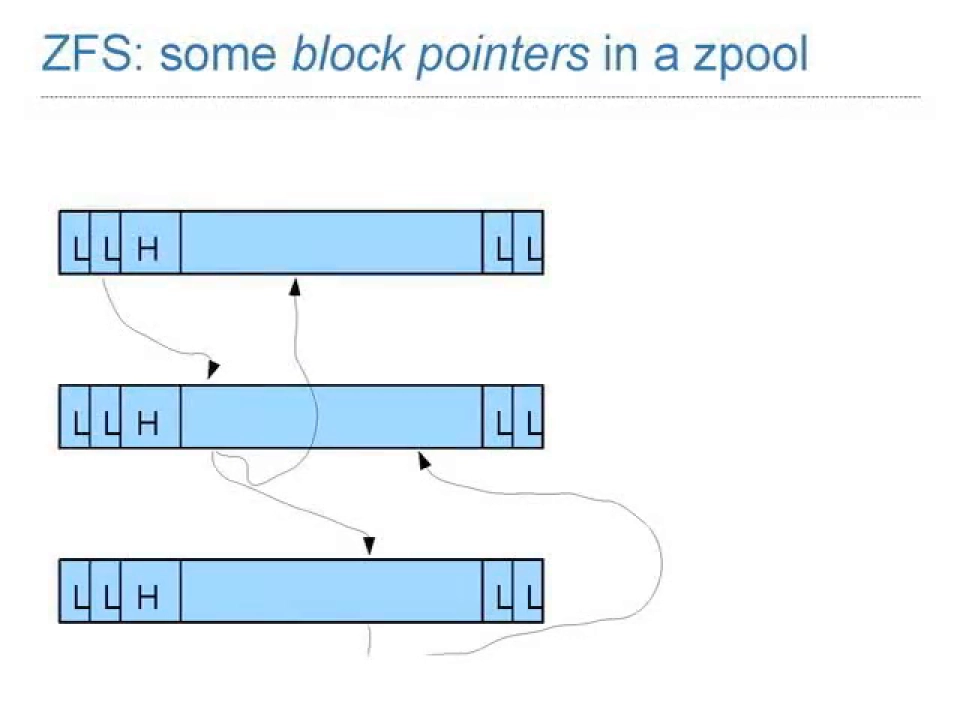

## 五、DSL：数据集与快照层

到这里还只是"一棵树"。ZFS 之所以能在一个 zpool 里放多个文件系统、多个快照，靠的是最上面的一层：**DSL（Dataset and Snapshot Layer）**。

### 5.1 从 uberblock 到 DSL

uberblock 的 `rootbp` 指向的不是用户数据，而是一个 **Meta Object Set**。这个对象里装着：

- **DSL directory**：一个 ZAP 对象（name-value 哈希表），存放所有数据集的入口；
- **vdev 配置的一份副本**；
- **待释放的块指针列表**（blockpointers to be freed）。

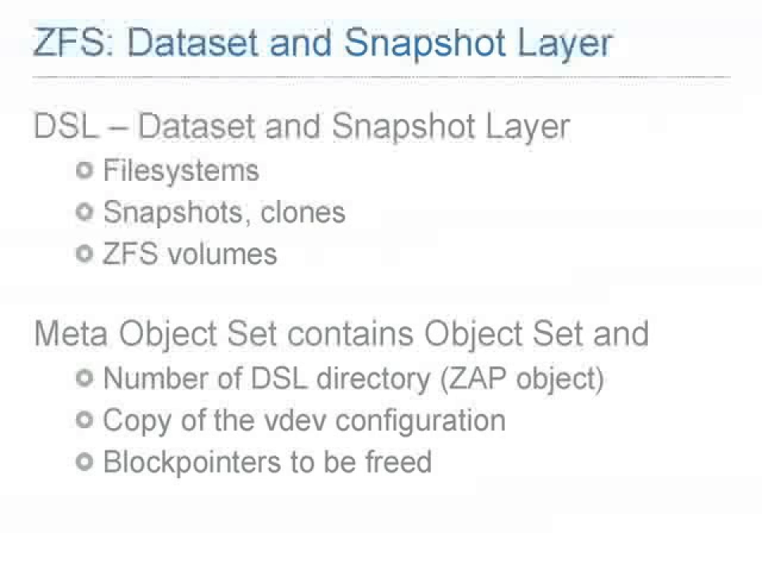

DSL directory 下面，每个数据集对应一个 **DSL dataset** 对象；DSL dataset 再指向一个 **object set**，那个 object set 里的 dnode 才是你看到的文件和目录。[【跳转到 37:00】](https://www.youtube.com/watch?v=nhtkHCN7qzg&t=2220)

### 5.2 快照挂在哪里

讲者在这一页给出了关键的一句：**"快照和克隆，是以 DSL dataset 为根的一条链表"**。[【跳转到 38:07】](https://www.youtube.com/watch?v=nhtkHCN7qzg&t=2287)

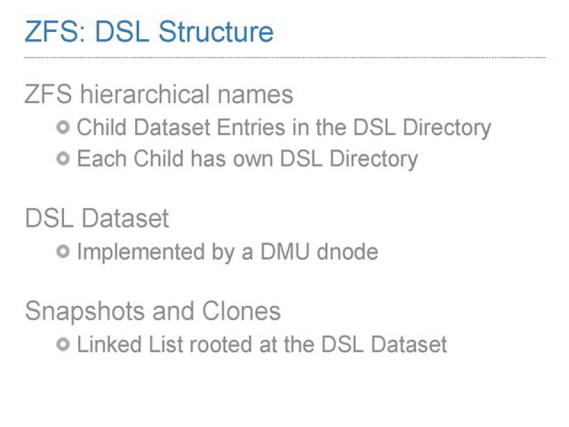

把这句话和前面的结构拼起来，就得到"快照怎么找到数据"的完整答案：

1. uberblock 给出 `rootbp`，这是**当前**这棵树的根；
2. 往下走到 DSL directory，找到目标数据集的 DSL dataset；
3. 这个 DSL dataset 上挂着一条快照链表，链表上的每个节点都是一个快照；
4. 每个快照节点自己持有一棵 object set 的根指针——**它是一棵独立的树，不是一份数据的拷贝**；
5. 从这棵树的根往下走，路径与读当前数据完全一致：dnode → 块指针 → DVA → vdev 内的块。

也就是说，**"回到某个快照"在结构上就是"换一个根指针"**。快照之间之所以能共享绝大部分块，是因为它们指向的块指针大量相同；而共享的块之所以不会被后来者覆盖，是因为 ZFS 从不原地改写——每次改动都产生新的块、新的指针，旧指针仍然指向旧块。讲者没有用"copy-on-write"这个词，但块指针里的 `birth` 事务组号、uberblock 的轮转写入、以及"快照是链表节点"这三件事放在一起，正是这个机制的结构证据。

### 5.3 谁来释放块

有一个细节容易被忽略：**结构本身不知道"哪些块已经没人用了"**。讲者的原话是"释放数据的所有魔法都由 ZFS 代码控制，结构对此一无所知"。[【跳转到 38:32】](https://www.youtube.com/watch?v=nhtkHCN7qzg&t=2312)

这解释了 Meta Object Set 里为什么要存一份"**待释放的块指针**"列表：删除快照、覆盖写之后，那些不再被任何树引用的块，需要由代码记下来、延后回收。这件事不能靠"扫一遍树"来做——那等于每次删除都要遍历整个 zpool。

## 六、一次读的完整路径

把上面几层串起来，读一个文件里的一个字节，走的是这样一条路：

```
uberblock（txg 最大的那个）
  └─ rootbp ──► Meta Object Set
        └─ DSL Directory（ZAP）──► DSL Dataset（dnode）
              ├─ 快照链表 ──► 某个快照的 object set 根指针
              └─ 当前 object set
                    └─ dnode[对象号]（512 字节定长，下标寻址）
                          └─ 块指针（最多 3 个，可多层间接）
                                └─ DVA：vdev 号 + 块号 + grid
                                      └─ 读出块，用块指针里的校验和验证
```

这条路径上有三个"索引"层次，各解决一个问题：

| 层次 | 解决什么 | 定位方式 |
| :--- | :--- | :--- |
| uberblock 数组 | 哪个版本的树是"当前" | 取 txg 最大且自校验通过的那个 |
| DSL Directory / DSL Dataset | 哪个数据集、哪个快照 | ZAP 名字查找 + 链表遍历 |
| dnode + 块指针 | 对象里的第几个字节 | 对象号下标 + 间接层级 + DVA |

## 七、这套结构对"快照持久化"意味着什么

讲者的这场分享是结构导览，不是快照专题，但结构本身已经回答了本小节的核心问题——**一份磁盘快照在存储上长什么样**：

- **它不是一个数据文件的副本**。快照是 DSL dataset 链表上的一个节点，持有自己那棵树的根指针。
- **它的"索引"就是那棵树**。要找快照里某个逻辑位置的数据，走的是和读当前数据一样的路径，只是起点换成了快照的根。
- **它的体积增长只发生在被改动的路径上**。改动一个块，就要新写这个块、以及从它到根路径上的所有间接块；没被改到的子树，新旧两棵树共用。
- **它的回收不靠结构，靠代码**。哪些块还能释放，记录在 Meta Object Set 的待释放列表里。

与 qcow2 那种"L1/L2 两级映射表 + 独立的引用计数表"相比，ZFS 把"索引"和"引用关系"合并在同一棵树里：块指针既是地址，也是这个块的身份证（校验和、类型、大小、birth txg）。代价是**每一次改动都要复制从叶子到根的整条路径**，收益是**任何一次改动都不会破坏已经写下的历史**。

## 小结

- **自愈的前提是块指针自带校验和**：读块、算校验、比对、不一致就用冗余修复；这要求"内置卷管理器 + 冗余 + 大校验和"三者同时存在。
- **盘上的入口是 vdev label**：每个 vdev 前后各两个 label，内含 nvlist（zpool 属性与 vdev 树）和 128 个 uberblock。
- **uberblock 只有一个内容**：指向 zpool 树根的块指针。恢复时取 txg 最大且自校验通过的那个。
- **块指针是地址 + 身份证**：1~3 个 DVA（vdev 号、块号、grid、gang 位）、类型、逻辑/分配大小、压缩信息、birth txg、校验和。
- **副本数有硬上限 3**，因为一个块指针最多 3 个 DVA；元数据默认 3 份，数据默认 1 份。
- **树只在叶子放数据**：dnode 定长 512 字节、用下标寻址，最多 3 个块指针，靠间接层级撑起大文件。
- **快照是 DSL dataset 上的链表节点**，每个快照持有自己那棵树的根指针；"回到快照"就是"换一个根指针"。
- **块的释放由代码负责**，Meta Object Set 里维护待释放的块指针列表。

## 关键术语速查

| 术语 | 一句话解释 |
| :--- | :--- |
| vdev | 虚拟设备，可以是整盘、分区或文件；多个 vdev 组成 zpool |
| vdev label | 每个 vdev 前后各两份的元数据区，含 nvlist 与 uberblock 数组 |
| nvlist | name-value 列表，存 zpool 属性与 vdev 树配置 |
| uberblock | 指向 zpool 树根的块，带 txg、时间戳和自校验 |
| 块指针 | 指向一个块的指针，含 DVA、类型、大小、压缩、birth txg、校验和 |
| DVA | 数据虚拟地址：vdev 号 + vdev 内块号 + grid 信息 + gang 位 |
| gang block | 碎片太多时用来"聚合"小块的 512 字节间接块 |
| dnode | 定义一个对象：类型、大小、间接层级、最多 3 个块指针、bonus buffer |
| object set | 只装 dnode 的对象，dnode 定长 512 字节，按下标寻址 |
| DSL | Dataset and Snapshot Layer，管理文件系统、快照、克隆、卷 |
| Meta Object Set | uberblock 直接指向的对象，内含 DSL directory、vdev 配置副本、待释放块指针 |
| birth txg | 块指针里记录"这个块生于哪个事务组"的字段 |