# qcow2 的落盘格式与索引：一次读如何从逻辑地址走到数据 cluster

> 视频来源：[QCOW2 in VMD: Snapshots 'Til the Cows Come Home](https://www.youtube.com/watch?v=5TZZvylyIas)（YouTube · BSDCan 2019 · Ori Bernstein）｜时长约 49 分钟
> 导读：这是一场"我照着规范实现了一遍 qcow2"的代码走读。讲者用一张树状图把 qcow2 的 header、L1/L2 映射表、引用计数表、内部/外部快照串成一条线，再逐个演示读、写、写共享块、写新块四种操作在树上怎么走。本文按"磁盘上有什么 → 怎么查 → 怎么写 → 快照怎么变"的顺序重排，末尾的现场演示与问答只保留与格式相关的部分。

## 本讲要解决的核心问题（SCQA）

**背景**：虚拟机的磁盘在宿主机上就是一个文件。最朴素的做法是 raw 镜像：客户机磁盘的第 N 个字节，就是文件的第 N 个字节，一对一映射。[【跳转到 01:28】](https://www.youtube.com/watch?v=5TZZvylyIas&t=88)

**冲突**：一对一映射又快又可靠，但它有两个绕不过去的毛病——**浪费**（分配了 32 GB 就真占 32 GB，哪怕里面大部分是空的）和**不能做快照**（每个字节只有一个位置，旧版本无处安放）。[【跳转到 02:18】](https://www.youtube.com/watch?v=5TZZvylyIas&t=138)

**疑问**：如果给磁盘加一层"逻辑块 → 物理位置"的间接映射，这份映射表在磁盘上长什么样？读一个逻辑地址时，怎么顺着表找到正确的数据块？打了快照之后，又怎么保证读快照读到的是"那一刻"的数据？

**回答（中心思想）**：qcow2 把整个虚拟磁盘切成固定大小的 **cluster**，再用**两级页表**（L1 → L2）记录"每个逻辑 cluster 落在文件的哪个位置"，外加一张**引用计数表**记录"每个物理 cluster 被几个人引用"。索引结构一旦确定，快照就退化成一件很轻的事：**内部快照 = 多一份 L1 表 + 一张快照表**，**外部快照 = 多一个只含差异的 qcow2 文件**。恢复时"按逻辑地址找到正确数据块"的全部答案，都在这三张表里。

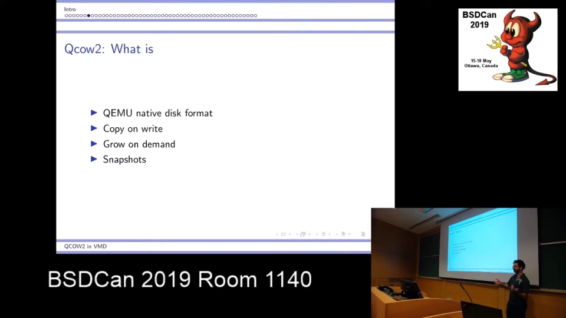

## 一、raw 镜像：一对一映射换来简单，也换来浪费

raw 镜像的结构就是"一个巨大的文件，每个字节一一对应"。你往磁盘的偏移 1000 写，就是往文件的偏移 1000 写；客户机能用到的每个字节，都在文件里有确定的位置。[【跳转到 01:53】](https://www.youtube.com/watch?v=5TZZvylyIas&t=113)

它的好处很实在：

- **快**：没有额外的元数据要读，不用为了定位一个字节而在文件里来回 seek；
- **可靠**：没有"高层结构"，也就没有"高层结构写坏了"这回事；
- **兼容**：客户机里的文件系统就是盘上的文件系统，任何熟悉的工具都能直接解析它。

代价同样实在：**浪费**，以及**永远做不了快照**。qcow2 要解决的就是这两件事。[【跳转到 02:43】](https://www.youtube.com/watch?v=5TZZvylyIas&t=163)

qcow2 是 QEMU 的原生磁盘格式，四个特征可以一句话说完：QEMU 原生、写时复制（copy-on-write）、按需增长、支持快照。按需增长的意思是：你从一个很小的镜像起步，往里装东西它才变大。讲者现场演示了这一点——用 `vmctl create "qcow2:test.img" -s 32G` 创建一个 32 GB 的虚拟磁盘，`ls -lh` 出来的文件只有 **256 KB**。[【跳转到 04:48】](https://www.youtube.com/watch?v=5TZZvylyIas&t=288)


## 二、磁盘上的三张表

讲者把 qcow2 的本质概括成一句话：**它是一张页表**。规范里把分配单位叫 cluster（簇），你可以把它当成页；加一张页表，磁盘就能按页增长。[【跳转到 06:03】](https://www.youtube.com/watch?v=5TZZvylyIas&t=363)

具体到磁盘上，一个 qcow2 文件由四类东西组成：

1. **header**：魔数、版本、cluster 大小、虚拟磁盘大小、以及后面几张表的位置；
2. **L1 表**：一级索引，每一项指向一张 L2 表；
3. **L2 表**：二级索引，每一项指向一个数据 cluster；
4. **refcount 表 + refcount block**：引用计数，记录每个物理 cluster 被引用了几次。

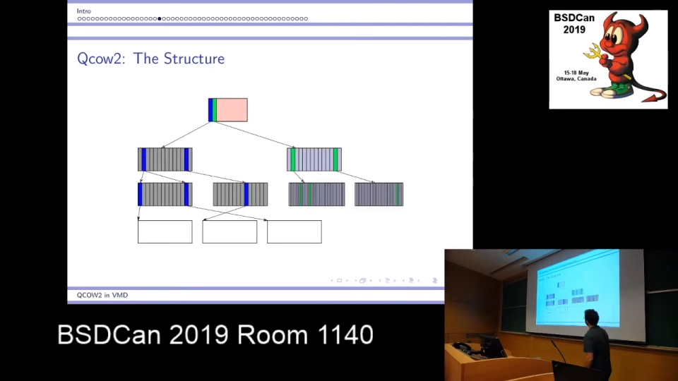

### 2.1 header：所有表的入口

header 是定长的结构体，字段顺序就是磁盘布局。讲者贴出了 `struct qcheader` 的前半段：

```c
struct qcheader {
    char     magic[4];       /* 魔数 */
    uint32_t version;
    uint64_t backingoff;     /* backing file 的路径偏移 */
    uint32_t backingsz;      /* backing file 路径长度 */
    uint32_t clustershift;   /* cluster 大小 = 1 << clustershift */
    uint64_t disksz;         /* 虚拟磁盘大小 */
    uint32_t cryptmethod;
    uint32_t l1sz;
    uint64_t l1off;
    /* ... */
};
```

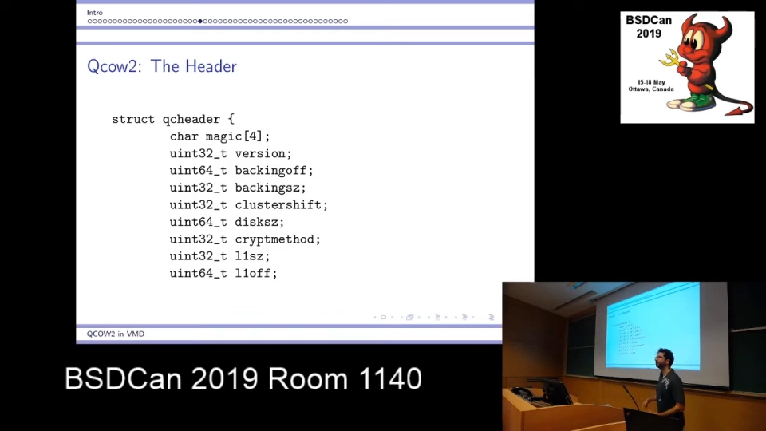

逐个字段看，每一个都在回答"后面要去哪里找东西"：

- `magic` 是识别符，`version` 是版本号——讲者的原话是"光有魔数还不够，不知道为什么还要一个版本号"；
- `backingoff` / `backingsz` 是**外部快照的钩子**：它指向本文件的父镜像路径，`backingsz` 是路径长度；
- `clustershift` 决定 cluster 多大（`1 << clustershift`）；
- `disksz` 是客户机看到的磁盘容量；
- `cryptmethod` 是加密方式，这个实现里没有支持；
- `l1sz` / `l1off` 告诉你去哪里读 L1 表。

后半段接着给出其余位置：

```c
    uint64_t refoff;      /* refcount 表位置 */
    uint32_t refsz;       /* refcount 表大小 */
    uint32_t snapcount;   /* 快照数量 */
    uint64_t snapsz;
    /* v3 新增 */
    uint64_t incompatfeatures;
    uint64_t compatfeatures;
    uint64_t autoclearfeatures;
    uint32_t reforder;
    uint32_t headersz;
} __packed;
```


这里有三组值得记住的字段：

- **`refoff` / `refsz`**：引用计数表的位置和大小。引用计数不是一条一条散着放的，而是先有一张 refcount 表，表项再指向 refcount block，block 里才是每个 cluster 的计数。
- **`snapcount` / `snapsz`**：快照表的位置和条目数。讲者说这个实现"基本没怎么用它"。
- **三组 feature 标志**：`incompatfeatures`（有它就不能加载）、`autoclearfeatures`（有它可以用，没有就必须关掉，否则可能写坏缓存）、`compatfeatures`（可以直接忽略）。这是格式演进的标准做法：新特性分成"读不了就别读"和"读不了也能凑合"两档。

讲者还提到 `reforder = 4`，并把它和"有人想要超过 65000 个快照"联系起来。[【跳转到 11:53】](https://www.youtube.com/watch?v=5TZZvylyIas&t=713) 另外，磁盘上的字段是**大端**，读进来要 `be64toh` 转成本机序——这一点在后面读 L2 表项的代码里能看到。

### 2.2 L1/L2：两级映射表

虚拟磁盘被切成 cluster，每个 cluster 有一个逻辑编号。如果只用一张平表记录"逻辑 cluster → 文件偏移"，一张 100 GB 的盘就要上百万个表项，而这张表本身又占掉一大堆 cluster——**表也是要占空间的**，这就变成了"为了省空间先花掉空间"。

qcow2 的解法是两级索引，和 CPU 的页表一模一样：

- **L1 表**：表项指向 L2 表所在的 cluster 偏移。L1 表很小，一张表就能盖住整块虚拟磁盘；
- **L2 表**：本身占一个 cluster，表项指向数据 cluster 的文件偏移。**只有客户机真正写过的那部分逻辑空间，才存在对应的 L2 表。**

讲者强调了一个容易忽略的细节：**这些表在文件里永远是连续的**（"all these tables are always contiguous"）。也就是说，一张 L2 表必须占满一个完整的 cluster，不能跨 cluster 拆开——这让"读 L2 表"简化成一次定长 `pread`。[【跳转到 08:58】](https://www.youtube.com/watch?v=5TZZvylyIas&t=538)

### 2.3 refcount：谁还在用这个 cluster

引用计数表回答的是另一个问题：**这个物理 cluster 现在被几个人指着**。计数为 1 表示"只有我在用，可以原地改"；计数大于 1 表示"还有别人（比如某个快照）在看，改之前必须先复制"。

结构上它也是两级的：header 里的 `refoff` 指向 refcount 表，表项指向 refcount block，block 里每个 cluster 对应一个计数。讲者的实现里对这块相当"懒"——后面第六节会看到，它其实只关心 L2 表项里的一个 copy-on-write 标志位，而不真的去读计数。[【跳转到 13:33】](https://www.youtube.com/watch?v=5TZZvylyIas&t=813)

## 三、一次查找：把逻辑地址切成三段

所有查找都收敛到一个函数 `xlate()`。讲者说这是"整个 qcow2 里唯一真正要讲的代码"。[【跳转到 12:18】](https://www.youtube.com/watch?v=5TZZvylyIas&t=738)

```c
off_t xlate(off_t off) {
    uint64_t *l1;
    uint32_t l1sz;
    off_t    l1off;

    /* 1. 逻辑地址 → L1 下标 */
    l1off = (off / disk->clustersz) / l2sz;

    /* 2. L1 表项 → L2 表的位置 */
    l2tab = disk->l1[l1off];

    /* 3. L2 表项 → 数据 cluster 的位置 */
    l2off = (off / disk->clustersz) % l2sz;
    pread(disk->fd, &buf, sizeof(buf), l2tab + l2off * 8);
    cluster = be64toh(buf);

    /* 4. 加上 cluster 内偏移 */
    return cluster + (off % disk->clustersz);
}
```

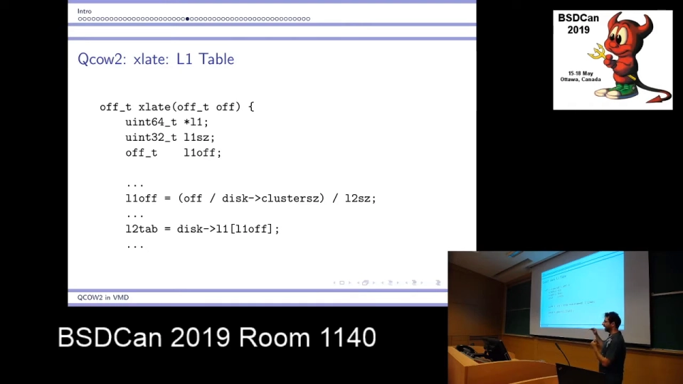

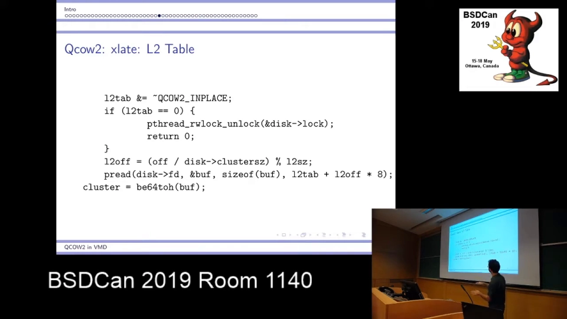

把这段代码翻译成"位切分"的语言，一个逻辑地址被拆成三段：

| 段 | 怎么算 | 作用 |
| :--- | :--- | :--- |
| L1 下标 | `(off / clustersz) / l2sz` | 选出 L1 表的第几项，即"用哪张 L2 表" |
| L2 下标 | `(off / clustersz) % l2sz` | 选出该 L2 表的第几项，即"用哪个数据 cluster" |
| cluster 内偏移 | `off % clustersz` | 在数据 cluster 内部再走多少字节 |

讲者用一张图解释这三段：一个偏移先按 cluster 大小切出"cluster 内偏移"，剩下的部分再切成"L2 段"和"L1 段"。[【跳转到 08:08】](https://www.youtube.com/watch?v=5TZZvylyIas&t=488)

代码里有两个细节值得单独记住：

**第一，L1 表项里有一位是"标志位"，不是地址。** 代码先把这个标志位清掉，再判断结果是否为 0：如果清完是 0，说明**这张 L2 表根本还不存在**，于是解锁、直接返回 0。[【跳转到 12:43】](https://www.youtube.com/watch?v=5TZZvylyIas&t=763) 讲者的解释是：这种情况下你根本不需要去看引用计数，直接返回零就行——因为虚拟磁盘"永远是满的"，没写过的地方读出来就是 0。

**第二，L2 表项是 8 字节、磁盘上大端。** `pread` 的偏移是 `l2tab + l2off * 8`，读出来还要 `be64toh`。这也解释了为什么 L2 表项数 `l2sz` 和 cluster 大小挂钩：一个 cluster 能装多少个 8 字节表项，就决定了这张 L2 表能映射多大的逻辑空间。

还有一个性能上的选择：**L2 表常驻内存**。讲者的理由是读路径上 seek 太多，而且每次只读一个表项、不是整个 cluster，"我们指望 buffer cache 把数据留在内存里"。[【跳转到 13:08】](https://www.youtube.com/watch?v=5TZZvylyIas&t=788)

## 四、写入的三种情况

读只有一条路径，写有三条。讲者用"集合操作"的方式逐个演示，判断依据只有两个：**数据在不在**、**有没有别人也在看**。[【跳转到 14:48】](https://www.youtube.com/watch?v=5TZZvylyIas&t=888)

### 4.1 情况零：数据在，且只有我在用 → 原地写

最简单的情况：L1 表项指向一张 L2 表，L2 表项指向一个数据 cluster，引用计数是 1。写的时候顺着表走到底，把数据写进那个 cluster 就完了。[【跳转到 15:13】](https://www.youtube.com/watch?v=5TZZvylyIas&t=913)

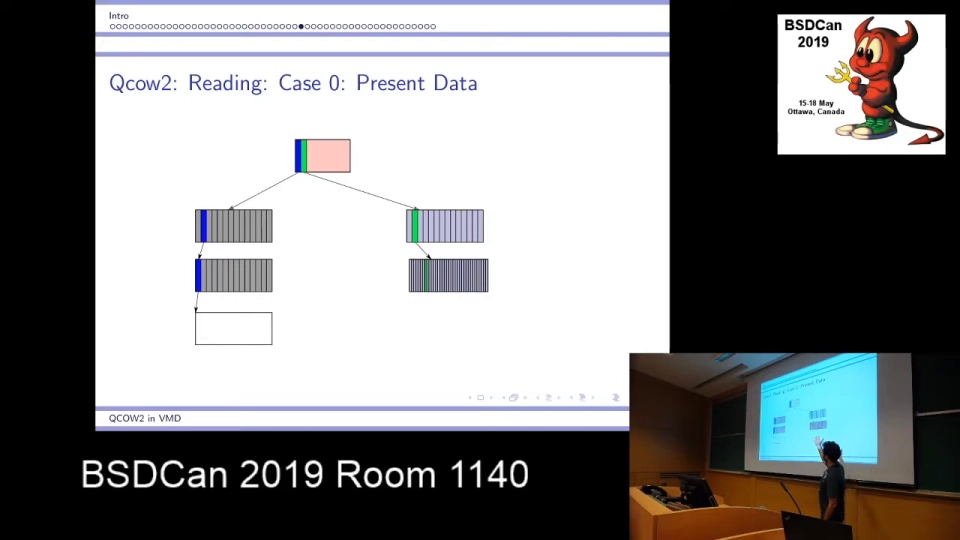

如果 L2 表项是 0（这个逻辑 cluster 从来没写过），读操作返回零——**"虚拟"的含义就是：数据永远在那里，只是没写过的地方填 0**。[【跳转到 15:38】](https://www.youtube.com/watch?v=5TZZvylyIas&t=938)

### 4.2 情况一：数据在，但有别人在看 → 沿路径复制到根

这是写时复制的核心。判断依据是 L2 表项上的 **copy-on-write 标志位**：如果这一位被置上，或者引用计数大于 1，就说明"别人也能看到这份数据"，**不能原地改**。[【跳转到 16:28】](https://www.youtube.com/watch?v=5TZZvylyIas&t=988)

于是要做三件事：

1. **复制数据 cluster**：把旧内容整块搬到文件的新位置，改的是新的那一份；
2. **复制 L2 表**：因为 L2 表里的那一项要指向新位置，而旧的 L2 表还被别人指着，所以 L2 表本身也得复制一份；
3. **复制 L1 表项 / 更新父节点**：新的 L2 表位置要写进 L1 表，这一步会一路往上走到根。

讲者的原话是"所有往上走到根的块都要复制，才能让新数据可见"。[【跳转到 17:43】](https://www.youtube.com/watch?v=5TZZvylyIas&t=1063) 复制完之后还要把**新 cluster 的引用计数设成 1**，表示"这一份只有我在用"。

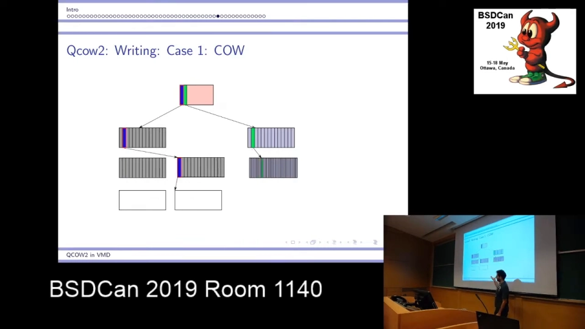

注意这里的代价结构：**改一个 4 KB 的块，可能要复制一整个数据 cluster（cluster 通常远大于 4 KB）、一张 L2 表、再改一次 L1 表项**。这就是"写放大"的来源，也是为什么快照链越长、写越慢。

### 4.3 情况二：数据不在 → 新建

如果走到底发现 L2 表项是 0，就没有"复制"可言，只有"新建"：分配一个新的数据 cluster，在 L2 表里填上它的位置；如果连 L2 表都不存在（L1 表项为 0），还要先分配一张 L2 表、把它的位置写进 L1 表。[【跳转到 18:08】](https://www.youtube.com/watch?v=5TZZvylyIas&t=1088)

讲者的说法很形象：这看起来很像 copy-on-write，只不过"不是复制，而是凭空造一个新的"。[【跳转到 18:33】](https://www.youtube.com/watch?v=5TZZvylyIas&t=1113)

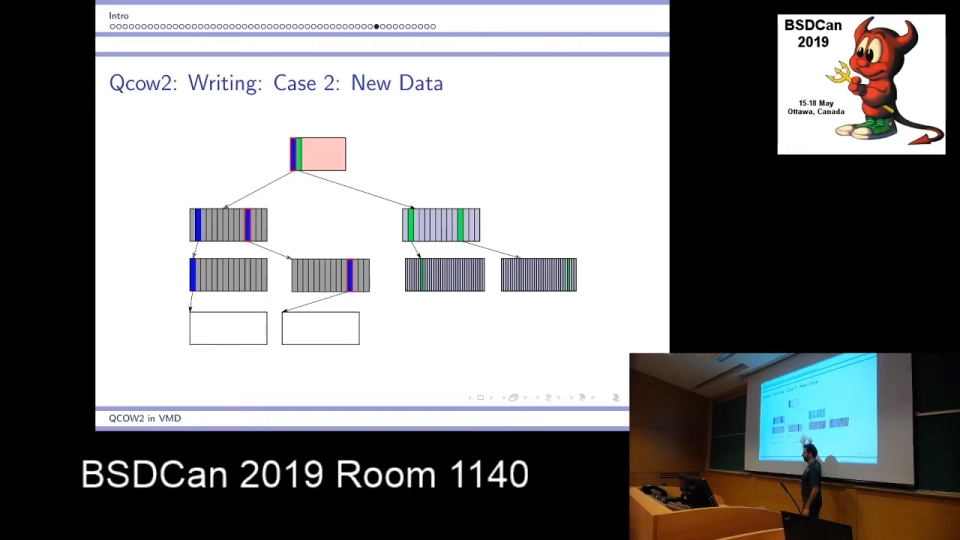

如果写的是磁盘末尾之外，还要把 `disksz` 改大，然后同样"一路更新到根"。

## 五、快照：换一个起点

三种写路径讲完，快照就变得很好理解了。讲者的总结是：**读快照和读普通数据走的是同一段代码，唯一的区别是"从哪里开始走"。** [【跳转到 19:10】](https://www.youtube.com/watch?v=5TZZvylyIas&t=1150)

### 5.1 内部快照：多一份 L1 表

内部快照（internal snapshot）的全部秘密就是：**快照表里存着每个快照自己的 L1 表位置**。读当前数据从 header 指的 L1 表开始走；读某个快照，就从快照表里那一项指的 L1 表开始走。下面的 L2 表和数据 cluster 大量共享，只有被改过的那部分才分裂出新副本。[【跳转到 07:18】](https://www.youtube.com/watch?v=5TZZvylyIas&t=438)

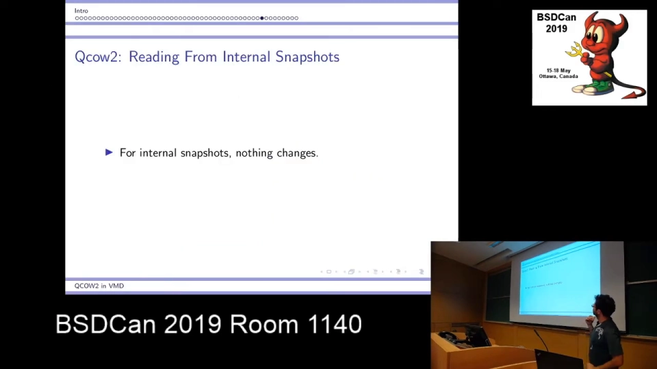

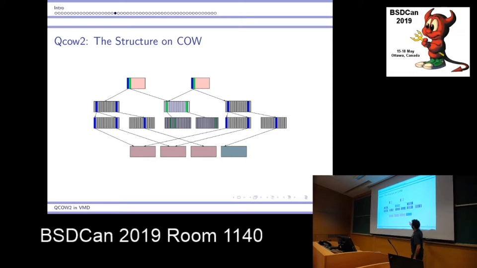

这也解释了为什么内部快照的删除在结构上很轻：删一个快照，就是把它的 L1 表连同它私有的那些 cluster 释放掉，别人的表一个字节都不用动。

### 5.2 外部快照：多一个文件

外部快照（external snapshot）走的是另一条路：**新建一个空的 qcow2 文件，在它的 header 里写上"我的 backing file 是谁"**。这个新文件一开始只有 header，所以只有 256 KB；读的时候如果在本文件里查不到（L1/L2 表项为 0），就顺着 `backingoff` 去父镜像里查，父镜像也没有就继续往上一级，直到链的尽头，仍然没有就返回零。[【跳转到 19:35】](https://www.youtube.com/watch?v=5TZZvylyIas&t=1175)

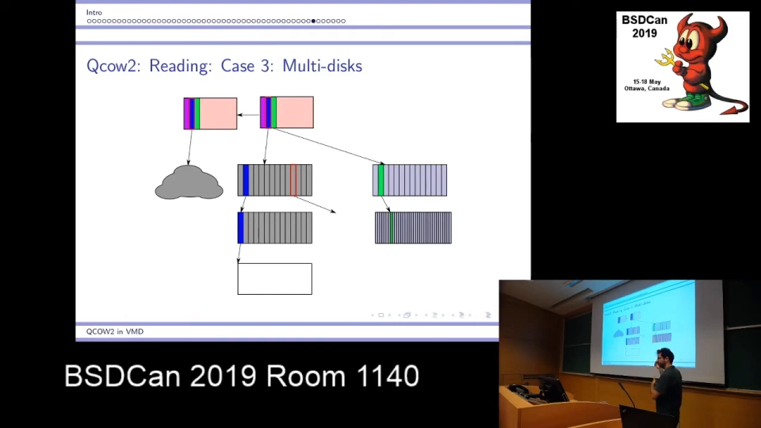

**写的时候不能照搬这个逻辑。** 讲者特别指出这是第一版的一个 bug：如果在"第一次找到这个数据的那一层"做 copy-on-write，就会把数据写进**错误的磁盘**——因为你要写的是最上面那一层，而不是 base。[【跳转到 20:25】](https://www.youtube.com/watch?v=5TZZvylyIas&t=1225)

正确的做法是：**先往下走到真正存着这份数据的那一层，把它复制上来，再更新本层的表**。也就是说，外部快照的写入是"自下而上搬一次"，而不是"就地改"。

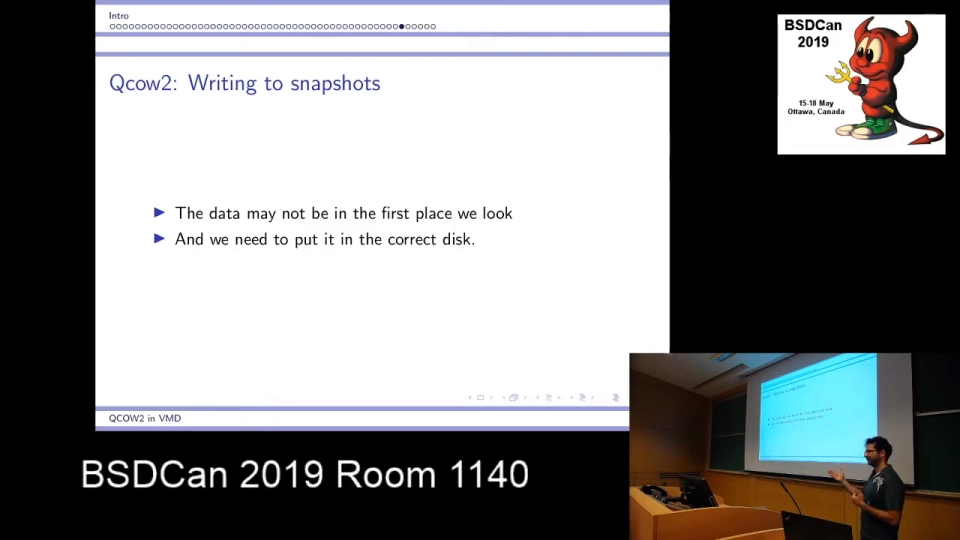

外部快照的另一个约束在演示里被明确提到：**base 镜像必须保持不变**。只要还在用派生镜像，base 就不能被改；实践中的做法是把 base 设成只读，防止人手动改坏。讲者还提到一个好处：50 个客户端可以跑在同一份 base 上，各自只承担差异部分的存储。[【跳转到 40:46】](https://www.youtube.com/watch?v=5TZZvylyIas&t=2446)

## 六、refcount 的账本，以及它的漏洞

回到引用计数。讲者很坦率地承认：这个实现**对引用计数相当懒**。读路径上根本不看计数，只看 L2 表项里的 copy-on-write 标志位；写的时候如果标志位没置上，就"原地读、原地写，反正没别人在用"。[【跳转到 13:33】](https://www.youtube.com/watch?v=5TZZvylyIas&t=813)

引用计数真正被更新的时机是**打快照**和**复制完成**。但这里有个已知的 bug：**复制完成之后，旧 cluster 的计数没有被减、也没有被标记为可回收**。后果是——你打一个内部快照、改点数据、再把快照删掉，那些本该释放的 cluster 就**泄漏**了，文件只涨不缩。[【跳转到 14:23】](https://www.youtube.com/watch?v=5TZZvylyIas&t=863)

讲者的态度是"这该修，但目前没人在用内部快照，所以不算大事"。他还给了一个很实用的临时办法：**把 qcow2 转成 raw 再转回来**，泄漏的 cluster 就顺手被清掉了。[【跳转到 27:17】](https://www.youtube.com/watch?v=5TZZvylyIas&t=1637)

## 七、可靠性：一次写要改好几张表

讲者对可靠性的评价很直接：**raw 镜像仍然是最稳的选择**，因为 qcow2 一次写要更新"一大堆大块数据"。[【跳转到 20:50】](https://www.youtube.com/watch?v=5TZZvylyIas&t=1250)

崩溃窗口有两个：

- 写完数据 cluster，还没更新 L2 表 → 数据在，但没人指向它（泄漏）；
- 更新完 L2 表，还没更新 L1 表 → 表之间不一致。

讲者的形容是"现在有好几个窗口大得能开卡车过去，我想把它们缩小到能开小面包车过去"。他也承认自己确实见过崩溃导致的损坏。[【跳转到 21:15】](https://www.youtube.com/watch?v=5TZZvylyIas&t=1275)


问答环节有人提出一个思路：**把写顺序反过来**——先算清楚要改哪些块，再从根往下改。讲者的回应是：这确实能做得更好，但要注意引用计数的更新顺序。如果**先更新引用计数**，最坏情况是泄漏一个 cluster；如果**先写数据再更新计数**，可能会在计数还没准备好时把磁盘撑大、拿到越界的 cluster，所以计数得先处理。[【跳转到 24:47】](https://www.youtube.com/watch?v=5TZZvylyIas&t=1487)

他列出的后续改进方向也很对症：

- 用**外部日志**（write-ahead log）记录"我打算对磁盘做什么"，真崩了可以重放；
- 现在每次访问都走一次系统调用 `pread`/`pwrite`，可以把热数据留在内存里；
- 外部快照链上每读一次都要逐层走，可以给每层维护一个 **bloom filter**，快速判断"这一层有没有这个 cluster"，从而跳过链的前半段。[【跳转到 23:20】](https://www.youtube.com/watch?v=5TZZvylyIas&t=1400)

## 八、现场演示：格式对不对，看文件大小就知道

演示部分验证了前面讲的机制：

- 用 32 GB 的虚拟磁盘起步，文件只有 **256 KB**——因为 L1 表是空的，一个数据 cluster 都没分配；
- 装完系统后文件涨到 **1.5 GB** 左右——按需增长生效；
- 用 base 镜像派生一个快照文件，新文件同样只有 **256 KB**——它只包含 header 和"我的父镜像是谁"；
- 在派生镜像里写数据，只有派生文件变大，base 保持不变。[【跳转到 37:26】](https://www.youtube.com/watch?v=5TZZvylyIas&t=2246)

演示里还提到一个与"索引"相关的实现细节：**VMD 进程本身没有权限打开镜像文件**。父进程先把所有磁盘的 file descriptor 通过数组传给 VMD，VMD 才能拿到这些 fd；在此之前它一个文件都打不开。这是 pledge/chroot 沙箱的代价，也顺带解释了为什么"派生镜像的 base 路径必须能被父进程解析"。[【跳转到 39:06】](https://www.youtube.com/watch?v=5TZZvylyIas&t=2346)

## 小结

- **raw 是一对一映射**：简单、可靠、兼容，但浪费空间、无法快照。qcow2 用一层间接映射换来了按需增长和写时复制。
- **qcow2 的索引是三张表**：header 记录所有表的位置；L1 → L2 两级映射把逻辑 cluster 翻译成文件偏移；refcount 表记录每个物理 cluster 被引用几次。
- **一次查找把逻辑地址切成三段**：L1 下标、L2 下标、cluster 内偏移。L1 表项为 0 意味着"这张 L2 表还不存在"，直接返回零；L2 表项是 8 字节大端。
- **写分三种**：独占就原地写；共享就沿路径复制到根（写放大的来源）；未分配就新建 L2 表项和数据块。
- **内部快照 = 多一份 L1 表**，读路径完全不变，只是起点不同；**外部快照 = 多一个文件**，读靠穿透、写靠"先下潜再上搬"。
- **引用计数是账本，但这个实现记账不全**：旧 cluster 的计数不减，删快照会泄漏；转 raw 再转回来可以顺手清理。
- **可靠性靠写顺序**：一次写要改多张表，崩溃窗口客观存在；日志、内存缓存、bloom filter 是三个明确的改进方向。

## 关键术语速查

| 术语 | 一句话解释 |
| :--- | :--- |
| cluster | qcow2 的分配与映射单位，大小由 header 的 `clustershift` 决定 |
| L1 表 | 一级索引，表项指向 L2 表所在的 cluster |
| L2 表 | 二级索引，占一个 cluster，表项（8 字节）指向数据 cluster |
| refcount 表 | 记录每个物理 cluster 被引用次数，用于判断能否原地写 |
| backing file | 外部快照的父镜像，路径存在 header 的 `backingoff` 处 |
| 内部快照 | 快照表 + 每个快照一份 L1 表，全部在同一个文件内 |
| 外部快照 | 一个新的 qcow2 文件，只存相对父镜像的差异 |
| copy-on-write 标志位 | L2 表项上的一个位，标记"这块数据还被别人共享" |
| `xlate` | 把逻辑偏移翻译成文件偏移的函数，读路径的全部逻辑 |
| 泄漏 cluster | 引用计数没减、也没被回收的 cluster，文件只涨不缩 |