# 定长分块注定失效：内容定义分块如何把去重率从 27% 提到 85%

> 视频来源：[Deduplicating data with content-defined chunking](https://www.youtube.com/watch?v=O_FrF7I2aEY)（YouTube · Dev Edmonton / Go Meetup，讲者 Andrew）｜时长约 50 分钟
> 导读：讲者用一份两版 Linux 内核源码（1.3 GB vs 1.5 GB）亲手实现并实测了四代去重算法——整文件哈希、定长分块、滚动哈希、内容定义分块，把每一代的去重率和耗时都跑了出来。本文按这条演进路线讲清"切点由内容决定"为什么是分水岭，以及它换来的索引代价。

## 本讲要解决的核心问题（SCQA）

**背景**：备份、同步、镜像分发这类系统都有一个共同的愿望——只传输和存储"变化的那部分"。判断"这部分我有没有"的办法，是给数据算哈希（hash，把任意长度的数据压成一个固定长度指纹的函数），再拿指纹去查表。

**冲突**：最自然的做法是把文件按固定长度切开（比如每 1000 字节一刀），逐块算哈希。可一旦有人在文件中间插入一个字节，后面**所有**块的边界就整体错位了——每一块的内容都变了，哈希全变，查表全部落空。于是"增量备份"看起来是增量的，实际上是每次重传全量。

**疑问**：切点能不能不由"第几个字节"决定，而由"这一段内容长什么样"决定？如果切点跟着内容走，插入一段就只影响局部几个块。

**回答（中心思想）**：能，这就是**内容定义分块**（content-defined chunking，CDC）。它用一个很"廉价"的滚动哈希在数据流上滑动，当哈希值满足某个条件时才切一刀，于是切点与字节偏移无关、只与内容有关。讲者的实测里，同一个数据集上整文件哈希只能去重 27% 的字节，定长分块 36%，滚动哈希 64%（但要跑一分钟），内容定义分块用 10 位掩码就到 59% 且只要 2 秒，把掩码收紧到 7 位则能到 85%——代价是索引从 44 MB 涨到几百 MB 量级。

---

## 一、先把术语钉死：base、update、块、哈希

讲者一开始就声明，这次演讲里几个词是同义词，别被绕晕（[【跳转到 04:21】](https://www.youtube.com/watch?v=O_FrF7I2aEY&t=261)）：

- **base（基线）**：已经存在于备份盘上、或者已经在传输接收端的那份数据。
- **update（更新）**：我们想高效存储或传输的新版本，它和 base 有重叠。
- **chunk = block = window**：都是"文件内容里的一段子区域"，比如"第 1000 到 1999 字节"。讲者在不同语境下换了词，但指同一个东西。
- **hash = checksum**：同一个东西。

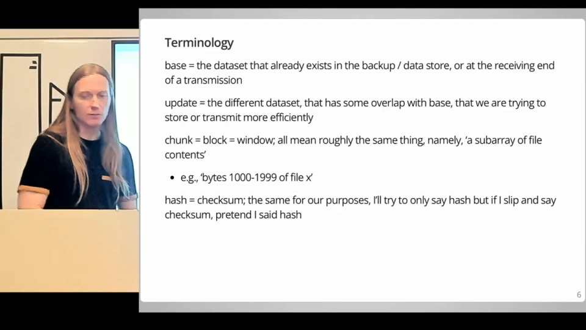

实验数据也交代得很清楚：base 是 `linux-6.1.161.tar`（2022 年 12 月发布的长期支持内核，加上到当时的补丁），update 是 `linux-6.19-rc6.tar`（最新主线内核），1.3 GB 对 1.5 GB，92000 个文件（[【跳转到 05:36】](https://www.youtube.com/watch?v=O_FrF7I2aEY&t=336)）。两者之间改动很多（三年里内核加了一堆驱动和新东西），但整体结构没被重写，所以相似度应该很高——这正是备份场景的典型形态。

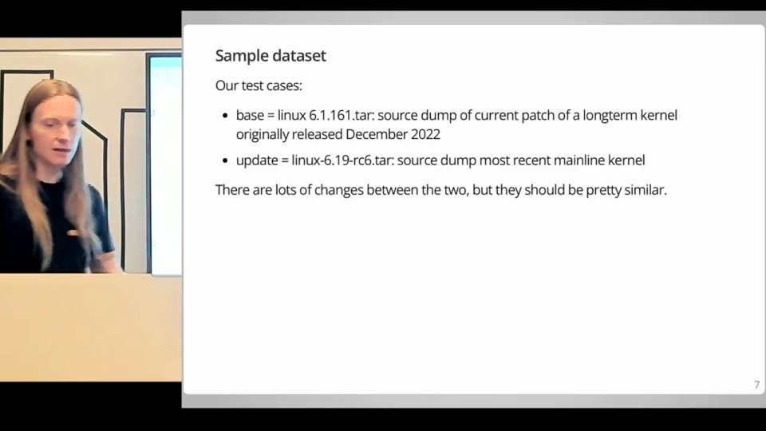

讲者反复强调一件事，值得先记住：**这只是单个数据集上的概念验证代码，几秒钟跑完、全部装在内存里**。所以"某个算法快 3%"这种结论不可信，但"整体趋势"可以外推（[【跳转到 01:44】](https://www.youtube.com/watch?v=O_FrF7I2aEY&t=104)）。这句话后面会变成一个重要的"陷阱"。

---

## 二、第一层：整文件哈希只能抓到"完全没动过"的文件

最省事的去重是**文件级去重**：遍历 base 的所有文件，算 SHA-256，存进一个 map；再遍历 update，算哈希，查表，命中就说明这个文件不用再存一份（[【跳转到 08:15】](https://www.youtube.com/watch?v=O_FrF7I2aEY&t=495)）。

这里顺便解释了 SHA-256 为什么合适：它是**密码学哈希**，设计目标是让人无法构造出另一段拥有相同哈希值的数据。数字签名之所以不对整份数据签名、而是对它的 SHA-256 签名，就是靠这个性质。

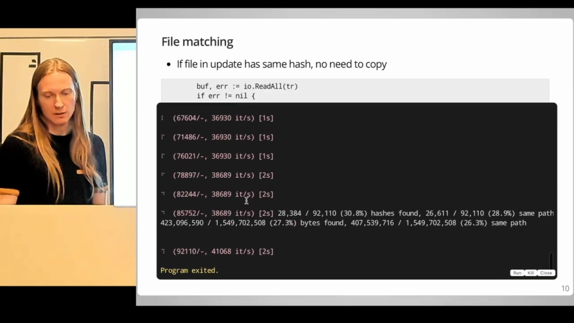

跑出来的结果是（[【跳转到 10:12】](https://www.youtube.com/watch?v=O_FrF7I2aEY&t=612)）：

- 30.8% 的文件哈希在 base 里出现过；
- 其中 28.9% 出现在**相同路径**上——说明这套方法还能覆盖"文件没动、只是被挪了位置"的情况；
- 折算成字节是 27.3%，约 400 MB。

**它的死穴**：只有源和目标两端文件**逐字节完全相同**时才有效。文件只要被改过一个字节，哈希就完全不同，这套方法一点忙都帮不上（[【跳转到 10:53】](https://www.youtube.com/watch?v=O_FrF7I2aEY&t=653)）。而备份场景里，改一个字节的文件遍地都是。

---

## 三、第二层：定长分块的死穴是边界位移

于是升级到**块级去重**：不再对整个文件算哈希，而是把文件切成固定大小的块（这里是 1000 字节），逐块算 SHA-256 存进 map，再拿 update 的每一块去查（[【跳转到 10:58】](https://www.youtube.com/watch?v=O_FrF7I2aEY&t=658)）。

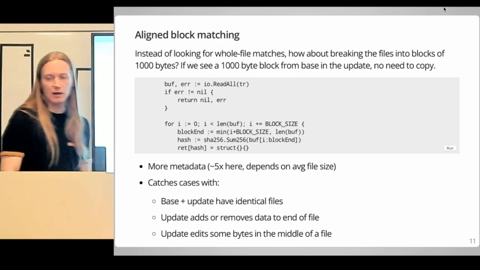

去重率从 27% 升到 36%。它能覆盖三种情况：base 和 update 有完全相同的文件；update 在文件末尾追加或删除数据；update 在文件中间改了几个字节（改动前后的块仍然能匹配上）。代价是**元数据涨了约 5 倍**（取决于平均文件大小）。

定长分块有一个真实的高光场景：**虚拟机镜像**（[【跳转到 13:18】](https://www.youtube.com/watch?v=O_FrF7I2aEY&t=798)）。如果你有 20 台虚拟机，里面都有同一个 `libc.so`，这份数据在原始磁盘镜像里会出现 20 次，但每次出现的位置都是"文件系统块大小的整数倍"——只要去重块大小是 512 或 4096 的整数倍，它们就会整齐地落在块边界上，被识别出来。

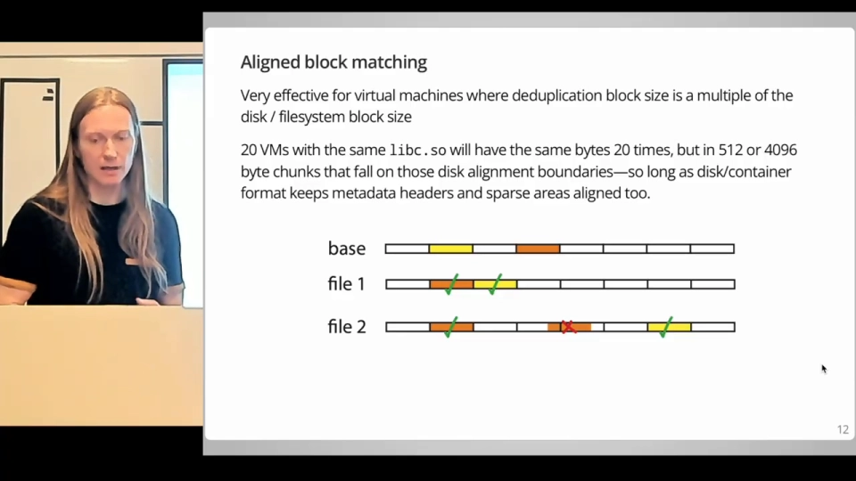

但图里也画出了它的失败：只要数据被整体挪动、不再落在块边界上，或者你在文件中间插入一点数据导致后面全部错位，就**完全找不到可去重的内容**——尽管数据其实还是好的（[【跳转到 13:43】](https://www.youtube.com/watch?v=O_FrF7I2aEY&t=823)）。

一个朴素的想法是：那我别只在"漂亮边界"上取 1000 字节，我在**每一个字节偏移**上都取 1000 字节算哈希，不就能找到了？问题是成本——一个 1 MB 的文件，在每个字节偏移上取 1000 字节哈希，等于要对 1 GB 的数据做哈希，数据量放大一千倍，太慢了（[【跳转到 14:33】](https://www.youtube.com/watch?v=O_FrF7I2aEY&t=873)）。

除非……这个哈希可以"滑动着更新"。

---

## 四、第三层：滚动哈希让"任意偏移"的比较变便宜

**滚动哈希**（rolling hash）解决了这个成本问题：它把数据看成一个多项式，当窗口往后滑一个字节时，用旧哈希**增量地**算出新哈希，而不是把窗口里的一千个字节重新读一遍（[【跳转到 15:22】](https://www.youtube.com/watch?v=O_FrF7I2aEY&t=922)）。

具体做法是把字节值当成多项式系数。以四个字符为例，字节值分别是十六进制的 71、65、68、54，那么：

$$
H = 71 \cdot X^0 + 65 \cdot X^1 + 68 \cdot X^2 + 54 \cdot X^3 \pmod P
$$

窗口往后滑一个字节时，新哈希由旧哈希直接推出（[【跳转到 16:39】](https://www.youtube.com/watch?v=O_FrF7I2aEY&t=999)）：

$$
H_{1..n+1} = X \cdot H_{0..n} + b_{n+1} - b_0 \cdot X^{n+1} \pmod P
$$

也就是说：**旧哈希乘 X、加上新进来的字节、减去滑出去的那个字节乘以 $X^{n+1}$**，只读首尾两个字节就能完成更新。讲者选的 $X = 64$，因为乘以 2 的幂在计算机里就是移位操作，不用操心余数（[【跳转到 22:22】](https://www.youtube.com/watch?v=O_FrF7I2aEY&t=1342)）。模数 $P$ 是一个随机选的 15 位素数。

有了滚动哈希，就能做"rsync 式"的匹配：把 base 里的对齐块哈希全部放进哈希表，然后在 update 里逐字节滑动、逐字节查表，查到就说明找到了一个块（[【跳转到 17:08】](https://www.youtube.com/watch?v=O_FrF7I2aEY&t=1028)）。**rsync 命令就是这么工作的**——它用滚动哈希去找文件里被改动过的部分。

因为滚动哈希不是密码学哈希、可能碰撞，所以查到之后还要再做一次 SHA-256 校验，确认不是误报（[【跳转到 18:59】](https://www.youtube.com/watch?v=O_FrF7I2aEY&t=1139)）。讲者的实测里，整个数据集上出现了 4 次这种碰撞（[【跳转到 23:00】](https://www.youtube.com/watch?v=O_FrF7I2aEY&t=1380)）——这也解释了为什么教科书上的小模数（只能放进 32 位、约 3000 万）不够用，碰撞会多得多。

### rsync 的局限：它只跟同名文件比

讲者顺手点出了 rsync 的一个结构性限制：它先找同名文件，再在这两个文件之间找相似之处。所以如果你把一个文件挪了位置，rsync 会说"没有这个名字的文件"，然后把内容整个重传一遍——尽管内容就在那儿（[【跳转到 19:24】](https://www.youtube.com/watch?v=O_FrF7I2aEY&t=1164)）。

实测数据很能说明问题（[【跳转到 20:49】](https://www.youtube.com/watch?v=O_FrF7I2aEY&t=1249)）：

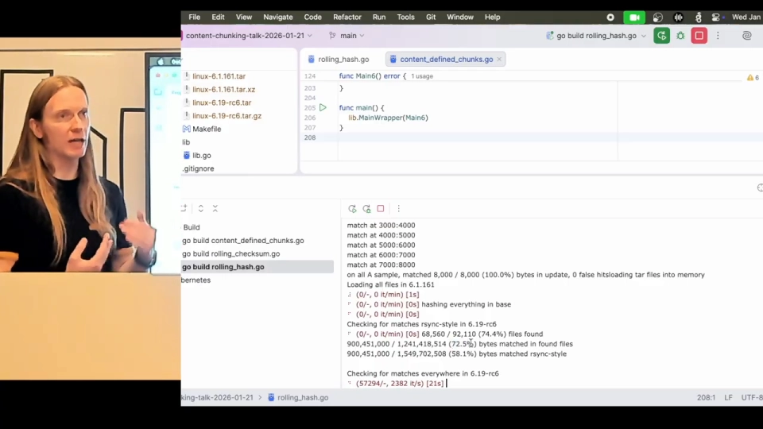

- update 里 74.4% 的文件在 base 里有同名文件；
- 在这些文件内部，rsync 算法匹配上了 72.5% 的字节；
- 但因为它没法跨文件找，**折算到全体只剩 58.1%**。

如果放开这个限制、允许它查全量哈希表，能到 64%、找到整整 1 GB 可去重的数据——但要跑**一整分钟**（[【跳转到 21:14】](https://www.youtube.com/watch?v=O_FrF7I2aEY&t=1274)）。原因很直白：update 里每一个字节都要去一张巨大的哈希表里查一次，这个随机查找就是瓶颈（[【跳转到 32:02】](https://www.youtube.com/watch?v=O_FrF7I2aEY&t=1922)）。

---

## 五、第四层：内容定义分块——让切点由内容决定

滚动哈希的思路到这里出现了一个反转。讲者是这么转的（[【跳转到 23:58】](https://www.youtube.com/watch?v=O_FrF7I2aEY&t=1438)）：

> 滚动哈希极力避免碰撞，但碰撞其实是能处理的。那如果反过来——我们**故意**用一个碰撞率极高的哈希，让它平均每一千字节就"碰撞"一次呢？

那么当哈希"碰撞"时，我们就可以说：**这里是一个应该切开的块边界**。

这就是内容定义分块的定义（[【跳转到 25:38】](https://www.youtube.com/watch?v=O_FrF7I2aEY&t=1538)）：**块是由"具有某种特定性质的字节序列"定义的**，比如"在一个碰撞率很高的哈希下哈希值为零"。

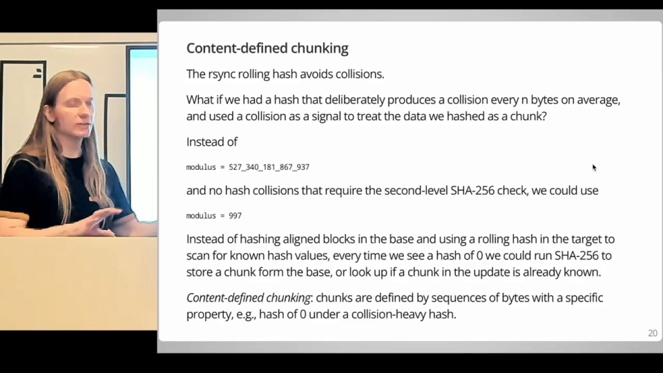

对比一下就很清楚：前面 rsync 式滚动哈希用的模数是 527340181867937（追求几乎不碰撞，碰撞了才需要二次 SHA-256 校验）；而内容定义分块用 997 这样的小模数——**每一次"碰撞"都是一次切块机会**，切完再用 SHA-256 去索引里查这个块有没有见过。

关键在于：**切点只取决于它前面那一小段字节的内容**。所以插入一段数据，只会让插入点附近重新切几刀，一旦重新"对上"（遇到同样的内容特征），后面的切点又和原来完全一致。这就是"边界位移"问题的解药。

### 5.1 gear hash：一次移位、一次加法

上面那个"故意碰撞"的哈希，讲者用了一个从文献里翻出来的实现，叫 **gear hash**，因为它简单到极致、所以极快（[【跳转到 26:03】](https://www.youtube.com/watch?v=O_FrF7I2aEY&t=1563)）：

```
hash = (hash << 1) + gearTable[buf[pos]]
if hash & mask == match {
    handleChunk()
}
```

其中 `gearTable` 是一个包含 256 个随机 32 位整数的数组（每个字节值对应一个随机数）。

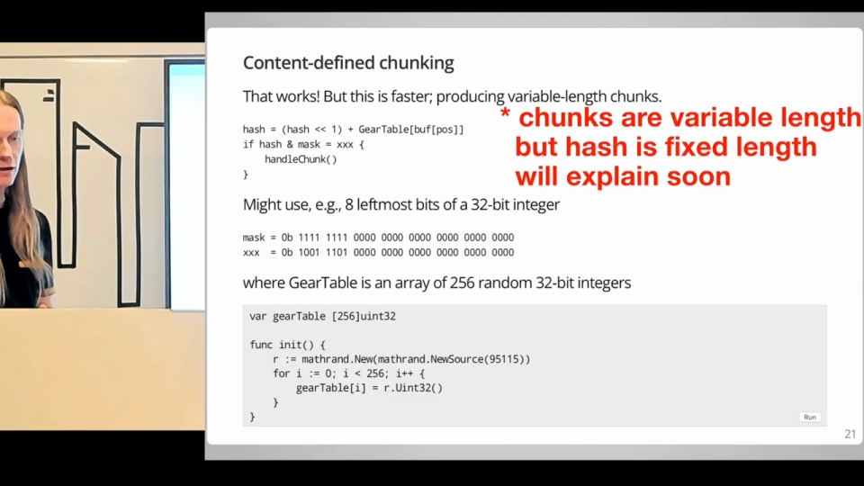

掩码决定"多久切一刀"。幻灯片上给的例子是取 32 位整数的最高 8 位：

```
mask = 0b 1111 1111 0000 0000 0000 0000 0000 0000
xxx  = 0b 1001 1101 0000 0000 0000 0000 0000 0000
```

也就是"当哈希的最高 8 位恰好等于 `10011101` 时切一刀"。这 8 位有 $2^8 = 256$ 种取值，所以平均每 256 个字节才会命中一次。

### 5.2 平均块大小 = $2^N$

这就是本小节最该记住的一条关系：**如果掩码要求 $N$ 位精确匹配，那么平均块大小就是 $2^N$ 字节**。

- $N = 8$ → 平均 256 字节一块；
- $N = 10$ → 平均 1024 字节一块（讲者前面所有例子里用的"约 1000 字节"就是这个）；
- $N = 12$ → 平均 4096 字节一块。

讲者的实测把这个关系验证得很干净：8 位掩码跑出来的平均块大小是 **261.2 字节**，而 $2^8 = 256$（[【跳转到 30:59】](https://www.youtube.com/watch?v=O_FrF7I2aEY&t=1859)）。

这个参数怎么选，本质是一个**两头堵的权衡**（[【跳转到 29:56】](https://www.youtube.com/watch?v=O_FrF7I2aEY&t=1796)）：

- **块太小**：需要跟踪、放进内存、等待查找的块数量暴涨，索引体积和随机查找次数都跟着涨；
- **块太大**：去重率下降，因为"能对上的最小单位"变粗了。

讲者的原话是：更小的块能带来更好的去重，但需要更多开销。

### 5.3 为什么还需要最小块长和最大块长

讲者在录像结束后专门补了一段更正，因为有人提问让他发现自己讲错了一处（[【跳转到 29:01】](https://www.youtube.com/watch?v=O_FrF7I2aEY&t=1741)）：

**gear hash 并不是变长哈希**。它是个 32 位整数，每输入一个字节最高位就被移出去，所以它实际上只看**最后 32 个输入字节**。我们找的是"满足特定条件的 32 字节标记"，然后把两个标记之间的所有数据当成一个块。

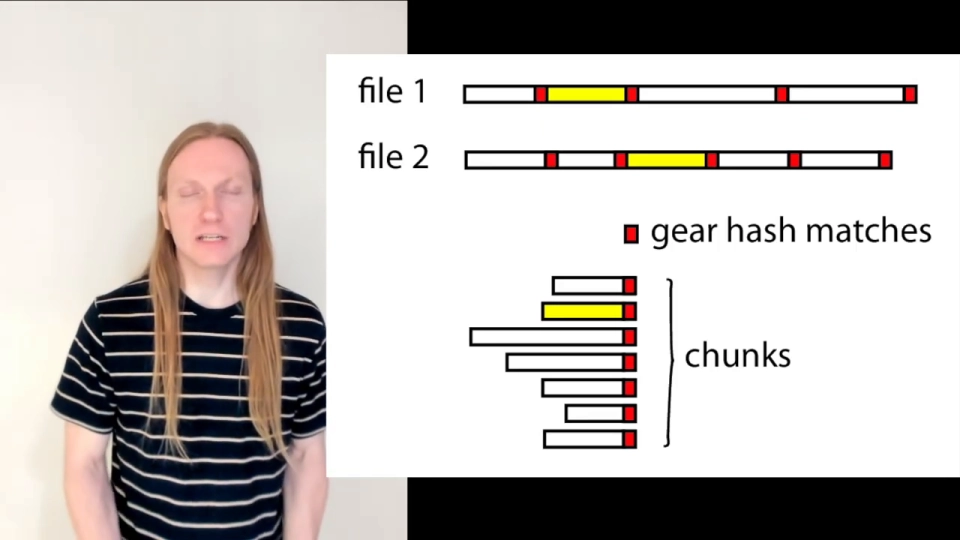

正因为"只看最后 32 字节"，才必须有最小块长和最大块长两个兜底参数（[【跳转到 29:24】](https://www.youtube.com/watch?v=O_FrF7I2aEY&t=1764)）：

- **最大块长**：应对全零字节这种永远哈希不匹配的输入。策略是"超过 2000 字节还没匹配上，就无论如何切一刀"。
- **最小块长**：应对匹配太频繁的情况。如果输入是一个重复的 32 字节模式，每个位置都匹配，那就规定"至少 1000 字节才算一个块"。

---

## 六、实测：四代算法的去重率与耗时

讲者把四代算法在同一份数据上跑了一遍，这是全文最有价值的一组数字。

先看内容定义分块用 10 位掩码（约 1000 字节块）的结果（[【跳转到 28:14】](https://www.youtube.com/watch?v=O_FrF7I2aEY&t=1694)）：

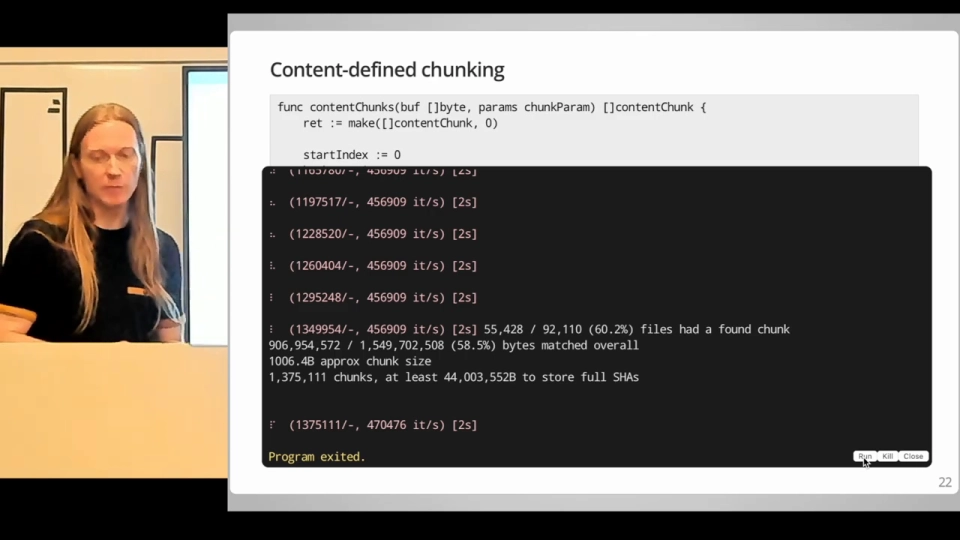

- 60.2% 的文件找到了可复用的块；
- **58.5% 的字节匹配**（906,954,572 / 1,549,702,508 字节），省了约 900 MB；
- 平均块大小 1006.4 字节，共 **1,375,111 个块**；
- **光是把这些块的完整 SHA-256 存下来，就至少要 44,003,552 字节（约 44 MB）**——这个数字后面会变成"代价"那一节的主角；
- 耗时 **2 秒**。

再把掩码收紧到 8 位（[【跳转到 30:54】](https://www.youtube.com/watch?v=O_FrF7I2aEY&t=1854)）：

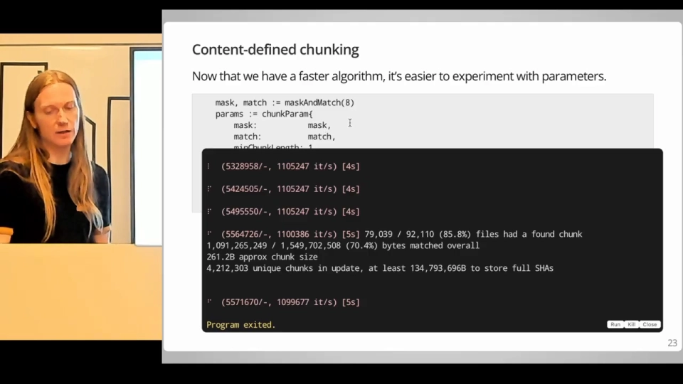

- 85.8% 的文件找到了可复用的块；
- **70.4% 的字节匹配**；
- 平均块大小 261.2 字节，块数涨到 **4,212,303 个**；
- 索引至少 **134,793,696 字节（约 135 MB）**；
- 耗时 5 秒。

最后是总结表（[【跳转到 31:37】](https://www.youtube.com/watch?v=O_FrF7I2aEY&t=1897)）：

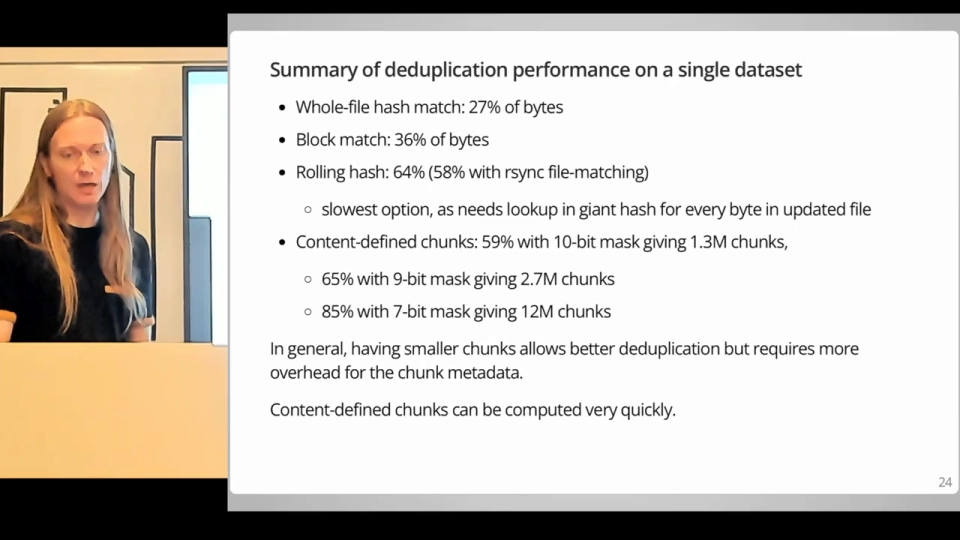

| 算法 | 去重率（字节） | 块数量级 | 耗时 |
| :--- | ---: | ---: | ---: |
| 整文件哈希匹配 | 27% | 文件数 | 快 |
| 定长块匹配（1000 字节） | 36% | 约 150 万（按 1.5 GB ÷ 1000 字节推算） | 快 |
| 滚动哈希（rsync 式，只比同名文件） | 58% | 同上 | 较快 |
| 滚动哈希（查全量哈希表） | 64% | 同上 | 约 1 分钟 |
| 内容定义分块，10 位掩码 | 59% | 137 万 | 2 秒 |
| 内容定义分块，9 位掩码 | 65% | 270 万 | 数秒 |
| 内容定义分块，8 位掩码 | 70% | 421 万 | 5 秒 |
| 内容定义分块，7 位掩码 | 85% | 1200 万 | 更慢 |

读这张表要抓住两件事：

1. **同样块大小下，内容定义分块已经打败了"滚动哈希 + 文件匹配"**：59% 对 58%，但耗时从一分钟降到 2 秒。这是因为滚动哈希要对 update 的每个字节做一次哈希表查找，而内容定义分块只在"切点"上做查找。
2. **去重率和索引体积是直接对冲的**：7 位掩码能到 85%，但块数从 137 万涨到 1200 万，索引体积按比例上涨。讲者的结论是："更小的块带来更好的去重，但需要更多块元数据的开销。"

---

## 七、代价：索引比你想的贵

上面那些实测数字里，最容易被忽略的是索引体积。这也是所有基于分块的备份系统真正的工程难点——**数据本身可能只占索引的几十分之一，但索引要能被随机查询**。

把讲者的数字换算一下：

- 137 万个块 × 32 字节 SHA-256 ≈ 44 MB；
- 421 万个块 × 32 字节 ≈ 135 MB；
- 1200 万个块 × 32 字节 ≈ 384 MB。

而这还只是"哈希 → 块地址"的映射本身。真实系统里每条索引还要存块长度、在包文件里的偏移、压缩方式、加密 nonce 等等，每条几十字节很正常。**十亿个块 × 每块几十字节 = 几十 GB 的索引**，这已经是一个需要专门设计的数据库了。

索引带来的第二个代价是**随机 IO**。讲者解释滚动哈希为什么慢时说得非常直白：对 update 里的每一个字节，你都要去一张巨大的哈希表里查一次，"那就是慢"（[【跳转到 32:02】](https://www.youtube.com/watch?v=O_FrF7I2aEY&t=1922)）。内容定义分块之所以快，正是因为它把"每字节一次查询"降成了"每块一次查询"——用块大小换查询次数。

第三个代价是**去重率被高估**。讲者从头到尾都在提醒：这是**单个数据集**上的结果，而且这份数据是 Linux 内核源码——大量重复的代码、头文件、驱动模板，是去重的理想样本。他明确说，单个数据集不能定量地证明某个方法更好，真实世界里应该在一批有代表性的数据集上测试，"你到底关心的是备份、虚拟机，还是虚拟机备份这类数据"（[【跳转到 02:09】](https://www.youtube.com/watch?v=O_FrF7I2aEY&t=129)）。换句话说：**别把源码树上的 85% 当成你备份数据的 85%**。

---

## 八、把这一层接回备份系统：增量和去重是同一件事

讲者最后讲了做这套东西的动机，其实正好是备份系统的完整流程（[【跳转到 00:18】](https://www.youtube.com/watch?v=O_FrF7I2aEY&t=18)）：

- 你希望每小时备份笔记本，但不想每小时买一块新硬盘、也不想每次等整块盘被复制一遍；
- 你有一堆虚拟机和容器镜像，共享同一个 base OS 和一堆库，不想把这些内容存很多遍；
- 软件更新时，源代码和应用文件都只改了一点点。

把这些诉求翻译成一次备份的落地流程，就是：

1. **遍历文件** → 2. **分块**（内容定义分块）→ 3. **逐块查索引**（这个哈希我有没有？）→ 4. **只上传索引里没有的新块** → 5. **写一份新的索引**。

第 3 步和第 4 步说明了一件事：**"增量"和"去重"在实现上是同一个动作**——都是问"这个块我有没有"。所谓"增量备份"，不过是"这次扫描出来的块里，有多少是新的"；所谓"去重"，不过是"同一个块被几个文件/几个版本引用"。一次备份的产物不是数据副本，而是一张"这次的文件由哪些块组成"的清单——**快照就是索引的索引**。

至于"块被多少个快照引用、没人引用了怎么回收"，那是备份系统在索引之上再叠一层引用计数的事，与文件系统里 reflink 的引用计数是同一个思想，但实现位置完全不同（reflink 的引用计数与 extent 分裂属于 2.2.1 的范围，这里不展开）。

---

## 小结

- **整文件哈希**只能抓到"完全没动过"的文件，实测 27% 的字节；文件改一个字节就失效。
- **定长分块**把粒度降到 1000 字节，实测 36%，对虚拟机镜像特别有效（只要块大小是文件系统块大小的整数倍）；但插入一个字节就让后面所有块错位，去重率归零。
- **滚动哈希**（Rabin-Karp）让"任意偏移"的比较变便宜：新哈希 = 旧哈希乘 X + 新字节 − 滑出字节乘 $X^{n+1}$。rsync 就靠它，但它只跟同名文件比，实测 58%。
- **内容定义分块**把"哈希碰撞"从要避免的缺陷变成切块信号：故意用高碰撞率的哈希，碰撞处切一刀，切点由内容决定、与偏移无关。
- **gear hash** 是 CDC 里最便宜的实现：`hash = (hash << 1) + gearTable[byte]`，再看掩码是否匹配。它只看最后 32 个字节，所以必须配最小/最大块长兜底。
- **平均块大小 = $2^N$**（$N$ 为掩码要求精确匹配的位数）。块小 → 去重率高但索引爆炸；块大 → 索引小但去重率掉。讲者的实测：10 位掩码 59% / 137 万块 / 2 秒；8 位掩码 70% / 421 万块 / 5 秒；7 位掩码 85% / 1200 万块。
- **索引是真正的成本**：137 万个块的 SHA-256 就要 44 MB，421 万个块要 135 MB，真实系统每条索引几十字节，十亿块就是几十 GB。
- **增量 = 去重**：一次备份 = 遍历 → 分块 → 查索引 → 只传新块 → 写新索引；快照就是"由哪些块组成"的清单。

## 关键术语速查

| 术语 | 一句话解释 |
| :--- | :--- |
| base / update | 已经存在于接收端的旧数据集 / 想高效传输的新数据集 |
| 文件级去重 | 对整个文件算哈希，只有逐字节相同才能命中 |
| 定长分块 | 按固定字节数切块，插入一个字节就会让后续所有块错位 |
| 滚动哈希 | 窗口滑动一个字节时，用旧哈希增量算出新哈希，不必重读整窗 |
| Rabin-Karp | 把字节当多项式系数、对素数取模的滚动哈希算法 |
| 内容定义分块（CDC） | 切点由内容特征决定，与字节偏移无关，插入只影响局部块 |
| gear hash | CDC 常用的一种极廉价滚动哈希：左移一位加随机表项，看掩码 |
| 掩码位数 $N$ | 决定平均块大小 $2^N$ 字节，直接决定去重率与索引体积的权衡 |
| 最小/最大块长 | 兜底参数，防止全零输入永不切块、或重复模式切得过碎 |
| 块索引 | 从块哈希到块地址的映射表，是备份系统真正的体积与随机 IO 来源 |