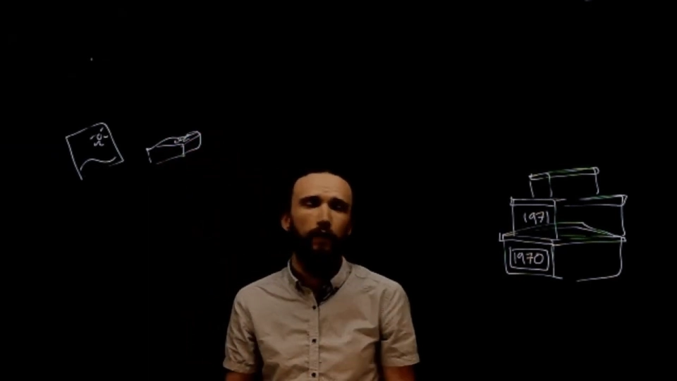
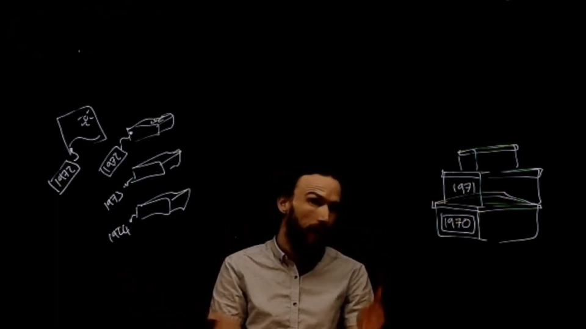
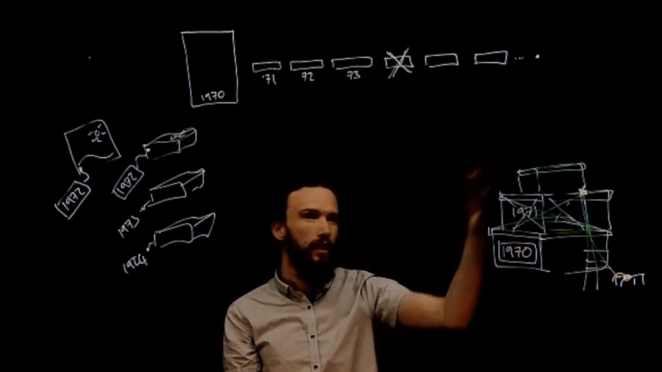
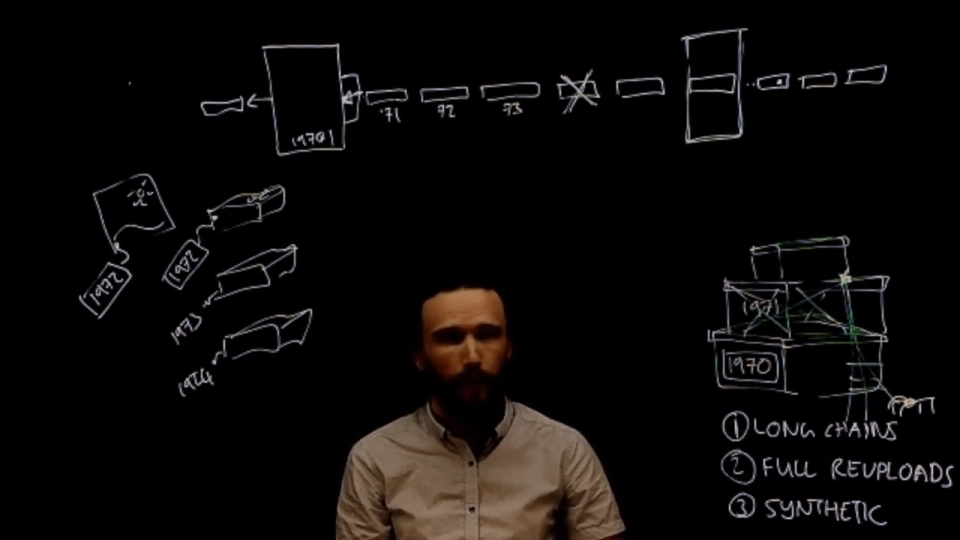
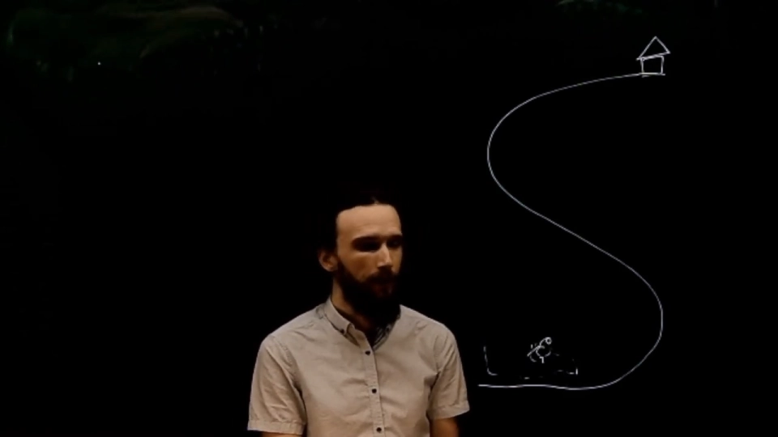
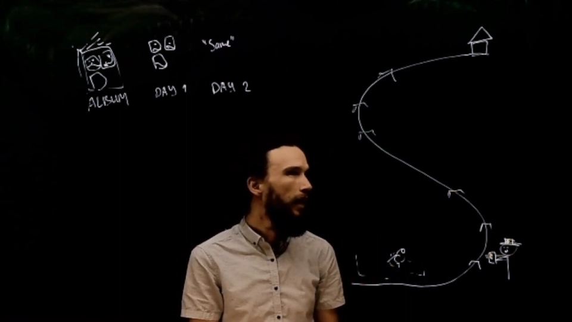
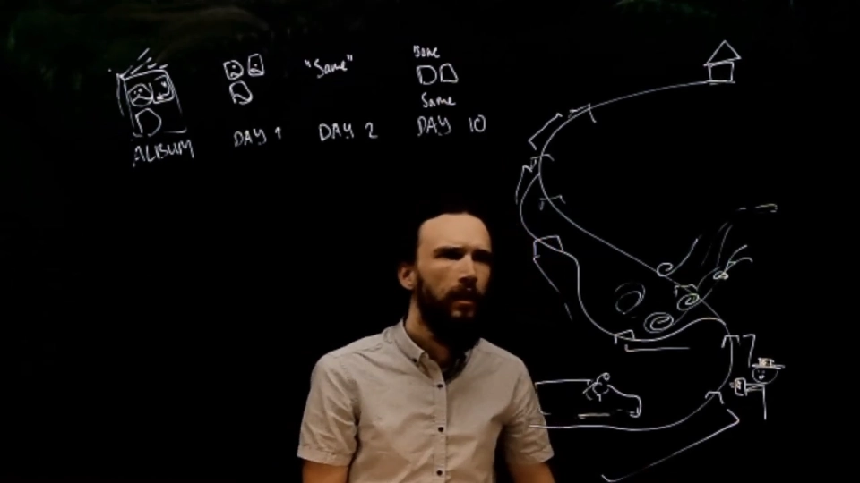
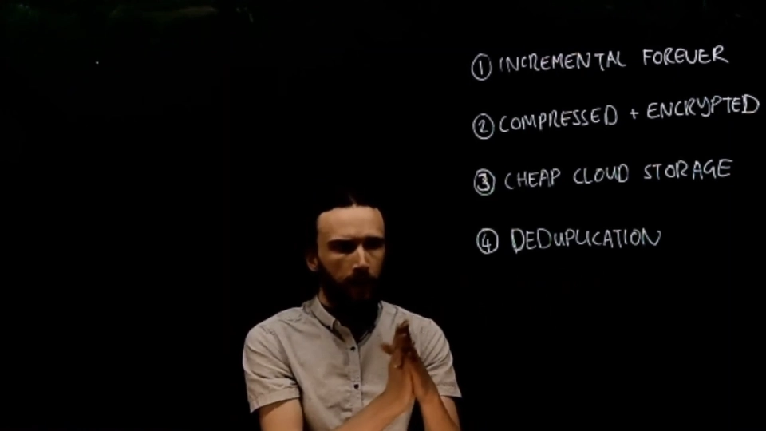

# 永远增量：备份存储模型的四代演进，与内容定义分块为什么是分水岭

> 视频来源：[Comet's Chunking Technology Explained](https://www.youtube.com/watch?v=AEDCx_bPtlM)（YouTube · Comet Backup，讲者 Mason）｜时长约 20 分钟
> 导读：这是一支从"备份产品怎么存数据"角度讲的科普，用鞋盒、自驾游、相册三个比喻，把备份存储模型从"每次存全量"到"永远增量"的四代演进讲清楚了。它补上了算法视角容易漏掉的一半：**快照是什么、保留策略怎么删、加密和去重怎么共存**。

## 本讲要解决的核心问题（SCQA）

**背景**：备份的本质是"同一份数据存很多个版本"。而磁盘镜像、数据库这类东西，每天只有很小一部分在变——讲者的说法是"这些磁盘镜像有 90% 是完全相同的"。

**冲突**：最直觉的增量做法是"存一份全量 + 后续只存变化"。但变化链会越来越长，恢复今天的版本要把几十个变化依次重放一遍，慢得不可接受；链上丢一环，后面的版本就再也拼不出来。于是大家改成"定期做一次完整重传"来截断链条——可这又吃带宽，而且保留策略会被污染：想恢复两年前的某个版本，就得把中间那些看似无关的全量都留着。

**疑问**：有没有一种存储模型，既能**永远只存变化、永不重传全量**，又能**快速恢复任意版本**、还能**干净地删掉过期数据**？

**回答（中心思想）**：有，前提是把存储单位从"文件"或"变化流"换成"**内容定义分块**（content-defined chunking，CDC）"。一旦切点由内容决定，同一个块在不同版本、不同机器上都会得到同一个指纹，于是"存变化"和"去重"变成同一个动作；快照退化成一张"由哪些块组成"的清单，恢复就是照着清单把块拼起来；删除过期快照时，没人引用的块直接扔掉即可。

---

## 一、第零代：鞋盒、编目，以及"90% 都一样"的发现

讲者的第一个比喻是**床底下的鞋盒**（[【跳转到 00:10】](https://www.youtube.com/watch?v=AEDCx_bPtlM&t=10)）：最简单粗暴的备份，就是把所有东西复制一份塞进鞋盒。1970 年一个鞋盒，1971 年再一个，鞋盒越堆越高，柜子里放不下。

第一层改进是**编目**（catalog）：把所有东西列个清单，要找"我的度假照片在哪"，直接查编目就能抽出来，不用翻遍每个鞋盒。这其实就是"索引"的雏形。

但编目解决不了体积问题。照片有个好性质——拍一次就不再变；**硬盘镜像不是**。你每天备份，就会得到 1972 版、1973 版、1974 版……一路堆下去（[【跳转到 02:45】](https://www.youtube.com/watch?v=AEDCx_bPtlM&t=165)）。

关键洞察在这里：**这些镜像有 90% 是相同的**。我不可能每天把硬盘上每个文件都改一遍，只有一小部分在变（[【跳转到 03:10】](https://www.youtube.com/watch?v=AEDCx_bPtlM&t=190)）。这个观察同样适用于数据库，也适用于"一整个文件夹里只有几个文件在变"的场景。

---

## 二、第一代：全量 + 变化链，问题在"链"

最直接的做法：存一份完整镜像，然后每天只存变化（[【跳转到 04:00】](https://www.youtube.com/watch?v=AEDCx_bPtlM&t=240)）。存储量确实接近最小。

但它有三个问题（[【跳转到 05:40】](https://www.youtube.com/watch?v=AEDCx_bPtlM&t=340) 附近，讲者一口气列了出来）：

1. **链越来越长**。要恢复今天的版本，得先恢复最初那份，然后把变化一个个重放进去。
2. **链上丢一环就完了**。还是鞋盒比喻：某个盒子发霉烂掉，你丢掉的恰好是这一段变化，那么往前重放时根本走不过这一段——链上缺一环，你就再也拼不出一个完整可用的现代版本。
3. **恢复太慢、太吃带宽**。要下载每一段再依次应用，而且为了拿到今天的数据，你得先把 1970 年的数据恢复出来。

### 补丁一：定期完整重传

截断长链最直接的办法是定期做一次完整重传，然后在新基础上继续做增量（[【跳转到 06:30】](https://www.youtube.com/watch?v=AEDCx_bPtlM&t=390)）。链条长度问题确实缓解了，但引入了新问题：**完整重传很吃带宽**——硬盘镜像可能有几个 TB。

### 补丁二：合成完整备份（synthetic full）

更聪明的办法是不重传，而是**在存储端把变化合并进全量**，合成一份"1971 备份"。也可以反过来做：让全量始终滚到最新日期，同时构造反向差异，这样恢复最新版本极快，恢复旧版本才需要重放（[【跳转到 07:45】](https://www.youtube.com/watch?v=AEDCx_bPtlM&t=465)）。

问题在于：**合成需要计算**。把差异合并进完整镜像是个计算过程，得在 CPU 上跑。CPU 到处都是，这本来不是问题——**除非你用的是便宜的云存储**。AWS S3，以及 Wasabi、Backblaze B2、IDrive 这些 S3 兼容服务商，只提供存储，不提供 CPU（[【跳转到 08:35】](https://www.youtube.com/watch?v=AEDCx_bPtlM&t=515)）。

还有一层更隐蔽的麻烦：差异本身应该是加密存储的，那么做合并的那台机器必须能解密，**加密密钥就得放在云存储服务商那里**。这在合规上是说不通的。

### 补丁三的代价：保留策略被污染

如果坚持"定期完整重传"，还有一个讲者称为 **retention（保留策略）放大** 的问题：假设你要保留最近两年历史，而这两年跨过了上一次完整重传的时间点，那么为了能恢复某一天的版本，你必须把那些看似无关的旧全量也全都留着（[【跳转到 09:50】](https://www.youtube.com/watch?v=AEDCx_bPtlM&t=590)）。

讲者把这一路的问题归纳成一句话：**我们真正想要的是"只存变化、永远增量（incremental forever）、不做完整重传"，同时能利用便宜的云存储，并且整条链路端到端加密。用前面这些模型，你根本达不到。**

---

## 三、第二代：自驾游与"每座桥都拍一张照"

这就是内容定义分块。讲者用了一个非常直观的比喻（[【跳转到 11:33】](https://www.youtube.com/watch?v=AEDCx_bPtlM&t=693)）：

你要开车去奶奶家，路很长。为了打发时间，你们玩一个游戏：**每遇到一座桥，就停车、下车、回头朝着来时的方向拍一张照片**。

第一次去，你拍了一整本相册。第二天再走同一趟路，风景没变，拍出来的照片**几乎一模一样**——所以你不需要把同样的照片再存一遍，直接说"这是昨天那批"就行（[【跳转到 13:59】](https://www.youtube.com/watch?v=AEDCx_bPtlM&t=839)）。

然后有一天发洪水，一座桥被冲毁，你只能绕道。绕道那段路上的桥不一样，拍出来的照片也不一样；但**一旦接回主路，后面的照片又和原来完全一致**（[【跳转到 14:49】](https://www.youtube.com/watch?v=AEDCx_bPtlM&t=889)）。

这就是 CDC 的全部精髓。把它翻译回技术语言（[【跳转到 15:14】](https://www.youtube.com/watch?v=AEDCx_bPtlM&t=914)）：

- **路** = 你的磁盘镜像或数据库；
- **桥** = 切点。它不是真的桥，而是"**多项式函数的零点**"。这些零点是**由内容决定的**，所以无论路变长变短、中途改了什么，你总能找到同样的停点；
- **照片** = 哈希校验值，是那一段内容的标识符；
- **相册** = 快照。

关键性质是：**"在每座桥停下来"这件事，与你走了多远、路有多长完全无关**。所以哪怕你在数据库中间加了几张表、删了几张表、做了很大的改动，那些改动当然都是新数据，但**你最终会重新对上，重新找到旧数据，重新拍出同样的照片**——于是那些照片在相册里只需要存一次（[【跳转到 16:04】](https://www.youtube.com/watch?v=AEDCx_bPtlM&t=964)）。

---

## 四、CDC 带来的四个性质：快照、恢复、删除、去重

讲者把 CDC 的收益归纳成四件事，这四件事恰好是备份系统最难的四个点（[【跳转到 16:29】](https://www.youtube.com/watch?v=AEDCx_bPtlM&t=989)）：

**1. 永远增量（incremental forever）**。可以一直这样下去，永远不需要做完整重传，只上传新拍的照片。

**2. 恢复很快**。想恢复第 10 天的版本？"就是这张照片、这张、这张、这张，把它们全部恢复出来，完成。"——**不需要重放任何一串变化**。这正是"快照 = 索引的索引"的含义：快照本身不含数据，它只是一张"由哪些块组成"的清单。

**3. 删除很干净**。想只保留最近一周的照片？"这些照片已经没人引用了，扔掉；这些还被引用着，留着。"这就是**引用计数 + 垃圾回收**：每个块记着被多少个快照引用，归零才回收。它和文件系统里 reflink 的引用计数是同一个思想（reflink 那套机制属于 2.2.1 的范围），但这里管的是"块被几个快照引用"，而不是"extent 被几个 inode 引用"。

**4. 去重同时跨时间、跨来源**。这是讲者特别强调的一点（[【跳转到 19:09】](https://www.youtube.com/watch?v=AEDCx_bPtlM&t=1149)）：如果两趟自驾走了不同路线，有些数据相同、有些不同，相同的部分只在同一个存储库里存一次——这是**跨来源去重**；今天的备份、昨天的备份、前天的备份之间相同的部分也只存一次——这是**跨时间去重**。

把它们列在一起就是这套存储模型的四个目标属性（[【跳转到 17:44】](https://www.youtube.com/watch?v=AEDCx_bPtlM&t=1064)）：

1. **永远增量**：不做完整重传；
2. **压缩 + 加密**，而且都在**客户端**、在做备份的那台设备上完成；
3. **兼容便宜的云存储**；
4. **去重**。

---

## 五、加密与去重为什么能共存——以及它的边界

第 2 条和第 3 条之间有个因果关系，讲者讲得很清楚（[【跳转到 18:19】](https://www.youtube.com/watch?v=AEDCx_bPtlM&t=1099)）：压缩在上传**之前**完成，所以上传量小；加密也在上传之前、在客户端完成，所以是**端到端加密**。而端到端加密正是"敢用便宜云存储"的前提——因为所有数据都在客户端加密过，云存储供应商根本没有办法看到那些分块内部的内容。

这里有一个容易被忽略的推论，值得单独点出来：**去重的判断必须发生在客户端、在加密之前**。因为一旦数据被加密，"两个块内容是否相同"这件事在密文层面就看不出来了（不同密钥、不同 nonce 会得到不同密文）。所以去重索引只能是客户端自己维护的，去重也只能在**同一套密钥、同一个存储库**的范围内生效——跨租户、跨密钥的去重，在端到端加密下是做不到的。（这一条是视频没有展开的推论，但它直接决定了"加密备份能不能去重"这个常见疑问的答案。）

---

## 六、三个必须付的代价

讲者是一路"推销"CDC 的，但把前面几代模型的问题摆出来时，也顺带暴露了 CDC 自己要付的账。

**代价一：索引的体积。** 相册本身也是要存的。CDC 把数据切成了很多小块（另一支讲同一主题的实测里，1.5 GB 数据切成 137 万块，光存 SHA-256 就要 44 MB；掩码收紧后块数涨到 421 万，索引涨到 135 MB）。块越小去重率越高，索引越大——这条权衡曲线是绕不过去的。

**代价二：查索引的开销。** 每个块都要问一次"我有没有"，这是随机查询。备份端还能靠内存缓存顶住，恢复端要在海量块里按清单逐个取，随机 IO 就是恢复时延的主要来源。

**代价三：去重率因数据而异。** 讲者的例子是磁盘镜像、数据库、虚拟机——这些数据"90% 相同"，去重率自然高。而如果数据本身已经被压缩或加密过（压缩包、视频、照片），块与块之间几乎没有重复内容，去重率会趋近于零，这时 CDC 只剩下"永远增量"这一个好处，索引开销反而是纯亏。

---

## 小结

- 备份存储模型经历了四代：**每次存全量**（鞋盒）→ **全量 + 变化链**（链长、易断、恢复慢）→ **定期完整重传 / 合成全量**（吃带宽、需要 CPU、污染保留策略）→ **内容定义分块**。
- CDC 的比喻是"每座桥拍一张回头照"：**切点由内容决定，与走了多远无关**。所以绕道之后一定能重新对上主路。
- 它同时解决四件事：永远增量（不重传全量）、恢复快（照清单拼块）、删除干净（引用计数归零即回收）、去重（跨时间 + 跨来源）。
- **快照 = 索引的索引**：快照不含数据，只是一张"由哪些块组成"的清单；这也是"恢复不需要重放变化链"的原因。
- **增量与去重是同一个动作**：都是问"这个块我有没有"。
- 加密和去重能共存，前提是**去重判断在客户端、加密之前完成**；因此去重只在同一密钥域内有效。
- 三个代价：索引体积、查索引的随机 IO、以及去重率高度依赖数据本身（已压缩/已加密的数据几乎去不了重）。

## 关键术语速查

| 术语 | 一句话解释 |
| :--- | :--- |
| 完整重传（full re-upload） | 定期重传一份完整备份来截断变化链，代价是带宽 |
| 合成完整备份（synthetic full） | 在存储端把差异合并进全量，需要 CPU 参与计算 |
| 保留策略放大（retention） | 为了能恢复某个旧版本，被迫保留中间那些看似无关的全量 |
| 永远增量（incremental forever） | 只上传新块、永不重传全量的备份模式 |
| 内容定义分块（CDC） | 切点由内容特征（多项式零点）决定，与字节偏移无关 |
| 相册 / 快照 | 一张"这个版本由哪些块组成"的清单，本身不含数据 |
| 引用计数 + 垃圾回收 | 块被多少快照引用，归零才真正删除 |
| 跨来源去重 | 不同机器/不同路线的相同内容只存一次 |
| 端到端加密 | 压缩和加密都在客户端完成，存储方看不到内容 |