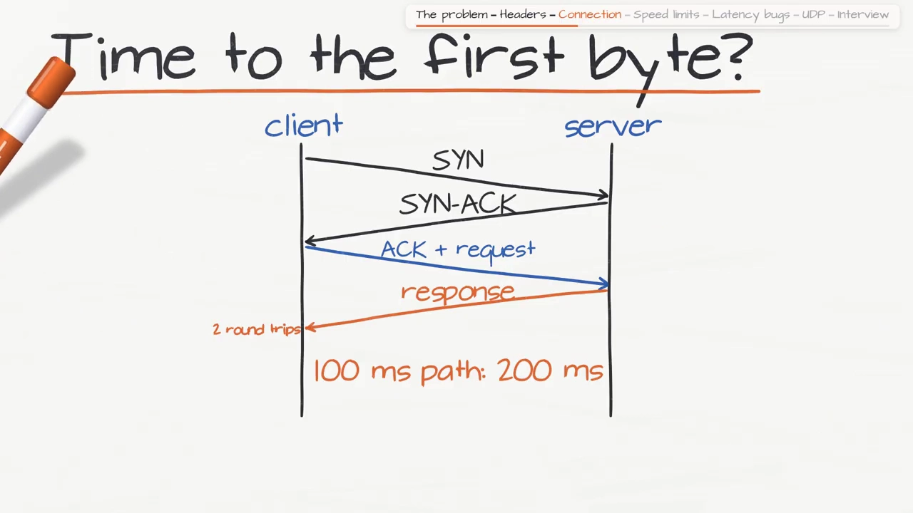
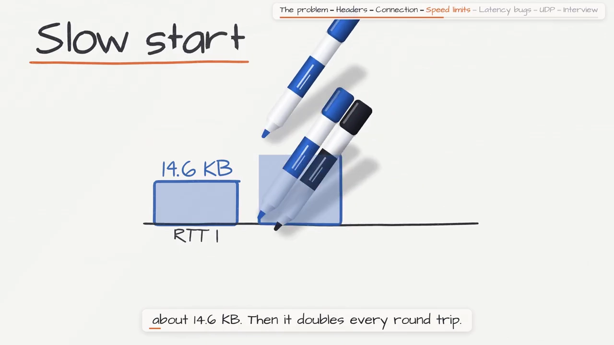
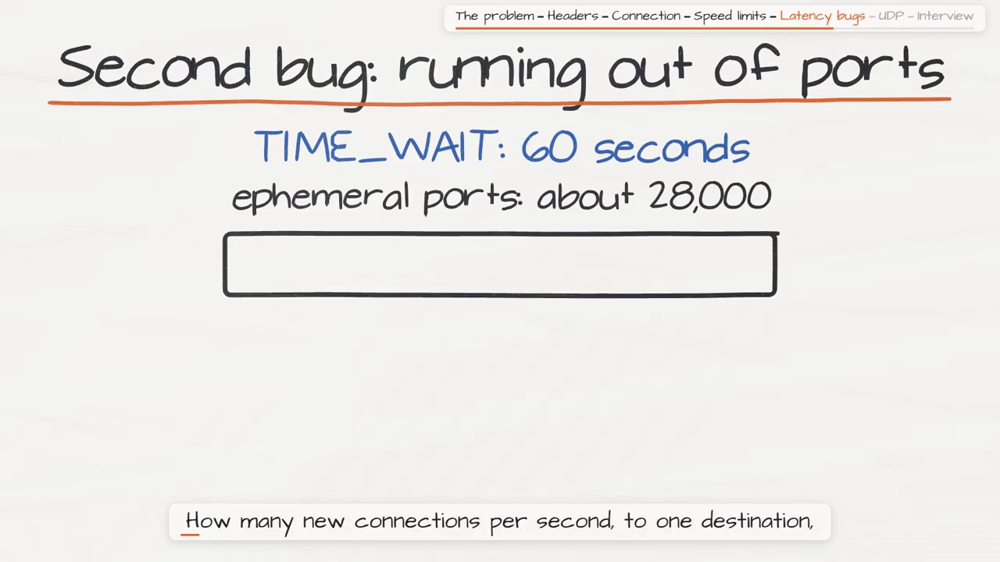

# 带宽不是瓶颈：跨节点搬运的时延由 RTT、窗口与丢包决定

> 视频来源：[TCP vs UDP: Why a 10 Gbps Link Crawls at 14 Mbps](https://www.youtube.com/watch?v=GPmcqUhyqlA)（YouTube · Beyond Binary，系统设计系列第 9 集）｜时长约 19 分钟
> 导读：上一节把跨节点恢复拆成「元数据 / 数据块 / 校验 / 挂载」四段，其中「取数据块」这一段大家习惯用「容量 ÷ 带宽」估时间。这支视频用一组反直觉的数字说明这个估法错得有多离谱：10 Gbps 的链路、100 ms 的距离，实测只能跑 14 Mbps，换更快的链路毫无变化。本文只取与恢复时延相关的部分——握手、窗口、慢启动、丢包封顶、连接复用——把「取数据块」那一段的时延模型算清楚；UDP、SYN flood、QUIC 等与恢复路径关系较远的内容只保留一句结论。文中的 10 GB 数字是按视频公式做的推算，不是视频里的实测。

## 本讲要解决的核心问题（SCQA）

**背景**：恢复一台卷，最耗时的一段是把数据块从远端搬到本地。估时间的方式通常是「容量 ÷ 带宽」：10 GB 的卷、1 Gbps 的链路，大约 82 秒。

**冲突**：视频开头给了一个反例——两个数据中心之间 10 Gbps 的链路，单向 100 ms 延迟，起一个大传输，实测只有 **14 Mbps**；买更快的链路，一点变化都没有。而且**什么都没坏**：一万个包里丢一个，经典 TCP 对丢包的反应完全按设计来 [【跳转到 00:00】](https://www.youtube.com/watch?v=GPmcqUhyqlA&t=0)。

**疑问**：如果带宽不是决定因素，那一次跨节点搬运的时间到底由什么决定？为什么「换更粗的管子」没用？

**回答（中心思想）**：TCP 的吞吐由三个量共同决定——**往返时延 RTT、接收窗口（以及拥塞窗口）、丢包率**。带宽只是上限，而且这个上限在公式里甚至不出现。因此「取数据块」这一段的时间是 $f(\mathrm{RTT}, W, p)$ 而不是 $f(\text{带宽})$；优化它的手段也不是换链路，而是**缩短 RTT、加大在途数据量、减少丢包、复用连接**。

## 一、第一笔开销：握手要走两个 RTT

### 1.1 见到第一个字节之前，已经花掉 2 个 RTT

TCP 建立连接要三次握手：客户端发 SYN（带起始序号），服务端回 SYN-ACK（带自己的序号），客户端再回 ACK。那么「响应的第一个字节」什么时候到？数一数趟数：**两个往返**——你的第一批数据在 1.5 个往返后到达服务端，响应在 2 个往返后回来。在 100 ms 的链路上，这就是 **200 ms**，什么都还没干 [【跳转到 04:39】](https://www.youtube.com/watch?v=GPmcqUhyqlA&t=279)。

对恢复来说，这笔开销是**按连接数**而不是按字节数计的。恢复要发多少请求，就要付多少次这样的固定成本——这正是「元数据段」时延近似等于「RTT × 请求数」的原因，也是连接池能省下大笔时间的原因。

### 1.2 服务端一侧还有两个队列

服务端内核维护两个队列：半开连接在 SYN 队列，握手完成的在 accept 队列，等应用来取。SYN flood 就是把 SYN 队列塞满、让真实用户进不来；对应的防御是 SYN cookies——把连接信息编码进自己的序号里，不占内存，直到最后一个 ACK 回来才真正分配 [【跳转到 05:04】](https://www.youtube.com/watch?v=GPmcqUhyqlA&t=304)。这一段与恢复时延关系不大，但它解释了一件事：**连接建立本身是有状态的、有队列的、会被打满的**，所以「每次恢复都新开一堆连接」不是免费的。

## 二、速度上限：窗口除以 RTT

### 2.1 16 位窗口把单连接锁在 5 Mbps

TCP 有两个独立的刹车：**流量控制**保护接收方（靠接收方通告的窗口），**拥塞控制**保护网络（靠发送方的拥塞窗口）；任一时刻在途的数据量只能是两者中较小的那个 [【跳转到 06:49】](https://www.youtube.com/watch?v=GPmcqUhyqlA&t=409)。

窗口字段是 16 位，最多约 65535 字节。一个窗口对应一个往返，所以在 100 ms 的路径上，单连接的最高速度是：

$$
\frac{65535\ \text{B}}{0.1\ \text{s}} \approx 655\ \text{KB/s} \approx 5\ \text{Mbps}
$$

**无论链路多快** [【跳转到 07:14】](https://www.youtube.com/watch?v=GPmcqUhyqlA&t=434)。

这就是第一个反直觉点：**在长肥链路上，限制你的是窗口，不是带宽**。如果恢复的每个数据块请求都走独立连接、且没有开窗口缩放，那么无论机房之间是 1 Gbps 还是 10 Gbps，单流吞吐都卡在 5 Mbps 左右。

### 2.2 窗口缩放与 BDP：窗口应该开多大

窗口缩放选项把这个字段最多乘 $2^{14}$，于是窗口可以到约 1 GB。那到底该多大？答案是**带宽时延积（BDP）**——把长管子灌满所需的在途数据量：

$$
\mathrm{BDP} = 1\ \text{Gbps} \times 0.1\ \text{s} = 12.5\ \text{MB}
$$

两端的 socket 缓冲区都至少要这么大 [【跳转到 07:39】](https://www.youtube.com/watch?v=GPmcqUhyqlA&t=459)。

对恢复的启示很直接：**要跑满 1 Gbps × 100 ms 的链路，发送端和接收端的缓冲区都得有 12.5 MB 量级**。如果恢复工具用的是默认 64 KB 缓冲区，那 1 Gbps 的链路也只能跑出 5 Mbps——和上面那个 16 位窗口的结论一模一样。

## 三、慢启动：小传输的时间与带宽无关

### 3.1 从 14.6 KB 起步，每个 RTT 翻倍

新连接的拥塞窗口从 10 个报文段开始，约 **14.6 KB**，然后每个往返翻一倍——这叫慢启动（虽然并不慢）[【跳转到 08:04】](https://www.youtube.com/watch?v=GPmcqUhyqlA&t=484)。

于是「发一个 100 KB 的响应要几个往返」有了答案：14.6 → 29.2 → 58.4，加起来约 102 KB，**刚好三个往返**；再加上握手，一共四个往返，约 400 ms——**无论链路多快** [【跳转到 08:23】](https://www.youtube.com/watch?v=GPmcqUhyqlA&t=503)。

### 3.2 为什么这对恢复很重要

恢复过程中的大部分请求都是**小请求**：取 manifest、取索引、取一个 4 MB 的数据块、取一段元数据。这些小请求的时间基本等于「握手 2 RTT + 慢启动若干 RTT」，与带宽无关。这解释了一个常见现象：**恢复一个几十 MB 的小卷，和恢复一个几 GB 的大卷，前几秒的耗时几乎一样**——前几秒花在往返上，不在字节上。

## 四、丢包封顶：Mathis 公式

慢启动结束后，窗口每个往返只增长一点，而**一次丢包就把窗口砍半**——这就是加性增、乘性减（AIMD）[【跳转到 08:48】](https://www.youtube.com/watch?v=GPmcqUhyqlA&t=528)。

把「增长」和「砍半」放在一起稳态求解，就得到 Mathis 公式：

$$
\text{吞吐} \approx \frac{1.22 \times \mathrm{MSS}}{\mathrm{RTT} \times \sqrt{p}}
$$

其中 MSS 是最大报文段长度（1460 字节），$p$ 是丢包率 [【跳转到 09:13】](https://www.youtube.com/watch?v=GPmcqUhyqlA&t=553)。

代入 1460 字节、100 ms、万分之一丢包：

$$
\frac{1.22 \times 1460}{0.1 \times \sqrt{10^{-4}}} = \frac{1781}{0.001} \approx 1.78\ \text{MB/s} \approx 14\ \text{Mbps}
$$

**公式里没有链路速率**。这就是开头那个谜题的答案：10 Gbps 的链路跑出 14 Mbps，不是链路坏了，是丢包在封顶。

## 五、两个生产 bug：40 ms 与 470 次/秒

视频里讲的两个「延迟 bug」在恢复路径上都会遇到，而且都被误诊成「存储慢」。

### 5.1 Nagle + delayed ACK = 固定 40 ms

一个本该 1 ms 的请求，每次都花 40 ms。原因是两个好主意撞在一起：Nagle 算法会压住小写入，等前面数据的 ACK 回来再发；Linux 的 delayed ACK 又会把 ACK 压约 40 ms。于是请求被拆成两小段写出去时，**两边互相等**。解法是一个 socket 选项：`TCP_NODELAY`，小写入立即发出 [【跳转到 10:28】](https://www.youtube.com/watch?v=GPmcqUhyqlA&t=628)。

对恢复的启示：如果恢复工具是「先发一个请求头、再发一个请求体」这种两段式写法，那么每次请求都会固定多付 40 ms。**请求数越多，这笔钱越贵**——元数据阶段几百个请求就是十几秒。

### 5.2 TIME_WAIT 与端口耗尽 = 470 次/秒

主动关闭连接的一方会把它留在 TIME_WAIT 状态 60 秒（Linux），用来吸收迟到的包。客户端只有约 28000 个临时端口，于是对同一个目的地址，新建连接的速度上限是：

$$
\frac{28000}{60} \approx 470\ \text{次/秒}
$$

超过这个速率，新连接开始失败 [【跳转到 11:18】](https://www.youtube.com/watch?v=GPmcqUhyqlA&t=678)。解法是**连接池 + keep-alive**，复用连接而不是每次新建；也可以扩大端口范围或分散到更多目的地址 [【跳转到 11:43】](https://www.youtube.com/watch?v=GPmcqUhyqlA&t=703)。

这一条直接决定了恢复的**并发度上限**：想用「开 500 个并发连接拉数据块」来提速，如果每个块都新建连接，很快就会撞到端口墙，反而更慢。**连接池是并发拉块的前提**。

## 六、把账算到一次 10 GB 的跨节点恢复上

视频给的是公式，下面把它代进恢复场景（以下为按视频公式的推算）：

设跨机房单向 50 ms，即 RTT = 100 ms。

| 条件 | 单流有效吞吐 | 10 GB 需要 |
| :--- | :--- | :--- |
| 窗口 64 KB（未开窗口缩放） | 655 KB/s | ≈ 4.4 小时 |
| 窗口按 BDP 开满，1 Gbps，无丢包 | ≈ 125 MB/s | ≈ 82 秒 |
| 窗口开满，但丢包 $10^{-4}$ | ≈ 1.78 MB/s | ≈ 1.6 小时 |
| 同上，开 8 条并发流 | ≈ 14 MB/s | ≈ 12 分钟 |

四行的差别说明：

1. **窗口没开**：链路再粗也没用，时间由 RTT 和窗口决定，10 GB 要几小时；
2. **窗口开满、无丢包**：这时候才轮到带宽说话，82 秒是理论上限；
3. **有万分之一丢包**：吞吐被 Mathis 公式封在 1.78 MB/s，比带宽上限低 70 倍——**这就是「10 Gbps 跑出 14 Mbps」在恢复场景里的样子**；
4. **开并发流**：每条流各自做慢启动、各自被丢包砍半，但总吞吐近似线性叠加，是把 1.6 小时拉回 12 分钟的最直接手段。

再叠加前面几节的两笔固定开销：如果恢复要发 1000 个元数据请求、每个请求走新连接，光握手就是 $1000 \times 2 \times 100\ \text{ms} = 200$ 秒；如果每个请求还踩中 Nagle/delayed ACK，再加 40 秒。**这些开销与卷容量完全无关**，却是小卷恢复慢的主因。

## 七、能动的旋钮

视频最后给的四个手段，正好对应上面四项：

- **缩短 RTT**：把连接终止在离用户更近的边缘（CDN 就是干这个的），RTT 从 100 ms 降到 10 ms，窗口不变吞吐直接 ×10 [【跳转到 09:38】](https://www.youtube.com/watch?v=GPmcqUhyqlA&t=578)；
- **并行连接**：多条流叠加，绕过单流的窗口/丢包限制；
- **换算法**：Cubic 把任何丢包都当拥塞；Google 的 BBR 改为测量瓶颈带宽和最小 RTT，据 Google 报告，YouTube 用 BBR 后吞吐平均提升 4%、RTT 下降 33% [【跳转到 09:45】](https://www.youtube.com/watch?v=GPmcqUhyqlA&t=585)；
- **连接复用**：`TCP_NODELAY` + 连接池 + keep-alive，把固定开销从「每请求一次」摊成「每连接一次」[【跳转到 14:15】](https://www.youtube.com/watch?v=GPmcqUhyqlA&t=855)。

## 小结

- 「容量 ÷ 带宽」估不准恢复时间，因为 TCP 的吞吐由 **RTT、窗口、丢包** 三者决定，带宽只是上限，甚至在 Mathis 公式里不出现。
- 见到第一个字节要 **2 个 RTT**；这笔开销按**连接数**计，不按字节数计，所以元数据阶段的时间 ≈ RTT × 请求数。
- 16 位窗口把单连接锁在「65535 字节 / RTT」；100 ms 路径上就是 5 Mbps，与链路速率无关。窗口要按 **BDP** 开（1 Gbps × 100 ms = 12.5 MB）。
- 慢启动让**小传输的时间与带宽无关**：100 KB 的响应要 4 个 RTT，约 400 ms。
- 丢包用 Mathis 公式封顶：1.46 KB、100 ms、万分之一丢包 → 约 14 Mbps，这就是「10 Gbps 跑出 14 Mbps」的原因。
- 两个固定开销：Nagle + delayed ACK 的 40 ms/请求；TIME_WAIT + 28000 端口把新建连接锁在 470 次/秒。
- 因此恢复的优化方向是**缩短 RTT、开满窗口、并发多流、复用连接**，而不是换更粗的链路。

## 关键术语速查

| 术语 | 一句话解释 |
| :--- | :--- |
| RTT | 往返时延，一个包从发出去到收到确认的时间 |
| MSS | 最大报文段长度，以太网 1500 字节 MTU 减去 IP 与 TCP 头后为 1460 字节 |
| 接收窗口 | 接收方通告的「还能收多少」，16 位字段，最大约 65535 字节 |
| 窗口缩放 | 把窗口字段乘以最多 $2^{14}$ 的选项，长肥链路必需 |
| 拥塞窗口 | 发送方维护的「网络还能承受多少」，由慢启动和 AIMD 调整 |
| BDP（带宽时延积） | 灌满一条链路所需的在途数据量，= 带宽 × RTT |
| 慢启动 | 新连接从 10 个报文段起步，每个 RTT 翻倍 |
| AIMD | 加性增、乘性减：每 RTT 小幅加窗，遇丢包砍半 |
| Mathis 公式 | 吞吐 ≈ 1.22 × MSS / (RTT × √丢包率) |
| TCP_NODELAY | 关闭 Nagle 算法，让小写入立即发出 |
| TIME_WAIT | 主动关闭方保留连接状态 60 秒，用于吸收迟到报文 |