# 按需拉取：把跨节点恢复的等待从「搬完整个卷」改成「只搬要用的块」

> 视频来源：[Startup Containers in Lightning Speed with Lazy Image Distribution](https://www.youtube.com/watch?v=H4Lbi26CqNU)（YouTube · KubeCon + CloudNativeCon Europe 2020 · 讲者 Kohei Tokunaga，NTT，stargz snapshotter 维护者）｜时长约 25 分钟
> 导读：这是一节把「从远端取一份 rootfs 快照」拆成时延账的分享。视频讲的是容器镜像的 lazy pull，但它拆的正是**跨节点恢复**的同一条路径：先取元数据（manifest + 索引），再按需取数据块（HTTP Range Request），最后挂载成 FUSE 让读写落到远端。本文把这条路径上的四段耗时逐段对上，并用讲者的实测数字（338 MB 镜像 32 秒 → 7.2 秒）说明「首字节时延」和「全量时延」差在哪里。字幕里的 `stargz` 被识别成 `sergio/sergey/sturdy`、`containerd` 被识别成 `continuity/contrary`、`pull` 被识别成 `pool`、`eStargz` 被识别成 `estradiol/estrogen` 等，已订正。

## 本讲要解决的核心问题（SCQA）

**背景**：把一个卷（或一份 rootfs 快照）从远端节点恢复到本地节点，最直觉的做法是「把字节搬完，再挂起来用」。所以大家估时间的方式也很直觉：容量除以带宽。10 GB 的卷、100 MB/s 的链路，大约 100 秒。

**冲突**：讲者引用的实测数据把这个直觉打破了——**拉取占了容器启动时间的 76%，但真正被读到的数据只有 6.4%** [【跳转到 01:52】](https://www.youtube.com/watch?v=H4Lbi26CqNU&t=112)。

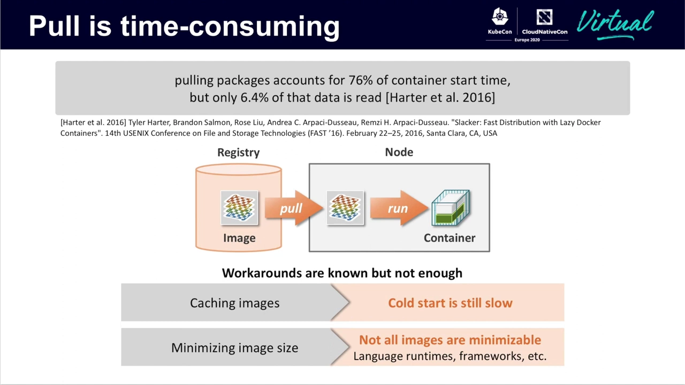

也就是说，恢复过程里绝大部分时间在搬一批「搬完之后根本不会被读」的字节。这不是带宽不够，而是搬的顺序不对。缓存和瘦身这两条常备解法也不够用：缓存救不了第一次的冷启动，镜像（卷）也不是想瘦就能瘦，语言运行时、框架这些大块头躲不掉 [【跳转到 02:17】](https://www.youtube.com/watch?v=H4Lbi26CqNU&t=137)。

**疑问**：一次跨节点恢复的时间到底花在哪几段？哪几段必须同步等完才能开始用，哪几段可以推迟到「真的读到了」再发生？

**回答（中心思想）**：一次跨节点恢复可以拆成**四段**——取元数据、取数据块、校验、挂载。其中只有「取元数据」和「挂载」是必须同步等完的；「取数据块」可以从「恢复时全量搬」推迟成「访问时按块拉」，于是用户感知的等待从**全量时延**变成**首字节时延**。讲者的实测把这条账算得很直白：同一个 338 MB 的 `python:3.7` 镜像，传统全量拉取 32 秒，按需拉取 7.2 秒 [【跳转到 06:53】](https://www.youtube.com/watch?v=H4Lbi26CqNU&t=413) [【跳转到 07:33】](https://www.youtube.com/watch?v=H4Lbi26CqNU&t=453)。

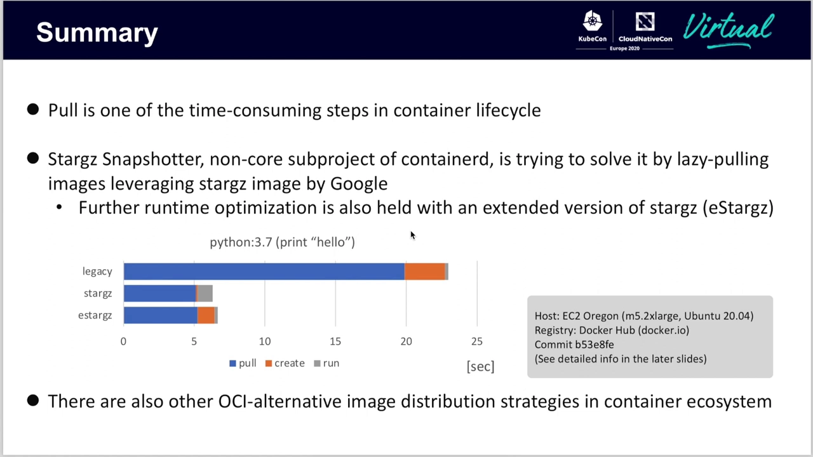

## 一、先看默认路径：为什么它必须「搬完才能用」

### 1.1 默认路径是「整块 blob 下载 + 顺序解包」

在 OCI / Docker 的分发规范里，一个容器（或一份 rootfs）是一组**层**；层在镜像规范里定义成 tar（可选再加压缩），容器由这些层合并而成；分发规范则把一层定义成一个用内容摘要寻址的 blob，通过 registry 的 HTTP API 拉下来 [【跳转到 03:05】](https://www.youtube.com/watch?v=H4Lbi26CqNU&t=185)。

问题就出在「层 = tar」这个定义上：**在所有层都本地可用之前，容器起不来**，哪怕启动时根本用不到层里的大部分内容 [【跳转到 04:18】](https://www.youtube.com/watch?v=H4Lbi26CqNU&t=258)。

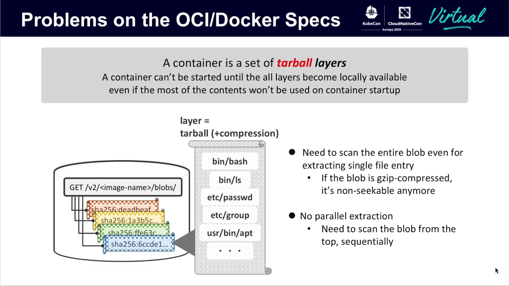

### 1.2 tar.gz 的两个硬约束：不可 seek、不可并行

tar 是流式格式，要找第 N 个文件必须从头扫过前 N−1 个文件的头部；再套一层 gzip，整个 blob 就**不再可随机访问**，只能从头顺序解压 [【跳转到 05:08】](https://www.youtube.com/watch?v=H4Lbi26CqNU&t=308)。

这两条约束直接决定了时延结构：

- 你没法「只取需要的那个文件」，因为不知道它在哪、也没法只解压它；
- 你没法并行解压，因为 gzip 是流式的，第 N 块依赖前面所有块。

于是「取数据块」这一段只能是一个**串行的、全量的**搬运，时间 ≈ 容量 ÷ 有效带宽。这就是全量时延。

### 1.3 把恢复拆成四段，看清哪一段必须等

按讲者描述的路径，一次跨节点恢复可以拆成下面四段。表中「能否推迟」一列是本文的归纳，用来对齐后面 stargz 的做法：

| 段 | 搬的是什么 | 时延主要来自 | 能否推迟到访问时 |
| :--- | :--- | :--- | :--- |
| 1 取元数据 | manifest、层清单、索引（stargz 的 TOC） | 请求数 × RTT、元数据服务 QPS、索引大小 | 不能，必须先拿到 |
| 2 取数据块 | 层里的实际字节 | 带宽、并发度、块大小、首字节延迟 | 能，按需拉即可 |
| 3 校验 | 内容摘要、压缩流校验 | CPU、是否并行 | 随第 2 段一起做 |
| 4 挂载 | 把快照挂成可用文件系统 | 建表、FUSE 挂载、卷 attach | 不能，但可以很轻 |

关键洞察是：**第 2 段是唯一「体量随容量线性增长」的段**，第 1、4 段基本是常数级开销，第 3 段跟着第 2 段走。所以想让恢复时间不随卷容量线性增长，唯一可动的就是第 2 段——把它从「全量」改成「按需」。

## 二、stargz：把层改成「可随机访问的索引 + 数据块」

### 2.1 格式上的两个改动

stargz（seekable tar.gz）由 Google 的 CRFS 项目提出，名字就是 **seekable tar.gz**：它仍然是一个合法的 targz，因此仍然是合法的 OCI / Docker 层，但**每个文件条目单独 gzip 压缩**，并且**在 blob 尾部放一个 TOC（目录）**，记录每个条目的偏移和所有文件的元数据 [【跳转到 10:20】](https://www.youtube.com/watch?v=H4Lbi26CqNU&t=620) [【跳转到 11:35】](https://www.youtube.com/watch?v=H4Lbi26CqNU&t=695)。

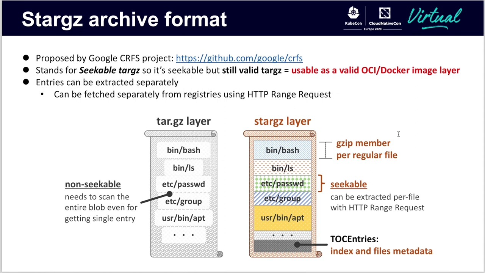

这两个改动正好对应上面四段里的两段：

- **TOC 让第 1 段变轻**：拿到 TOC 就知道每个文件在 blob 里的字节偏移，不用扫头部就能挂载这一层 [【跳转到 12:00】](https://www.youtube.com/watch?v=H4Lbi26CqNU&t=720)；
- **按条目压缩让第 2 段可以切片**：每个条目可以用一次 HTTP Range Request 单独取，不必取整个 blob [【跳转到 10:45】](https://www.youtube.com/watch?v=H4Lbi26CqNU&t=645)。

### 2.2 挂载成 FUSE，读文件时才触发下载

真正把「按需」落到系统里的是挂载方式：stargz snapshotter 把容器的 rootfs 快照**挂成 FUSE**，挂载时大部分层内容还没下载，等容器访问某个文件时，才从标准 registry 按需把这个文件的内容拉下来 [【跳转到 08:40】](https://www.youtube.com/watch?v=H4Lbi26CqNU&t=520)。

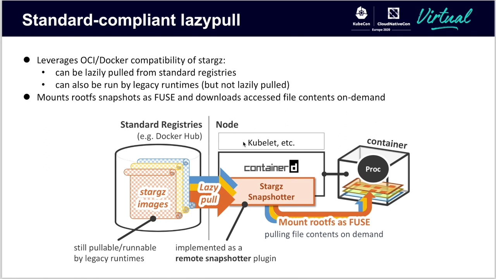

这条路径把恢复的时序改成了：

1. 取 manifest（小）；
2. 取 TOC（小）；
3. FUSE 挂载（本地操作）；
4. 容器开始跑——**此刻恢复就已经「完成」了**；
5. 之后每一次缺页/读文件，才触发一次 Range Request 去拉对应的块。

这就是「首字节时延」和「全量时延」的分界：用户等的是第 1–3 步，第 5 步被摊到了运行期。

### 2.3 代价：每一次首次读都是一次网络往返

按需不是免费的。讲者明确提醒：**按需取一个条目时，网络相关的开销不能被忽略**，尤其是在慢网络环境下，因为对 stargz 上一个文件的读访问，会直接引发一次从 registry 下载该文件条目的动作 [【跳转到 12:00】](https://www.youtube.com/watch?v=H4Lbi26CqNU&t=720)。

换句话说，全量拉取把 N 次小请求换成了 1 次大传输；按需拉取把大传输拆回了 N 次小请求。当 N 很大、RTT 不低时，第 5 步的累计时延可能反超。这正是下一节 eStargz 要解决的问题。

## 三、eStargz：把「等会儿要用」的文件提前排到前面

### 3.1 优先级分组 + 一次 Range 请求预取

eStargz 的思路是：既然运行期真正会读的文件是少数且可预测的，那就把它们标成**优先文件（prioritized files）**，在层里按优先级重新排序；挂载时用**一次** HTTP Range Request 把这些文件一起预取并预缓存到本地 [【跳转到 12:25】](https://www.youtube.com/watch?v=H4Lbi26CqNU&t=745)。

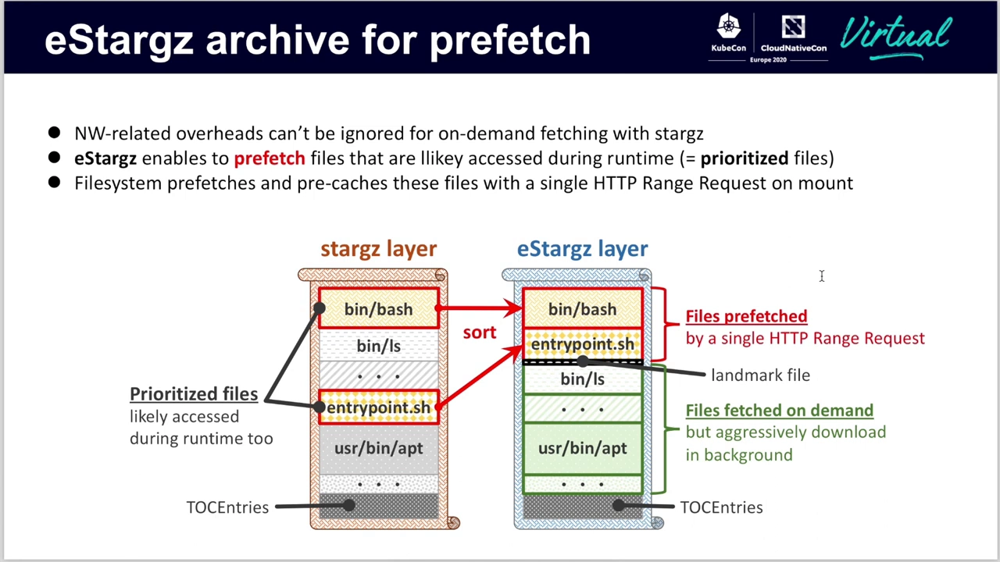

注意这里有两档策略：

- **预取**：优先文件用一次 Range 请求成批拿回来，把 N 次往返压成 1 次；
- **后台积极下载**：非优先文件在挂载后由后台继续拉，用户读到它们时大概率已经在本地。

### 3.2 优先级从哪来：在沙箱里跑一遍

「哪些文件会被读」不是猜的。讲者介绍了项目提供的 CLI converter：容器一般是有明确用途的，workload 写在 Dockerfile 里（entrypoint、user、envvar 等）；converter 把镜像放到沙箱里跑一遍，**profile 所有文件访问**，把这些访问过的文件当作运行期也可能被访问的优先文件，重新生成 eStargz [【跳转到 14:25】](https://www.youtube.com/watch?v=H4Lbi26CqNU&t=865)。

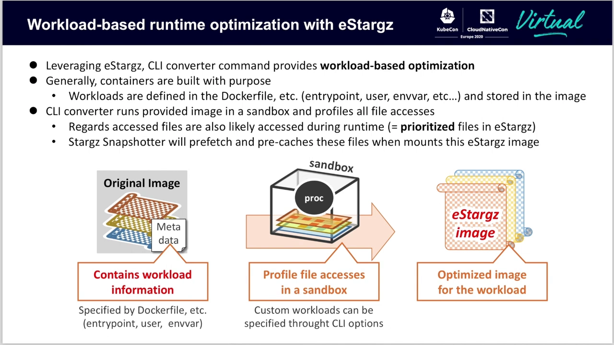

这是一个很通用的思路：**恢复的预取清单，应该由「这份数据将被怎么用」决定，而不是由「数据在存储里怎么排」决定**。放到卷恢复上，等价于「按应用的访问模式预热快照」。

### 3.3 预取也要等：create 阶段被拉长

预取的代价在实测里非常明显：因为容器创建时要**等预取完成**，eStargz 的 create 段比 stargz 长 [【跳转到 16:57】](https://www.youtube.com/watch?v=H4Lbi26CqNU&t=1017)。这提醒一件事：预取不是免费的加速，它只是把「运行期零散的等待」集中成「启动时一次成批的等待」——总量可能更小（少了 N−1 次往返），但峰值等待变长了。

## 四、实测：32 秒 → 7.2 秒

### 4.1 一个 338 MB 的镜像

讲者现场演示：`python:3.7` 镜像在 registry 上大约 338 MB，用传统方式拉取大约 **32 秒**；同一份镜像换成 stargz 格式（不是 squash，内容一点没少）后按需拉取，大约 **7.2 秒** [【跳转到 06:53】](https://www.youtube.com/watch?v=H4Lbi26CqNU&t=413) [【跳转到 07:33】](https://www.youtube.com/watch?v=H4Lbi26CqNU&t=453)。如果镜像变成 1 GB、2 GB，传统拉取会线性变长，而按需拉取的等待基本只取决于「元数据 + 启动时真正读到的那些文件」。

讲者还提示：他在东京拉这个镜像，换个位置结果会不同；后面在 Oregon 的基准测试里，按需拉取的时间更短 [【跳转到 07:43】](https://www.youtube.com/watch?v=H4Lbi26CqNU&t=463)。**同一份数据、同样的容量，恢复时间随地理位置变化**——这正说明瓶颈在 RTT 和链路，而不是在数据量。

### 4.2 基准测试：三段耗时被拆开了

基准测试的口径是：容器启动时间包含从 Docker Hub 拉镜像；语言类容器跑一个 print hello world，服务类容器则等到打出「up and running」。方法基于 HelloBench，取 100 次操作的 95 分位，宿主机是 EC2 Oregon 实例，registry 是 Docker Hub [【跳转到 15:37】](https://www.youtube.com/watch?v=H4Lbi26CqNU&t=937)。

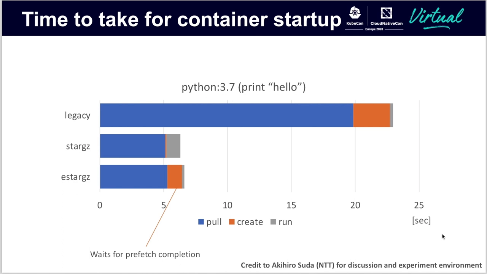

这张图值得逐段读：

- **legacy**：pull 占绝对大头（二十多秒），create 和 run 都很短；
- **stargz**：pull 被压到 5 秒左右，但 run 变长——因为运行期第一次读文件要现场去拉；
- **eStargz**：run 的额外开销被预取补回来，代价是 create 段要等预取完成。

也就是说，**按需拉取是把时间从 pull 段挪到了 run 段**，eStargz 再把它从 run 段挪回 create 段并压缩总量。三段的总和才是用户真正感知的启动时间。

### 4.3 两个反例：profile 不到就会退化

`gcc:9.2.0` 这个镜像要编译并运行一个 hello world C 程序，但**源码不在镜像里**，是运行期通过挂载源码目录提供的。项目的优化命令当时还不支持挂载外部目录，所以 workload 优化 profile 不到这部分文件访问，run 段依然变慢 [【跳转到 17:47】](https://www.youtube.com/watch?v=H4Lbi26CqNU&t=1067)。

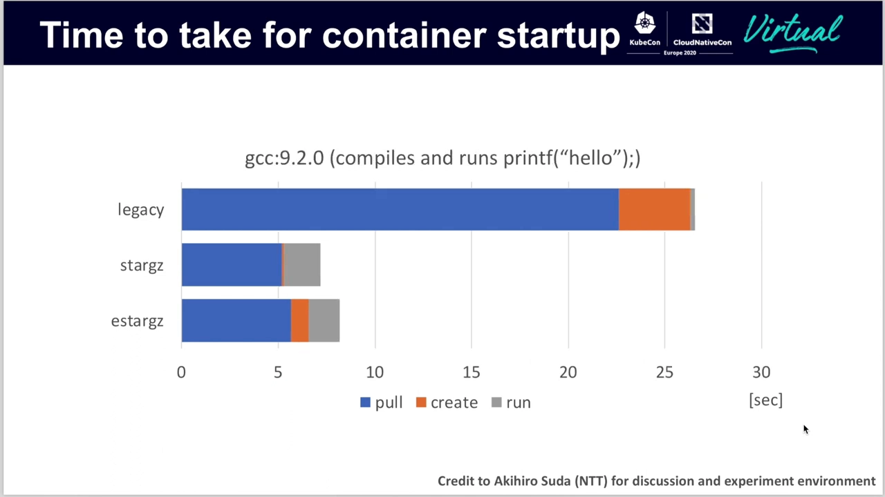

`glassfish:4.1-jdk8` 是服务端镜像，情况更微妙：stargz 的 pull 很短，但**服务初始化（run）明显变长**；eStargz 把这段补了回来，代价又是 create 段等预取 [【跳转到 18:37】](https://www.youtube.com/watch?v=H4Lbi26CqNU&t=1117)。

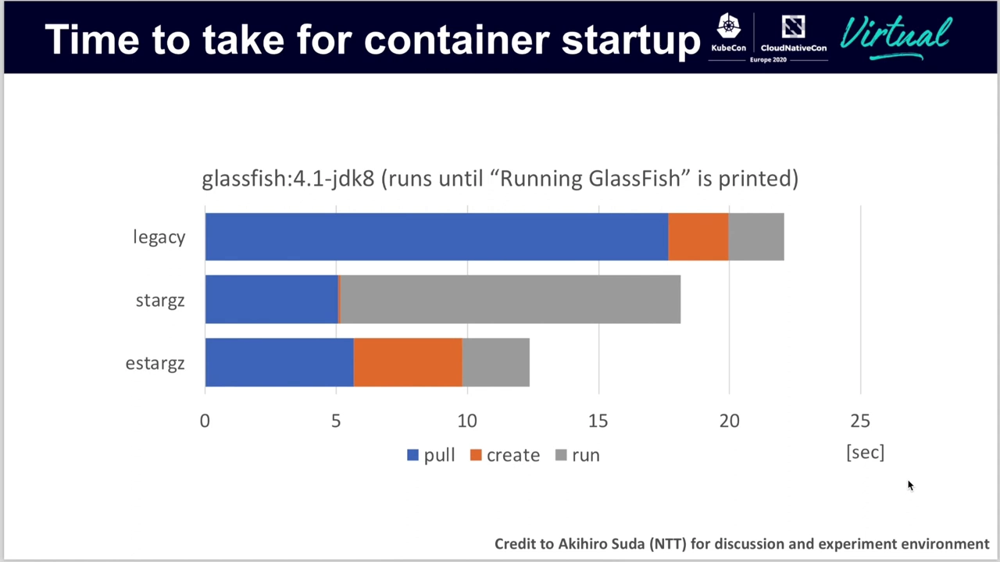

这两张图给的是同一个教训：**按需拉取只对「访问模式可预测、且启动时只读一小部分」的负载有效**。访问模式不可预测（如编译、随机读），按需就把时延从恢复期搬到了运行期，总量未必下降。

## 五、把账算到一台 10 GB 的卷上

视频给的是容器镜像的数字，但同一套账可以直接搬到卷恢复上。假设恢复一台 10 GB 的卷（10 GB ≈ 10240 MB），下面三行是按视频给出的机制做的推算（不是视频里的实测）：

| 方式 | 需要搬的字节 | 100 MB/s 链路 | 1 Gbps 链路（≈125 MB/s） |
| :--- | :--- | :--- | :--- |
| 全量恢复 | 10240 MB | ≈ 102 秒 | ≈ 82 秒 |
| 全量恢复 + 压缩（按 3:1 估） | ≈ 3413 MB | ≈ 34 秒 | ≈ 27 秒 |
| 按需恢复（只读 6.4%） | ≈ 655 MB + 元数据 | ≈ 7 秒 + 首字节时延 | ≈ 5 秒 + 首字节时延 |

三行之间的差距说明两件事：

1. **全量恢复的时间由带宽决定，且随容量线性增长**。100 MB/s 和 1 Gbps 只差 20 秒——因为这两条链路的带宽本来就在同一量级，换链路救不了容量；
2. **按需恢复的时间由「启动时真正读了多少」决定**，与卷的总容量脱钩。6.4% 这个比例来自讲者引用的容器镜像研究，卷上的真实比例要看负载；但方向是一致的：只要启动只读一小部分，按需就把 102 秒压到个位数秒。

代价写在另一栏里：按需恢复多了「首字节时延」这一项，也就是第 5 步每次缺页都要一次往返。所以按需恢复的适用条件是——**启动阶段的读集小且可预测**（数据库启动要扫全表、编译要读全部头文件，就不适合）。

## 六、同一个思路的其它形态

讲者在最后扫了一遍社区里的其它按需分发方案，它们和 stargz 的差别主要在「索引放在哪、数据块怎么切」：

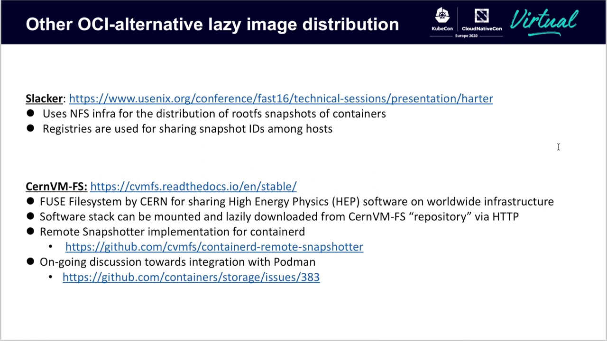

- **Slacker**：用 NFS 基础设施分发容器的 rootfs 快照，registry 只用来在主机之间共享快照 ID；
- **CernVM-FS**：CERN 为高能物理软件做的 FUSE 文件系统，软件栈可以挂载后按需从 HTTP 仓库下载，且有 containerd 的 remote snapshotter 实现；
- **Nydus**（Akihiro Suda 提出）：OCI 兼容的镜像格式，但用 containerd 的 manifest 做层，文件按内容寻址的 blob 拉取，重复数据在文件粒度上去重；
- **OCIv2**（Aleksa Sarai 提出，尚非正式规范）：讨论中还包括挂载多种文件系统；
- **CRFS 插件**（Giuseppe Scrivano，Red Hat）：FUSE-overlayfs 的插件，用来挂载 stargz 层 [【跳转到 21:36】](https://www.youtube.com/watch?v=H4Lbi26CqNU&t=1296)。

讲者对这些方案的适用场景也给了清单：多阶段构建里 base 镜像的分发、开发/测试环境的构建流水线、共享大型科学软件栈（ML 框架动辄 1 GB 以上）、以及 serverless 的冷启动优化 [【跳转到 19:12】](https://www.youtube.com/watch?v=H4Lbi26CqNU&t=1152)。

## 七、边界与坑

讲者在结尾给了几条很实在的提醒，正好对应「时延构成」里容易被忽略的两项：

- **实现还在早期**，可见性能受网络状况、实例位置影响很大 [【跳转到 20:52】](https://www.youtube.com/watch?v=H4Lbi26CqNU&t=1252)；
- **冷容器要小心**：在层内容被完整缓存到节点之前，按需拉取的收益和风险都还在 [【跳转到 20:52】](https://www.youtube.com/watch?v=H4Lbi26CqNU&t=1252)；
- **profile 覆盖不到的部分会退化**：运行期挂进来的目录（源码、数据卷）不在镜像里，优化命令看不到，run 段就回到「现场去拉」的状态。

## 小结

- 一次跨节点恢复可以拆成四段：**取元数据、取数据块、校验、挂载**。只有第 2 段的体量随容量线性增长，所以优化必须动它。
- 默认路径「层 = tar(.gz)」的两个硬约束——**不可 seek、不可并行解压**——逼着恢复必须全量、串行地搬完，这就是全量时延的来源。
- stargz 用两个格式改动解开了约束：**每个文件单独 gzip + 尾部 TOC**，于是可以按条目用 HTTP Range Request 单独取；再配合 FUSE 挂载，把「取数据块」推迟到访问时。
- 这样用户等的就从**全量时延**变成**首字节时延**：338 MB 的镜像从 32 秒变成 7.2 秒。
- 按需的代价是**每次首次读一次往返**；eStargz 用「优先级排序 + 一次 Range 预取」把 N 次往返压成 1 次，代价是 create 段要等预取完成。
- 实测里三段（pull / create / run）的总和才是用户感知的时间：按需把时间从 pull 挪到 run，预取再把它挪回 create 并压缩总量。
- 这套方法只对**启动读集小且可预测**的负载有效；编译、随机读这类负载，按需只是把等待搬到了运行期。

## 关键术语速查

| 术语 | 一句话解释 |
| :--- | :--- |
| 层（layer） | OCI 镜像里的一层文件系统内容，规范上定义成 tar（可选加压缩） |
| blob | registry 里按内容摘要寻址的一段字节，一层就是一个 blob |
| stargz | seekable tar.gz，每个文件一个 gzip member，尾部带 TOC，仍是合法 targz |
| TOC | stargz blob 尾部的索引，记录每个条目的偏移和所有文件的元数据 |
| eStargz | stargz 的扩展，按优先级重排条目，支持挂载时一次 Range 请求预取 |
| HTTP Range Request | 只取 blob 中某一段字节的请求，按需拉取的前提 |
| lazy pull | 不在恢复时下载全部内容，访问到哪块才拉哪块 |
| remote snapshotter | containerd 的插件类型，允许从远端存储直接挂载 rootfs 快照 |
| 全量时延 / 首字节时延 | 搬完全部字节才可用 vs 拿到能开始用的最小集合即可用 |
| 冷启动（cold start） | 节点上没有任何缓存的第一次恢复，缓存救不了它 |