# 断点续传靠分块，完整性靠两级校验

> 视频来源：[Design a File Upload Service: Resumable, Presigned, Verified](https://www.youtube.com/watch?v=z6OPj6Ostto)（YouTube · GrowAsEngineers / Prateek Goel）｜时长约 39 分钟
> 导读：这是一节系统设计课，讲者用「一个 5 GB 视频传到 98% 断了」这个场景，一步步推演出分块续传、块级校验、整份校验、幂等重传与孤儿块清理。本文只取与本小节相关的两条线：**中断之后怎么接上**，以及**怎么证明没传坏**；容量估算、预签名 URL 的鉴权细节、分片扩容等部分只保留与这两条线相关的结论。

## 本讲要解决的核心问题（SCQA）

**背景**：把一个几 GB 的文件（或一份卷快照）从一台机器搬到另一台机器，中间要经过电缆、路由器、磁盘，任何一段都可能出问题。一次长传输动辄几十分钟。

**冲突**：讲者算了一笔账。一条 5 GB 的上传，在 1.25 MB/s 的家用上行带宽下要跑 4000 秒，也就是 67 分钟；而连接大约每小时断一次，于是这 67 分钟里平均会遇到 1.1 次断线。如果断线是随机发生的，一次都不遇上的概率只有约 33%——**三分之二的大文件上传注定会断**。更糟的是，断线平均落在中途，一次断线就扔掉 33 分钟的工作量。而重传本身还可能再断。

**疑问**：既然中断是常态而不是意外，怎么让一次中断只损失几秒钟而不是半小时？又怎么证明最终存下来的字节，和发送方磁盘上的字节一模一样？

**回答（中心思想）**：把长传输切成**带编号的小块**，让中断只影响一块；把「有没有传坏」变成**两级可计算的指纹**——每块一个校验和，整份一个 SHA-256；再把「传到哪了」这个状态交给**存储侧记账**，让重传天然幂等。这样，恢复策略和校验方式就都变成了协议的一部分，而不是靠人盯着重试。

---

## 一、长传输的敌人不是请求数，是「暴露时间」

### 1.1 请求数看起来很正常，字节数才是问题

讲者先给了一个「最简单能跑」的设计：用户把整个文件放在一个请求里发给上传服务器，服务器边收边写进对象存储，最后一个字节落盘后，往元数据库写一行记录，返回文件 ID。

这个设计在模拟器里跑 1250 次完成/秒时，一台上传服务器只用了 16% 的容量，全绿。但讲者提醒：**模拟器数的是请求数，不是字节数**，而每个请求背后都是一个要传几分钟的整文件。[【跳转到 14:02】](https://www.youtube.com/watch?v=z6OPj6Ostto&t=842)

把真实数字代进去，问题立刻显形：10 万路并发上传，每路 1.25 MB/s，合起来就是 125 GB/s，约 1 Tb/s。单台服务器的网卡按 1.25 GB/s 算，光是「接字节」就要 100 条链路；按 80% 水位留余量，需要 125 台服务器专门搬字节。

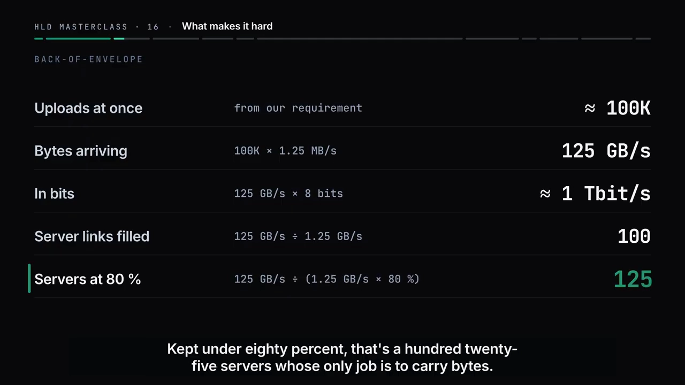

### 1.2 一次断线为什么能吃掉半小时

真正致命的不是带宽，而是**暴露时间**：一次传输持续得越久，它撞上一次断线的概率就越大，而一旦撞上，整文件方案会把已经传完的部分全部作废。

讲者的估算很直白：67 分钟的上传，每小时断一次，期望断线次数 1.1 次；若断线服从随机到达，一次都不撞的概率约

$$
P(\text{零次断线}) \approx e^{-1.1} \approx 33\%
$$

也就是说，**三次大文件上传里有两次会断**，而且断点平均落在中途——一次断线扔掉 33 分钟。[【跳转到 05:39】](https://www.youtube.com/watch?v=z6OPj6Ostto&t=339)

### 1.3 于是问题被拆成四个

讲者把难点归纳成四条，其中与本小节直接相关的是后两条：

- **吞吐**：要流动的是 1 Tb/s 的字节，不是请求数；
- **可靠性**：长传输跑在会断的连接上，却要 99.9% 的成功率；
- **完整性**：在每秒几十亿字节的规模上，每个字节都必须和发送时一致；
- **存储**：每天几 PB 的数据，外加没传完的残留。

结论是：**难点不在收到多少请求，而在搬多少字节、以及每一份传输在断线面前暴露了多久。** 这句话直接决定了后面两个设计动作——把传输切短，把校验做细。

---

## 二、把大文件切成编号的块，中断只损失一块

### 2.1 一个搬家的类比

讲者的类比是搬家：用一辆巨大的卡车一次拉完，车坏在路上，所有东西都卡住；改成把家当装进**编号的纸箱**，掉了一箱就只补那一箱，箱子上的编号还告诉你该怎么按顺序拆开。

这就是分块（chunking）：**把一次大传输拆成带编号的小片，每一片单独发送、单独确认。**

### 2.2 为什么是 5 MB

在这套设计里，切片叫 **part（块）**，每块 5 MB。选 5 MB 有两个理由：

- 它是 S3 允许的最小块大小（最后一块除外）；
- 它足够小，丢一块的代价很小。

于是 Maya 那个 20 MB 的视频变成 4 块（1、2、3、4），一个 5 GB 的文件变成 1000 块。规则只有一条：**每一块要么被确认，要么没有**；断线之后，只重发没被确认的那些块。[【跳转到 08:45】](https://www.youtube.com/watch?v=z6OPj6Ostto&t=525)

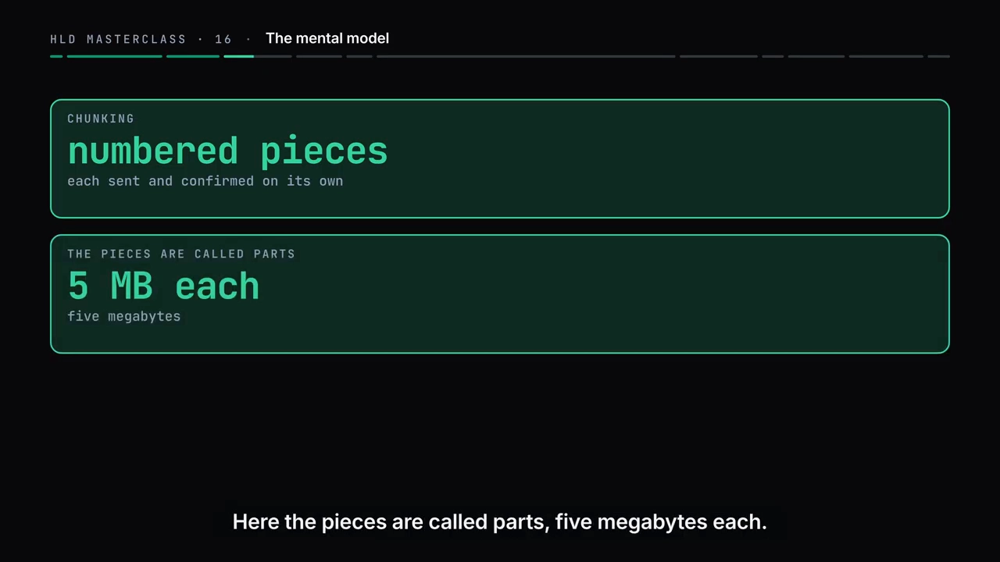

### 2.3 断点续传的状态：一个会话 ID 加一份已确认清单

续传要能成立，客户端必须能问出一句话：**「这个上传，你手上已经有哪几块？」**

讲者给的接口契约里，这件事由两个东西承担：

1. **上传会话**：客户端先发一个「开始上传」的请求，带上文件名、大小、类型和整份文件的 SHA-256；服务端返回一个 **upload ID** 和块大小（5 MB）。
2. **已确认块清单**：客户端再查一次这个上传的**状态**，拿回**已经确认的块号列表**；然后只补发剩下的块。[【跳转到 10:56】](https://www.youtube.com/watch?v=z6OPj6Ostto&t=656)

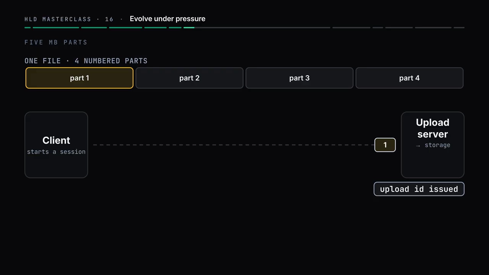

整份契约一共五个调用：**start**（开会话，带整份 SHA-256）、**part**（发一块，带块校验和）、**status**（问已确认的块号）、**complete**（提交块清单，让存储拼装）、以及下载/分享。其中 `status` 就是续传的入口——**它返回的不是「进度百分比」，而是「哪几块已经在」这个事实**，客户端据此决定补发哪些块。

讲者用 Maya 的例子把过程走了一遍：20 MB 切成 4 块，第 1、2 块发出并确认；第 3 块传到一半，火车进隧道，第 3 块没到；出隧道后 App 问「这个上传你有什么」，答案是「第 1、2 块」，于是补发第 3、4 块。**她只丢了 2 秒**，而整文件方案会丢掉已经传出去的 10 秒并从零开始。[【跳转到 15:18】](https://www.youtube.com/watch?v=z6OPj6Ostto&t=918)

这里有一个容易被忽略的收益：块之间互不依赖，所以客户端可以**同时发 3、4 块，顺序随意**——每块落在文件的哪个位置，由块号决定，而不是由到达顺序决定。这既让续传更细，也为后面的并行提速留了口子。

### 2.4 块号就是身份：重传是替换，不是追加

断点续传一定会遇到「确认丢了」的情况：第 3 块其实已经存进对象存储，但确认消息在回程丢了。客户端以为没成功，又发了一遍第 3 块。

讲者的回答是：**什么都不会坏**。服务端会用同样的块号再存一次，**用字节完全相同的新副本替换旧副本**。这就是幂等（idempotent）：同一个操作执行一次和执行两次，结果一样。

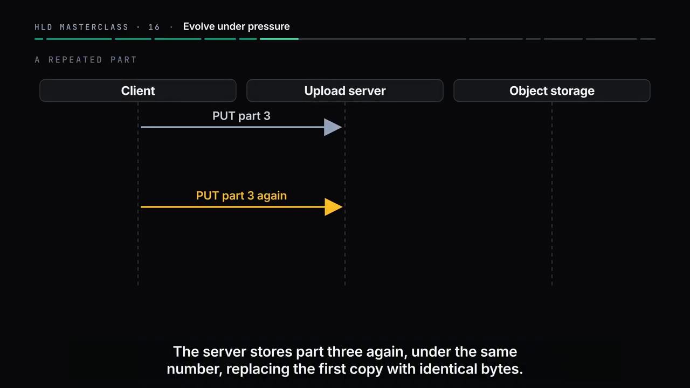

为什么这件事重要？因为**重试是不可避免的**，而幂等让「重试」从「可能产生重复数据」变成「一次无害的覆盖」。讲者把它总结成一句话：**块号就是这一块的身份，所以重复是替换而不是累加。**[【跳转到 16:21】](https://www.youtube.com/watch?v=z6OPj6Ostto&t=981)

### 2.5 顺带解决了速度问题

讲者后面还用分块解释了吞吐上限：一条连接能跑多快，受限于「在途数据量 ÷ 往返时延」。假设一条连接保持约 1 MB 在途，往返 0.25 秒，那么单连接上限约

$$
\frac{1\ \text{MB}}{0.25\ \text{s}} = 4\ \text{MB/s}
$$

对一个 1.25 MB/s 的普通用户，这绰绰有余；但对一条 50 MB/s 的 fast line、目标区域在 0.25 秒之外的用户，单连接只能跑出 4 MB/s。解法之一就是**并行发多块**：13 条连接 × 4 MB/s 填满 50 MB/s。这也是「块之间互不依赖」的第二个红利。[【跳转到 25:38】](https://www.youtube.com/watch?v=z6OPj6Ostto&t=1538)

---

## 三、校验和：把「没传坏」变成可计算的判断

分块解决了「断了怎么办」，但没解决「传过去的东西还是不是原来那个」。讲者给的理由很朴素：**一个 bit 可能在电缆里翻转，可能在路由器的内存里翻转，也可能在磁盘上翻转**。所以不能假设「传过去了就是对的」，得在应用层自己算指纹。

### 3.1 一个玩具校验和

讲者先用三个数字讲清原理。假设一块数据是 12、7、30，发送方把它们加起来得到 49，**把数据和 49 一起发出去**；接收方对收到的数据再求一次和，和 49 比较。

路上出了事：12 变成了 13。接收方算出来是 13 + 7 + 30 = 50，和 49 对不上，于是**拒收这一块，让发送方重发**。

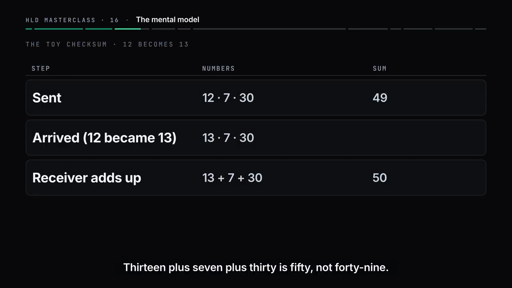

这个「和」就是**校验和（checksum）**：一段由字节算出来的短指纹。**改动任何一个字节，指纹几乎必然改变。**[【跳转到 09:43】](https://www.youtube.com/watch?v=z6OPj6Ostto&t=583)

### 3.2 真实世界用更强的指纹

求和太弱，讲者点出真实系统用的是 MD5、CRC32C、SHA-256 这类算法，它们比求和强得多：**两块不同的数据几乎不会共享同一个指纹。**

「几乎」二字是这套机制能成立的前提：指纹要足够强，强到「不同的内容撞上同一个指纹」在实践中不会发生。整份文件的校验用的是 SHA-256，块级校验用的也是同一类算法。[【跳转到 09:53】](https://www.youtube.com/watch?v=z6OPj6Ostto&t=593)

### 3.3 两级校验：每块一个，整份一个

这是本小节最核心的一张图。讲者的设计是**两层校验**，各自负责不同的事：

- **块级校验**：App 在发送每一块之前算出这一块的校验和，放进请求里；存储收到后**重新算一遍**。两者不一致就拒收这一块，App 重发。**坏块永远不会被存下来。** 这一层抓的是「传输途中的损坏」。
- **整份校验**：App 在开会话时就把整份文件的 SHA-256 报给了服务端。等所有块拼成一个文件之后，再对**存下来的整个文件**算一次 SHA-256，和最初那个值比对。一致，文件状态变成 ready；不一致，标成 failed，告诉用户，**绝不把损坏的文件当成品提供出去**。

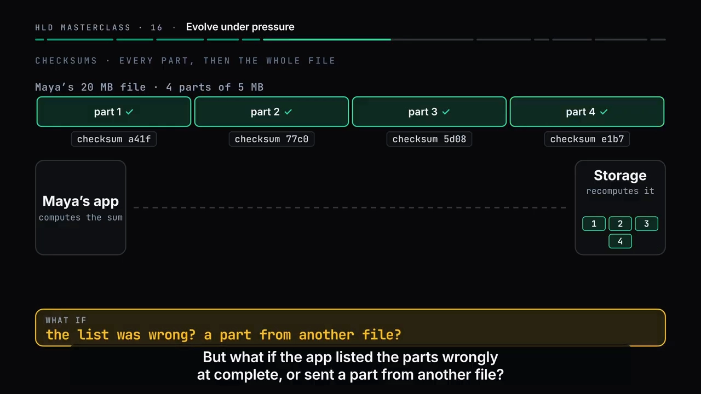

为什么块级校验不够，非要再加一层整份校验？讲者给的反例是：**块本身都是好的，但拼装顺序错了，或者混进了另一个文件的一块**。块级校验只看「这一块的字节有没有变」，看不出「这块是不是该出现在这里」。[【跳转到 22:09】](https://www.youtube.com/watch?v=z6OPj6Ostto&t=1329)整份 SHA-256 覆盖的是**最终拼装结果**，所以能抓住这类错误。

这就是「边传边校验」和「传完整体校验」的分工：前者是**便宜的、即时的、逐块的**，用来挡住路上的损坏并立刻触发单块重传；后者是**昂贵的、一次性的、覆盖全局的**，用来给最终产物盖章。

### 3.4 校验时机：整份校验不要挡在响应路径上

既然整份校验这么重要，是不是应该在 `complete` 请求里同步做完再返回？

讲者算了一笔账：一个 5 GB 的文件，按 250 MB/s 读取并计算校验和，要 20 秒。**把请求挂起 20 秒会占住 API，而一旦超时，用户就会重试**——重试又会带来新的 complete 请求。

所以设计改成：`complete` **立刻返回**，把文件状态置为 `verifying`，同时往队列里投一条消息「校验文件 42」。一个校验 worker 取走任务，读文件、算 SHA-256，算完把结果报回 API。

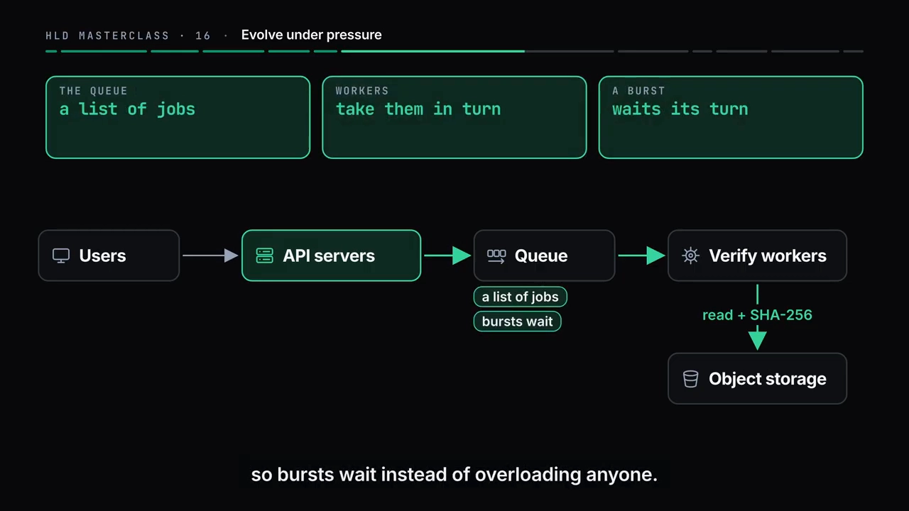

代价是**文件在上传完成后有几秒钟不可下载**，最大的文件大约 20 秒。讲者也给了适用边界：**文件很小（比如 10 MB 以下）时，同步校验更划算**，不值得为它引入一条异步链路。[【跳转到 22:38】](https://www.youtube.com/watch?v=z6OPj6Ostto&t=1358)

队列在这里还顺带解决了一个可靠性问题：worker 中途崩了，消息因为没被标记完成，超时后会被投给另一个 worker；而校验是只读操作，**做两遍无害**。

这套异步校验的容量也能算出来：峰值 1250 个文件/秒、每个 100 MB，就是 125 GB/s 的读带宽；一个 worker 按 250 MB/s 读，满打满算要 500 个，按 80% 水位要 625 个。讲者的评价是「这是实打实的工作量，但它能靠加 worker 横向扩展」，而且同一条链路还能顺手做病毒扫描、生成缩略图——**「读一遍整个文件」这件事，一次读可以服务多个目的**。

### 3.5 校验失败之后：只重传坏的那一块

这是分块 + 块级校验组合起来最实际的收益。校验失败时，恢复的粒度是**块**，不是整份：

- 块级校验失败 → 存储拒收 → App 只重发这一块（5 MB、约 4 秒）；
- 整份校验失败 → 文件标 failed，用户可以重试，而**没有任何损坏的文件会被当成成品提供**。

对比一下整文件方案：任何一次失败都意味着从头再来。**校验的粒度决定了恢复的粒度**——这是本小节最值得记住的一句对应关系。

---

## 四、状态放在哪：让存储侧记账，让重传天然幂等

### 4.1 「每块写一行」会把元数据库压垮

第一版分块设计里，服务端为了回答「你手上有哪几块」，给**每个被确认的块写一行**到元数据库。

讲者在模拟器里把数字代进去：10 万路上传、每 4 秒发一块，就是每秒 2.5 万次块请求。四台上传服务器只到 78%，但**元数据库直接冲到 250%，60% 的请求失败**。

于是他提出那个关键问题：**我们真的需要自己为每一块存一行吗？**

答案是：不需要。**对象存储本来就知道自己手上有哪些块。** S3 把这件事做成了内建能力，叫 multipart upload（分片上传）：你先开一个上传，把带编号的块发给它，最后让它把块拼成一个文件；**块就存在 upload ID 下面，而且可以列出来**。

于是「状态查询」从「查我们自己的库」变成「问对象存储」：

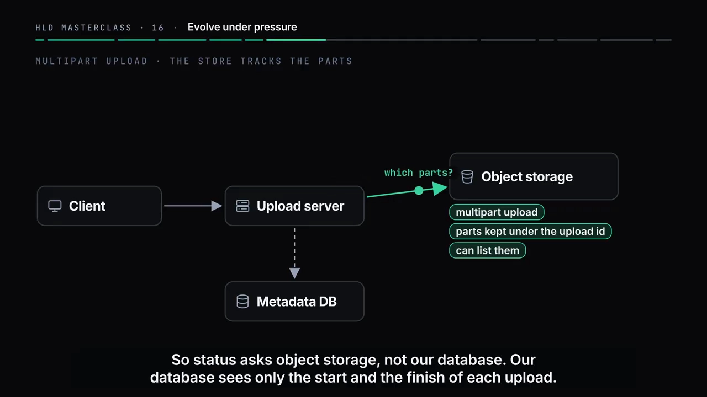

改造后，元数据库每秒只看到 1250 次开始 + 1250 次结束 = 2500 次请求，负载从 250% 降到 25%。[【跳转到 17:16】](https://www.youtube.com/watch?v=z6OPj6Ostto&t=1036)讲者把这条决策写成：**块状态住在对象存储里**；代价是状态查询变成一次远程调用，而不是一次本地查询。他还给了反向的适用条件：**只有当存储本身不支持列出块时，才需要自己为每块存一行。**

### 4.2 控制面与数据面分开，字节不经过决策者

第二个压力来自字节本身：125 GB/s 流进上传服务器，再原样流出去到对象存储，125 台服务器的网卡 80% 满载，**搬的却是它们从不查看的字节**。

讲者的观察是：上传服务器真正要决定的只有一件事——**这个用户能不能把这些字节放到这个 key 下面**。做决定花一毫秒，搬字节花几分钟。所以把两者拆开：

- **控制面**：我们的服务器做鉴权、配额、签名；
- **数据面**：字节从客户端直接进对象存储。

存储凭什么相信我们的服务器已经同意了？讲者用「代客泊车钥匙」类比：它能发动车、开一小段，但打不开后备箱，而且只借你一个晚上。对应到系统里就是**预签名 URL**：一个针对「某个 key 的某一块」的 URL，有效期一小时，用只有服务器和存储知道的密钥签名。存储校验签名和有效期；**URL 里任何一个字符被改过，签名就对不上，存储直接拒绝**。[【跳转到 18:57】](https://www.youtube.com/watch?v=z6OPj6Ostto&t=1137)

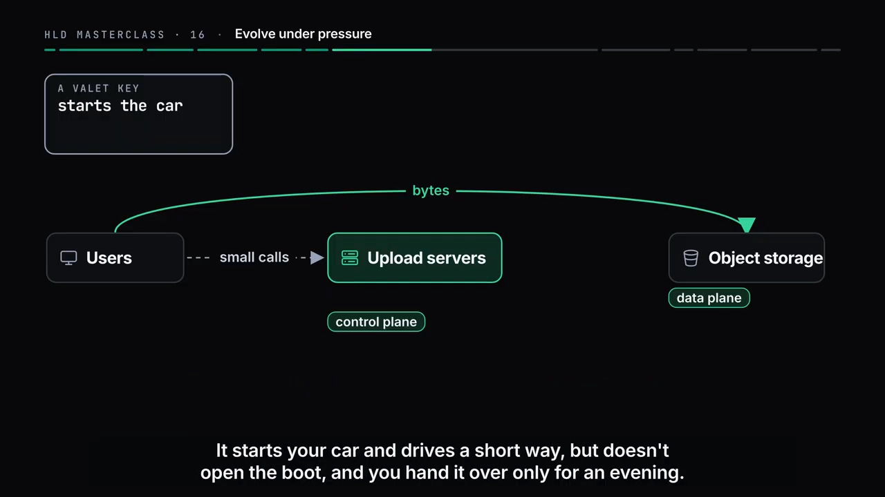

这条改动和续传直接相关：**API 服务器不再保存任何上传状态**，状态在数据库和存储里。所以一台 API 服务器在上传中途死掉，Maya 的上传几乎不受影响——她的块正带着一小时内有效的 URL 直接飞向存储，`complete` 调用换一台服务器发就行。

### 4.3 先写数据，再写索引

讲者在最早那版设计里就强调过一个顺序：**只有字节存好之后，才写那一行元数据**，所以「一行记录永远不会指向一个不存在的文件」。[【跳转到 13:04】](https://www.youtube.com/watch?v=z6OPj6Ostto&t=784)

这个顺序在后面的故障推演里反复被用到：块先进存储、再被确认；文件先拼好、再被标记 ready；校验通过、状态才变成 ready。反过来做——先写索引再写数据——中间崩溃就会留下**指向空洞的索引**。

同样的道理也适用于「块清单」：`complete` 时客户端提交的是块号清单和它们的校验和，服务端拿这份清单去让存储拼装，拼完再核对总大小和整份 SHA-256。**清单是意图，存储里的块才是事实**，两者必须对齐之后才能对外声称「这个文件好了」。

---

## 五、恢复不止上传：下载侧的 Range 续传

讲者说得很干脆：**下载就是上传倒过来**。

下载时，API 先检查访问权限，然后发一个**有效期只有几分钟**的读链接。这个链接支持 **Range 请求**：只要字节 100M–200M，存储就只返回那一片。

于是下载侧的恢复策略和上传侧是对称的：

- **断点续传**：从收到的最后一个字节之后继续，向 API 要一个新链接即可；
- **随机访问**：播放器可以直接跳到第 10 分钟，而不必先下载前 9 分钟。[【跳转到 24:48】](https://www.youtube.com/watch?v=z6OPj6Ostto&t=1488)

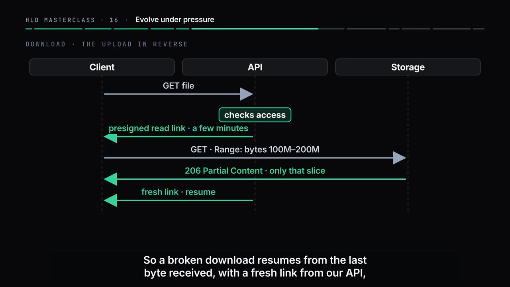

分享链接也遵循同一条原则：**分享链接指向我们的 API，永远不直接指向存储**。每次点击都要重新检查：链接还在吗？过期了吗？文件 ready 了吗？然后才发一个新的短时效链接。所以删掉分享链接能立刻生效；即使有人存下了旧的存储 URL，那个 URL 几分钟内也会过期。

---

## 六、失败与边界：重试、重复、作弊、残留

讲者用「试着把设计打坏」的方式检查了这套机制。下面几条直接关系到续传与校验的正确性。

### 6.1 `complete` 重试不能产生第二个文件

场景：Maya 的 `complete` 调用其实成功了，但响应在回程丢了，App 重试 `complete`。会不会因此多出一个文件？

不会。`complete` 会先看 upload ID：**如果这个上传已经完成，就再返回同一个 file ID**。也就是说 `complete` 本身也是幂等的。[【跳转到 28:42】](https://www.youtube.com/watch?v=z6OPj6Ostto&t=1722)这和「块号即身份」是同一个思路，只是把幂等的单位从「块」提升到了「整个上传会话」。

### 6.2 声明的长度就是签名的一部分

场景：客户端声称自己只传 1 MB，实际发了 5 GB。

讲者指出，每个预签名 URL 在签名时**连这一块的精确长度一起签进去**，所以存储会拒绝任何长度不符的块。此外，`complete` 时还会把拼装后的总大小和最初声明的大小比对；配额在 `start` 时就检查，因为大小是提前声明的，**固定的块数和块大小天然给单次上传封了顶**。

预签名 URL 泄漏（比如进了日志或截图）的爆炸半径也被限制住了：**它只对一个上传的一块有效，最长一小时。**

### 6.3 没传完的上传必须过期，否则越积越多

这是「断点续传」的阴暗面：**能续传，就意味着允许长期不完成**。

讲者的估算：假设百分之一的上传半途而废，一天就是 54 万次，留下约 27 TB 的孤儿块；如果永不清理，一年就是约 9.9 PB——**付着存储费，却没人能用**。

所以每个上传都有一个过期时间：24 小时。[【跳转到 23:58】](https://www.youtube.com/watch?v=z6OPj6Ostto&t=1438)对象存储用**生命周期规则**删掉超过一定年龄的未完成分片上传；一个小的清理任务把过期的行标成 failed。这样文件表和实际存储最多相差一天的孤儿。

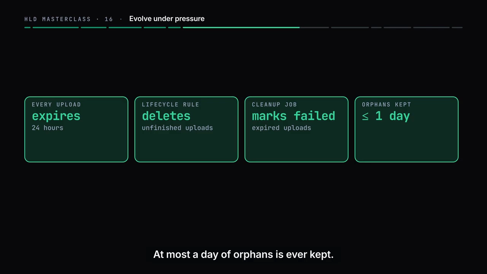

这条设计对续传的含义是：**续传的有效期是协议的一部分**。客户端必须预期「隔了太久，这个 upload ID 已经不能用了，得从头开始」。

### 6.4 校验 worker 崩了会怎样

前面提过：任务没被标记完成，队列超时后把消息投给另一个 worker；校验是只读的，重复做无害。**把校验做成只读且幂等，是它能安全重试的前提。**

---

## 七、变体：块大小、去重与超大文件

讲者最后用四个变体检验这套设计：两个改变「字节被允许流经哪里」，两个改变续传与校验的参数。

### 7.1 小文件不该分块

如果传的都是 200 KB 的头像，**分块毫无意义**：一张图不到一秒就传完，一次预签名 URL 就够，同步校验也没问题。这时压力从存储转移到了控制面（同样的字节量，文件数变成 500 倍）。**分块是给「长传输」用的，不是给「大吞吐」用的。**

### 7.2 要求端到端加密时，字节又得回到自己的服务器

变体二：存储提供方绝不能看到明文，而手机又不持有密钥。这时**存储没法替我们加密**（它会先看到明文），手机也不行，只能由我们控制的某一环在途中转换每一个字节——字节于是重新流经自己的服务器，又是 125 台。

讲者的结论是：这正是「代理（proxying）」胜出的场景，而**分块和校验原封不动**。也就是说，续传与校验的机制和「字节走哪条路」是正交的两件事。

### 7.3 去重：校验和既是身份，也是风险

如果很多用户传同一个文件（比如一个热门安装包），可以在 `start` 时用**整份文件的校验和**做去重：如果已经有一个 ready 的文件校验和相同，就跳过上传，让新的一行指向同一份字节。

讲者马上给了三个代价：

1. **删除要引用计数**：删一个文件时，必须确认没有别的行还指向这份字节；
2. **校验和必须足够强**：强到两个不同的文件永远不会碰撞；
3. **校验和不等于「持有证明」**：任何人只要知道这个校验和，就能声称自己有这个文件。

所以实践上有两条路：**按用户去重**（放弃跨用户的节省），或者**先上传、后去重**（省下存储，但省不下上传时间）。[【跳转到 33:20】](https://www.youtube.com/watch?v=z6OPj6Ostto&t=2000)讲者把这个问题留成了课后题：**客户端怎样才能在不真正上传的情况下证明自己确实持有这个文件？**——只有解决了它，跨用户去重才是安全的。

### 7.4 100 GB 的文件：块大小和过期时间都要跟着变

S3 单次上传最多 10,000 块。100 GB 按 5 MB 切需要 20,000 块，超了，所以**块大小至少要涨到 10 MB**。代价是断线时损失的一块变大——于是块大小应该**按文件大小来选**。

另一头是时间：按 1.25 MB/s，100 GB 要传 22 小时，**一天的过期时间会让大文件在快传完时死掉**，所以过期时间必须为大文件或慢速连接放宽。

讲者在这里给出的原则是：**「决策与搬运分离」的结构在每个变体里都成立，变的是块的大小和字节被允许流经哪里。**

---

## 小结

- **中断是常态，不是意外**：67 分钟的上传期望遇到 1.1 次断线，三分之二的大文件上传会断；整文件方案一次断线就归零。
- **分块让恢复的粒度变成一块**：5 MB 一块，块号就是身份，断线后只补没被确认的块，损失从 33 分钟降到 4 秒。
- **块号即身份带来幂等**：重复 PUT 是覆盖而不是追加；`complete` 重试返回同一个 file ID。重试因此变得无害。
- **校验要两级**：块级校验抓传输途中的损坏并触发单块重传；整份 SHA-256 抓拼装错误和混入的块，给最终产物盖章。
- **校验的粒度决定恢复的粒度**：坏一块就重传一块，不必整份重来。
- **整份校验不要挡在响应路径上**：5 GB 要读 20 秒，改成「先返回 verifying，再让队列里的 worker 算」；小文件（10 MB 以下）同步做更划算。
- **状态交给存储侧记账**：自己为每块写一行会把元数据库打到 250%；用存储的 multipart 列表，数据库只看开始和结束。
- **先写数据再写索引**：行永远不指向不存在的文件；块先进存储再被确认，文件先拼好再标 ready。
- **续传有有效期**：24 小时过期 + 生命周期规则清理孤儿块，否则一年能攒下约 9.9 PB 的垃圾。
- **下载侧同理**：Range 请求 + 短时效链接，断点从最后一个字节继续。

## 关键术语速查

| 术语 | 一句话解释 |
| --- | --- |
| chunked resumable upload | 把一次上传拆成带编号的小块，断线后只补没确认的块 |
| part（块） | 分块传输的最小单位，本例 5 MB；块号决定它在文件里的位置 |
| upload ID | 一次上传会话的标识，续传和幂等重传都靠它定位 |
| checksum（校验和） | 由字节算出的短指纹，改动任意字节指纹几乎必然变化 |
| CRC32C / MD5 / SHA-256 | 真实使用的校验算法，强度远高于「求和」，不同内容几乎不会共享指纹 |
| 块级校验 | 每块带校验和，存储收到后重算，不一致就拒收并触发单块重传 |
| 整份校验 | 对拼装后的整个文件算 SHA-256，与开会话时声明的值比对 |
| 幂等（idempotent） | 同一操作执行一次和执行两次结果相同；块号相同即覆盖 |
| 预签名 URL | 带签名和有效期的临时写/读链接，让字节不经过业务服务器 |
| multipart upload | 对象存储内建的分片上传，块挂在 upload ID 下且可列举 |
| Range 请求 | 只取文件的一段字节，下载断点续传和随机跳转都靠它 |
| 孤儿块 | 上传半途而废留下的分片，靠过期时间和生命周期规则清理 |
| 去重（dedup） | 用整份校验和判断「已有同样内容」，跳过上传；需引用计数与防碰撞 |
