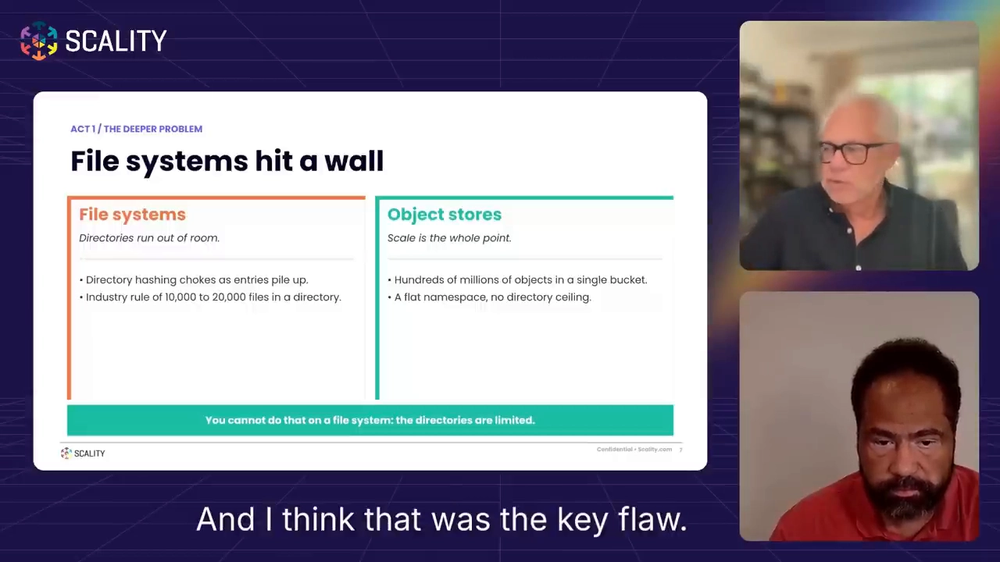
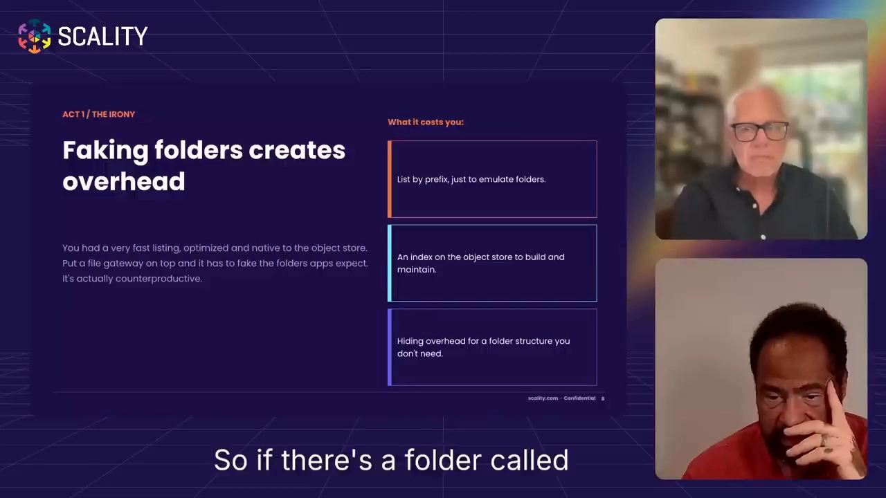
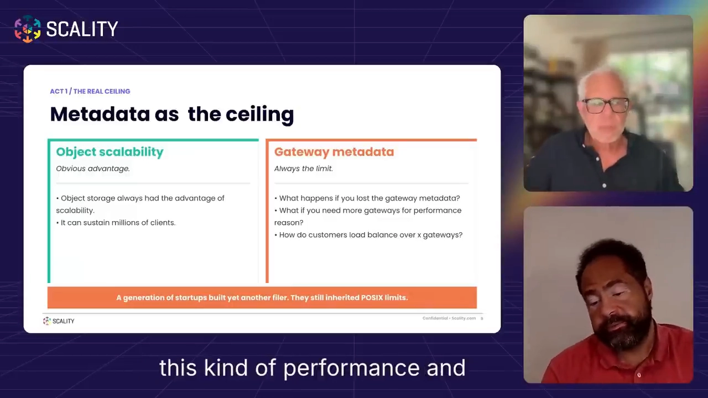
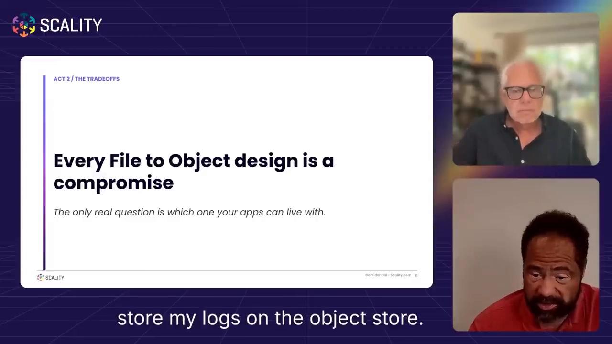
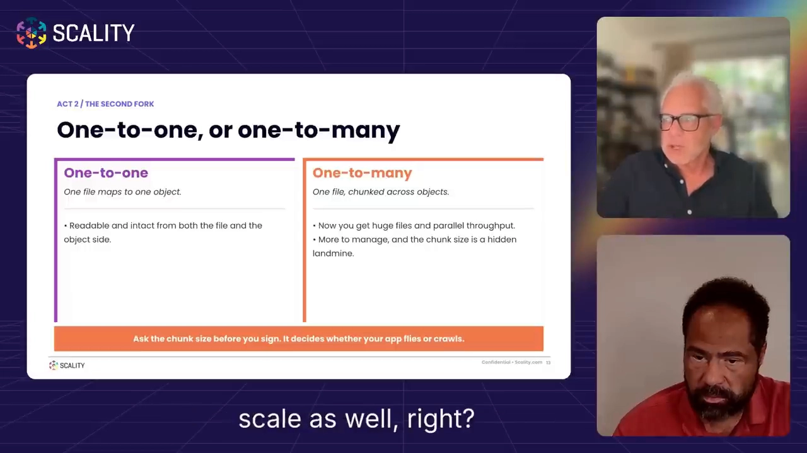
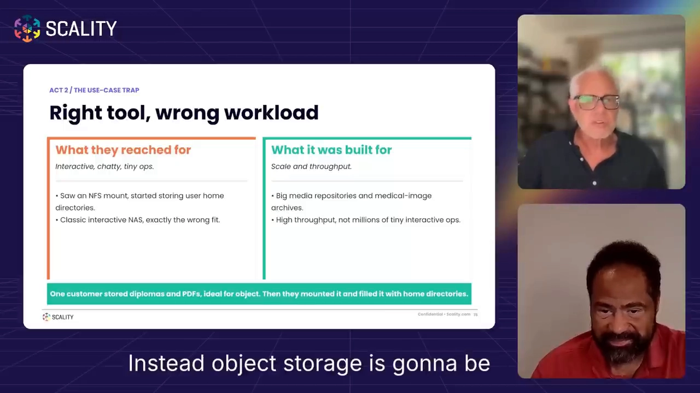
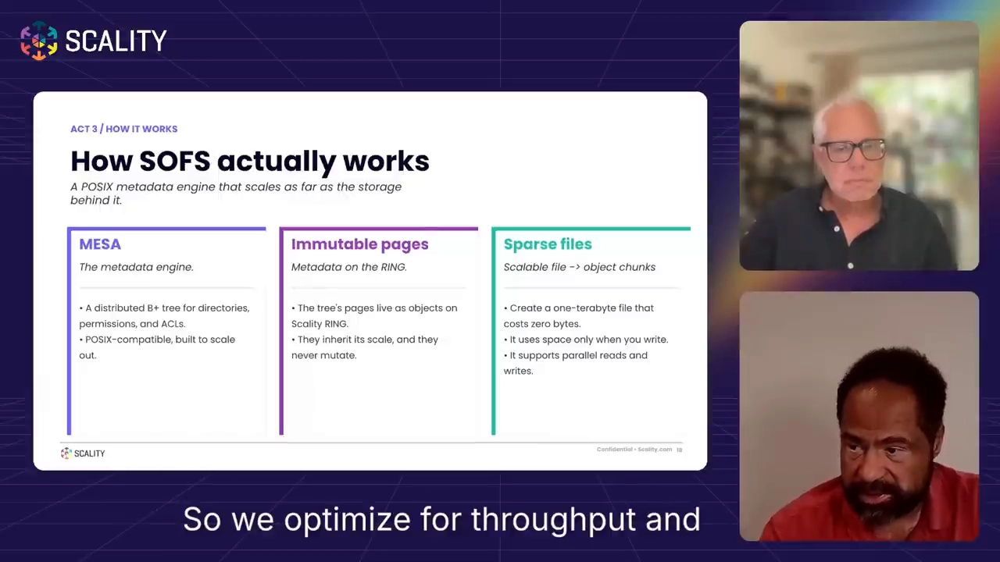
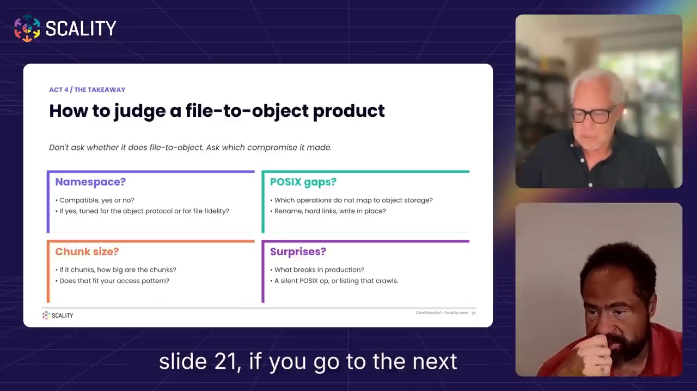

# 把对象存储当文件系统用：省下的容量会在元数据和小 IO 上加倍还回去

> 视频来源：[File-on-Object Storage: Know the Tradeoffs](https://www.youtube.com/watch?v=8jav9wnkEPA)（YouTube · Scality Podcast，Giorgio Regni 与 Paul Speciale）｜时长约 23 分钟
> 导读：两位做了十几年对象存储的人复盘"在对象存储上提供文件接口"这条路上踩过的坑，并给出判断这类方案的四个问题。本文只讨论**对象存储作为卷后端的边界与代价**；S3 的桶/键模型与语义差异见 3.1，分片上传与生命周期见 3.2，JuiceFS 的元数据引擎架构见 4.2，三种后端的横向选型见同小节的另一篇。

## 本讲要解决的核心问题（SCQA）

**背景**：对象存储便宜、容量近乎无限、还能跨区复制。于是几乎每隔几年就会有人问同一个问题：能不能在对象存储上挂一个文件系统，让老应用不用改代码就吃到这份便宜？

**冲突**：这个问题从 2010 年问到今天，答案一直是"能，但你得付代价"。十几年里出现过一整代网关厂商，今天的 JuiceFS、S3 Files 是同一族思路的新版本。它们的共同点是：**对象存储本身扩展得很好，但一旦要在它上面伪造目录和 POSIX 语义，瓶颈就从存储层转移到了元数据层**。

**疑问**：代价到底落在哪几个具体位置？怎么判断一个 file-to-object 方案能不能扛住我的负载？

**回答（中心思想）**：每一次"文件到对象"的设计都是一次取舍，没有通用解——**你只能在命名空间兼容、POSIX 语义完整、块大小、以及"哪一层做真相中心"之间选**。判断一个方案，不要问"它支不支持文件"，而要问它做了哪个取舍，以及那个取舍是否匹配你的访问模式。

## 一、撞墙的地方不是容量，是目录

对象存储的卖点一直是扩展性：一个桶里可以放几亿个对象，扁平命名空间，没有目录上限 [【跳转到 05:21】](https://www.youtube.com/watch?v=8jav9wnkEPA&t=321)。

文件系统这边正好相反。目录项一多，**目录哈希**就开始吃力。业界有个经验法则：一个目录放一万到两万个文件 [【跳转到 05:46】](https://www.youtube.com/watch?v=8jav9wnkEPA&t=346)。

这两件事本来就该各管各的：**文件系统侧的元数据引擎和对象存储侧的元数据引擎根本不是一类东西**。当你硬要让两者共存——用对象存储当底层、在上面呈现一棵目录树——冲突就从这里开始。

顺带一提，这个限制在本系列 4.1.1 里被讨论过：元数据服务的开销与**文件个数**成正比，数据面的开销与**字节数**成正比。小文件负载下，前者比后者贵一到两个数量级，于是元数据先撞墙。

## 二、用前缀"伪造"目录，代价落在列举和索引上

对象存储里没有目录，只有键。S3 的键里可以带斜杠，于是大家约定俗成地把斜杠当目录分隔符，再用**前缀列举**来模拟"列目录"：想看 `backup/` 下面有什么，就列举所有以 `backup/` 开头的键 [【跳转到 06:46】](https://www.youtube.com/watch?v=8jav9wnkEPA&t=406)。

问题是这个模拟并不精确：

- 前缀列举会**把子目录、子目录的子目录全都返回**，你必须自己在客户端做"该在哪停"的判断；
- 对象存储返回的列表顺序是它自己的顺序，**不是文件系统的顺序**，于是你实际上是在两个不同的索引之间互相打架。

一句话概括：你本来有一个为对象存储优化过的、原生极快的列举操作，现在在上面套了一个文件网关，它必须伪造出应用期待的目录——**这实际上是反效果的**。

## 三、网关把元数据抽出来自己维护，于是网关成了新的天花板

网关方案的结构是这样的：对象存储负责存数据，网关负责维护"哪个对象对应哪个文件、目录树长什么样"。问题在于，**元数据一旦从对象存储里被抽出来，网关就必须自己扛住它** [【跳转到 07:55】](https://www.youtube.com/watch?v=8jav9wnkEPA&t=475)。

幻灯片上的三个问题，每一个都是运维噩梦：

- 网关的元数据丢了怎么办？
- 性能不够，多加几个网关实例行不行？
- 多个网关之间怎么负载均衡？

讲者补了一个更具体的观察：**它们彼此看不见对方**。你买的对象存储能并行做一万个操作，但你的网关只能做五个；你加第二个网关，两个网关之间并不同步，于是形成一种"阻抗失配" [【跳转到 09:10】](https://www.youtube.com/watch?v=8jav9wnkEPA&t=550)。

还有一类代价是**两个真相中心**带来的。讲者讲了一个真实案例，不点名厂商：某网关给终端用户提供块设备做虚拟机存储，卖点是全程加密，云上对象存储里的数据连存储厂商都读不了。结果客户把主密钥弄丢了——两百 TB 的卷，没人能读。去问网关厂商，厂商说我们不保存你的密钥副本（这话本身没错）；但密钥一丢，数据就全成了死的 [【跳转到 08:20】](https://www.youtube.com/watch?v=8jav9wnkEPA&t=500)。

这就是"两个命名空间"的代价：一致性、安全性、访问控制，全都要在两层之间对齐。

## 四、不可变语义：追加一行日志，要重传整个文件

对象存储最容易被低估的一条语义是**不可变**：对象一旦写下去，就不能原地改 [【跳转到 09:59】](https://www.youtube.com/watch?v=8jav9wnkEPA&t=599)。

而用文件系统的人，脑子里默认的是"原地改"。

最典型的翻车场景是日志：你说"我把日志存到对象存储上"，然后有人往日志里加了一行——在对象存储上，你没法只加一行，你得**把整个日志文件下载下来、改完、再整个上传回去**。追加也一样 [【跳转到 10:04】](https://www.youtube.com/watch?v=8jav9wnkEPA&t=604)。

这条约束直接决定了：**任何"小步追加、频繁刷盘"的负载都不适合裸对象存储**。数据库的 WAL、容器的可写层、编辑器的临时文件，全在这个名单上。

## 五、分块是唯一出路，但块大小是个隐藏地雷

要在对象存储上实现完整的 POSIX，就必须支持"改文件的中间某一段"。做法只有一种：**分块**——把一个文件切成很多对象，改哪块就重传哪块 [【跳转到 11:18】](https://www.youtube.com/watch?v=8jav9wnkEPA&t=678)。

两种映射各有各的代价：

- **一对一**：一个文件就是一个对象。好处是文件侧和对象侧都能读到完整内容，坏处是**扩展性差**——你拿到的是巨大对象，拿不到访问并行度。
- **分块**：一个文件切成很多对象。好处是能追加、能改局部、能做间接层（于是重命名、硬链接才有可能），坏处是**后端对象数量暴增**——一个文件可能是上万个对象 [【跳转到 11:43】](https://www.youtube.com/watch?v=8jav9wnkEPA&t=703)，等于不必要地把对象存储压得很重。

于是**块大小成了决定成败的隐藏参数**。讲者举了两个极端：有些用例因为应用行为，必须要求 64 MB 的块；另一些要调到 256 KB 左右，差别极大 [【跳转到 12:23】](https://www.youtube.com/watch?v=8jav9wnkEPA&t=743)。

这个参数为什么致命？因为**块大小决定了你的每一次小写会被放大成多大的写**。如果块是 64 MB，你改一个字节，后端就要重传 64 MB。所以讲者的建议是：**签合同之前先问块大小**——它决定了你的应用是跑得动还是爬得动。

## 六、接口预设了负载：给了挂载点，用户就会当 NAS 用

讲者有一个很锋利的观察：**接口本身就预设了工作负载的样子** [【跳转到 13:33】](https://www.youtube.com/watch?v=8jav9wnkEPA&t=813)。

- 文件系统接口（POSIX）预设的是：用户目录、家目录、共享、小读小写、列目录、交互式访问、要好的响应时间。这正是 NAS 擅长的。
- 对象存储擅长的是：巨大容量、大吞吐、整对象读写。

所以一旦你给用户一个挂载点，他就会像用 NAS 一样用它——**而这个预设在很多场景下是错的**。

讲者给了一个真实的翻车案例：一所学校用 Scality 存毕业证 PDF 和学生照片——这对对象存储来说非常合理。但他们是通过 **NFS** 来用的，因为他们的应用只认 NFS。跑了好几个月都没事，直到有人决定把它挂成**家目录**：学生用 Linux，登录时自动把家目录挂到这个 NFS 上。一开始也没事，直到他们开始跑数据库、做 `git checkout`——这些操作期望的是**极小的 IO 并且立即刷盘**，恰恰不符合对象存储的特性 [【跳转到 14:23】](https://www.youtube.com/watch?v=8jav9wnkEPA&t=863)。

这个案例值得记住：**它不是配置错误，而是"接口允许的用法"和"后端能承受的负载"不匹配**。挂载点一旦存在，就一定会有人这么用。

## 七、如果真要做一套 POSIX-on-object，得做哪些取舍

讲者的公司最后自己做了一套横向扩展文件系统（SOFS），并且把取舍写在明面上 [【跳转到 15:32】](https://www.youtube.com/watch?v=8jav9wnkEPA&t=932)：**必须完全符合 POSIX**（所有 POSIX 操作都能做），但**不为小 IO 设计**（不刷 4 KB 页），优化的是吞吐和较大的对象。

它的实现路子很有代表性，也正好对应前面几节的坑：

- **元数据引擎 MESA**：一棵分布式的 B+ 树，存目录结构、权限、ACL。这就是"把元数据从对象存储里抽出来"的那一步，区别是它被设计成可横向扩展的。
- **不可变页**：B+ 树的页本身作为对象存在对象存储上，因此继承对象存储的扩展性，且永不修改（只写新版本）。
- **稀疏文件**：文件被切成对象块，按需占用空间。

第三点带来一个很漂亮的收益：**`truncate` 变成了一次元数据修改**。你想模拟一块 10 GB 的块设备，不需要真的上传 10 GB 的对象——只要在数据库里把长度改成 10 GB，空间等你真写的时候才占 [【跳转到 18:27】](https://www.youtube.com/watch?v=8jav9wnkEPA&t=1107)。这正是本系列 1.3.1 讲的稀疏文件语义，只不过"洞"记在元数据引擎里而不是本地 inode 里。

代价也很清楚：**它不允许小文件 IO**。对讲者瞄准的负载（媒体仓库、医学影像、备份）完全没问题，对数据库和 KV cache 就是灾难。他们最终做到过 100 PB 的单文件系统卷 [【跳转到 19:17】](https://www.youtube.com/watch?v=8jav9wnkEPA&t=1157)——那些本来是人们想要对象存储的理由，只不过以文件的形式呈现。

## 八、判断一个 file-to-object 方案，问四个问题

讲者最后给了一张判断清单 [【跳转到 20:25】](https://www.youtube.com/watch?v=8jav9wnkEPA&t=1225)。核心一句：**别问它是不是 file-to-object，问它做了哪个取舍**。

1. **命名空间兼容吗？** 如果需要兼容，就要接着问"你更偏向对象还是文件"。偏向文件，就必须是"对象在文件之下"，而不是"文件在对象之上"。如果对象是协议和第一原则、文件只用来读，那用 FUSE 之类把 S3 数据以同样命名空间导出成文件系统、做一对一映射就够了——**但重命名、硬链接这些操作就不支持了**。
2. **POSIX 有哪些缺口？** 重命名、硬链接、原地写，这三样是最常缺的。缺哪个，取决于你的应用用不用。
3. **块大小是多少？** 后端 IO 变成 64 MB 你能接受吗？对备份没问题，对 KV cache 就是最糟的决定。
4. **生产环境会冒出什么意外？** 哪个 POSIX 操作会静默失败，哪个列举会突然变慢。

讲者还提到一个旁证：某家大型公有云在自己的对象存储上放了**五六套文件系统**，看着乱，其实合理——每一套的取舍不同，用来匹配不同的负载。**一家公司需要好几种"文件到对象"的风味，是正常的，不是设计失败。**

## 九、放回三种后端的坐标系里

把这篇和同小节另一篇（本地 reflink 与分布式块）放在一起，对象存储的位置就很清楚了：

- **它赢在容量、单价和跨区**：容量近乎无限，冷数据单价最低，原生跨区复制。归档、备份、媒体仓库、医学影像这类"大文件、整读整写、写一次读多次"的负载，它是正解。
- **它输在时延和语义**：首字节是几十毫秒量级（一次 HTTPS 请求加元数据查找），没有原地改写，没有原子快照原语，目录要靠前缀列举模拟。
- **它的"文件接口"是一层翻译，翻译就要付翻译费**：元数据要么推给网关（网关成为天花板），要么推给一套自建的元数据引擎（复杂度上一个台阶）。这笔费用不会消失，只会转移。

所以选型上的判断是：**如果你的负载是"整对象读写 + 容量不可预测 + 需要跨区"，用对象存储，别在它上面架文件系统**；如果应用只认 POSIX，那要么接受一个明确取舍过的 file-on-object 方案（先问那四个问题），要么老老实实回到本地 reflink 或分布式文件系统——后两者的时延和语义，本来就是为这种负载设计的。

## 小结

- 对象存储撞墙的地方不是容量，是**目录**：文件系统一万到两万个文件的目录上限，和对象存储的扁平命名空间是两套元数据引擎。
- 用前缀"伪造"目录会带来额外列举和额外索引，**为对象存储优化的快速列举被抵消掉了**。
- 网关把元数据抽出来自己维护，于是**网关成为新的天花板**，还制造了两个真相中心（一致性、密钥、访问控制都要对齐）。
- 对象不可变：追加一行日志要重传整个文件，所以"小步追加、频繁刷盘"的负载不适合裸对象存储。
- 完整 POSIX 只能靠分块实现，而**块大小决定写放大**——64 MB 的块意味着改一个字节要重传 64 MB。
- 接口预设负载：给了挂载点，用户就会当家目录用。学校的案例不是配置错误，是能力与用法不匹配。
- 判断一个 file-to-object 方案，问四件事：命名空间、POSIX 缺口、块大小、生产意外。没有通用解，只有匹配。

## 关键术语速查

| 术语 | 一句话解释 |
| :--- | :--- |
| 前缀列举 | 用键的公共前缀模拟"列目录"，会连带返回所有子目录内容，顺序也不是文件系统的顺序 |
| 目录哈希 | 文件系统用来快速定位目录项的结构，目录项越多越吃力，业界经验上限约一万到两万个 |
| 网关（gateway） | 在对象存储前面提供 NFS/SMB/iSCSI 接口的一层服务，自己维护元数据，因此自己成为瓶颈 |
| 不可变对象 | 对象写入后不能原地修改，任何改动都是"下载-修改-重传"或写一个新版本 |
| 分块（chunking） | 把一个文件切成多个对象存放，以便支持局部修改与追加，代价是对象数量暴增 |
| 块大小 | 分块的粒度，决定一次小写会被放大成多大的后端写 |
| 稀疏文件 | 逻辑大小远大于实际占用，`truncate` 只改元数据，不写数据 |
| MESA | Scality 的分布式 B+ 树元数据引擎，把目录、权限、ACL 从对象存储里抽出来单独扩展 |