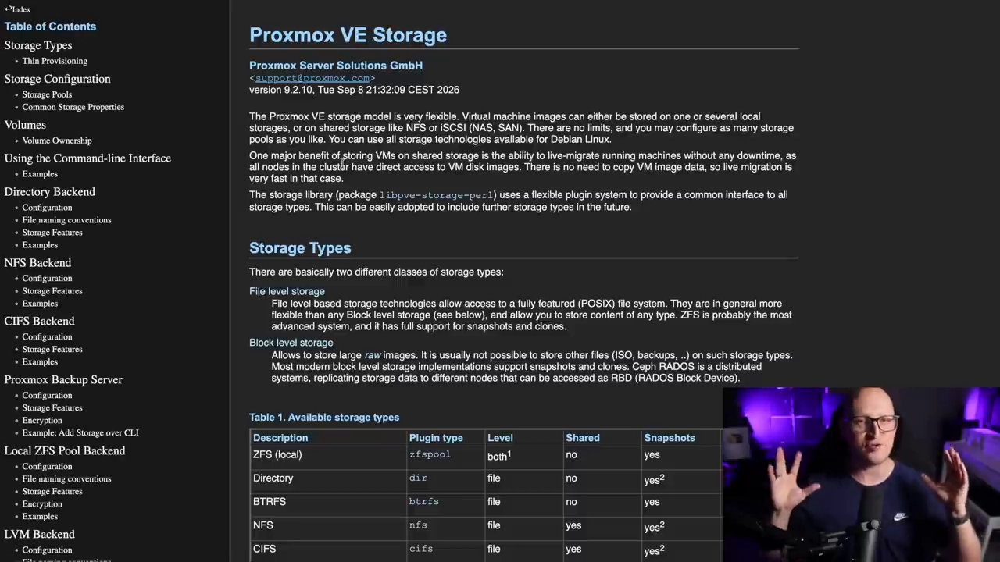
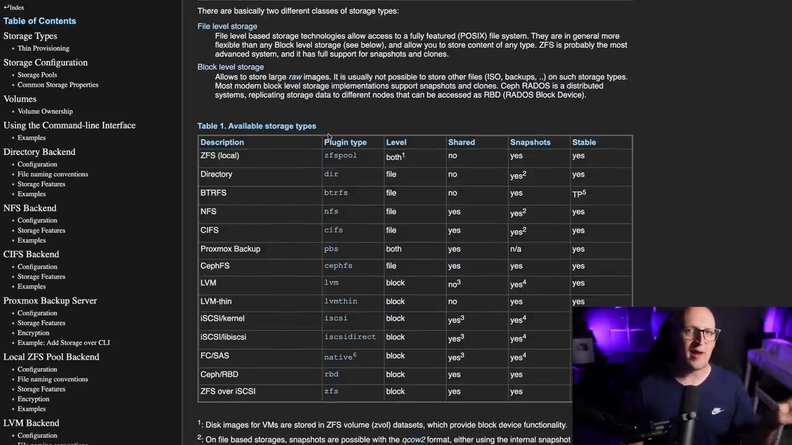
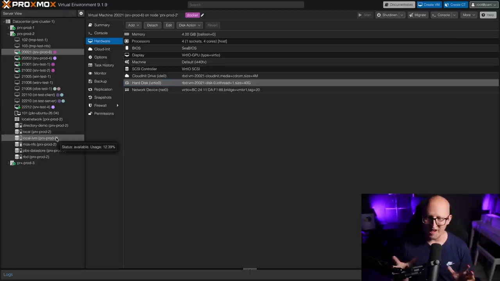
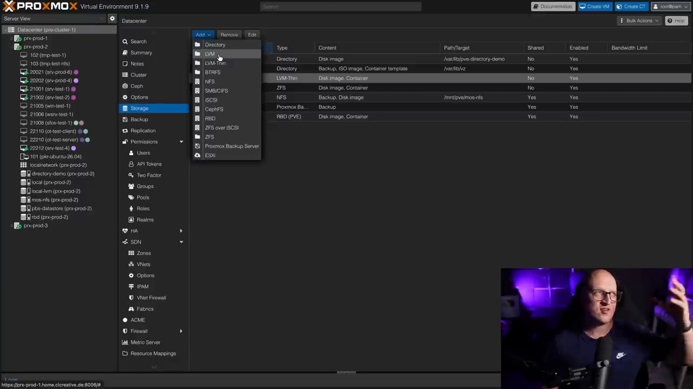
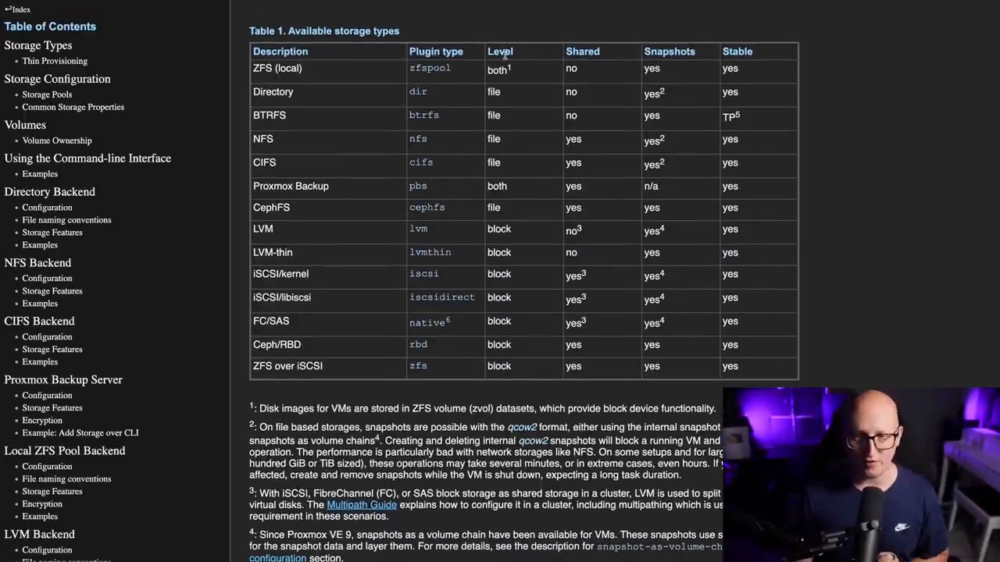
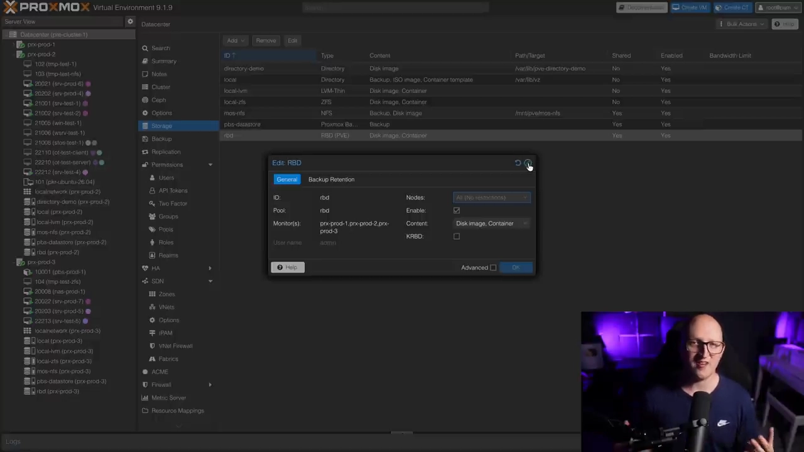
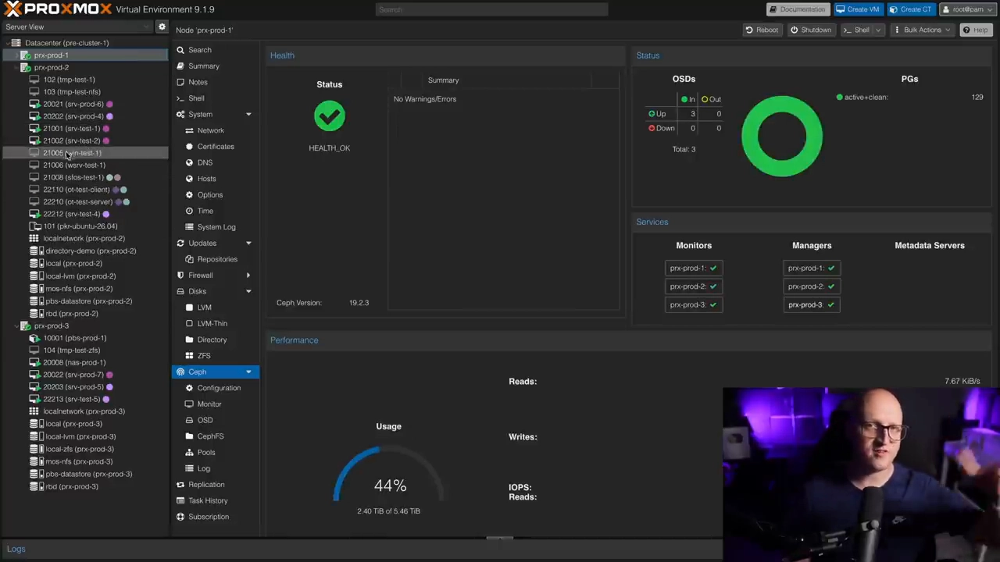
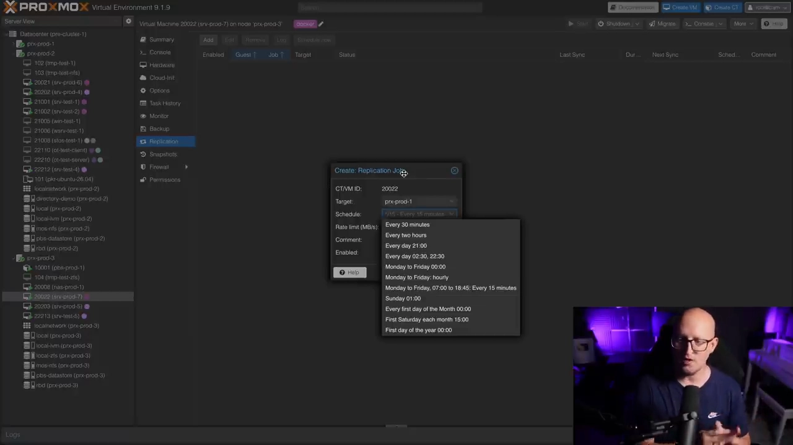

# 本地 reflink、共享文件还是分布式块：卷后端选型先问快照成本与迁移代价

> 视频来源：[Which Proxmox Storage Should You Use?](https://www.youtube.com/watch?v=HVEErwd8OAg)（YouTube · Christian Lempa）｜时长约 24 分钟
> 导读：讲者把一台宿主机上能选的存储后端逐个走了一遍，并给出明确的取舍结论。本文按「文件级还是块级 → 本地 → 共享文件 → 分布式块 → 折中方案 → 一页纸对照」重组，只讨论**后端怎么选**；reflink 的 extent 共享原理见本系列 1.2，PV/PVC/CSI 的接口契约见 S04，对象存储这一路见同小节的另一篇《把对象存储当文件系统用》。

## 本讲要解决的核心问题（SCQA）

**背景**：卷插件（CSI 驱动、Proxmox 的存储插件、Kubernetes 的 StorageClass）最终都要落到一个真实的后端上：本地盘上的文件系统、一台共享的 NAS、还是一个分布式存储集群。上层接口看起来一样——创建卷、克隆、打快照、挂载。

**冲突**：接口一样，代价差几个数量级。同一句"给这台机器打个快照"，在本地 ZFS 上是毫秒级的元数据操作，在 NFS 上的 qcow2 内部快照却可能**阻塞运行中的虚拟机几分钟甚至几小时**；同一句"把这台机器迁到另一台节点"，本地存储要先把几百 GB 数据拷过去，共享存储只要搬内存状态。选错后端，代价不是"慢一点"，而是"这个操作根本没法在业务窗口内做完"。

**疑问**：本地 reflink、共享文件系统、分布式块存储，到底按什么顺序判断？

**回答（中心思想）**：先问三个问题，顺序不能颠倒——**快照要不要 O(1)**、**数据要不要跨节点同时可见**、**容量要不要弹性**。第一个问题决定你能不能容忍"文件级 + 网络"的快照路径；第二个问题决定本地存储是否直接出局；第三个问题才轮到分布式与对象存储之争。绝大多数生产系统最后落在**混合**形态上：热数据留在本地快路径，冷数据异步推到远端。

## 一、先分清两件事：虚拟机看到的是块设备，后端存的是文件还是块

不管后端是什么，虚拟机自己看到的永远是一块**虚拟块设备**——一块它的操作系统可以分区、可以格式化的磁盘，和物理硬盘没有区别。区别发生在宿主机这一侧：Proxmox 可以用不同方式把这块虚拟磁盘落盘 [【跳转到 01:09】](https://www.youtube.com/watch?v=HVEErwd8OAg&t=69)。

官方文档把存储类型分成两大类 [【跳转到 01:59】](https://www.youtube.com/watch?v=HVEErwd8OAg&t=119)：

- **文件级存储**：虚拟磁盘就是文件系统里的一个普通文件。本地目录、NFS、CIFS、CephFS 属于这一类。它的好处是能访问一个完整的 POSIX 文件系统，ISO、备份、模板也能一起放。
- **块级存储**：不给文件，直接分配一个逻辑卷或者块镜像，比如 LVM、LVM thin、ZFS 的 zvol、Ceph RBD、iSCSI。它适合存裸镜像，通常不能在上面顺手放 ISO 和备份。

这张表最值得看的是 **Shared 这一列**。它才是"本地 vs 分布式"的分水岭：ZFS、Directory、LVM-thin 全是 `no`，NFS、CIFS、CephFS、Ceph/RBD 全是 `yes`。**"能不能被多个节点同时访问"不是性能差异，是能力差异**——它决定了在线迁移、故障自动重启这些事能不能做。

## 二、本地 reflink：快照几乎免费，代价是绑死单机

单机场景下讲者的结论很干脆：选 ZFS，没有理由不选 [【跳转到 21:47】](https://www.youtube.com/watch?v=HVEErwd8OAg&t=1307)。

原因是 ZFS 把本地盘和冗余一起管了，而 Proxmox 把虚拟机磁盘存成一种叫 **zvol** 的块设备。它带来一串特性：校验和、压缩、快照、回滚、克隆，以及用镜像或 RAID-Z 实现的软件冗余 [【跳转到 08:28】](https://www.youtube.com/watch?v=HVEErwd8OAg&t=508)。一块盘坏了不用回滚、不用恢复，换掉那块盘就行。

这里说的"快照几乎免费"，本质就是本系列 1.2 讲过的 **reflink**：快照只是让新文件指向同一批 extent，改的是元数据，不是数据。所以快照耗时与卷大小无关——这是 O(1) 与 O(文件大小) 的差别（细节见 2.3.1）。

代价有两层。

**第一层：容量会超配。** 默认的 LVM thin 是"按写入分配"：给虚拟机建一块 40 GB 的盘，客户机里只写了 5 GB，就只占 5 GB。听起来很划算，但你可以分配出去的虚拟空间**超过物理池的实际容量**——建几块 40 GB、100 GB、200 GB 的盘，加起来超过物理盘可用空间，就会在某个时刻写爆 [【跳转到 06:10】](https://www.youtube.com/watch?v=HVEErwd8OAg&t=370)。这是精简配置的通用风险（回收手段见 1.3.3），不是 ZFS 独有。

**第二层，也是更致命的一层：它绑死单机。** 一旦你加第二台、第三台节点，本地存储立刻不够用 [【跳转到 11:23】](https://www.youtube.com/watch?v=HVEErwd8OAg&t=683)：

- 要把虚拟机迁到另一台节点，得先把数据整个复制过去；
- 那台节点彻底坏掉，你从别的机器**根本访问不到**它的数据，只能先把机器修好。

所以"本地 reflink 做高可用"是个伪命题。它做的是**单机内的快照与回滚**，不是跨机可用性。这一点在容器语境下同样成立：本地 PV（local-path、hostPath 类）上的卷，Pod 调度到别的节点就挂不上。

## 三、共享文件（NFS）：迁移变简单，快照变昂贵

想要"所有节点同时看到同一份数据"，最省事的做法是 NFS：Proxmox 连到一台 NAS，虚拟机磁盘就放在那台 NAS 的导出目录里 [【跳转到 15:08】](https://www.youtube.com/watch?v=HVEErwd8OAg&t=908)。

好处很直接：在线迁移时只需要搬内存状态，磁盘立刻可用，什么配置都不用改。如果已经有一台可靠的 NAS，这比跑一套 Ceph 简单得多。

但讲者的态度很明确：**虚拟机磁盘不要放 NFS** [【跳转到 23:13】](https://www.youtube.com/watch?v=HVEErwd8OAg&t=1393)。两个原因。

**一是快照路径完全不同。** 文件级存储上的快照靠 qcow2 格式实现，而官方文档明确写着：创建和删除 qcow2 内部快照会**阻塞运行中的虚拟机**，在网络存储（比如 NFS）上性能尤其差；在几百 GB 到 TB 级的卷上，这些操作可能耗时几分钟，极端情况甚至几小时 [【跳转到 02:24】](https://www.youtube.com/watch?v=HVEErwd8OAg&t=144)。

这一句是整篇里信息量最大的地方。**同样的"打快照"动作，在块级/reflink 后端是元数据操作，在文件级 + 网络后端是"复制 + 阻塞"**。如果你的业务需要"每小时快照、秒级回滚"，NFS 这条路直接出局——不是慢，是语义上就不满足。

**二是数据永远在网络上走。** 虚拟机启动后不停往磁盘写，磁盘在远端，那这些写就永远得走网络。所以 NAS 至少要是 SSD 或 NVMe，网络至少 10 Gb，最好更快 [【跳转到 17:13】](https://www.youtube.com/watch?v=HVEErwd8OAg&t=1033)。而且那台 NAS 成了新的单点故障：它一宕，所有节点都访问不到虚拟机磁盘。

讲者给 NFS 的定位是：**当备份目标很好用，当虚拟机磁盘不行**。

## 四、分布式块（Ceph RBD）：真正的共享与高可用，代价是三节点起步

再往上就是分布式存储。RBD 是共享块存储，数据分布在多台节点上，任何节点都能同时访问 [【跳转到 18:56】](https://www.youtube.com/watch?v=HVEErwd8OAg&t=1136)。

讲者自己跑的是三节点 Proxmox + Ceph，每节点一块 2 TB NVMe 做一个 OSD。他列出的收益是实打实的：虚拟机几秒内迁完、任意节点都能启动、维护时关掉一台节点业务不停、节点故障后虚拟机能自动在别的节点起来 [【跳转到 21:01】](https://www.youtube.com/watch?v=HVEErwd8OAg&t=1261)。

代价同样明确 [【跳转到 19:46】](https://www.youtube.com/watch?v=HVEErwd8OAg&t=1186)：

- **最少三台节点**，每台一块独立物理盘，这是下限；
- 数据要分布到所有节点并不断同步，等于**牺牲掉全部本地容量**去做副本；
- 网络要求高：建议给同步流量单独一张 10 Gb 网卡，前端再一张；Proxmox 的 HA 链路还要一张。理想情况是两张 10 Gb 网卡，疯狂一点就三张；
- 交换机也得跟上，整体"相当贵"。

这张面板值得多看一眼：**Monitor、Manager、Metadata Server 各三个**。分布式后端买到的不只是容量，还有一整套必须自己运维的控制面组件——它们每一个都是新的故障域。这也解释了为什么"元数据服务会成为天花板"（见 4.1.1）。

## 五、折中方案：本地 reflink + 定时复制

如果只有两台节点，既想要 ZFS 的特性、又想要一点容错，讲者推荐的中间路线是**存储复制**：按虚拟机配一条复制任务，把磁盘复制到另一台节点 [【跳转到 12:38】](https://www.youtube.com/watch?v=HVEErwd8OAg&t=758)。

ZFS 在这里有个优势：可以先做一次全量复制，之后只传增量，每次可能只有几 MB，很快。

但**最短间隔是 15 分钟** [【跳转到 13:03】](https://www.youtube.com/watch?v=HVEErwd8OAg&t=783)。

这就是本地 + 复制的本质：**它买到的是 RPO 15 分钟级别的容错，不是高可用**。节点挂了，另一台上最多有 15 分钟前的数据，这期间的变化会丢；而且虚拟机不会自动切过去，得手动操作。讲者说得很直白：如果你要"节点故障后虚拟机自动重启"，复制绝对不是正确选项 [【跳转到 14:18】](https://www.youtube.com/watch?v=HVEErwd8OAg&t=858)。

顺带一句他反复强调的话：**存储方案永远替代不了备份**。复制、快照、副本都是"防硬件故障"，不防误删和逻辑损坏。

## 六、三种后端一页纸对照

把上面这些和同小节另一篇（对象存储那一路）的结论放在一起，就是选型表。表中给的是**量级**，具体数字随硬件与实现浮动；带"文档"字样的来自 Proxmox 官方文档，其余是工程经验值。

| 维度 | 本地 reflink（ZFS/btrfs/XFS） | 分布式文件系统（CephFS/RBD、Lustre、JuiceFS） | 对象存储（S3/MinIO） |
| :--- | :--- | :--- | :--- |
| 快照成本 | O(1) 元数据操作，微秒到毫秒，与卷大小无关 | 块级快照同为元数据级，秒级完成 | 没有原子快照原语，靠版本控制或清单文件模拟，秒到分钟 |
| 文件级快照代价 | 不适用（本身就是块级） | 不适用 | qcow2 类内部快照会阻塞运行中的虚拟机，文档：几分钟到几小时 |
| 读时延 | 几十到一百微秒（本地 NVMe） | 零点几到几毫秒（一次网络往返 + 副本读） | 首字节几十毫秒（一次 HTTPS 请求 + 元数据查找） |
| 写时延 | 一百微秒级 | 一到几毫秒（等副本确认） | 整对象 PUT，几十到上百毫秒；小对象写放大更明显 |
| 单卷容量上限 | 单盘到单机容量，TB 级 | PB 级，随节点线性扩展 | 近乎无限 |
| 跨节点共享 | 不能，绑死单机 | 能，同一命名空间 | 能，但只有 HTTP 语义，没有挂载点 |
| 跨区容灾 | 不能，单机故障即全丢 | 单集群内多副本；跨区要另做复制 | 原生支持跨区复制与生命周期分层 |
| 运维复杂度 | 最低，一条命令建池 | 最高，三节点起步、多张 10 Gb 网卡、mon/mgr/mds 都要养 | 中（托管则最低） |
| 单位成本 | 最低，只有硬件钱 | 中高，三副本加专用网络 | 存储单价最低，但请求费和流量费另算 |
| 典型 RPO | 快照点（分钟级，取决于快照频率） | 副本同步（近似 0） | 取决于上传频率 |

## 七、选型判断：三个问题定方向

按顺序问，第一个问题就能砍掉一半选项。

**问题一：快照要不要 O(1)、能不能秒级回滚？**
要 → 排除文件级 + 网络这条路径（NFS/CIFS 上的 qcow2 快照会阻塞虚拟机）。本地 reflink 或分布式块存储都行。

**问题二：数据要不要跨节点同时可见、要不要节点故障自动接管？**
不要 → 本地 reflink，最便宜最快，配一个独立备份。
要 → 必须上共享后端，本地存储直接出局。

**问题三：容量要不要弹性、能不能接受几十毫秒的首字节时延？**
能接受 → 对象存储，容量和成本都最优，但只适合"整对象读写"的负载。
不能接受、又要共享 → 分布式文件系统。

落到具体场景：

- **单机、快照频繁、要秒级回滚** → 本地 reflink（ZFS zvol / btrfs / XFS reflink）。这是讲者在单机场景下的唯一推荐。
- **需要跨节点共享、能接受毫秒级时延** → 分布式文件系统或分布式块。三节点起步、两张 10 Gb 网卡是入场费。
- **归档、冷数据、跨区备份、容量不可预测** → 对象存储。备份目标、媒体仓库、医学影像这类"大文件、整读整写"的负载最合适。
- **只有两台节点、预算有限** → 本地 reflink + 定时复制，接受 15 分钟 RPO，别把它当高可用。
- **混合**：热数据本地 reflink，冷数据异步同步到对象存储。这是多数生产系统的实际形态——快路径留给本地，容量和跨区交给对象存储。

## 八、三个不要踩的坑

**坑一：把对象存储当块设备用。** 对象存储没有原地改写，也没有原子快照；要在上面模拟块设备，只能用"对象 + 索引"，写放大会放大到 2~3 倍（见 3.3.2）。省下的存储单价，会在请求数和写放大上加倍还回去。

**坑二：用分布式文件系统跑数据库。** 数据库要的是小随机 IO 和低时延的元数据操作，而分布式文件系统的元数据服务是共享的、要加锁的。文件数一多、并发一高，元数据层先撞墙（见 4.1.1），数据库的 IO 就被拖在锁后面。

**坑三：拿本地 reflink 做高可用。** 快照和副本都在同一台机器上，机器一挂全没了。本地 reflink 解决的是"回滚到今天早上"，不是"节点挂了业务不停"。这两件事必须用不同的机制解决。

## 小结

- 虚拟机永远看到块设备，差别在宿主机这一侧：**存成文件还是存成块**，以及**能不能被多节点同时访问**。
- 本地 reflink 的快照是 O(1) 元数据操作，代价是绑死单机：迁移要拷全量数据，节点坏了数据就够不着。
- 共享文件（NFS）让迁移变简单，但快照退回 qcow2 路径，会阻塞虚拟机，文档写明可能几分钟到几小时；而且数据永远走网络。
- 分布式块（Ceph RBD）换来真正的共享与自动接管，入场费是三节点、全量副本和两张 10 Gb 网卡，外加一整套要养的控制面。
- 本地 + 定时复制是折中，但最短 15 分钟间隔决定了它只是容错，不是高可用。
- 选型按"快照是否要 O(1) → 是否要跨节点共享 → 容量是否要弹性"三问排序，多数系统最终是本地快路径 + 对象存储冷路径的混合。

## 关键术语速查

| 术语 | 一句话解释 |
| :--- | :--- |
| zvol | ZFS 提供的块设备，Proxmox 用它承载虚拟机磁盘，因此能享受 ZFS 的快照与校验和 |
| LVM thin | 按写入量分配空间的逻辑卷池，可超配，因此可能写爆 |
| qcow2 内部快照 | 文件级存储上的快照实现，创建/删除会阻塞运行中的虚拟机 |
| Shared 列 | Proxmox 存储表里"能否被多节点同时访问"的标记，决定能否在线迁移 |
| 存储复制 | 把虚拟机磁盘按计划增量复制到另一节点，最短间隔 15 分钟，给的是 RPO 不是 HA |
| RPO | 恢复点目标，即故障时最多能丢多长时间的数据 |
| OSD / Monitor / MDS | Ceph 里管数据盘、管集群状态、管元数据的守护进程，各自都是故障域 |