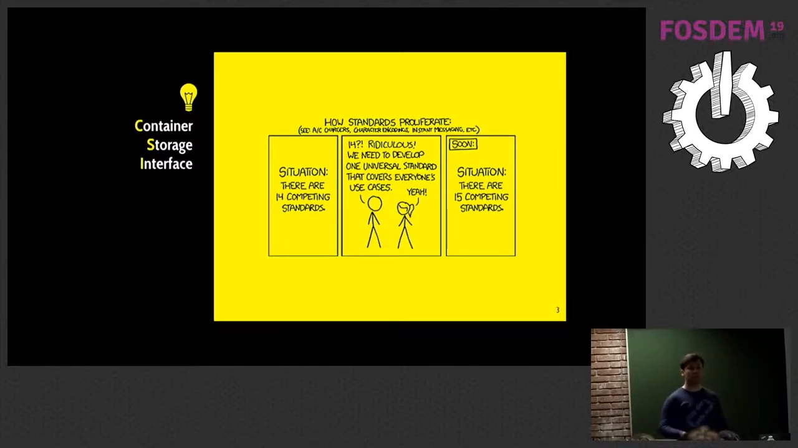
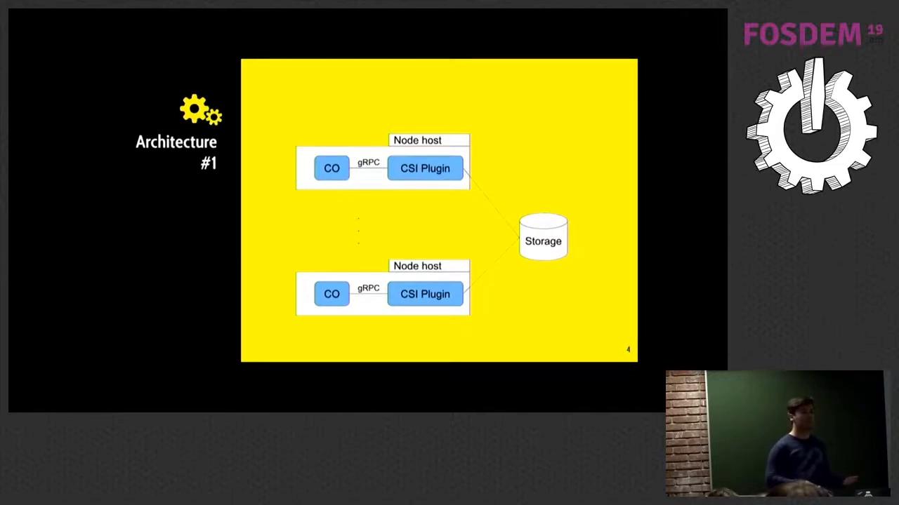
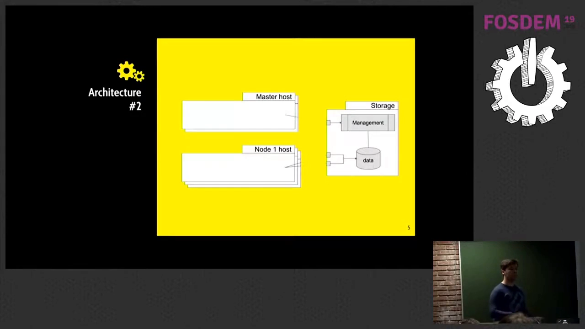
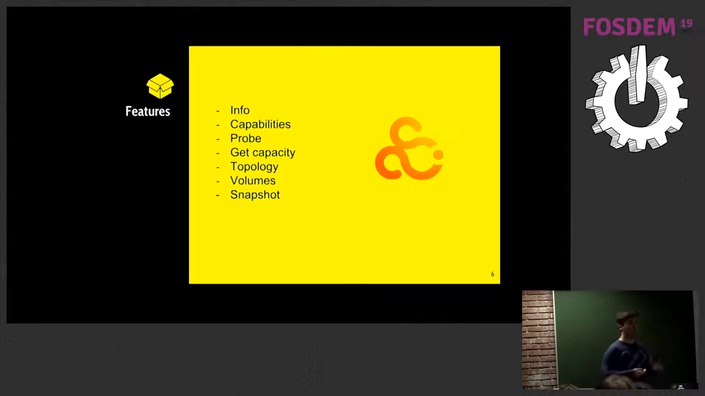
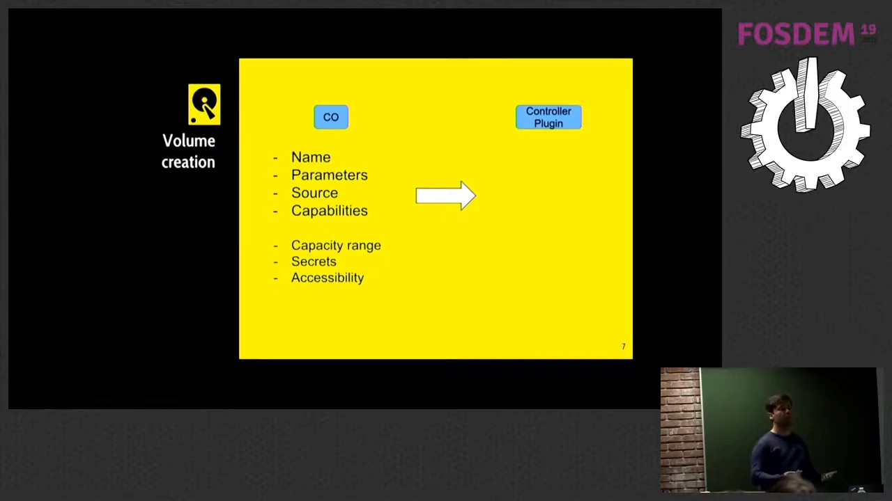
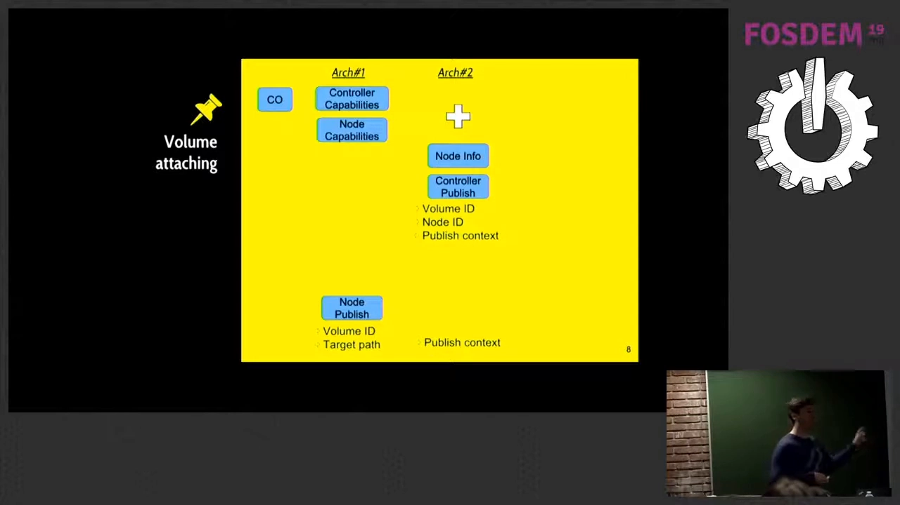
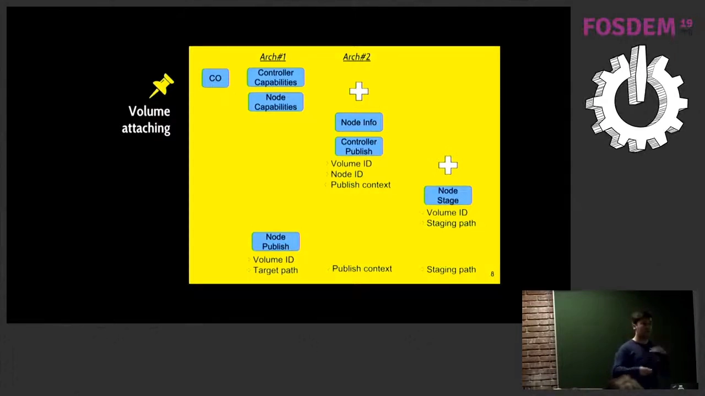
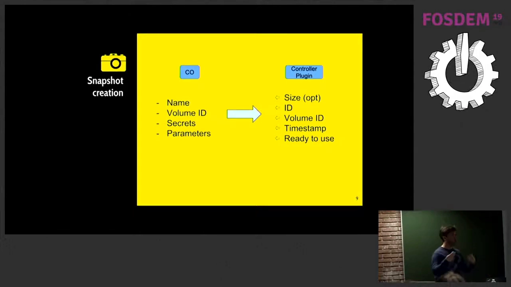
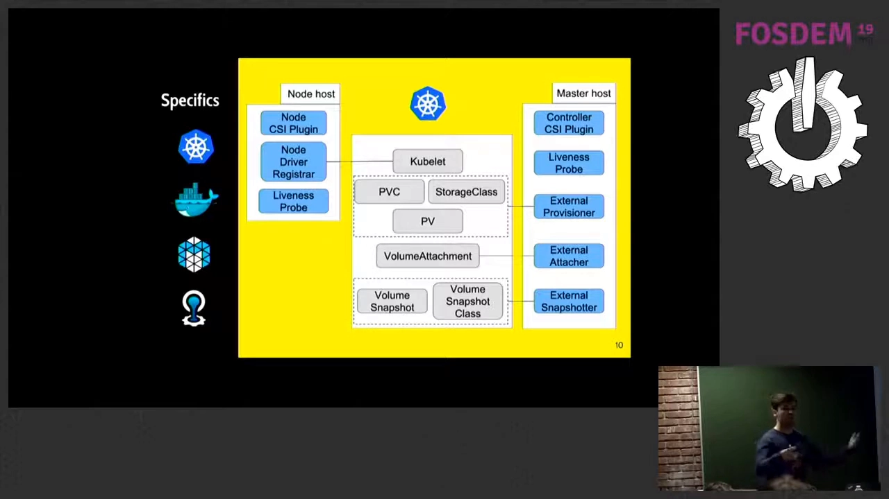
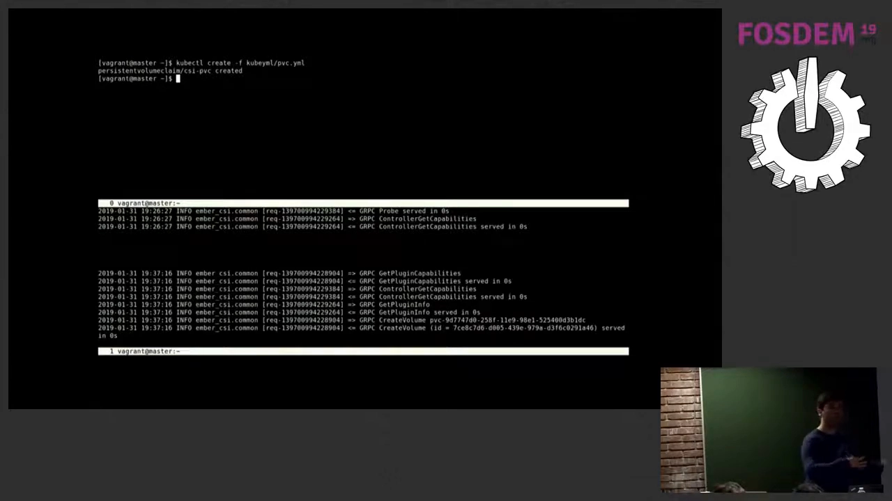

# CSI 把能力做成可选项：接口只约定动作，不约定后端

> 视频来源：[The Container Storage Interface, Explained - Gorka Eguileor](https://www.youtube.com/watch?v=MokXcWewixk)（YouTube · FOSDEM 2019 · Gorka Eguileor）｜时长约 34 分钟
> 这是一场从**规范设计者视角**讲的 CSI 导览：为什么不缺接口还要再造一个、两种部署架构如何决定接口分工、创建卷的七个参数各自解决什么问题、以及为什么"可选能力"是这套接口能适配所有存储的关键。讲于 2019 年，规范当时还是 1.0，扩容等特性尚未发布，但接口的骨架没有变。同小节的另一篇《一个 CSI 插件最少要实现八个幂等方法》从实现者视角讲同一套方法怎么落地。

## 本讲要解决的核心问题（SCQA）

**背景**：容器一开始被认为不需要持久存储，后来需要了，就一个一个往上加接口。结果是存储厂商不得不写一大堆不同的驱动，每接一个容器平台就要重写一遍。[【跳转到 00:32】](https://www.youtube.com/watch?v=MokXcWewixk&t=32)

**冲突**：于是 CSI 出场，目标是成为任何容器平台上**唯一**的存储接口。但"统一标准"这件事本身名声不好——漫画里那 15 个标准就是前车之鉴。更棘手的是，存储的形态差别极大：光纤通道、iSCSI、NFS、云盘，管理面和数据面可能根本不在一个网络上。一个接口要同时做到"统一"和"不僵化"，看起来是矛盾的。

**疑问**：CSI 靠什么化解这个矛盾？它到底约定了什么、又刻意留白了什么？为什么"创建卷"这一个调用要带七个参数？

**回答（中心思想）**：CSI 只约定**动作**（创建、发布、快照……）和**动作的结果**，把"我能做什么"做成**可选项由插件自报**，把"后端怎么实现"塞进**对编排器不透明的参数**里，把"节点上怎么挂"做成**可选的 NodeStage**。所以同一个接口，既能描述一个只能整份复制的后端，也能描述一个支持快照和克隆的后端——规范不关心，也不该关心。

## 一、两种部署架构，决定了接口怎么分工

CSI 努力做到"存储无关"，为此它支持多种基础设施形态。讲者只讲最常见的两种，因为**接口的分工是由架构决定的**。

### 1.1 架构一：每个节点都能访问后端

在这种部署里，存储可以被所有节点访问，每个节点都能创建、删除、连接卷。CSI 插件服务**常驻在每个节点上**，编排器不再用命令行调用，而是通过 gRPC 发请求。[【跳转到 02:22】](https://www.youtube.com/watch?v=MokXcWewixk&t=142)

好处是实现被解耦、插件可以更高效；代价是每个节点都要有访问存储管理面的能力。

### 1.2 架构二：管理面与数据面分离

更多情况下，存储的管理网络和数据路径是分开的。这时编排器一侧也会分成两类节点：**基础设施节点**能访问管理网络，负责创建和删除资源；**容器工作负载节点**只需要知道存储的传输协议，能连上数据路径就行。[【跳转到 04:02】](https://www.youtube.com/watch?v=MokXcWewixk&t=242)

讲者举的例子很直观：如果后端是 iSCSI，工作节点只需要把 iSCSI initiator 启起来，它完全不需要知道后端是什么，只要知道"这是 iSCSI，这是连接信息，去连"。

**这一节是理解后面所有接口形态的前提**：正因为存在架构二，"把卷挂到某台节点上"这件事就必须有一个能访问管理面的角色来做，于是有了 Controller 侧的发布调用；而"在这台节点上把卷挂起来"必须由本机做，于是有了 Node 侧。

## 二、特性分两组：帮编排器的，和管资源的

这些特性是编排器开发者、存储厂商开发者和第三方共同挑选出来的，不是编排器单方面决定的，所以各方利益都在里面。它们可以分成两组：[【跳转到 05:42】](https://www.youtube.com/watch?v=MokXcWewixk&t=342)

**第一组：帮助编排器完成它那份工作的**

- **Info**：识别不同的插件，让编排器知道哪个 controller 对应哪个 node 插件——因为你可以同时跑多个 CSI 插件，必须配对，请求才会发到对的地方。
- **Capabilities**：CSI 里几乎所有特性都是**可选**的（这样才能适配各种存储方案），所以必须有一种办法去问插件：你这个部署到底支持哪些特性。[【跳转到 06:32】](https://www.youtube.com/watch?v=MokXcWewixk&t=392)
- **Probe**：检查各个插件的健康状态。
- **Get capacity**：查询还有多少可用容量。
- **Topology**：知道哪些节点能访问哪些存储。讲者的例子是：你总不会想把容器调度到一个没有 HBA 卡、根本连不上光纤通道卷的节点上。有了拓扑信息，编排器就能按卷的位置做智能调度。

**第二组：管理资源本身的**

卷和快照两类资源，可以创建、删除、列举；可以对某个卷取统计信息看还剩多少空间；还有挂接和摘除。

讲者特意说明：这只是 1.0 的清单，规范是活的，比如扩容当时已经在做、会在下一版发布。

## 三、创建卷：七个参数，各解决一个问题

创建卷和所有与存储相关的 CSI 功能一样，**必须幂等**：你可能多次收到同一个请求，插件必须保证只创建一个卷，并且总是返回同一个卷。[【跳转到 08:37】](https://www.youtube.com/watch?v=MokXcWewixk&t=517)

编排器会传七个参数。幻灯片上是这样排的：

### 3.1 name 就是请求 ID

第一个参数叫 `name`，你可以把它当成请求 ID：每个请求它是唯一的，同一个调用重复到达时 `name` 也一样。插件正是靠它实现幂等。[【跳转到 09:02】](https://www.youtube.com/watch?v=MokXcWewixk&t=542)

这一点值得停一下：**幂等不是靠插件记日志，而是靠调用方提供一个稳定的名字**。接口把"去重"的责任用参数的形式明确交给了双方。

### 3.2 parameters 对编排器不透明

`parameters` 是一个映射表，让插件和存储厂商把高级特性暴露出来。这就是它们既做到"存储无关"、又让存储能展示自家花样的方式。[【跳转到 09:52】](https://www.youtube.com/watch?v=MokXcWewixk&t=592)

讲者的例子：你的存储支持压缩，插件就在文档里写"你可以传一个叫 `compression` 的键，卷就会被压缩"。这些参数**对编排器是不透明的**——编排器根本不关心，只是原样接过来交给插件。所以它们在不同插件之间各不相同，你必须查文档才知道有哪些可用。

这是整场分享里最能说明"抽象边界"的一处：**接口只规定"有一个自由参数区"，不规定里面放什么**。

### 3.3 source 决定三种来源：空卷、克隆、快照

`source` 参数定义我们要的是哪一种卷。可以创建三种：[【跳转到 10:42】](https://www.youtube.com/watch?v=MokXcWewixk&t=642)

1. **空卷**；
2. **clone 卷**——从另一个卷创建出来的卷；
3. **从快照创建的卷**。

请注意这里没有单独的"克隆接口"。克隆和"从快照恢复"都是**创建卷的一种来源**，走的是同一个 `CreateVolume`。这是接口设计上的一个重要取舍：与其为每种来源加一个方法，不如把"来源"变成一个参数——这样新增一种来源不会破坏已有实现。

至于后端到底怎么实现这个"从另一个卷来的卷"，规范不管。它可能是元数据级的共享，也可能是整份复制；接口只承诺"你会得到一个内容相同的卷"。**同一个接口，允许不同后端有完全不同的代价模型**，这正是抽象边界的价值所在。

### 3.4 capabilities 决定这个卷怎么用

`capabilities` 是编排器告诉插件"这些卷打算怎么用"的方式：[【跳转到 11:07】](https://www.youtube.com/watch?v=MokXcWewixk&t=667)

- 当**块设备**用，还是挂成**文件系统**用？
- 如果是文件系统，要哪种文件系统？
- 访问模式是什么——单读单写、多读单写，等等。

所以流程是：编排器必须去问 controller 它想要什么，如果 controller 能做到，就返回卷的 ID，同时返回实际大小和可访问性信息，也就是这个卷能从哪儿访问。[【跳转到 11:57】](https://www.youtube.com/watch?v=MokXcWewixk&t=717)

这是一个简单的同步调用：你调用它，它创建，创建好了返回一个值。

## 四、挂接：规范说的是 publish，不是 attach

如果你去读 CSI 规范，会发现它不讲 attach 和 detach，它讲 **publish** 和 **unpublish** 卷。[【跳转到 12:22】](https://www.youtube.com/watch?v=MokXcWewixk&t=742)

这个用词不是巧合：**attach 描述的是"把线插上"这个动作，publish 描述的是"让它在某个目标上可用"这个结果**。前者是某一种实现，后者才是接口要承诺的东西。

### 4.1 架构一：一次 NodePublish 就够

每个节点都能访问后端，所以编排器会先查能力，确认"你用的是架构一"，然后直接到它要创建容器的那台节点上，说：请把这个卷 publish 出来，让它在这台目标上可用。就这样，卷暴露出来了。[【跳转到 12:47】](https://www.youtube.com/watch?v=MokXcWewixk&t=767)

所以在架构一里，让卷在特定目标上可访问，是 **node publish 的职责**。

### 4.2 架构二：先 ControllerPublish，再 NodePublish

架构二把功能拆到了管理侧和节点侧，于是多了一步。controller 并不知道卷最终会在哪儿被 publish，所以顺序是：先问清楚要放到哪个节点，拿到节点信息，再带着节点 ID 去调 controller，告诉它"请把这个卷 publish 到这台特定节点"。[【跳转到 14:02】](https://www.youtube.com/watch?v=MokXcWewixk&t=842)

讲者举的例子：如果你在 publish 一个 iSCSI 卷，controller 这一步就是在做 **export 和 mapping**，把卷和特定节点用 initiator name 和 IP 地址绑定起来。

注意 `Publish context` 这个字段：controller publish 的产出会作为上下文传给 node publish——**管理面算出来的连接信息，正是节点侧建立连接所需要的**。两段职责靠这个字段缝合。

### 4.3 NodePublish 可以被调用多次

如果访问模式是多读多写，node publish 在同一台节点上可以被调用多次：为第一个容器 publish 一次，再创建第二个容器访问同一个卷，就会得到第二次 publish 调用。规范对这点说得很清楚。[【跳转到 14:27】](https://www.youtube.com/watch?v=MokXcWewixk&t=867)

### 4.4 NodeStage 是可选项，用来把"一次挂载"和"多次暴露"分开

为了帮插件处理"同一节点上多次 publish"，规范里有一个额外的、**可选**的调用：`NodeStage`。它夹在 controller publish 和 node publish 中间，而且**总是在容器将要运行的那台节点上**被调用。[【跳转到 14:52】](https://www.youtube.com/watch?v=MokXcWewixk&t=892)

它解决什么问题？讲者用 NFS 驱动举例：这类驱动可以在 stage 阶段做**真正的挂载**，因为它们知道"每台节点每个卷只会被调用一次"，可以把卷挂到编排器传进来的 staging 路径上；之后无论收到多少次 node publish，它们只要做 bind mount，从 staging 路径挂出去就完事。

于是插件**不需要自己记录这台节点上有多少个容器在用这个卷**，只要知道：先会收到一次 NodeStage，我在那儿挂好；然后做 bind mount。

unpublish 是严格的反向：先收到 node unpublish，只需要去掉 bind mount；然后收到 NodeUnstage，这时才真正卸载外部存储。[【跳转到 16:07】](https://www.youtube.com/watch?v=MokXcWewixk&t=967)

**为什么它是可选的？** 因为有些后端根本不需要"一次挂载多次暴露"这个优化，强制它们实现只会增加负担。把它做成可选，插件就可以按自己的能力声明，编排器按声明决定调不调——这就是"能力自报"机制的具体应用。

## 五、快照：一个同步调用，加一个 ready-to-use 标志

讲者选快照来讲，是因为对大多数驱动来说，这是一个**简单的同步调用**：编排器说"创建一个快照"，驱动咔嚓切一个，存下来，返回，一个调用就完事，快照立刻可用。[【跳转到 16:57】](https://www.youtube.com/watch?v=MokXcWewixk&t=1017)

返回里的 `ID` 就是快照的标识，后续"从快照创建卷"时，把它填进 `CreateVolume` 的 `source` 就行。

但规范多引入了一个特性：**后处理（post-processing）**。你的快照可以已经切好了，你作为同步调用返回给调用方，告诉它"我切好了，但快照还没准备好，我还要做些额外的工作"，于是返回 `Ready to use` 为 **false**。[【跳转到 17:47】](https://www.youtube.com/watch?v=MokXcWewixk&t=1067)

这样编排器就知道这件事进入了异步范围，会在插件后台继续跑，可能要几个小时才能完成——比如你在把快照上传到云端。这时**轮询检查"它好了吗、我能用了吗"就成了编排器的责任**。

而且和所有资源操作一样，这个操作是幂等的，所以接口很简单：你会收到同样的参数，只要用 `name` 就能轻松判断这个操作到底完成了没有。

这里又一次看到同一种设计手法：**接口不承诺"调用返回时事情已经做完"，只承诺"你能问出它做完了没有"**。同步还是异步，是插件的自由。

## 六、Kubernetes 怎么把这些拼起来

Kubernetes 决定用"边车容器 + kubelet 里的代码"混合的方式实现 CSI：一部分代码在 kubelet 里，一部分是你要放进 Pod 里的边车。[【跳转到 18:37】](https://www.youtube.com/watch?v=MokXcWewixk&t=1117)

节点侧：

- **Node CSI Plugin**：你的驱动的 node 部分；
- **node-driver-registrar**：把 CSI 插件注册进 kubelet，让 kubelet 知道它跑在这台节点上；
- **liveness probe**：接收 HTTP 请求，转成 gRPC 去调我们前面说的 probe 特性，再以 HTTP 返回，于是能接进监控系统。

控制侧：

- **external-provisioner**：监听 PVC，触发创建或删除。创建时它把 PVC 和 StorageClass 的信息拼起来传给插件——**`CreateVolume` 里那个 `parameters` 就来自 StorageClass**，你可以在 StorageClass 里写 `compression=true`，provisioner 原样传下去；[【跳转到 20:17】](https://www.youtube.com/watch?v=MokXcWewixk&t=1217)
- **external-attacher**：监听 VolumeAttachment 并调用 controller publish。所以只有架构二才需要它；[【跳转到 21:07】](https://www.youtube.com/watch?v=MokXcWewixk&t=1267)
- **external-snapshotter**：监听 VolumeSnapshot 和 VolumeSnapshotClass，做的是 provisioner 的等价工作——把 SnapshotClass 的信息和 VolumeSnapshot 请求拼起来，调用 controller 侧插件；[【跳转到 21:57】](https://www.youtube.com/watch?v=MokXcWewixk&t=1317)
- **external-resizer**：扩容特性加入后新增的边车。[【跳转到 22:47】](https://www.youtube.com/watch?v=MokXcWewixk&t=1367)

挂接的后半段由 kubelet 完成：因为有了 node-driver-registrar，kubelet 知道该用哪个 socket 去和 node 侧插件说话，从这台节点发出 gRPC 调用，完成 publish 或 stage。

**这套拼装本身就是抽象边界的一部分**：编排器不直接实现任何存储逻辑，它只是把"用户意图"翻译成对插件的调用；插件也不实现调度、绑定、重试，它只回答"这个动作能不能做、做完了没有"。

## 七、抽象边界的收益：一个插件，八十种后端

讲者用 Ember CSI 做演示：它支持大约 80 种后端，支持 CSI 2.3，全都跑在同一个容器里；例子用 LVM 做后端（为了不偏向任何存储厂商），部署一个基础设施节点和两个工作节点。[【跳转到 22:47】](https://www.youtube.com/watch?v=MokXcWewixk&t=1367)

演示里能看到接口在真实流量中的样子：创建 PVC 之后，先收到 `GetCapabilities`（确认 controller 能创建卷），再收到 `CreateVolume`，带着 `name` 参数——也就是那个用来实现幂等的请求 ID——然后返回卷的 ID。[【跳转到 28:13】](https://www.youtube.com/watch?v=MokXcWewixk&t=1693)

同一个插件能对接 80 种后端，靠的不是"把 80 种后端的差异都写进接口"，而是反过来：**接口只留出几个可以承载差异的位置**——`parameters` 承载厂商特性，`capabilities` 承载使用方式，`NodeStage` 承载节点侧的优化空间，`Ready to use` 承载同步/异步的自由。其余部分对所有后端都一样。

## 小结

- CSI 的目标是成为容器平台上**唯一**的存储接口；它靠"约定动作与结果、留白实现"来避免成为第 15 个标准。
- 两种部署架构（节点直连后端 / 管理面与数据面分离）决定了接口分工：**能碰管理面的放 Controller，必须碰本机的放 Node**。
- 创建卷的七个参数各有分工：`name` 提供幂等所需的稳定标识，`parameters` 对编排器不透明、承载厂商特性，`source` 把"空卷 / 克隆 / 从快照恢复"统一成一种来源，`capabilities` 决定块设备还是文件系统、以及访问模式。
- 规范说 **publish** 而不是 attach：它描述的是"让卷在某个目标上可用"这个结果，不是"把线插上"这个动作。
- `NodeStage` 是**可选**能力，用来把"一次挂载"和"多次暴露"分开，让插件不必自己数有多少容器在用这个卷。
- 快照是一个同步调用，但可以用 `Ready to use = false` 声明后处理，把轮询责任交给编排器。
- 收益是具体的：一个插件对接 80 种后端，因为差异只被允许出现在少数几个约定好的位置上。

## 关键术语速查

| 术语 | 一句话解释 |
| :--- | :--- |
| CO | Container Orchestrator，容器编排器，CSI 的调用方 |
| 幂等 | 同样的参数调用多次，结果与调用一次相同（或返回错误） |
| parameters | 创建卷时的自由参数区，对编排器不透明，由插件定义 |
| source | 创建卷的来源：空卷、从另一个卷克隆、从快照创建 |
| capabilities | 编排器声明卷的使用方式：块设备还是文件系统、哪种文件系统、什么访问模式 |
| publish / unpublish | 规范用语，指"让卷在某个目标上可用 / 不可用"，替代 attach / detach |
| NodeStage | 可选调用，在 controller publish 与 node publish 之间，用于一次挂载多次暴露 |
| staging path | 编排器传给 NodeStage 的暂存路径，后续 bind mount 从它出发 |
| Ready to use | 快照返回值里的标志，false 表示快照已切好但还需后处理 |
| Topology | 让编排器知道哪些节点能访问哪些存储，用于按卷调度 |
| sidecar | external-provisioner / attacher / snapshotter / resizer 等边车，把编排器意图翻译成 CSI 调用 |