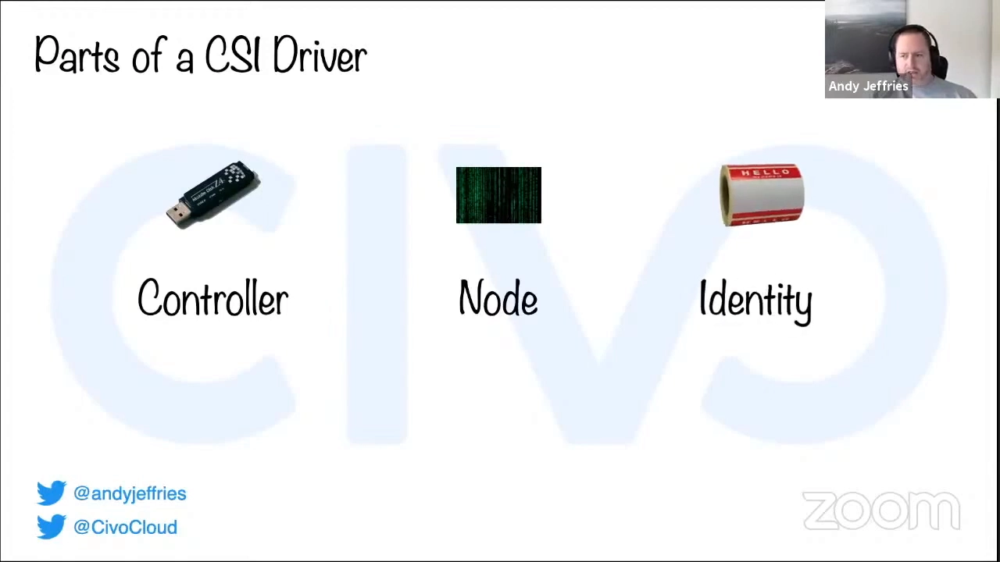
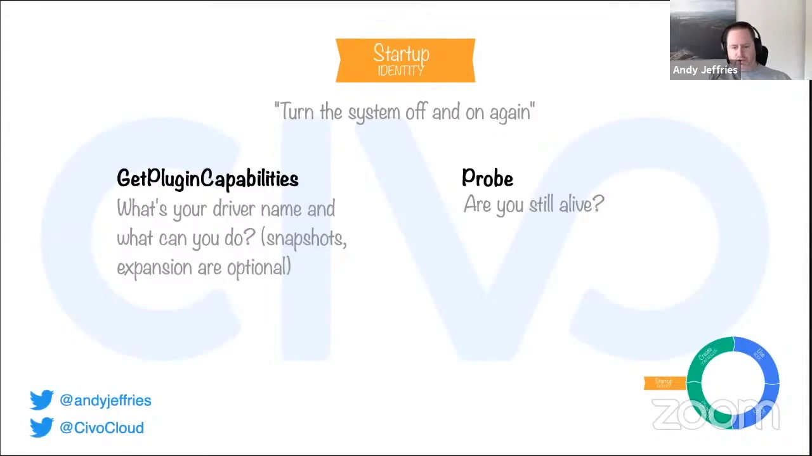
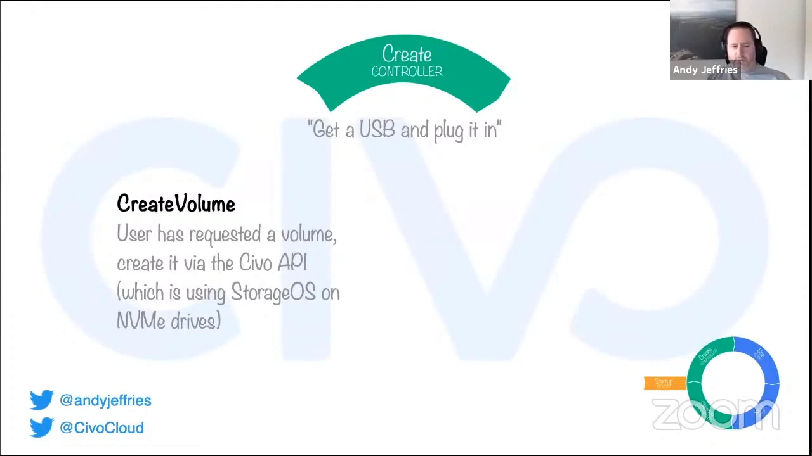
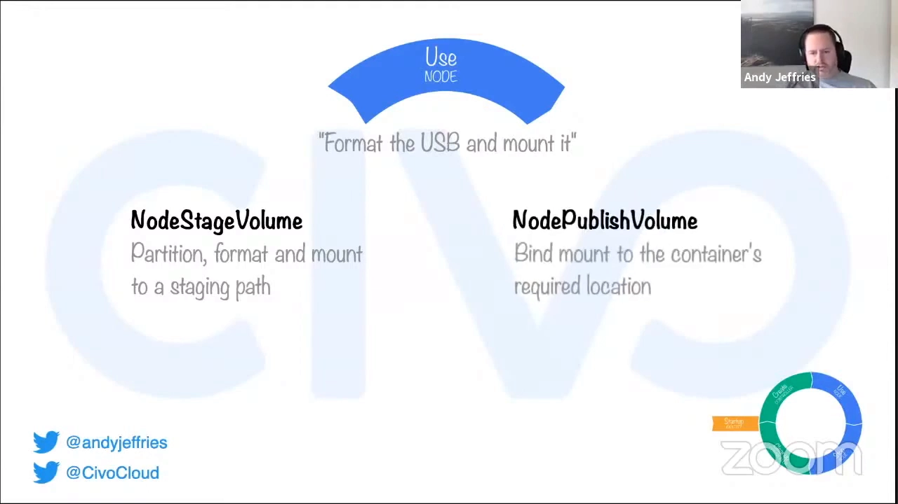
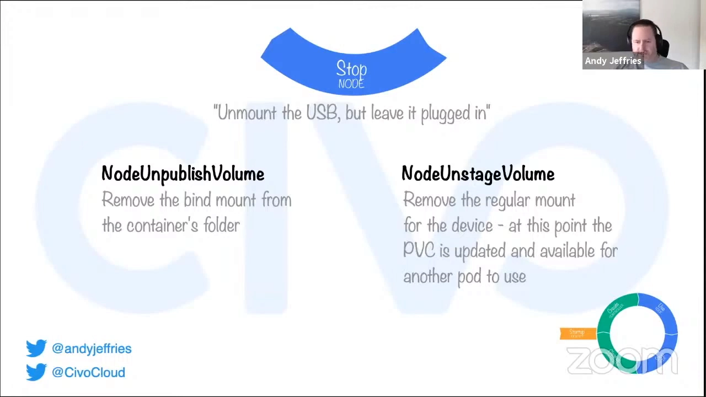
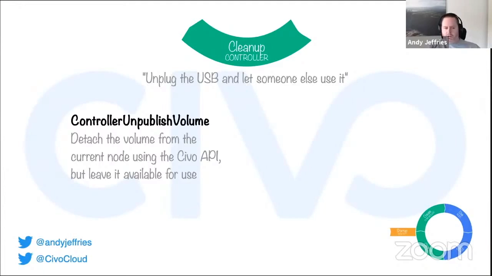
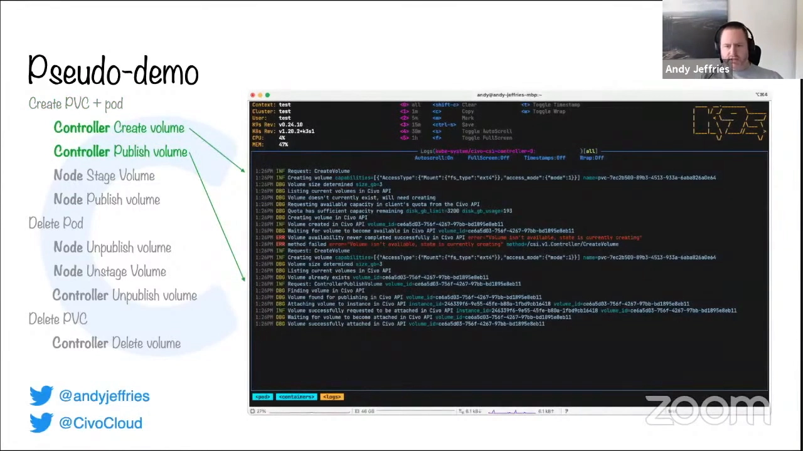
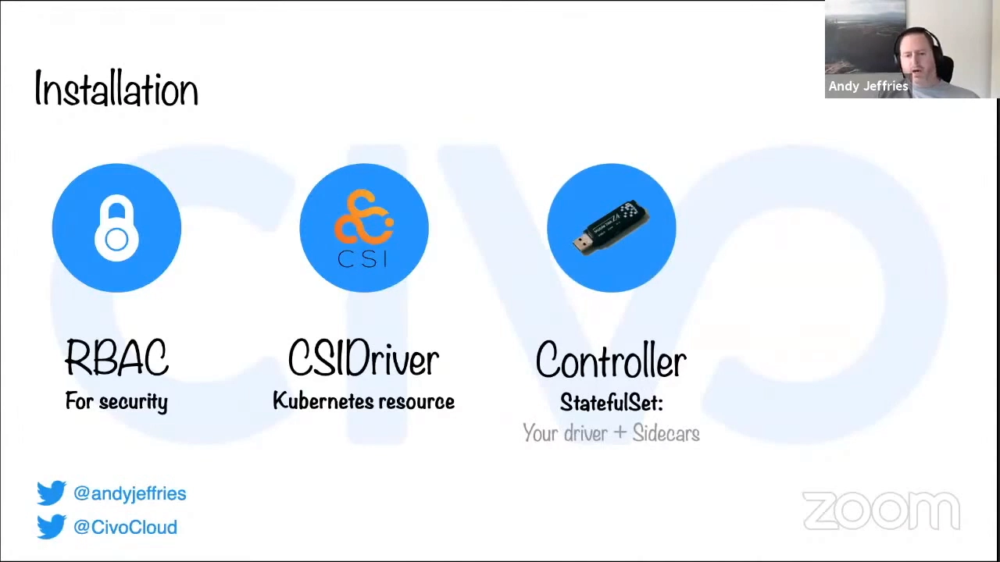

# 一个 CSI 插件最少要实现八个幂等方法

> 视频来源：[Introduction to CSI Driver Internals - Andy Jeffries](https://www.youtube.com/watch?v=FK8Ti39oXEg)（YouTube · Civo Online Meetup · Andy Jeffries）｜时长约 19 分钟
> 这是一场从"写驱动的人"视角讲的 CSI 入门：不讲怎么用 PVC，只讲一个卷插件必须交出哪些方法、这些方法分别跑在控制面还是节点上、以及为什么每个方法都必须幂等。本文顺着视频的"U 盘生命周期"主线整理，并把散落在各处的调用顺序收成一张表。同小节的另一篇《CSI 把能力做成可选项》从规范角度讲同一套接口的"可选能力"与快照/克隆。

## 本讲要解决的核心问题（SCQA）

**背景**：容器本身是无状态的，但你要跑 MySQL、跑 WordPress，数据就得落在容器外面。在 Kubernetes 里，容器随时可能被调度到另一台机器上，所以存储必须能跟着容器走。[【跳转到 00:40】](https://www.youtube.com/watch?v=FK8Ti39oXEg&t=40)

**冲突**：麻烦在于"把一块盘交给容器"在现实世界里是一长串动作：先去存储池里拿一块盘，插到机器上，分区、格式化、挂载，最后让容器能读写它；用完还要倒着来一遍。这些动作每一步都依赖不同的东西——有的要在存储管理面做，有的只能在具体的机器上做。如果每家存储厂商都自己定义一套接口，Kubernetes 就得为每家写一遍胶水代码。

**疑问**：那么一个卷插件（CSI driver）到底最少要实现哪些方法？这些方法分别由谁调用、在哪台机器上执行？为什么规范反复强调"必须幂等"？

**回答（中心思想）**：CSI 把这条"U 盘生命周期"切成五个阶段、三个 gRPC 服务，一个插件最少要交出**八个卷生命周期方法**（创建、挂接、暂存、发布，以及四个反向操作）**加两个身份方法**。切分的依据是**操作发生在哪**：能碰存储管理面的放 Controller，必须碰本机磁盘的放 Node。而所有方法都必须幂等，因为编排器的重试是常态，不是异常。

## 一、先把 CSI 看成一条 U 盘的生命周期

### 1.1 现实世界里的五步

讲者用 U 盘打比方：你有一堆 U 盘，锁在保险柜里，不能同时被两个人用，还需要一条看门狗记着谁拿着哪块盘。要用的时候：

1. 去保险柜里拿一块盘，插到你的电脑上；
2. 一堆"技术性的琐碎操作"——分区、用文件系统格式化、挂载，让它作为一块盘出现在操作系统里；
3. 用；
4. 用完了，右键弹出，但盘还插着；
5. 把盘还回保险柜，别人可以用了。

CSI 就是把这五步规定成一套和 Kubernetes 配合良好的接口。[【跳转到 02:10】](https://www.youtube.com/watch?v=FK8Ti39oXEg&t=130)

### 1.2 三个服务，对应三种角色

写 CSI 驱动时有三大部分，正好对应上面的比方：[【跳转到 03:01】](https://www.youtube.com/watch?v=FK8Ti39oXEg&t=181)

- **Controller（控制器）**：对应"U 盘本身"——给我一块新盘，把它插到这台机器上。它面对的是存储的管理面。
- **Node（节点）**：对应那些琐碎操作——分区、格式化、把盘挂到某个位置。它必须跑在容器将要运行的那台机器上。
- **Identity（身份）**：最小的那部分，就是"我叫什么名字，我活着"。

Kubernetes 通过 gRPC 和驱动通信。讲者特意对比了一下：REST 是围绕 URL 和对象的增删改查，而 gRPC 更像"执行这个动作"，接近函数式声明。写驱动的人通常不用碰 protobuf 那一层——Kubernetes CSI 项目提供了一批 **sidecar（边车）**，它们替你把 gRPC 的脏活干了，只调用你在驱动里实现的方法。[【跳转到 03:26】](https://www.youtube.com/watch?v=FK8Ti39oXEg&t=206)

## 二、八个卷方法加两个身份方法，沿生命周期排开

把五个阶段摊平，每个阶段对应两到四个方法。下面这张表是全文的骨架：

| 阶段 | 执行侧 | 方法 | 一句话职责 |
| :--- | :--- | :--- | :--- |
| Startup | Identity | `GetPluginCapabilities` | 报出驱动名与支持的可选能力 |
| Startup | Identity | `Probe` | 回答"你还活着吗" |
| Create | Controller | `CreateVolume` | 在存储层真正创建卷 |
| Create | Controller | `ControllerPublishVolume` | 把卷挂接到指定节点 |
| Use | Node | `NodeStageVolume` | 分区、格式化、挂到暂存路径 |
| Use | Node | `NodePublishVolume` | bind mount 到容器要用的目录 |
| Stop | Node | `NodeUnpublishVolume` | 去掉 bind mount |
| Stop | Node | `NodeUnstageVolume` | 去掉常规挂载点 |
| Cleanup | Controller | `ControllerUnpublishVolume` | 从节点上摘掉卷，但保留数据 |
| Cleanup | Controller | `DeleteVolume` | 真正删卷，停止计费 |

### 2.1 Startup：两个身份方法

启动阶段相当于"关机再开机"。两个方法：[【跳转到 08:02】](https://www.youtube.com/watch?v=FK8Ti39oXEg&t=482)

- `GetPluginCapabilities`：告诉对方我的驱动叫什么名字、我能做什么——**哪些可选功能我实现了**。讲者的幻灯片上直接写着"快照、扩容是可选的"。
- `Probe`：Kubernetes 会频繁调用，是最简单的方法，只要返回一个响应，就说明 controller 还活着。

### 2.2 Create：创建卷，再把它挂到某台节点上

创建阶段有两个方法，第一个是 `CreateVolume`：当有人创建了 PVC、又试图把它挂到 Pod 上，系统发现底下还没有卷（你有 claim，但没有 volume），就调用它去存储层创建卷。在讲者的实现里，这一步是调用 Civo 的 API，底层是 NVMe 盘上的 StorageOS。[【跳转到 08:27】](https://www.youtube.com/watch?v=FK8Ti39oXEg&t=507)

第二个是 `ControllerPublishVolume`，相当于"把 U 盘插进去"。在讲者的实现里，就是告诉 Civo：你需要把这个卷挂到这台节点上。[【跳转到 09:17】](https://www.youtube.com/watch?v=FK8Ti39oXEg&t=557)

### 2.3 Use：NodeStage 做格式化与挂载，NodePublish 只做 bind mount

使用阶段在**具体的 Kubernetes 工作节点**上执行，同样两个调用：[【跳转到 09:42】](https://www.youtube.com/watch?v=FK8Ti39oXEg&t=582)

- `NodeStageVolume`：**分区、格式化、挂载到暂存路径（staging path）**。这一步决定了卷在这台机器上"长什么样、挂在哪"。
- `NodePublishVolume`：非常简单，就是一个 **bind mount**。讲者打了个比方：bind mount 可以理解成符号链接——从已经挂载好的路径，链到容器期望找到它的那个具体位置，容器就能往里写了。[【跳转到 10:07】](https://www.youtube.com/watch?v=FK8Ti39oXEg&t=607)

这个"两步走"不是啰嗦，而是把"设备级准备"和"容器级暴露"分开：同一台节点上可能有多个容器要用同一个卷，前者只需要做一次，后者要做多次。

### 2.4 Stop 与 Cleanup：四个反向方法，粒度不同

用完之后的路径是严格的反向，但要分清"还插着"和"还回去了"：[【跳转到 10:32】](https://www.youtube.com/watch?v=FK8Ti39oXEg&t=632)

- `NodeUnpublishVolume`：去掉 bind mount，容器看不到这个目录了；
- `NodeUnstageVolume`：去掉那个常规挂载点，此时设备还挂在节点上，只是没有挂载点了；
- `ControllerUnpublishVolume`：从当前节点上摘掉卷，**但没有数据丢失**——以后别的 Pod 起来，只要 PVC 还在，卷还在；[【跳转到 10:57】](https://www.youtube.com/watch?v=FK8Ti39oXEg&t=657)
- `DeleteVolume`：只有真的删掉 PVC 才调用，从存储 API 里彻底删除，一路传到后端，你也不用再为它付费。

把"卸载"和"删除"分成两个方法，是这套接口最实用的设计之一：Pod 重启、节点漂移只需要前者，只有用户明确放弃数据才需要后者。

## 三、幂等不是好习惯，是硬要求

讲者在演示日志时专门停下来讲这件事。日志里 `CreateVolume` 先报"卷已创建"，然后开始等卷进入 available 状态——这一步比最初的超时时间要长，所以第一次调用没能成功返回。[【跳转到 12:10】](https://www.youtube.com/watch?v=FK8Ti39oXEg&t=730)

Kubernetes 的反应不是报错退出，而是**用同一个名字再调一次**。所以规范要求：[【跳转到 12:35】](https://www.youtube.com/watch?v=FK8Ti39oXEg&t=755)

> 用同样的参数调用同一个方法，必须落到同样的状态，或者返回错误。用某个名字调用 `CreateVolume` 十次，你应该只得到一个叫这个名字的卷，而不是十个。

这条要求之所以是硬的，是因为**编排器的重试是常态**：网络抖动、后端慢、控制器重启，都会让同一个请求到达两次。如果 `CreateVolume` 不幂等，一次重试就多一块盘、多一份账单；如果 `DeleteVolume` 不幂等，一次重试就可能删掉别人刚建的同名卷。

幂等还带来一个额外好处：**接口可以很简单**。因为重复调用是安全的，插件不需要维护"这个请求我处理过没有"的复杂状态，只要按名字查一下就行。

### 3.1 用测试套件把幂等和输入校验固定下来

讲者给了一条捷径：不用一页页翻文档去数方法，直接看 **CSI sanity 测试套件**——它是 Kubernetes 项目写的，用来检查你该实现的方法都实现了、输入都被正确校验了。[【跳转到 05:20】](https://www.youtube.com/watch?v=FK8Ti39oXEg&t=320)

- 全套 154 个测试；
- 把可选功能去掉之后，**剩下 98 个**需要你填细节；
- 它检查的正是这类边界：用空名字创建卷要返回错误，用 -1 GB 或 0 GB 创建卷也要返回错误——不能有空卷。[【跳转到 14:54】](https://www.youtube.com/watch?v=FK8Ti39oXEg&t=894)

在 Go 里跑完这 98 个测试大约半秒，所以可以形成"跑测试、修坏的地方、再跑一遍"的快速循环。边车本身也有自动测试，你唯一需要自己写的是针对自家后端功能的单元测试——讲者的做法是做一个 fake 库，接口和真实库一致，但不需要 API server。

## 四、职责边界：谁格式化、谁挂载

把上面的方法按执行位置重新排一遍，边界就很清楚了：

| 关注点 | Controller 侧 | Node 侧 |
| :--- | :--- | :--- |
| 卷存在不存在 | 创建、删除 | 不关心 |
| 卷挂在哪台机器 | 挂接、摘除 | 不关心 |
| 分区与格式化 | 不参与 | `NodeStageVolume` |
| 挂载点 | 不参与 | `NodeStageVolume`（暂存路径） |
| 容器看到哪个目录 | 不参与 | `NodePublishVolume`（bind mount） |

这条边界不是审美选择，而是物理约束：分区、格式化、挂载都是**本机内核**的动作，控制面根本碰不到那台机器的设备节点。反过来，创建卷要调存储的管理 API，节点上通常没有这个权限，也不该有。

所以判断一个操作该放哪一侧，只需要问一句：**它需不需要碰这台机器的磁盘？** 需要，就是 Node；不需要，就是 Controller。

## 五、把驱动装进集群：四步

驱动写完之后，装进集群有四步：[【跳转到 15:44】](https://www.youtube.com/watch?v=FK8Ti39oXEg&t=944)

1. **RBAC**：让驱动的各个部分能访问底层文件系统、能往盘上写；
2. **CSIDriver 资源**：大约十行 YAML，字面意思就是"我是一个 CSIDriver，我的标识符是 csi.com"；它和 StorageClass 对应起来——用某个 StorageClass 创建卷时，系统会去查有没有驱动能处理它；
3. **Controller**：一个 StatefulSet，集群里只跑一份，是唯一和外部 API 交互的部分，由你的驱动加调用 gRPC 的边车组成；
4. **Node**：一个 DaemonSet，跑在每台工作节点上，同样包含驱动代码和边车。

这里有一个自由度：可以把 controller 和 node 做成同一个代码库、同一个二进制，两处都安装；也可以拆成两个项目、两个二进制，只跑各自需要的代码。讲者选了前者——Go 的二进制很小，代码组织也清爽。

## 小结

- CSI 把"把一块盘交给容器"拆成五个阶段：Startup、Create、Use、Stop、Cleanup，分布在三个 gRPC 服务里。
- 一个插件最少要实现 **八个卷生命周期方法**：`CreateVolume`、`ControllerPublishVolume`、`NodeStageVolume`、`NodePublishVolume`、`NodeUnpublishVolume`、`NodeUnstageVolume`、`ControllerUnpublishVolume`、`DeleteVolume`；再加 Identity 的 `GetPluginCapabilities` 与 `Probe`。
- 切分依据是**操作发生在哪**：要碰本机磁盘的一律放 Node，要碰存储管理面的一律放 Controller。格式化与挂载在 Node，创建与挂接在 Controller。
- `NodeStage` 与 `NodePublish` 分成两步，是为了让"设备级准备"只做一次、"容器级暴露"做多次。
- 卸载与删除是两个方法：前者保留数据，后者才真正停止计费。
- **幂等是硬要求**：编排器的重试是常态，同名调用十次只能得到一个卷；CSI sanity 套件用 98 个必测项把幂等与输入校验固定下来。

## 关键术语速查

| 术语 | 一句话解释 |
| :--- | :--- |
| CSI | Container Storage Interface，容器存储接口，编排器与存储插件之间的标准接口 |
| Controller | 驱动中面向存储管理面的一半，负责创建/删除卷、把卷挂到节点 |
| Node | 驱动中跑在工作节点上的一半，负责分区、格式化、挂载、bind mount |
| Identity | 驱动中最小的服务，只报驱动名、能力与存活状态 |
| sidecar | Kubernetes 提供的边车容器，替驱动完成 gRPC 通信与资源监听 |
| 幂等 | 同样的参数调用多次，结果与调用一次相同（或返回错误） |
| bind mount | 把已挂载的目录再挂到另一个路径，容器通过它看到卷 |
| staging path | `NodeStageVolume` 挂载到的暂存目录，供后续多次 bind mount 复用 |
| CSI sanity | Kubernetes 项目的测试套件，用来检查驱动是否合规（98 个必测项） |