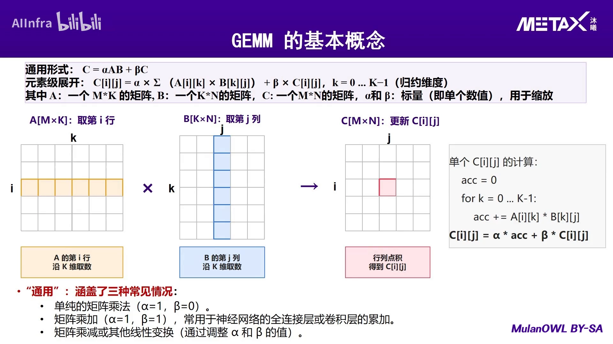
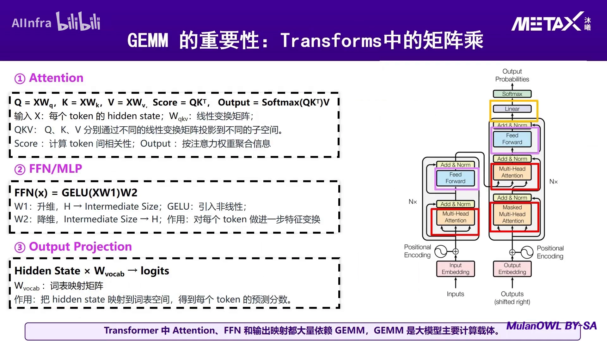
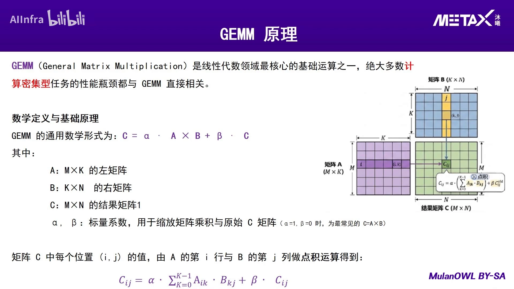
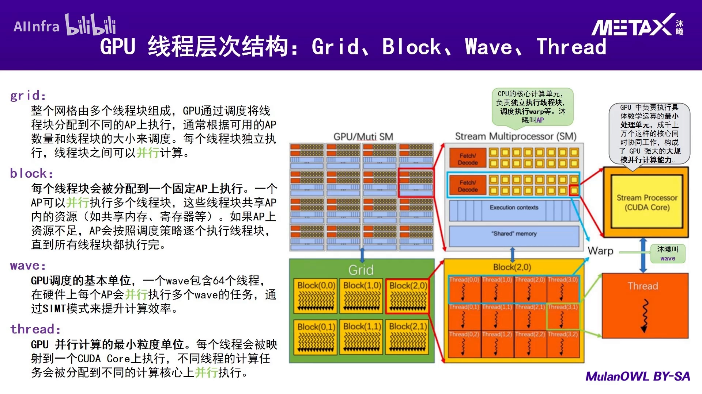
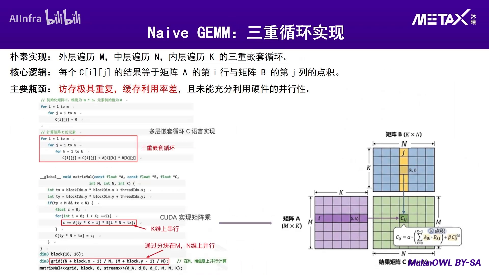
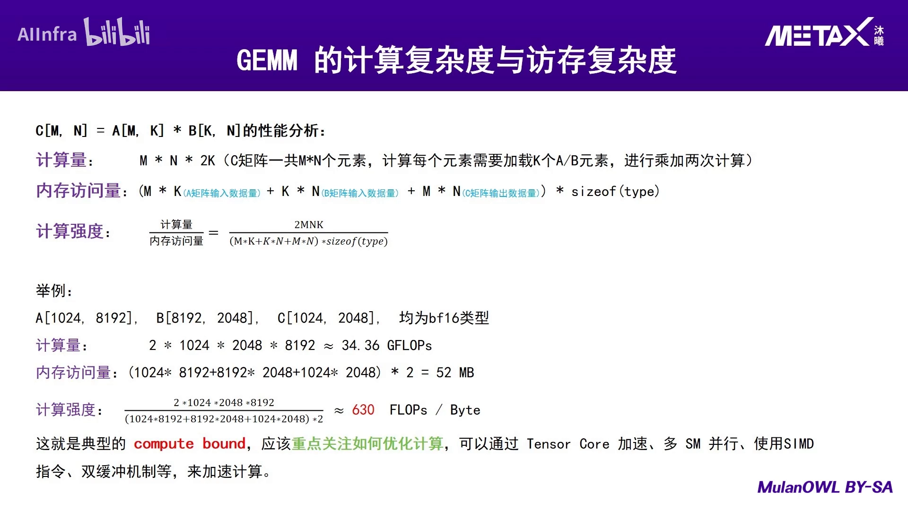
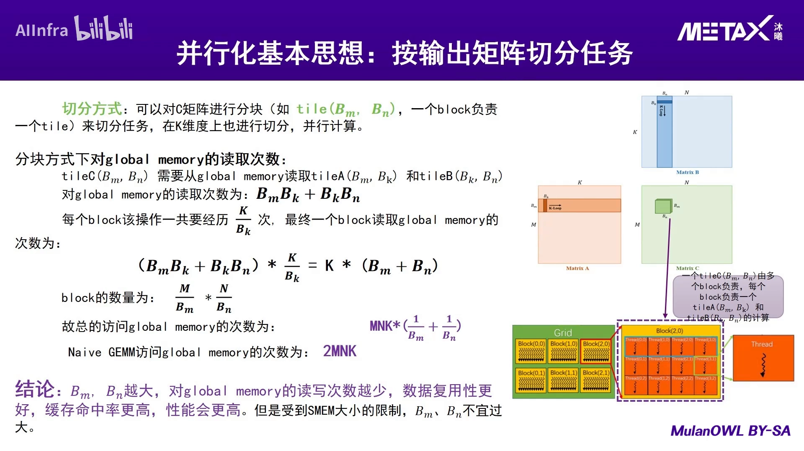
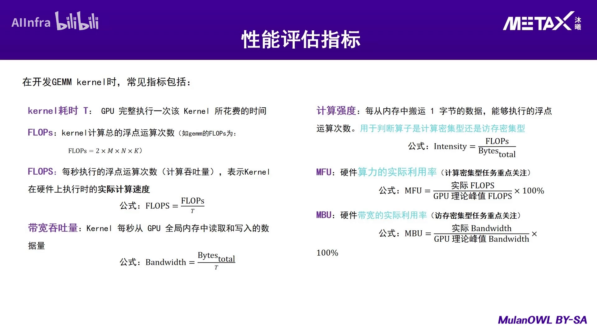
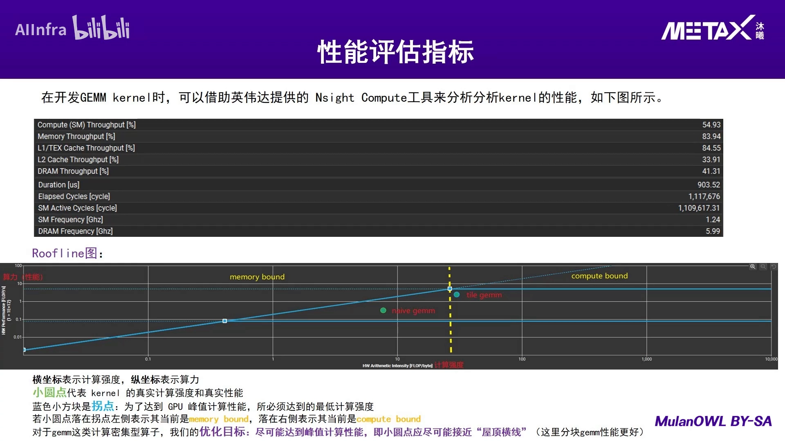
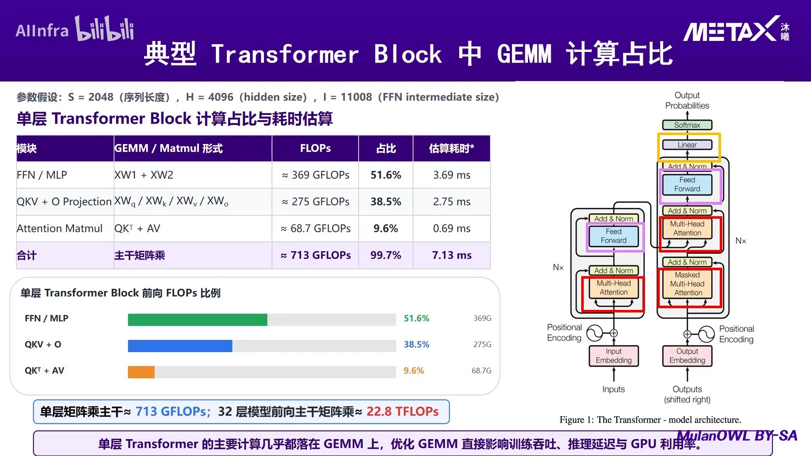

# GEMM 的 M、N、K 三个维度从哪里来：M 越大，同一份权重就被复用越多次

> 视频来源：[GEMM 的核心作用、计算原理与并行基础](https://www.bilibili.com/video/BV1Y6h36eEWC/)（Bilibili · AI Infra 系列课 · 授课老师曾艳，杭州电子科技大学教授）｜时长约 25 分钟
> 简要导读：这是一节从高性能计算视角讲 GEMM 的课。本文取它和「Prefill 为什么是 GEMM 主导」直接相关的部分：GEMM 在 Transformer 里出现在哪、M/N/K 三个维度各是什么、为什么它天然适合 GPU 并行、以及 M 维如何决定权重复用次数。视频后半段的分块优化与 Roofline 瓶颈判定属于下一小节的内容，本文只在结尾处点到为止。

## 本讲要解决的核心问题（SCQA）

**背景**：Transformer 的推理计算，绝大部分时间花在矩阵乘上。这一点几乎所有人都听过。

**冲突**：但「矩阵乘」是个笼统的说法。一个 $(M \times K) \cdot (K \times N)$ 的矩阵乘，如果 M=1，它就是矩阵乘向量，一次只能算出一行结果，权重搬进来一次只被用一次；如果 M=4096，同一份权重搬进来一次能被 4096 行同时用。**同样是「矩阵乘」，M 维不同，硬件上的行为可以差出上千倍。** 而 Prefill 之所以特殊，恰恰是因为它的 M 维等于整条 prompt 的长度。

**疑问**：GEMM 到底出现在 Transformer 的哪些位置？M、N、K 三个维度分别对应模型的哪个参数？为什么 GEMM 天然适合 GPU 的并行结构？为什么说 M 越大，权重复用越好、性能越高？

**回答（中心思想）**：GEMM 的通用形式是 $C = \alpha AB + \beta C$，A 是 $M \times K$、B 是 $K \times N$、C 是 $M \times N$。在 Transformer 里，**N 和 K 由模型结构固定（hidden size、intermediate size、头数、词表大小），只有 M 随请求变化**——M 就是这一轮要处理的 token 行数。Prefill 把整条 prompt 拼成 M 行，于是每个线性层都变成大 GEMM：同一份权重被 M 行复用，计算量按 $2MNK$ 增长，而权重只搬运一次。**这就是「GEMM 主导的计算模式」的硬件含义：不是矩阵乘本身快，而是 M 大让权重复用率变高。**

---

## 一、GEMM 是什么：三个维度各管一件事

### 1.1 通用形式与元素级展开

GEMM（General Matrix Multiplication，通用矩阵乘法）的数学形式是：

$$
C = \alpha A B + \beta C
$$

其中 A 是 $M \times K$ 的左矩阵，B 是 $K \times N$ 的右矩阵，C 是 $M \times N$ 的结果矩阵，$\alpha$、$\beta$ 是标量缩放系数。

[【跳转到 02:33】](https://www.bilibili.com/video/BV1Y6h36eEWC/?t=153)

元素级展开写出来是：

$$
C[i][j] = \alpha \times \sum_{k=0}^{K-1} \left(A[i][k] \times B[k][j]\right) + \beta \times C[i][j]
$$

**三个维度的分工非常清楚**：

- **M**：输出矩阵有多少行。在 Transformer 里，**M 就是这一轮要处理的 token 行数**。
- **N**：输出矩阵有多少列，也就是权重矩阵有多宽。
- **K**：每个输出元素要累加多长，也就是输入向量的宽度。

### 1.2 「通用」体现在哪

$\alpha$、$\beta$ 两个标量让这个式子覆盖三种常见情况：

| $\alpha$、$\beta$ | 退化成 | 典型用途 |
| --- | --- | --- |
| $\alpha=1,\ \beta=0$ | $C = AB$，单纯的矩阵乘 | 最常见的线性变换 |
| $\alpha=1,\ \beta=1$ | 矩阵乘加 | 神经网络全连接层、卷积层的累加 |
| 其它取值 | 矩阵乘减等线性变换 | 需要调整缩放时使用 |

视频里强调：**我们后面讲优化时，主要是对 C 这个输出矩阵进行分块，对 M 和 N 进行切块，把 K 作为循环和规约的维度。** 这句话提前点明了 M、N、K 在实现里的不同角色——M、N 是可并行的空间维度，K 是必须串行累加的规约维度。

---

## 二、GEMM 在 Transformer 里出现在哪：三个位置，全是矩阵乘

Transformer 的结构图里，有三类模块包含大量矩阵乘：

[【跳转到 04:33】](https://www.bilibili.com/video/BV1Y6h36eEWC/?t=273)

### 2.1 Attention：四个矩阵乘

$$
Q = XW_q,\quad K = XW_k,\quad V = XW_v,\quad \text{Score} = QK^\top,\quad \text{Output} = \mathrm{Softmax}(QK^\top)V
$$

- 输入 $X$ 是每个 token 的 hidden state，$W_{qkv}$ 是线性变换矩阵；
- Q、K、V 分别通过不同的线性变换矩阵投影到不同的子空间；
- Score 计算 token 间的相关性，Output 按注意力权重聚合信息。

**注意这里的两次「升级」**：$XW_q$ 的 M 是 token 行数；而 $QK^\top$ 的 M 和 N 都是 token 行数——它是一个 $S \times S$ 的方阵。**这是 Transformer 里唯一一个 M 和 N 都随序列长度增长的矩阵乘。**

### 2.2 FFN / MLP：一升一降

$$
\mathrm{FFN}(x) = \mathrm{GELU}(XW_1)W_2
$$

- $W_1$ 升维：H → Intermediate Size；GELU 引入非线性；
- $W_2$ 降维：Intermediate Size → H；
- 作用是对每个 token 做进一步的特征变换，增强模型表达能力。

**两次矩阵乘的 K 和 N 是「一大一小」的镜像关系**：$XW_1$ 的 N 是中间维度（大），$XW_2$ 的 K 是中间维度（大）。M 始终是 token 行数。

### 2.3 Output Projection：把 hidden state 映射到词表

$$
\text{Hidden State} \times W_{\text{vocab}} \rightarrow \text{logits}
$$

$W_{\text{vocab}}$ 是词表映射矩阵。它的作用是**把 hidden state 映射到词表空间，得到每个 token 的预测分数**。由于词表规模非常大，整个过程本质上也是一次大规模的矩阵乘——**这里的 N 是词表大小，通常是十万量级**。

视频的结论是：**Transformer 中 Attention、FFN 和输出映射都大量依赖 GEMM，GEMM 是大模型的主要计算载体。**

---

## 三、M、N、K 三个维度分别由什么决定

把上面三处矩阵乘摊开，就能看清 M、N、K 的来源。下面这张表是本文的核心（**补充说明**：视频没有把这张表直接列出来，它是把视频里各处的形状描述汇总后的结果）：

| 矩阵乘 | M | K | N |
| --- | --- | --- | --- |
| $XW_q$ | token 行数 | hidden size H | 头数 × 每头维度 |
| $XW_k$、$XW_v$ | token 行数 | hidden size H | KV 头数 × 每头维度 |
| $QK^\top$ | token 行数 | 每头维度 | token 行数 |
| $\mathrm{Softmax}(\cdot)V$ | token 行数 | token 行数 | 每头维度 |
| $XW_1$（FFN 升维） | token 行数 | hidden size H | 中间维度 I |
| $XW_2$（FFN 降维） | token 行数 | 中间维度 I | hidden size H |
| 输出投影 | token 行数 | hidden size H | 词表大小 |

读这张表可以得出三条结论：

1. **只有 M 随请求变化**。K 和 N 全部由模型结构决定——hidden size、中间维度、头数、每头维度、词表大小。换一个模型，K 和 N 就换一套；换一条更长的 prompt，只有 M 变。
2. **M 就是「这一轮要处理多少个 token」**。Prefill 时它是整条 prompt 的长度；Decode 时它是 1（单请求）或批量大小（多请求）。
3. **$QK^\top$ 是唯一的例外**：它的 N 也等于 token 行数，所以它的计算量随序列长度平方增长，而其它矩阵乘只随序列长度线性增长。

---

## 四、为什么 GEMM 天然适合 GPU：一个 $M \times N$ 的输出网格

### 4.1 计算量：$2MNK$

每个输出元素 $C[i][j]$ 需要 K 次乘法和 K 次加法，近似 **2K 次浮点操作**。整个 C 有 $M \times N$ 个元素，所以：

$$
\text{FLOPs} = 2 \times M \times N \times K
$$

[【跳转到 10:26】](https://www.bilibili.com/video/BV1Y6h36eEWC/?t=626)

视频特别提示：**M 和 N 决定输出矩阵有多少元素，K 决定每个输出元素要累加多长。** 这个区分很重要，因为后面做分块优化时，切的是 M 和 N，循环的是 K。

### 4.2 GPU 的优势是吞吐，不是单线程速度

GPU 的硬件架构是一大片计算单元。每个计算单元（英伟达称为 SM，Streaming Multiprocessor）内部包含取指解码单元、执行上下文、共享内存等，再往下是数量非常多的小核心（CUDA core / stream processor）。

[【跳转到 16:23】](https://www.bilibili.com/video/BV1Y6h36eEWC/?t=983)

**GPU 的优势不是单个线程特别快，而是可以把大量相似任务并行铺开。** 线程的层次结构是：

| 层级 | 含义 | 对应到 GEMM |
| --- | --- | --- |
| grid（网格） | 由多个线程块组成，GPU 调度分配到不同 AP/SM 上执行 | 整个矩阵乘任务 |
| block（线程块） | 分配到一个固定 AP 上执行，块内共享内存与寄存器 | 矩阵 C 中的一个小切块 |
| wave / warp | GPU 调度的基本单位，一个 wave 含 64 个线程，SIMT 执行 | 更细粒度的数据加载、乘加、写回 |
| thread（线程） | 最小粒度，映射到一个 CUDA core | 单个输出元素的乘加 |

**GEMM 与这套结构的对应关系几乎是天生一对**：矩阵 C 有 $M \times N$ 个输出元素，天然可以切成 $M \times N$ 份互不依赖的工作。**M 和 N 越大，可并行的工作越多，GPU 越不容易闲着。**

### 4.3 朴素三重循环为什么慢

最朴素的 GEMM 实现是三重嵌套循环：外层遍历 M，中层遍历 N，内层遍历 K。

[【跳转到 11:16】](https://www.bilibili.com/video/BV1Y6h36eEWC/?t=676)

视频指出三个瓶颈：

1. **访存重复**：算 C 同一行的元素时都要用 A 的同一行，算同一列时都要用 B 的同一列。本来已经从全局内存读过一次的数据没有保存，下次还得重读，造成大量带宽浪费。
2. **缓存利用率差**：围绕单个 $C[i][j]$ 计算，每次只完成一个元素的点积，访问粒度小、局部性弱。结果是**大量时间不是花在乘加计算上，而是花在等待数据搬运上**。
3. **并行性没有展开**：逻辑上是逐个 $C[i][j]$ 计算，没有做合理的矩阵分块和线程协作，没有充分利用 GPU 的计算单元。

---

## 五、M 维为什么决定性能：权重复用次数

### 5.1 计算强度：每搬 1 字节能做多少次浮点

视频给出三个基础量：

$$
\begin{aligned}
\text{计算量} &= M \times N \times 2K \\
\text{内存访问量} &= (M \times K + K \times N + M \times N) \times \texttt{sizeof(type)} \\
\text{计算强度} &= \frac{\text{计算量}}{\text{内存访问量}} = \frac{2MNK}{(MK + KN + MN)\times \texttt{sizeof(type)}}
\end{aligned}
$$

[【跳转到 14:08】](https://www.bilibili.com/video/BV1Y6h36eEWC/?t=848)

视频举的例子：A 为 `[1024, 8192]`、B 为 `[8192, 2048]`、C 为 `[1024, 2048]`，均为 bf16。计算量 $2 \times 1024 \times 2048 \times 8192 \approx 34.36$ GFLOPs，内存访问量 52 MB，计算强度约 **630 FLOP/Byte**。结论是「这就是典型的 compute bound，应该重点关注如何优化计算」。

### 5.2 M 从 4096 掉到 1 会发生什么

这个公式里藏着一个关键事实：**当 M 很大时，分母里的 $MK$ 和 $MN$ 与分子里的 $MNK$ 同阶增长，但分子多了一个 K 因子**。所以 M 越大，计算强度越高——**每搬一次权重，能做的乘加次数越多**。

反过来，当 M = 1（矩阵乘向量）时：

$$
\text{计算量} = 2NK,\qquad \text{内存访问量} \approx (K + KN + N)\times \texttt{sizeof(type)}
$$

分子只有 $2NK$，分母里的 $KN$（权重本身）占绝对主导。**权重搬进来一次，只参与一次乘加**——计算强度掉到个位数，硬件绝大部分时间在等数据。这就是「GEMV 是带宽受限」的算术来源。

> **补充（非讲者原话）**：视频没有直接对比 M=1 与 M=4096 两种情形，它只讲了 GEMM 的一般公式与一个 M=1024 的例子。上面的 M=1 推导是按视频给出的公式直接代入得到的。把这条结论套到 Prefill 上，就得到本节的核心判断：**Prefill 的 M 等于 prompt 长度，所以它的每个线性层都是高计算强度的大 GEMM；Decode 的 M 等于 1（或小批量），所以它的每个线性层都是低计算强度的 GEMV。**

### 5.3 分块：把复用从「M 行」再放大一层

朴素实现的问题可以用分块（tiling）解决：把 C 切成 $B_m \times B_n$ 的小块，一个 block 负责一个 tile，沿 K 维循环累加。

[【跳转到 19:18】](https://www.bilibili.com/video/BV1Y6h36eEWC/?t=1158)

一个 block 读取 global memory 的次数是 $K \times (B_m + B_n)$，block 总数是 $\frac{M}{B_m} \times \frac{N}{B_n}$，所以总的访问次数是：

$$
MNK \times \left(\frac{1}{B_m} + \frac{1}{B_n}\right)
$$

而朴素 GEMM 的访问次数是 $2MNK$。**结论：$B_m$、$B_n$ 越大，对 global memory 的读写次数越少，数据复用性更好，缓存命中率更高，性能更高。但受 SMEM（共享内存）大小的限制，$B_m$、$B_n$ 不宜过大。**

这里有一个容易被忽略的层次关系：**M 维决定「权重被多少行复用」，分块决定「一个 block 内权重被复用多少次」**。前者是问题本身的形状给的，后者是 kernel 实现争取的。Prefill 天然把前者做到很大，所以它比 Decode 更容易接近峰值算力。

---

## 六、怎么衡量「算力吃满了没有」

视频给出了一组评估指标：

| 指标 | 含义 | 公式 |
| --- | --- | --- |
| kernel 耗时 T | GPU 完整执行一次 kernel 的时间 | — |
| FLOPs | kernel 计算的总浮点运算次数 | $2MNK$ |
| FLOPS | 每秒执行的浮点运算次数（计算吞吐量） | $\text{FLOPs} / T$ |
| 带宽吞吐量 | 每秒从全局内存读写的数据量 | $\text{Bytes}_{\text{total}} / T$ |
| 计算强度 | 每搬 1 字节能做的浮点运算次数 | $\text{FLOPs} / \text{Bytes}_{\text{total}}$ |
| MFU | 硬件算力的实际利用率 | 实际 FLOPS / 峰值 FLOPS |
| MBU | 硬件带宽的实际利用率 | 实际带宽 / 峰值带宽 |

[【跳转到 22:07】](https://www.bilibili.com/video/BV1Y6h36eEWC/?t=1327)

视频提到，在英伟达平台上可以用 **Nsight Compute** 分析 kernel 性能，看到计算吞吐、缓存吞吐等，从而判断资源的利用情况。

**注意 FLOPs 与 FLOPS 只差一个字母**：前者是总量（小写 s），后者是速率（大写 S）。视频特意提醒了这个容易混淆的点。

### 6.1 Roofline：拐点把空间分成两半

Roofline 图的横坐标是计算强度，纵坐标是实际算力。斜线与水平线的交点称为**拐点**，它标志着「为了刚好达到这款 GPU 的峰值计算性能，程序所必须满足的最低计算强度」。

[【跳转到 23:29】](https://www.bilibili.com/video/BV1Y6h36eEWC/?t=1409)

- 小圆点落在拐点**左侧**：程序还没达到计算峰值就被内存限制住了，是 **memory bound**，计算效率一直上不去；
- 落在**右侧**：没有受内存限制，是 **compute bound**，属于计算密集型任务。

图里标了两个点：一个是朴素三重循环的实现，一个是做了分块优化的实现。**分块之后整个点往上走，无限逼近代表峰值算力的那条横线。**

> **下一小节预告**：Roofline 的拐点怎么算、Prefill 与 Decode 分别落在哪一侧、各算子的耗时占比如何分布——这些是 1.1.2「算子耗时分布：为什么 Prefill 阶段是典型的 Compute-Bound」的内容，本文不展开。

---

## 七、把结论套回 Prefill：为什么它一定是 GEMM 主导

现在可以把两条线索合起来了。

### 7.1 单层 Transformer 里 GEMM 占多少

视频给了一个具体测算。参数假设：序列长度 S = 2048、hidden size H = 4096、FFN 中间维度 I = 11008。

[【跳转到 08:31】](https://www.bilibili.com/video/BV1Y6h36eEWC/?t=511)

| 模块 | GEMM 形式 | FLOPs | 占比 |
| --- | --- | --- | --- |
| FFN / MLP | $XW_1 + XW_2$ | ≈ 369 GFLOPs | 51.6% |
| QKV + O Projection | $XW_q$ / $XW_k$ / $XW_v$ / $XW_o$ | ≈ 275 GFLOPs | 38.5% |
| Attention Matmul | $QK^\top + AV$ | ≈ 68.7 GFLOPs | 9.6% |
| 合计 | 主干矩阵乘 | ≈ 713 GFLOPs | 99.7% |

单层矩阵乘主干约 **713 GFLOPs**，32 层模型前向主干矩阵乘约 **22.8 TFLOPs**。

这张表里最反直觉的一点是：**我们平时讨论最多的 attention 矩阵乘只占 9.6%，而 FFN 和线性投影合计占 90.1%。** 原因就在 M、N、K 上——FFN 的 N 是 11008（中间维度），QKV 投影的 N 是 4096 加两份 KV 宽度，而 attention 矩阵乘的 N 只有每头维度。**宽度决定了计算量，而宽度是模型结构定的。**

### 7.2 Prefill 与 Decode 的形状差别，只体现在 M 上

把第三节那张表再压缩一次：

| | Prefill | Decode |
| --- | --- | --- |
| M（输出行数） | prompt 长度（整条一次算完） | 1（单请求）或批量大小 |
| K（累加维度） | 模型结构决定，不变 | 模型结构决定，不变 |
| N（输出宽度） | 模型结构决定，不变 | 模型结构决定，不变 |
| 算子形态 | GEMM（大矩阵乘大矩阵） | GEMV（矩阵乘向量） |
| 权重复用 | 一份权重服务 M 行 | 一份权重服务 1 行 |
| 计算强度 | 高 | 低 |
| 瓶颈 | 算力（compute bound） | 显存带宽（memory bound） |

**同一套权重、同一份代码、同一个 kernel，只因为 M 不同，就从 compute bound 变成 memory bound。** 这就是「Prefill 是 GEMM 主导的计算模式」这句话的全部含义。

### 7.3 为什么「并行处理」不等于「更快地逐 token 生成」

最后澄清一个常见误解。Prefill 的并行不是把「逐个 token 生成」这个循环拆到多个核上跑——**它根本没有逐 token 的循环**。它的并行来自数据布局：整条 prompt 的 S 个 token 被竖着排成矩阵的 S 行，一次前向就把 S 行的结果全部算出来。

这个区别带来两个后果：

1. **Prefill 的 S 行之间没有依赖**。第 3 行的 QKV 投影不需要等第 2 行算完；它们本来就是同一个矩阵乘的不同行。因果遮罩只影响 attention 内部的可见范围，不影响投影的可并行性。
2. **Decode 的逐 token 依赖无法消除**。第 n+1 个 token 的输入是第 n 个 token 的输出，所以 Decode 的 M 天然只能是 1（单请求）。要把它变成 GEMM，只能靠**批量**——把多个请求的新位置拼在一起，让 M = 批量大小。

**所以「并行处理」的真实收益是算力利用率，不是延迟。** 它把一次矩阵乘的 M 维撑大，让同一份权重被反复复用、让 GPU 的 $M \times N$ 个输出格子都有活干。这也是后面所有推理优化（连续批处理、分块预填充、PD 分离）共同的操作对象：**想办法让 M 变大，或者让 M 变大的时候不伤害延迟。**

---

## 小结

- **GEMM 的三个维度分工明确**：M 是输出行数（=本轮 token 行数），N 是输出宽度（=权重列数），K 是累加维度（=输入宽度）。计算量是 $2MNK$。
- **Transformer 里三处 GEMM**：Attention 的 QKV 投影与 $QK^\top$、$AV$；FFN 的 $XW_1$ 与 $W_2$；输出投影的 Hidden×$W_{\text{vocab}}$。
- **只有 M 随请求变化**：K 和 N 由 hidden size、中间维度、头数、词表大小决定，换模型才换；换 prompt 只换 M。
- **$QK^\top$ 是唯一 M、N 都随序列长度增长的矩阵乘**，所以它的计算量是平方级，其它都是线性级。
- **GPU 的优势是吞吐**：$M \times N$ 个输出格子天然可并行，M、N 越大，可并行的工作越多。
- **M 决定权重复用次数**：M 大时计算强度高（compute bound），M=1 时权重搬一次只用一次，计算强度掉到个位数（memory bound）。
- **分块是在 M 之上再加一层复用**：$B_m$、$B_n$ 越大，全局内存访问次数越少（从 $2MNK$ 降到 $MNK(1/B_m + 1/B_n)$），但受共享内存大小限制。
- **单层 Transformer 的 GEMM 占比**：FFN 51.6%、QKV 与输出投影 38.5%、attention 矩阵乘 9.6%，合计 713 GFLOPs；32 层约 22.8 TFLOPs。
- **Prefill 与 Decode 的差别只在 M**：同一套权重，M 大就是 GEMM、算力受限；M=1 就是 GEMV、带宽受限。

## 关键术语速查

| 术语 | 一句话解释 |
| --- | --- |
| GEMM | 通用矩阵乘法 $C = \alpha AB + \beta C$，A 是 M×K、B 是 K×N、C 是 M×N |
| GEMV | 矩阵乘向量，即 M=1 的退化情形，权重搬一次只用一次 |
| M / N / K | 输出行数 / 输出宽度 / 累加维度；前两个可并行，K 必须串行规约 |
| FLOPs 与 FLOPS | 前者是总浮点运算次数（量），后者是每秒浮点运算次数（速率） |
| 计算强度 | 每搬运 1 字节数据能完成多少次浮点运算，决定算子是计算密集还是访存密集 |
| MFU / MBU | 硬件算力的实际利用率 / 硬件带宽的实际利用率 |
| SM | Streaming Multiprocessor，GPU 的核心计算单元，内部含共享内存与大量小核心 |
| wave / warp | GPU 调度的基本单位，一个 wave 含 64 个线程，以 SIMT 方式执行同一条指令 |
| 分块 tiling | 把输出矩阵 C 切成 $B_m \times B_n$ 的小块，一个 block 算一块，沿 K 维循环累加 |
| Roofline | 以计算强度为横轴、实际算力为纵轴的性能模型，拐点左侧是 memory bound、右侧是 compute bound |
| 拐点 | 为达到峰值算力所必须满足的最低计算强度 |