# Prefill 把整条 prompt 一次性拼成一个大矩阵：M 维就等于 prompt 长度

> 视频来源：[图解 vLLM 原理 第3集 ｜ Prefill 与 Decode：公式、完整手算与 KV 缓存形状](https://www.bilibili.com/video/BV1c7yXzmES1/)（Bilibili · UP 主「--丘比特之箭---」）｜时长约 37 分钟
> 简要导读：这支视频用一套「词表只有 5 个词、模型只有 2 维」的微型模型，把一次 Prefill 加两次 Decode 的每一个数字都手算了一遍。本文只取其中的**形状**这一条线：一次 Prefill 里每个线性层到底是多大的矩阵乘、M 维为什么等于序列长度、Attention 为什么变成 S×S 的表。KV Cache 的显存公式与分页寻址不在本文展开。

## 本讲要解决的核心问题（SCQA）

**背景**：大模型推理分两步——先是 **Prefill（预填充）**，把用户输入的一整段 prompt 算完；然后是 **Decode（解码）**，一个 token 一个 token 地往外吐。

**冲突**：几乎所有人都听过「Prefill 是把 prompt 并行处理」。但「并行」这两个字很容易被误解成「多开几个线程同时算」，好像只是把逐 token 的循环摊到了多个核上。真正发生的事情不是这样：**整条 prompt 的所有 token 被排成一个矩阵，一起喂进模型**，于是每一次线性变换都从「矩阵乘向量」升级成「矩阵乘矩阵」。

**疑问**：一次 Prefill 里，QKV 投影、输出投影、FFN 的 up/gate/down 投影，各自的矩阵形状到底是什么？M、K、N 三个维度分别对应模型的哪个参数？Attention 部分为什么不是矩阵乘向量，而是一张 S×S 的表？这些形状差异又为什么会带来算力利用率上的巨大差别？

**回答（中心思想）**：Prefill 的全部计算都可以用「M = 序列长度 S」这一个事实串起来——**权重矩阵不变，左边多了一摞行**。线性层因此是 $(S \times D) \cdot (D \times N)$ 的大 GEMM；Attention 是 $(S \times d) \cdot (d \times S)$ 再加 $(S \times S) \cdot (S \times d)$ 的两个 GEMM，中间夹一个按行 softmax，因果遮罩让有效计算量大约减半；同一套权重在 Prefill 下服务 4096 行、在 Decode 下只服务 1 行，参与计算的浮点操作数相差约 4000 倍。**「并行」带来的不是更快的逐 token 生成，而是把一次矩阵乘的 M 维撑大，让同一份权重被反复复用、让算力单元吃满。**

---

## 一、先把模型缩到能手算的尺寸：S=3、D=2、一个头

要看清形状，最有效的办法是把模型缩到极小。视频里搭了一套「教学用微型模型」：

- **词表只有 5 个 token**：the、cat、sat、near、window，编号 0 到 4；
- **每个 token 用 2 个数表示**：the = (1, 0)，cat = (0, 1)，sat = (1, 1)，near = (1, -1)；
- **只有一层、一个注意力头**；
- **Q、K、V 和输出投影都用二阶单位矩阵**——单位矩阵不改变向量数值，这样每一步的点积、权重、缓存都能直接逐项核对。

[【跳转到 00:50】](https://www.bilibili.com/video/BV1c7yXzmES1/?t=50)

这一层的运算定义被固定成一条链：

$$
Q = XW_Q,\quad K = XW_K,\quad V = XW_V,\quad O = \mathrm{softmax}_{\text{row}}\left(\frac{QK^\top}{\sqrt{2}} + M\right)V,\quad H = X + OW_O
$$

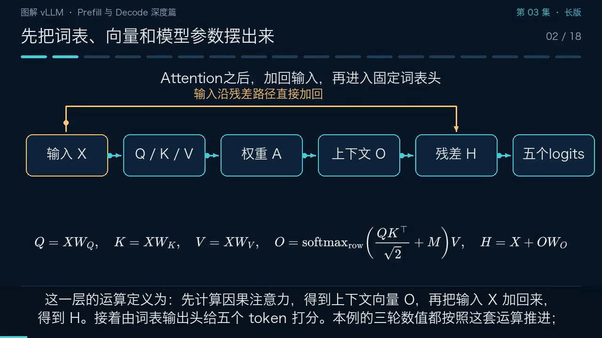

请注意这条链里出现了 **5 个矩阵乘**：$XW_Q$、$XW_K$、$XW_V$、$QK^\top$、$AV$，再加一个 $OW_O$ 就是 6 个。它们全部是 GEMM（General Matrix Multiplication，通用矩阵乘法）——**没有一个是「矩阵乘向量」**。原因很简单：$X$ 不是一行，而是一摞行。

---

## 二、M 维从哪里来：把三个 token 竖着排成矩阵

### 2.1 行是位置，列是分量

把 the、cat、sat 三个输入向量竖着排好，就得到输入矩阵 $X$：

$$
X = \begin{bmatrix} 1 & 0 \\ 0 & 1 \\ 1 & 1 \end{bmatrix} \in \mathbb{R}^{3 \times 2}
$$

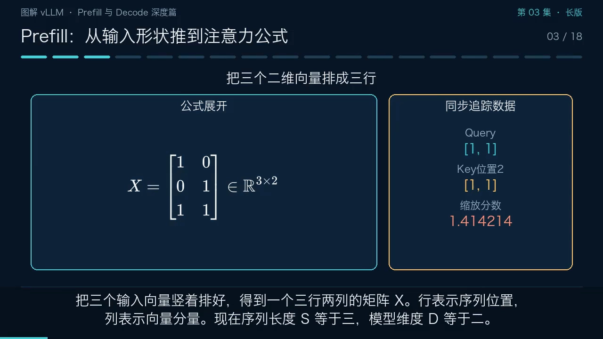

这里定下了本节最重要的一条约定：**矩阵的行 = 序列位置，列 = 向量分量**。现在序列长度 $S = 3$，模型维度 $D = 2$。

[【跳转到 02:30】](https://www.bilibili.com/video/BV1c7yXzmES1/?t=150)

这就是 Prefill 与 Decode 的分水岭。Decode 时新输入只有**一行**（上一步刚选出的那个 token）；Prefill 时新输入有 **S 行**（整条 prompt 的所有 token）。**M 维就是这一摞行的数量，也就是 prompt 长度。**

### 2.2 一般形式：投影宽度由头数决定

把上面的具体数字换成符号。一个头的 query 和 key 各有 $d_k$ 个分量，value 有 $d_v$ 个分量。输入乘上对应投影矩阵，就得到 S 行 query、S 行 key、S 行 value：

$$
Q = XW_Q \in \mathbb{R}^{S \times d_k},\quad K = XW_K \in \mathbb{R}^{S \times d_k},\quad V = XW_V \in \mathbb{R}^{S \times d_v}
$$

三个投影的形状完全一致，都是 $(S \times D) \cdot (D \times d)$。**权重矩阵的形状与 S 无关**——这就是「同一套权重服务更多行」的数学表述。

---

## 三、Attention 在 Prefill 下变成一张 S×S 的表

### 3.1 两个 GEMM 夹一个 softmax

query 乘 key 的转置：左边是 S 行 $d_k$ 列，右边是 $d_k$ 行 S 列，中间维度相消，得到 **S 行 S 列**的分数表。第 i 行第 j 列表示位置 i 的 query 与位置 j 的 key 的匹配分数。

$$
S_{\text{score}} = \frac{QK^\top}{\sqrt{d_k}} \in \mathbb{R}^{S \times S},\qquad S_{ij} = \frac{\sum_{a=1}^{d_k} Q_{ia}K_{ja}}{\sqrt{d_k}}
$$

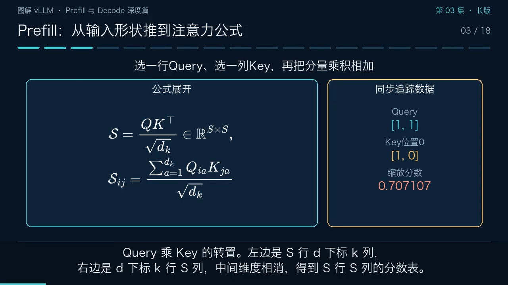

[【跳转到 03:20】](https://www.bilibili.com/video/BV1c7yXzmES1/?t=200)

然后加因果遮罩、按行做 softmax，最后用 S×S 的权重矩阵乘上 S×$d_v$ 的 value 矩阵，得到 S×$d_v$ 的上下文输出：

$$
O = \mathrm{softmax}_{\text{row}}(S_{\text{score}} + M_{\text{mask}})\,V \in \mathbb{R}^{S \times d_v}
$$

**这一段的三个算子性质完全不同**：$QK^\top$ 是 GEMM（$M{=}S, N{=}S, K{=}d_k$），softmax 是逐元素的非线性（不是矩阵乘），$AV$ 又是 GEMM（$M{=}S, N{=}d_v, K{=}S$）。视频特意强调：FlashAttention 在实际执行时是把这三步**分块融合**在一起做的，但数学关系仍然是「分块产生分数 → 归一化 → 汇总 value」。

### 3.2 因果遮罩：把 S×S 的方阵削成下三角

因果遮罩规定每个查询能够使用哪些位置：用从零开始的位置索引，**列号小于或等于行号时保留分数，未来位置加上负无穷**。

$$
M_{ij} = \begin{cases} 0, & j \le i \\ -\infty, & j > i \end{cases},\qquad A_{ij} = \frac{\exp(S_{ij} + M_{ij})}{\sum_{j'=0}^{S-1}\exp(S_{ij'} + M_{ij'})}
$$

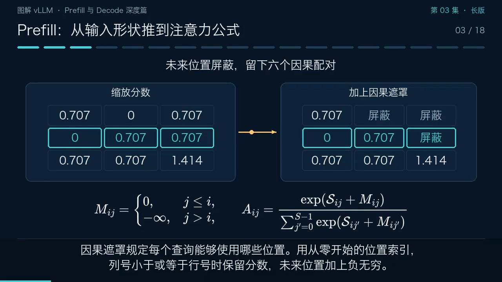

[【跳转到 04:35】](https://www.bilibili.com/video/BV1c7yXzmES1/?t=275)

画面里九个格子里只剩六个有效格子：第一行 1 个、第二行 2 个、第三行 3 个。**有效格子数 = $S(S+1)/2$，而整个方阵是 $S^2$ 个格子**——所以因果遮罩让实际有效的计算量大约减半。S 越大，这个「一半」越接近精确的 1/2。

三行归一化后的权重矩阵长这样：

$$
A \approx \begin{bmatrix} 1.000000 & 0 & 0 \\ 0.330238 & 0.669762 & 0 \\ 0.248255 & 0.248255 & 0.503490 \end{bmatrix}
$$

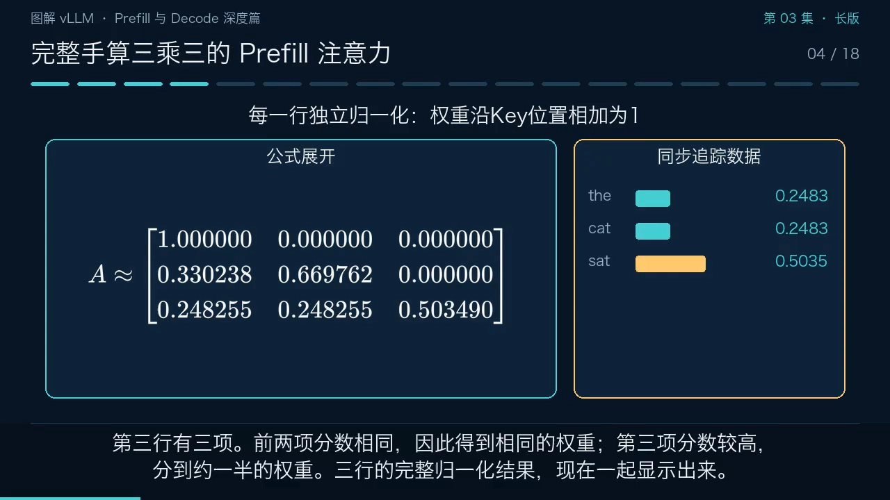

[【跳转到 05:25】](https://www.bilibili.com/video/BV1c7yXzmES1/?t=325)

这张图值得多看一眼：**三行是同时算出来的**。第一行使用一个位置、第二行混合两个位置、第三行混合三个位置——三个查询的输入已经确定，所以这一层的多行工作可以被组织在一起执行，再把各行结果交给下一层。这就是「并行」的真实含义：不是把行拆到不同时间片，而是**行本来就在同一个矩阵里**。

### 3.3 复杂度：Prefill 是平方，Decode 是线性

把每头维度记为 $d_h$。长度为 S 的完整 Prefill 注意力，计算规模随 S 的平方增长；单步 Decode 面对 T+1 长度的上下文，计算规模随这个长度线性增长：

$$
\text{Prefill Attention}: O(S^2 d_h),\qquad \text{single-step Decode Attention}: O((T+1)d_h)
$$

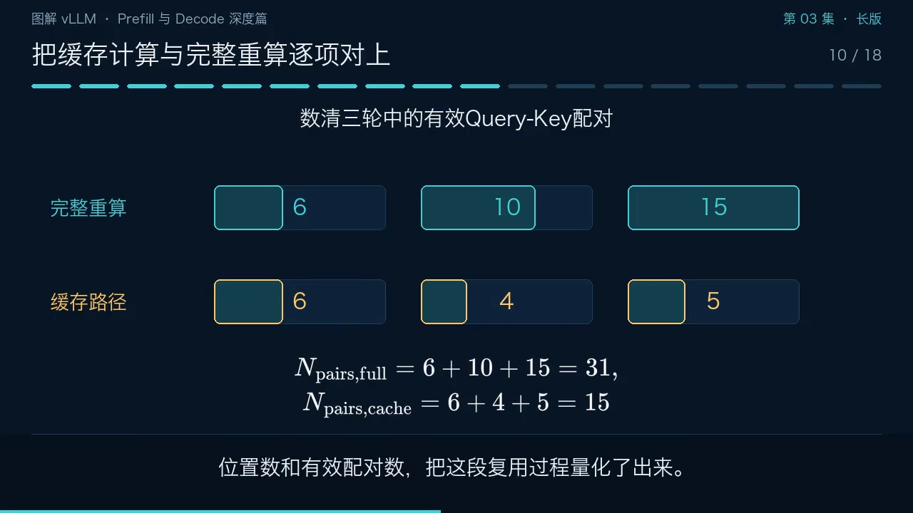

[【跳转到 17:53】](https://www.bilibili.com/video/BV1c7yXzmES1/?t=1073)

左边那张下三角图就是 Prefill 的注意力，右边那条横排就是 Decode 的注意力。**同一个数学式子，形状完全不同**——这正是本节要反复强调的一点。

---

## 四、把批量轴和头轴放回来：形状的完整写法

### 4.1 五个轴各管一件事

前面把批量和头都取成 1，是为了让每个数字都能直接展开。现在保留全部轴：

- $B$：请求批量，也就是这一轮同时处理几个请求；
- $S$：本轮 Prefill 的输入长度，也就是**新输入的行数**；
- $D$：模型隐藏维度，每行表示的宽度；
- $d_h$：每个头的维度；
- $H_q$：query 头数；$H_{kv}$：KV 头数。

[【跳转到 18:18】](https://www.bilibili.com/video/BV1c7yXzmES1/?t=1098)

由此得到投影宽度的关系：

$$
\text{query 投影宽度} = H_q \cdot d_h,\qquad \text{key/value 投影宽度} = H_{kv} \cdot d_h
$$

### 4.2 GQA：几个 query 头共用一组 KV

普通多头注意力中 query 头数和 KV 头数相等。**GQA（Grouped-Query Attention，分组查询注意力）** 把若干 query 头分成一组，让这一组共用一个 KV 头，每个 query 头继续计算自己的分数和权重。

取一个具体配置：隐藏维度 4096、32 个 query 头、8 个 KV 头、每头 128 个分量。$32 \div 8 = 4$，所以每四个 query 头共用一组 K 和 V。写成公式就是 query 头编号除以每组头数再向下取整：

$$
g(h) = \left\lfloor h / G \right\rfloor,\qquad A_h = \mathrm{softmax}_{\text{row}}\left(\frac{Q_h K_{g(h)}^\top}{\sqrt{d_h}} + M\right),\qquad O_h = A_h V_{g(h)}
$$

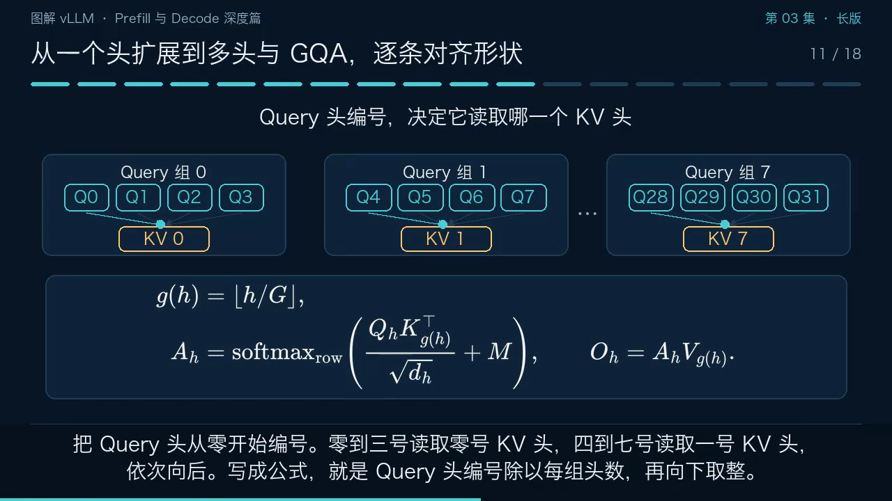

[【跳转到 19:33】](https://www.bilibili.com/video/BV1c7yXzmES1/?t=1173)

### 4.3 一张表看完 Prefill 里所有张量的形状

这是全片最实用的一张表。配置仍是隐藏维度 4096、32 个 query 头、8 个 KV 头、每头 128 维，序列长度 3：

| 张量 | 形状 |
| --- | --- |
| 输入 X | `[1, 3, 4096]` |
| Q 参数 / K、V 参数 | `[4096, 4096]` / `[4096, 1024]` |
| 分头后的 Q | `[1, 32, 3, 128]` |
| K、V 各自 | `[1, 8, 3, 128]` |
| 分数与权重 | `[1, 32, 3, 3]` |

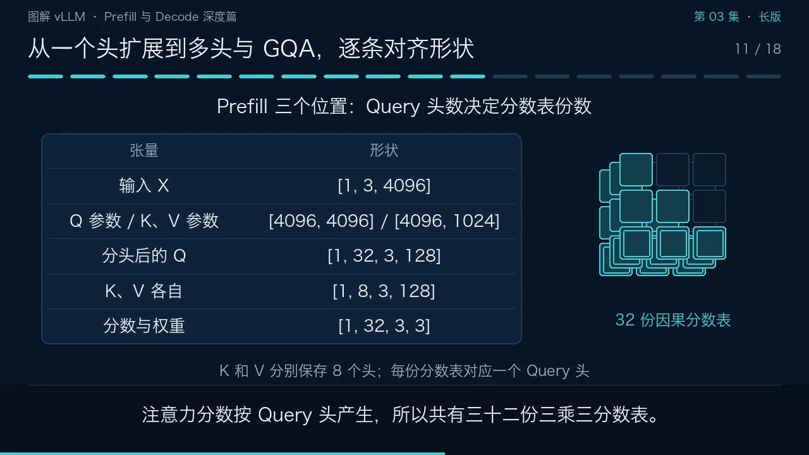

[【跳转到 19:58】](https://www.bilibili.com/video/BV1c7yXzmES1/?t=1198)

逐条读这张表，可以读出四件事：

1. **Q 参数是 4096×4096**，因为 $32 \times 128 = 4096$；K、V 参数是 4096×1024，因为 $8 \times 128 = 1024$。**权重形状只由头数决定，跟序列长度无关。**
2. **输入 X 的第一维是批量、第二维是位置**。所以 QKV 投影的 M 维是 $B \cdot S$——批量 1、位置 3 时就是 3 行。
3. **分数表是 `[1, 32, 3, 3]`**：注意力分数按 query 头产生，所以共有 **32 份 3×3 分数表**。头数把 GEMM 变成了 batched GEMM（批处理矩阵乘）。
4. 各 query 头的输出最后沿特征方向拼接 $32 \times 128$，重新组成 4096 维，再经过输出投影。

### 4.4 缓存的形状也遵循同样的轴顺序

K 和 V 的缓存不是「一堆向量」，而是一个四维张量，轴顺序是 $[B, H_{kv}, T, d_h]$：第一轴选择请求，第二轴选择 KV 头，第三轴选择已处理位置，最后一轴读取这个位置的向量分量。

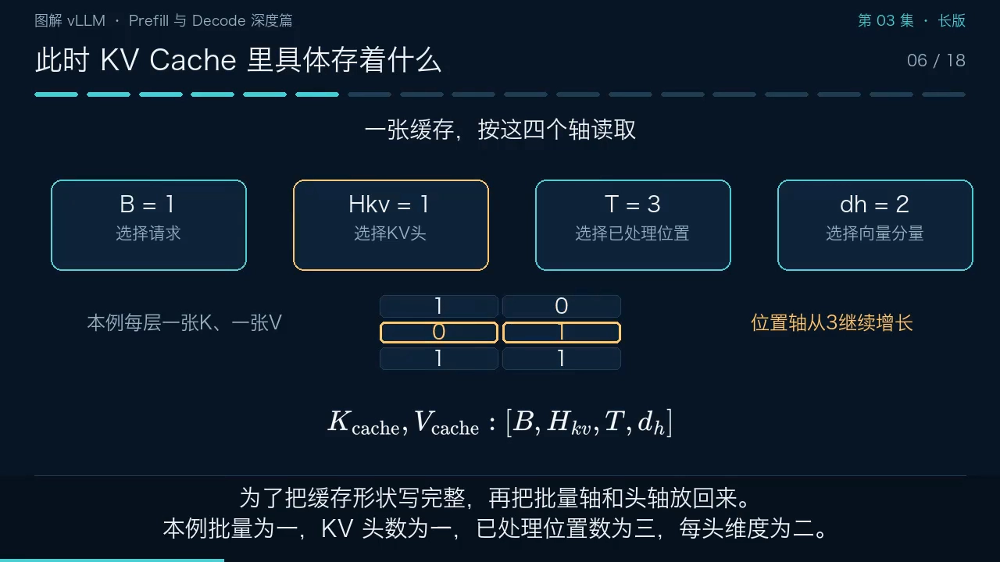

[【跳转到 08:18】](https://www.bilibili.com/video/BV1c7yXzmES1/?t=498)

**注意位置轴在第三位**：Prefill 写入时它从 0 长到 S，Decode 每轮只把它往后推一格。这就是「Prefill 建立缓存、Decode 追加缓存」在形状上的含义。

### 4.5 Decode 的形状：M 维塌成 1

同样配置下，Decode 只输入一个新位置：

$$
\begin{aligned}
Q_{\text{new}} &: [1,32,1,128],\quad K_{\text{new}},V_{\text{new}}: [1,8,1,128] \\
K_{(3)},V_{(3)} &: [1,8,3,128] \longrightarrow K_{(4)},V_{(4)}: [1,8,4,128] \\
A_{\text{new}} &: [1,32,1,4],\quad O_{\text{heads,new}}: [1,32,1,128]
\end{aligned}
$$

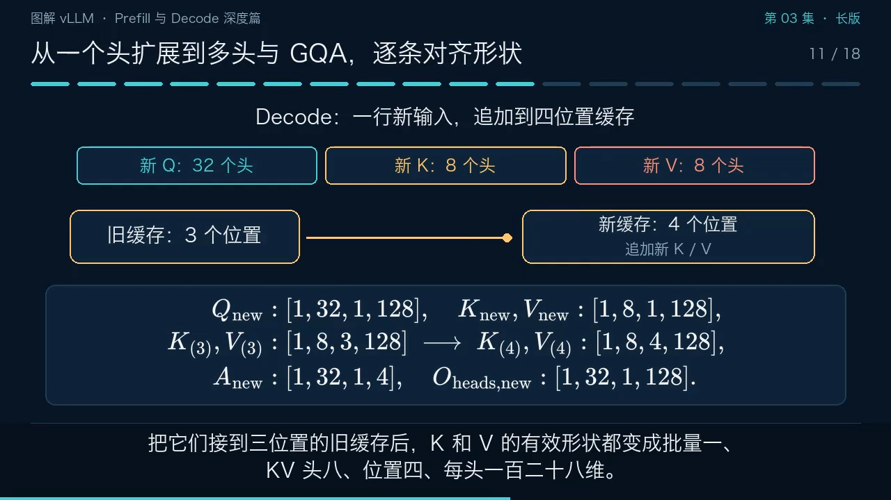

[【跳转到 20:48】](https://www.bilibili.com/video/BV1c7yXzmES1/?t=1248)

对比 4.3 那张表，**唯一变化的就是位置轴：3 变成 1**。分数表从 `[1,32,3,3]` 变成 `[1,32,1,4]`——M 维是 1，N 维是历史长度 4。**M=1 的矩阵乘，就是矩阵乘向量（GEMV）。**

---

## 五、FFN 与归一化：形状不变，但也是 GEMM

一层 Transformer 不只有 attention。以 Llama 类 pre-norm 结构为例，当前层输入先做 RMSNorm，再生成 QKV，多头输出经过投影与原输入做残差相加，再进 RMSNorm，然后进 MLP。

### 5.1 RMSNorm 不改变形状

RMSNorm 对**一个位置的向量**做归一化：先求各分量平方的均值，加上一个小量后开平方，原向量除以这个尺度，再乘上学习到的缩放参数。

$$
\mathrm{RMSNorm}(x) = \frac{x}{\sqrt{\frac{1}{D}\sum_{a=1}^{D}x_a^2 + \varepsilon}} \odot \gamma
$$

它**保留输入位置的数量与向量维度**——进来是 $S \times D$，出去还是 $S \times D$。所以归一化本身不是 GEMM，它只是给后面的 GEMM 准备输入。

### 5.2 门控 MLP：三条投影，都是 GEMM

这里使用门控形式：一条投影产生门控值，一条投影产生特征，门控经过 SiLU 与特征逐分量相乘，再投影回模型维度。

$$
\mathrm{MLP}(u) = \left(\mathrm{SiLU}(uW_{\text{gate}}) \odot (uW_{\text{up}})\right)W_{\text{down}},\qquad H^{(\ell+1)} = Z^{(\ell)} + \mathrm{MLP}(U_b^{(\ell)})
$$

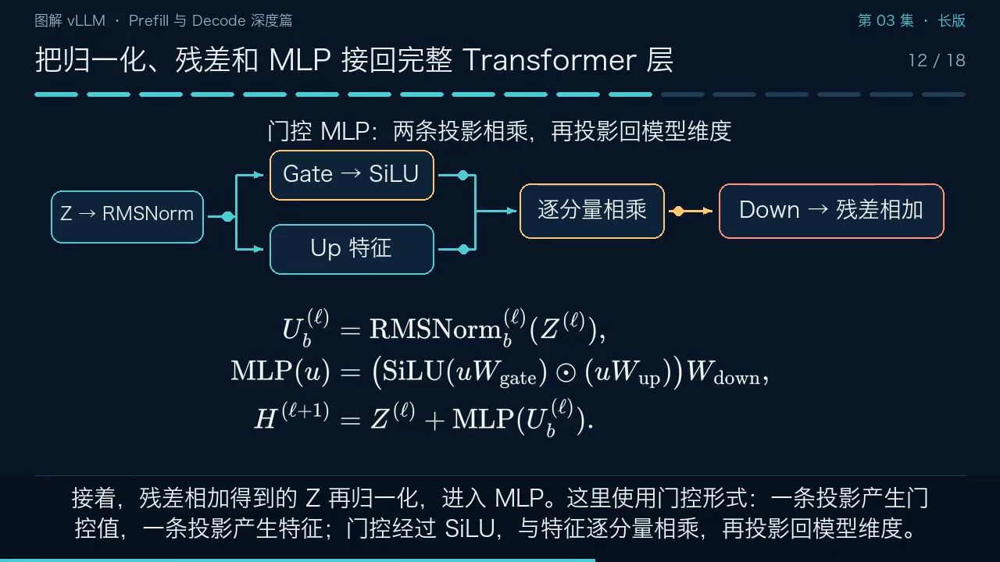

[【跳转到 21:38】](https://www.bilibili.com/video/BV1c7yXzmES1/?t=1298)

把三条投影写成形状（设中间维度为 $I$，Llama 类模型通常 $I \approx 3.5D$）：

| 投影 | 形状 | 说明 |
| --- | --- | --- |
| up | $(S \times D) \cdot (D \times I)$ | 升维到中间宽度 |
| gate | $(S \times D) \cdot (D \times I)$ | 产生门控值 |
| down | $(S \times I) \cdot (I \times D)$ | 降回模型维度 |

三条全是 GEMM，M 维同样是 S。**SiLU 和逐分量相乘不是矩阵乘**，它们是逐元素算子，不改变形状。

### 5.3 两种工作形态放回同一张网络图

Prefill 中这套运算处理多行已知输入；Decode 中它处理新位置的一行输入。attention 从本层缓存读取历史 KV 做归约，MLP 沿着这行新表示继续执行。新位置通过所有层后，模型再做最终归一化，进入词表头。

**网络层参数和运算定义完全一致**，改变的只有两件事：本轮参与的行数，以及 attention 从缓存读取的历史长度。这两件事随请求进度变化。

---

## 六、同一套权重，4096 行与 1 行的差距

### 6.1 用公式数清 QKV 投影的计算量

把一批新位置的数量记为 $n_{\text{new}}$。三次稠密投影的输出总宽度是 query 头数加两倍 KV 头数，再乘每头维度。按一次乘法和一次加法记两次浮点操作：

$$
F_{\text{QKV}} \approx 2B\,n_{\text{new}}\,D\,(H_q + 2H_{kv})\,d_h
$$

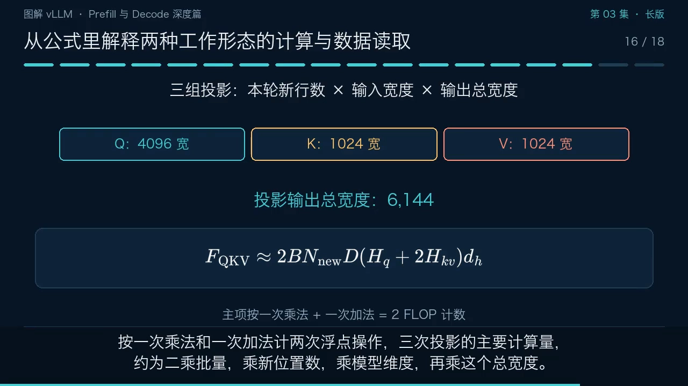

[【跳转到 30:48】](https://www.bilibili.com/video/BV1c7yXzmES1/?t=1848)

代入 4096 维、32 个 query 头、8 个 KV 头、128 维头大小：输出总宽度 $4096 + 1024 + 1024 = 6144$。三组投影参数合计约 2500 万个元素，按两字节表示，权重张量为 **48 MiB**。

### 6.2 206 GFLOP 与 50.3 MFLOP

同一份 48 MiB 的权重，面对不同行数时：

$$
\begin{aligned}
F_{\text{QKV,prefill}} &\approx 206{,}158{,}430{,}208\ \text{FLOP} \approx 206.1584\ \text{GFLOP} \\
F_{\text{QKV,decode}} &\approx 50{,}331{,}648\ \text{FLOP} \approx 50.3316\ \text{MFLOP}
\end{aligned}
$$

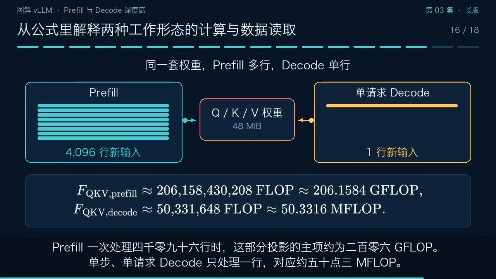

[【跳转到 31:13】](https://www.bilibili.com/video/BV1c7yXzmES1/?t=1873)

**同一份权重，算力相差约 4096 倍**——因为 M 维相差 4096 倍。这就是「大 GEMM」与「GEMV」的差别：

- **GEMM**（$M > 1$）：一份权重被 M 行输入同时复用，权重从显存搬进来一次，能参与 M 次乘加。搬运成本被摊薄，算力单元有活干。
- **GEMV**（$M = 1$）：一份权重搬进来，只参与一次乘加。搬运成本摊不开，算力单元大部分时间在等数据。

视频对这件事的表述是：**长输入 Prefill 把许多行集中在矩阵乘法里，让同一组权重服务更多位置，形成较高的计算密度**；而小批量 Decode 每轮只推进少量新位置，同时还要为这些位置读取模型权重和历史 KV，上下文越长，attention 要访问的历史缓存越多，这种工作形态更容易受到显存带宽影响。

> **补充（非讲者原话）**：所谓「计算密度」在业界通常用**算术强度（arithmetic intensity）**衡量，即每搬运 1 字节数据能完成多少次浮点运算。GEMM 的算术强度随 M 增长，GEMV 的算术强度几乎固定在个位数。本系列下一小节会用 Roofline 模型把这件事推导完整，本文只到「大 GEMM 意味着算力受限、GEMV 意味着带宽受限」这一句为止。

### 6.3 混合批：Prefill 与 Decode 可以拼进同一个矩阵

真实引擎里，一轮执行往往同时包含 Prefill 和 Decode。视频最后把这种混合输入也写成了具体形状：请求 A 正在处理 near、历史里已有三个位置；请求 B 刚进入，要处理 the、cat、sat 三个提示词。位置调度器这一轮分配四个新位置，分别是 1+3。

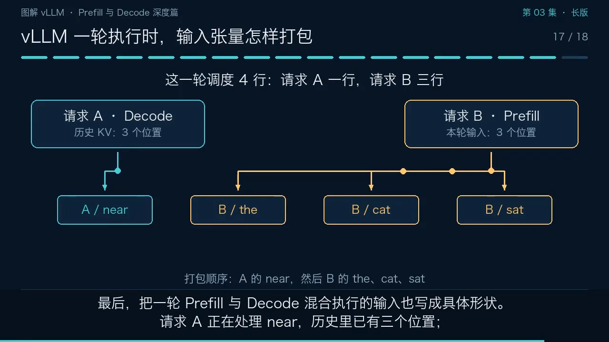

[【跳转到 33:06】](https://www.bilibili.com/video/BV1c7yXzmES1/?t=1986)

打包后当前层输入形状是 **4×4096**。投影并拆头后，query 是 `[4 个新位置, 32 头, 128 维]`，key/value 是 `[4 个新位置, 8 头, 128 维]`。四行的顺序是 A 的 near，然后是 B 的 the、cat、sat，位置索引分别为 3、0、1、2；查询段的累计起点是 0、1、4，告诉内核第一段有一行、第二段有三行。

**这解释了为什么「M 维」在工程上不等于「一条 prompt 的长度」**：它是这一轮所有请求的新位置总数。因果遮罩也随之从「列号 ≤ 行号」推广成按绝对位置对齐的规则：位置 i 的绝对索引是 $T+i$，它保留列索引小于或等于 $T+i$ 的位置。

---

## 七、Prefill 与 Decode 的形状对照表

把全文的形状收进一张表。配置：隐藏维度 $D$、query 头数 $H_q$、KV 头数 $H_{kv}$、每头维度 $d_h$、中间维度 $I$、批量 $B$。

| 算子 | Prefill 形状 | Decode 形状 | 类型 |
| --- | --- | --- | --- |
| QKV 投影 | $(B S \times D)\cdot(D \times (H_q{+}2H_{kv})d_h)$ | $(B \times D)\cdot(D \times (H_q{+}2H_{kv})d_h)$ | GEMM / GEMV |
| 注意力分数 | $(B S \times d_h)\cdot(d_h \times S)$ → $S \times S$ | $(B \times d_h)\cdot(d_h \times (T{+}1))$ → $1 \times (T{+}1)$ | GEMM / GEMV |
| softmax | 按行，$S \times S$ 逐元素 | 按行，$1 \times (T{+}1)$ 逐元素 | 非矩阵乘 |
| 注意力输出 | $(S \times S)\cdot(S \times d_h)$ | $(1 \times (T{+}1))\cdot((T{+}1) \times d_h)$ | GEMM / GEMV |
| 输出投影 | $(B S \times H_q d_h)\cdot(H_q d_h \times D)$ | $(B \times H_q d_h)\cdot(H_q d_h \times D)$ | GEMM / GEMV |
| FFN up / gate | $(B S \times D)\cdot(D \times I)$ | $(B \times D)\cdot(D \times I)$ | GEMM / GEMV |
| FFN down | $(B S \times I)\cdot(I \times D)$ | $(B \times I)\cdot(I \times D)$ | GEMM / GEMV |
| 词表头 | $(B S \times D)\cdot(D \times V_{\text{vocab}})$ | $(B \times D)\cdot(D \times V_{\text{vocab}})$ | GEMM / GEMV |

**读这张表只需要记住一句话：所有算子的形状差异都集中在 M 维上——Prefill 是 $B \cdot S$，Decode 是 $B$。** 权重矩阵（K、N 两个维度）完全一样。

---

## 小结

- **Prefill 的「并行」不是多线程技巧，而是数据布局**：整条 prompt 的所有 token 被竖着排成矩阵的行，一次前向就把它们全部算完。M 维 = 序列长度（或本轮所有请求的新位置总数）。
- **每个线性层都是 GEMM**：QKV 投影、输出投影、FFN 的 up/gate/down，形状都是 $(M \times K) \cdot (K \times N)$，其中 K、N 由模型结构决定，只有 M 随请求变化。
- **Attention 是两个 GEMM 夹一个 softmax**：$QK^\top$ 得到 $S \times S$ 分数表，$AV$ 得到 $S \times d_v$ 上下文；softmax 是逐元素算子，不是矩阵乘。
- **因果遮罩把方阵削成下三角**：有效格子数是 $S(S+1)/2$，约为 $S^2$ 的一半。
- **GQA 让 K、V 的投影宽度变窄**：32 个 query 头共用 8 个 KV 头时，Q 参数是 4096×4096，K/V 参数只有 4096×1024。
- **同一套权重，M 维决定算力规模**：Prefill 4096 行约 206 GFLOP，Decode 1 行约 50.3 MFLOP，相差约 4096 倍。大 GEMM 让权重被反复复用，这是算力利用率高的根源；GEMV 则把瓶颈推到显存带宽上。
- **混合批会把不同请求的新位置拼进同一个 M 维**：所以 M 不等于某一条 prompt 的长度，而是这一轮所有新位置的总数。

## 关键术语速查

| 术语 | 一句话解释 |
| --- | --- |
| Prefill（预填充） | 推理的第一步，把整段 prompt 的所有 token 一次性算完，建立各层 KV 缓存 |
| Decode（解码） | 推理的第二步，每轮只送进上一个 token，读历史缓存，生成一个新 token |
| GEMM | 通用矩阵乘法 $C = \alpha AB + \beta C$，A 是 M×K、B 是 K×N、C 是 M×N |
| GEMV | 矩阵乘向量，是 M=1 的退化情形，一次只能算一行 |
| M / N / K | M 是输出行数（=本轮新位置数）、N 是输出宽度（=权重列数）、K 是累加维度（=输入宽度） |
| 算术强度 | 每搬运 1 字节数据能完成多少次浮点运算；GEMM 高、GEMV 低 |
| 因果遮罩 | 让位置 i 只能看到位置 j ≤ i 的遮罩，把 S×S 的注意力削成下三角 |
| GQA | 分组查询注意力，多个 query 头共用一组 K/V，缩小 KV 的投影宽度与缓存体积 |
| RMSNorm | 按位置做的均方根归一化，不改变位置数与向量维度 |
| 门控 MLP | SwiGLU 一类结构：gate 投影过 SiLU 后与 up 投影逐分量相乘，再由 down 投影降维 |
| 分段处理的多行输入 | 一轮里新位置数大于 1 的情形，因果可见范围按绝对位置 T+i 对齐 |