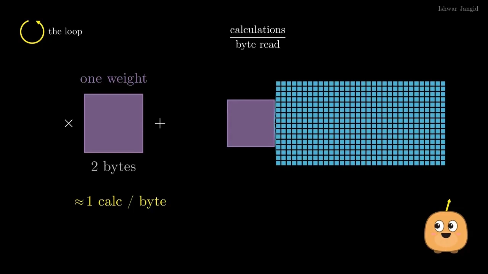
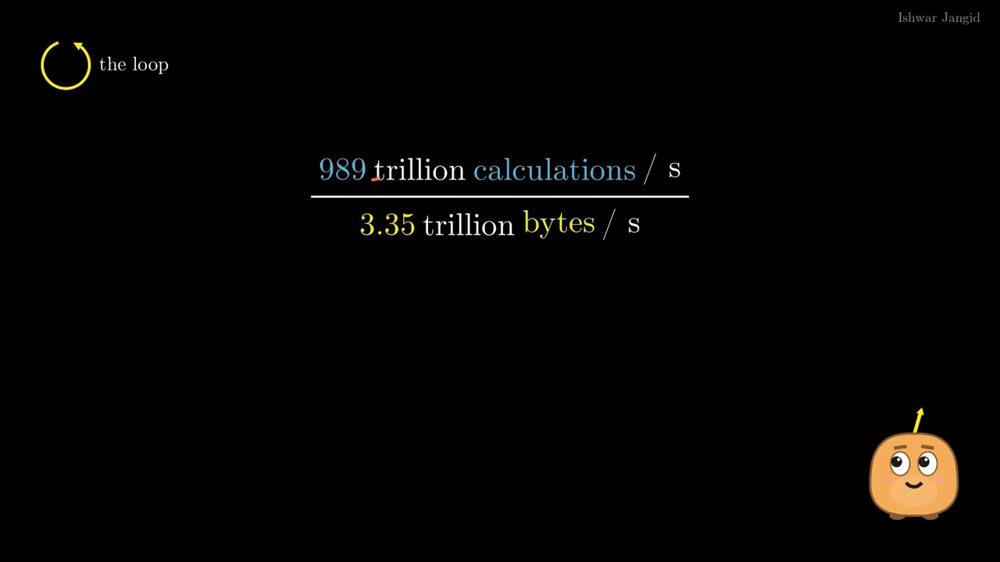
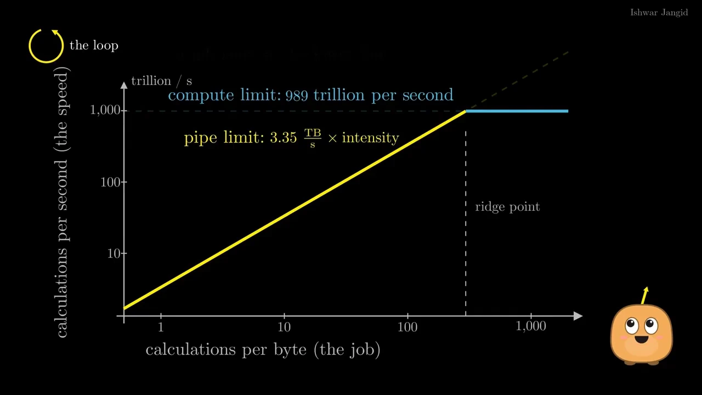
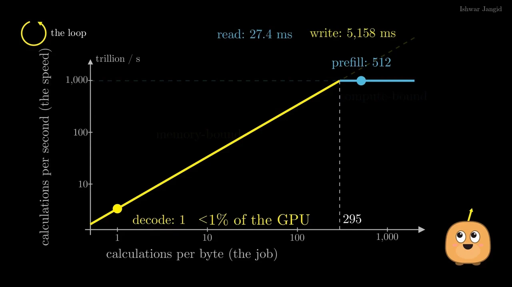
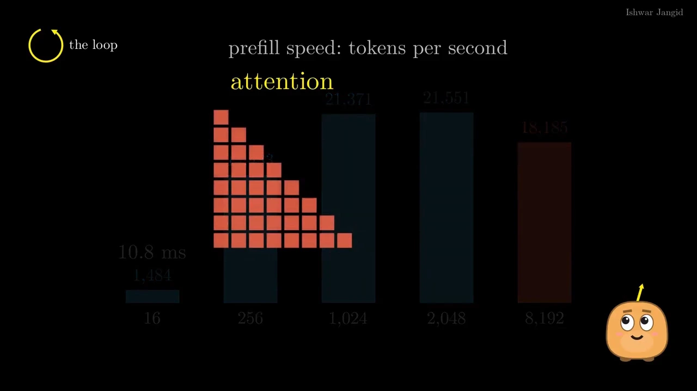
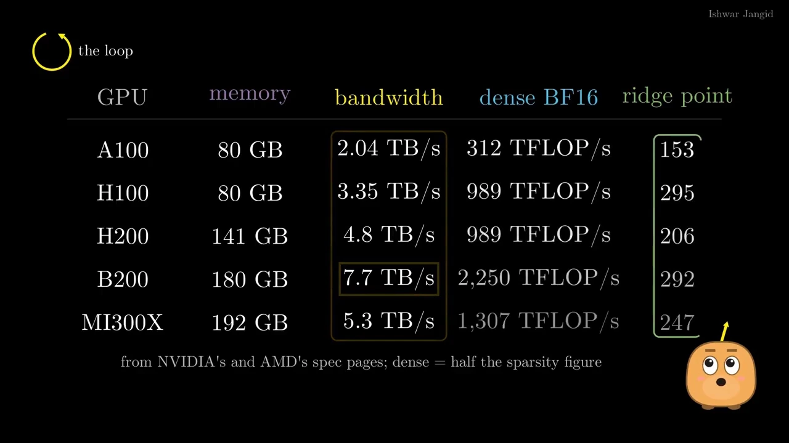
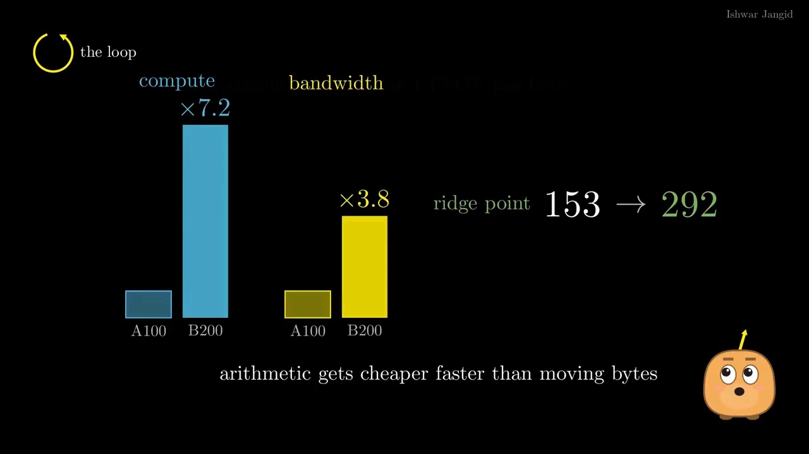
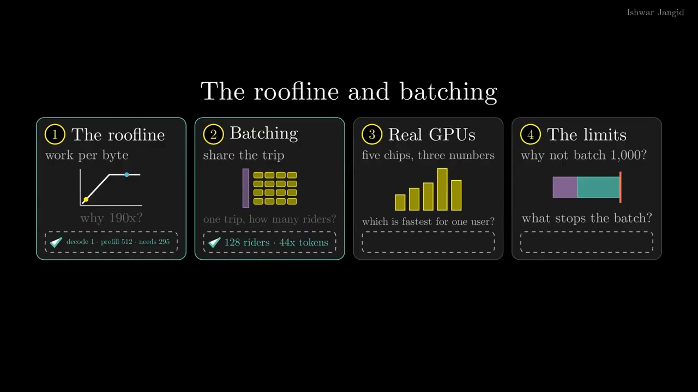

# Prefill 与 Decode 的差距不是「快慢」，而是落在 Roofline 的两侧

> 视频来源：[Inference in Depth, Part 3: The Roofline and Batching](https://www.youtube.com/watch?v=5o5io53OaOA)（YouTube · Ishwar Jangid / Ishwar AIML）｜时长约 21 分钟
> 简要导读：这支视频用「一张图（Roofline）+ 一个技巧（batching）」的叙事把推理性能讲透，最大的价值是**给了一组真实测量**：同一块芯片上 decode 只有 0.10 万亿次计算/秒，prefill 达到 13.4 万亿次，差了一百多倍；并且诚实地说出了 prefill 在什么情况下**不再**高效（prompt 太短、prompt 太长）。本文只取与本小节相关的部分：Roofline 怎么读、prefill 与 decode 各落在哪一侧、以及边界条件。batching 的调度细节属于后续小节，这里只讲到「它为什么能把点往右推」为止。

## 本讲要解决的核心问题（SCQA）

**背景**：一块 H100 每秒能做约 989 万亿次浮点运算。但当你只服务一个用户时，它用不到这个能力的百分之一，芯片 99% 的面积在等。

**冲突**：更奇怪的是，你往聊天框里粘一段长文档，前面那两秒的沉默之后，字会突然以你读不过来的速度涌出来——**同一块 GPU、同一个模型，前后两个阶段的表现完全不像同一台机器**。一个几乎不动，一个飞快。

**疑问**：这两个阶段到底在做什么不同的工作？为什么一个慢一个快？有什么办法能用一个数字把它们放在同一张图上比较，并且预测「什么时候会变快、什么时候会变慢」？

**回答（中心思想）**：把「每读一字节数据做多少次计算」（算术强度）画在横轴、把「每秒实际做多少次计算」画在纵轴，就得到 Roofline。**Decode 的算术强度约等于 1，落在斜线上（访存受限）；Prefill 的算术强度约等于 prompt 长度（示例里 512），落在水平屋顶上（算力受限）。** 两者相差一百多倍不是工程实现的问题，而是这一个比值决定的。而 Prefill 也不是永远高效：prompt 只有 16 个 token 时它会掉回和 decode 一样的水平，prompt 到 8000 时又会因为 attention 的平方项掉速——**「算力受限」是一个有条件的结论**。

---

## 一、一个数字就够了：每读一字节做多少次计算

视频的第一句话就把整件事压缩成一个比值：**数一数你每读一个字节做了多少次计算**。

[【跳转到 02:10】](https://www.youtube.com/watch?v=5o5io53OaOA&t=130)

推导过程只有两步：

1. 取一个权重。它占 2 字节（FP16）。
2. 每被一个 token 使用一次，要做约 2 次计算（一次乘法、一次加法）。

于是：

- **Decode（1 个 token）**：2 次计算 / 2 字节 $\approx$ **1 次计算每字节**；
- **Prefill（512 个 token）**：$512 \times 2$ 次计算 / 2 字节 $\approx$ **512 次计算每字节**。

视频强调了这个比值为什么比「计算次数」本身更有用：**每一项工作都需要两样东西——数学运算，和用来运算的数字。运算在计算单元上花时间，取数在管道上花时间，而这一个比值告诉你两者谁花得更久。** 而且它属于「工作」而不属于「芯片」，所以任何工作都能拿去和任何芯片比。

---

## 二、芯片也有一个同样的比值：屋脊点

接下来算芯片自己的比值。H100 的两个速度上限：

[【跳转到 02:41】](https://www.youtube.com/watch?v=5o5io53OaOA&t=161)

$$
\frac{989 \times 10^{12}\ \text{计算/s}}{3.35 \times 10^{12}\ \text{字节/s}} \approx 295\ \text{计算/字节}
$$

这个 295 就是**盈亏平衡点（break-even point）**：

- 一项工作如果每字节做的计算少于 295，它要求字节的速度超过了管道能送来的速度，于是计算单元只能等；
- Decode 做的是约 1，差了 295 倍。

---

## 三、把两个比值画成一张图：Roofline

[【跳转到 04:31】](https://www.youtube.com/watch?v=5o5io53OaOA&t=271)

这张图来自 2009 年 Williams、Waterman 与 Patterson 的论文，叫 **Roofline（屋顶线）**。读法：

- **横轴**：算术强度（计算/字节），每一步是前一步的 10 倍（1、10、100、1000），这样强度为 1 的工作和强度为 1000 的工作能放进同一张图；
- **纵轴**：GPU 实际能达到的每秒计算次数，同样是 10 倍一档；
- **斜线**：管道每秒送来 3.35 万亿字节，每字节带来越来越多的计算，所以计算单元最多能做「带宽 × 强度」——强度翻倍，速度翻倍，这是一条上升的斜线；
- **水平线**：无论数字送得多快，计算单元也不能超过 989 万亿次/秒——这是屋顶；
- **一项工作总是跑在两条线中较低的那条上**，于是两条线合成一个屋顶的形状；
- **交点就是屋脊点**，在 295 计算/字节。

于是判据只有一句：**屋脊点左边是访存受限（等管道），右边是算力受限（等工人）。**

---

## 四、Decode 在地下室，Prefill 在屋顶上

这是全文最关键的一张图。

[【跳转到 05:00】](https://www.youtube.com/watch?v=5o5io53OaOA&t=300)

图上有两个点：

- **decode：强度 1**，落在斜线最左端，标注「<1% of the GPU」；
- **prefill：强度 512**，落在水平屋顶上。

图上还有两个时间：**读 27.4ms，写 5158ms**。视频的说法是：**读写之间 190 倍的差距，就是这一张图**——读（prefill）住在屋顶上，写（decode）住在地下室里等管道。

然后视频给出了自己的实测，这是最有说服力的部分：

> 我自己的芯片（M5 Pro）也呈现同样的模式。**decode 时它做到约 0.10 万亿次计算/秒；prefill 时同一块芯片达到 13.4 万亿次，每秒的运算量高出一百多倍。**

这句话把「算力受限 vs 访存受限」从定性变成了定量：**同一块芯片、同一套算子，只因为 $M$ 从 1 变成 prompt 长度，算力利用率就差了两个数量级。**

---

## 五、边界条件一：prompt 太短，Prefill 也会掉回 decode 的水平

视频在这里插了一句非常诚实的提醒：**「Prefill 总是这么高效吗？不完全是。」**

[【跳转到 06:04】](https://www.youtube.com/watch?v=5o5io53OaOA&t=364)

实测数据（同一块芯片）：

| prompt 长度 | prefill 速度（token/s） | 说明 |
| :--- | :--- | :--- |
| 16 | 1,484 | 耗时 10.8ms，**与一个 decode step 相当** |
| 256 | — | 明显上升 |
| 1,024 | 21,371 | 接近峰值 |
| 2,048 | 21,551 | 峰值区 |
| 8,192 | 18,185 | **掉速** |

两个现象各有原因：

1. **16 个 token 时只有 1,484 token/s**，耗时 10.8ms，和一次 decode step 差不多。视频的解释是：**工作太少，喂不饱计算单元**。用本文的语言说，$M=16$ 时的算术强度只有几十，还没越过屋脊点 295，所以它其实落在斜线上——**短 prompt 的 Prefill 是访存受限或开销受限的**。
2. **8,192 个 token 时掉速**，视频的解释是：**大部分掉速来自 attention 这一步**。每个 token 都要回头看它之前的每个 token，所以这部分工作随长度的平方增长。1,000 个 token 时约 50 万对 token，长度翻倍就变成 4 倍的对数。

图中那个红色三角就是因果掩码（causal mask）的形状——下三角有效、上三角被屏蔽，这也是为什么「有效计算」只有满矩阵的一半（这一点在 1.1.1 里已经讲过，这里不重复）。

**这两条边界恰好就是本小节的边界条件**：Prefill 的「算力受限」只在 prompt 足够长（比如几百 token 以上）时成立；而 prompt 长到几千 token 之后，attention 的平方项开始主导，虽然仍是算力受限，但**主导的算子从线性层换成了 attention**。

---

## 六、Batch 的作用：把点沿着斜线往右推

视频后半段讲 batching，这里只取与 Roofline 有关的一条结论：**batch 是在给每个权重增加「被使用的次数」，也就是在提高算术强度。**

[【跳转到 14:05】](https://www.youtube.com/watch?v=5o5io53OaOA&t=845)

| GPU | 显存 | 带宽 | 稠密 BF16 算力 | 屋脊点（计算/字节） |
| :--- | :--- | :--- | :--- | :--- |
| A100 | 80 GB | 2.04 TB/s | 312 TFLOPS | 153 |
| H100 | 80 GB | 3.35 TB/s | 989 TFLOPS | 295 |
| H200 | 141 GB | 4.8 TB/s | 989 TFLOPS | 206 |
| B200 | 180 GB | 7.7 TB/s | 2,250 TFLOPS | 292 |
| MI300X | 192 GB | 5.3 TB/s | 1,307 TFLOPS | 247 |

这张表里有一个陷阱值得单独说：规格书上写的算力往往是**带稀疏（sparsity）**的数字（比如 B200 标称近 2,000 TFLOPS），而实际部署的模型权重里没有那么多零，跑的是稠密模式，只有标称值的一半。**算屋脊点必须用稠密算力。**

把 batch 与 Roofline 联系起来：

- 每加入一个序列，每个权重就多做约 1 次计算/字节；
- 所以 batch 为 64 时强度约 64，点在斜线上往右爬了一截；
- **decode 要接近屋顶，batch 得大到约 300**（H100/B200），A100 上约 150。

[【跳转到 15:40】](https://www.youtube.com/watch?v=5o5io53OaOA&t=940)

这张图解释了为什么「batching 越来越重要」：**算力涨得比带宽快，屋脊点一代代往右移**，于是要用更大的 batch 才能把点推到屋顶上。反过来说，**Prefill 天生就有 $S$ 这么大的「batch」**（$S$ 就是 prompt 长度），所以它不需要靠调度技巧就能站在屋顶上——这是 Prefill 与 Decode 最本质的不对称。

---

## 七、把整条线索收拢

[【跳转到 20:15】](https://www.youtube.com/watch?v=5o5io53OaOA&t=1215)

视频用四格图收尾，其中第一格就是我们这一节的主题：

- **Roofline：每字节做多少工作** → decode 是 1、prefill 是 512、需要 295 才能上屋顶 → 这就是 190 倍差距的来源；
- Batching：一次行程载多少人 → 128 人换来 44 倍 token；
- 真实 GPU：五张卡、三个数字（显存容量、带宽、峰值算力）；
- 边界：为什么不能 batch 到 1000。

对于本小节，需要记住的只有第一格和第四格：**Prefill 站在屋顶上，但屋顶不是无限的，而且不是所有 prompt 都能爬上去。**

---

## 小结

- 算术强度（每读一字节做多少次计算）是唯一能把「工作」和「芯片」放在同一个尺度上比较的数字：它属于工作，不属于芯片。
- Decode 的算术强度约 1（一个权重 2 字节、2 次计算），Prefill 的算术强度约等于 prompt 长度（示例 512）。
- H100 的盈亏平衡点是 $989 / 3.35 \approx 295$ 计算/字节，这就是屋脊点；左侧访存受限，右侧算力受限。
- 实测对照：同一块芯片 decode 约 0.10 万亿次计算/秒，prefill 达 13.4 万亿次，差一百多倍；读写时间 27.4ms vs 5158ms。
- 边界一：prompt 只有 16 个 token 时，prefill 耗时 10.8ms，与一个 decode step 相当——工作太少，喂不饱计算单元。
- 边界二：prompt 到 8,192 个 token 时速度从 2.1 万 token/s 掉到 1.8 万，原因是 attention 的平方项开始主导。
- batch 的作用是给每个权重增加复用次数，也就是沿斜线把点往右推；decode 要接近屋顶需要 batch 约 300（H100）。
- 算力涨得比带宽快（A100→B200：7.2 倍 vs 3.8 倍），屋脊点一代代右移，所以 batching 越来越重要；而 Prefill 天生就有 $S$ 这么大的「batch」，不需要调度技巧就站在屋顶上。

## 关键术语速查

| 术语 | 一句话解释 |
| :--- | :--- |
| 算术强度（arithmetic intensity） | 每读一字节数据做多少次计算，单位「计算/字节」，等价于 FLOP/Byte |
| 盈亏平衡点 / 屋脊点 | 芯片的算力除以带宽，H100 上约 295 计算/字节 |
| Roofline | 把「带宽 × 强度」的斜线和「峰值算力」的水平线画在一起，工作总是跑在较低的那条上 |
| 稠密算力（dense） | 不带稀疏加速的算力，是规格书标称值的一半，算屋脊点必须用它 |
| 因果掩码（causal mask） | 注意力里的下三角掩码，让每个 token 只能看它之前的 token，有效计算约为满矩阵的一半 |
| 平方项（$O(S^2)$） | attention 里每个 token 要和之前所有 token 配对，工作量随序列长度平方增长 |