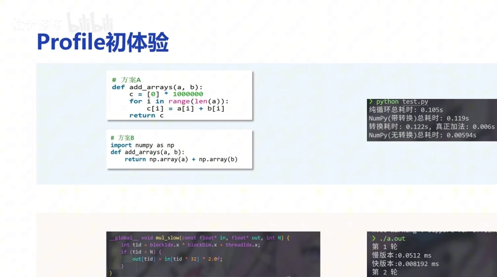
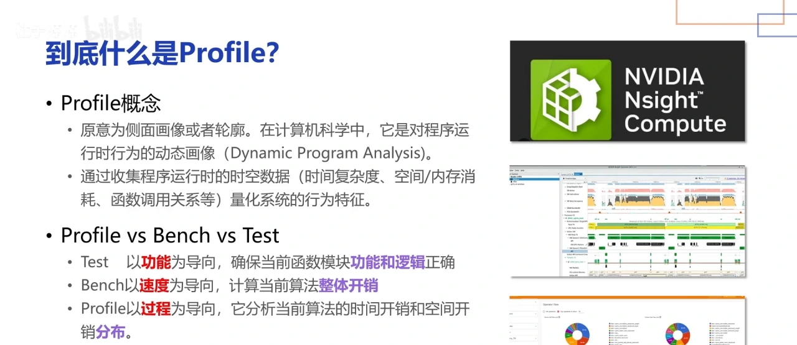
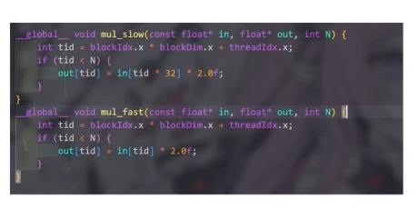
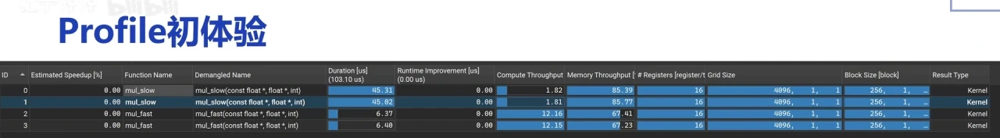
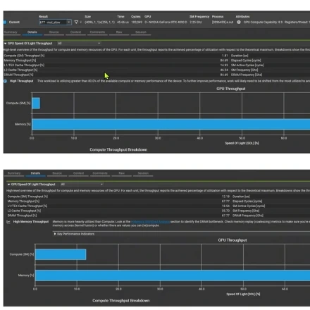
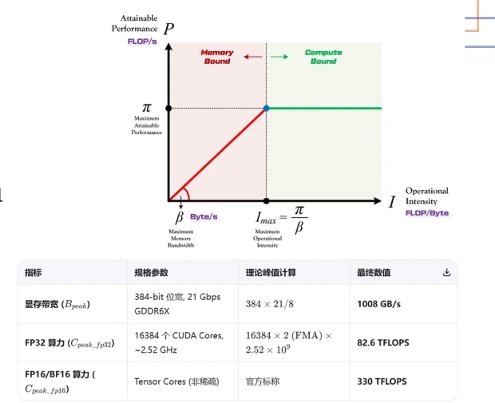
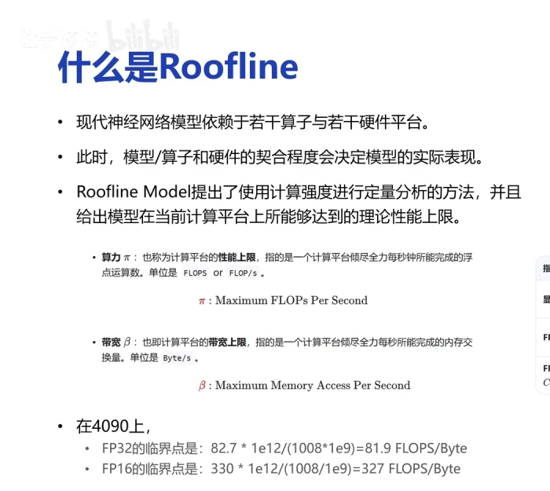
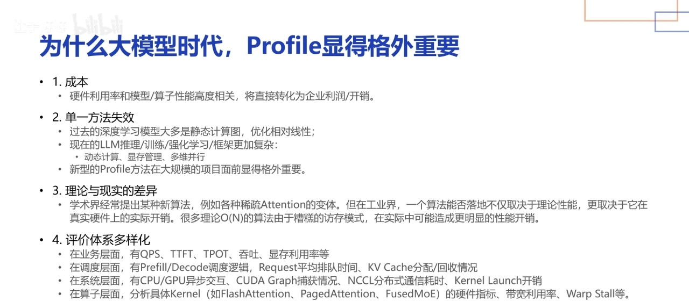

# 判定算力受限还是访存受限，看的是两个吞吐占比而不是 GPU 利用率

> 视频来源：[【01】AI Infra 最详细 Profile 教程—vllm 实现及优化](https://www.bilibili.com/video/BV16w316ZEyS/)（Bilibili · UP 主 杜子源源）｜时长约 22 分钟
> 简要导读：这是「AI Infra Profiler 实战教学」系列的第一期，定位是**建立工具地图**而不是写代码：它讲清了 profile / benchmark / test 三者的区别、torch.profiler / nsys / ncu 三层工具各回答什么问题、以及怎么用 NCU 的 Compute Throughput 与 Memory Throughput 两个占比判断一个 kernel 卡在哪一侧。视频后半段有较多系列规划与个人项目介绍，本文只取与「判定方法」相关的部分。字幕为 B 站 AI 生成，术语已订正（NCU / NSYS / Roofline / throughput 等）。

## 本讲要解决的核心问题（SCQA）

**背景**：本小节前面的两篇已经论证了「Prefill 是算力受限」。但那是**算出来的**结论，用的是算术强度和 Roofline。真正在机器上跑的时候，你需要**测出来**同一个结论。

**冲突**：麻烦在于，最常用的那个指标会骗人。`nvidia-smi` 里那个 GPU-Util 跳到 95% 的时候，你会以为算力用满了；实际上它只表示「有 kernel 在跑的时间占比」，Decode 阶段它可以一直是 95%，而算力利用率不到 1%。用错指标，就会把访存瓶颈当成算力瓶颈，然后去优化一个不需要优化的地方。

**疑问**：那应该看什么指标？torch.profiler、nsys、ncu 这三个工具分别回答什么问题？拿到一个 kernel，怎么用数字判断它是算力受限还是访存受限？判断出来之后，对症的药又是什么？

**回答（中心思想）**：判断一个 kernel 卡在哪一侧，看的是**它离自己那条上限有多近**——NCU 会把这件事直接算成两个百分比：Compute Throughput（SM 计算吞吐占峰值的比例）和 Memory Throughput（DRAM 吞吐占峰值的比例）。**哪个占比高，就卡在哪一侧**；两个都低，说明它既没算满也没搬满，卡在延迟或同步上。而这两个数字只有 NCU 这种内核层工具给得出来，torch.profiler 只能告诉你「哪个算子最慢」，nsys 只能告诉你「时间线上有没有空隙」——**三层工具是三个不同分辨率的镜头，不能互相替代**。

---

## 一、先分清三件事：test、benchmark、profile

视频开篇用一个很小的例子说明「快慢」这件事有多容易看错。

[【跳转到 02:10】](https://www.bilibili.com/video/BV16w316ZEyS/?t=130)



这个例子里：

| 方案 | 总耗时 | 备注 |
| :--- | :--- | :--- |
| 纯 Python 循环 | 0.105 s | 直觉上应该更慢 |
| NumPy（带转换） | 0.119 s | 反而更慢 |
| 其中：数组转换 | 0.122 s | 真正的开销在这里 |
| 其中：真正的加法 | 0.006 s | 快了 20 倍 |

**结论**：直觉说 NumPy 一定比 for 循环快，但实测反了。只有把耗时**拆开看分布**，才知道钱花在了「转换」而不是「加法」上。这就是 profile 与 benchmark 的区别。

视频给三者的定义划得很清楚：

[【跳转到 05:39】](https://www.bilibili.com/video/BV16w316ZEyS/?t=339)



| 概念 | 导向 | 回答的问题 |
| :--- | :--- | :--- |
| Test | 功能 | 这个函数的功能和逻辑对不对 |
| Benchmark | 速度 | 这个算法整体开销多少（比如冒泡 vs 快排） |
| Profile | 过程 | 时间与空间开销**分布**在哪里，哪一段花了多少 |

关键词是**分布**。Benchmark 给你一个总数，profile 给你一张分布表——而本小节需要的正是分布：Prefill 的时间到底分给了哪些算子。

---

## 二、三层工具是三个不同分辨率的镜头

视频在开头交代了这套教程要讲的四类工具，它们的分工正好对应「从宏观到微观」的排查顺序：

| 工具 | 分析层级 | 回答的问题 |
| :--- | :--- | :--- |
| torch.profiler | 框架 / 算子层 | PyTorch 里哪个算子最慢？是 CPU 开销还是 GPU 开销？`torch.compile` 做了哪些算子融合？CPU 和 GPU 有没有流水线？ |
| nsys（Nsight Systems） | 系统层 | CPU 线程、CUDA 流、内核之间在做什么？更系统一些，甚至能看到 PCIe |
| ncu（Nsight Compute） | 内核层 | 针对单个算子：显存带宽、寄存器利用率、warp 之类的微架构指标 |
| 自定义 profiler | 业务 / 组件层 | prefill 阶段花了多少时间？调度器开销多大？decode 阶段的开销如何？ |

视频对这三层的定位有一句关键判断：**torch.profiler 属于「框架层和算子层」，能看出代码里哪个算子比较耗时、是 CPU 开销还是 GPU 开销；nsys 更偏系统层；再往下针对单个算子，用 ncu 看它的显存带宽、寄存器利用率、warp 之类的指标。**

这句话正好回答了本小节的一个具体问题：**「怎么用 ncu / nsys / torch.profiler 判断一个 kernel 是算力受限还是访存受限」——三层里只有 ncu 能给出那个判定所需的吞吐占比**，另外两层负责先把「可疑 kernel」找出来。

视频还解释了为什么需要自定义 profiler：框架在 CUDA Graph 之后很难用官方方案测出来，所以「prefill 阶段花了多少时间、调度器的开销、decode 阶段的开销」这类问题需要自己埋点。

---

## 三、NCU 的两个百分比就是判据本身

视频用一个 CUDA 小实验演示了 NCU 的用法。实验设计很干净：同一个「每个元素乘 2」的 kernel，写两个版本，只改一行。

[【跳转到 04:31】](https://www.bilibili.com/video/BV16w316ZEyS/?t=271)



```cuda
__global__ void mul_slow(const float* in, float* out, int N) {
    int tid = blockIdx.x * blockDim.x + threadIdx.x;
    if (tid < N) {
        out[tid] = in[tid * 32] * 2.0f;   // 跨步访问：相邻线程读的地址隔了 32 个元素
    }
}

__global__ void mul_fast(const float* in, float* out, int N) {
    int tid = blockIdx.x * blockDim.x + threadIdx.x;
    if (tid < N) {
        out[tid] = in[tid] * 2.0f;        // 连续访问：相邻线程读相邻地址
    }
}
```

两个版本的计算量完全一样（每元素一次乘法），只有访存模式不同。用 NCU 跑出来的结果：

[【跳转到 04:31】](https://www.bilibili.com/video/BV16w316ZEyS/?t=271)



| kernel | Duration | Compute Throughput | Memory Throughput |
| :--- | :--- | :--- | :--- |
| mul_slow | 45.31 us | 1.82% | 85.39% |
| mul_fast | 6.37 us | 12.16% | 67.41% |

这张表就是判据的原始形态。视频的原话是：

> 一般来说，如果 memory throughput 的占比更高，那它就有可能是一个内存瓶颈；如果 compute throughput 占得更满，那它就可能是一个计算瓶颈。

把这两个数字翻译成判断规则：

| Compute Throughput | Memory Throughput | 判断 | 对应的优化方向 |
| :--- | :--- | :--- | :--- |
| 高（接近峰值） | 不高 | **算力受限** | 换更快的计算单元（Tensor Core）、提高数据复用 |
| 不高 | 高（接近峰值） | **访存受限** | 算子融合、合并访存、提高算术强度 |
| 低 | 低 | **延迟 / 同步 / 开销受限** | 看时间线空隙、减少 kernel 启动、提高占用率 |
| 高 | 高 | 已到硬件极限 | 只能换卡或换算法 |

对照上表看这两个 kernel：**两个版本都是访存受限**（Memory 85% 和 67%，都远高于 Compute 的 1.8% 和 12%）。但快版本快了 7 倍，原因是它把跨步访问改成了连续访问，**让同样的字节数搬得更有效率**——Memory Throughput 从 85% 降到 67%，说明它不再被访存卡得那么死，同时 Compute 从 1.8% 升到 12%，算力开始被用起来。

NCU 的详情页把这个判断画得更直观：

[【跳转到 04:31】](https://www.bilibili.com/video/BV16w316ZEyS/?t=271)



面板上写着一句提示：「Memory is heavily utilized. Compute is low. The kernel is likely memory bound.」——**这正是「两个百分比谁高就卡在哪一侧」的机器版表述。**

回到本小节的主题：**如果把 Prefill 里的一个 GEMM kernel 丢进 NCU，你会看到相反的画面——Compute Throughput 高、Memory Throughput 低。** 这就是「Prefill 是算力受限」在工具层面的证据形态。视频没有直接跑一个 prefill 的 GEMM（它的例子是逐元素 kernel），但判据是同一个判据。

---

## 四、为什么必须用 Roofline 而不是只看百分比

NCU 的两个百分比有个局限：它们都是「占峰值的比例」，而峰值本身取决于用哪种计算单元。所以还需要 Roofline 把「这个 kernel 应该落在哪」算出来。

[【跳转到 12:57】](https://www.bilibili.com/video/BV16w316ZEyS/?t=777)



视频把 Roofline 的两个参数讲得很清楚：

- **算力 $\pi$**：计算平台倾尽全力每秒所能完成的浮点运算数，单位 FLOP/s 或 FLOPS；
- **带宽 $\beta$**：计算平台倾尽全力每秒所能完成的内存交换量，单位 Byte/s；
- 两者的比值就是屋脊点 $I_{\max} = \pi / \beta$；拐点之前是 memory-bound，拐点之后是 compute-bound。

视频对这件事的价值判断是：**「通常我们认为当一个算法达到了 compute-bound，就是一个相对来说比较好的算法，因为它基本上利用到了硬件的上限；而如果它是 memory-bound，那它就还有进一步提升利用率的空间。」**

然后它拿 RTX 4090 做了一遍完整算例：

[【跳转到 12:57】](https://www.bilibili.com/video/BV16w316ZEyS/?t=777)



| 指标 | 规格 | 理论峰值计算 | 最终数值 |
| :--- | :--- | :--- | :--- |
| 显存带宽 $B_{peak}$ | 384-bit 位宽、21 Gbps GDDR6X | $384 \times 21 / 8$ | 1008 GB/s |
| FP32 算力 $C_{peak,fp32}$ | 16384 个 CUDA Core、约 2.52 GHz | $16384 \times 2 \times 2.52 \times 10^{9}$ | 82.6 TFLOPS |
| FP16/BF16 算力 $C_{peak,fp16}$ | Tensor Core（非稀疏） | 官方标称 | 330 TFLOPS |

于是两个屋脊点：

$$
I^{*}_{\text{FP32}} = \frac{82.7 \times 10^{12}}{1008 \times 10^{9}} \approx 81.9\ \text{FLOP/Byte}
$$

$$
I^{*}_{\text{FP16}} = \frac{330 \times 10^{12}}{1008 \times 10^{9}} \approx 327\ \text{FLOP/Byte}
$$

注意这里出现了**两个屋脊点**，因为 4090 的 FP32 与 FP16 峰值差了 4 倍。这和上一篇里「屋顶要按计算单元分别画」是同一件事：**判断一个 kernel 是不是算力受限，必须先确定它跑在哪种计算单元上。** 一个 FP32 的 kernel 越过 81.9 就算力受限，一个 Tensor Core 的 BF16 GEMM 要越过 327 才算力受限。

接着视频用 $C = A + B$ 走了一遍：

- 计算量：1 FLOP（每元素一次加法）；
- 访存量：读 A、读 B、写 C，共 12 字节（每元素 4 字节）；
- 算术强度：$1 / 12 \approx 0.083$。

$$
0.083 \ll 81.9
$$

**差了一千倍**，所以这个 kernel 的核心优化方向是带宽，不是算力。视频的结论是：**「因此它的核心优化是需要优化它的带宽」**。

把这个算法套到 Prefill 上就是本文要的答案：**Prefill 的 GEMM 算术强度是「prompt 长度」这个量级（几百），远高于 327；而 LayerNorm、残差相加这类算子的算术强度是 0.083 这个量级，远低于 81.9。** 所以同一个 Prefill 前向里，GEMM 是算力受限、归一化是访存受限——**「Prefill 是算力受限」这句话说的是整段前向的吞吐上限由 GEMM 那一侧决定，而不是说每个算子都算力受限。**

---

## 五、为什么大模型时代必须做 profile：四个层次

视频用一页讲清了为什么这件事在 LLM 时代变得更重要，其中「评价体系多样化」这一条正好给出了 profile 的四个层次。

[【跳转到 11:09】](https://www.bilibili.com/video/BV16w316ZEyS/?t=669)



| 层次 | 看什么指标 |
| :--- | :--- |
| 业务层 | QPS、TTFT、TPOT、吞吐、显存利用率 |
| 调度层 | Prefill/Decode 调度逻辑、Request 平均排队时间、KV Cache 分配/回收 |
| 系统层 | CPU/GPU 异步交互、CUDA Graph 捕获、NCCL 分布式通信耗时、Kernel Launch 开销 |
| 算子层 | 具体 kernel（FlashAttention、PagedAttention、FusedMoE）的硬件指标、带宽利用率、Warp Stall |

本小节要回答的问题落在**算子层**：Prefill 的 kernel 是算力受限还是访存受限。而算子层的指标就是 NCU 给的那两个百分比。

视频还给了三条「为什么以前的方法不够用」的理由，其中第三条与本小节关系最大：

> **理论与现实的差异**：学术界经常提出某种新算法，例如各种稀疏 Attention 的变体。但在工业界，一个算法能否落地不仅取决于它的理论性能，更取决于它在真实硬件上的实际开销。很多理论 $O(N)$ 的算法由于糟糕的访存模式，在实际中可能造成更明显的性能开销。

这句话是「算术强度」这个概念存在的理由：**复杂度（$O(N)$ 还是 $O(N^2)$）描述的是运算量，而算术强度描述的是运算量与访存的比值。** 一个 $O(N)$ 的算法如果每步都要搬一次数据，它在硬件上可能比 $O(N^2)$ 但数据复用得好的算法更慢。判断 Prefill 是不是算力受限，用的正是后一个尺度。

视频最后强调了一条原则：**任何优化都需要 trade-off，一般来说用 XX 指标换取 XX 指标的性能提升**。比如用空间换时间——原本「读一次算一次」，改成「一次性读很多、再一次性算得很快」。FlashAttention 就是典型的用 SRAM 空间换 HBM 搬运。

---

## 小结

- 判断一个 kernel 卡在哪一侧，看它离自己那条上限有多近：NCU 的 Compute Throughput 与 Memory Throughput 两个百分比，**哪个高就卡在哪一侧；两个都低说明卡在延迟/同步/开销上**。
- 实验对照：同一个「乘 2」kernel，跨步访问版本 45.31us（Compute 1.82%、Memory 85.39%），连续访问版本 6.37us（Compute 12.16%、Memory 67.41%）——两者都是访存受限，但后者搬得更有效率。
- 三层工具不能互相替代：torch.profiler 找「哪个算子最慢」，nsys 找「时间线上有没有空隙」，ncu 才给得出「离峰值有多近」。
- 光看百分比不够，还要用 Roofline 算出「应该落在哪」：$I^{*} = \pi / \beta$。RTX 4090 上 FP32 的屋脊点是 81.9、FP16 是 327 FLOP/Byte。
- 同一个屋脊点尺度下，$C = A + B$ 的算术强度只有 0.083，差一千倍，所以它只能优化带宽；而 Prefill 的 GEMM 算术强度是几百，所以它算力受限。
- 「Prefill 是算力受限」说的是整段前向的吞吐上限由 GEMM 决定，不是说每个算子都算力受限——LayerNorm 和残差相加仍然是访存受限的。
- profile 与 benchmark 的区别是「分布」：benchmark 给总数，profile 给分布；而本小节要的「算子耗时分布」正是 profile 的产物。

## 关键术语速查

| 术语 | 一句话解释 |
| :--- | :--- |
| Compute Throughput | NCU 指标，SM 计算吞吐占硬件峰值的百分比，接近 100% 说明算力用满 |
| Memory Throughput | NCU 指标，DRAM 吞吐占硬件峰值的百分比，接近 100% 说明带宽用满 |
| GPU Speed of Light | NCU 的一个面板，把上面两个百分比画成两条横条，一眼看出卡在哪一侧 |
| Nsight Systems（nsys） | 系统层时间线工具，看 CPU 线程、CUDA 流、内核空隙、内存拷贝重叠 |
| Nsight Compute（ncu） | 内核层微架构工具，看单个 kernel 的吞吐、占用率、访存合并、warp stall |
| Operational Intensity | Roofline 横轴，等价于算术强度，单位 FLOP/Byte |
| 屋脊点 $I_{\max}$ | $\pi / \beta$，算力与带宽的比值，是逃出访存瓶颈的最低算术强度 |
| 访存合并（coalescing） | 相邻线程访问相邻地址，一次内存事务服务多个线程；反之是跨步访问，带宽被浪费 |
| trade-off | 任何优化都是用某个指标换另一个指标，找到最平衡的那个位置 |