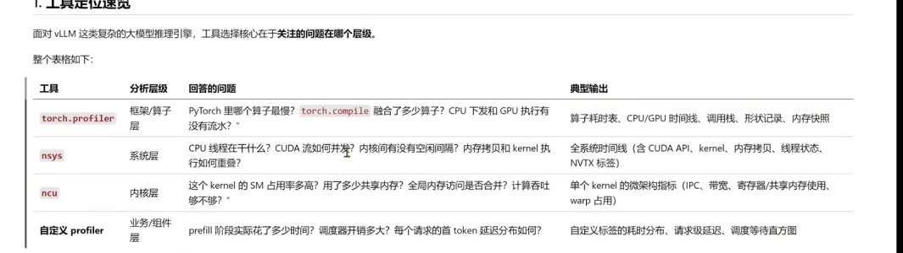
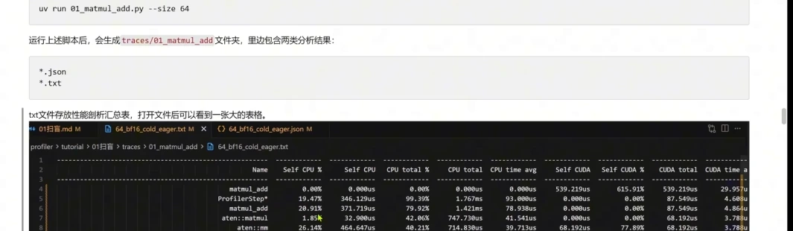
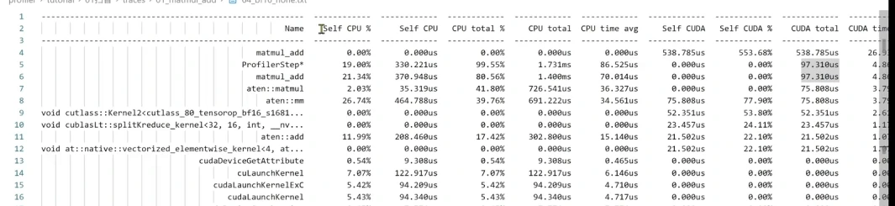
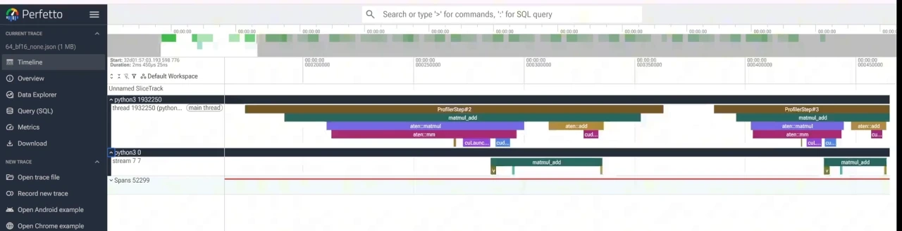
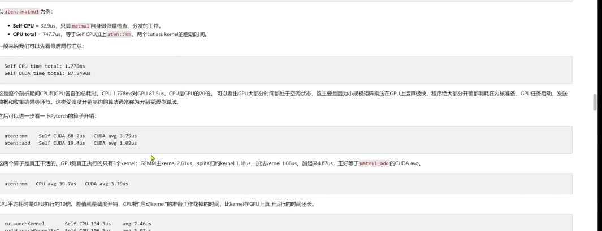
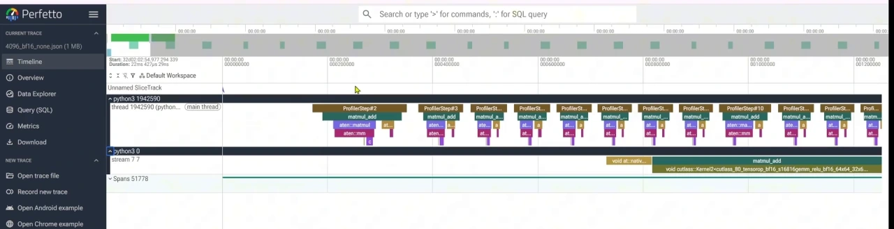
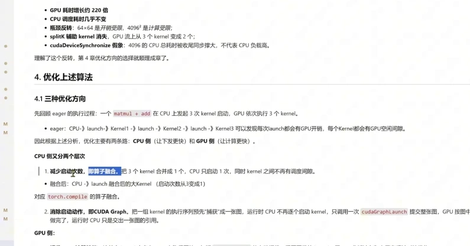
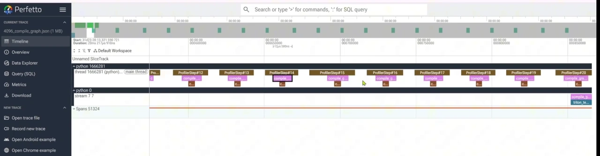

# 读不出算子耗时分布，就判断不了 Prefill 卡在哪一侧

> 视频来源：[【03】vllm 系列之 torch.profiler 与 compile 详解](https://www.bilibili.com/video/BV1XhM96FEjH/)（Bilibili · UP 主 杜子源源）｜时长约 29 分钟
> 简要导读：这是一期**动手课**：用一个「矩阵乘 + 加法」的小例子，把 torch.profiler 从埋点、配置、导出、读表到读时间线完整走一遍，然后顺着时间线把瓶颈从 CPU 挪到 GPU，再演示算子融合与 CUDA Graph 两条优化路。它的例子不是完整的 Prefill 前向，但**「怎么把算子耗时分布读出来」这件事是通用的**——本小节要的「QKV 投影 / Attention / O 投影 / FFN / LayerNorm 各占多少」正是这张表的行。字幕为 B 站 AI 生成，术语已订正（torch.profiler / Perfetto / CUDA Graph / cutlass / splitK 等）。

## 本讲要解决的核心问题（SCQA）

**背景**：本小节要证明「Prefill 是算力受限」，而这个结论的第一手证据是一张**算子耗时分布表**：哪些算子占了多少 GPU 时间。

**冲突**：这张表不会自己出现。在推理框架里，调度复杂、执行条件多变，你经常「无法判断出来瓶颈是哪一侧」。最土的办法是在函数前后各打一个 `time`，但视频指出这条路有两个毛病：**对代码的伤害非常大**（要写很多侵入性代码），而且**写完了之后容易忘了删**。

**疑问**：那怎么在不改业务代码的前提下，拿到「每个算子自己的 GPU 耗时」？拿到之后，怎么从时间线上判断瓶颈在 CPU 还是 GPU？判断出来之后，对症的药又是什么？

**回答（中心思想）**：`torch.profiler` 能同时记录 CPU 和 GPU 两条活动流，导出一张按算子聚合的表——**`Self CUDA` 那一列就是「这个算子自己在 GPU 上花了多少时间」，把这一列按大小排序，就是算子耗时分布**。而把同一份数据导成时间线（Perfetto）之后，CPU 与 GPU 两条泳道的相对位置会直接告诉你瓶颈归属：**CPU 长、GPU 短且有空隙 = 开销受限；GPU 连续跑满 = 计算或访存受限**。视频用一个 64×64 的矩阵乘把前者演到极致（CPU 1.778ms vs GPU 87.5us，差 20 倍），再用 4096×4096 把后者演到极致（GPU 连续跑，CPU 早早收工），最后给出两条优化路：**减少启动次数（算子融合）** 与 **消除启动动作（CUDA Graph）**。

---

## 一、先摆好工具地图：三层镜头，各看一层

视频开头先给了一张表，把四类工具的分工钉死。这张表是整期内容的骨架。

[【跳转到 02:13】](https://www.bilibili.com/video/BV1XhM96FEjH/?t=133)



| 工具 | 分析层级 | 回答的问题 | 典型输出 |
| :--- | :--- | :--- | :--- |
| torch.profiler | 框架 / 算子层 | PyTorch 里哪个算子最慢？`torch.compile` 融合了多少算子？CPU 下发和 GPU 执行有没有流水？ | 算子耗时表、CPU/GPU 时间线、调用栈、形状记录、内存快照 |
| nsys | 系统层 | CPU 线程在干什么？CUDA 流如何并发？内核间有没有空隙？内存拷贝和 kernel 执行如何重叠？ | 全系统时间线（含 CUDA API、kernel、内存拷贝、线程状态、NVTX 标签） |
| ncu | 内核层 | 这个 kernel 的 SM 占用率多高？用了多少共享内存？全局内存访问是否合并？计算吞吐够不够？ | 单个 kernel 的微架构指标（IPC、带宽、寄存器/共享内存使用、warp 占用） |
| 自定义 profiler | 业务 / 组件层 | prefill 阶段实际花了多少时间？调度器开销多大？每个请求的首 token 延迟分布如何？ | 自定义标签的耗时分布、请求级延迟、调度等待直方图 |

视频对流程的总结是：**先用 nsys 或 torch.profiler 定位大粒度的性能瓶颈，再用 ncu 深入分析核心 kernel；在 CUDA Graph 等场景下 torch.profiler 无法捕获算子事件，需要自定义 profiler 补充监控。**

对本小节来说，**torch.profiler 是「拿到算子耗时分布」的那一层**，nsys 和 ncu 是后续「确认瓶颈性质」的两层。

---

## 二、埋点：给算子起个名字，才能把它从表里认出来

视频的例子极简：$Y = WX + B$。

```python
def step(x, w, b):
    return torch.matmul(x, w) + b
```

问题是：跑完之后表里会出现 `aten::matmul`、`aten::mm`、`aten::add` 一堆名字，你怎么知道哪一行对应你自己的逻辑？视频的解法是 `record_function`：

```python
with torch.profiler.record_function("matmul_add", x.shape):
    y = step(x, w, b)
```

三个要点：

1. **给这段逻辑起个名字**（`matmul_add`），方便在表里找到它；
2. **支持嵌套**，可以层层叠叠地堆起来，于是你能看到「我的标签 → aten::matmul → aten::mm」的调用链；
3. **可以传额外信息**，比如把 `x.shape` 传进去，标签就会显示成 matmul_add 64x64 这种形式，一次跑多个规模时特别好用。

然后是 profiler 的配置：

```python
with torch.profiler.profile(
    activities=[torch.profiler.ProfilerActivity.CPU,
                torch.profiler.ProfilerActivity.GPU],
    schedule=torch.profiler.schedule(wait=1, warmup=1, active=3, repeat=1),
    record_shapes=True,
    profile_memory=True,
    with_stack=False,
) as prof:
    for _ in range(steps):
        step(x, w, b)
        prof.step()
```

| 参数 | 作用 |
| :--- | :--- |
| `activities` | 要监测哪些活动：只选 CPU 就只记 CPU，CPU 和 GPU 都写就两条流都记 |
| `schedule` | `wait` 跳过若干步、`warmup` 预热、`active` 实际记录、`repeat` 重复几轮 |
| `record_shapes` | 记录张量形状 |
| `profile_memory` | 记录内存分配 |
| `with_stack` | 记录调用栈（开销较大，视频里先设为 False） |

**预热这一步不能省**：GPU 第一次跑某个 kernel 会有额外开销（编译、上下文建立），不预热的话第一轮的数字会污染结果。这一点在后面的时间线里会看得很清楚。

---

## 三、读表：`Self CUDA` 那一列就是算子耗时分布

跑完 64×64、bf16 的配置，视频先看汇总：**Self CPU time total 1.738ms，Self CUDA time total 97.310us**（后者是这一次 64×64 跑下来 GPU 侧的总时间）。然后打开导出的文本表。

[【跳转到 11:40】](https://www.bilibili.com/video/BV1XhM96FEjH/?t=700)



表格的列名需要先解释清楚，否则很容易读错：

| 列 | 含义 |
| :--- | :--- |
| `Self CPU` | 这个算子**自己**在 CPU 上执行的时间，不含它调用的子项 |
| `CPU total` | 这个算子**自己加上所有子项**在 CPU 上的总时间 |
| `Self CUDA` | 这个算子**自己**在 GPU 上执行的时间 |
| `CUDA total` | 这个算子加上子项的 GPU 总时间 |
| `# of Calls` | 调用次数 |

视频的原话是：**「self 就是它自己执行的，不包括它下面的子项目；total 就是它自己再带上它的一些子项目，总共的执行时间。」**

**为什么 `Self CUDA` 才是「算子耗时分布」？** 因为 `CUDA total` 会把子项重复计入——父算子（比如 `matmul_add`）的 `CUDA total` 等于它下面所有 kernel 之和，如果你按 `CUDA total` 排序，会看到父算子永远排第一，但那是重复计算的结果。**只有 `Self CUDA` 是不重复的、可以直接相加的**，把所有行按 `Self CUDA` 排序，才是真正的「时间花在哪」。

64×64 那次跑出来的表长这样：

[【跳转到 08:08】](https://www.bilibili.com/video/BV1XhM96FEjH/?t=488)



读这张表要注意三件事：

1. **`matmul_add` 那一行的 553.68% 不是错误**——它是父节点，百分比的分母是「总 CUDA 时间」，父节点把子节点的时间又算了一遍，所以超过 100%。**这恰好证明了「不能按父节点排序」。**
2. **真正干活的是三个 kernel**：cutlass 的 GEMM kernel（52.351us）、splitK 的 reduce kernel（23.457us）、逐元素加法 kernel（21.502us）。视频在后面把这三个加起来算过：$2.61 + 1.18 + 1.08 = 4.87$ 微秒，正好等于 `matmul_add` 的 CUDA 平均耗时。
3. **`cudaLaunchKernel` 占了 5.42%**——注意这是 CPU 侧的启动开销，它出现在 GPU 时间占比里说明它自己也被算进了某个 CUDA 活动。这个数字在 64×64 这种小规模下会变得非常显眼。

**这就是「算子耗时分布」的原始形态。** 把同样的方法套到 Prefill 上，你会看到 `aten::mm`（QKV 投影、O 投影、FFN 的 gate-up-down）、FlashAttention 的 kernel、aten::layer_norm、`aten::add`（残差）各自占了多少——**而它们之间的比例关系，就是本小节要论证的「GEMM 主导」的经验证据**。

视频还演示了另一个细节：**同一个算子在不同规模下，底层的 kernel 组成会变**。

> 刚刚在 64×64 的时候，对于 `mm` 下边它是有两个模块的，分别是正常的矩阵乘和一个 splitK reduce；而对于 4096 来说，这个就变成了一个。

原因是小规模矩阵乘的并行度不够，cutlass 会用 splitK 把 K 维切开、用更多 block 并行，最后再 reduce 一次；规模大了之后不需要 splitK，那个辅助 kernel 就消失了。**这意味着「算子耗时分布」不是模型的固有属性，它随输入规模变化**——这一点对 Prefill 尤其重要，因为 prompt 长度直接决定了 $M$ 维的大小。

---

## 四、读时间线：CPU 与 GPU 谁在等谁

表格告诉你「谁慢」，但不告诉你「为什么慢」。要回答后者，得把同一份数据导成时间线。

导出方式是调用 prof.export_chrome_trace 写出 trace.json，然后用 ui.perfetto.dev 打开。视频演示了 64×64 的时间线：

[【跳转到 09:20】](https://www.bilibili.com/video/BV1XhM96FEjH/?t=560)



时间线分两条泳道：

- **上面一条是 CPU 线程**（`python3 1932250 (main thread)`），里面是 `aten::matmul`、`aten::mm`、`aten::add`、`cudaLaunchKernel`、`cudaDeviceGetAttribute` 这些框；
- **下面一条是 GPU stream**（`python3 0 / stream 7`），里面是 `matmul_add` 的实心块。

64×64 的画面特征非常明显：**GPU 泳道上只有很短的一小段，两段之间还有空隙；而 CPU 泳道上密密麻麻排满了框。** 视频的解读是：

> 这个算子 64×64 这个范围下是 CPU 瓶颈呢还是 GPU 瓶颈呢？很明显是 CPU 瓶颈。为什么呢？CPU 执行了 1.7ms，而 GPU 只有 87 微秒，那这个开销就很大了，差了 20 倍，所以 GPU 很长一段时间都在等待。

**这就是「两个利用率都低」的现场**：GPU 的计算单元没满（因为没活干），显存带宽也没满（因为没数据搬），两个指标的分子都很小——瓶颈既不在算力也不在带宽，而在**CPU 把活派过来的速度**。视频把这条推理写在了教程文档里，并且给出了更细的拆解：

[【跳转到 12:34】](https://www.bilibili.com/video/BV1XhM96FEjH/?t=754)



这张截图里有四个数字构成了一条完整的证据链：

| 数字 | 含义 |
| :--- | :--- |
| `Self CPU time total` 1.778 ms | CPU 侧总耗时 |
| `Self CUDA time total` 87.549 us | GPU 侧总耗时 |
| `aten::mm` Self CUDA 68.2us + `aten::add` 19.4us | 两个算子各自在 GPU 上花了多少 |
| GEMM kernel 2.61us + splitK reduce 1.18us + 加法 kernel 1.08us = 4.87us | 真正在算的时间只有这么多 |

**关键在最后一行**：GPU 上真正做计算的时间只有 4.87 微秒，而 CPU 花了 1.778 毫秒去准备和派发。视频把这类算法命名为**开销受限型算法**：

> 可以看出 GPU 大部分时间都处于空闲状态，这主要是因为小规模矩阵乘法在 GPU 上运算极快，程序绝大部分开销都消耗在内核准备、GPU 任务启动、发送数据和收集结果等环节。这类受调度开销制约的算法通常称为**开销受限型算法**。

再把规模换成 4096×4096：

[【跳转到 14:00】](https://www.bilibili.com/video/BV1XhM96FEjH/?t=840)



画面完全反转：**CPU 泳道很快就执行完了，后面一直空着；GPU 泳道上是一整条连续的 `matmul_add` 长块。** 视频的解读是：

> 对于 4096 来说，现在的开销实际上就转成了 GPU 的开销。很明显的看到刚刚是 GPU 很长一段、CPU 一直等，这个地方有一个很长的同步，CPU 实际上执行了一点点，很快就执行完了，后边 GPU 在一直等。

**「GPU 连续跑满、CPU 早早收工」就是算力或访存受限的现场。** 至于是算力还是访存，torch.profiler 给不出答案——那需要上一层的 ncu（见同小节的另一篇《用 NCU 判定算力受限还是访存受限》）。

视频把两个规模的差异总结成了一张对照：

[【跳转到 17:00】](https://www.bilibili.com/video/BV1XhM96FEjH/?t=1020)



| 现象 | 64×64 | 4096×4096 |
| :--- | :--- | :--- |
| GPU 耗时 | 87.5 us | 增长约 220 倍 |
| CPU 调度耗时 | 1.778 ms | **几乎不变** |
| 瓶颈归属 | 开销受限 | 计算受限 |
| splitK 辅助 kernel | 有（3 个 kernel） | 消失（2 个 kernel） |

这张表最有价值的一行是「CPU 调度耗时几乎不变」：**数据量涨了 4096 倍，CPU 的派活成本一点没变**。所以规模越大，CPU 开销被摊得越薄，瓶颈就越往 GPU 那一侧移。**这正是 Prefill 的处境**：prompt 越长，GPU 上的 GEMM 越忙，CPU 那点启动开销就越不重要，于是 Prefill 越来越「纯」地表现为算力受限。

---

## 五、对症下药：两条路，一条减次数，一条消动作

视频把优化方案分成两条，这个划分很干净，也正好对应「开销受限」的两种解法。

[【跳转到 17:00】](https://www.bilibili.com/video/BV1XhM96FEjH/?t=1020)

先看 eager 模式的执行过程：一个 `matmul + add` 在 CPU 上发起 **3 次 kernel 启动**，GPU 依次执行 3 个 kernel。**每次 launch 都有 GPU 开销，每个 kernel 之间都有 GPU 空闲间隙。**

于是两条路：

**路一：减少启动次数（算子融合）。** 把 3 个 kernel 合成 1 个，CPU 只启动 1 次，同时 kernel 之间不再有调度间隙。对应 `torch.compile` 的算子融合。

**路二：消除启动动作（CUDA Graph）。** 把一组 kernel 的执行序列预先「捕获」成一张图，运行时 CPU 不再逐个启动 kernel，只调用一次 `cudaGraphLaunch` 提交整张图。图按图中的依赖关系自动执行，启动的工作在捕获阶段一次性做完了，运行时 CPU 只是交出一张图的引用。

**路三（GPU 侧）：让单个 kernel 本身跑得更快。** 包括 `max-autotune` 的自动调优、手写更优的 kernel、用 ncu 分析访存和占用率后针对性优化。

视频把 `torch.compile` 的几种模式列了出来：

| 模式 | 做了什么 |
| :--- | :--- |
| `none`（eager） | 什么都不做 |
| `default` | 默认只做算子融合，不做 CUDA Graph |
| `reduce-overhead` | 在 default 基础上加 CUDA Graph |
| `max-autotune` | 加上自动调优，找到当前机器上配置最好的参数 |
| `max-autotune-no-cudagraphs` | 只做 kernel 调优，不做 CUDA Graph |

然后是一个反直觉的实测结果：**在 64×64 上，编译反而让性能变差。**

> 每一个编译它的开销都要比默认开销大。那对于这个算子来说，编译是有优化的吗？实际上并没有，反而增加了很多开销。

原因在时间线上看得很清楚：编译版本的时间线里多出了 `torch._dynamo`、`prologue bytecode`、`dispatch`、`call compiled graph` 这一堆框，**而且这些开销每次执行都会有**。原本人家直接就算了，现在每次都要跑一遍编译的那堆东西。视频的结论是：

> 这就是在小规模的数据上面，它其实是一个开销受限，开销越小，对于这个算子来说优化效果越好。

而 4096 上 `max-autotune` 就真的更快了，因为它通过算子融合和更好的 kernel 让 GPU 侧变快。至于 `reduce-overhead` 为什么在 64×64 上最慢，视频的解释很精彩：

> CUDA Graph 的 input 和 output 大小必须是固定的，例如我 64 只能是固定 64，我不能在运行的过程中改成 256，所以它会强制地进行 `for each copy`，包括一个 memory copy。这个 copy 反而也是我们的性能开销。

**这是 CUDA Graph 的代价：它要求静态 buffer，于是每次都要把输入拷进固定的 buffer、把输出拷出来。** 在小规模下，这点拷贝开销比省下的启动开销还大。

最后视频给出了手写 CUDA Graph 的三个核心点：

1. **必须是静态 buffer**（输入输出形状固定）；
2. **捕获只记录、不执行**；
3. **最后要 replay**。

手写版本（把编译开销放在循环外面）在 64×64 上把 CPU 侧时间从 eager 的约 1ms36us 压到 **41 微秒**：

[【跳转到 27:30】](https://www.bilibili.com/video/BV1XhM96FEjH/?t=1650)



视频的总结是：**「它在 CPU 这一侧极大地缩短了整个开销。」** 同时提醒这个方案不是唯一的：如果要做训练或者 shape 会变化，CUDA Graph 就不太适合，要根据自己的环境来定。

---

## 六、这套方法怎么用到 Prefill 上

视频的例子是「矩阵乘 + 加法」，不是完整的 Prefill 前向。但方法可以一比一搬过去，具体分三步：

1. **埋点**：在 Prefill 的入口（`context.is_prefill` 那个分支）包一层 record_function 并命名为 prefill，把 prompt 长度作为形状传进去，标签就会变成 prefill 2048 这种形式。这样一次跑多个 prompt 长度时，可以直接对比。
2. **读表**：导出后按 `Self CUDA` 排序，看 `aten::mm`（QKV 投影、O 投影、FFN）、FlashAttention kernel、aten::layer_norm、`aten::add`（残差）各占多少。**这就是「算子耗时分布」的直接答案**，也是本小节「GEMM 主导」这个论断的经验证据。
3. **读时间线**：看 GPU 泳道是否连续。**如果 GPU 上出现大段空隙，说明这个 Prefill 的规模还不够大**——这正是短 prompt 的 Prefill 会退化成开销受限的原因（实测数据见同小节的另一篇《Prefill 与 Decode 的 Roofline 对照》：16 个 token 的 prefill 耗时 10.8ms，与一个 decode step 相当）。

需要强调的是：**torch.profiler 只能告诉你「谁慢」和「谁在等」，它给不出「离峰值多远」。** 要回答「这个 GEMM 是算力受限还是访存受限」，必须换 ncu 看 Compute Throughput 与 Memory Throughput 两个占比。三层工具的顺序是固定的：**先 torch.profiler 找嫌疑犯，再 ncu 定罪名。**

---

## 小结

- 在推理框架里「无法判断瓶颈在哪一侧」是常态；打断点式计时的侵入性大、容易忘删，所以要靠 profiler。
- `record_function` 给逻辑起名字并支持嵌套，是把「你的代码」对上「表里的行」的关键一步。
- `Self CUDA` 那一列才是「算子耗时分布」：它不重复计入子项，可以直接排序相加；`CUDA total` 会把父节点算成 553% 这种超过 100% 的数。
- 真正干活的 kernel 往往比算子少：`matmul_add` 底下只有 GEMM、splitK reduce、逐元素加法三个 kernel，加起来 4.87us。
- 算子耗时分布不是模型的固有属性：64×64 有 splitK 辅助 kernel，4096 就没有了。
- 时间线判断瓶颈归属：**CPU 长、GPU 短且有空隙 = 开销受限；GPU 连续跑满、CPU 早早收工 = 计算或访存受限**。
- 「两个利用率都低」的现场就是开销受限：GPU 没活干，算力和带宽都没满，瓶颈在 CPU 派活的速度。
- 64×64 的实测：CPU 1.778ms vs GPU 87.5us，差 20 倍；换成 4096 后 GPU 耗时涨约 220 倍，而 CPU 调度耗时几乎不变——**规模越大，瓶颈越往 GPU 移**。
- 两条优化路：减少启动次数（算子融合）、消除启动动作（CUDA Graph）；CUDA Graph 要求静态 buffer，小规模下拷贝开销可能吃掉收益。
- 这套方法搬到 Prefill 上就是三步：埋点、按 `Self CUDA` 排序读分布、看 GPU 泳道有没有空隙。

## 关键术语速查

| 术语 | 一句话解释 |
| :--- | :--- |
| torch.profiler | PyTorch 自带的性能分析器，可同时记录 CPU 与 GPU 活动，导出表格与 Chrome trace |
| record_function | 给一段代码打标签的上下文管理器，支持嵌套与传形状，方便在表里定位 |
| Self CUDA | 算子自己在 GPU 上执行的时间，不含子项，是算子耗时分布的正确口径 |
| CUDA total | 算子加上所有子项的 GPU 时间，父节点会超过 100%，不能用来排序 |
| Perfetto | 浏览器里的时间线查看器，打开 chrome trace 后可以看到 CPU/GPU 泳道 |
| 开销受限（overhead-bound） | GPU 在等 CPU 派活，算力和带宽都没用满，时间线上全是空隙 |
| 算子融合 | 把多个 kernel 合成一个，减少启动次数与 kernel 间空隙 |
| CUDA Graph | 把一串 kernel 捕获成图，运行时只调一次 `cudaGraphLaunch`；要求静态 buffer |
| splitK | 小规模矩阵乘把 K 维切开并行，最后再 reduce 一次的技巧，会多出一个辅助 kernel |
| prologue bytecode / dispatch | `torch.compile` 每次执行都要付的 Python 侧开销，小规模下可能抵消融合收益 |