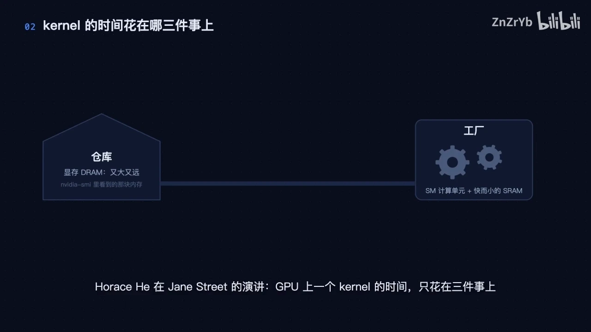
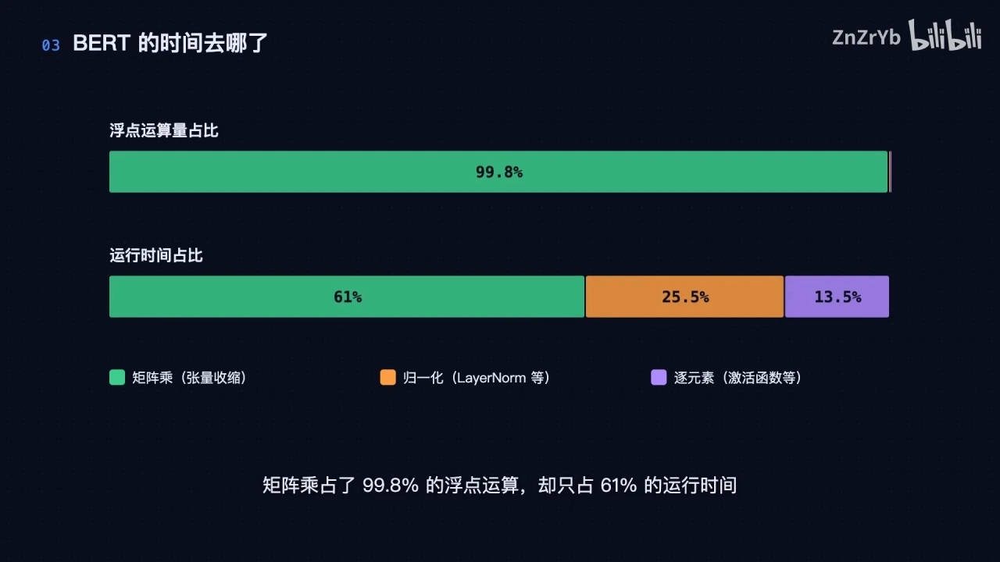
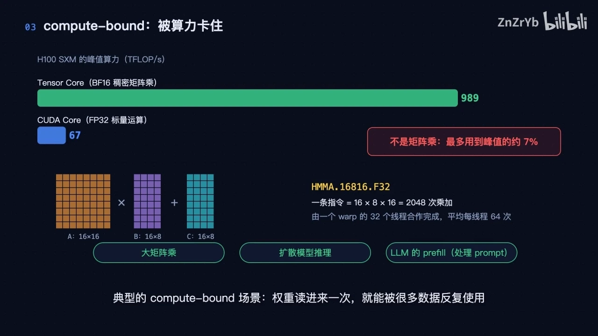
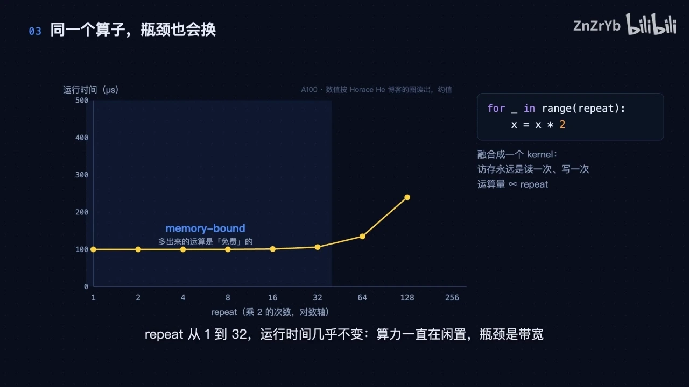
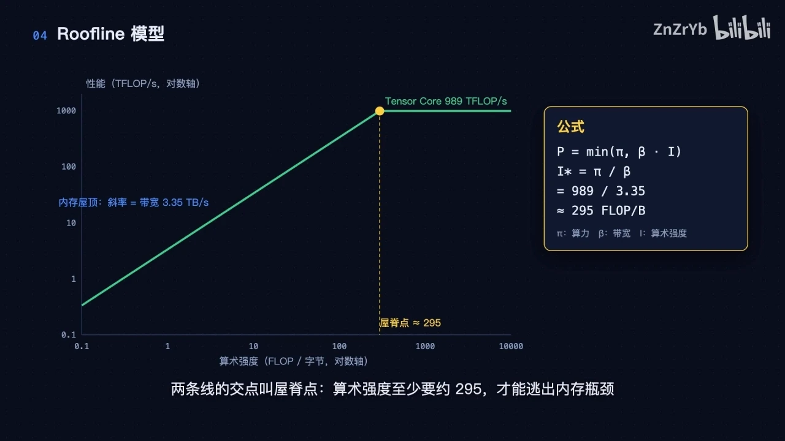
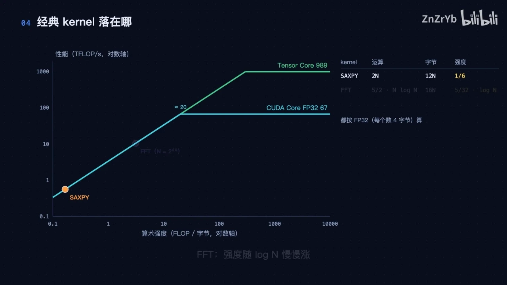
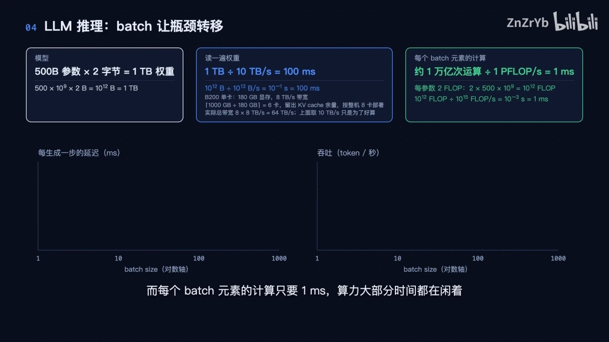
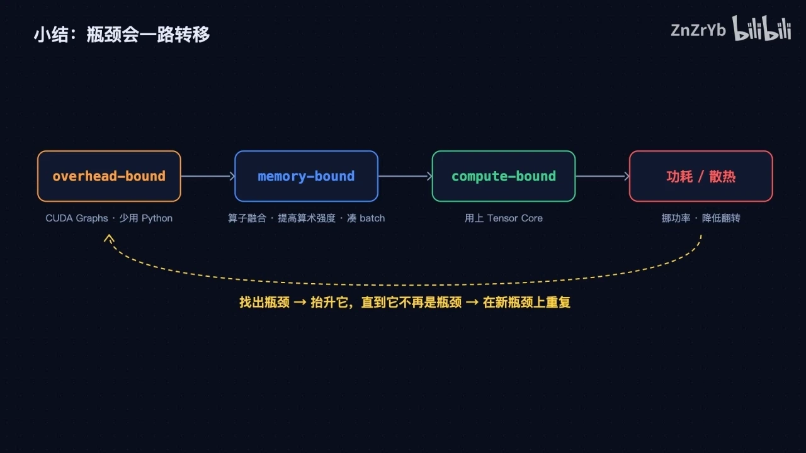
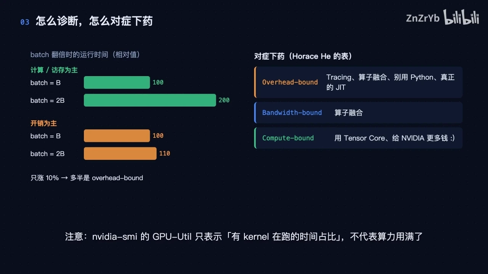

# 算子耗时集中在 GEMM，Prefill 就必然落在算力的屋顶上

> 视频来源：[你的 GPU 为什么跑不满？纳西妲讲 GPU 性能瓶颈：Roofline、算术强度、算子融合](https://www.bilibili.com/video/BV1KTn16ZEYV/)（Bilibili · UP 主 ZnZrYb）｜时长约 17 分钟
> 简要导读：这支视频按「瓶颈理论 → kernel 的三类工作 → 三类瓶颈 → Roofline → 功耗」的顺序讲了一遍 GPU 性能分析的骨架，其中最关键的两张图是「BERT 的算子耗时分布」和「Roofline 屋脊点」。本文只取与本小节相关的部分：**算子耗时怎么分布、为什么这个分布意味着算力受限、以及怎么用三个判据把它测出来**。矩阵形状怎么来的（M 维为什么等于 prompt 长度）属于 1.1.1，本文只在需要时一句话带过。

## 本讲要解决的核心问题（SCQA）

**背景**：所有人都说「Prefill 是计算受限（compute-bound），Decode 是访存受限（memory-bound）」。这句话在面试里出现频率极高，但它其实是一个**可以算出来的结论**，而不是一句口号。

**冲突**：麻烦在于，如果你去看 Prefill 的算子耗时表，会发现时间并没有全花在矩阵乘上——归一化（LayerNorm）和逐元素运算（残差相加、激活函数）的浮点运算量只占 0.2%，却吃掉了将近 40% 的运行时间。既然有这么大一块时间不在做矩阵乘，凭什么说这一阶段是「算力受限」？

**疑问**：Prefill 一次前向里，时间到底花在哪些算子上？这些算子的占比是什么量级关系？「耗时集中在 GEMM」和「算力受限」之间那一步推理是怎么完成的？以及，落到工程上，用什么指标能把这个判断测出来？

**回答（中心思想）**：判断一个阶段是不是算力受限，看的不是「哪个算子最耗时」，而是**这个阶段整体的算术强度（每读一字节能做多少次浮点运算）落在 Roofline 的哪一侧**。Prefill 把整段 prompt 一次性送进网络，同一个权重被 S 个 token 复用，算术强度随 prompt 长度线性上涨，很快就越过了 GPU 的屋脊点（H100 上约 295 FLOP/Byte），于是性能被顶在算力平台那条水平线上——**这就是「算力受限」的全部含义**。归一化和逐元素算子虽然时间占比高，但它们是「被 Tensor Core 甩下的配角」，不改变整段前向的瓶颈归属。

---

## 一、先分清 kernel 的时间花在哪三件事上

视频开篇引用了 Horace He 在 Jane Street 演讲里的一个划分：GPU 上一个 kernel 的时间只花在三件事上。

[【跳转到 03:20】](https://www.bilibili.com/video/BV1KTn16ZEYV/?t=200)

| 时间去向 | 类比 | 具体是什么 |
| :--- | :--- | :--- |
| 计算 | 工厂开工 | 在 CUDA Core 或 Tensor Core 上做浮点运算 |
| 访存 | 把原料从远处仓库运进工厂 | 数据在 DRAM / L2 / SRAM 之间搬运 |
| 开销 | 等工头下指令 | CPU 上的 Python 与框架决定下一步干什么，此时 GPU 在空等 |

这个三分法的价值在于：**三段里最长的那段就是瓶颈**，而瓶颈只有三种，对应三类 kernel：

- **compute-bound（计算受限）**：被计算单元的算术吞吐卡住，典型是大矩阵乘；
- **memory-bound（访存受限）**：被显存与 SM 之间的带宽卡住，典型是大向量的逐元素运算；
- **overhead-bound（开销受限）**：GPU 根本没在干活，在等 CPU 把下一件活派过来。

视频里有一句很关键的提醒，正好对应本小节要回答的问题：**「时间都花在搬数据上，提升算力没用；时间都花在矩阵乘上，减少派送开销也没用」**。所以优化的第一步永远是判断自己卡在哪个区，而不是先动手改代码。

---

## 二、算子耗时分布：99.8% 的浮点运算只占 61% 的时间

### 2.1 一组反直觉的实测数字

视频给出一张 BERT 的算子耗时分布图，这是理解 Prefill 的第一把钥匙。

[【跳转到 05:41】](https://www.bilibili.com/video/BV1KTn16ZEYV/?t=341)

图中三组数字值得逐条读：

| 算子类别 | 浮点运算量占比 | 运行时间占比 |
| :--- | :--- | :--- |
| 矩阵乘（张量收缩，GEMM） | 99.8% | 61% |
| 归一化（LayerNorm 等） | 与逐元素合计约 0.2% | 25.5% |
| 逐元素（激活函数、残差相加等） | 与归一化合计约 0.2% | 13.5% |

也就是说：**运算量上矩阵乘几乎垄断（99.8%），但时间上它只占六成；剩下四成时间被只占 0.2% 运算量的归一化和逐元素算子吃掉了。**

视频给的解释是：Tensor Core 让矩阵乘快了大约十倍，其余运算没跟上，它们的时间占比就暴涨了。这句话翻译成更直白的表述是——**「运算量占比」和「时间占比」是两张不同的表，前者由算法决定，后者由算法和硬件的匹配程度共同决定。**

### 2.2 把 Prefill 的算子按「走哪种计算单元」分成两类

把上面这张图套到 Prefill 的一次前向里，各算子可以按「落到哪种计算单元」分成两类。这里给出的是**量级关系**（视频只给了 BERT 的整体划分，没有给逐算子百分比，所以不编造具体数字）：

| 算子 | 计算形态 | 落到哪种单元 | 在 Prefill 里的量级 |
| :--- | :--- | :--- | :--- |
| QKV 投影 | GEMM，$M$ 等于 prompt 长度 | Tensor Core | 运算量主体之一，随 $S$ 线性增长 |
| Attention 的 $QK^\top$ 与 $AV$ | GEMM，但规模含 $S^2$ 项 | Tensor Core | 短 prompt 下占比小，长 prompt 下反超 |
| O 投影 | GEMM | Tensor Core | 与 QKV 同量级 |
| FFN（gate-up-down） | GEMM，通常是最大的一块 | Tensor Core | 参数量与运算量都最大 |
| LayerNorm / RMSNorm | 归一化（reduce + 逐元素） | CUDA Core | 运算量极小，时间占比可观 |
| 残差相加、激活函数 | 逐元素 | CUDA Core | 运算量极小，时间占比可观 |

这张表要传达的结论只有一句：**Prefill 里真正吃运算量的算子全是 GEMM，而 GEMM 是唯一能用上 Tensor Core 的形态。** 归一化和逐元素算子虽然占了不少时间，但它们不是「运算大户」，把它们优化掉也换不来数量级的收益——它们恰恰是「被 Tensor Core 甩下的那部分」。

### 2.3 为什么「耗时集中在 GEMM」就等于「算力受限」

这里需要一步关键推理，而视频把它讲得很清楚：**可计算单元不止一种，而它们的峰值差了一个数量级。**

[【跳转到 05:25】](https://www.bilibili.com/video/BV1KTn16ZEYV/?t=325)

H100 上的两个峰值：

- **Tensor Core（BF16 稠密矩阵乘）**：989 TFLOPS；
- **CUDA Core（FP32 标量运算）**：67 TFLOPS。

两者相差约 15 倍。图中还标注了 `HMMA.16816.F32` 这条指令：一条指令就算 $16 \times 8 \times 16 = 2048$ 次乘加，由一个 warp 的 32 个线程合作完成，平均每线程 64 次。而 CUDA Core 一条指令只算一个数。

于是结论很硬：**不是矩阵乘的运算，在 H100 上最多只能用到峰值的 7% 左右**（$67 / 989 \approx 6.8\%$）。

这就把「耗时集中在 GEMM」和「算力受限」连起来了：

1. Prefill 的运算量几乎全部由 GEMM 承担（99.8% 那一栏）；
2. GEMM 是唯一能跑满 Tensor Core 的形态，所以这部分的性能上限就是 989 TFLOPS；
3. 归一化与逐元素算子虽然占了不少**时间**，但它们只占 0.2% 的**运算量**，把它们的耗时全部抹掉，Prefill 也快不了多少——它们不是决定吞吐的那一环；
4. 因此整段 Prefill 的吞吐上限由「Tensor Core 能跑多快」决定，**这就是 compute-bound 的定义**。

图里还有一行小字值得记住：**「典型的 compute-bound 场景：权重读进来一次，就能被很多数据反复使用」**，并且它把「LLM 的 prefill（处理 prompt）」和大矩阵乘、扩散模型推理并列画在了同一个框里。这句话是后面 Roofline 分析的伏笔——「一次读入、多次复用」正是算术强度高的口语化表述。

---

## 三、同一个算子，瓶颈也会换：一个 repeat 微基准

在给出 Roofline 之前，视频先用一个微基准证明「瓶颈是会转移的」，这对理解 Prefill 与 Decode 的差别非常重要。

[【跳转到 07:42】](https://www.bilibili.com/video/BV1KTn16ZEYV/?t=462)

实验设置：对同一个张量连续做 `repeat` 次乘 2，并**融合成一个 kernel**，这样访存永远是「读一次、写一次」，而运算量正比于 repeat。

- repeat 从 1 到 32：运行时间几乎不变（约 100 微秒），因为瓶颈是带宽，多出来的运算「是免费的」；
- repeat 过了 64：时间开始跟着运算量上涨，瓶颈换成了算力；
- 实测算力从 0.2 TFLOPS 一路涨到接近峰值 9.75 TFLOPS。

这个实验的意义是：**「这个算子是不是算力受限」不是算子的固有属性，而是「这个算子在这个规模下」的属性。** 同一个 kernel，规模小的时候是访存受限，规模大的时候变成算力受限。

把这句话搬到 LLM 推理上，就是 Prefill 与 Decode 的分野：同一个权重矩阵，Prefill 用它乘 $S$ 个 token，Decode 用它乘 1 个 token，于是前者落在算力一侧、后者落在带宽一侧。第五、六节会把这件事量化。

---

## 四、Roofline：把「算力受限」变成一个可算的判据

### 4.1 算术强度与屋脊点

Roofline 模型的横轴是**算术强度（arithmetic intensity）**，定义是这个 kernel 对每个字节的数据做多少次浮点运算，单位 FLOP/Byte；纵轴是实际能达到的性能。

[【跳转到 10:10】](https://www.bilibili.com/video/BV1KTn16ZEYV/?t=610)

图中给出的公式非常干净：

$$
P = \min(\pi,\ \beta \cdot I), \qquad I^{*} = \frac{\pi}{\beta}
$$

其中 $\pi$ 是算力上限（FLOP/s），$\beta$ 是带宽上限（Byte/s），$I$ 是算术强度（FLOP/Byte），$I^{*}$ 就是**屋脊点**。代入 H100 的数字：

$$
I^{*} = \frac{989\ \text{TFLOPS}}{3.35\ \text{TB/s}} \approx 295\ \text{FLOP/Byte}
$$

这条式子的读法是：

- 当 $I < I^{*}$，性能 $P = \beta \cdot I$，落在斜线上，**memory-bound**；
- 当 $I > I^{*}$，性能 $P = \pi$，落在水平线上，**compute-bound**；
- 屋脊点是「逃出内存瓶颈所需的最低算术强度」。

视频还强调了一个容易忽略的细节：**屋顶要按计算单元分别画**。同一块 H100，Tensor Core 的屋顶是 989 TFLOPS，而 FP32 CUDA Core 的屋顶只有 67 TFLOPS，对应的屋脊点约 20 FLOP/Byte。

[【跳转到 11:50】](https://www.bilibili.com/video/BV1KTn16ZEYV/?t=710)

图中给了一组经典 kernel 的算术强度：

| kernel | 运算量 | 访存量 | 算术强度 |
| :--- | :--- | :--- | :--- |
| SAXPY（$y = a x + y$） | $2N$ | $12N$ | $1/6$ |
| FFT | $\tfrac{5}{2} N \log N$ | $16N$ | $\tfrac{5}{32}\log N$ |
| 矩阵加 | $1$（每元素） | $12$ 字节（每元素） | $1/12 \approx 0.083$ |
| 方阵矩阵乘 | $2N^3$ | $8N^2$（FP32） | $N/8$ |

这张表最有信息量的一行是矩阵乘：**算术强度等于 $N/8$，随 $N$ 线性上涨**；因为运算量是 $N^3$、访存量只是 $N^2$。当 $N$ 到 160 左右就越过了 FP32 CUDA Core 的屋脊（约 20）；而如果走 Tensor Core（屋脊 295），则需要更大的 $N$。

视频对这件事的评价是：**「这是矩阵乘能吃满、神经网络大获成功的关键原因之一」**。换句话说，深度学习之所以能靠 GPU 加速，本质上是因为大矩阵乘的算术强度足够高。

### 4.2 Prefill 的算术强度为什么天然高

把矩阵乘的结论套到 Prefill 上：Prefill 的 QKV 投影、O 投影、FFN 都是「权重矩阵 × 输入矩阵」的形态，其中**输入矩阵的行数 $M$ 就等于 prompt 长度 $S$**（这部分推导见 1.1.1）。于是：

- 权重读一次，被 $S$ 行输入复用 $S$ 次；
- 算术强度随 $S$ 线性上涨。

这正是图中「权重读进来一次，就能被很多数据反复使用」那句话的定量版本。所以只要 prompt 不是短得离谱，Prefill 的算术强度就会远高于 295，落在算力平台一侧。

---

## 五、与 Decode 的对照：500B 模型的两个 100ms

视频用一个 500B 参数的模型把「同一套算子，两个阶段落在不同一侧」算得非常清楚。

[【跳转到 12:40】](https://www.bilibili.com/video/BV1KTn16ZEYV/?t=760)

设定：500B 参数、FP16（每参数 2 字节），权重共 $500 \times 10^9 \times 2 = 10^{12}$ 字节 $= 1$ TB。假设 GPU 算力 1 PFLOP/s、显存带宽 10 TB/s。

**Decode（每步只处理 1 个 token）**：

- 必须把 1 TB 权重完整读一遍：$10^{12}\ \text{B} \div 10^{13}\ \text{B/s} = 100$ ms；
- 而这一步的计算量约 $2 \times 500 \times 10^9 = 10^{12}$ FLOP，在 1 PFLOP/s 下只要 1 ms；
- **算力有 99% 的时间在闲着**，瓶颈是带宽。

**把 batch 加大**：权重读一次，batch 里每个元素都能用，延迟不变、吞吐随 batch 线性上涨。按这组数字，batch 到 100 左右时计算也要 100ms——**再往上瓶颈就换成了算力**。

这段推演就是本小节标题里「对照」的全部内容：**同一套算子（同样的 GEMM），在 $M=1$ 时算术强度掉到 1 附近，落在带宽斜线一侧；在 $M=S$ 时算术强度升到几百，落在算力平台一侧。** 算子没变，瓶颈变了。

视频还补了一句关于「屋脊点会一代代往右移」的判断：带宽涨得没有算力快，所以想吃满算力越来越难；到 B200 跑 FP4 时，每读一个字节要做 1125 次运算才能逃出内存瓶颈。这句话对 Prefill 的含义是：**未来的 Prefill 会更容易算力受限**，因为算力涨得比带宽快。

---

## 六、怎么诊断：三个判据和一个陷阱

视频最后给了三个判断工具，正好对应本小节要的「判定方法」：

[【跳转到 16:32】](https://www.bilibili.com/video/BV1KTn16ZEYV/?t=992)

| 判据 | 做法 | 能回答什么 |
| :--- | :--- | :--- |
| 加大规模 | 把数据量或 batch 加大，看时间怎么涨 | 时间几乎不涨 = 开销受限；随运算量涨 = 算力受限 |
| 用 profiler 看 GPU 的空隙 | 看时间线上 GPU 是否连续有活干 | 空隙多 = 开销受限或同步受限 |
| 用 Roofline 看算术强度 | 算 FLOP/Byte，与屋脊点比较 | 落在斜线左侧 = 访存受限；右侧 = 算力受限 |

视频还给出了一张「对症下药」的表，以及一个非常实用的**诊断捷径**：把 batch 翻倍，看运行时间怎么变。

[【跳转到 09:36】](https://www.bilibili.com/video/BV1KTn16ZEYV/?t=576)

- 计算或访存为主：batch 从 $B$ 到 $2B$，时间从 100 涨到 200；
- 开销为主：时间只从 100 涨到 110，**只涨 10% 就多半是 overhead-bound**。

**陷阱**：图中底部那行提醒必须记住——**`nvidia-smi` 的 GPU-Util 只表示「有 kernel 在跑的时间占比」，不代表算力用满了**。Decode 阶段 GPU-Util 可以很高（kernel 一直在跑），但算力利用率不到 1%。这就是为什么判断算力受限不能看 GPU-Util，要看算术强度或 profiler 里的吞吐占比。

---

## 七、边界条件：什么时候 Prefill 不再是算力受限

本文的结论有明确适用边界，视频在讲「瓶颈会转移」时已经埋下了线索：

1. **prompt 很短时，Prefill 也会掉回开销受限或访存受限。** 因为 $M = S$ 很小，GEMM 退化成接近 GEMV 的形态，算术强度掉到屋脊点以下；同时 kernel 数量不变、启动开销不变，于是「开销」这一项的相对占比上升。这与第三节 repeat 微基准里「repeat 小于 32 时时间是平的」是同一件事。
2. **batch 很小时同理。** Prefill 的算术强度同时正比于 $S$ 和 batch 中的 token 总数；单条短 prompt 的 Prefill 完全可能跑不满算力。
3. **prompt 很长时，Attention 的 $O(S^2)$ 项会反超线性层。** QKV/O/FFN 的运算量随 $S$ 线性增长，而 $QK^\top$ 与 $AV$ 随 $S^2$ 增长。$S$ 足够大时，attention 成为运算量主体。注意即便如此它仍然是 GEMM、仍然走 Tensor Core，**所以「算力受限」这个判断不变，变的是「哪一类 GEMM 主导」**。这一点的实测数据见同小节的另一篇《Prefill 与 Decode 的 Roofline 对照》。
4. **功耗墙。** 视频第五章指出，H100 标称的 989 TFLOPS 是「Tensor Core 数量 × 最高频率 × 每指令运算量」算出来的，满载时根本维持不住最高频率；A100 上甚至出现「输入全零比随机数快」的怪事（全零 295 TFLOPS vs 随机 257 TFLOPS），原因是翻转少的输入功耗低、降频少。所以真实 Prefill 的算力上限往往由功耗而不是架构决定。

---

## 小结

- Prefill 的运算量几乎全部由 GEMM 承担（BERT 上矩阵乘占 99.8% 的浮点运算），而 GEMM 是唯一能跑满 Tensor Core 的形态，所以整段前向的吞吐上限由 Tensor Core 决定——这就是 compute-bound。
- 但「运算量占比」不等于「时间占比」：归一化与逐元素算子只占 0.2% 的运算量，却吃掉近 40% 的时间。它们不是决定吞吐的那一环，因为它们最多只能用到峰值的 7%。
- 判断算力受限的正确工具是算术强度：$I = \text{FLOP} / \text{Byte}$，与屋脊点 $I^{*} = \pi / \beta$ 比较。H100 的 Tensor Core 屋脊点约 295 FLOP/Byte。
- 矩阵乘的算术强度是 $N/8$，随规模线性上涨；Prefill 里 $N$ 对应 prompt 长度 $S$，所以长 prompt 天然越过屋脊点。
- 同一套算子在 Decode 里 $M=1$，算术强度掉到 1 附近，于是变成访存受限。500B 模型的例子：读一遍 1TB 权重 100ms，而每 batch 元素的计算只要 1ms。
- 三个诊断判据：加大规模看时间怎么涨、用 profiler 看 GPU 空隙、用 Roofline 看算术强度。捷径是把 batch 翻倍——只涨 10% 就是开销受限。
- 别被 `nvidia-smi` 的 GPU-Util 骗了：它只表示「有 kernel 在跑的时间占比」，不代表算力用满了。
- 边界：短 prompt、小 batch 时 Prefill 也可能不是算力受限；长 prompt 时 attention 的 $S^2$ 项会反超线性层（但仍走 Tensor Core）；满载时还会撞上功耗墙。

## 关键术语速查

| 术语 | 一句话解释 |
| :--- | :--- |
| compute-bound（计算受限） | 性能被计算单元的峰值算力卡住，加带宽没用，要换更快的计算单元 |
| memory-bound（访存受限） | 性能被带宽卡住，加算力没用，要减少搬运或做算子融合 |
| overhead-bound（开销受限） | GPU 在等 CPU 派活，时间线上全是空隙，要靠 CUDA Graphs、少用 Python 解决 |
| 算术强度（arithmetic intensity） | 每读一字节数据做多少次浮点运算，单位 FLOP/Byte |
| Roofline 模型 | 把「带宽 × 算术强度」和「峰值算力」两条线画在一起，取较小值作为性能上限 |
| 屋脊点（ridge point） | 两条线的交点 $I^{*} = \pi / \beta$，是逃出内存瓶颈所需的最低算术强度 |
| Tensor Core | 一条指令算一整块小矩阵（如 $16 \times 8 \times 16$）的计算单元，H100 上 BF16 稠密 989 TFLOPS |
| CUDA Core | 一条指令算一个数的标量运算单元，H100 上 FP32 只有 67 TFLOPS |
| GEMM | 通用矩阵乘，深度学习里唯一能吃满 Tensor Core 的算子形态 |
| 算子融合（operator fusion） | 把多个逐元素算子合成一个 kernel，把多次全局内存读写压成一次读写 |