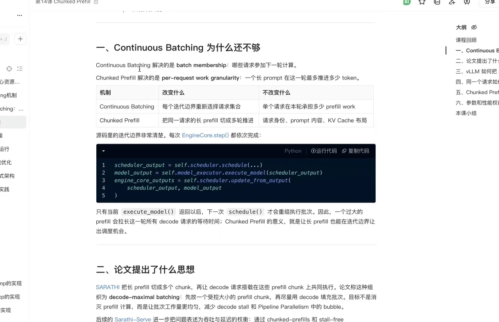
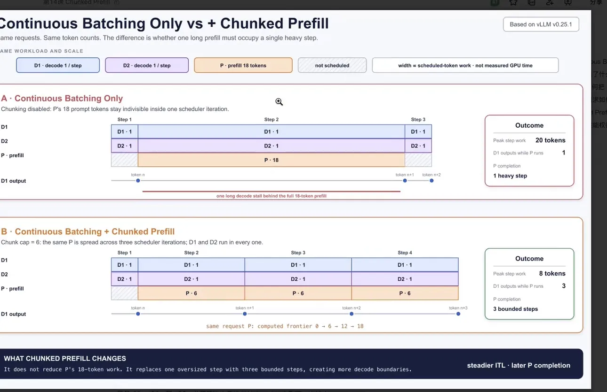
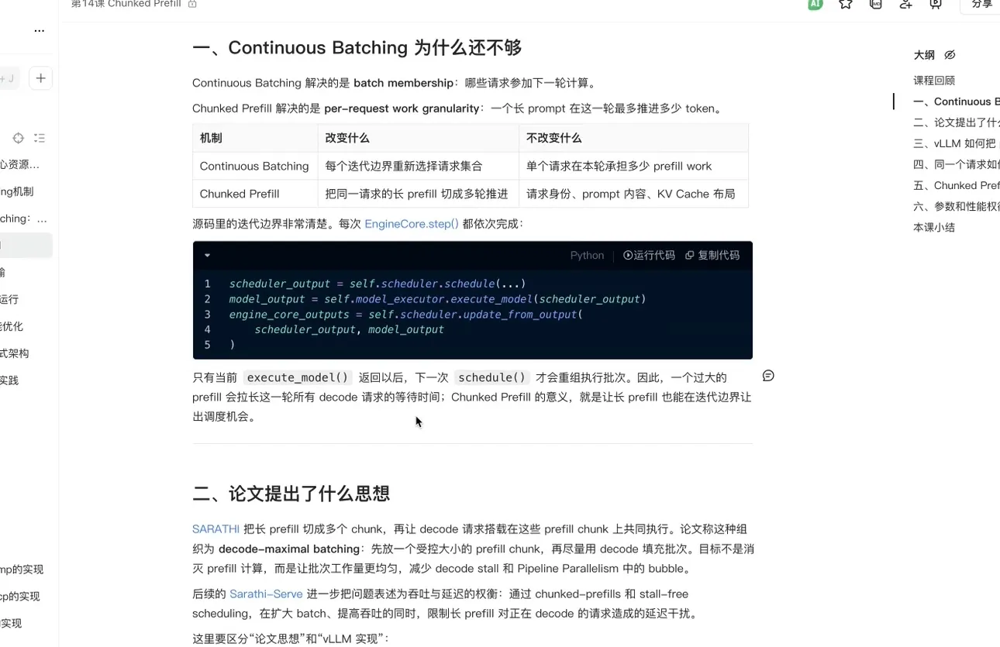
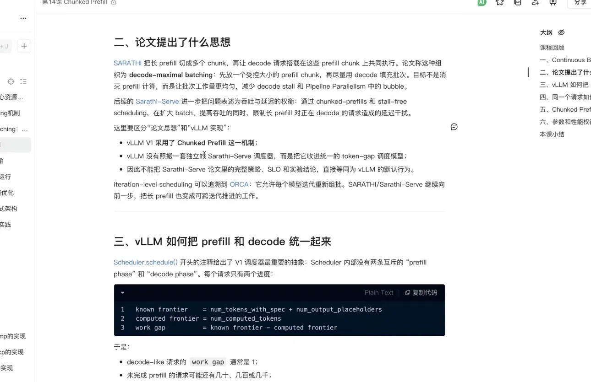
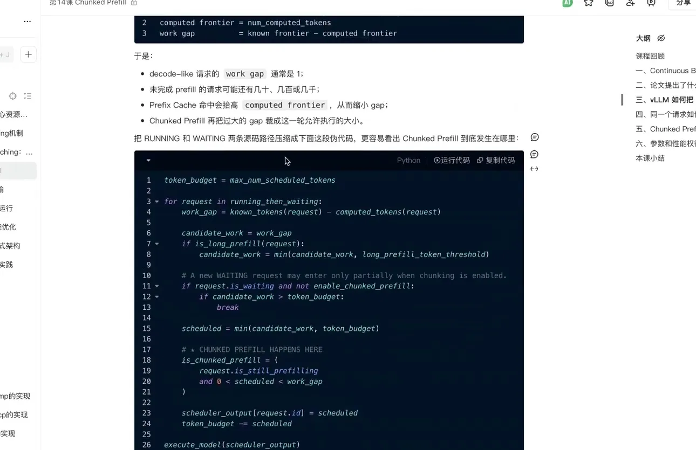
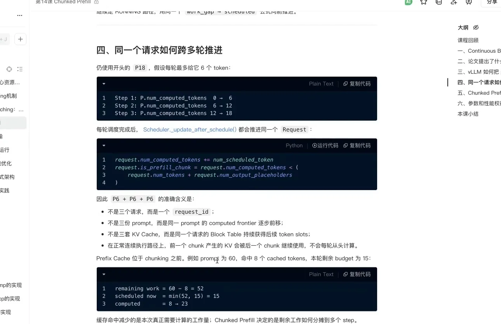
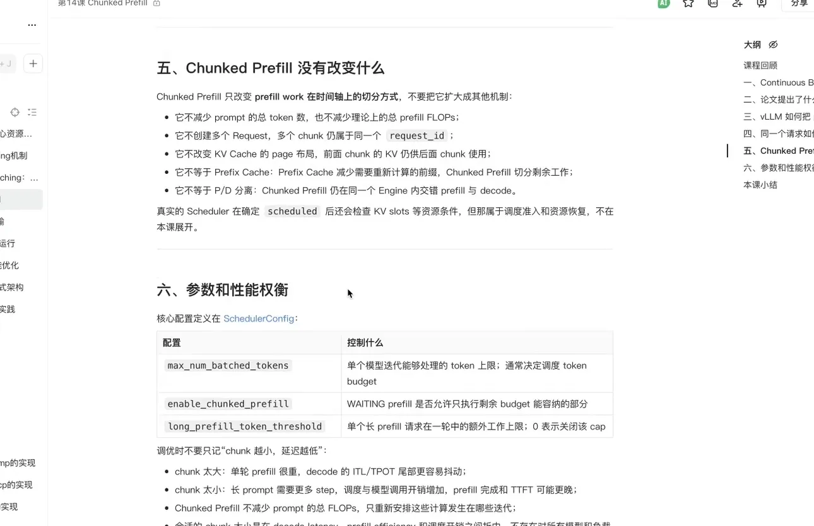
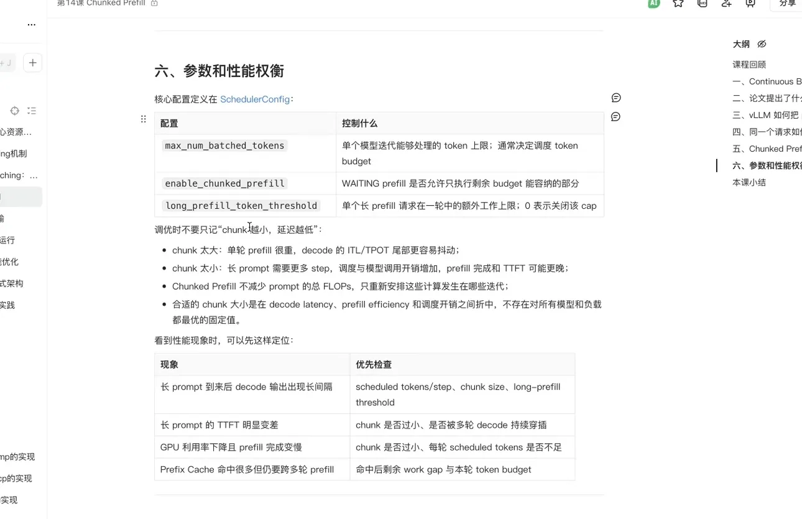
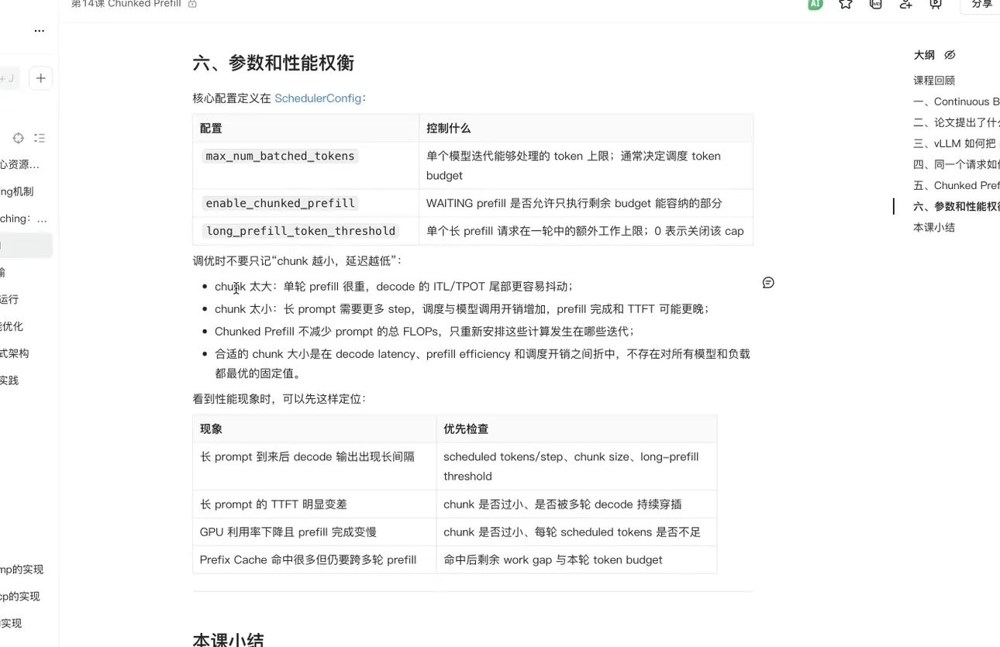

# 分块预填充只削峰不省总量：把长 Prompt 切成 chunk，单步工作量从 20 个 token 降到 8 个

> 视频来源：[第14课 Chunked Prefill](https://www.bilibili.com/video/BV1DG816dEju/)（Bilibili · UP 主 想躺平的程序员，vLLM 源码系列课）｜时长约 11 分 28 秒
> 简要导读：这支视频是照着作者的语雀笔记讲的，讲的是 vLLM 里 chunked prefill 的**调度机制**：为什么 continuous batching 不够、SARATHI 论文的思路、vLLM 用 token gap 模型怎么切 chunk、哪些参数控制它、以及它「没有改变什么」。本文只取与本小节相关的那一半：**长 prompt 的峰值是怎么被切下来的、切小了会付出什么代价**。调度博弈的完整讨论属于 3.2，本文不重复。

## 本讲要解决的核心问题（SCQA）

**背景**：Prefill 是一次性把整段 prompt 送进网络，一次前向算完全部 token。这是它算得快的原因——同一个权重被 $s$ 个 token 复用，算术强度高（见 1.1.1、1.1.2）。

**冲突**：但「一次性」也意味着**一次性把峰值抬到最高**。一个 8000 token 的 prompt 进来，这一轮前向里所有中间张量都按 8000 的规模分配：残差流、LayerNorm 输入、FFN 的四倍展开、以及最要命的注意力分数矩阵。峰值直接顶到显存天花板，OOM 就是这一瞬间发生的。

**疑问**：既然峰值是由「这一轮处理多少 token」决定的，那能不能**少处理一点**？把 8000 个 token 切成 10 个 800，峰值是不是就下来了？代价是什么？为什么框架不干脆默认切得很小？

**回答（中心思想）**：分块预填充（chunked prefill）把一次巨型 prefill 拆成多个有界的 step，**峰值显存与单步工作量一起降下来，但总工作量一个字节都没少**。视频里那个 18 token 的 prompt 被切成 3 个 6，单步峰值工作量从 20 个 token 降到 8 个 token；代价是 step 数从 1 变成 3、这个请求自己的完成时间变晚。所以 chunk 大小是一个**在峰值、延迟与调度开销之间的折中参数**，不存在对所有负载都最优的固定值。

---

## 一、先把「峰值显存」的账本摆开

视频本身不谈显存账本，它谈的是调度。但要把「分块为什么能削峰」讲清楚，得先知道峰值是由哪几笔账叠出来的。这一节是**补充背景**，不属于视频内容。

一次 Prefill 的显存占用，可以拆成五笔：

| 账目 | 随什么增长 | 与序列长度的关系 |
| :--- | :--- | :--- |
| 模型权重 | 参数量 $\times$ 精度字节数 | 无关，加载一次就固定 |
| KV Cache（本次写入的部分） | 总 token 数 $\times$ 每 token 每层字节数 | 线性（公式见 1.3.2） |
| **中间激活值** | $b \times s \times d_m$ 与 $b \times n_h \times s^2$ | 线性 + 平方 |
| workspace / 临时缓冲 | 算子实现决定，通常与 $s$ 成正比 | 线性 |
| CUDA context 与显存碎片 | 驱动、框架预留、分配历史 | 弱相关，但会吃掉「看起来还有」的空间 |

关键在于第三笔。按 1.1.3 另一篇的推导，单个 Block 的激活内存是 $m_{\text{act}} = \alpha b d_m s + \beta b n_h s^2$，其中平方项来自注意力分数矩阵 $(b,n_h,s,s)$。**这三笔账里，权重是常数、KV Cache 是线性、激活值是线性加平方**——长 prompt 时最后一项涨得最快，于是它成了峰值。

而「这一轮处理多少 token」直接决定了 $s$ 取多大。这就是切分的着力点：**你没法减少 KV Cache（它必须写），也没法减少权重，但你可以让某一轮前向里 $s$ 小一点。**

---

## 二、Continuous Batching 解决了「谁参加」，没解决「一次吞多少」

视频开篇先把上一课的 continuous batching 摆出来做对照。

[【跳转到 04:08】](https://www.bilibili.com/video/BV1DG816dEju/?t=248)



表格里的两行是全文的骨架：

| 机制 | 改变什么 | 不改变什么 |
| :--- | :--- | :--- |
| Continuous Batching | 每个迭代边界重新选择请求集合 | 单个请求在本轮承担多少 prefill work |
| Chunked Prefill | 把同一请求的长 prefill 切成多轮推进 | 请求身份、prompt 内容、KV Cache 布局 |

视频的原话是：**continuous batching 解决的是 batch membership（哪些请求参加下一轮计算），chunked prefill 解决的是 per-request work granularity（一个长 prompt 在这一轮最多推进多少 token）。**

为什么 continuous batching 不够？因为它的调度只发生在**迭代边界**上。源码里的循环非常清楚：

```python
scheduler_output = self.scheduler.schedule(...)
model_output = self.model_executor.execute_model(scheduler_output)
engine_core_outputs = self.scheduler.update_from_output(
    scheduler_output, model_output
)
```

execute_model() 返回之后，下一次 `schedule()` 才会重组执行批次。所以**一个过大的 prefill 会拉长这一轮所有 decode 请求的等待时间**——它们本来只算 1 个 token，却要陪着一个 18 token 的 prefill 一起等这一轮结束。

### 2.1 一个 18 token 的具体例子

[【跳转到 00:49】](https://www.bilibili.com/video/BV1DG816dEju/?t=49)



图里是两个请求 D1、D2（各处于 decode 阶段，每步生成 1 个 token）加上一个刚到的新请求 P（prefill 阶段，要处理 18 个 token）。上半部分是**不切分**：

- Step 1 里 P 的 18 个 token 一次性算完，这一轮的总工作量是 $1+1+18 = 20$ 个 token；
- D1、D2 在整个 Step 1 里只能干等，直到 P 结束才能继续；
- 结果：**Peak step work = 20 tokens**，D1 在 P 运行期间只产出 1 个 token。

下半部分是**切分**（chunk cap = 6）：P 的 18 个 token 拆成 3 个 6，分三步推进，每一步 D1、D2 都能跟着跑：

- 每一步的总工作量是 $1+1+6 = 8$ 个 token；
- D1 在 P 运行期间产出了 3 个 token；
- 结果：**Peak step work = 8 tokens**，P 的完成时间从「1 个重型 step」变成「3 个有界 step」。

视频里那张图的底部写着一句总结，可以直接当作这一节的结论：

> **What chunked prefill changes**: It does not reduce P's 18-token work. It replaces one oversized step with three bounded steps, creating more decode boundaries.

翻译过来：**它没有减少 P 那 18 个 token 的工作量，只是把一个过大的 step 换成三个有界的 step，顺便多造出几个 decode 边界。**

### 2.2 这一步对显存意味着什么

视频讲的是延迟，但把同一张图按显存读一遍，结论更直接（以下是对视频内容的延伸分析）：

- 不切分时，Step 1 这一轮前向的 $s$ 等于 18（加上 D1、D2 各 1 个 token，实际要处理 20 个位置），**激活值的线性项按 20 的规模分配，平方项按 20 的规模分配**；
- 切分后，每一步的 $s$ 只有 8，**峰值按 8 的规模分配**；
- 而 KV Cache 的总量不变——P 的 18 个 token 迟早都要写进 KV Cache，切分只是把「写入」摊到三步里。

所以「削峰」在显存上的准确表述是：**把某一瞬间的激活值峰值从 $O(s_{\text{total}})$ 压到 $O(s_{\text{chunk}})$，而 KV Cache 的总量、权重、总 FLOPs 全都不变。** 这也是为什么分块预填充能救 OOM：它救的是「峰值」那一瞬间，不是「总量」。

---

## 三、论文的思路：decode-maximal batching

[【跳转到 05:01】](https://www.bilibili.com/video/BV1DG816dEju/?t=301)



视频转述的论文是 SARATHI，核心做法叫 **decode-maximal batching**：**先放一个受控大小的 prefill chunk，再尽量用 decode 请求填满批次**。视频特意强调了一句容易被忽略的话：

> 目标不是消灭 prefill 计算，而是让批次工作量更均匀，减少 decode stall 和 Pipeline Parallelism 中的 bubble。

后续的 Sarathi-Serve 把问题表述为吞吐与延迟的权衡：通过 chunked-prefills 和 stall-free scheduling，在扩大 batch、提高吞吐的同时，限制长 prefill 对正在 decode 的请求造成的延迟干扰。

### 3.1 论文思想不等于 vLLM 实现

视频在这里划了一条很清楚的界线，值得原样保留：

- vLLM V1 **采用了** Chunked Prefill 这一机制；
- 但 vLLM **没有照搬**一套独立的 Sarathi-Serve 调度器，而是把它收进统一的 **token-gap 调度模型**；
- 因此**不能把 Sarathi-Serve 论文里的完整策略、SLO 和实验结论，直接等同于 vLLM 的默认行为**。

这条界线对读源码的人很重要：论文里 chunk 大小是被调度器显式管理的对象，vLLM 里它是「token budget 与请求剩余工作量取最小值」的自然结果。

---

## 四、vLLM 怎么把 prefill 和 decode 统一起来：token gap 模型

[【跳转到 05:43】](https://www.bilibili.com/video/BV1DG816dEju/?t=343)



vLLM V1 的 `Scheduler.schedule()` 开头给出了最重要的抽象：**调度器内部没有两条互斥的 prefill phase 与 decode phase**，每个请求只有两个进度：

```text
known frontier   = num_tokens_with_spec + num_output_placeholders
computed frontier = num_computed_tokens
work gap          = known frontier - computed frontier
```

于是：

- decode 类请求的 `work gap` 通常是 1（还差 1 个 token 没算）；
- 未完成 prefill 的请求，gap 可能有几十、几百甚至几千；
- Prefix Cache 命中会抬高 `computed frontier`，从而**缩小** gap；
- **Chunked Prefill 就是把过大的 gap 裁成这一轮允许执行的大小。**

这个模型的好处是：prefill 和 decode 不再是两种请求，而是**同一个 gap 大小不同的请求**。调度器只需要做一件事——按预算分配 token，谁 gap 大谁多拿一点，但每轮总量有上限。

### 4.1 切分发生在哪一行代码

[【跳转到 06:55】](https://www.bilibili.com/video/BV1DG816dEju/?t=415)



视频把 RUNNING 和 WAITING 两条源码路径压成了这段伪代码，切分逻辑就是两次取最小值：

```python
token_budget = max_num_scheduled_tokens

for request in running_then_waiting:
    work_gap = known_tokens(request) - computed_tokens(request)

    candidate_work = work_gap
    if is_long_prefill(request):
        candidate_work = min(candidate_work, long_prefill_token_threshold)

    if request.is_waiting and not enable_chunked_prefill:
        if candidate_work > token_budget:
            break

    scheduled = min(candidate_work, token_budget)

    # ★ CHUNKED PREFILL HAPPENS HERE
    is_chunked_prefill = (
        request.is_still_prefilling
        and 0 < scheduled < work_gap
    )

    scheduler_output[request.id] = scheduled
    token_budget -= scheduled

execute_model(scheduler_output)
```

三行值得记住：

1. candidate_work = min(work_gap, long_prefill_token_threshold)——单个长 prefill 在一轮里最多推进多少，由阈值封顶；
2. scheduled = min(candidate_work, token_budget)——再被这一轮的总预算封顶；
3. is_chunked_prefill = (0 < scheduled < work_gap)——**只要「这一轮给的」严格小于「还差的」，这个请求就是被切了**。

注意第 3 条：切分不是一个显式的「切块」动作，而是「预算不够，先给这么多」的自然结果。**这就是为什么 vLLM 的 chunk 大小不是一个配置项，而是 `token_budget` 与 `work_gap` 相互作用的产物。**

### 4.2 同一个请求跨多轮推进，语义没变

[【跳转到 08:01】](https://www.bilibili.com/video/BV1DG816dEju/?t=481)



视频用开头的 P18 举例，假设每轮给它 6 个 token：

```text
Step 1: P.num_computed_tokens   0 → 6
Step 2: P.num_computed_tokens   6 → 12
Step 3: P.num_computed_tokens  12 → 18
```

每轮调度完成后，Scheduler._update_after_schedule() 都会推进同一个 `Request`：

```python
request.num_computed_tokens += num_scheduled_token
request.is_prefill_chunk = request.num_computed_tokens < (
    request.num_tokens + request.num_output_placeholders
)
```

所以 P6 + P6 + P6 的准确含义是（视频原文的四条）：

- 不是三个请求，而是**一个** `request_id`；
- 不是三份 prompt，而是同一个 prompt 的 **computed frontier 逐步前移**；
- 不是三套 KV Cache，而是同一个请求的 Block Table 持续获得后续 token slots；
- 在正常连续执行路径上，**前一个 chunk 产生的 KV 会被后一个 chunk 继续使用**，不会每轮从头计算。

最后这条对显存的理解很关键：**切分不复制 KV Cache，KV Cache 是累加的**。第 1 个 chunk 算完，它的 KV 就留在显存里；第 2 个 chunk 的注意力要读它。所以分块预填充降低的是「这一轮前向的中间激活值峰值」，KV Cache 的占用曲线一点没变平——它只是被摊成了三段阶梯。

视频还给了一个 Prefix Cache 与 chunking 叠加的例子：prompt 长度 60、命中 8 个已缓存 token、本轮剩余 budget 为 15，则

```text
remaining work = 60 - 8 = 52
scheduled now  = min(52, 15) = 15
computed       = 8 → 23
```

结论是：**缓存命中减少的是「本次真正需要计算的工作量」，Chunked Prefill 决定的是「剩余工作如何分摊到多个 step」。两者作用在不同的量上，不能混为一谈。**

---

## 五、Chunked Prefill 没有改变什么

[【跳转到 09:05】](https://www.bilibili.com/video/BV1DG816dEju/?t=545)



这一节是全文最容易被跳过、但最该记住的部分。视频明确列出五条「它不等于什么」：

- 它**不减少** prompt 的总 token 数，也**不减少**理论上的总 prefill FLOPs；
- 它**不创建多个 Request**，多个 chunk 仍属于同一个 `request_id`；
- 它**不改变 KV Cache 的 page 布局**，前面 chunk 的 KV 仍供后面 chunk 使用；
- 它**不等于 Prefix Cache**：Prefix Cache 减少需要重新计算的前缀，Chunked Prefill 切分剩余工作；
- 它**不等于 P/D 分离**：Chunked Prefill 仍在同一个 Engine 内交错 prefill 与 decode。

把五条合起来看，它只做了一件事：**改变 prefill work 在时间轴上的切分方式**。

这正好解释了上一节的显存结论：既然总 token 数、总 FLOPs、KV 布局都没变，那它唯一能改的就是**每一轮前向的规模**——也就是激活值峰值。**削峰不省总量，这句话在机制层面和显存层面是同一件事。**

（视频还补了一句边界：真实的 Scheduler 在确定 `scheduled` 后还会检查 KV slots 等资源条件，但那属于调度准入与资源恢复，不在本课展开。）

---

## 六、chunk 大小的权衡：为什么不能一直切小

[【跳转到 10:20】](https://www.bilibili.com/video/BV1DG816dEju/?t=620)



如果切小就能降峰值，为什么不把 chunk 设成 1？视频的回答是「调优时不要只记 chunk 越小延迟越低」：

| chunk 设置 | 后果 |
| :--- | :--- |
| 太大 | 单轮 prefill 很重，decode 的 ITL/TPOT 尾部更容易抖动 |
| 太小 | 长 prompt 需要更多 step，调度与模型调用开销增加，prefill 完成和 TTFT 可能更晚 |
| 任何大小 | Chunked Prefill 不减少 prompt 的总 FLOPs，只重新安排计算发生在哪些迭代 |

结论原话：**合适的 chunk 大小是在 decode latency、prefill efficiency 和调度开销之间折中，不存在对所有模型和负载都最优的固定值。**

把显存这一维加进去，折中关系就变成三方的（这一句是本文的补充）：

- chunk 越大 → 峰值显存越高，但调度开销越低、TTFT 越早；
- chunk 越小 → 峰值显存越低，但 step 数变多，每步的 kernel launch 与调度开销摊不薄；
- 而且 chunk 小到一定程度后，**单步的算术强度会掉下来**——每步只算几百个 token 时，权重读取的固定成本摊不薄，Prefill 会从 compute-bound 滑向 memory-bound（判据见 1.1.2）。

所以工程上常见做法不是「尽量小」，而是「**刚好小到不 OOM**」：先按峰值显存反推出可接受的最大 chunk，再看这个 chunk 下 TTFT 能不能接受。

### 6.1 三个控制参数

[【跳转到 09:55】](https://www.bilibili.com/video/BV1DG816dEju/?t=595)



视频给出的三个配置项及其作用：

| 配置 | 控制什么 |
| :--- | :--- |
| `max_num_batched_tokens` | 单个模型迭代能够处理的 token 上限；通常决定调度 token budget |
| `enable_chunked_prefill` | WAITING prefill 是否允许只执行剩余 budget 能容纳的部分 |
| `long_prefill_token_threshold` | 单个长 prefill 请求在一轮中的额外工作上限；0 表示关闭该 cap |

**`max_num_batched_tokens` 就是那个「显存峰值旋钮」**：它封顶的是单轮 token 数，而单轮 token 数直接决定这一轮前向的 $s$，进而决定激活值峰值。把它调小，峰值下降、并发能力上升，但每步的效率下降。

视频还给了一张「看到现象怎么定位」的排查表，对调优很实用（节选）：

| 现象 | 优先检查 |
| :--- | :--- |
| 长 prompt 到来后 decode 输出出现长间隔 | scheduled tokens/step、chunk size、long-prefill threshold |
| 长 prompt 的 TTFT 明显变差 | chunk 是否过小、是否被多轮 decode 持续穿插 |
| GPU 利用率下降且 prefill 完成变慢 | chunk 是否过小、每轮 scheduled tokens 是否不足 |
| Prefix Cache 命中很多但仍要跨多轮 prefill | 命中后剩余 work gap 与本轮 token budget |

---

## 七、把削峰手段放回全景

分块预填充只是削峰工具箱里的一件。按「它作用在峰值公式的哪一项」来分类，四种手段各管一段（这一节是补充整理，不是视频内容）：

| 手段 | 作用对象 | 峰值效果 | 代价 |
| :--- | :--- | :--- | :--- |
| FlashAttention（分块 + 在线 softmax） | $\beta b n_h s^2$ 这一项 | 平方项归零 | 实现复杂，对上层透明 |
| 分块预填充（chunked prefill） | 公式里的 $s$ | 线性项与平方项同时按 chunk 缩小 | 多轮调度开销，TTFT 变晚 |
| 激活重计算（recomputation） | 同时存活的中间张量份数 | 只留少量统计量，用时重算 | 多花算力 |
| 算子融合（fused kernel） | 系数 $\alpha$ | 减少同时存活的张量份数 | 需要手写或依赖编译器 |

四种手段是**乘性叠加**的：FlashAttention 消掉平方项，chunked prefill 再把剩下的线性项按 chunk 压小，两者一起用才能把长上下文塞进有限的卡里。

工程上还要能**测**出峰值，否则所有调参都是盲调（补充）：

- torch.cuda.max_memory_allocated()：分配峰值，配合 reset_peak_memory_stats() 可以按请求测；
- torch.cuda.memory._record_memory_history() + _dump_snapshot()：导出时间线，定位是哪一行抬起了峰值；
- PYTORCH_CUDA_ALLOC_CONF=expandable_segments:True：缓解「空闲总量够但没有连续大块」的碎片型 OOM。

还有一条容易被忽略的工程后果（补充）：**峰值显存直接决定最大并发**。因为并发请求的 KV Cache 是叠加的，而激活值峰值只取「单轮最大那一次」——所以「能开多少并发」取决于「峰值 + 所有并发请求的 KV Cache」是否还装得下。这就是长上下文服务必须同时限制「单请求最大长度」和「并发数」的原因：前者压峰值，后者压 KV Cache 总量。

---

## 小结

- Prefill 的显存峰值由五笔账叠成：权重（常数）、KV Cache（线性）、**中间激活值（线性 + 平方）**、workspace（线性）、CUDA context 与碎片。长 prompt 时涨得最快的是激活值。
- Continuous Batching 决定「谁参加这一轮」，Chunked Prefill 决定「单个请求这一轮推进多少 token」——前者是 batch membership，后者是 per-request work granularity。
- 视频的例子：18 token 的 prompt 切成 3 个 6，单步峰值工作量从 20 个 token 降到 8 个 token，decode 请求在 prefill 期间产出的 token 从 1 个变成 3 个。
- vLLM 用 token gap 模型统一 prefill 与 decode：`work gap = known frontier - computed frontier`，scheduled = min(candidate_work, token_budget)，只要 条件 $0 < \text{scheduled} < \text{work\_gap}$ 就是被切了。
- 切分不复制 KV Cache：前一个 chunk 产生的 KV 供后一个 chunk 使用，KV 占用曲线只是被摊成阶梯，总量不变。
- Chunked Prefill 不减少总 token 数、不减少总 FLOPs、不改变 KV 布局——**它只改变 prefill work 在时间轴上的切分方式**，所以它削的是峰值，不是总量。
- chunk 大小是三方折中：太大则 ITL/TPOT 抖动，太小则调度开销上升、TTFT 变晚、算术强度下降。工程做法是「刚好小到不 OOM」。
- `max_num_batched_tokens` 是那个显存峰值旋钮；`enable_chunked_prefill` 与 `long_prefill_token_threshold` 决定切分粒度。

## 关键术语速查

| 术语 | 一句话解释 |
| :--- | :--- |
| Chunked Prefill | 把一次长 prefill 拆成多个有界的 step 分多轮推进，降低单轮峰值 |
| Continuous Batching | 每个迭代边界重新选择哪些请求参加这一轮计算 |
| work gap | 请求「还差多少 token 没算」，等于 known frontier 减 computed frontier |
| token budget | 单轮允许调度的 token 总数上限，由 `max_num_batched_tokens` 决定 |
| `is_chunked_prefill` | 判定条件 条件 $0 < \text{scheduled} < \text{work\_gap}$，即这一轮给的严格少于还差的 |
| SARATHI | 提出 chunked prefill 与 decode-maximal batching 的论文 |
| decode-maximal batching | 先放一个受控大小的 prefill chunk，再用 decode 请求填满批次 |
| Prefix Cache | 复用已算过的前缀 KV，减少需要重新计算的工作量（与 chunking 不同） |
| 峰值显存 | 单轮前向中途所有中间张量同时在场的瞬时占用，决定 OOM 与否 |
| ITL / TPOT | 相邻输出 token 的间隔 / 每输出一个 token 的平均耗时 |