# 长 Prompt 的显存峰值由激活值撑起：一个 Block 的激活开销是线性项加平方项

> 视频来源：[OOM！where is my memory！激活值占用显存](https://www.bilibili.com/video/BV1qhMtz5E21/)（Bilibili · UP 主 Ray很好奇）｜时长约 15 分 42 秒
> 简要导读：这支视频是照着作者自己整理的一篇飞书文档讲的，顺序是「激活值是什么 → 为什么反向传播非要它不可 → 一个 Transformer Block 的激活内存公式 → 激活值占比 → HuggingFace 的实测柱状图」。原文的语境是**训练**，本文把它搬到 **Prefill** 上讲：公式与量级完全通用，只是推理侧不需要跨层保留激活值，这一点本文会专门辨析。KV Cache 的显存公式属于 1.3.2，本文只在需要时一句话带过。

## 本讲要解决的核心问题（SCQA）

**背景**：算显存时大家习惯只算两笔——模型权重（7B 参数、FP16，约 14 GB）和 KV Cache（随总 token 数线性增长）。这两笔账在很多部署文档里被当成全部。

**冲突**：但真实的长上下文服务里，一张 80 GB 的卡装一个 7B 模型（权重只占 14 GB），跑一段 8K token 的 prompt 就可能直接 OOM。权重没变、KV Cache 也算得出来，多出来的那几十 GB 是从哪儿冒出来的？

**疑问**：Prefill 的一次前向里，显存里到底同时躺着哪几样东西？为什么「激活值」这一项会随序列长度炸开，甚至在长 prompt 时反超权重和 KV Cache？能不能写出一个可代入数字的公式，判断自己的场景下它会不会成为峰值？

**回答（中心思想）**：Prefill 的显存峰值不是权重撑起来的，而是**中间激活值**撑起来的。单个 Transformer Block 的激活内存可以近似写成两项之和：

$$
m_{\text{act}} = \alpha \, b \, d_m \, s + \beta \, b \, n_h \, s^2
$$

第一项随序列长度 $s$ **线性**增长（来自 MLP 与投影层的中间张量，形状都是 $(b,s,\cdot)$）；第二项随 $s$ **平方**增长（来自注意力分数矩阵 $(b,n_h,s,s)$）。标准实现下 $\alpha \approx 34$、$\beta \approx 5$，二次项在几千 token 就开始咬人；一旦换成 FlashAttention，$\beta = 0$，二次项被彻底消掉——**这就是长上下文服务必须开 FlashAttention 的显存理由**。

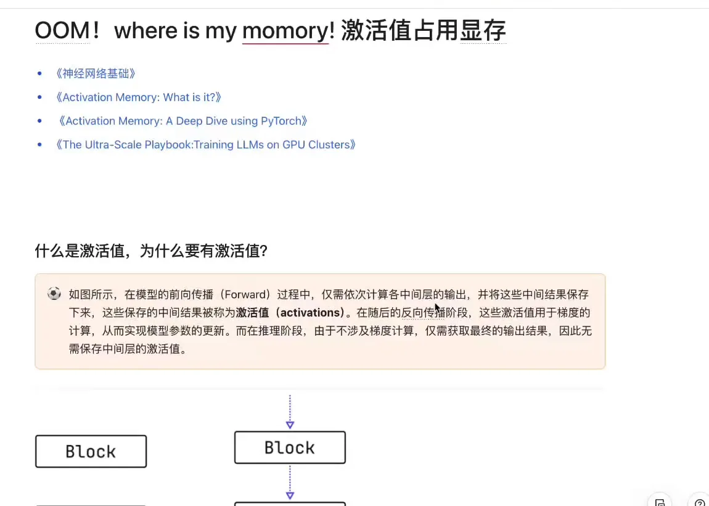

---

## 一、激活值不是「缓存」，是前向传播中途必须留住的中间结果

### 1.1 一句话定义

视频开篇给出的定义很干脆：模型在前向传播（Forward）过程中会依次计算各中间层的输出，**把这些中间结果保存下来，这些被保存的中间结果就叫激活值（activations）**。

[【跳转到 00:25】](https://www.bilibili.com/video/BV1qhMtz5E21/?t=25)

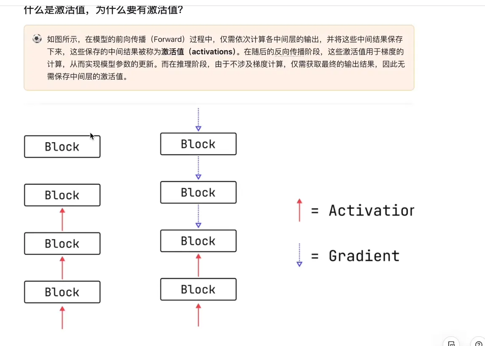

图里左边一列方块是前向（红色箭头向上），右边一列是反向（蓝色箭头向下）。红色箭头代表激活值，蓝色箭头代表梯度——**前向只能算出激活值，反向才能算出梯度，而反向要用到前向留下的激活值**，这条因果链就是激活值必须存在的全部原因。

### 1.2 为什么反向传播非要它不可

视频用一个只有一层隐藏层的极简网络把这个「非要不可」算给你看：输入 $x=1$，隐藏层三个神经元，输出层一个神经元，期望值 2，损失函数取

$$
\text{Loss} = \frac{1}{2}(y-2)^2
$$

[【跳转到 01:15】](https://www.bilibili.com/video/BV1qhMtz5E21/?t=75)

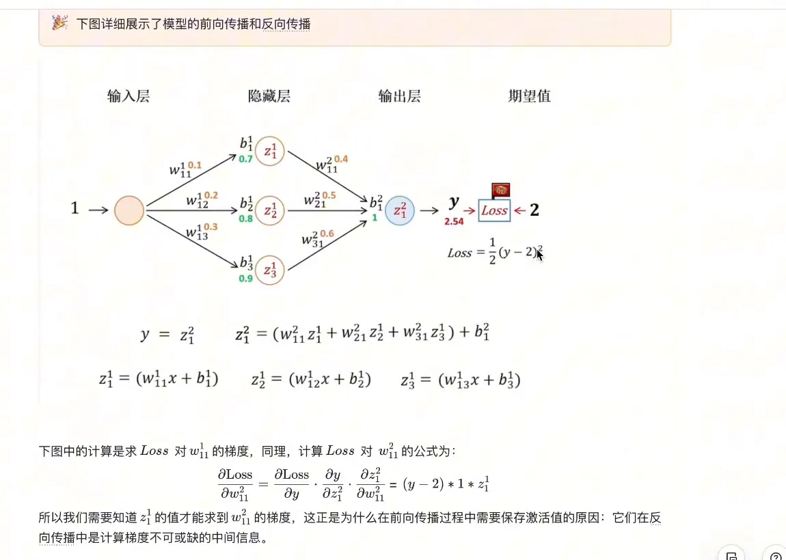

前向算完，我们手上有一堆数：权重 $w_{11}^{1}=0.1$、$w_{12}^{1}=0.2$、$w_{13}^{1}=0.3$，隐藏层输出 $z_1^1$、$z_2^1$、$z_3^1$，输出 $y=2.54$，损失。接下来要更新参数，就得知道 Loss 对每个权重的偏导。按链式法则：

$$
\frac{\partial \text{Loss}}{\partial w_{11}^{2}} = \frac{\partial \text{Loss}}{\partial y} \cdot \frac{\partial y}{\partial z_1^2} \cdot \frac{\partial z_1^2}{\partial w_{11}^{2}} = (y-2) \cdot 1 \cdot z_1^1
$$

[【跳转到 04:10】](https://www.bilibili.com/video/BV1qhMtz5E21/?t=250)

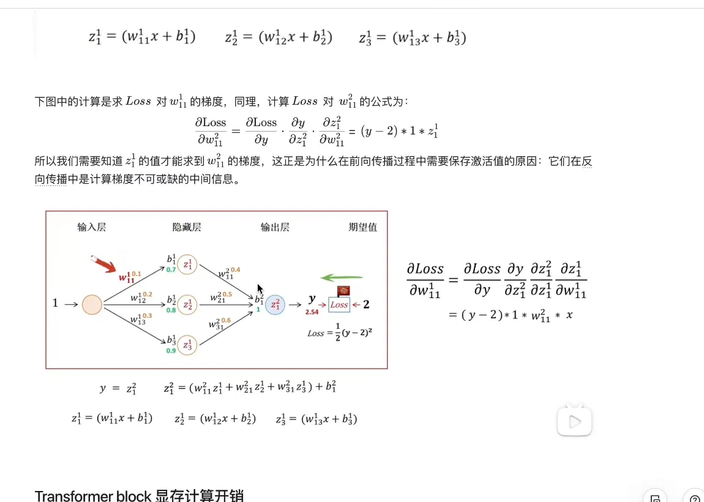

注意等式最右边那一项 $z_1^1$——**它是前向算出来的数，不是权重，也不是输入**。想求这个梯度，就必须把它留着；不留就得重算一遍前向。视频里那句话可以直接抄下来当结论：

> 所以我们需要知道 $z_1^1$ 的值才能求到 $w_{11}^2$ 的梯度，这正是为什么在前向传播过程中需要保存激活值的原因：它们在反向传播中是计算梯度不可或缺的中间信息。

### 1.3 训练与推理的差别：推理不留跨层激活，但单层内部的峰值照样存在

视频在这里给了一句很容易被误读的话：

> 而在推理阶段，由于不涉及梯度计算，仅需获取最终输出结果，因此无需保存中间层的激活值，可以极大减少显存消耗。

这句话在**训练 vs 推理**的对比语境下完全正确：训练要把 $L$ 层（$L$ 是层数）的激活值全部留到反向传播，推理没有反向，第 1 层算完就可以把它的中间张量还给显存池。但它常被误读成「推理没有激活值开销」，这就错了。

正确的理解是（这一段是对视频的补充辨析，不是讲者原话）：**推理省掉的是「跨层保留」，省不掉「层内同时存活」**。一次前向经过第 $l$ 层时，这一层内部的若干张量必须同时在显存里：

| 层内张量 | 形状 | 为什么要同时活着 |
| :--- | :--- | :--- |
| 残差流（hidden states） | $(b, s, d_m)$ | 每个子层都要加回去，前向结束才能释放 |
| LayerNorm 的输入 | $(b, s, d_m)$ | 归一化要用它的均值和方差，反向/下一个算子还要读 |
| Q、K、V 投影结果 | $(b, s, d_m)$ 或 $(b, s, n_h d_h)$ | 注意力计算的输入 |
| 注意力分数矩阵 | $(b, n_h, s, s)$ | softmax 的输入与输出，标准实现必须物化 |
| FFN 的中间展开 | $(b, s, 4d_m)$ | 第一个线性层升维 4 倍后的结果，激活函数要读它 |

所以「Prefill 阶段激活值是峰值而不是稳态」的准确含义是：**峰值出现在某一层的前向中途**——那一刻残差、归一化输入、分数矩阵、FFN 中间张量同时在场；这一层算完，这些张量陆续释放，显存回落到一个较低的稳态。序列长度 $s$ 越大，这个「中途瞬间」抬得越高，而它抬到的高度就是你要买的显存。

---

## 二、先把与序列长度无关的那部分算清楚：16N

在讲激活值之前，视频先把「固定开销」摆出来，因为只有知道地板在哪，才知道激活值涨到多高算高。

假设一个 Transformer Block 含 $N$ 个参数，以字节为单位，训练时这部分主要由三块组成：

[【跳转到 05:25】](https://www.bilibili.com/video/BV1qhMtz5E21/?t=325)

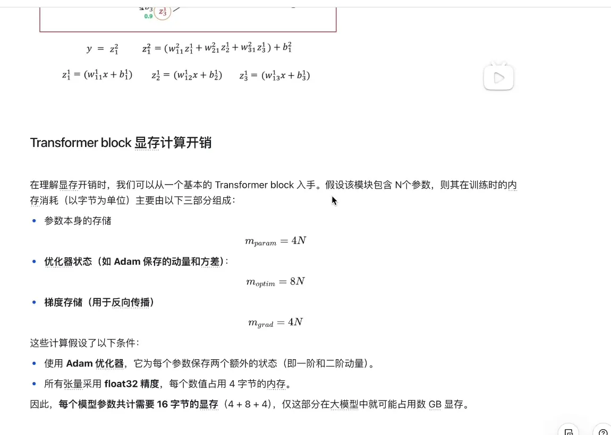

$$
m_{\text{param}} = 4N, \qquad m_{\text{optim}} = 8N, \qquad m_{\text{grad}} = 4N
$$

推导前提写在图里：用 Adam 优化器（每个参数额外存一阶、二阶动量各一份），所有张量用 float32（每数值 4 字节）。于是每个参数一共要 16 字节：$4+8+4$。

这三项的关键性质是：**它们只跟参数量 $N$ 有关，与 batch size、序列长度完全无关**。这是后面所有讨论的参照系——一个 7B 模型在 FP32/Adam 下光这三项就是 $16 \times 7\times10^9 \approx 112$ GB，序列长度是 128 还是 128K，这个数一动不动。（推理侧没有梯度与优化器状态，权重只有 $2N$ 字节（FP16）这一项，这也是「推理比训练省得多」的主要来源。）

---

## 三、单个 Block 的激活内存：一个线性项加一个平方项

### 3.1 公式与它的四个自变量

视频给出的近似表达式是这一节的核心：

[【跳转到 07:30】](https://www.bilibili.com/video/BV1qhMtz5E21/?t=450)

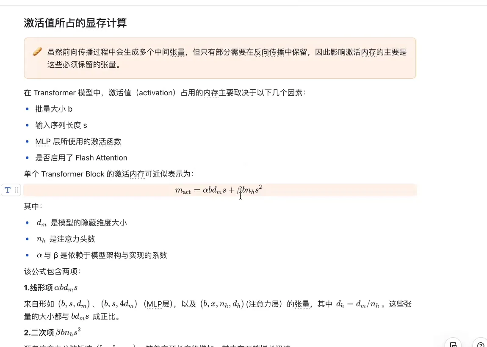

$$
m_{\text{act}} = \alpha \, b \, d_m \, s + \beta \, b \, n_h \, s^2
$$

符号含义：$b$ 是批量大小（batch size），$s$ 是输入序列长度，$d_m$ 是模型隐藏维度，$n_h$ 是注意力头数，$\alpha$ 与 $\beta$ 是依赖模型架构与实现方式的系数。

视频还列出了影响激活内存的四个因素：**批量大小 $b$、输入序列长度 $s$、MLP 层所用的激活函数、是否启用了 FlashAttention**。前两个直接出现在公式里，后两个决定系数 $\alpha$ 与 $\beta$ 的取值。

### 3.2 线性项 $\alpha b d_m s$ 是从哪来的

[【跳转到 08:45】](https://www.bilibili.com/video/BV1qhMtz5E21/?t=525)

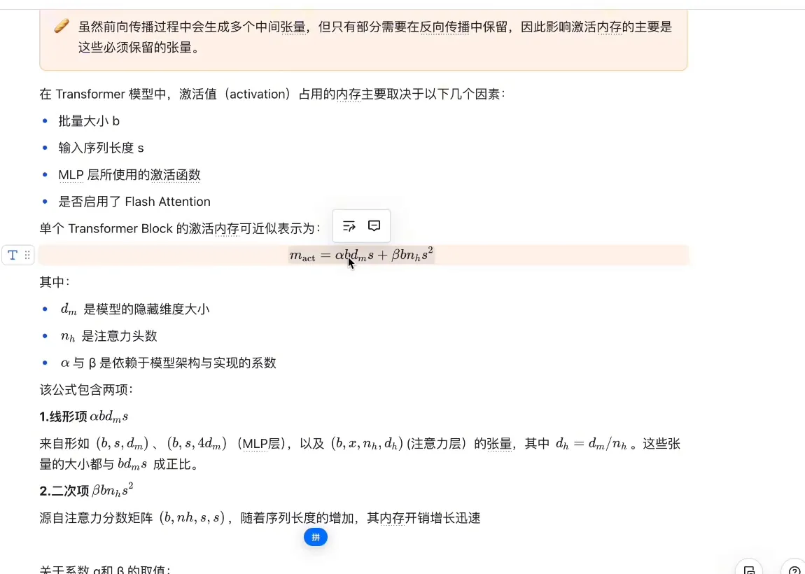

视频的原话：线性项「来自形如 $(b, s, d_m)$、$(b, s, 4d_m)$（MLP 层），以及 $(b, x, n_h, d_h)$（注意力层）的张量，其中 $d_h = d_m / n_h$。这些张量的大小都与 $b d_m s$ 成正比」。

把这三个形状的**元素个数**算一遍就明白了：

- $(b, s, d_m)$：$b \cdot s \cdot d_m$
- $(b, s, 4d_m)$：$4 b \cdot s \cdot d_m$——FFN 把维度升到 4 倍，所以这一项是四份
- $(b, s, n_h, d_h)$：$b \cdot s \cdot n_h \cdot d_h = b \cdot s \cdot d_m$——因为 $n_h d_h = d_m$，注意力和它一点关系都没有

一个 Block 里这样的张量有十几份（QKV 投影、输出投影、FFN 的两个线性层、两处 LayerNorm 的输入、激活函数前后的中间结果……），全加起来前面的系数就是 $\alpha$。**所以线性项的本质是：层内张量的元素个数都是「token 数 $\times$ 维度」，token 数等于 $b \times s$，于是它随序列长度线性增长。**

### 3.3 平方项 $\beta b n_h s^2$ 是从哪来的

视频原话：「二次项 $\beta b n_h s^2$ 源自注意力分数矩阵 $(b, n_h, s, s)$，随着序列长度的增加，其内存开销增长迅速。」

这一项没有任何花招：注意力要算 $QK^\top$，得到的分数矩阵形状是 $(b, n_h, s, s)$——**每个头、每个 batch 都有一个 $s \times s$ 的方阵**。元素个数是 $b \cdot n_h \cdot s^2$，$s$ 出现两次，这就是平方项的物理来源。

### 3.4 $\alpha \approx 34$、$\beta \approx 5$，以及 FlashAttention 把 $\beta$ 变成 0

[【跳转到 09:35】](https://www.bilibili.com/video/BV1qhMtz5E21/?t=575)

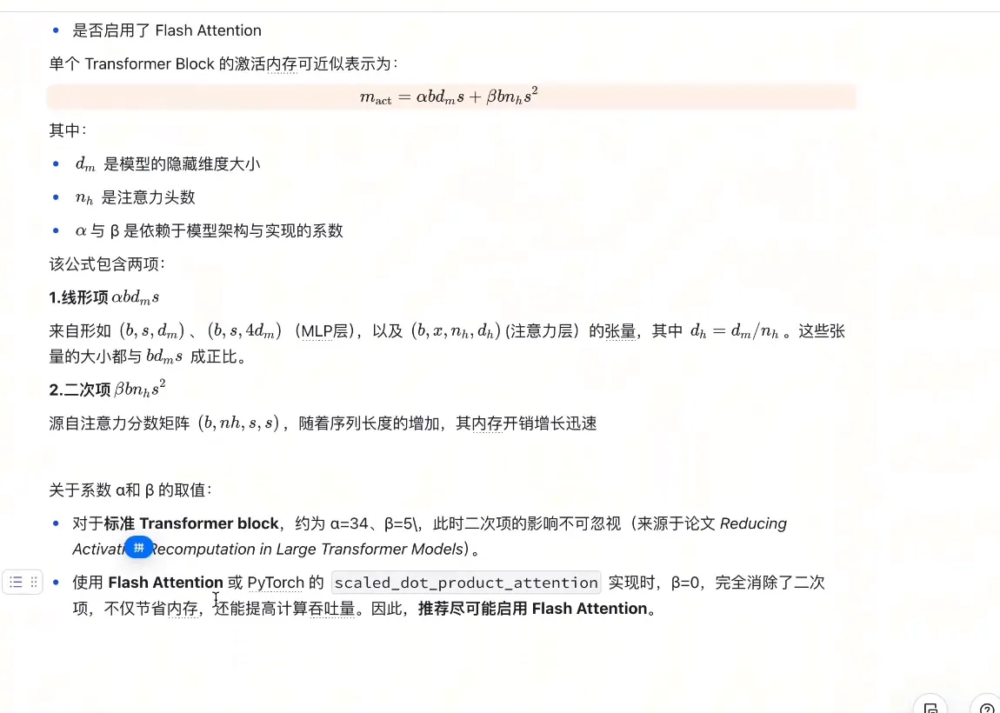

视频给出的具体取值：

| 实现方式 | $\alpha$ | $\beta$ | 二次项 |
| :--- | :--- | :--- | :--- |
| 标准 Transformer Block | 约 34 | 约 5 | 存在，长序列时影响不可忽视 |
| 启用 FlashAttention 或 PyTorch 的 `scaled_dot_product_attention` | 约 34 | 0 | 完全消除 |

$\alpha=34$、$\beta=5$ 这两个数出自论文 *Reducing Activation Recomputation in Large Transformer Models*（视频中标注了出处）。视频的结论很直接：**FlashAttention 实现时 $\beta=0$，完全消除了二次项，不仅节省内存，还能提高计算吞吐量，因此推荐尽可能启用 FlashAttention。**

这里要强调一个容易忽略的点：$\beta=0$ 不是「把分数矩阵变小了」，而是**根本不物化这个矩阵**——分块读入、在线 softmax、算完即弃。至于它是怎么做到的（tiling、online softmax、重计算），属于 FlashAttention 的实现细节，不在本小节展开；本小节只需要记住它的显存效果：**注意力这一项的显存从 $O(s^2)$ 回到 $O(s)$**。

---

## 四、代入 Llama-2-7B：单层激活就能吃掉 4 GB

公式给了，但「34」和「5」到底意味着多少 GB？用视频里出现的 Llama-2-7B 配置代入一遍（$d_m = 4096$、$n_h = 32$、FP16 每元素 2 字节、$b=1$），下面所有数字都是**按视频公式做的量级估算**，不是实测。

### 4.1 线性项：8K 序列、单层约 4.3 GiB

$$
m_{\text{linear}} = 34 \times 1 \times 4096 \times 8192 \times 2 \text{ B} \approx 4.56\times10^{9} \text{ B} \approx 4.25 \text{ GiB}
$$

也就是说，**光是一个 Block 的线性项，在 8K 序列下就要 4 GB 出头**。7B 模型有 32 层，如果像训练那样把 32 层的激活值全留着，就是 $4.25 \times 32 \approx 136$ GB——这就是为什么训练 7B 模型、8K 序列，单卡 80 GB 根本不够。推理侧只保留当前层，$4.25$ GB 就是这一层的瞬时峰值，但**它已经比 7B 模型 FP16 权重（14 GB）的三分之一还多**，而且这还只是线性项。

### 4.2 平方项：同样是 8K，单层约 20 GiB

$$
m_{\text{quad}} = 5 \times 1 \times 32 \times 8192^{2} \times 2 \text{ B} \approx 2.15\times10^{10} \text{ B} \approx 20 \text{ GiB}
$$

**单层 20 GB**。这就是「不开 FlashAttention 跑 8K 上下文会 OOM」的算术解释：一个 7B 模型 + 8K prompt，仅注意力分数矩阵这一项，一层就要 20 GB，80 GB 的卡连一层都放不下（还要算上权重 14 GB 和 KV Cache）。开了 FlashAttention，这一项直接归零，剩下的 4.25 GB 线性项才是你真正要面对的峰值。

### 4.3 平方项什么时候反超线性项

令两项相等，解出临界长度：

$$
\alpha b d_m s = \beta b n_h s^2 \;\Longrightarrow\; s^{*} = \frac{\alpha d_m}{\beta n_h}
$$

代入 $\alpha=34$、$\beta=5$、$d_m=4096$、$n_h=32$：

$$
s^{*} = \frac{34 \times 4096}{5 \times 32} \approx 870
$$

**大约 870 个 token，平方项就追平线性项；再往上，平方项一路领先。** 这个结论对长上下文服务非常关键：它不是「长度到几万才开始担心」，而是「只要超过一千 token，注意力分数矩阵就是激活值里的第一大头」。注意 $s^*$ 与 $b$ 无关（两边都有 $b$），也与精度无关（两边同乘字节数）——它只由模型的 $d_m / n_h$ 比例决定。

---

## 五、激活值占比：什么时候它比「其它所有东西」还大

单项数字不够说明问题，真正要回答的是「激活值占整体显存多少」。视频的做法是算一个比值：激活内存与非激活内存之比。

[【跳转到 11:40】](https://www.bilibili.com/video/BV1qhMtz5E21/?t=700)

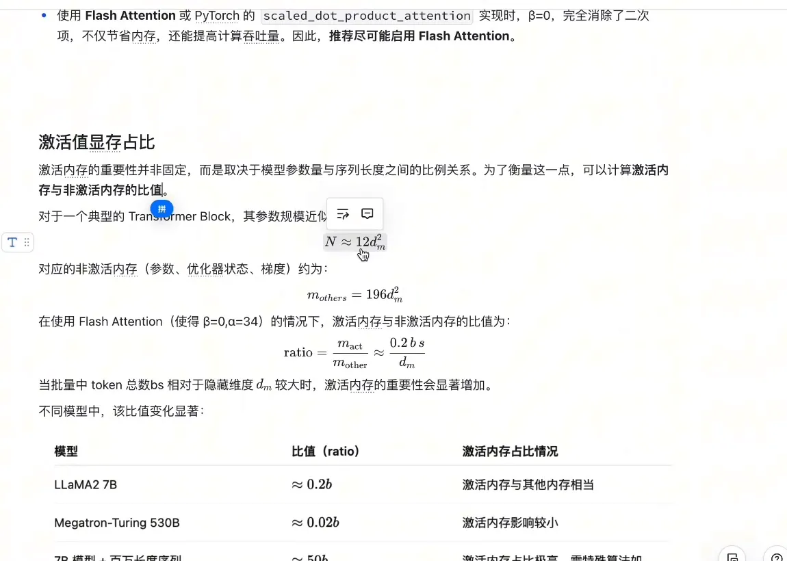

推导链条是这样的：

1. 一个典型 Transformer Block 的参数规模近似为 $N \approx 12 d_m^2$；
2. 非激活内存（参数 + 优化器状态 + 梯度）是 $16N$，于是 $m_{\text{others}} = 16 \times 12 d_m^2 = 192 d_m^2$（视频里取整写成 $196 d_m^2$）；
3. 在启用 FlashAttention（$\beta=0$、$\alpha=34$）的情况下，比值

$$
\text{ratio} = \frac{m_{\text{act}}}{m_{\text{others}}} \approx \frac{34 \, b \, d_m \, s}{196 \, d_m^2} \approx \frac{0.2 \, b \, s}{d_m}
$$

这个式子的形状比数值更重要：**分子是「这一批处理了多少 token」（$bs$），分母是「模型的宽度」（$d_m$）**。所以

> 当批量中 token 总数 $bs$ 相对于隐藏维度 $d_m$ 较大时，激活内存的重要性会显著增加。

[【跳转到 12:30】](https://www.bilibili.com/video/BV1qhMtz5E21/?t=750)

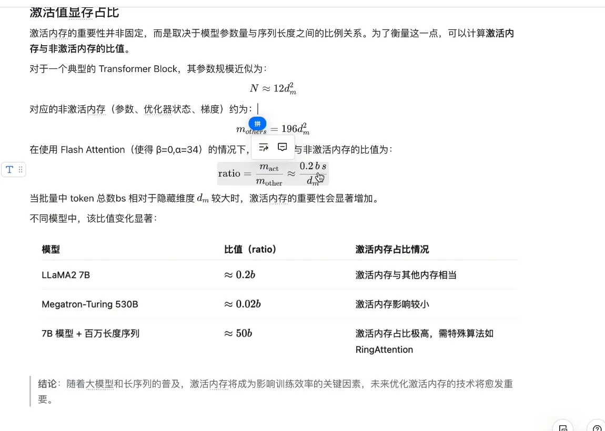

视频给出的三行对照：

| 模型 | 比值（ratio） | 激活内存占比情况 |
| :--- | :--- | :--- |
| LLaMA2 7B | 约 $0.2b$ | 激活内存与其他内存相当 |
| Megatron-Turing 530B | 约 $0.02b$ | 激活内存影响较小 |
| 7B 模型 + 百万长度序列 | 约 $50b$ | 激活内存占比极高，需特殊算法如 RingAttention |

三行数字讲了三件事：

- **小模型更怕长序列**。7B 的 $d_m$ 小（4096），比值里的分母小，同样的 $bs$ 撑出的比值更大；530B 的 $d_m$ 大得多，激活值相对就不显眼。这解释了为什么「跑 7B 的消费级卡」比「跑 530B 的训练集群」更容易被长 prompt 顶爆。
- **$b=1$ 时 7B 的比值约 0.2**，即激活内存大约是其它内存的五分之一——这还是 $s$ 不算大的情况。
- **百万长度序列下比值到 50**：激活内存是其余所有内存的 50 倍，普通注意力根本不可能，必须上 RingAttention 这类把序列切到多卡上的特殊算法（这属于上下文并行，不在本小节展开）。

---

## 六、实测校准：HuggingFace 的三张柱状图

公式讲完，视频最后用 HuggingFace 博客 *Activation Memory: A Deep Dive using PyTorch* 里的实测图做校准。

[【跳转到 14:35】](https://www.bilibili.com/video/BV1qhMtz5E21/?t=875)

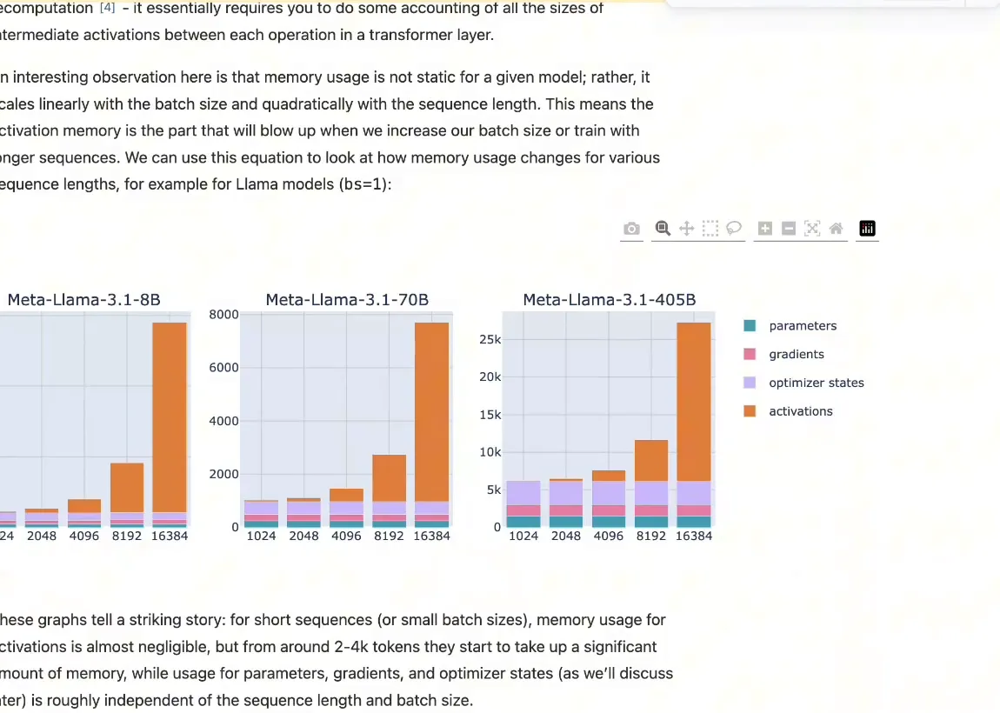

图里三组柱状图分别是 Meta-Llama-3.1-8B、70B、405B，横轴是序列长度（1024、2048、4096、8192、16384），纵轴是显存占用，四种颜色分别是参数、梯度、优化器状态、激活值（橙色）。**只有橙色那根柱子在长高，另外三色几乎是三条水平线**——这正是第二节「16N 与序列长度无关」的实测印证。

视频里的读数（讲者口述，$bs=1$ 的训练口径）：

| 序列长度 | 显存占用（讲者读数） | 相对上一档 |
| :--- | :--- | :--- |
| 1024 | 约 10 GB | — |
| 2048 | 约 28 GB | 约 2.8 倍 |
| 4096 | 约 100 GB（图中鼠标悬停显示 97.0） | 约 3.5 倍 |
| 16K | 1300 多 GB | 约 13 倍 |

这里有一个值得停下来看的现象（以下是对视频读数做的分析，不是讲者原话）：**长度每翻一倍，激活值涨的是 2.8 倍、3.5 倍、再到 4 倍左右，明显超过线性的 2 倍**。超过线性的那部分就是 $\beta b n_h s^2$ 在起作用——如果这三张图是开了 FlashAttention（$\beta=0$）跑出来的，长度翻倍应该只涨 2 倍。反过来说，**这张图恰好演示了「不开 FlashAttention 时二次项如何主导」**，也解释了为什么论文和框架都把 FlashAttention 当成默认项。

视频的收尾结论可以直接用：

> 随着大模型和长序列的普及，激活内存将成为影响训练效率的关键因素。

把这句话里的「训练」换成「推理」，就是本小节要记住的东西：**Prefill 的峰值不是稳态，它是某一层前向中途所有中间张量同时在场的那个瞬间；序列越长，这个瞬间越高，而 FlashAttention 决定它是线性地高还是平方地高。**

---

## 七、对推理服务的三条推论

### 7.1 峰值显存决定的是「最大并发」，不是「平均占用」

既然峰值出现在单层前向中途，那么决定你能开多少并发的不是「权重 + KV Cache 的平均值」，而是「权重 + KV Cache + 单层激活峰值」。这就是为什么容量规划要留出比直觉更大的余量：按平均值买卡，上线后一定 OOM。

### 7.2 削峰的四条路，本质都是「别让那么多张量同时活着」

| 手段 | 作用在哪一项 | 代价 |
| :--- | :--- | :--- |
| FlashAttention（分块 + 在线 softmax） | 消掉 $\beta b n_h s^2$ | 实现复杂，但对上层透明 |
| 分块预填充（chunked prefill） | 把 $s$ 切成小块，线性项与平方项同时按块缩小 | 多轮调度开销，首 token 延迟变晚 |
| 激活重计算（activation recomputation） | 不存中间张量，用的时候重算 | 多花算力（推理侧只在极端长序列时才值得） |
| 算子融合（fused kernel） | 减少同时存活的中间张量份数，压低 $\alpha$ | 需要手写或依赖编译器的融合能力 |

前两条是长上下文服务的标配，第三条在推理侧是「最后手段」，第四条是框架层的长期优化方向。分块预填充的具体做法与代价，见本小节的另一篇《分块预填充只削峰不省总量》。

### 7.3 怎么确认自己撞上的是激活值而不是碎片【补充】

上面全部是「算出来的」，工程上还要「测出来」。以下是补充的工具，不属于视频内容：

- torch.cuda.max_memory_allocated()：返回**自进程启动以来的分配峰值**（不是当前占用），这是判断「峰值有没有顶到上限」最直接的指标；配合 reset_peak_memory_stats() 可以按请求重置，测单次 Prefill 的峰值。
- torch.cuda.memory._record_memory_history() + _dump_snapshot()：导出内存时间线，用 PyTorch 官方的 snapshot 可视化工具看「哪一行代码抬起了峰值」，能区分是激活值、临时 workspace 还是碎片。
- PYTORCH_CUDA_ALLOC_CONF=expandable_segments:True：允许显存段动态扩张，缓解「空闲总量够但没有连续大块」导致的 OOM——这类 OOM 的典型特征是 `max_memory_allocated` 远小于卡容量却仍然失败。

---

## 小结

- **激活值是前向传播中途必须留住的中间结果**，存在的唯一理由是反向传播算梯度要用它；推理没有反向，省掉的是跨层保留，不是层内峰值。
- 单个 Block 的激活内存近似为 $m_{\text{act}} = \alpha b d_m s + \beta b n_h s^2$：线性项来自 $(b,s,d_m)$ 形状的 MLP/投影张量，平方项来自 $(b,n_h,s,s)$ 的注意力分数矩阵。
- 标准实现 $\alpha \approx 34$、$\beta \approx 5$；**FlashAttention 让 $\beta = 0$**，注意力显存从 $O(s^2)$ 回到 $O(s)$。
- 代入 Llama-2-7B、8K 序列：线性项单层约 4.25 GiB，平方项单层约 20 GiB；**平方项在约 870 token 处就追平线性项**。
- 激活值与非激活内存的比值约为 $0.2bs/d_m$：模型越窄、token 越多，激活值越主导；百万长度序列下比值可达 50 倍。
- HuggingFace 的实测图显示，随序列长度增长的只有激活值那一根柱子，参数、梯度、优化器状态是水平线——16N 与序列长度无关。
- 工程上：峰值决定最大并发；削峰靠 FlashAttention、分块预填充、重计算与算子融合；定位靠 `max_memory_allocated`、memory snapshot 与 `expandable_segments`。

## 关键术语速查

| 术语 | 一句话解释 |
| :--- | :--- |
| 激活值（activation） | 前向传播中各层的中间输出，反向传播算梯度时要用，因此必须保存 |
| $b$ / $s$ / $d_m$ / $n_h$ | 批量大小 / 序列长度 / 隐藏维度 / 注意力头数 |
| $\alpha$、$\beta$ | 激活内存公式里线性项与平方项的系数，取决于架构与实现 |
| 注意力分数矩阵 | $QK^\top$ 的结果，形状 $(b, n_h, s, s)$，是平方项的唯一来源 |
| FlashAttention | 分块计算注意力、不物化 $s\times s$ 矩阵的实现，使 $\beta=0$ |
| 激活重计算 | 不保存中间张量，需要时重新算一遍，用算力换显存 |
| 分块预填充（chunked prefill） | 把长 prompt 切成多个 chunk 分多轮推进，降低单步峰值 |
| 峰值显存 | 一次前向中途所有中间张量同时在场的瞬时占用，决定 OOM 与否 |
| `max_memory_allocated` | PyTorch 记录的分配峰值，判断是否顶到显存上限的首选指标 |