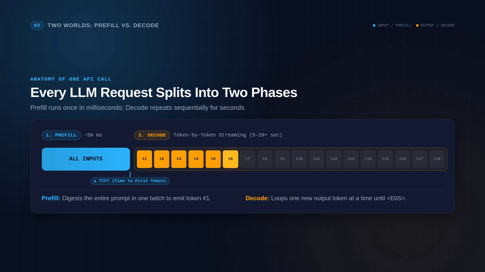
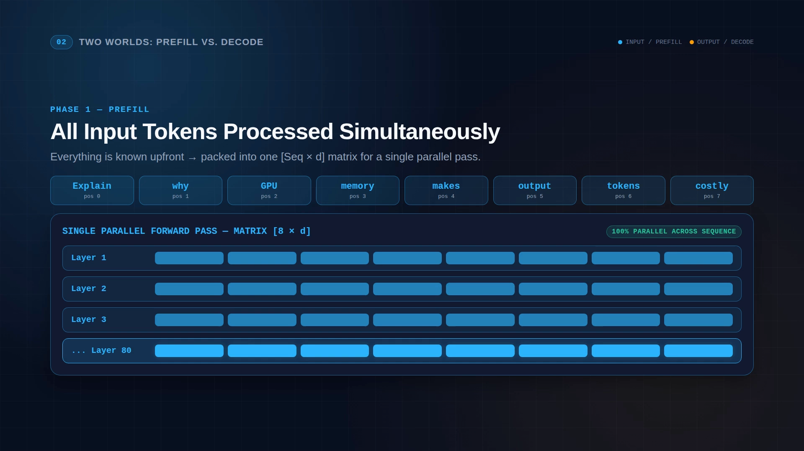
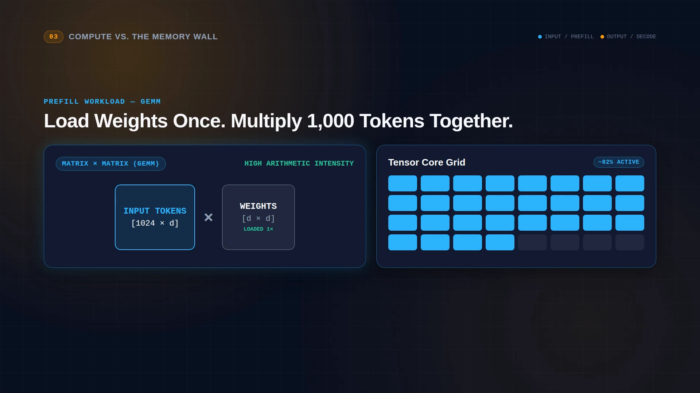
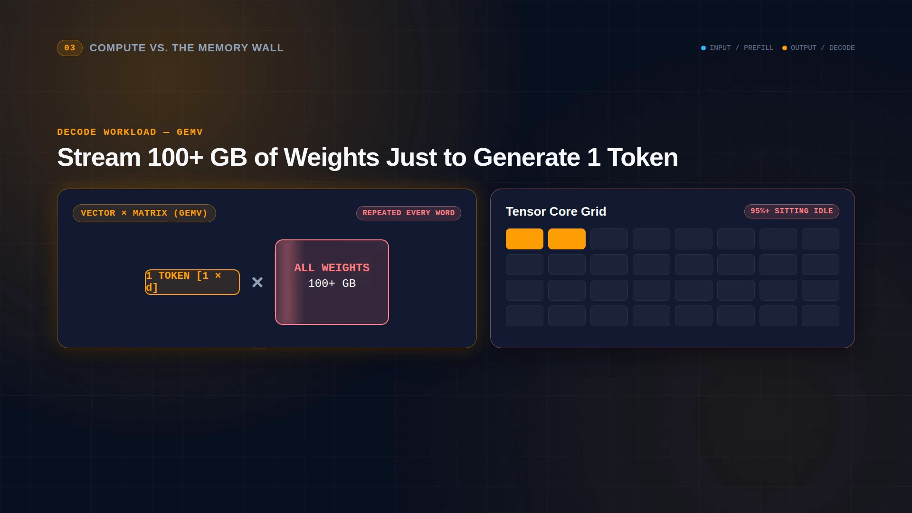
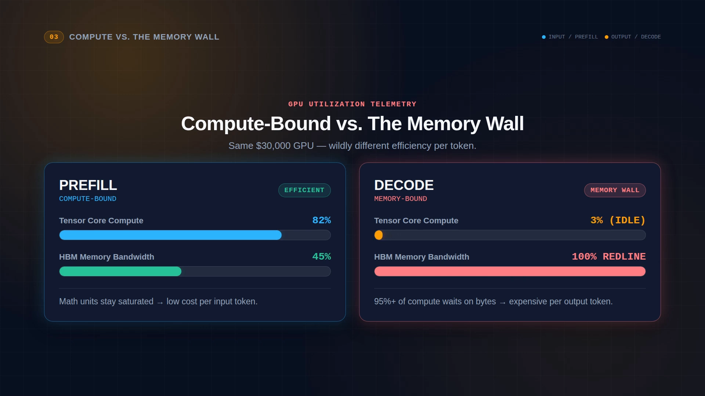
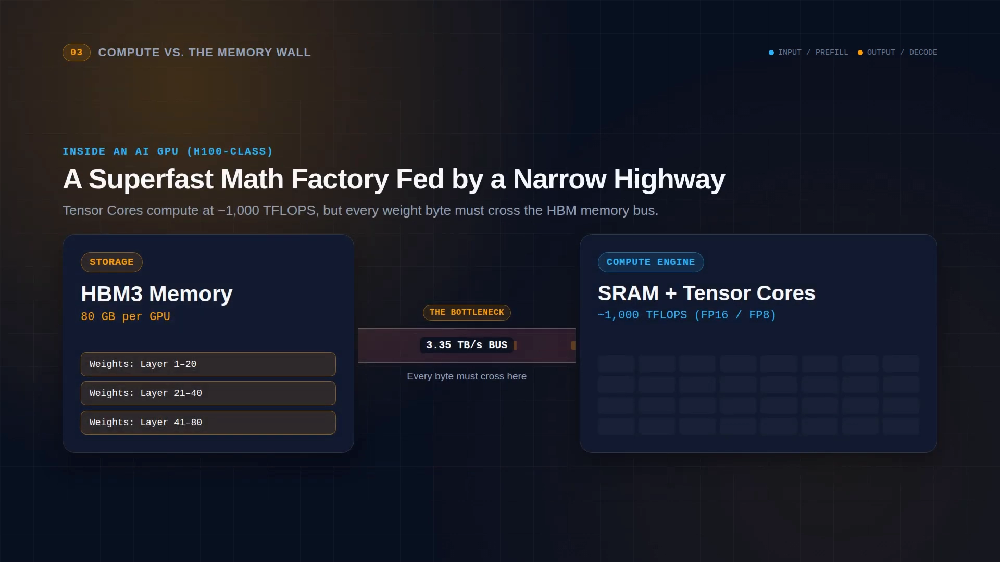
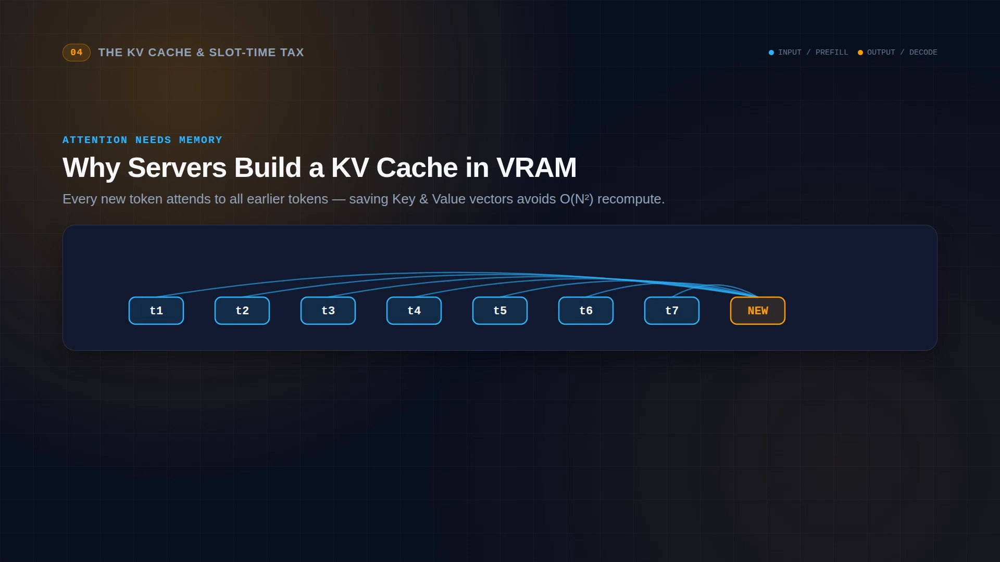
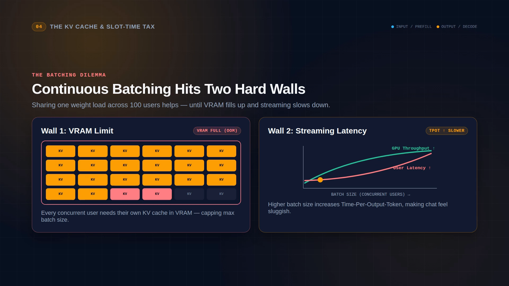

# Decode 每步只喂一个 Token 向量：线性层从 GEMM 退化成 GEMV

> 视频来源：[Why AI Output Tokens Cost 5× More Than Input Tokens](https://www.youtube.com/watch?v=KYYtykvEgvE)（YouTube · Spokio Studio）｜时长约 6 分 56 秒
> 简要导读：这支视频从「API 价目表上输出 token 比输入 token 贵五倍」这个账单现象切入，一路追到 GPU 的物理层。本文只取其中与本小节相关的那条线：**Decode 的输入形状为什么只有一行、这一行让线性层从 GEMM 变成 GEMV、以及由此产生的「每 token 读一遍全部权重」这一固有开销**。算术强度与屋脊点的完整推导见 1.1.2，KV Cache 的显存公式见 1.3.2，本文只在需要处一句带过。

## 本讲要解决的核心问题（SCQA）

**背景**：任何一家 AI API 的价目表上，输入 token 和输出 token 的价格都差得很远。视频举的例子是：输入每百万 token 3 美元，输出每百万 token 15 美元；如果拿缓存输入（每百万 30 美分）去比，输出能贵到 50 倍。

[【跳转到 00:20】](https://www.youtube.com/watch?v=KYYtykvEgvE&t=20)

**冲突**：这个差价看起来毫无道理。输入 token 和输出 token 流的是**同一个 Transformer、同一套权重、同一份数学**——一个 token 进去，一个 token 出来。既然模型没变，凭什么「写」比「读」贵五倍？更奇怪的是，同一块标价三万美元的 GPU，在 Prefill 阶段能把 Tensor Core 用到 82%，一进入 Decode 就掉到 3%，而 HBM 带宽反而被顶到 100% 的红线。

**疑问**：Decode 到底在算什么？它的输入长什么样？为什么同样一套权重，在 Prefill 里能把计算单元喂饱，在 Decode 里却只能看着它们空转？这个差距是「引擎写得不够好」，还是某种无法绕开的物理事实？

**回答（中心思想）**：**Decode 每一步的输入只有一个 token 向量，于是所有线性层都从「矩阵乘矩阵」退化成「矩阵乘向量」。** 矩阵乘向量的输出只有 $N$ 个元素，能同时铺开的独立工作最多 $N$ 份；而每一个权重元素被读进来之后只参与一次乘加就被丢掉，没有任何复用。所以 Decode 的瓶颈不在算力，而在「把权重从 HBM 搬到计算单元」这条窄路上——**每生成一个 token，都必须把整个模型的权重完整读一遍**。这个开销与模型层数、隐层宽度都无关，只与权重的总字节数和显存带宽有关。它是自回归这种计算模式自带的，不是实现缺陷。

---

## 一、Decode 的输入只有一行，所以线性层只能是 GEMV

### 1.1 同一个请求，两个形状完全不同的阶段

视频用一张时间轴把一次 API 调用切成两段：Prefill 大约 50 毫秒，Decode 则要按秒计（5 到 20 秒以上）。

[【跳转到 01:00】](https://www.youtube.com/watch?v=KYYtykvEgvE&t=60)

- **Prefill**：你的整段 prompt 一开始就已经躺在显存里，什么都不用等。GPU 把全部输入 token 打包成一个 $[S \times d]$ 的矩阵，一次性、完全并行地推过每一层。
- **Decode**：语言模型是自回归的，一次只生成一个 token。第 99 个 token 必须算完并喂回去，第 100 个 token 才开始算。

[【跳转到 01:15】](https://www.youtube.com/watch?v=KYYtykvEgvE&t=75)

这个差别落到矩阵形状上就非常具体。一个线性层（比如 QKV 投影、输出投影、FFN 的 up/gate/down）本质是「输入矩阵乘权重矩阵」：

$$
Y = XW,\qquad X \in \mathbb{R}^{M \times K},\quad W \in \mathbb{R}^{K \times N}
$$

- **Prefill** 时 $M = S$（prompt 长度），$X$ 是一摞行，这是标准的 **GEMM**（General Matrix Multiplication，通用矩阵乘法）。视频里画的例子是 $[1024 \times d]$ 的输入乘 $[d \times d]$ 的权重。
- **Decode** 时 $M = 1$，$X$ 退化成一个行向量，这是 **GEMV**（General Matrix-Vector multiplication，矩阵乘向量）。视频里画的例子是 $[1 \times d]$ 的输入乘整个权重矩阵。

[【跳转到 02:14】](https://www.youtube.com/watch?v=KYYtykvEgvE&t=134)

这两张图放在一起，就是整个小节的论证：**形状从 $[S \times d] \cdot [d \times d]$ 变成 $[1 \times d] \cdot [d \times d]$，权重矩阵一点没变，左边那一摞行只剩一行。**

> **补充（一句话，留给 1.2.3）**：如果同时服务 $B$ 个请求，Decode 的输入就变成 $[B \times d]$，这时它是「小 GEMM」而不是纯粹的 GEMV——$B$ 行共用同一份权重，复用次数从 1 变成 $B$。这正是后面「增大 batch 把访存受限推回 GEMM」那条路线的起点，本文不展开。

### 1.2 并行度只剩 $N$：一个 token 向量能铺开的工作量

把形状换算成「能同时干多少活」，GEMV 的局限就一目了然。

GEMV 的输出是 $N$ 个数（$N$ 就是这一层的输出宽度，比如 QKV 投影的 $3d$、FFN 的中间维度）。这 $N$ 个数彼此独立，可以分给不同的计算单元；但**只有 $N$ 个**。而每一个输出元素本身，又必须把 $K$ 个乘积串行累加起来。所以：

- **可并行的独立结果数 = $N$**；
- **每个结果内部是一条长度 $K$ 的串行累加链**。

一块 H100 级别的 GPU 有上万个 CUDA 核、几百个 Tensor Core 通道。当 $N = 4096$ 时，你理论上最多只能铺满 4096 份并行工作，剩下的计算单元无事可做。视频用「Tensor Core 网格」这个画面把这件事画了出来：Decode 那一格里，只有左上角两格被点亮。

反过来看 GEMM：$M = S$ 时输出是 $S \times N$ 个数，可并行的独立结果数是 $S \cdot N$。$S = 1024$ 时，同一个 $N$ 被放大了 1024 倍——**网格被填满了**。

这就是「同样一套权重、同样一块芯片，一个能跑到 82%、一个只有 3%」的直接原因。

---

## 二、真正的代价：每个权重只被用一次

### 2.1 没有复用，就没有算术强度

视频用两个类比把这件事说得很好记：

- **Prefill 像一列货运火车**：一趟就把一千个集装箱拉走。权重从 HBM 读进来一次，被成千上万个输入 token 各用一次。
- **Decode 像开着一辆 18 轮大卡车横穿全城，只为了送一张明信片**。权重从 HBM 读进来一次，只被那一个 token 用一次，然后就被丢掉，下一个词再来一遍。

[【跳转到 01:54】](https://www.youtube.com/watch?v=KYYtykvEgvE&t=114)

用「算术强度」（每读一字节做多少次浮点运算）来量化：

$$
\text{算术强度} = \frac{\text{FLOPs}}{\text{搬运的字节数}}
$$

对一个 FP16 的权重元素：它占 2 字节；每被一个 token 使用一次，要做一次乘法加一次加法，约 2 次浮点运算。于是

$$
\text{Decode：}\ \frac{2\ \text{FLOP}}{2\ \text{Byte}} \approx 1\ \text{FLOP/Byte}
$$

而 Prefill 时同一个权重被 $S$ 行共用：

$$
\text{Prefill：}\ \frac{S \times 2\ \text{FLOP}}{2\ \text{Byte}} \approx S\ \text{FLOP/Byte}
$$

$S = 1000$ 时，两者的算术强度差了整整一千倍。

> **术语订正**：视频旁白有一处说「每个权重做两次运算，所以算术强度是 2」。这是按「每个权重元素」计数、把字节数省掉了。换算成标准的 FLOP/Byte，FP16 下应该是 $2 \div 2 = 1$。本系列 1.1.2 用的也是 1 这个值，本文统一按 1 FLOP/Byte 表述。

### 2.2 落在 Roofline 的斜线上

> **补充（视频未展开）**：把「算术强度」和「芯片的算力/带宽比」放在一张图上比较，就是 Roofline。这一段的推导属于 1.1.2，这里只借用结论并代入本视频给的芯片规格。

Roofline 的屋脊点等于「峰值算力 ÷ 带宽」。用视频里那块 H100 级别的规格算一遍：约 1000 TFLOPS 算力、3.35 TB/s 带宽，屋脊点约 $1000 / 3.35 \approx 300$ FLOP/Byte。

Decode 的算术强度是 1 FLOP/Byte，只有屋脊点的三百分之一——**它坐在 Roofline 的斜线上，离平顶还差两个数量级**。斜线的含义就是：性能 = 带宽 × 算术强度，与算力无关。把算力从 1000 TFLOPS 提到 2000 TFLOPS，这个点一动不动。

这就是「算术强度低于屋脊点的工作，性能由带宽决定，加算力没有用」在 Decode 上的具体形态。

### 2.3 利用率表并排一放，瓶颈就无可辩驳

视频把两个阶段的遥测数据并排放在一张图上，这是全片最有说服力的一帧：

[【跳转到 02:34】](https://www.youtube.com/watch?v=KYYtykvEgvE&t=154)

| 指标 | Prefill（GEMM） | Decode（GEMV） |
| --- | --- | --- |
| Tensor Core 占用 | 82% | 3%（空转） |
| HBM 带宽占用 | 45% | 100%（红线） |
| 受限类型 | 计算受限 | 访存受限 |
| 每 token 成本 | 低 | 高 |

旁白的说法是「GPU 95% 的计算单元完全闲着，在等字节」。**注意这个组合的含义**：不是 Decode 算得慢，而是它算得极快、然后长时间无事可做。计算单元在等数据，而数据正在一条已经跑满的带宽管道上排队。

---

## 三、每生成一个 Token 都要把全部权重读一遍

### 3.1 一个无法绕开的等式

视频把镜头推进到 GPU 内部，用一张图说明了物理布置：大容量 HBM 存放模型权重，通过一条很窄的显存总线连到片上 SRAM 和 Tensor Core。旁白说得很直白——「这些数学单元塞着大约一千 TFLOPS 的算力，但每一个字节都必须先跨过那条带宽管道」。

[【跳转到 01:34】](https://www.youtube.com/watch?v=KYYtykvEgvE&t=94)

于是 Decode 的每一步都变成同一个动作的重复：

1. 把整个模型的权重从 HBM 流进 SRAM（视频说「常常超过 100 GB」）；
2. 拿那一个 token 向量做一次很小的向量乘；
3. 把权重丢掉；
4. 为下一个词，从第 1 步重来。

这就给出了本节最重要的一个不等式。设权重总字节数为 $W$、显存带宽为 $B$，那么单个 token 的延迟有一个下界：

$$
t_{\text{token}} \ \ge\ \frac{W}{B}
$$

这个下界有几个值得注意的性质：

- **它只和两个量有关**：权重总字节数 $W$ 和带宽 $B$。层数、隐层宽度、注意力头数都不直接出现——它们只通过「总共多少字节」间接影响结果。
- **它和「kernel 写得好不好」无关**。即使你写出了一个完美到极致的 GEMV 内核，把每一个字节都用满带宽读进来，你也只能达到这个下界，不能突破它。
- **它和算力完全无关**。分子里没有 FLOPs。

### 3.2 代入真实数字

视频在讲硬件时给了两个可以直接相除的数：显存总线带宽 3.35 TB/s，以及 decode 每步要读的权重「常常超过 100 GB」。把这两个数相除，就得到单 token 延迟的量级：

$$
\frac{100\ \text{GB}}{3.35\ \text{TB/s}} \approx 30\ \text{ms}
$$

也就是说，**在 H100 这一级硬件上，光是把权重读一遍就要几十毫秒**。而一次 1000 token 的回答，就是 1000 个这样的几十毫秒。

> 配套的第二篇《GEMV 的算术强度只有 1》把这笔账算得更细（它用 7B 模型、1 TB/s 带宽得到 71 token/s，加上 KV Cache 后降到 62 token/s），并给出了完整的速度上界公式。

把这个式子代入几种常见的「模型大小 × 带宽」组合，量级感会更强（下面几行是按视频给的权重字节数和公开带宽做的算术推算，不是视频原话）：

| 模型 | FP16 权重 | 带宽 | 单 token 延迟下界 | 对应 tok/s |
| --- | --- | --- | --- | --- |
| 7B | 14 GB | 1 TB/s | 14 ms | 71 |
| 7B | 14 GB | 2 TB/s（A100 级） | 7 ms | 143 |
| 7B | 14 GB | 3.35 TB/s（H100 级） | 4.2 ms | 239 |
| 70B | 140 GB | 3.35 TB/s | 42 ms | 24 |

**这张表就是「为什么输出 token 贵」的全部答案。** 一个 70B 模型在 H100 上，光是把权重读一遍就要 42 毫秒——这还没算 KV Cache、没算注意力、没算采样。而一次 1000 token 的回答，就是 1000 次这样的 42 毫秒。

---

## 四、和 Prefill 对照：同一套权重，复用次数从 $S$ 掉到 1

把两个阶段放在同一套权重上看，差距的来源变得非常干净：

| | Prefill | Decode |
| --- | --- | --- |
| 输入形状 $X$ | $[S \times K]$ | $[1 \times K]$ |
| 运算类型 | GEMM | GEMV |
| 权重被复用次数 | $S$ | 1 |
| 算术强度 | $\approx S$ FLOP/Byte | $\approx 1$ FLOP/Byte |
| 权重搬运量 | $W$ 字节（一次 Prefill 摊到 $S$ 个 token） | $W$ 字节（每个 token 都要一遍） |
| 受限类型 | 计算受限 | 访存受限 |

**关键在最后两行。** Prefill 也要把权重读一遍，但它只读一遍就服务了 $S$ 个 token，摊到每个 token 上是 $W/S$ 字节。Decode 每生成一个 token 就要读 $W$ 字节，一个都摊不掉。

这就是视频开头那个「输出贵五倍」的账单背后的机制：Prefill 以峰值效率占用 GPU 几十毫秒，而一次一千 token 的 Decode 会把一块显存位霸占 10 到 20 秒，而且计算效率极差。**厂商卖的其实不是 token，是 GPU 秒。**

---

## 五、自回归的串行依赖：第 $t+1$ 步必须等第 $t$ 步

除了「每 token 读一遍权重」，自回归还有第二重固有开销：**它不能并行**。

视频的原话是：「GPU 必须先算完第 99 个 token 并把它喂回去，才能开始算第 100 个。」这句话的严格含义是：第 $t+1$ 步的输入是第 $t$ 步采样出来的结果，而采样要等第 $t$ 步的前向完全结束。**整条序列无法像 Prefill 那样一次性算完**，只能一步一步往前推。

这就带来两个后果：

1. **延迟可以累加但不能重叠**。生成 $n$ 个 token 的总时间大致是 $n \times t_{\text{token}}$，没有「把 $n$ 步并行起来」的空间（在单个请求内部）。
2. **历史必须被保存，否则复杂度会爆掉**。如果每一步都从头重算所有更早的 token，第 $t$ 步要处理 $t$ 个 token，总量是 $1 + 2 + \cdots + n = n(n+1)/2$，是平方级。

[【跳转到 03:14】](https://www.youtube.com/watch?v=KYYtykvEgvE&t=194)

视频给出的解法就是 **KV Cache**：把每个历史 token 的 key 和 value 向量存下来，每步只为最新的那个 token 算 Q、K、V，把新的 K、V 追加进缓存，然后对全部已存内容做注意力。**复杂度从 $O(N^2)$ 降到 $O(N)$。**

> KV Cache 的完整机制与显存公式见 1.3.1 与 1.3.2，本文不展开。这里只需要记住它对本文论证的作用：**KV Cache 消掉了重复的数学，但没有消掉重复的搬运。**

视频明确说了这一点：「KV Cache 消掉了重复的数学，但加上了第二重税。」因为每一个 decode step，GPU 都必须沿着**同一条** HBM 带宽管道，同时读模型权重和这份不断长大的 KV Cache。原本只是 $W$ 字节，现在变成 $W + \text{KV}$ 字节。

---

## 六、这是计算模式的问题，不是实现不够好

走到这里可以下一个明确的判断：**Decode 慢，不是因为 PyTorch 写得烂、也不是因为 kernel 没调优，而是因为「一次只算一个 token」这种计算模式本身把算术强度压到了 1。**

这个判断有三个可检验的推论，视频都提到了：

1. **换一块算力翻倍、带宽不变的 GPU，Decode 一点都不会更快。** 因为瓶颈在分子之外。
2. **把权重字节减半（比如 8 位量化），速度几乎翻倍。** 因为 $t_{\text{token}} \ge W/B$，$W$ 减半，下界就减半。
3. **增大 batch 几乎是免费的。** 服务 16 个用户时，权重只被读一次给所有人用，算术强度朝 16 走，吞吐就上去了——直到撞上显存和延迟两堵墙。

[【跳转到 03:34】](https://www.youtube.com/watch?v=KYYtykvEgvE&t=214)

视频在结尾列出了一整套「对抗内存墙」的手段，本文只点到为止，各自归属后续小节：

[【跳转到 04:54】](https://www.youtube.com/watch?v=KYYtykvEgvE&t=294)

| 手段 | 一句话原理 | 本系列位置 |
| --- | --- | --- |
| 增大 batch / Continuous Batching | 让一次权重读取服务 $B$ 个 token，算术强度从 1 抬到 $B$ | 1.2.3 / 第 3 章 |
| 量化（8 位、4 位） | 直接缩小 $W$，下界同比例下降 | 第 7 章 |
| 投机采样 | 用小模型一次猜多个 token、大模型一次并行验证，把「串行」掰成「并行」 | 第 6 章 |
| GQA / MLA | 压缩 KV Cache，缩小 $W + \text{KV}$ 里的第二项 | 1.3.x |
| PagedAttention | 像虚拟内存分页那样管理 KV Cache，消掉显存碎片 | 4.2 |
| PD 分离 | 把计算密集的 Prefill GPU 与访存密集的 Decode GPU 拆开 | 第 10 章 |

**注意这张表里没有「写一个更快的 GEMV 内核」。** 因为按第三节的不等式，内核优化的天花板就是 $W/B$ 这个下界；它值得做（能把实际性能从下界的 60% 推到 90%），但它改变不了「这是带宽受限」这个结论。真正的出路都在**改变计算模式**：让权重被复用更多次（batching）、让要搬的字节更少（量化）、让串行步数更少（投机采样）。

---

## 小结

- **Decode 的输入只有一个 token 向量**：$[1 \times K]$ 乘 $[K \times N]$，线性层从 GEMM 退化成 GEMV。batch 内多请求时是 $[B \times K]$ 的小 GEMM，复用次数从 1 变成 $B$。
- **并行度只有 $N$**：GEMV 的输出只有 $N$ 个元素，能同时铺开的独立工作最多 $N$ 份，而每个输出内部还是一条长度 $K$ 的串行累加链。Tensor Core 网格因此大面积空转。
- **每个权重只被用一次**：读进来、做一次乘加、丢掉。算术强度约 1 FLOP/Byte，远低于 H100 级别约 300 FLOP/Byte 的屋脊点，落在 Roofline 的带宽斜线上。
- **单 token 延迟下界是 $W/B$**：每生成一个 token 都要把全部权重读一遍（7B FP16 ≈ 14 GB），所以 7B 在 2 TB/s 上约 7 ms、在 3.35 TB/s 上约 4.2 ms；70B 的 140 GB 在 3.35 TB/s 上要约 42 ms。这个下界只与权重字节数和带宽有关。
- **和 Prefill 的唯一差别是复用次数**：同一套权重，Prefill 时 $M = S$ 复用 $S$ 次，Decode 时 $M = 1$ 只复用 1 次。这就是输出 token 比输入 token 贵的物理原因。
- **自回归还有串行依赖**：第 $t+1$ 步必须等第 $t$ 步采样完成，无法一次算完整条序列；KV Cache 把复杂度从 $O(N^2)$ 降到 $O(N)$，但每步仍要同时读权重和缓存。
- **这是计算模式问题，不是实现问题**：即使 kernel 完美，GEMV 也受带宽限制。出路是改变模式——增大 batch、量化、投机采样。

## 关键术语速查

| 术语 | 一句话解释 |
| --- | --- |
| GEMM | General Matrix Multiplication，通用矩阵乘法 $[M \times K] \cdot [K \times N]$。$M$ 大意味着同一份权重被多行共用，算术强度高。 |
| GEMV | General Matrix-Vector multiplication，矩阵乘向量 $[1 \times K] \cdot [K \times N]$。Decode 的典型形状，$M = 1$，权重零复用。 |
| 算术强度 | 每从显存搬运一个字节所执行的浮点运算次数，单位 FLOP/Byte。它属于「工作负载」，不属于芯片。 |
| Roofline | 把算术强度画在横轴、可达性能画在纵轴得到的折线图。斜线由带宽决定，平顶由峰值算力决定。 |
| 屋脊点 | Roofline 的拐角，等于「峰值算力 ÷ 带宽」。算术强度低于它 = 访存受限。 |
| 访存受限（memory-bound） | 性能由显存带宽决定，加算力没有收益。Decode 属于这一类。 |
| 计算受限（compute-bound） | 性能由峰值算力决定。Prefill 在 prompt 足够长时属于这一类。 |
| HBM | High Bandwidth Memory，GPU 上的高带宽显存，存放模型权重和 KV Cache。 |
| KV Cache | 缓存历史 token 的 key 和 value 向量，避免每步重算历史，把复杂度从 $O(N^2)$ 降到 $O(N)$。 |
| 自回归 | 一次只生成一个 token、并把结果喂回作为下一步输入的解码方式，因此天然串行。 |