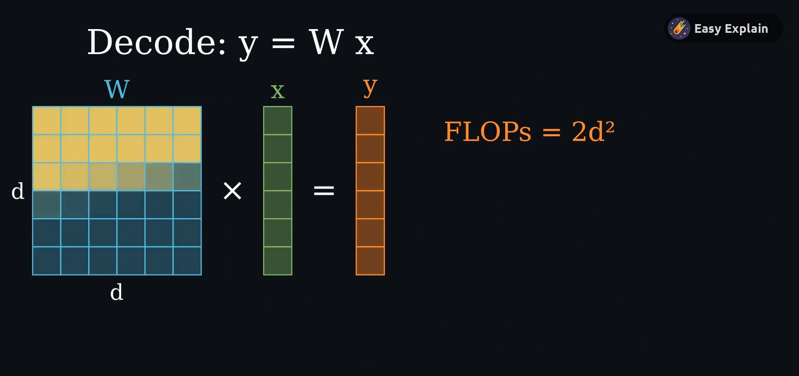
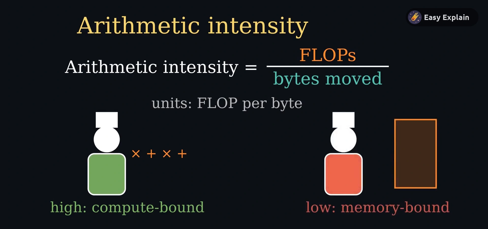
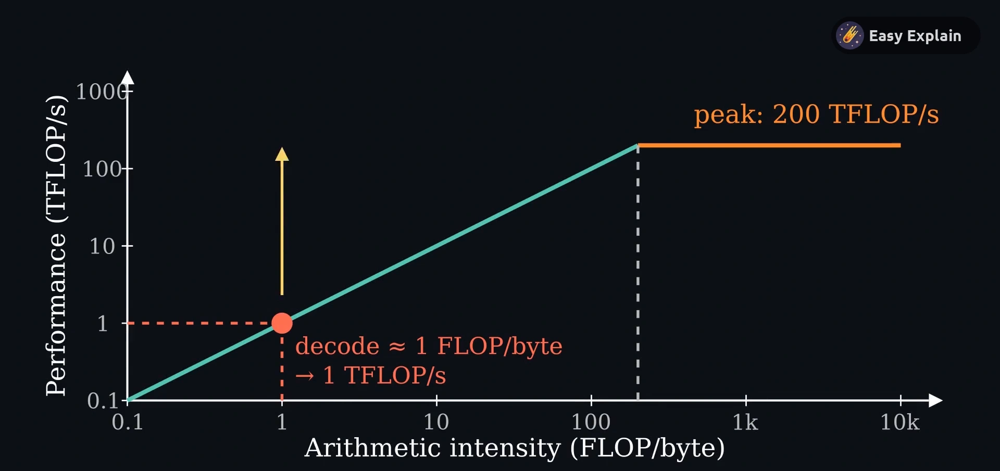
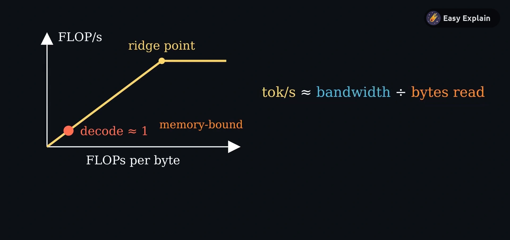
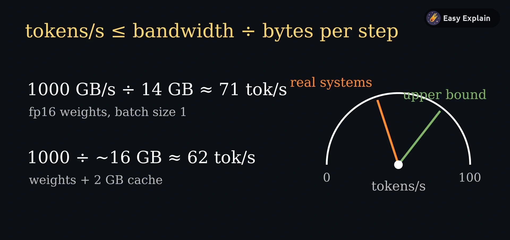
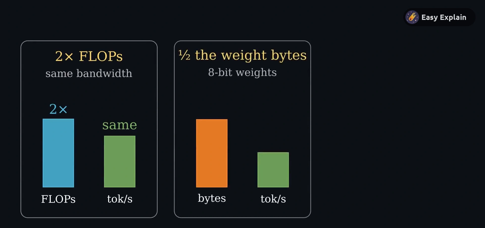
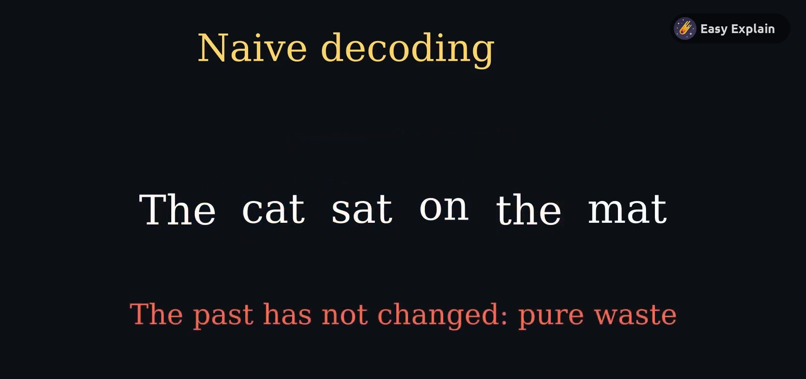
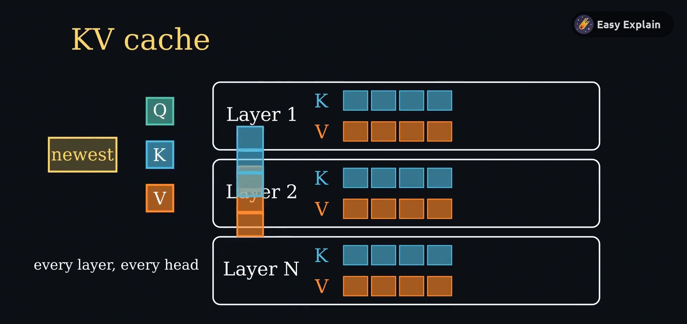
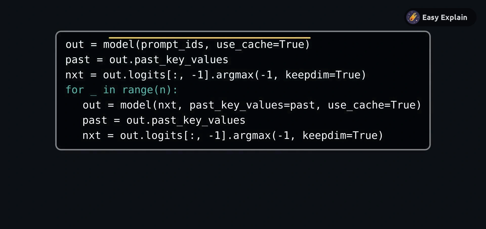
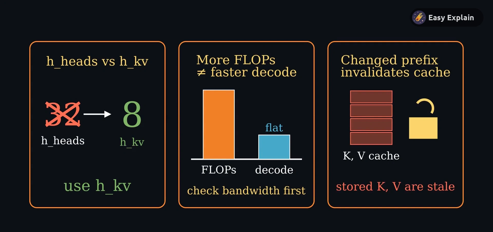

# GEMV 的算术强度只有 1：Decode 每 Token 延迟下界由权重字节数除以带宽决定

> 视频来源：[The KV Cache Explained: Why LLM Decoding Is Memory-Bound](https://www.youtube.com/watch?v=uJLSDw2xJ4w)（YouTube · Easy Explain）｜时长约 13 分 33 秒
> 简要导读：这支视频把「decode 为什么是访存受限」这件事算成了一道可以手推的算术题：从 $y = Wx$ 的形状出发，算出算术强度恰好等于 1，把它放到 Roofline 上定位，再推出「每秒 token 数 ≤ 带宽 ÷ 每步字节数」这条速度法则，最后用 PyTorch 的两段循环把「平方变线性」实测出来。本文只取这条主线；KV Cache 的显存公式与 GQA / 滑动窗口 / 缓存量化的容量优化属于 1.3.2，本文只在必要处一句带过。

## 本讲要解决的核心问题（SCQA）

**背景**：一块现代 GPU 每秒能做好几百万亿次算术运算。可当你用它和一个语言模型聊天时，词是一个一个往外挤的。

**冲突**：这么快的机器，为什么会觉得慢？更刺眼的是，同一块芯片在 Prefill 阶段能把硬件用得很好，一进入 Decode 就「用得很糟」——计算单元超过 99% 的时间在等显存，而每秒 token 数被死死钉在一个很低的水平上。如果瓶颈真是算力，那么换更贵的卡应该更快；可现实是，算力翻倍往往一点用都没有。

**疑问**：Decode 到底在做什么运算？它的算术强度是多少？这个数字和芯片的屋脊点差多远？如果瓶颈是带宽，那么「每秒最多能吐多少个 token」能不能写成一个只含带宽和字节数的公式？这个公式又能预言哪些优化有效、哪些无效？

**回答（中心思想）**：**Decode 的核心运算是一次矩阵乘向量 $y = Wx$，它的算术强度恰好等于 1 FLOP/Byte——因为每个权重被读进来只做一次乘加就被丢掉，没有任何复用。** 这个值远在屋脊点（示例芯片约 200 FLOP/Byte）的左边，所以 decode 的性能完全由带宽决定，并由此得到一条速度法则：

$$
\text{tokens/s} \;\le\; \frac{\text{带宽}}{\text{每步要读的字节数}}
$$

这条法则能直接预言三件事：**算力翻倍不会让 decode 更快；把权重字节减半（量化）几乎让速度翻倍；增大 batch 几乎是免费的**（直到撞上显存与延迟两堵墙）。

---

## 一、先把形状画出来：$y = Wx$

视频给的最基础一张图，就是一个权重矩阵乘一个向量：

[【跳转到 06:15】](https://www.youtube.com/watch?v=uJLSDw2xJ4w&t=375)

把它写成一般形式。一个线性层的权重是 $W \in \mathbb{R}^{K \times N}$，输入是 $x \in \mathbb{R}^{K}$：

$$
y = Wx,\qquad y \in \mathbb{R}^{N}
$$

- **FLOPs**：$N$ 个输出元素，每个要做 $K$ 次乘法加 $K$ 次加法，共 $2KN$ 次浮点运算。视频用方阵举例，$K = N = d$，于是 $2d^2$。
- **字节数**：要把 $W$ 的 $KN$ 个元素全部读进来。FP16 每个 2 字节，共 $2KN$ 字节。
- **输出**：只有 $N$ 个数。

**这三行就是全部。** 后面所有的结论都是从这里推出来的。

### 1.1 并行度只有 $N$

把形状换算成「能同时干多少活」：输出只有 $N$ 个数，这 $N$ 个数彼此独立，可以分给不同的计算单元——但也**只有 $N$ 个**。而每一个输出元素内部，还必须把 $K$ 个乘积串行累加起来。

所以 GEMV 的并行结构是「$N$ 条独立的、长度为 $K$ 的串行累加链」。一块 GPU 有上万个 CUDA 核、几百个 Tensor Core 通道，当 $N = 4096$ 时，你最多只能铺满 4096 份并行工作。

对比 Prefill 的 GEMM：输入是 $[S \times K]$，输出是 $[S \times N]$，可并行的独立结果数是 $S \cdot N$。$S = 1000$ 时，同一个 $N$ 被放大了 1000 倍。

**「并行度」这一条解释了 GPU 为什么空转；下面「算术强度」这一条解释了为什么加算力也没用。**

---

## 二、算术强度：$2d^2$ 除以 $2d^2$ 等于 1

### 2.1 定义

视频给的定义很干净：

[【跳转到 05:58】](https://www.youtube.com/watch?v=uJLSDw2xJ4w&t=358)

$$
\text{算术强度} \;=\; \frac{\text{FLOPs}}{\text{搬运的字节数}}\quad [\text{FLOP/Byte}]
$$

视频的解释是：**强度高，说明芯片一直在算；强度低，说明它在等数据。正是这个比值决定你先撞上哪堵墙。**

### 2.2 给 Decode 算一遍

把第一节的三个量代进去：

$$
\text{算术强度}_{\text{decode}} \;=\; \frac{2d^2\ \text{FLOP}}{2d^2\ \text{Byte}} \;=\; 1\ \text{FLOP/Byte}
$$

视频紧接着问了「为什么这么低」，答案是全片最关键的一句：

> **每个权重只被读一次、做一次乘加，然后就被丢掉了，没有任何复用。**

这就是「复用」这个词的分量。算术强度衡量的是「一个字节被搬进来之后，被用了几次」——Decode 的答案是**一次**。

### 2.3 给 Prefill 算一遍

同样的公式，换成矩阵乘矩阵。假设 prompt 有 1000 个 token，输入是 $[1000 \times d]$：

$$
\text{算术强度}_{\text{prefill}} \;=\; \frac{1000 \times 2d^2\ \text{FLOP}}{2d^2\ \text{Byte}} \;=\; 1000\ \text{FLOP/Byte}
$$

**同一个权重矩阵，被读进来一次，服务了 1000 行。** 分母没变，分子放大了 1000 倍。

| | Decode | Prefill（S = 1000） |
| --- | --- | --- |
| 输入形状 | $[1 \times d]$ | $[1000 \times d]$ |
| 运算 | GEMV | GEMM |
| 权重复用次数 | 1 | 1000 |
| 算术强度 | 1 FLOP/Byte | 1000 FLOP/Byte |

> **补充（一句话，留给 1.2.3）**：如果 Decode 同时服务 $B$ 个请求，输入变成 $[B \times d]$，复用次数就从 1 变成 $B$，算术强度朝 $B$ 走。这就是「增大 batch 把 decode 推回 GEMM」那条路线的数学起点。

---

## 三、放到 Roofline 上：1 对 200，差两个数量级

### 3.1 芯片也有一个同样的比值

算术强度属于「工作负载」，芯片也有一个对应的比值：**峰值算力 ÷ 带宽**，也就是 Roofline 的屋脊点。

视频用一组假设的圆整数来演示（它明确说「真实芯片各不相同，请查自己的规格书」）：200 TFLOPS 的 FP16 算力、1 TB/s 的显存带宽。

$$
\text{屋脊点} \;=\; \frac{200\ \text{TFLOPS}}{1\ \text{TB/s}} \;=\; 200\ \text{FLOP/Byte}
$$

含义是：**要做到计算受限，一个负载每读一字节大约得做 200 次浮点运算。**

### 3.2 Decode 落在哪里

[【跳转到 07:47】](https://www.youtube.com/watch?v=uJLSDw2xJ4w&t=467)

Decode 的算术强度是 1，远远在 200 的左边。它坐在斜线上，性能等于：

$$
1\ \text{TB/s} \times 1\ \text{FLOP/Byte} \;=\; 1\ \text{TFLOP/s}
$$

而峰值是 200 TFLOP/s。**1 除以 200，等于百分之零点五。** 视频的原话是：「计算单元超过 99% 的时间都在等显存。」

[【跳转到 12:59】](https://www.youtube.com/watch?v=uJLSDw2xJ4w&t=779)

> Roofline 怎么读、斜线和平顶各代表什么、屋脊点怎么与真实芯片对应，1.1.2 已经完整推导过。本文只用它来定位 decode 这个点。

---

## 四、速度法则：tokens/s ≤ 带宽 ÷ 每步字节数

### 4.1 从 Roofline 到一条可用的公式

既然 decode 坐在斜线上，那么它的「性能」就可以直接写成带宽乘以算术强度。但工程师更关心的是**每秒能吐多少个 token**，所以视频把它换了一个写法。

每个 token 都要把全部模型字节读一遍，所以：

$$
\text{tokens/s} \;\le\; \frac{\text{带宽}}{\text{每步要读的字节数}}
$$

这条不等式的三个性质值得单独强调：

1. **它是上界，不是估计值。** 真实系统一定更低（视频说「这是上界，真实系统会更低」）。
2. **分子里没有 FLOPs。** 算力完全不出现。
3. **分母是「每步」，不是「每请求」。** 它包含权重，也包含这一层/这一步要读的 KV Cache。

### 4.2 代入视频给的数字

视频用一组假设的典型配置来算：Llama 风格的 70 亿参数模型，32 层、32 个注意力头（这个经典多头设计里也是 32 个 KV 头）、头维度 128、FP16 存储。

先算模型权重：$7 \times 10^9 \times 2\ \text{字节} \approx 14\ \text{GB}$。

再算每 token 的 KV Cache（这一步属于 1.3.2 的内容，这里只借数字）：

$$
2 \times 32_{\text{层}} \times 32_{\text{KV 头}} \times 128_{\text{头维度}} \times 2_{\text{字节}} = 524{,}288\ \text{字节} \approx 0.5\ \text{MiB}
$$

于是 4096 token 的上下文、batch 1，缓存约 2 GiB。

[【跳转到 08:25】](https://www.youtube.com/watch?v=uJLSDw2xJ4w&t=505)

$$
\frac{1000\ \text{GB/s}}{14\ \text{GB}} \approx 71\ \text{token/s},\qquad
\frac{1000\ \text{GB/s}}{16\ \text{GB}} \approx 62\ \text{token/s}
$$

**注意第二行。** 加上 2 GB 缓存之后，每步要读的字节从 14 GB 变成 16 GB，速度从 71 掉到 62——**KV Cache 不只是占显存，它还要被读，而且和权重抢同一条带宽管道。**

### 4.3 这条公式预言了什么

视频用这条公式做了三个「反直觉但必然」的推论，这是全片最有价值的部分：

[【跳转到 08:34】](https://www.youtube.com/watch?v=uJLSDw2xJ4w&t=514)

| 改动 | 对 $W$ 的影响 | 对 tok/s 的影响 | 为什么 |
| --- | --- | --- | --- |
| 算力翻倍、带宽不变 | 不变 | **不变** | 分子里没有 FLOPs |
| 权重从 16 位降到 8 位 | 减半 | **接近翻倍** | 分母减半 |
| 同时服务 16 个用户 | 权重仍只读一次 | **吞吐上升** | 权重被 16 个 token 共用 |

第三行值得展开一句：服务 16 个用户时，权重只被读一次给所有人用，算术强度朝 16 走，吞吐就上去了。**只有 KV Cache 是每个用户私有的，没法共享**——所以 batch 越大，缓存越大，这也是后面「显存墙」的来源。

---

## 五、串行依赖与 KV Cache：为什么必须一步一步来

### 5.1 朴素解码的平方代价

视频用一个很朴素的画面开场：想象你在一个词一个词地写故事，而每写一个新词之前，你都必须把整个故事从第一行重读一遍，从头重建理解。

[【跳转到 00:52】](https://www.youtube.com/watch?v=uJLSDw2xJ4w&t=52)

用数字算一遍。生成 $n$ 个 token，如果没有缓存，第 $t$ 步要重算 $t$ 个 token：

$$
1 + 2 + \cdots + n \;=\; \frac{n(n+1)}{2}
$$

$n = 1000$ 时约 50 万次 token 前向。有缓存时，每步只处理一个新 token，共 1000 次——**少了 500 倍**。

### 5.2 KV Cache 做了什么、没做什么

视频把因果性这一步讲得很清楚：第 $T$ 个 token 只注意第 1 到第 $T$ 个 token，所以更早的 token 的 key 和 value 只取决于它自己和它之前的 token；在某一层算出来之后，它们**永远不变**，不管后面再来多少词。

[【跳转到 01:49】](https://www.youtube.com/watch?v=uJLSDw2xJ4w&t=109)

于是每一步的动作固定成三步：为最新的 token 算 Q、K、V → 把新的 K、V 追加进缓存 → 对全部已存内容做注意力。

**但 KV Cache 只消掉了「重复的数学」，没有消掉「重复的搬运」。** 视频的原话是：「每一步只处理一个 token，却要读完整个缓存和全部模型权重。」这正是第四节那条公式里分母的构成。

### 5.3 串行性：每一步都严格依赖上一步

视频明确说了：「每一步都是严格串行的，因为第 $t+1$ 个 token 需要第 $t$ 个 token。」这句话在工程上有两个直接后果：

1. **单个请求内部没有并行空间。** 你无法像 Prefill 那样把整条序列一次算完——第 100 个 token 的输入还不存在。
2. **时间随长度线性累加。** 生成 $n$ 个 token 的总时间大致是 $n \times t_{\text{token}}$，而 $t_{\text{token}}$ 被第四节的上界钉住。

### 5.4 用两段循环把它测出来

视频最后用 PyTorch 做了对照实验：一段不用缓存（每步把整条序列重新喂进去），一段用缓存（每步只喂最新的 token ID 加上 `past_key_values`）。

[【跳转到 10:26】](https://www.youtube.com/watch?v=uJLSDw2xJ4w&t=626)

视频给了三条实测纪律，值得抄下来：

- **公平计时**：两个循环生成同样多的 token，读时钟前调用 `torch.cuda.synchronize()`，因为 GPU 工作是异步的。
- **正确性校验**：两边都用贪心解码，输出应当一致；**务必检查两边的 token ID 是否完全相同——不同就说明你有 bug，而不是有加速**。
- **预期曲线**：没有缓存时，每 token 耗时随序列变长而上升，总时间大致按平方增长；有缓存时，每 token 耗时几乎不变，总时间大致线性增长。序列越长，差距越大。

视频刻意不报具体数字（「完全取决于你的硬件」），而是让你自己跑一遍画出曲线。这个态度值得学：**这条曲线的形状是物理决定的，绝对数值才是硬件决定的。**

---

## 六、四个常见误区

视频在结尾列了四条「踩过的坑」，它们恰好都是本文这条主线的推论：

[【跳转到 12:29】](https://www.youtube.com/watch?v=uJLSDw2xJ4w&t=749)

1. **忘了缓存同时随 batch 和长度线性增长。** 一台能舒服装下 16 段短对话的服务器，当这些用户粘贴长文档时会直接 OOM。要按「最坏情况长度 × batch size」规划显存，而不是按平均对话。
2. **模型用 GQA 时还拿注意力头数去算缓存。** 公式要的是 KV 头数，它可能少好几倍。
3. **以为换一块 FLOPS 更高的 GPU 解码就会更快。** 先看显存带宽——这条正是第四节表格的第一行。
4. **用了缓存却悄悄改了 prompt 前缀。** 这会让已存的 key 和 value 全部失效，缓存白存。

第 3 条和第 4 条特别值得记住：一条是本文的结论，一条是本文结论的反面——**KV Cache 之所以能省，前提是「过去不变」；一旦前缀变了，这个前提就没了。**

---

## 小结

- **形状**：Decode 的核心运算是 $y = Wx$，$W$ 是 $K \times N$、$x$ 是 $K$ 维向量、$y$ 只有 $N$ 个元素。FLOPs 约 $2KN$，字节数约 $2KN$（FP16）。
- **并行度只有 $N$**：$N$ 条独立的、长度 $K$ 的串行累加链，铺不满上万个计算单元。
- **算术强度恰好是 1 FLOP/Byte**：因为每个权重只被读一次、做一次乘加就被丢掉，零复用。Prefill 有 1000 个 token 时是 1000 FLOP/Byte。
- **Roofline 定位**：示例芯片屋脊点 200 FLOP/Byte，decode 落在 1，可达性能只有 1 TFLOP/s，是峰值的 0.5%，计算单元 99% 以上在等显存。
- **速度法则**：$\text{tokens/s} \le \text{带宽} \div \text{每步字节数}$。1000 GB/s ÷ 14 GB ≈ 71 token/s；加上 2 GB 缓存后约 62 token/s。
- **三个推论**：算力翻倍不会更快；权重字节减半接近翻倍；batching 几乎免费（但缓存不共享）。
- **串行依赖**：第 $t+1$ 步必须等第 $t$ 步，单请求内部无并行空间；KV Cache 把 $O(N^2)$ 降到 $O(N)$，但每步仍要读权重加缓存。

## 关键术语速查

| 术语 | 一句话解释 |
| --- | --- |
| GEMV | 矩阵乘向量 $y = Wx$，$W$ 是 $K \times N$、$x$ 是 $K$ 维。Decode 的典型形状。 |
| GEMM | 矩阵乘矩阵，输入是 $[S \times K]$。Prefill 的典型形状，权重被 $S$ 行共用。 |
| 算术强度 | FLOPs ÷ 搬运字节数，单位 FLOP/Byte。衡量「一个字节被搬进来后用了几次」。 |
| 复用 | 同一份权重被多个 token 使用的次数。Decode 是 1，Prefill 是 $S$，batch 是 $B$。 |
| 屋脊点 | 峰值算力 ÷ 带宽，Roofline 的拐角。示例芯片为 200 FLOP/Byte。 |
| 访存受限 | 算术强度低于屋脊点，性能 = 带宽 × 算术强度，加算力无效。 |
| 速度上界 | $\text{tokens/s} \le \text{带宽} \div \text{每步字节数}$，由「每 token 读一遍全部权重」推出。 |
| KV Cache | 缓存历史 token 的 key 和 value，避免重算，把复杂度从 $O(N^2)$ 降到 $O(N)$，但每步仍要读。 |
| 串行依赖 | 第 $t+1$ 个 token 的输入是第 $t$ 步的采样结果，因此单请求内部无法并行。 |
| `past_key_values` | Hugging Face 里承载 KV Cache 的对象，每步传入、返回更新后的版本。 |