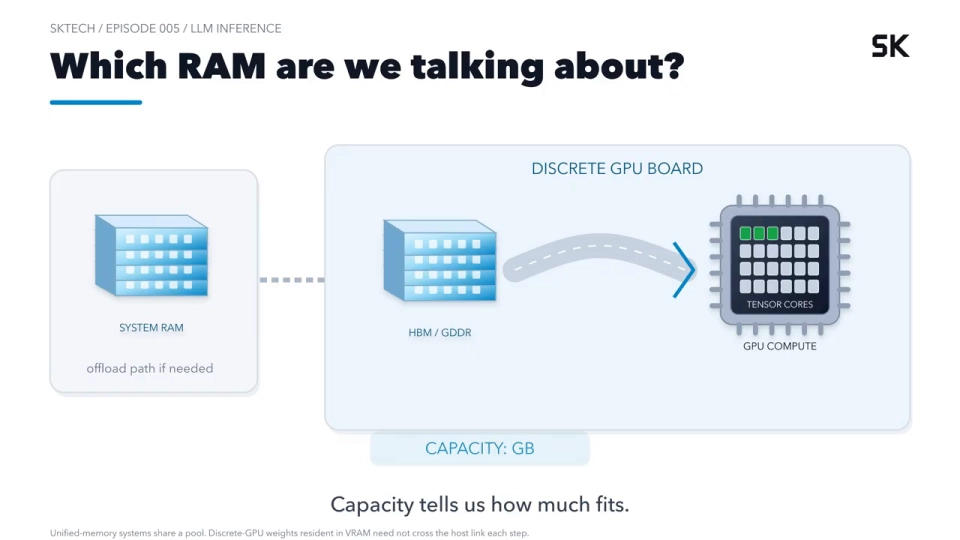
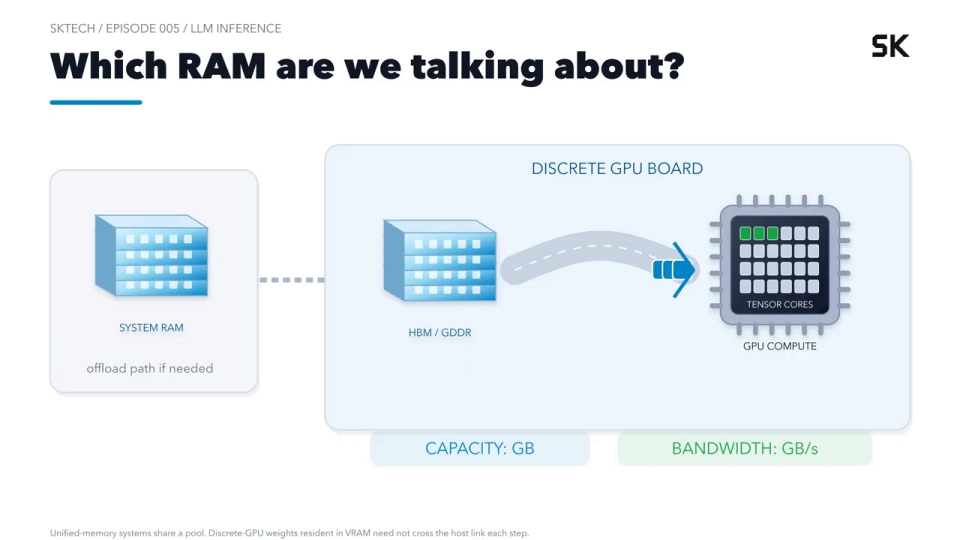
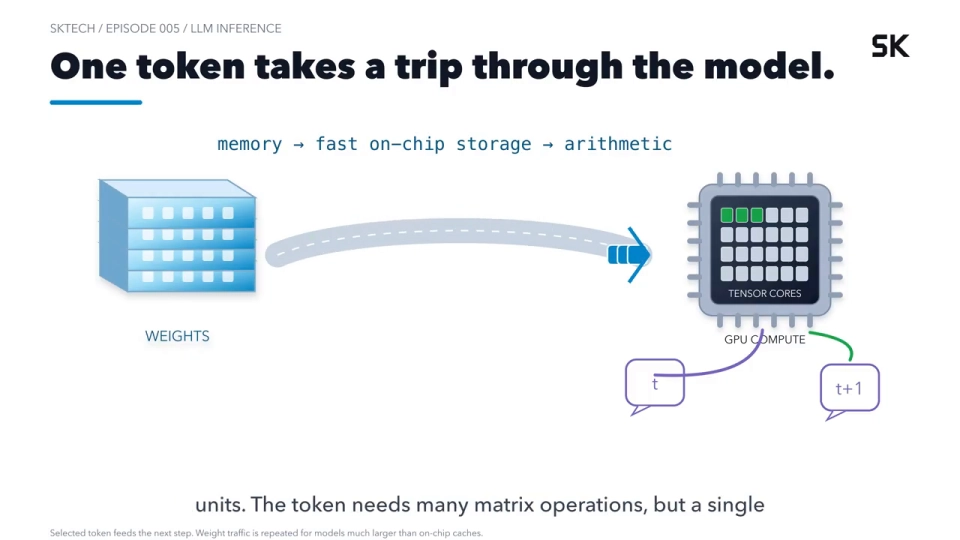
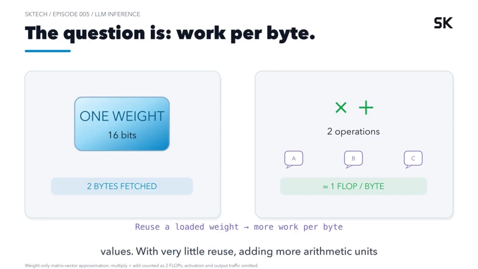
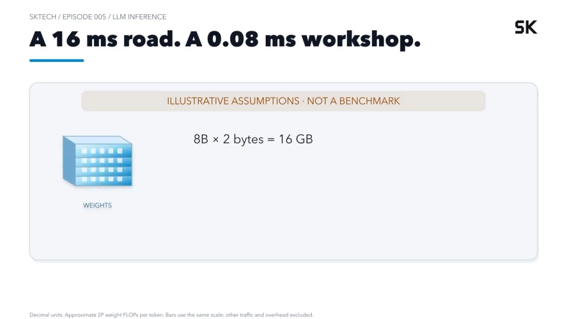
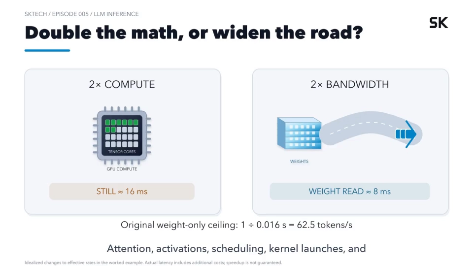
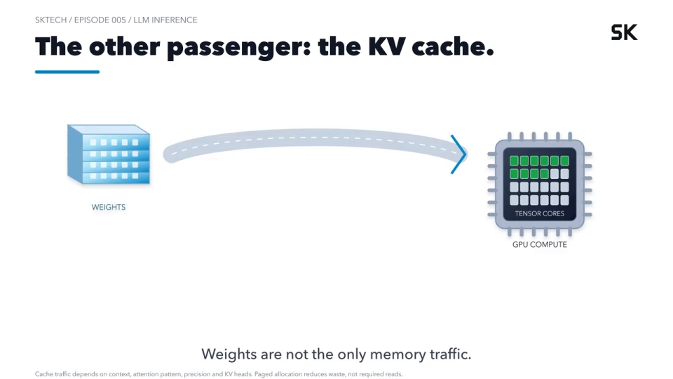
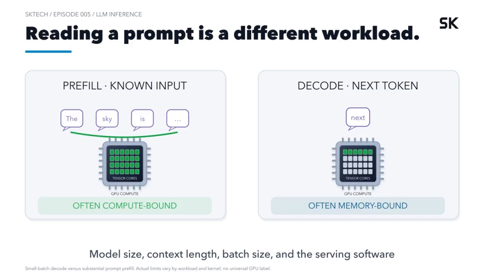
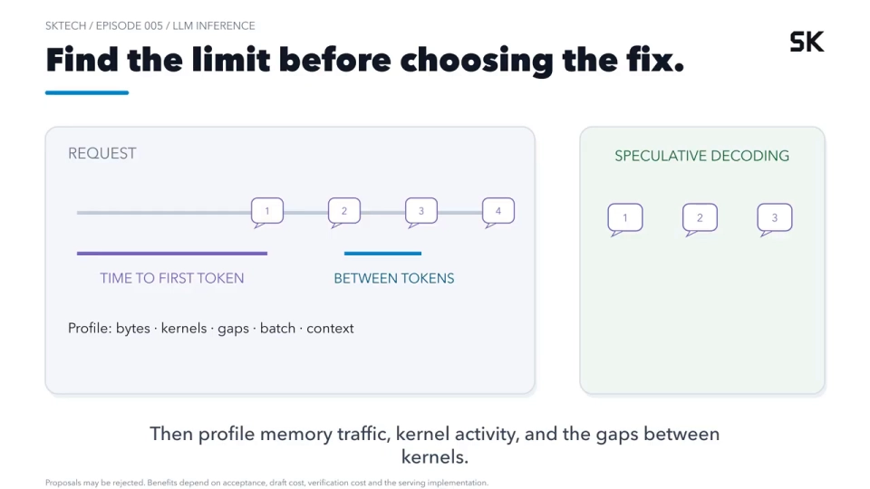

# 权重只读一次，却要为每个 Token 重搬一遍：算力翻倍无效、带宽翻倍减半的那笔访存账

> 视频来源：[Why LLM Token Generation Is Bottlenecked by RAM Bandwidth, Not GPU Compute](https://www.youtube.com/watch?v=oo_5FAFLxjc)（YouTube · SKTechDev，LLM Inference 系列第 5 集）｜时长约 7 分 21 秒
> 简要导读：这支视频只做一件事——把「每生成一个 token 要搬多少字节」算成两道可以手算的除法，然后做一个可证伪的预测：算力翻倍，每步时间不变；带宽翻倍，每步时间减半。它最大的价值在于把「下界」和「预测」严格分开，并逐条列出实测低于下界的原因。GEMV 形状与算术强度等于 1 的推导见 1.2.1，本文只引用结论。

## 本讲要解决的核心问题（SCQA）

**背景**：一块 GPU 每秒能做上百万亿次浮点运算。而一个大语言模型写答案时，词是一个一个往外挤的。

**冲突**：直觉会说「写比读难，所以慢」。可事实相反——同一份权重、同一块卡，读一段长文档（Prefill）不到半秒，写一段话却要好几秒。更奇怪的是，很多人在讨论推理性能时还在看 TFLOPS，而 decode 的速度对 TFLOPS 完全不敏感。

**疑问**：一个 token 从显存到算完，到底走了哪些路、搬了多少字节？这些字节为什么下一步又要重搬？如果瓶颈真是搬运，那么「算力翻倍」和「带宽翻倍」这两个改动，哪一个能让每步时间变短？按这个模型算出来的 tok/s 是不是就是实际能跑到的速度？如果不是，差在哪？

**回答（中心思想）**：**在大模型、小 batch、单请求这三个前提下，每生成一个 token 都要把全部权重从显存搬到计算单元一次，而每个权重只被用一次就丢掉。** 于是每步耗时由「权重字节数 ÷ 有效带宽」定住，算力几乎不参与。8B 模型在 fp16 下是 16 GB，按 1 TB/s 的有效带宽算是 16 ms，而同样的运算量在 200 TFLOPS 的算力下只要 0.08 ms——**搬运比计算慢 200 倍**。由此得到一个可证伪的预测：算力翻倍，每步仍是 16 ms；带宽翻倍，每步变成 8 ms。这个 16 ms 对应约 62 tok/s 的「权重-only 天花板」，它是上界而不是预测值：注意力、激活值、调度、kernel 启动、通信都会来分账，真实硬件也常常达不到标称带宽。

---

## 一、先分清「装得下」和「喂得动」

### 1.1 这里的 RAM 指什么

视频开场先做了一次名词澄清，因为「权重每步都要从内存搬到 GPU」这句话很容易被误解成「每生成一个 token 就要从硬盘或系统内存重新加载模型」。



[【跳转到 00:33】](https://www.youtube.com/watch?v=oo_5FAFLxjc&t=33)

视频的界定是：

- 在独立 GPU 上，权重通常常驻**显存**（HBM 或 GDDR）。它们**不会**每个 token 都从系统内存跨主机链路过来。
- 统一内存（unified memory）系统共享同一个物理内存池。如果权重被 offload 到系统内存，那么系统内存的带宽和它与 GPU 之间的连接就会变成**额外的**限制。

**这条澄清很重要，因为它把「权重重复搬运」的范围限定在了 GPU 内部：** 每步搬的是 16 GB 从 HBM 到计算单元，不是 16 GB 从硬盘到显存。前者是纳秒到微秒级的片外访存，后者是毫秒级的 IO——两者差三个数量级，混为一谈会得出完全错误的优化方向。

### 1.2 容量是 GB，带宽是 GB/s，两者不能互相替代

视频给了一句很朴素的判断：

> 容量告诉我们能装下多少；带宽告诉我们每秒能移动多少字节。**一个更大的仓库，不会自动给你一条更宽的路。**



[【跳转到 01:06】](https://www.youtube.com/watch?v=oo_5FAFLxjc&t=66)

这句话在工程上有两个直接推论：

1. **买显存更大的卡，不解决 decode 慢。** A100 的 40 GB 版和 80 GB 版容量翻倍，带宽只从约 1.6 TB/s 涨到约 2.0 TB/s（涨 25%，不是翻倍）——容量翻倍几乎不带来单用户 decode 提速。
2. **反过来，装不下的时候带宽再好也没用。** 这就是 1.2.2 另一篇里 70B fp16 需要两张 H100 的原因。

**decode 的性能问题属于第二列（带宽），不属于第一列（容量）。** 这是本节全部论证的起点。

---

## 二、一个 token 要走完整个模型，然后下一个 token 再走一遍

### 2.1 一趟完整的路

视频把 decode 的一步画成一条单向的路：



[【跳转到 01:23】](https://www.youtube.com/watch?v=oo_5FAFLxjc&t=83)

用文字描述这条路：

```
token t 的隐藏向量
   ↓ 第 1 层：从 HBM 读该层全部权重 → 片内 SRAM → 乘加 → 写回
   ↓ 第 2 层：从 HBM 读该层全部权重 → 片内 SRAM → 乘加 → 写回
   ↓ …（共 L 层）
   ↓ lm_head：从 HBM 读输出头权重 → 得到词表上的分数
   ↓ 采样
token t+1
   ↓ 回到第 1 层，把上面整条路再走一遍
```

视频特别强调了两件事：

- **一个大而稠密的模型，无法把全部权重留在芯片的小而快的缓存里。** 这是第四节要算的账。
- **「这些权重流量中的很大一部分，会在下一个解码步重复。」** 这是「重复搬运」四个字的准确含义：不是重复计算，是重复搬运。

### 2.2 每个权重被用几次

视频把镜头推到单个权重上：



[【跳转到 02:06】](https://www.youtube.com/watch?v=oo_5FAFLxjc&t=126)

$$
\frac{2\ \text{次运算}}{2\ \text{字节}} \;=\; 1\ \text{FLOP/Byte}
$$

视频紧接着给了一句很好的概括：**「Tensor Core 擅长的是一个被载入的权重被许多个值复用。而这里几乎没有复用，所以增加更多算术单元，并不能解决投递问题。」**

> 「算术强度 = 1」的完整推导、以及这个值在 Roofline 上为什么落在斜线最左端，1.2.1 已经写过，本文不重复。本文只用一个更朴素的说法：**每个字节被搬进来，只换来一次乘加，然后就作废了。**

### 2.3 真正该问的问题

视频在这里做了一次提问方式的转换，值得单独抄下来：

> 有用的问题不是「GPU 能做多少运算」，而是「**每一个取回来的字节，支撑了多少工作**」。

这个提问方式的转换，把「优化推理」从「找更快的算子」变成了「提高字节的利用率」。后面所有的技巧——batch、量化、投机采样、FlashAttention——都是对这个比值的改动。

---

## 三、把账算到毫秒：16 ms 的路，0.08 ms 的车间

### 3.1 视频的算例（它明确声明是示意，不是基准测试）



[【跳转到 02:31】](https://www.youtube.com/watch?v=oo_5FAFLxjc&t=151)

前提：

- 8B 稠密模型，每个权重 2 字节 → **16 GB 权重**
- 有效显存带宽 **1 TB/s**（视频强调这是取整的假设值）
- 算力 **200 TFLOPS**

**第一笔账，搬：**

$$
t_{\text{mem}} \;=\; \frac{16\ \text{GB}}{1\ \text{TB/s}} \;=\; 16\ \text{ms}
$$

**第二笔账，算：** 权重-only 的运算量约等于「每个参数 2 次运算」，即 16 GFLOP：

$$
t_{\text{compute}} \;=\; \frac{16 \times 10^{9}\ \text{FLOP}}{200 \times 10^{12}\ \text{FLOP/s}} \;=\; 0.08\ \text{ms}
$$


[【跳转到 02:31】](https://www.youtube.com/watch?v=oo_5FAFLxjc&t=151)

**16 ms 对 0.08 ms，差 200 倍。** 视频的结论是：「即使完美重叠，也不可能在更慢的那个资源之前完成。」

这句话的技术含量在于「完美重叠」四个字。现代 GPU 确实会把访存和计算重叠起来——一边等下一块权重，一边算上一块。但重叠的上限是 $\max(t_{\text{mem}}, t_{\text{compute}})$，不是两者之和，也**不可能小于**两者中较大的那个。当 $t_{\text{mem}}$ 是 $t_{\text{compute}}$ 的 200 倍时，重叠做得再好，也只能把总时间压到 16 ms 附近。

### 3.2 顺手得到一个天花板

$$
\text{tokens/s} \;\le\; \frac{1}{0.016\ \text{s}} \;=\; 62.5
$$

视频的原话是「16 毫秒对应约 62 tokens/s 的权重-only 天花板，**它不是一个承诺的生成速度**」。

**「权重-only」这个定语是关键。** 它意味着这个数字只算了权重这一项流量，没算注意力、没算激活值、没算 KV Cache、没算调度开销。所以它是**乐观上界**：真实系统只会更慢。

---

## 四、做一个可证伪的预测：算力翻倍没用，带宽翻倍减半

视频在这里做了一件很好的事：它没有停在「所以是访存受限」，而是用公式做了一个**能被实验打脸**的预测。



[【跳转到 03:29】](https://www.youtube.com/watch?v=oo_5FAFLxjc&t=209)

| 改动 | 每步耗时 | 为什么 |
| --- | --- | --- |
| 算力翻倍（200 → 400 TFLOPS） | **仍是约 16 ms** | 计算那 0.08 ms 变成 0.04 ms，但 16 GB 还是得走完 |
| 带宽翻倍（1 → 2 TB/s） | **约 8 ms** | 分母翻倍，字节数不变 |

**这个预测的检验成本很低**：找两块算力不同、带宽相同的卡，或者同一块卡上跑不同精度的权重，看 tok/s 跟着哪一个变。

视频的措辞很谨慎：「在我们理想化的模型里，把有效内存带宽翻倍会把权重读取的估算降到 8 毫秒。」——它说的是「估算」，不是「实测」。**这个区分很重要：模型给出的是趋势和量级，实测才是结论。**

> **补充一句对照（讲者未展开）**：这条预测的反面同样成立——如果把权重从 16 位换成 4 位，字节数变成四分之一，$t_{\text{mem}}$ 也变成四分之一。所以「带宽翻倍」和「精度减半」在数学上是同一件事的两种做法，一个改分母，一个改分子。量化的算法细节归第 7 章。

---

## 五、下界不是预测：那 16 ms 之外还有谁在分账

视频在给出 62 tok/s 之后，立刻列了一串「但是」：

> 注意力、激活值、调度、kernel 启动，以及通信都在工作。**真实硬件也可能远低于它标称的峰值带宽。**

这句话可以拆成两类问题，值得分开处理：

### 5.1 第一类：额外的流量（分母变大）

| 额外流量 | 是什么 | 量级 |
| --- | --- | --- |
| KV Cache 读写 | 每步要读历史 token 的 K/V，还要写入新 token 的 K/V | 与上下文长度成正比 |
| 激活值与中间结果 | 每层的输出、LayerNorm 的中间量要过一遍 HBM | 与 batch × 隐藏维度成正比 |
| 注意力本身的读写 | QK^T、softmax、加权求和的中转 | 与上下文长度成正比 |

**在短上下文、小 batch 时，这些项相对 16 GB 权重是小头；上下文一长，它们就开始抢戏。** 视频专门用一段讲了这件事（见第六节）。

### 5.2 第二类：带宽打不满（分母变小）

| 打不满的原因 | 机制 |
| --- | --- |
| kernel 启动开销 | 每层要发多个 kernel，SM 在等下一个 kernel 上线时是空的 |
| 访存不连续 | 权重按 tile 读取，边界不对齐时有效带宽低于峰值 |
| SM 占用率不足 | 单行输入能并行的独立工作太少，铺不满所有 SM，于是带宽也打不满 |
| 通信（张量并行） | 跨卡 all-reduce 与计算争时间（补充，讲者未展开） |
| 标称带宽本身偏乐观 | 厂商标称的是理论峰值，实际可持续带宽通常更低 |

**视频那句「真实硬件也可能远低于它标称的峰值带宽」是本节最实用的一句提醒。** 拿标称带宽算出来的 tok/s 是**上界**，不是预测值。真实系统能达到标称带宽的 60%–80% 已经算不错——这个「实测 ÷ 理论」的比值，另一篇里用 MBU 这个指标量化过。

### 5.3 所以这个模型什么时候有效

视频给了一个明确的前提边界，这是它比很多同类讲解严谨的地方：

> **对于一个大而稠密的模型、每个请求生成一个 token、在小 batch 下，反复取权重会主导这一步。**

三个条件缺一不可：

- **大而稠密**：MoE 模型每步只激活一部分专家，字节数不等于总参数量。
- **单请求 / 小 batch**：batch 一大，一次搬运就服务多个 token，权重项被摊薄。
- **decode 阶段**：Prefill 一次搬运服务 $S$ 个 token，完全不同的账。

**离开这三个条件，这个模型就不适用。** 记住边界比记住结论更重要。

---

## 六、权重不是唯一的乘客：KV Cache

视频用一句话把 KV Cache 引入：「权重不是唯一的内存流量。」



[【跳转到 04:52】](https://www.youtube.com/watch?v=oo_5FAFLxjc&t=292)

视频把这件事讲得很有分寸：

- KV Cache **避免**了每一步重算历史 token 的表示——这是它的功劳。
- 但注意力**仍然必须访问**它——这是它的账单。
- 上下文变长时，缓存的**空间和带宽**都会变成可观的量。
- 具体成本取决于注意力设计：GQA 让多个查询头共享同一组 K/V 头，能显著减少缓存量。
- 更好的缓存管理（例如分页分配）能腾出空间给更多请求，但**不会让注意力的数据移动消失**。

视频的结论句是：**「长上下文解码会同时被缓存流量和权重流量限制。」**

> 这一句正好是 1.3 系列的入口：KV Cache 的精确公式、GQA 与滑动窗口的容量收益、PagedAttention 的碎片治理，都在那里。本文只需要记住它对「权重搬运」这件事的影响：**它不减少权重字节数，只是往分母上再加一项。**

---

## 七、Prefill 和 Decode 是两个不同的负载

视频用一张对照图把两阶段分开：



[【跳转到 05:56】](https://www.youtube.com/watch?v=oo_5FAFLxjc&t=356)

| | Prefill | Decode（小 batch） |
| --- | --- | --- |
| 输入 | 整段 prompt，$S$ 个 token 全部已知 | 1 个新 token（每请求） |
| 权重被复用次数 | $S$ | 1 |
| 常见瓶颈 | 计算 | 访存带宽 |
| 用户感知 | 首字延迟（TTFT） | 每 token 间隔（TPOT） |

视频在这里做了一个很重要的限定：**「这两个标签都不适用于每一个 kernel、每一次部署。」** 模型规模、上下文长度、batch size、服务框架都会改变平衡。

它还补了一句很实用的观察：**「一个 prompt 出现得慢，和一个答案生成得慢，即使在完全相同的 GPU 上，也可能有完全不同的原因。」**

**这句话的实践含义是：不要用一个「GPU 利用率」数字去诊断两种不同的慢。** 首字慢要去查 Prefill 的算力与排队；出词慢要去查带宽与 kernel 间隙。

---

## 八、诊断顺序：先找到限制，再选药方

### 8.1 视频给的诊断清单



[【跳转到 06:21】](https://www.youtube.com/watch?v=oo_5FAFLxjc&t=381)

视频给的步骤可以整理成一张检查表：

1. **把首字延迟（TTFT）和 token 间隔（TPOT）分开测。** 两者对应不同的阶段，混在一起测等于什么都没测。
2. **记录四个上下文量：batch size、上下文长度、模型格式（精度）、硬件。** 缺一个，数字就不可比。
3. **profile 三样东西：内存流量、kernel 活动、kernel 之间的空隙。** 第三项最容易被忽略，但它常常是「带宽没打满」的直接原因。
4. **不要用「GPU 活动率高」判断 Tensor Core 饱和。** 视频的原话是：高 GPU 活动率本身**不能**告诉你 Tensor Core 是否饱和。搬运数据时 GPU 也是「忙」的。
5. **做对照实验：换一个小一点的权重格式，或换一个 batch size，同时比较延迟和吞吐。** 只比一个指标会得出错误结论。

### 8.2 一个补充的量化口径（讲者未展开）

上面第 5 步的「对照实验」，可以用一个很简单的比值来读：

$$
\text{带宽利用率} \;\approx\; \frac{\text{每 token 字节数} \div \text{每 token 耗时}}{\text{标称带宽}}
$$

- 这个值在 70% 以上：已经贴着带宽墙，只能靠「减少字节」或「提高复用」。
- 这个值在 40% 以下：先查 kernel 间隙、访存连续性、并行度，而不是怀疑带宽不够。

**先算下界、再测实际、然后看比值**——这个顺序能避免最常见的错误：把实现问题当成硬件问题，或者反过来。

---

## 九、结论：这句话的适用边界

视频的收尾把整篇压缩成一段话，值得逐句读：

> 对于一个大而稠密的模型，在较小的 batch size 下为每个请求生成一个 token 时，**反复取权重会主导这一步**。更快的算术本身无法消除那部分流量。**更宽的有效带宽、更少的字节、更有用的复用**能帮上忙。但瓶颈会随负载移动，所以要测量你实际运行的那个系统。

这段话里有三个可操作的动词，正好对应三条优化路线：

| 动词 | 做法 | 后续 |
| --- | --- | --- |
| 更宽的有效带宽 | 换带宽更高的卡；或者提高现有带宽的利用率（减少 kernel 间隙、改善访存连续性） | 本文第八节 |
| 更少的字节 | 量化（fp16 → int8 → int4）、稀疏化 | 第 7 章 |
| 更有用的复用 | 增大 batch，让一次搬运服务多个 token；投机采样让一次搬运验证多个候选 | 1.2.3、第 6 章 |

**这三条路线的数学位置完全不同**：第一条改分母（有效带宽），第二条改分子（字节数），第三条改「每字节被用几次」。而它们都作用在同一个式子上：

$$
t_{\text{token}} \;\ge\; \frac{\text{每步要搬的字节数}}{\text{有效带宽}}
$$

**只要 batch 还是 1、权重还是 fp16、模型还是稠密的，这个式子的分子就是模型文件的大小，一分都少不了。** 这就是「权重重复搬运困境」这个名字的全部含义——它不是实现缺陷，是 decode 这个工作负载的形状决定的。

---

## 小结

- **先分清容量与带宽**：容量是 GB，决定装不装得下；带宽是 GB/s，决定喂不喂得动。加显存不会加带宽，decode 的问题是后者。
- **权重常驻显存，但每步仍要过一遍 HBM**：不是从硬盘或系统内存重载，而是从 HBM 搬到计算单元。这一趟每生成一个 token 就要重走一次。
- **每个权重只被用一次**：16 位权重占 2 字节，换来约 2 次运算，约 1 FLOP/Byte。增加算术单元解决不了投递问题。
- **两笔账差 200 倍**：8B fp16 是 16 GB，按 1 TB/s 要 16 ms；同样的运算量在 200 TFLOPS 下只要 0.08 ms。
- **预测可证伪**：算力翻倍，每步仍是约 16 ms；带宽翻倍，每步约 8 ms。16 ms 对应约 62 tok/s 的权重-only 天花板。
- **天花板不是预测**：注意力、激活值、调度、kernel 启动、通信都在分账，真实硬件也常达不到标称带宽。
- **KV Cache 是第二个乘客**：它省掉重算，但不减少权重字节，只是往分母上再加一项；上下文越长越重。
- **Prefill 与 Decode 是两个负载**：同一份权重，一个搬一次服务 $S$ 个 token，一个搬一次只服务 1 个。首字慢和出词慢原因不同，不能混测。
- **诊断顺序**：分开测 TTFT 与 TPOT → 记录 batch/上下文/格式/硬件 → profile 字节、kernel、kernel 间隙 → 做格式与 batch 的对照实验。高 GPU 活动率不等于 Tensor Core 饱和。
- **三条出路**：更宽的有效带宽、更少的字节（量化）、更有用的复用（batch、投机采样）。

## 关键术语速查

| 术语 | 一句话解释 |
| --- | --- |
| 有效带宽 | 实际能达到的显存带宽，通常低于厂商标称峰值。decode 的下界要用它做分母。 |
| 容量 vs 带宽 | 容量（GB）决定模型装不装得下，带宽（GB/s）决定每步喂不喂得动。两者不可互换。 |
| 权重-only 天花板 | 只计算权重流量得到的 tok/s 上界，等于带宽 ÷ 权重字节数。真实系统一定更低。 |
| 完美重叠 | 让访存与计算并行。它的上限是两者中较慢的那个，不是两者之和，也不可能更小。 |
| 激活值 | 每层计算的中间结果，需要写回再读出 HBM，是权重之外的额外流量。 |
| KV Cache | 缓存历史 token 的 K/V。省掉重算，但每步仍要读，且随上下文长度线性增长。 |
| TTFT / TPOT | 首字延迟 / 每 token 间隔。前者对应 Prefill，后者对应 Decode，必须分开测。 |
| kernel 间隙 | 相邻 kernel 之间 SM 空转的时间。它是「带宽没打满」的常见原因。 |
| GQA | Grouped-Query Attention，多个查询头共享一组 K/V 头，能显著减少 KV Cache 的容量与带宽。 |
| 权重复用次数 | 同一份权重被几个 token 共用。单请求 decode 是 1，Prefill 是 $S$，batch 是 $B$。 |