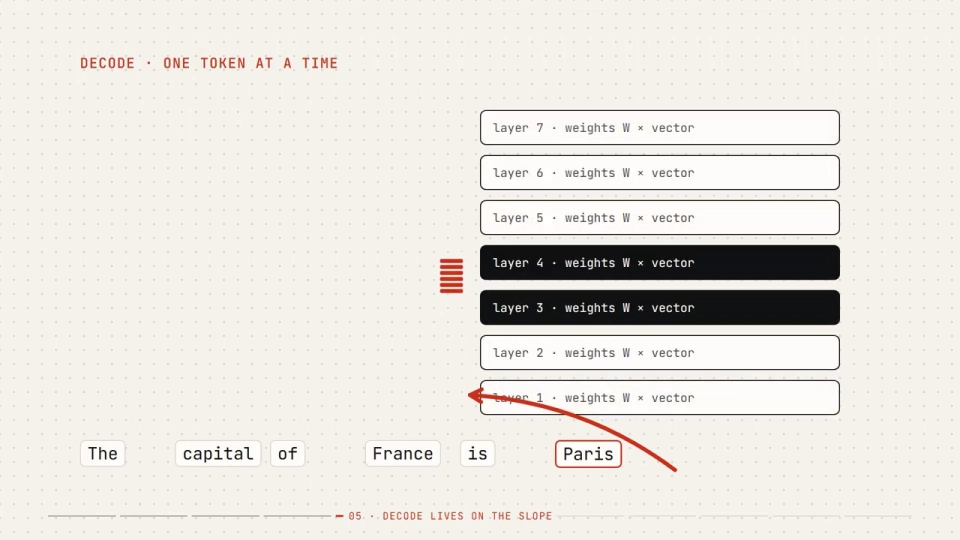
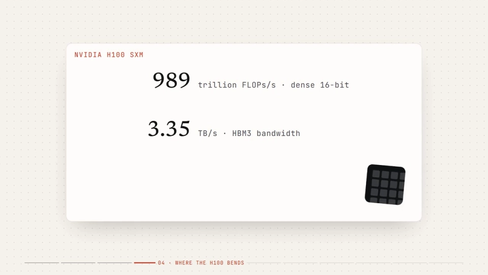
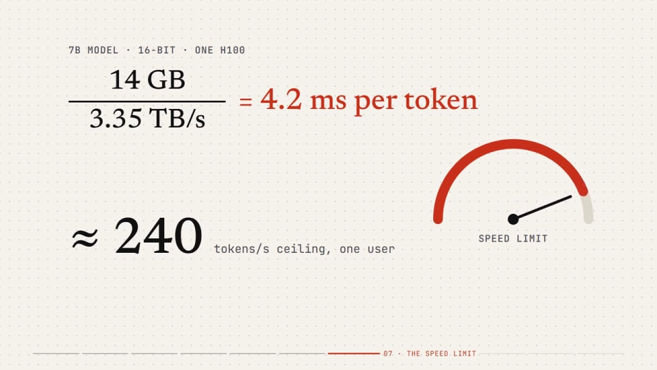
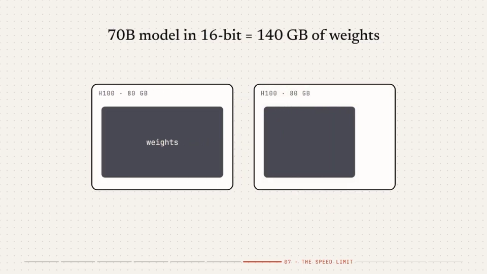
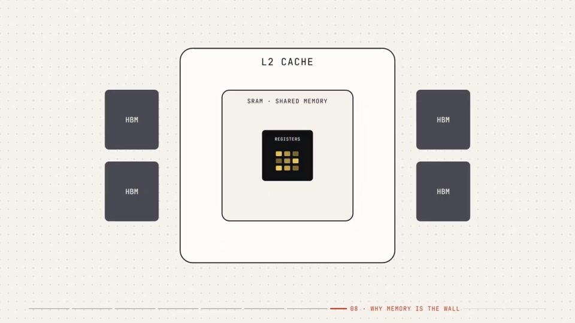
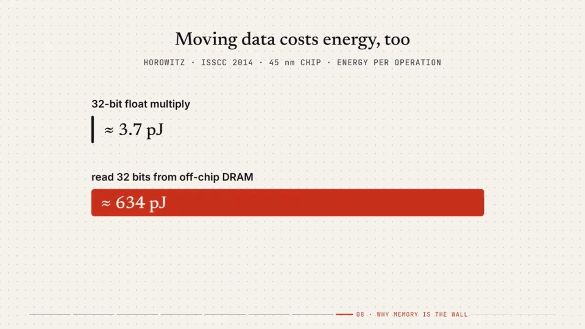
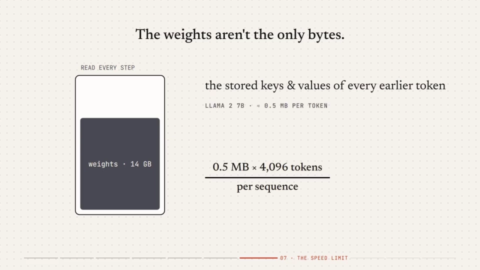
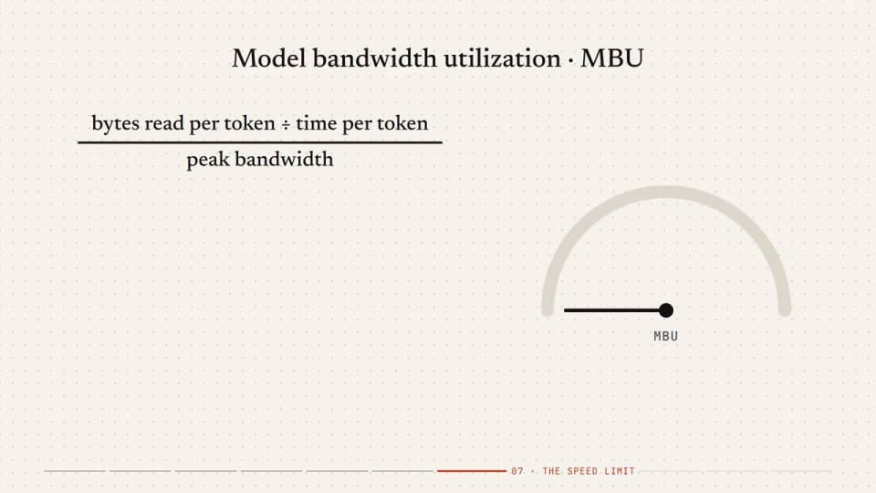
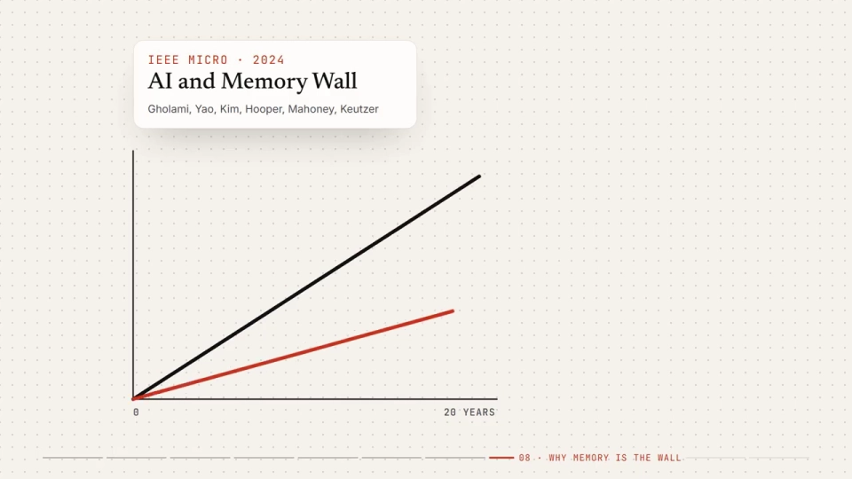

# 每生成一个 Token 都要把全部权重从 HBM 搬一遍：每 Token 延迟下界就是「权重字节数 ÷ 带宽」

> 视频来源：[Why LLMs Are Memory-Bound](https://www.youtube.com/watch?v=_LfMpQmC0VM)（YouTube · unicodesnwrites，LLM Inference 系列第 3 集）｜时长约 12 分 59 秒
> 简要导读：这支视频把「decode 慢」这件事算成一道可以手算的除法：先用 H100 的真实规格算出 7B 模型的每 Token 延迟下界 4.2 ms 与 240 tok/s 的天花板，再逐级拆开 GPU 的存储层次说明为什么 L2 帮不上忙，最后用 MBU（模型带宽利用率）把「实测离下界有多远」变成一个可测的百分比。本文只取「权重重复搬运」这条主线；GEMV 形状与算术强度等于 1 的推导见 1.2.1，Roofline 屋脊点的完整读法见 1.1.2，本文只引用结论。

## 本讲要解决的核心问题（SCQA）

**背景**：NVIDIA H100 SXM 在 16 位精度下有约 989 TFLOPS 的密集算力，HBM3 带宽约 3.35 TB/s。按任何常识，这是一台快到「算不完」的机器。

**冲突**：可只要它是在给一个用户写答案，计算单元就有超过 99% 的时间在空转。同一块卡、同一份权重，换成处理 prompt（Prefill）却能接近峰值。更刺眼的是：把算力翻倍，单用户生成速度**一点都不会变快**。

**疑问**：生成一个 token 到底要搬多少字节？这些字节为什么每一步都要重搬一遍、而不是留在片内？瓶颈具体落在哪一级存储——寄存器、SRAM、L2 还是 HBM？把「每秒能出多少 token」写成一个只含字节数和带宽的式子，能算出什么可验证的数字？实测又为什么比这个数字低？

**回答（中心思想）**：**每生成一个 token，模型的全部权重都要从 HBM 重新流经一次计算单元，一个字节都省不掉；因此每 Token 延迟有一个与算力无关的下界——权重字节数除以 HBM 带宽。** 对 7B fp16 模型在 H100 上，这个下界是 $14\ \text{GB} \div 3.35\ \text{TB/s} \approx 4.2\ \text{ms}$，对应约 240 tok/s 的单用户天花板；70B fp16 是 140 GB，连一张 80 GB 的 H100 都装不下。瓶颈落在 **HBM 这一级**：L2 只有 50 MB，装不下 14 GB 的权重，所以缓存命中率对 decode 几乎无用。这条下界是结构性的——二十年来算力每两年涨约 3 倍、DRAM 带宽只涨约 1.6 倍，差距还在扩大。

---

## 一、先把「一次 decode 要搬多少字节」写成一行乘法

### 1.1 权重字节数 = 参数量 × 每参数字节

这是全篇唯一需要记住的公式，也是后面所有数字的来源：

$$
\text{权重字节数} \;=\; \text{参数量} \times \text{每个参数占用的字节数}
$$

- **参数量**：模型文件里一共有多少个可训练的数（权重矩阵的元素个数之和）。
- **每参数字节**：存储精度决定。fp16 / bf16 是 2 字节，int8 是 1 字节，int4 是 0.5 字节。

视频用它算的第一个例子是 7B 模型：

$$
7 \times 10^{9}\ \text{个参数} \times 2\ \text{字节/参数} \;=\; 14\ \text{GB}
$$

**这 14 GB 就是「一次 decode 前向要搬的字节数」的主体。** 注意它不是「模型占多少显存」——虽然数值一样——而是「每生成一个 token，有多少字节必须从 HBM 走到计算单元附近」。这两件事在 decode 里恰好数值相等，正是本节要讲的困境的来源。

### 1.2 逐层拆开：这 14 GB 花在哪里

视频没有逐层拆，但它的公式可以直接往下拆。**以下按 Llama-2 7B 的结构做一次分解（补充推导，不是讲者原话）**：32 层、隐藏维度 $d = 4096$、FFN 中间维度 $d_{ff} = 11008$、词表 32000、32 个注意力头、头维度 128（这个经典多头设计里 KV 头数也是 32，所以 KV 投影宽度等于 $d$）。

每一层的参数量：

| 组件 | 形状 | 参数量 |
| --- | --- | --- |
| QKV 投影 | $d \times (d + 2d_{kv})$ | $4096 \times 12288 \approx 50.3\text{M}$ |
| 输出投影 O | $d \times d$ | $4096 \times 4096 \approx 16.8\text{M}$ |
| FFN 门控 + 升维 + 降维 | $3 \times d \times d_{ff}$ | $3 \times 4096 \times 11008 \approx 135.3\text{M}$ |
| 两个 LayerNorm | $2 \times d$ | $8192$ |

乘 32 层，再加上词嵌入与输出头（Llama-2 7B 里两者共享）：

| 组件 | 参数量 | 占比 | fp16 字节数 |
| --- | --- | --- | --- |
| FFN 三个矩阵 | 4.33 B | 64% | 8.66 GB |
| QKV 投影 | 1.61 B | 24% | 3.22 GB |
| 输出投影 O | 0.54 B | 8% | 1.07 GB |
| 词嵌入 + lm_head | 0.26 B | 4% | 0.52 GB |
| LayerNorm 参数 | 0.26 M | 0.004% | 0.5 MB |
| 合计 | 6.74 B | 100% | 13.5 GB |

[【跳转到 05:38】](https://www.youtube.com/watch?v=_LfMpQmC0VM&t=338)

这张图是本节最该盯住的一张：**「一层」不是一次计算，而是一次完整的权重搬运。** 32 层意味着 32 次串行的「搬权重—算一下—再搬下一层」。

三个可以直接记的结论：

1. **FFN 吃掉了近三分之二的字节。** 所以任何「只优化注意力」的方案，对 decode 的每 Token 延迟影响都有限——注意力的权重只占 32%。
2. **LayerNorm 可以忽略。** 26 万个参数、0.5 MB，占 0.004%。它重要是因为数值稳定性，不是因为带宽。
3. **词嵌入与 lm_head 只占 4%。** 但它有一个特殊性质：lm_head 的输出宽度是词表大小（32000），是 decode 里少数「输出比输入宽得多」的地方。

视频用的是取整后的 7B：$7 \times 10^9 \times 2 = 14$ GB。精确的 Llama-2 7B 是 6.74 B 参数、13.5 GB。**两者差 4%，不影响任何结论**——后面所有算例都用视频的 14 GB。

### 1.3 7B / 13B / 70B 在三种精度下的字节数

把公式套到三个常见规模上（数字按 7B、13B、70B 取整）：

| 模型 | fp16（2 B/参数） | int8（1 B/参数） | int4（0.5 B/参数） |
| --- | --- | --- | --- |
| 7B | 14 GB | 7 GB | 3.5 GB |
| 13B | 26 GB | 13 GB | 6.5 GB |
| 70B | 140 GB | 70 GB | 35 GB |

这张表是后面所有「能不能装下」「每秒能出多少 token」的计算底稿。**它只有一列自变量：每个参数占几个字节。** 第 7 章的量化技术，本质上就是在动这一列。

---

## 二、这 14 GB 每个 token 都要重搬一遍，与序列长度无关

### 2.1 视频给出的那条除法

H100 的真实规格（视频画面直接给出）：

[【跳转到 04:55】](https://www.youtube.com/watch?v=_LfMpQmC0VM&t=295)

于是：

$$
t_{\text{token}} \;\ge\; \frac{14\ \text{GB}}{3.35\ \text{TB/s}} \;\approx\; 4.2\ \text{ms}
$$

[【跳转到 08:11】](https://www.youtube.com/watch?v=_LfMpQmC0VM&t=491)

取倒数就是吞吐天花板：

$$
\text{tokens/s} \;\le\; \frac{3.35\ \text{TB/s}}{14\ \text{GB}} \;\approx\; 240
$$

**「约 240 tokens/s」这个数字的分量在于它的定语：单用户、单卡、无论代码写得多聪明。** 视频的原话是「no matter how clever the code is」。它不是某个框架的性能，而是这块硅片在物理上允许的上限。

#### 换一张卡：分子不变，分母变

这条除法最好用的地方，是它能直接把「换硬件」翻译成「换分母」。**补充一组常见卡的计算（讲者只给了 H100，下面按同一公式套用公开的标称带宽）**：

| 卡 | HBM 带宽（标称） | 7B fp16 的 $t_{\min}$ | tok/s 天花板 | 70B fp16 的 tok/s 天花板 |
| --- | --- | --- | --- | --- |
| A100 40GB | 约 1.6 TB/s | 8.8 ms | 约 114 | 约 11 |
| A100 80GB | 约 2.0 TB/s | 7.0 ms | 约 143 | 约 14 |
| H100 SXM | 3.35 TB/s | 4.2 ms | 约 240 | 约 24 |

读这张表要注意三件事：

1. **A100 80GB 上 7B fp16 的上限约 143 tok/s**，H100 上约 240 tok/s。带宽涨了 1.7 倍，天花板也涨了 1.7 倍——**完全线性**。
2. **70B 在任何一张单卡上都只有两位数。** 这不是实现问题，是 140 GB 除以 2 TB/s 的算术结果。
3. **「标称」两个字要打折扣。** 真实可持续带宽通常低于标称值，所以这些数字是上界中的上界。

### 2.2 为什么「与序列长度无关」

这是本节最容易被误解的一点。KV Cache 让 decode 每一步只需要处理一个新 token（推导见 1.2.1），于是很多人以为「既然只算一个 token，那计算量就很小，应该很快」。

**但权重不是按 token 分片读取的。** 一个线性层要做 $y = Wx$，无论 $x$ 是 1 行还是 1000 行，$W$ 的每一个元素都必须被读进来参与运算。$x$ 只有 1 行时，$W$ 的每个元素只被用一次，然后就被丢掉了——**读进来的字节数一模一样，只是每个字节干的活变少了。**

所以：

- **序列长度不影响每步的权重字节数。** 第 10 个 token 和第 10000 个 token，都要读那 14 GB。
- **序列长度只影响 KV Cache 那部分字节。** 那是另一笔账，见第四节。
- **生成长度线性放大总访存量。** 生成 $N$ 个 token，权重就要被搬 $N$ 遍：

$$
\text{decode 总访存量} \;\approx\; N \times \text{权重字节数}
$$

生成 500 个 token 就是 $500 \times 14\ \text{GB} = 7\ \text{TB}$ 的权重流量。**这 7 TB 里，没有一个字节是「新的信息」——同一份权重被原封不动地搬了 500 次。**

### 2.3 和 Prefill 对照：同一份权重，一个搬一次服务 1 个 token，一个搬一次服务 S 个

视频把这个对照讲得很清楚：Prefill 时整段 prompt 的所有 token 一起穿过每一层，权重被读一次、服务 $S$ 行；Decode 时权重被读一次、只服务 1 行。

| | Prefill | Decode（batch = 1） |
| --- | --- | --- |
| 一次前向处理的位置数 | $S$（prompt 长度） | 1 |
| 权重搬运次数 | 1 | 1 |
| 权重字节摊到每个 token | 14 GB / $S$ | 14 GB |
| 1000 token 的 prompt / 输出 | 14 GB 总流量 | 14 TB 总流量 |

**同样是 1000 个 token，Prefill 花 14 GB 的权重流量，Decode 花 14 TB。差 1000 倍。** 这就是「首字很快、后面越写越慢」的全部算术来源——不是因为后面的词更难，而是因为前面的 1000 个 token 平摊了一次搬运，后面的每个 token 都要独自承担一次完整搬运。

> 算术强度为什么恰好等于 1、Roofline 上这个点为什么落在斜线最左端，1.2.1 已经完整推导过，这里不再重复。本节只关心一件事：**那个「1」在字节层面的具体数额是多少。**

---

## 三、70B 先撞容量墙，再撞带宽墙

### 3.1 140 GB 装不进 80 GB

把公式套到 70B：

$$
70 \times 10^{9} \times 2\ \text{字节} \;=\; 140\ \text{GB}
$$

而一张 H100 只有 80 GB 显存。

[【跳转到 08:23】](https://www.youtube.com/watch?v=_LfMpQmC0VM&t=503)

视频的措辞很克制：「它必须被切分到至少两张 GPU 上，而**每一个 token 仍然意味着把全部 140 GB 流过它们**。」

这句话有两个层次：

1. **容量墙**：装不下就得切。切分方式（张量并行、流水并行）是第 9 章的内容。
2. **带宽墙**：切分**不会减少总字节数**。每张卡各读自己那一半（70 GB），加起来还是 140 GB。所以「用两张卡」不会让每 Token 延迟减半——它只是让这件事**变得可能**。

> **补充（一句话，讲者未展开）**：张量并行还会额外引入 all-reduce 通信，把每层的部分和同步一次。这部分流量不在「权重字节数」里，但它同样占用互联带宽，是实测低于理论下界的原因之一，见第五节。

### 3.2 一张表看清「装得下 / 装不下」

以 80 GB 显存为界（H100 / A100-80GB）：

| 模型 | fp16 | int8 | int4 |
| --- | --- | --- | --- |
| 7B | 14 GB，单卡轻松 | 7 GB | 3.5 GB |
| 13B | 26 GB，单卡 | 13 GB | 6.5 GB |
| 70B | 140 GB，**至少 2 卡** | 70 GB，单卡勉强 | 35 GB，单卡 |

**注意 int8 那一格的「勉强」**：70 GB 权重装进 80 GB 之后，只剩 10 GB 给 KV Cache 和中间激活值。这就是「显存容量墙」如何反过来限制 batch size 的起点（1.2.3 与 2.3.2 会展开）。

---

## 四、瓶颈落在 HBM 这一级：L2 装不下，所以缓存救不了 decode

### 4.1 GPU 有四层存储，一层比一层大、一层比一层慢

视频把 H100 的存储层次报了一遍具体数字：

[【跳转到 09:39】](https://www.youtube.com/watch?v=_LfMpQmC0VM&t=579)

| 层级 | H100 上的容量 | 位置 |
| --- | --- | --- |
| 寄存器 | 每个 SM 数万字节量级 | 紧贴计算单元 |
| SRAM / 共享内存 | 每个 SM 最多 228 KB（132 个 SM） | 片内 |
| L2 Cache | 全芯片共享 50 MB | 片内 |
| HBM | 80 GB | 芯片旁边 |

视频的总结是「每往外一层，就更大、更远、更慢」。**但真正决定 decode 命运的是容量那一列，不是速度那一列。**

### 4.2 50 MB 对 14 GB：命中率在数学上就不可能高

这是本节的核心论证，值得单独写清楚：

- 要让权重「第二次被读到时不走 HBM」，它必须还在 L2 里。
- 但 L2 只有 **50 MB**，而 7B fp16 的权重是 **14 GB**。
- 两者差 **280 倍**。

也就是说，**即使 L2 命中率做到理论最优，也只能覆盖 0.36% 的权重**。而 decode 的访问模式是「从头到尾扫一遍、扫完再从头扫一遍」，每一遍的 14 GB 都远大于 50 MB，所以第二遍开始时，第一遍开头的数据早已被挤出。

**结论：decode 的有效带宽就是 HBM 带宽，L2 和 SRAM 在这件事上帮不上忙。** 视频里那句「the hard part of inference isn't the thinking, it's the fetching」，说的就是这条。

> **反向验证（补充）**：如果模型小到能整个装进 L2，情况会完全不同——那时有效带宽会跳一个数量级。这也是为什么端侧小模型（1B 以下、4 位量化后几百 MB）的 tok/s 常常「超出」按 HBM 带宽算出的预期。这个现象在 1.2.3 讨论 batch 时会再遇到一次。

### 4.3 搬运的代价还体现在能量上

视频引了 Mark Horowitz 在 ISSCC 2014 的经典估算（45 nm 工艺）：

[【跳转到 10:12】](https://www.youtube.com/watch?v=_LfMpQmC0VM&t=612)

$$
3.7\ \text{pJ} \quad\text{vs}\quad 634\ \text{pJ}
$$

**「取一个数」比「用一个数」贵一百多倍。** 这条数字解释了为什么 decode 不只是慢，还费电——每一瓦时里绝大部分花在搬运上，而不是花在乘加器上。视频没有展开能耗指标（joules/token），那属于 2.2 的度量体系。

---

## 五、实测离下界有多远：用 MBU 把差距量化

### 5.1 权重不是唯一的字节：KV Cache 也要读

视频专门提醒了一次：「权重不是唯一的字节。」

[【跳转到 08:40】](https://www.youtube.com/watch?v=_LfMpQmC0VM&t=520)

$$
0.5\ \text{MB/token} \times 4096\ \text{tokens} \;\approx\; 2\ \text{GB}
$$

于是每步要读的字节从 14 GB 变成 16 GB，天花板从 240 掉到约 210 tok/s。**KV Cache 不只是占显存，它还要和权重抢同一条 HBM 带宽管道。** 上下文越长，这笔账越重——长上下文 decode 的瓶颈会从「权重」逐渐转向「缓存」，这是 1.3 系列的主题。

### 5.2 MBU：一个只看带宽的评分

视频给了一个比「tokens/s」更能说明问题的指标——**模型带宽利用率（Model Bandwidth Utilization, MBU）**：

[【跳转到 08:53】](https://www.youtube.com/watch?v=_LfMpQmC0VM&t=533)

$$
\text{MBU} \;=\; \frac{\text{每 token 读取字节数} \div \text{每 token 耗时}}{\text{峰值带宽}}
$$

代入视频的例子：7B 模型每 6 ms 出一个 token，则

$$
\frac{14\ \text{GB}}{6\ \text{ms}} \approx 2.3\ \text{TB/s},\qquad \frac{2.3}{3.35} \approx 70\%
$$

**70% 的 MBU 意味着：实测已经吃到了理论带宽的七成，剩下的三成就是所有工程优化的空间。** 视频紧接着说了一句很关键的话：这里从头到尾没有出现 FLOPs。「对 decode 来说，计算利用率无论怎么做都很难看；带宽利用率才是告诉你离墙有多近的那个数。」

### 5.3 那 30% 去哪了

视频点出了几个方向，这里按「是否属于权重搬运」归类：

| 差距来源 | 机制 | 是否在「权重字节数」里 |
| --- | --- | --- |
| KV Cache 读写 | 每步还要读历史 K/V，并与新 token 的 K/V 写入 | 不在，是额外流量 |
| 注意力与激活值 | QK^T、softmax、输出投影的中间结果要过 HBM | 不在 |
| kernel 启动与调度间隙 | 每层要发多个 kernel，SM 在等下一个 kernel 上线的空档里空转 | 不在，是纯开销 |
| 访存不连续 | 权重按 tile 读取，边界不对齐时有效带宽低于峰值 | 在，但打了折 |
| 张量并行的 all-reduce | 每层同步部分和，跨卡通信与计算争时间 | 不在（补充） |
| SM 占用率不足 | 单行输入能并行的独立工作太少，铺不满所有 SM，带宽打不满 | 不在 |

视频的原话是「真实硬件也可能远低于它标称的峰值带宽」。**这句话是本节最实用的提醒：任何按标称带宽算出来的 tok/s 都是上界，不是预测值。**

> 上表里「SM 占用率不足」这一条，正是 1.2.3 要展开的内容：单请求的并行度只有输出宽度那么多，铺不满上万个计算单元，所以带宽也打不满。解决办法是把多个请求拼成一个 batch——但那是下一节的事。

### 5.4 一个可操作的诊断顺序

视频没有给完整的诊断清单，但它给的 MBU 定义本身就是一个诊断工具。**补充一个可落地的顺序（不是讲者原话）**：

1. 先算下界：权重字节数 ÷ 标称带宽，得到 $t_{\min}$。
2. 测实际每 Token 耗时 $t_{\text{real}}$，算 $\text{MBU} = t_{\min} / t_{\text{real}}$。
3. MBU 在 70% 以上：已经贴着带宽墙，只能靠「减少字节」或「提高复用」。
4. MBU 在 40% 以下：先怀疑 kernel 间隙、访存不连续、并行度不足，而不是怀疑带宽不够。

**先算下界，再谈优化**——否则你无法区分「硬件到顶了」和「实现太差了」。

---

## 六、为什么这是结构性的：差距还在扩大

### 6.1 二十年的两条斜率

视频引了 Gholami 等人 2024 年发表在 IEEE MICRO 的论文《AI and Memory Wall》：

[【跳转到 10:32】](https://www.youtube.com/watch?v=_LfMpQmC0VM&t=632)

| 指标 | 每两年增长 |
| --- | --- |
| 峰值算力 | 约 3 倍 |
| DRAM 带宽 | 约 1.6 倍 |

复利一算，屋脊点（算力 ÷ 带宽）就一直在往右滑。视频的说法是「这个数字多年来一直在变得更苛刻，因为芯片厂商加算力的速度快于加带宽的速度」。

**这条趋势是本节标题里「结构性」三个字的全部依据：**

- 换更贵的卡，算力涨得比带宽快，**decode 反而更吃亏**。
- 等下一代硬件，等来的是更宽的算力，不是等比例的带宽。
- 所以「权重重复搬运」不是某个实现的 bug，而是这个行业二十年的方向造成的结构性事实。

### 6.2 唯一的两条出路

视频把所有的推理优化技巧归结成一句话：**让 decode 那个点往右滑，靠近屋脊。**

而往右滑只有两种方式：

$$
\text{每字节的有用工作} \uparrow \quad\text{或}\quad \text{字节数} \downarrow
$$

| 路线 | 做法 | 本文之后去哪看 |
| --- | --- | --- |
| 提高每字节的复用 | 把多个请求拼成一个 batch，让一次权重搬运服务 $B$ 个 token | 1.2.3 |
| 减少字节数 | 量化：fp16 → int8 → int4，字节数按比例下降 | 第 7 章 |
| 减少字节数（另一条） | 投机采样：一次权重搬运验证多个候选 token | 第 6 章 |
| 减少非权重流量 | FlashAttention：把注意力的中间结果留在 SRAM，不回 HBM | 第 5 章 |

**注意第一行和后面三行的区别**：batch 不改变字节数，它改变的是「这些字节被用了几次」；量化和投机采样改变的是「需要搬多少字节」。两条路的数学位置完全不同，但都落在同一个式子的分子或分母上。

> 本节到此为止。batch 为什么能让 GEMV 变成 GEMM、为什么能提高计算单元利用率、代价是什么，全部留给 1.2.3；量化算法（GPTQ / AWQ / SmoothQuant）的细节留给第 7 章。这里只需要记住：**在 batch = 1 的前提下，权重字节数是不可谈判的，每 Token 延迟下界就是那道除法。**

---

## 小结

- **一行乘法**：权重字节数 = 参数量 × 每参数字节。7B fp16 = 14 GB，13B = 26 GB，70B = 140 GB；int8 减半，int4 再减半。
- **逐层拆开**：Llama-2 7B 的 13.5 GB 里，FFN 三个矩阵占 64%、QKV 投影占 24%、输出投影占 8%、词嵌入与 lm_head 占 4%、LayerNorm 只占 0.004%。**优化注意力最多只能动 32% 的字节。**
- **每 token 重搬一遍**：序列长度不影响每步的权重字节数，只影响 KV Cache。生成 $N$ 个 token 的总权重流量约 $N \times$ 权重字节数。
- **与 Prefill 的对照**：同一份权重，Prefill 搬一次服务 $S$ 个 token，Decode 搬一次只服务 1 个。1000 token 的账是 14 GB 对 14 TB。
- **下界与天花板**：$t_{\text{token}} \ge$ 权重字节数 ÷ 带宽。7B fp16 在 H100 上是 4.2 ms/token、约 240 tok/s；70B 是 140 GB，连一张 80 GB 卡都装不下，切到两张卡也不减少总字节数。
- **瓶颈在 HBM**：H100 的 L2 只有 50 MB，权重 14 GB，差 280 倍，所以缓存命中率在数学上就不可能高；decode 的有效带宽就是 HBM 带宽。
- **实测差距用 MBU 量化**：7B 每 6 ms 一个 token 对应 2.3 TB/s、约 70% MBU。剩下 30% 花在 KV Cache、激活值、kernel 间隙、访存不连续、并行度不足上。
- **结构性**：二十年里算力每两年涨 3 倍、带宽只涨 1.6 倍，屋脊点持续右滑。换更贵的卡不会救 decode。
- **两条出路**：提高每字节的复用（batch，1.2.3）或减少字节数（量化，第 7 章）。

## 关键术语速查

| 术语 | 一句话解释 |
| --- | --- |
| 权重字节数 | 参数量 × 每参数字节。7B fp16 是 14 GB，这是每生成一个 token 必须搬过 HBM 的主体。 |
| 每 Token 延迟下界 | 权重字节数 ÷ HBM 带宽。7B fp16 在 H100 上是 4.2 ms，与算力和代码质量无关。 |
| HBM | High Bandwidth Memory，GPU 的显存。H100 上是 3.35 TB/s、80 GB。decode 的有效带宽就是它。 |
| SRAM / 共享内存 | 片内高速存储，H100 每个 SM 最多 228 KB。装不下权重，只能装 tile 和中间结果。 |
| L2 Cache | 全芯片共享的二级缓存，H100 上 50 MB。比权重小两个数量级，对 decode 的权重读取几乎无用。 |
| MBU | Model Bandwidth Utilization，模型带宽利用率 =（每 token 字节数 ÷ 每 token 耗时）÷ 峰值带宽。实测离下界多远的量化指标。 |
| 容量墙 | 权重装不进单卡显存时必须切分。切分让「可能」成立，但不减少总搬运字节数。 |
| KV Cache | 缓存历史 token 的 K/V，避免重算。它不减少权重搬运，还额外占用带宽。 |
| 屋脊点 | 峰值算力 ÷ 带宽，单位 FLOP/Byte。H100 上约 295。算力涨得比带宽快，屋脊点持续右移。 |
| 权重复用次数 | 同一份权重被几个 token 共用。单请求 decode 是 1，Prefill 是 $S$，batch 是 $B$。 |