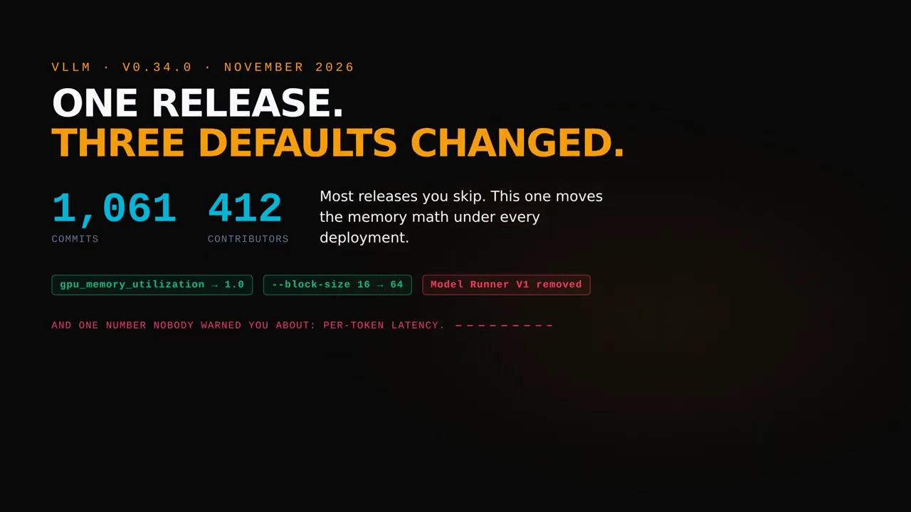
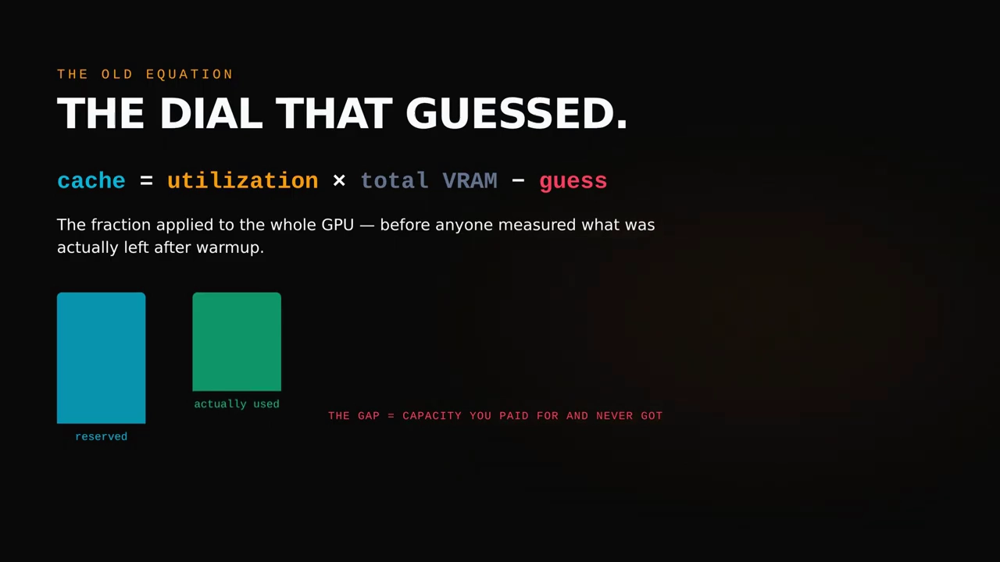
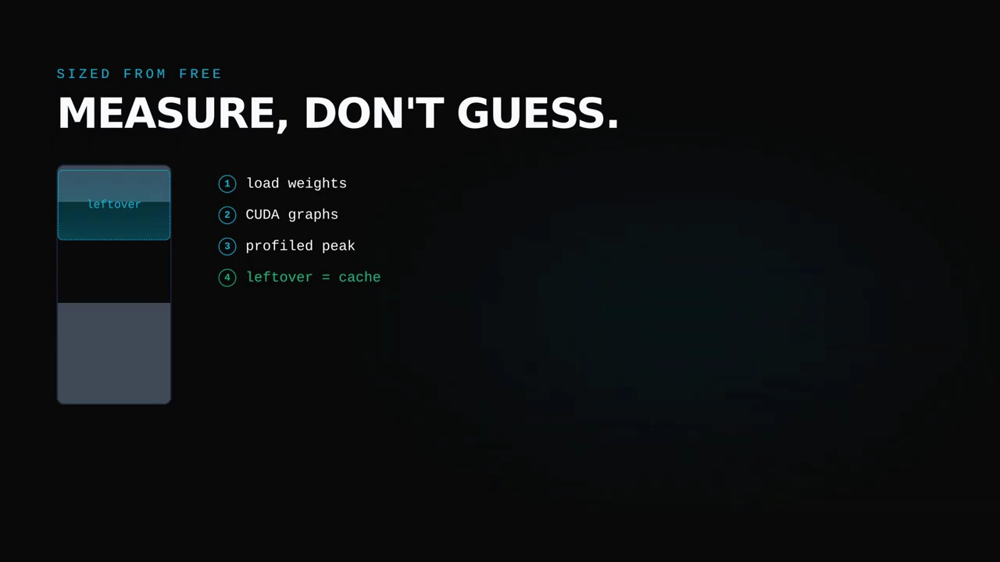
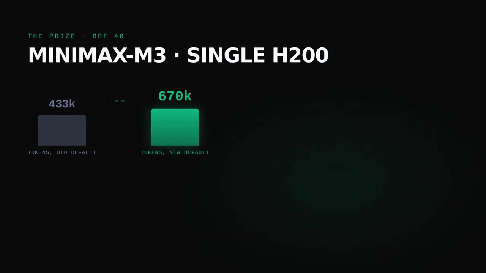
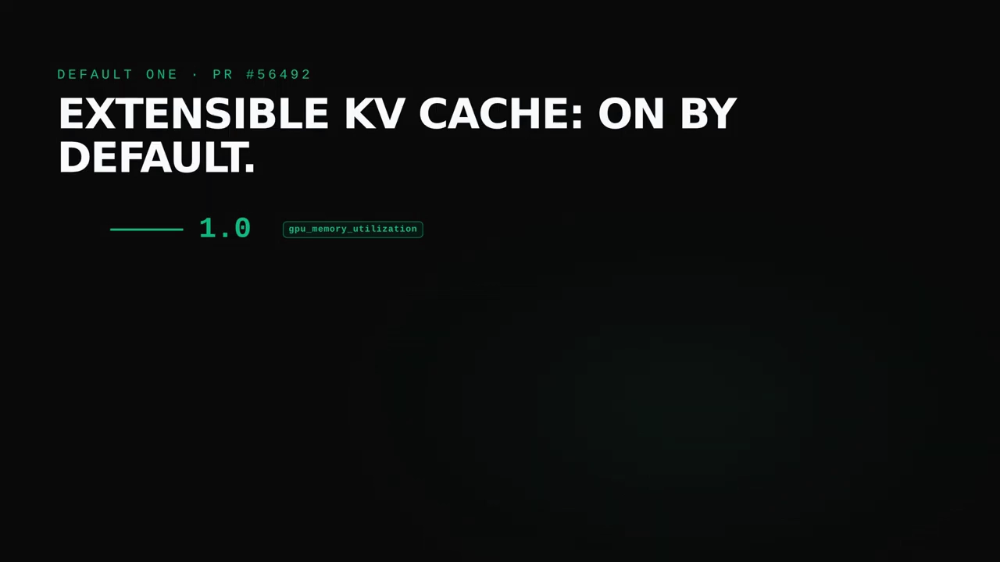
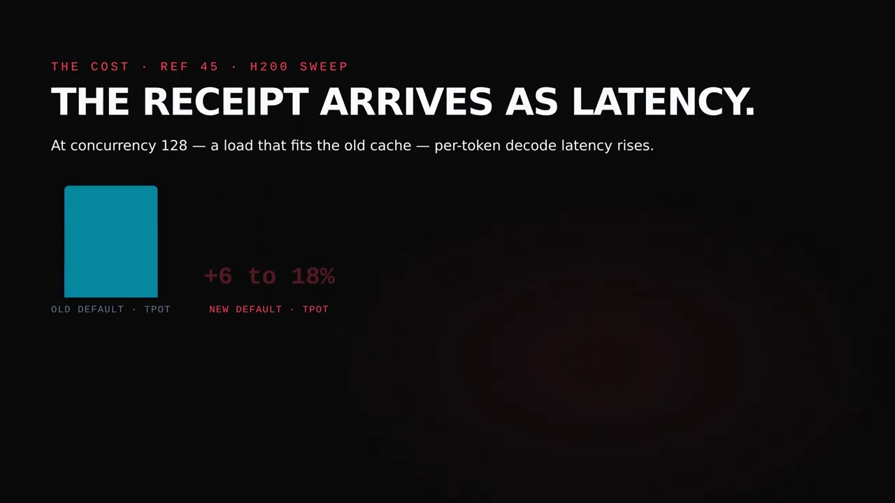
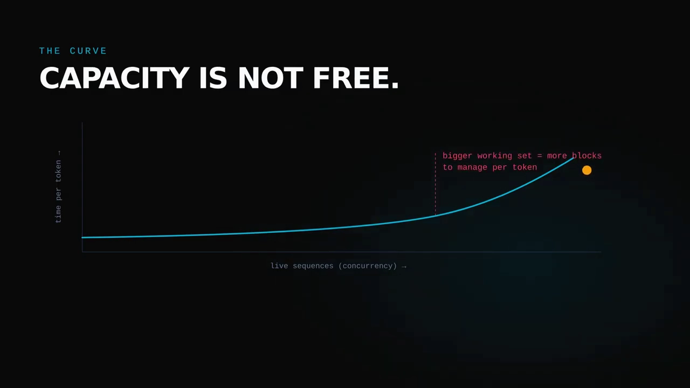
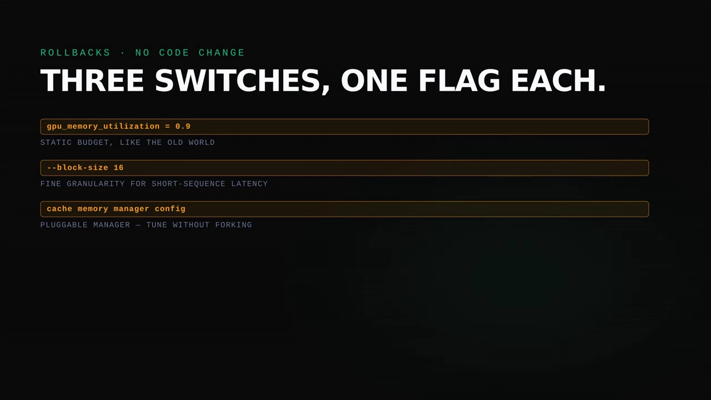

# gpu_memory_utilization 不是一个百分比：KV 池该多大，要靠测量而不是估算

> 视频来源：[vLLM 0.34.0: The GPU Memory Fix That Changed 3 Defaults](https://www.youtube.com/watch?v=FroFpile7kQ)（YouTube · 推理引擎版本解读）｜时长约 7 分 52 秒
> 简要导读：这支视频讲 vLLM 0.34.0 一次改了三个默认值，其中两个直接改写显存账本：KV 池改成「先跑起来、量出剩余、再全给缓存」，「gpu_memory_utilization」 默认从 0.9 变成 1.0。它还引用了发布说明里的一句警告——更大的缓存会让每 token 解码延迟上升 6%~18%。本文聚焦「显存预算怎么分、这个参数到底在控制什么、代价在哪里」；PagedAttention 的块表机制属于第 4 章，本文只点到。

## 本讲要解决的核心问题（SCQA）

**背景**：跑大模型服务时，大家都会设一个参数——「gpu_memory_utilization」，常见值 0.9。直觉上它是「这个引擎最多用掉 90% 的显存」。

**冲突**：但这个直觉是错的。旧版引擎的算法是「按整卡总量乘 0.9，再减去一个**估算**的权重与激活开销，剩下的给 KV 池」。估算保守，就有一大块显存白白浪费；估算激进，启动时或运行时就崩。更麻烦的是，warmup 期间实际多花掉的每一 GB，都**悄悄从 KV 池里扣走**，你根本不知道。

**疑问**：这个比例到底在控制什么？为什么「更大的 KV 池」反而会让每个 token 变慢？如果我要判断「这台机器还能塞多少并发」，应该看哪个数？

**回答（中心思想）**：「gpu_memory_utilization」 控制的不是「用了多少显存」，而是「**KV 池能占多少**」——因为在权重与激活峰值已经确定之后，KV 池就是唯一有弹性的那一项，它的字节数直接换算成「能同时容纳多少 token」，也就直接换算成并发上限。vLLM 0.34.0 把这件事从「启动前估算」改成「启动后测量」：先加载权重、捕获 CUDA graph、量出激活峰值，**把真正剩下的全部交给 KV 池**。代价是池子变大后，高并发下每 token 延迟会上升 6%~18%——**容量不是免费的，账单以延迟的形式寄到**。

---

## 一、显存是一次拍卖：KV 池和权重、激活、CUDA graph 抢同一块 HBM

视频用了一个很贴切的比喻：**服务大模型就是一场显存拍卖**。

每一条请求都持有一份 KV Cache——那份随每个生成 token 增长一个「页」的注意力状态。这份缓存要和**权重、激活值、CUDA graph** 争夺同一池显存。

[【跳转到 00:30】](https://www.youtube.com/watch?v=FroFpile7kQ&t=30)

往一个方向设错，你浪费昂贵的 HBM；往另一个方向设错，请求会被**抢占（preempted）或被拒绝**。而这两个方向之间，只隔着一个旋钮：「gpu_memory_utilization」——你承诺给引擎使用的显存比例。

这就回到了本小节的核心命题：**三块显存里，权重是常量、激活是峰值，只有 KV 是那个可以「多给一点、少给一点」的弹性项**。所谓「显存预算怎么分」，本质就是「把弹性项定多大」。

---

## 二、旧公式的问题：`cache = utilization × total VRAM − 估算值`

### 2.1 0.9 是对整卡的比例，不是「剩下的」

旧版的算法是静态的：

$$
\text{KV 池} = \text{utilization} \times \text{整卡显存} - \text{估算的权重与激活开销}
$$

注意第一项的分母：**是整卡总量，不是「权重加载完之后剩下的」**。默认 `utilization = 0.9`，意味着引擎先假定自己可以用掉 90% 的卡，再从这个数里减去一个**估算**的权重与激活开销。

[【跳转到 01:45】](https://www.youtube.com/watch?v=FroFpile7kQ&t=105)

### 2.2 估算的误差从 KV 池里悄悄扣走

问题出在那个「估算」上：

- **估得保守**：为了避免启动崩溃，估高一点——于是 KV 池被压小，一大块容量留在桌上没用；
- **估得激进**：启动能过，但 warmup 期间实际多花的每一 GB **都从 KV 池里扣**，而且**没有任何提示**。

这就是视频说的「估算就是全部问题」：它要么浪费容量，要么在你不察觉的时候缩小并发。

---

## 三、新做法：先跑起来，再量剩下多少

### 3.1 四步：加载权重 → CUDA graph → 量峰值 → 剩下的全给缓存

vLLM 0.34.0 把默认路径改成「测量而非估算」：

1. **加载权重**；
2. **捕获 CUDA graph**（这一步本身也吃显存，而且不同机器吃的不一样）；
3. **实测激活峰值**（profiled peak）；
4. **剩下的（leftover）全部给 KV 缓存**。

[【跳转到 03:00】](https://www.youtube.com/watch?v=FroFpile7kQ&t=180)

这一步的意义不只是「更准」，而是**账本结构变了**：KV 池不再是「总量乘比例再减估算」，而是「实测剩余」。两台同型号的卡，因为 CUDA graph 捕获的足迹不同，现在会得到**各自诚实的缓存大小**。

### 3.2 同一个硅片，缓存容量 +55%

视频引用了发布说明里的数字：**MiniMax-M3 在单张 H200 上，KV 缓存从 433,000 token 涨到 670,000 token**——同样的硬件，多出 55% 的容量。

[【跳转到 03:25】](https://www.youtube.com/watch?v=FroFpile7kQ&t=205)

把 token 数换算回本小节的账本：**KV 池的字节数 ÷ 每 token KV 字节数 = 能同时容纳的在飞 token 数**，再除以平均上下文长度就是并发上限。所以「+55% 缓存」直接翻译成「高并发下更多请求被接纳、更少被抢占、TTFT 更低、批处理吞吐更高」。

### 3.3 「gpu_memory_utilization = 1.0」 到底是什么意思

新版默认值从 0.9 变成 **1.0**。视频特意强调：**1.0 不等于「引擎霸占整张卡」**。

它的真实含义是：**上限不再是启动前做出的承诺**。引擎改用设备虚拟内存预留地址范围，物理页在**真正需要时才提交**。于是「1.0」表示「我不再预留一块用不上的额度」，而不是「我要吃光所有显存」。

[【跳转到 02:10】](https://www.youtube.com/watch?v=FroFpile7kQ&t=130)

旧行为仍然保留了一个开关：显式写 「gpu_memory_utilization = 0.9」 就回到旧世界。

---

## 四、代价：更大的池子，在高并发下让每个 token 更慢

### 4.1 发布说明自己写下的警告

同一个发布说明里有一句警告：**更大的缓存提高吞吐、降低高并发下的 TTFT，但在某些模型上会让每 token 解码延迟上升**。视频引用的实测是：部分 H200 模型在并发 128 时，**TPOT（每输出 token 时间）上升 6%~18%**。

[【跳转到 04:40】](https://www.youtube.com/watch?v=FroFpile7kQ&t=280)

也就是说：**同一个版本，给了你 55% 的额外缓存，却可能在高负载下让每个流式 token 慢近五分之一**。你站在悬崖的哪一侧，不是引擎的问题，是你自己的负载形态决定的。

### 4.2 为什么更大的池子会拖慢每个 token

视频给了三个机制：

1. **占用（occupancy）**：池子大，每步能塞进更多序列，每步要 attend 的常驻状态更多，**单步解码的工作量变大**；
2. **批形状（batch shape）**：注意力 kernel 面对更长的合并批状态会**丢失缓存局部性**，工作集溢出片上快速存储；
3. **调度（scheduling）**：在池子边缘，抢占与分页行为发生变化。更多的余量意味着引擎会**贴着「再多一条序列就让所有人变慢」的那个点运行**。

一句话：**池子更大 → 批更深 → 每 token 延迟更高**。这是结构性权衡，不是 bug。

[【跳转到 05:30】](https://www.youtube.com/watch?v=FroFpile7kQ&t=330)

这张曲线值得和本小节的主题放在一起看：**KV 池决定「能塞多少并发」，而并发本身又会抬高每 token 延迟**。所以「把池子开到最大」不是最优解——最优解是找到你的 SLO 允许的那个并发点。

---

## 五、运维动作：显式设定、测自己的曲线、盯 P99

### 5.1 升级当天该做的三件事

1. **如果你显式设过 「gpu_memory_utilization」，你的数字不变**，新默认值不生效——这是最省心的情形。
2. **如果你依赖旧默认值，先测再接受新默认值**：别直接上线，先跑自己的并发曲线。
3. **把 SLO 钉在 P99 并发上**，并从引擎自己的指标里读：vllm:time_per_output_token_seconds 与 vllm:time_to_first_token_seconds（以直方图形式导出到 Prometheus）。

### 5.2 怎么测：从低并发爬到 128 以上

视频给的测量方法很朴素：**用代表性负载重放**，并发从低逐步加到 128 甚至更高，分别记录「新默认（extensible cache 开）」与「旧默认（「gpu_memory_utilization = 0.9」 逃生阀）」两套设置下的 TPOT 与 TTFT 对并发曲线，**找出 P99 违反目标的那个交叉点**。

这个交叉点就是你的引擎的「并发悬崖」：短输出或不同 kernel 上可能永远碰不到；重解码负载上可能很早就撞上。**只有实测能回答**。

### 5.3 三个开关，一行代码都不用改

如果测下来新默认不适合你，回滚是显式的、便宜的：

| 开关 | 作用 |
| --- | --- |
| 「gpu_memory_utilization = 0.9」 | 回到旧的静态预算方式 |
| 「--block-size 16」 | 回到旧的细粒度分页（默认已改为 64 token 一块） |
| 「cache_memory_manager_config」 | 可插拔的缓存管理器，不改代码即可调 |

[【跳转到 07:10】](https://www.youtube.com/watch?v=FroFpile7kQ&t=430)

视频对这套设计的评价是：**这是一个「可退出（opt-out）」的升级，而这是移动这么深的默认值时唯一诚实的做法**。

### 5.4 顺带一提：块大小也是一个显存账本参数

第二个默认值改动是**块大小从 16 token 变成 64 token**。块更宽，页表项更少、访存模式更友好，但**粒度更粗**：一个不满的块最多浪费 63 个 token 槽位（旧的是 15 个）。对长生成通常是赚的，对很短的请求可能不划算。块表与物理块池的机制属于第 4 章，这里只记住它对显存账本的影响：**块大小决定「浪费的上界」，而池子大小决定「总量」**。

---

## 小结

- **显存是一场拍卖**：KV 池与权重、激活、CUDA graph 抢同一池 HBM；三块里只有 KV 是弹性项，所以「预算怎么分」等于「KV 池定多大」。
- **旧公式的病根**：`utilization × 整卡 − 估算`，0.9 是对整卡的比例而不是剩余；估算保守就浪费容量，估算激进就让 warmup 超支悄悄从 KV 池扣走。
- **新做法**：加载权重 → CUDA graph → 实测激活峰值 → 剩余全部给缓存。同硅片缓存容量 +55%（433k → 670k token）。
- **「gpu_memory_utilization = 1.0」 不是霸占**：它取消了启动前的承诺，物理页按需提交。
- **容量不是免费的**：并发 128 时 TPOT 上升 6%~18%，机制是占用、批形状、调度三重作用；拐点位置取决于你自己的负载。
- **运维三步**：显式设定则不受影响；依赖默认值就先测；把 SLO 钉在 P99 并发上，用引擎自己的 TPOT / TTFT 指标找交叉点。
- **回滚成本很低**：0.9、「--block-size 16」、缓存管理器配置，三个开关即可。

## 关键术语速查

| 术语 | 一句话解释 |
| --- | --- |
| gpu_memory_utilization | 引擎允许自己使用的显存比例上限；在权重与激活确定后，它实际控制 KV 池大小 |
| KV 池 | 预留给 KV Cache 的显存区域，按块管理；其大小 ÷ 每 token KV = 能容纳的在飞 token 数 |
| 抢占（preemption） | 显存不够时引擎暂停某些请求、腾出 KV 块给别人的调度动作 |
| CUDA graph | 把一段固定的 kernel 调用序列录制成图以降低启动开销，捕获时会额外占用显存 |
| profiled peak | 启动时实测出来的激活峰值，用于确定 KV 池的起点 |
| TPOT | 每输出 token 时间，衡量流式生成流畅度；池子变大时可能上升 |
| TTFT | 首 token 时间；池子变大、接纳更多请求时通常下降 |
| extensible KV cache | 按需提交物理页的 KV 缓存实现，替代启动前一次性预留 |
| 块大小（block size） | 一个 KV 块容纳的 token 数；越大越省页表项，但不满块浪费越多 |
| 并发悬崖 | TPOT 随并发上升曲线上的拐点，越过它之后每多一条序列都会拖慢所有人 |