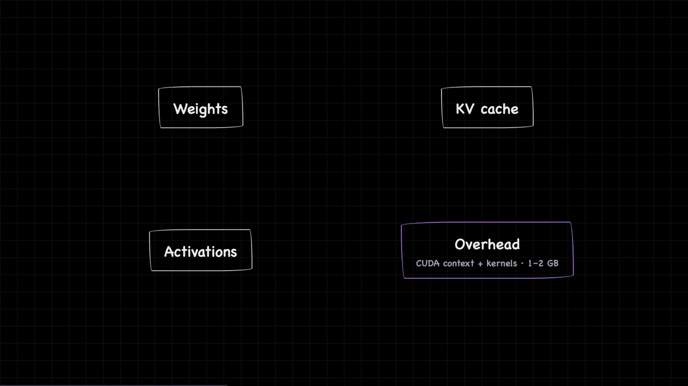
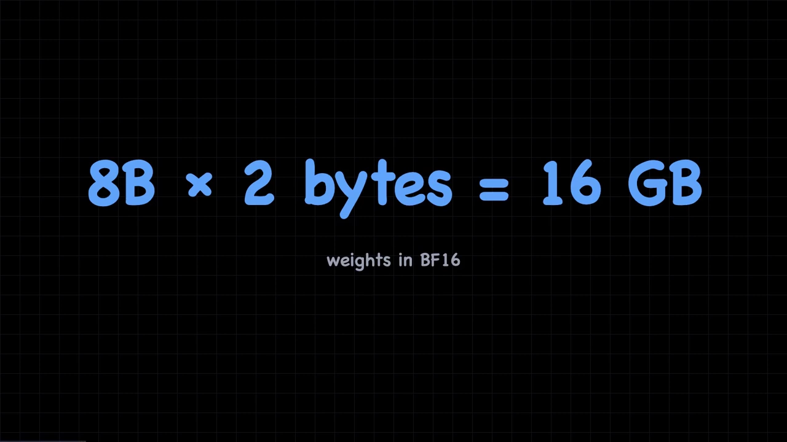
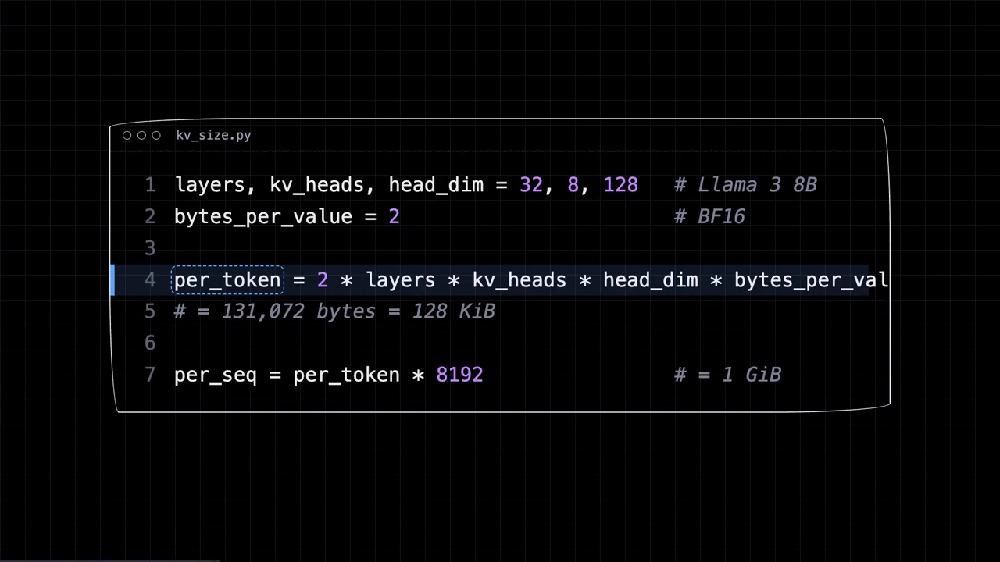
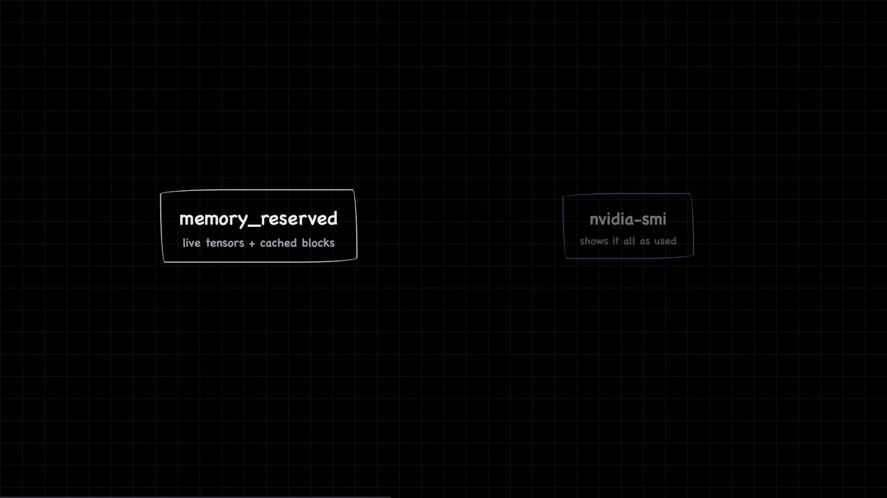
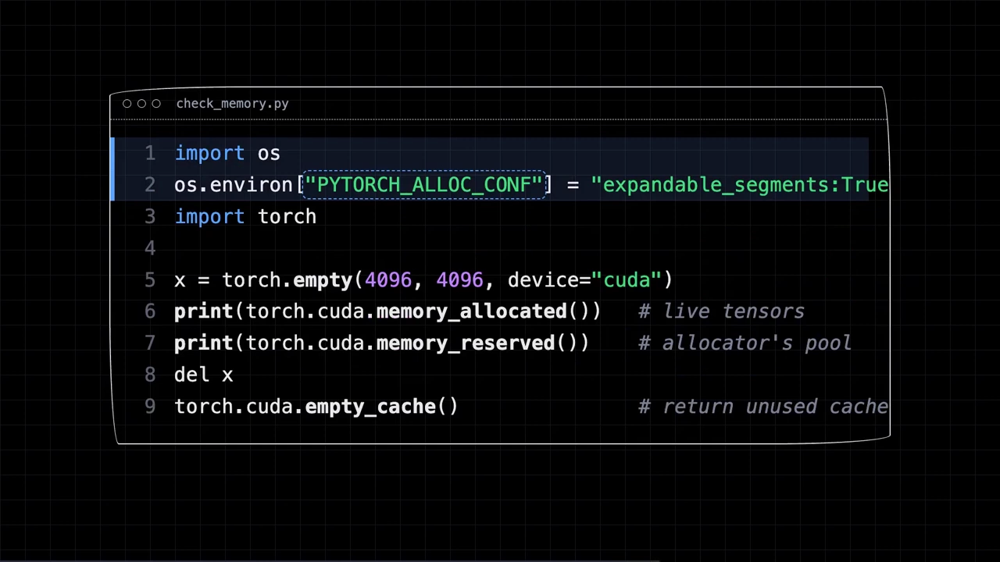
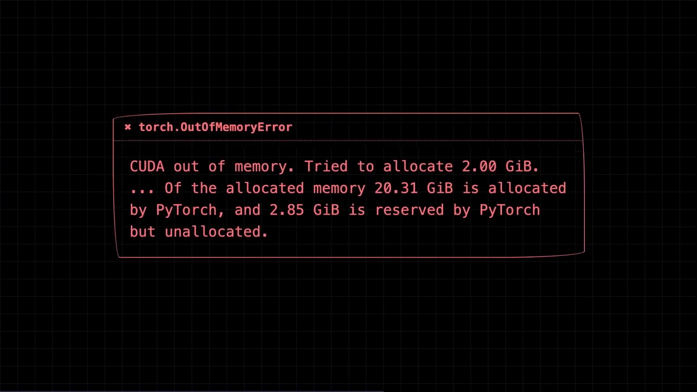
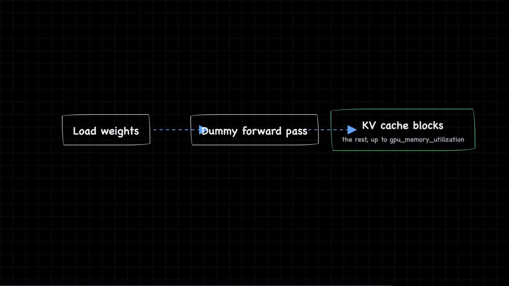
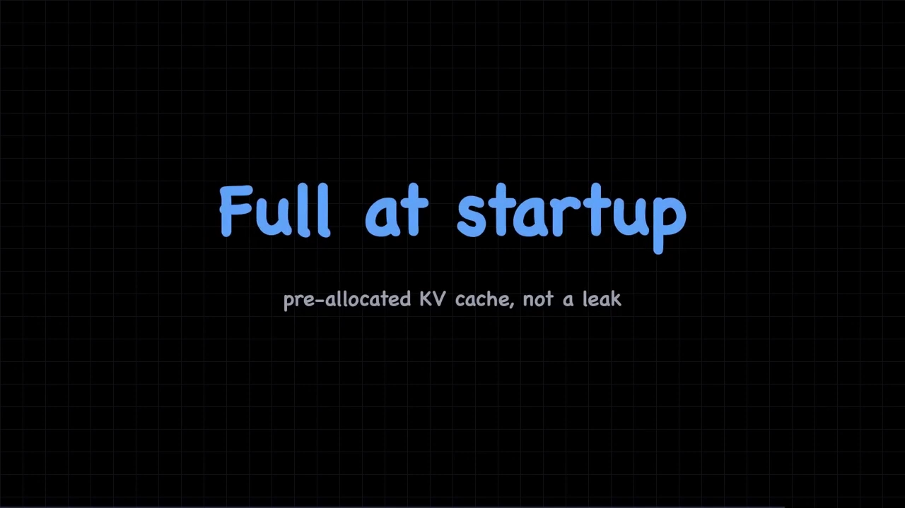

# 显存里不止权重：四类消费者、两个数字，与决定并发的那个峰值

> 视频来源：[42. VRAM Management: Where Your GPU Memory Really Goes](https://www.youtube.com/watch?v=PGWVxsDyvpA)（YouTube · 系列课程第 42 讲）｜时长约 3 分 42 秒
> 简要导读：这支短视频只回答一个问题——「权重只占 16GB，24GB 的卡为什么会 OOM」。它把显存拆成四类消费者，再讲清 PyTorch 缓存分配器给出的两个数字、碎片为什么会制造「明明有空却分配不出」的假象，最后落到推理引擎「先量峰值、再分池」的做法。KV Cache 公式的逐项推导见 1.3.2，激活值的逐项公式与削峰手段见 1.1.3。



## 本讲要解决的核心问题（SCQA）

**背景**：一张 24 GB 的卡跑一个 80 亿参数的模型，BF16 精度下权重只要 16 GB。按「权重装得下就能跑」的直觉，还剩 8 GB 余量，应该很宽裕。

**冲突**：可实际跑起来还是会 OOM。监控上显示显存「快满了」，但你把模型卸载、把请求清空，占用也降不下来；有时候报错信息里明明写着「还有 2.85 GiB 是预留但未分配的」。

**疑问**：除了权重，显存里还住着什么？为什么「已分配」和「已预留」是两个数？为什么总量够却分配不出来？推理引擎又是怎么把这块空间切给 KV Cache 的？

**回答（中心思想）**：显存里有**四类消费者**——权重（常量）、KV Cache（随 token 累加）、激活值（随 batch 冲顶）、运行时开销（1~2 GB 起）。它们由 **PyTorch 缓存分配器**统一发放，于是有了 `memory_allocated`（活张量）与 `memory_reserved`（分配器池子）两个数字，以及**碎片**这个「总量够、单块不够」的隐形杀手。推理引擎的对策是：先把权重和激活峰值**量出来**，再把剩下的空间按比例切成固定大小的 KV 块。

---

## 一、四类消费者：权重只是第一类

视频开篇就把「显存里有什么」列成四栏。

### 1.1 权重：参数量 × 每参数字节，加载一次、全程固定

$$
\text{权重字节数} = \text{参数量} \times \text{每参数字节}
$$

80 亿参数、BF16（每参数 2 字节）：

$$
8 \times 10^{9} \times 2\ \text{B} = 16\ \text{GB}
$$

[【跳转到 00:25】](https://www.youtube.com/watch?v=PGWVxsDyvpA&t=25)



关键性质是：**权重加载一次，整个运行期间固定**。它不随 batch 变，不随序列长度变，也不随并发数变——这也是为什么它是最容易算准的一项。

### 1.2 KV Cache：每个请求、每个 token、每一层都要存一对 key/value

对每个请求里的每个 token，每一层都要存一个 key 向量和一个 value 向量。每 token 的字节数是：

$$
\text{每 token KV} = 2 \times L \times H_{kv} \times d_{head} \times \text{每数值字节}
$$

以 Llama 3 8B 为例，$L = 32$ 层、$H_{kv} = 8$ 个 KV 头、$d_{head} = 128$、BF16 每数值 2 字节：

$$
2 \times 32 \times 8 \times 128 \times 2\ \text{B} = 131{,}072\ \text{B} = 128\ \text{KiB}
$$

[【跳转到 00:50】](https://www.youtube.com/watch?v=PGWVxsDyvpA&t=50)



于是 8192 个 token 的会话约占 **1 GiB**，而且**每多一条请求就多一份**。这是四类消费者里唯一随「并发 × 长度」线性增长的一项——公式的逐项推导见 1.3.2，这里只取结论。

### 1.3 激活值：前向的中间张量，随最大 batch 达到峰值

**激活值**（activations）是前向传播过程中产生的中间张量。视频给的一句话定义很准：**它们随最大的那个 batch 达到峰值**。

这句话里有两个要点：一是它的大小与 batch 正相关；二是它是**峰值**而不是平均值——前向结束就释放，但峰值那一刻必须真的拿得出这么多空间。1.1.3 已经算过，长 prompt 下单层激活就能到 GB 量级。

### 1.4 运行时开销：任何张量存在之前就先占 1~2 GB

视频引用 accelerate 文档的说法：**CUDA context 和它的 kernel 在任何张量存在之前就要占 1~2 GB**。这部分常被漏算，但它在小卡上很致命——24 GB 的卡先扣掉 2 GB，再扣 16 GB 权重，真正能用的可能只剩 6 GB 左右。

四类消费者放在一起，就是「权重 16 GB 却 OOM」的完整解释：**16 GB 只是其中一栏**。

---

## 二、谁在发显存：缓存分配器与它的两个数字

### 2.1 为什么要有缓存分配器

在 PyTorch 里，发显存的是**缓存分配器**（caching allocator）。原因是：**直接向 CUDA driver 申请显存非常慢**。如果每个请求都真的申请一次、释放一次，处理器会被反复卡住。

所以分配器的策略是：张量被释放时，**不把块还给 driver，而是留在自己的池子里**，下一个同样大小的张量直接复用。

### 2.2 `memory_allocated` 与 `memory_reserved`

这就产生了两个必须分清的指标：

| 指标 | 含义 | 谁在看 |
| --- | --- | --- |
| torch.cuda.memory_allocated() | 当前**活张量**占用的字节数 | 你的代码 |
| torch.cuda.memory_reserved() | 分配器**池子里所有块**的总字节数（含已释放但未归还的） | 你的代码、`nvidia-smi` |

[【跳转到 01:15】](https://www.youtube.com/watch?v=PGWVxsDyvpA&t=75)



**`nvidia-smi` 只能看到 reserved 总量**。所以「缓存着但没在用」的显存在外部看来依然是「已占用」——这就是「监控显示快满了，但模型其实没在用那么多」的根源。

两个操作的区别也在这里：

- `del x`：活张量没了，`memory_allocated` 下降，但 `memory_reserved` **不变**（块还在池子里）；
- torch.cuda.empty_cache()：把池子里**未使用**的缓存还给 driver，`memory_reserved` 才下降。它**永远不会释放活张量占用的内存**。

[【跳转到 02:05】](https://www.youtube.com/watch?v=PGWVxsDyvpA&t=125)



---

## 三、碎片：总量够，但没有一块够大

### 3.1 碎片是怎么产生的

分配器按块管理显存。**不同大小的块被释放、被复用，就会留下空洞**：总空闲量看起来很充裕，但没有任何一个空洞能装下接下来要分配的那个张量。这就是**碎片**（fragmentation）。

### 3.2 从 OOM 报错里读出三个数字

PyTorch 的 OOM 报错其实把答案写在了脸上：

```
torch.OutOfMemoryError: CUDA out of memory. Tried to allocate 2.00 GiB.
... Of the allocated memory 20.31 GiB is allocated by PyTorch,
and 2.85 GiB is reserved by PyTorch but unallocated.
```

[【跳转到 01:40】](https://www.youtube.com/watch?v=PGWVxsDyvpA&t=100)



三个数字分别对应：

- **Tried to allocate 2.00 GiB**：这次要的块有多大；
- **20.31 GiB allocated**：活张量占了多少（权重 + KV + 正在算的激活）；
- **2.85 GiB reserved but unallocated**：池子里有空闲，但**凑不出连续的 2 GiB**。

最后那行是关键：**不是没内存，是没有一块够大的连续内存**。

### 3.3 对策：打开 expandable_segments

视频给的解法是打开可扩展段：

```python
import os
os.environ["PYTORCH_ALLOC_CONF"] = "expandable_segments:True"
import torch
```

打开后，分配器**创建一个段并按需增长**，而不是预先切出一堆固定大小的段。这样空洞被消除，碎片导致的假性 OOM 会明显减少。

一个必须注意的细节：**这个配置在 CUDA 初始化时就被读取，所以必须在第一次分配之前设置**——写在 `import torch` 之后、任何张量创建之后都无效。

---

## 四、推理引擎不靠运气：先量峰值，再分池

### 4.1 三步：加载权重 → dummy 前向测峰值 → 剩余切成 KV 块

服务引擎不会把这件事交给运气。视频给的流程是：

1. **加载权重**；
2. **跑一次 dummy 前向**（用最大的 batch），把**激活峰值**量出来；
3. 剩下的、直到 `gpu_memory_utilization` 比例为止的空间，**切成固定大小的 KV Cache 块**。

[【跳转到 02:30】](https://www.youtube.com/watch?v=PGWVxsDyvpA&t=175)



这三步的顺序很讲究：**激活峰值必须先量出来**，因为它是峰值项，不能被 KV 池挤占；而 KV 池是「剩下的」，所以它天然是弹性的——池子多大，直接决定能同时容纳多少 token。

### 4.2 为什么是「块」而不是「整段」

视频引用了 vLLM 论文的实测：**早期系统里只有 20.4%~38.2% 的 KV Cache 内存真的装着 token**。原因是每个请求都按最大可能长度预留一整段连续空间，内部和外部碎片一起把大部分空间浪费掉了。改成固定大小的小块之后，这部分浪费基本消失。

块的机制（块表、物理块池、前缀共享）属于第 4 章，这里只记住它对显存账本的影响：**它改变的是 KV 的实际占用率，不改变 KV 随并发线性增长的规律**。

### 4.3 「启动就快满了」不是泄漏

因为 KV 池是启动时一次性划走的，所以一个 vLLM 服务**从启动那一刻起在 `nvidia-smi` 里就接近满**。这是**预留的缓存**，不是内存泄漏。

[【跳转到 03:17】](https://www.youtube.com/watch?v=PGWVxsDyvpA&t=197)



这个认知很重要：它意味着**「显存占用率高」本身不是问题，「峰值时凑不出空间」才是问题**。也意味着你不能用「剩余显存」来判断还能接多少请求——真正的判据是 KV 池里还剩多少块。

---

## 五、OOM 时的排查清单：查四个数字

视频最后给了一份清单。碰到 OOM，按这四项逐一核对：

| 要查的项 | 对应的问题 | 怎么查 |
| --- | --- | --- |
| **权重** | 模型本身是不是就超了？ | 参数量 × 每参数字节，与卡容量比 |
| **KV Cache** | 并发 × 上下文是不是太大？ | 每 token KV × 在飞 token 数 |
| **激活峰值** | 最长 prompt / 最大 batch 是不是顶穿了？ | 用最大负载跑一次，看 `max_memory_allocated` 峰值 |
| **预留但未分配** | 是不是碎片？ | 看 OOM 报错里的 `reserved but unallocated` |

这四项正好对应第一节的四类消费者，只是把「运行时开销」并入了「预留但未分配」这一栏去观察。

一句话总结视频的结论：**显存里住着权重、KV Cache、激活值和运行时开销；PyTorch 会缓存已释放的块，引擎会预分配 KV 块，而碎片解释了「明明有空却失败」。**

---

## 小结

- **四类消费者**：权重（常量，参数量 × 每参数字节）、KV Cache（每 token 128 KiB 起，随并发叠加）、激活值（随最大 batch 冲顶）、运行时开销（CUDA context 与 kernel，1~2 GB 起）。
- **两个数字**：`memory_allocated` 是活张量，`memory_reserved` 是分配器池子；`nvidia-smi` 只看得到后者，所以「缓存但未使用」在外部看来仍是已占用。
- **两个操作**：del 只减 allocated，empty_cache() 才把未使用的缓存还给 driver，且永不释放活张量。
- **碎片**：总量够、单块不够。OOM 报错里的 `reserved but unallocated` 就是它的指纹；expandable_segments 要在第一次分配前设置。
- **引擎的做法**：先量激活峰值，再把剩余空间切成固定大小的 KV 块；启动即接近满是预留，不是泄漏。
- **排查顺序**：权重 → KV → 激活峰值 → 预留未分配。

## 关键术语速查

| 术语 | 一句话解释 |
| --- | --- |
| 缓存分配器 | PyTorch 的显存管理者，释放的块留在池子里复用，避免频繁问 driver 要内存 |
| memory_allocated | 当前活张量占用的字节数 |
| memory_reserved | 分配器池子里的总字节数，含已释放但未归还的块 |
| empty_cache | 把池中未使用的缓存还给 driver，不影响活张量 |
| 碎片 | 总量够但没有一块连续空间能装下新张量 |
| expandable_segments | 让分配器用一个可按需增长的段，缓解碎片 |
| dummy 前向 | 启动时用最大 batch 空跑一次，测出激活峰值 |
| gpu_memory_utilization | 引擎允许自己使用的显存比例上限，剩余部分切成 KV 块 |
| 激活峰值 | 前向期间中间张量的最高同时占用，决定显存安全垫 |
| 预留但未分配 | 已向 driver 要过来、但当前没装活张量的显存，碎片的高发区 |