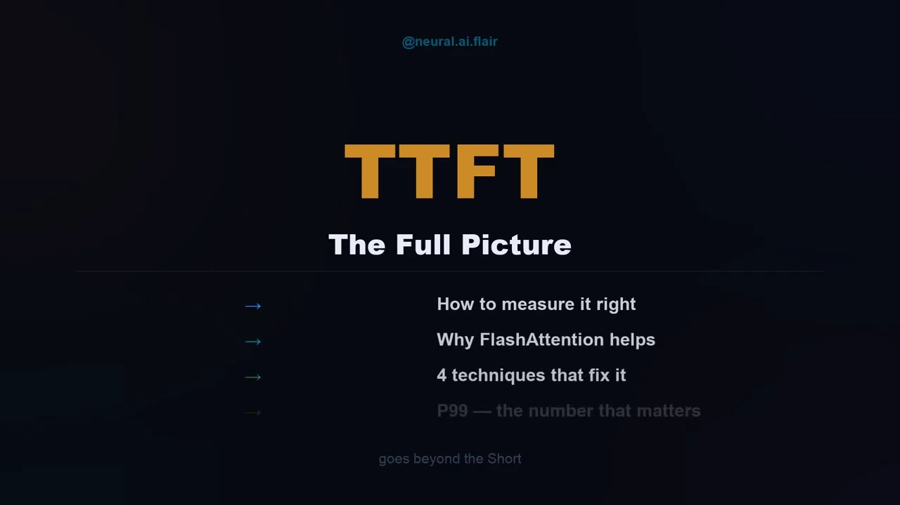
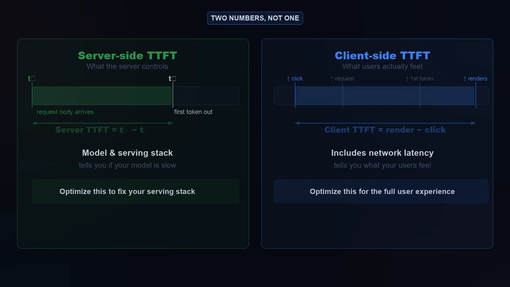
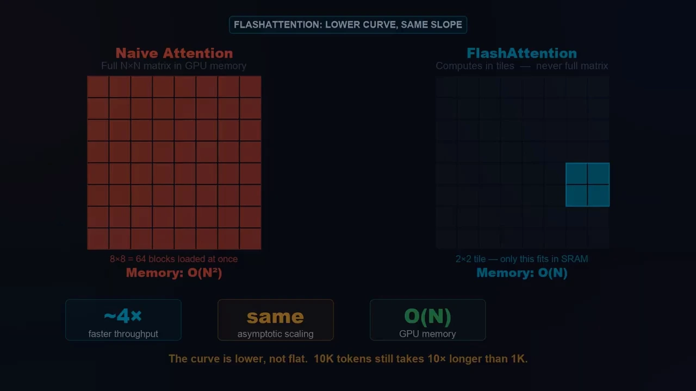
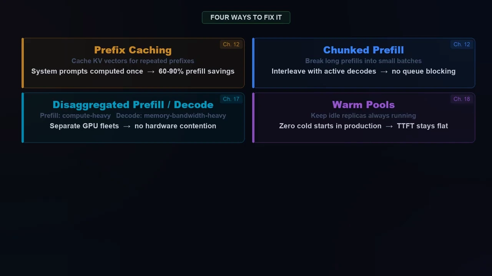
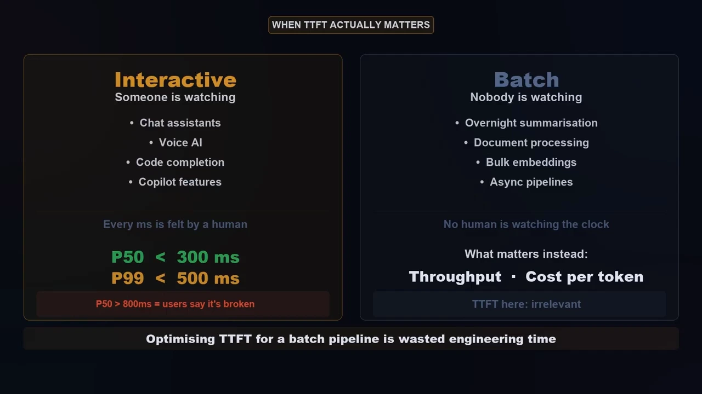
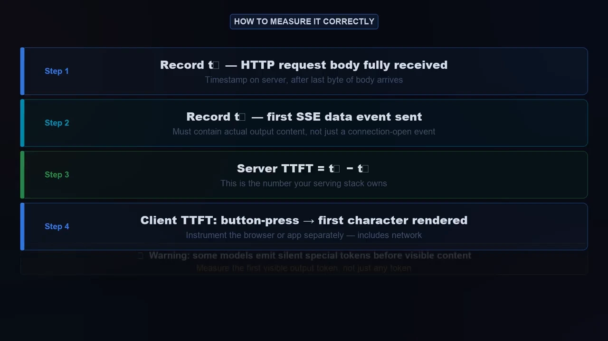
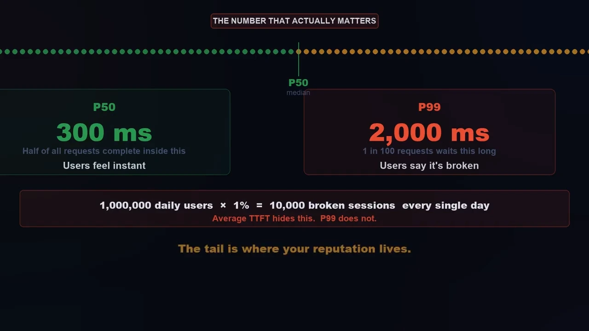
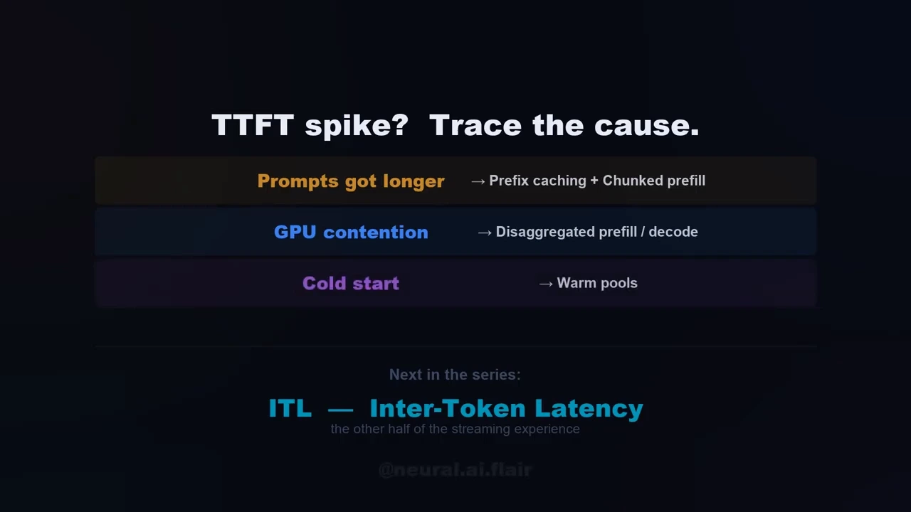

# TTFT 是两个数而不是一个：服务端量的是 Prefill，客户端才量到用户感受

> 视频来源：[TTFT Deep Dive](https://www.youtube.com/watch?v=CwO2PrRdPNQ)（YouTube · 频道 neural.ai.flair）｜时长约 4 分钟
> 简要导读：这支短片把「首字延迟」拆成服务端与客户端两个计时器，讲清 Prefill 为什么是 TTFT 的主体、四条压回 300 ms 的手段、以及 P99 为什么比均值更值得看。本文在视频内容之外，用「补充」标记补齐了视频没展开的分段拆解与两个额外影响因素；TPOT 与端到端延迟的完整分解留给本系列后续小节。

## 本讲要解决的核心问题（SCQA）

**背景**：几乎每个做推理服务的人都会在监控面板上挂一个指标叫 **TTFT（Time To First Token，首字延迟）**——用户按下发送之后，到屏幕上出现第一个字为止的那段空白有多长。

**冲突**：这个指标被报出来的时候，几乎没人说清它是**谁量的**。服务端同事说「我们 TTFT 只有 200 毫秒」，用户却在群里抱怨「点了半天没反应」。两个人都没说谎：他们量的是**两个不同的时间区间**，中间隔着两段网络。更要命的是，很多人把厂商 benchmark、模型卡、发布会 PPT 上的 TTFT 直接当成自己的目标值，而那些数字几乎都是在**空载服务器**上测出来的——排队时间是零。

**疑问**：TTFT 到底该怎么定义、怎么分段？它为什么主要由 Prefill 决定？哪些因素在把它推高？怎么量才不会被自己的仪表盘骗？

**回答（中心思想）**：TTFT 必须拆成**服务端 TTFT**（请求体收完 → 第一个 token 送出）和**客户端 TTFT**（按下按钮 → 第一个字渲染出来）两个数，前者衡量你的模型与推理栈，后者才是用户感受到的空白；其中占大头的通常是 Prefill，而 Prefill 的代价随 prompt 长度增长，所以**同一个 TTFT 数字离开「输入多长、当时服务器多忙」就没有意义**。压低它只有四条路——前缀缓存、分块预填充、Prefill/Decode 分离、常驻热池——而判断有没有做到位，看的是 P99，不是均值。

---

## 一、TTFT 的定义里藏着两个不同的计时器

### 1.1 服务端 TTFT 量的是「模型和推理栈有多慢」

服务端视角的区间非常干净：**从 HTTP 请求体完整到达那一刻起，到第一个 token 被送出那一刻止**。

$$
\text{TTFT}_{\text{server}} = t_1 - t_0
$$

- $t_0$：请求体（body）最后一个字节到达服务器的时刻；
- $t_1$：第一个 token 被写出去的时刻。

这个数字回答的问题是「**我的模型和推理栈慢不慢**」，它是你的工程能直接优化的部分。

[【跳转到 00:25】](https://www.youtube.com/watch?v=CwO2PrRdPNQ&t=25)

### 1.2 客户端 TTFT 加上两段网络，才是用户感受到的空白

客户端视角的区间是：**从用户按下按钮，到第一个字符真正渲染到界面上**。它比服务端 TTFT 多了两段：

1. **上行**：请求从浏览器/手机发到服务器（含 TLS 握手、DNS、跨地域 RTT）；
2. **下行**：第一个 token 从服务器流回客户端并完成渲染。

$$
\text{TTFT}_{\text{client}} = \text{TTFT}_{\text{server}} + t_{\text{上行}} + t_{\text{下行}} + t_{\text{渲染}}
$$

视频给这两条时间线的定位很直接：**服务端 TTFT 告诉你模型慢不慢，客户端 TTFT 告诉你用户感受到了什么**。只量一个，问题就有一半是隐形的。

### 1.3 为什么两个数必须同时报

举个最常见的吵架场景：服务端 P50 是 200 ms，用户投诉「要等两三秒」。

- 如果用户在国内、服务器在美西，单程 RTT 就有 150–200 ms，往返加上 TLS 握手，光网络就能吃掉好几百毫秒；
- 如果客户端是移动端网页，还要加上首包解析、字体加载、首个字符的布局与绘制；
- 如果前面还有一层网关或负载均衡做鉴权、限流、日志，这些时间都不在服务端的 $t_1 - t_0$ 里。

所以正确的做法是**两个数都报**：服务端 TTFT 用来定位「是我慢还是链路慢」，客户端 TTFT 用来对齐产品定义的 SLO。只报服务端数字，等于把链路和前端的问题永久藏起来。

---

## 二、TTFT 里占大头的通常是 Prefill

### 2.1 一次 Prefill 要建一张 N×N 的分数表

Prefill（预填充）是模型把整条 prompt 一次性读完、算出第一个 token 的阶段。它的开销来自两处性质完全不同的计算：

- **线性层**（QKV 投影、输出投影、FFN）：计算量正比于 token 数，即 $O(S)$，$S$ 是 prompt 长度；
- **注意力**：每个 token 要和它前面的所有 token 算相关性，标准实现会建一张 $S \times S$ 的分数矩阵，计算量 $O(S^2)$、中间结果也是 $O(S^2)$。

视频给了一个能立刻感受到量级的数字：**prompt 有 10,000 个 token 时，那张分数矩阵在 GPU 显存里同时存在 8 亿个数值**。这就是「长 prompt 一来，TTFT 就炸」的物理原因——不是模型变笨了，是要同时摊开的中间结果变多了。

### 2.2 FlashAttention 把曲线压低，但没有把斜率改平

FlashAttention 的做法是**分块（tiling）**：把 $S \times S$ 的矩阵切成小块，一块一块算、算完就丢，整张矩阵从头到尾都不真正落进显存。视频给的收益是：

- **吞吐约 4 倍**；
- **显存从 $O(S^2)$ 降到 $O(S)$**。

但视频强调了一句最容易被忽略的话：**「曲线更低，不是变平」**。渐进复杂度没有被改变，只是常数项变小了。所以：

- 讲者原话是「prompt 翻倍，Prefill 时间大致变成四倍」——这是二次项主导时的说法；
- 同一页幻灯片底部又写着「10K token 仍然比 1K 慢 10 倍」——这是线性项主导时的说法。

两句话并不矛盾，它们说的是**同一根曲线上不同的区段**：prompt 短的时候，$O(S)$ 的线性层占主导，看起来是线性；prompt 长到注意力项压过线性项，增长就逼近二次。工程上的结论只有一句：**TTFT 随 prompt 长度单调上升，而且越往后越陡**。

### 2.3 TTFT 的完整分段（补充）

视频只区分了「服务端 / 客户端」两段。要把一个 TTFT 数字归因到具体环节，还需要把服务端那一段再切细。下面是**补充**的通用分段（不是讲者原话，是业界通行的拆法）：

$$
\text{TTFT} = t_{\text{排队}} + t_{\text{调度}} + t_{\text{tokenize}} + t_{\text{prefill}} + t_{\text{采样}} + t_{\text{detokenize}} + t_{\text{首包网络}}
$$

| 分段 | 里面发生了什么 | 什么场景下占主导 |
| --- | --- | --- |
| 排队等待 $t_{\text{排队}}$ | 请求进了队列，但还没轮到 GPU | 高并发、长请求扎堆时 |
| 调度开销 $t_{\text{调度}}$ | 调度器组 batch、分配 KV 块、准备元数据 | 小模型、极短 prompt 时反而显眼 |
| tokenize | 文本切成 token | 极长 prompt 或多模态输入 |
| Prefill 计算 $t_{\text{prefill}}$ | 整条 prompt 的前向计算 | 长 prompt（几千 token 以上） |
| 首 token 采样 + detokenize | 取 logits、采样、解码成文字 | 大词表、采样参数复杂时 |
| 首包网络 $t_{\text{首包网络}}$ | 第一个 SSE 事件传到客户端 | 跨地域、移动网络 |

这张表最实用的地方是**归因**：TTFT 从 300 ms 涨到 3 s，先看是哪一行涨了。同一台机器上，prompt 长度没变、并发也没变，那多半是排队；prompt 长度翻了三倍，那就是 Prefill；什么都没变但只有某些地域的用户慢，那是首包网络。

---

## 三、把 TTFT 压回 300 ms 的四条路

视频给了四条标准手段，并明确标注了它们分别解决上面哪一个原因。

### 3.1 前缀缓存：让重复的前缀只算一次

**做法**：把已经算过的 KV 向量按前缀存起来。下一次请求如果开头是同一段文本（系统提示词、few-shot 示例、RAG 里固定的指令模板、多轮对话的历史），这一段直接复用，不再重算。

**为什么有效**：真实业务里 prompt 的**头部高度重复**。一个客服机器人，每次请求前面都挂着同一段 2000 token 的系统提示词——没有缓存时每个请求都要为这 2000 token 付一次 Prefill。

**视频给的量级**：系统提示词只需计算一次，Prefill 开销可省 **60%–90%**。

这也是为什么 TTFT 优化里「改 prompt 结构」往往比「换更快的 GPU」更划算：把易变的内容放到 prompt 末尾，把固定的内容放前面，缓存命中率立刻就上去了。（前缀缓存的基数树结构属于本系列另一小节的内容，这里不展开。）

### 3.2 分块预填充：把长 Prefill 切碎，别让它堵住队列

**做法**：把一条长 prompt 的 Prefill 切成若干小块，和正在进行的 Decode 步骤**交错**执行，而不是「一条长 prompt 霸占 GPU 直到算完」。

**为什么有效**：它解决的不是「这条请求自己快不快」，而是「**它会不会把别人堵住**」。一条 32K token 的 prompt 如果独占一次前向，所有正在解码的请求都得等它——这就是队头阻塞（head-of-line blocking）。

**代价（补充，视频未展开）**：分块之后，**这条长请求自己的 TTFT 会变长**——它要分好几轮才轮完。换来的是其他请求的 TPOT（相邻 token 间隔）更平稳。所以分块预填充本质上是**用长请求的 TTFT 换全体请求的 TPOT 抖动**，块切得越小越平滑、长请求的首字越晚。这个权衡的调度细节属于本系列调度小节，这里只记住方向。

### 3.3 Prefill/Decode 分离：让两种负载别抢同一张卡

**做法**：把 Prefill 和 Decode 放到**完全不同的硬件池**上，中间通过 KV 传输衔接。

**为什么有效**：这两种负载对 GPU 的要求几乎相反——Prefill 是算力受限（compute-bound），Decode 是显存带宽受限（memory-bound）。跑在同一张卡上，它们会互相抢资源：Prefill 在算的时候，Decode 的 token 间隔被拉长；Decode 占着显存的时候，Prefill 排不上队。

### 3.4 常驻热池：别让冷启动落到用户头上

**做法**：始终保持若干副本处于**已加载模型、已预热**的状态，而不是等请求来了再拉起容器。

**为什么有效**：冷启动要加载几十 GB 权重、初始化 CUDA 上下文、跑 JIT 编译，这一段动辄几十秒。**它一旦发生，那一次请求的 TTFT 就不是 300 ms 而是 30 s**。视频的说法是「让冷启动永远不落到用户身上，TTFT 就保持平稳」——注意这里的关键词是「平稳」，热池不改善均值，它砍掉的是尾部。

### 3.5 补充：还有两件事也在推高 TTFT

这两条视频没有展开，但做容量规划时绕不开，标为**补充**：

- **张量并行的通信开销**：把一层切到多张卡上，每层前后都要做 all-reduce / all-gather。Prefill 阶段计算密集、通信还能被计算掩盖一部分；但卡数越多、互联越弱（跨节点走以太网而不是 NVLink），通信就越可能成为 TTFT 里新增的一段。**同样的模型，从单卡换到 8 卡 TP，TTFT 不一定变短**，要看互联带宽是否跟得上。
- **量化对 Prefill 的收益有限**：量化主要省的是**权重搬运的字节数**，而 Prefill 是计算受限的——瓶颈在算力不在带宽。所以 W4A16 这类仅权重量化对 Decode 的加速很明显，对 Prefill（也就是对 TTFT）的改善要小得多。想压 TTFT，优先考虑前缀缓存和更快的算力，而不是量化。

---

## 四、TTFT 只在有人盯着屏幕时才值得优化

视频在这里插了一个很实用的判断题：**动手优化之前，先问一句「真的有人在看屏幕吗」**。

| 场景 | 有人在等吗 | 该优化什么 |
| --- | --- | --- |
| 聊天助手、语音助手、代码补全、Copilot 类功能 | 有，每一毫秒都能被感知 | TTFT |
| 夜间批量摘要、文档批处理、批量 embedding、异步流水线 | 没有 | 吞吐、每 token 成本 |

视频给了一个很具体的体感阈值：**语音类应用里 3 秒的静默，用户读到的是「系统坏了」，而不是「有点慢」**。这句话解释了为什么交互式场景的 TTFT 目标要压到几百毫秒：它不是性能指标，是**「这个功能还能不能用」的判据**。

反过来，给一个夜间批量摘要任务优化 TTFT 是纯粹的浪费——那里没有人在等第一个字，优化它只会挤占吞吐。

---

## 五、怎么量才可信：四个时间戳与两个分位数

### 5.1 服务端 TTFT 的四个时间戳

视频把测量步骤规定得很死，因为差一个时间戳，数字就能差出好几倍：

1. **记 $t_0$**：HTTP 请求体**完整接收完毕**的那一刻（不是 TCP 连接建立、不是首字节到达）。放在服务端打时间戳，因为客户端打点会把上行网络算进去。
2. **记 $t_1$**：**第一个 SSE 数据事件真正发出**的那一刻。这里有个坑：流式接口通常先发一个「连接已建立」的空事件或心跳，那不算；必须是**含真实输出内容**的那个事件。
3. **服务端 TTFT $= t_1 - t_0$**，这是你的推理栈自己能负责的数。
4. **客户端 TTFT**：从按钮按下到第一个字符渲染，单独在浏览器/App 侧埋点，因为它含网络。

### 5.2 一个特别隐蔽的坑：静默的特殊 token

视频专门提醒：**有些模型在真正的内容之前，会先吐出一批「静默的特殊 token」**（比如角色标记、格式控制符、思考块的起始符）。如果测量代码把「收到第一个 token」直接当成「第一个可见字符」，测出来的 TTFT 会**偏小**——因为用户屏幕上什么都还没有。

正确口径是：**量第一个用户可见的输出 token**，不是任意一个 token。这一条在带思维链、带工具调用标记的模型上尤其容易踩。

### 5.3 看 P50 与 P99，不要看均值

视频给了一组很好记的对照：

- **P50 = 300 ms**：一半请求在这个值以内完成，用户感觉「是即时的」；
- **P99 = 2000 ms**：每一百个请求里有一个要等这么久，用户会说「这玩意儿坏了」；
- **均值会把这件事抹掉**：一百万日活、1% 的坏请求，就是**每天一万次坏体验**。

所以 TTFT 的报表里，均值和 P50 只能用来做容量规划，**能不能上线要看 P99**。这和本系列后面讲尾部延迟治理的部分是同一条原则，这里只需要记住：**尾部才是口碑所在**。

---

## 六、TTFT 突然变差，只有三个原因

视频最后给了一张归因表，把「TTFT 涨了」压缩成三个互斥的原因，每个原因对应第三节里的一条修复手段。

| 现象 | 原因 | 对应手段 |
| --- | --- | --- |
| 同样的流量，TTFT 整体抬升 | **prompt 变长了**（用户贴了长文档、RAG 塞了更多片段、多轮对话历史变长） | 前缀缓存 + 分块预填充 |
| 峰值时段 TTFT 抖动，低谷正常 | **GPU 争抢**（Prefill 与 Decode 在同一批卡上互相挤） | Prefill/Decode 分离 |
| 偶发的、极长的尖刺（几十秒级） | **冷启动**（扩容、重启、副本被回收后重新拉起） | 常驻热池 |

这张表的用法是**先分类再动手**：看到 TTFT 涨了，先按「是整体抬升、还是峰值抖动、还是偶发尖刺」分成三类，再套对应手段。反过来，如果你只盯着「TTFT 高了」这一个信号，很可能给一个冷启动问题上了前缀缓存——白忙一场。

---

## 小结

- **TTFT 是两个数**：服务端 TTFT（请求体收完 → 第一个 token 送出）衡量模型与推理栈；客户端 TTFT（按钮按下 → 首字符渲染）才含网络与渲染，是用户真正感受到的空白。只报一个，问题就有一半隐形。
- **TTFT 的主体是 Prefill**：线性层 $O(S)$、注意力 $O(S^2)$，prompt 越长越贵。FlashAttention 让曲线更低（约 4 倍吞吐、显存 $O(S)$），但没有让斜率变平。
- **完整分段**（补充）：排队 + 调度 + tokenize + Prefill + 采样/解码 + 首包网络。高并发时排队占大头，长 prompt 时 Prefill 占大头，跨地域时首包网络占大头。
- **四条压低手段**：前缀缓存（重复前缀省 60%–90% Prefill）、分块预填充（不堵队列，代价是长请求自己的 TTFT 变长）、Prefill/Decode 分离（两类负载别抢卡）、常驻热池（砍掉冷启动尖刺）。
- **只在有人看屏幕时才值得优化**：交互式场景 P50 < 300 ms、P99 < 500 ms 是常见目标，P50 > 800 ms 用户就会说「坏了」；批量场景优化 TTFT 是浪费。
- **测量口径要钉死**：$t_0$ 取请求体收完、$t_1$ 取含真实内容的第一个 SSE 事件、客户端单独埋点；小心静默特殊 token 让 TTFT 偏小。
- **报 P99 而不是均值**：均值会把尾部抹掉，而尾部才是口碑所在。
- **TTFT 变差只有三类原因**：prompt 变长、GPU 争抢、冷启动——先分类，再选手段。

## 关键术语速查

| 术语 | 一句话解释 |
| --- | --- |
| TTFT（Time To First Token，首字延迟） | 从请求发出到第一个输出 token 到达客户端的时间，决定「点了发送多久看到字开始动」 |
| 服务端 TTFT | 请求体完整接收 → 第一个 token 送出，衡量模型与推理栈，不含网络 |
| 客户端 TTFT | 按钮按下 → 首个字符渲染，含上下行网络与前端渲染，是用户的真实体感 |
| Prefill（预填充） | 把整条 prompt 一次性算完、产出第一个 token 的阶段，计算量随 prompt 长度增长 |
| FlashAttention | 用分块计算避免物化整张 $S \times S$ 注意力矩阵，显存从 $O(S^2)$ 降到 $O(S)$，斜率不变 |
| 前缀缓存（prefix caching） | 复用重复前缀已算好的 KV，避免每次请求重算同一段系统提示词 |
| 分块预填充（chunked prefill） | 把长 Prefill 切片并与 Decode 交错执行，避免长请求堵住队列 |
| Prefill/Decode 分离（PD 分离） | 把计算受限的 Prefill 与带宽受限的 Decode 放到不同硬件池，避免互相抢资源 |
| 常驻热池（warm pool） | 始终保持已预热的副本，让冷启动不落到用户请求上 |
| SSE（Server-Sent Events） | 流式输出的常见传输方式，服务端按事件逐条推送 token |
| P50 / P99 | 分位数：50% / 99% 的请求快于该值；P99 反映尾部体验，均值会把尾部抹掉 |