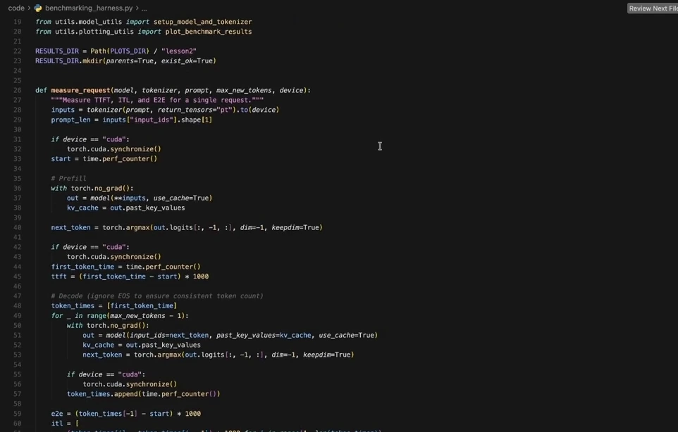
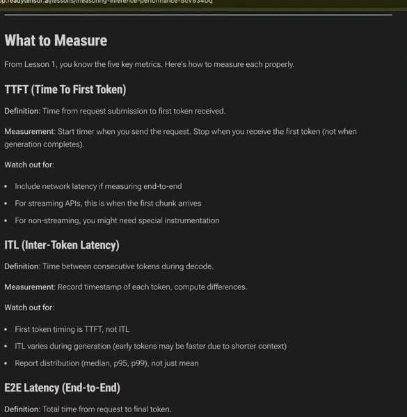
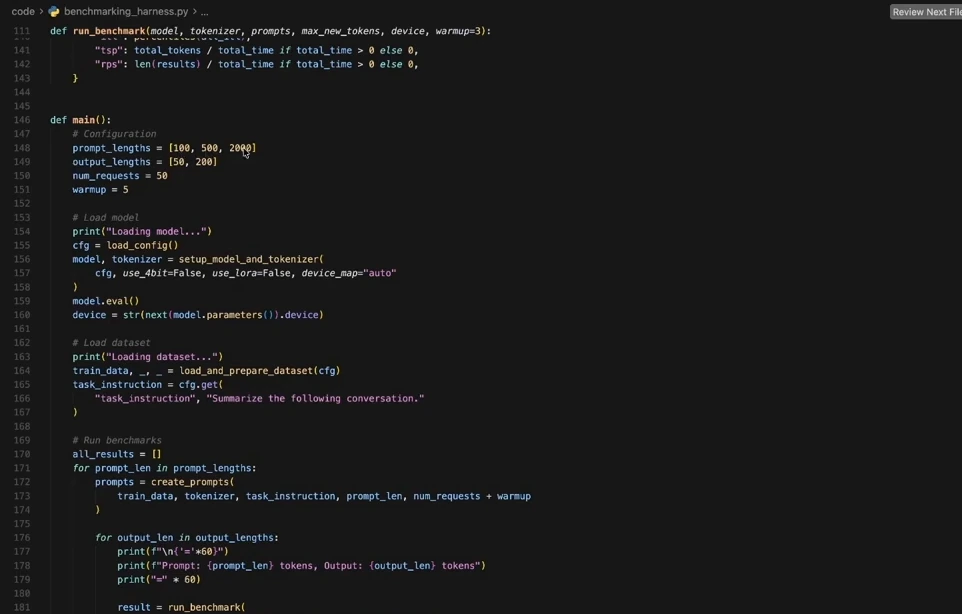
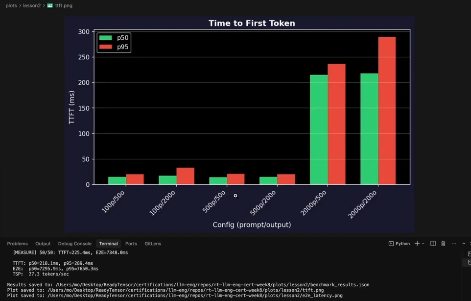
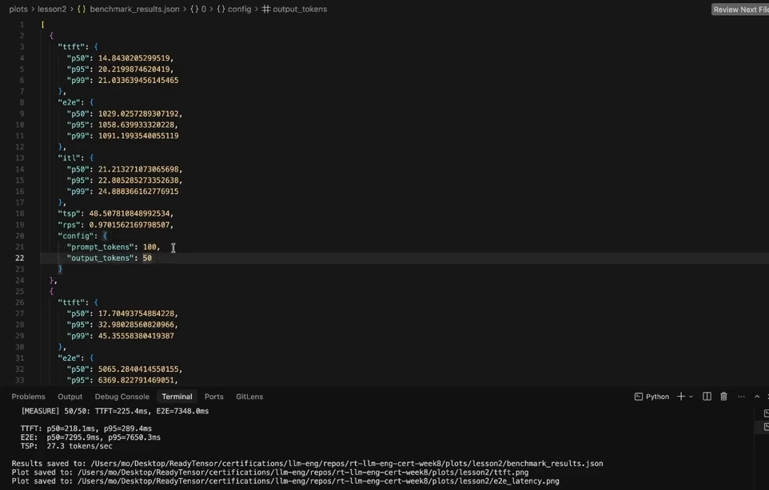
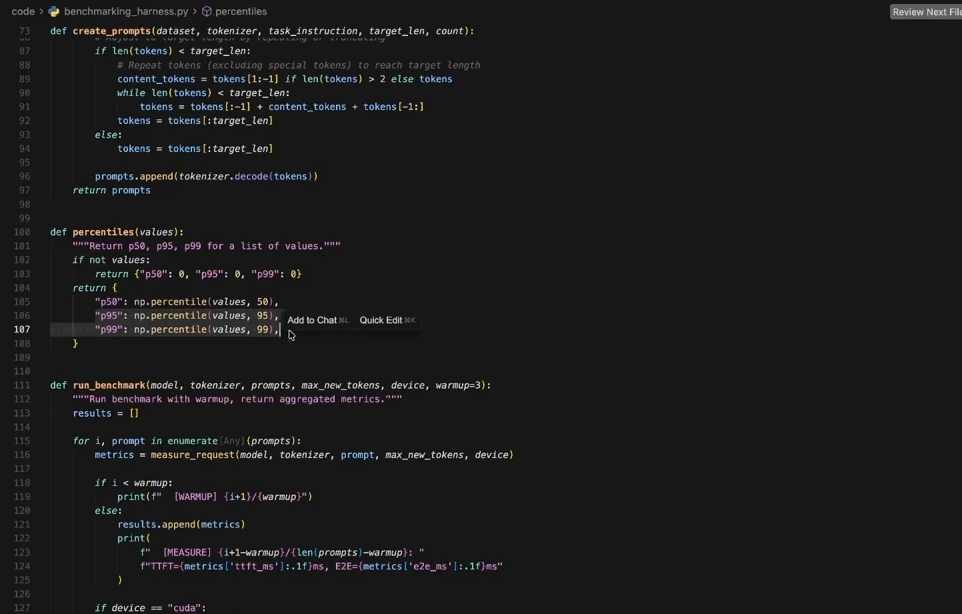
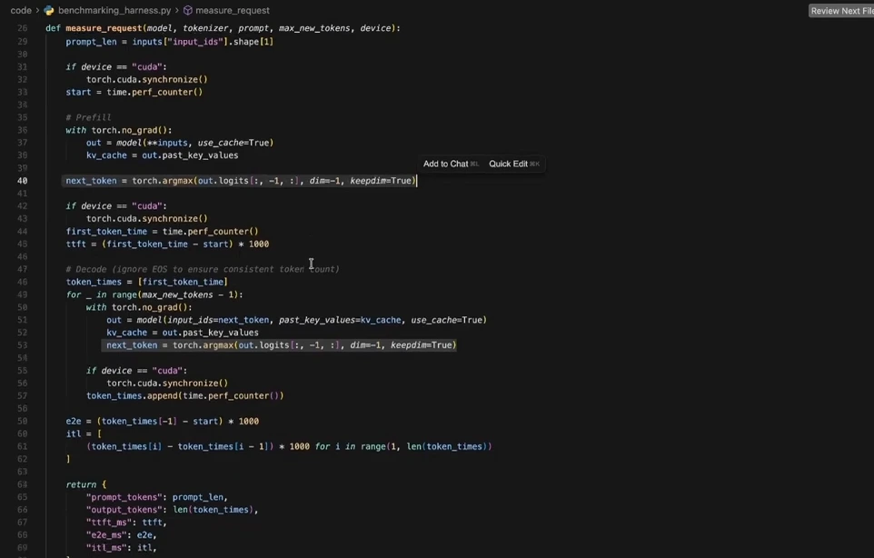
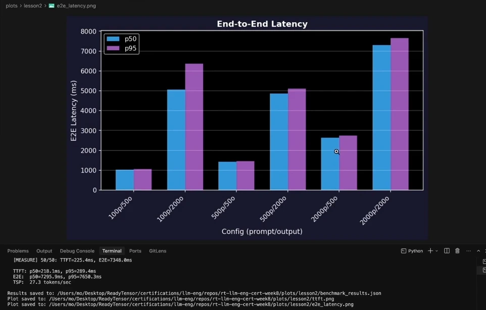

# 把 TTFT 按 prompt 长度分桶测：不预热、不固定长度、只看均值，量出来的数字没有意义

> 视频来源：[LLM Inference Performance: Latency and Throughput Metrics](https://www.youtube.com/watch?v=DW-mo65DJ-Q)（YouTube · Ready Tensor，讲者 Mohamed Abdelhamid）｜时长约 15 分钟
> 简要导读：这支视频不讲原理，讲**怎么把 TTFT 量出来**——用一个 PyTorch 脚本、六组固定长度的配置、5 条预热、50 条样本，把首字延迟画成一张随 prompt 长度变化的柱状图。本文只取其中的 TTFT 一条线：怎么埋点、怎么控制变量、跑出来的数怎么读。ITL 与端到端延迟只作对照提及，其完整定义与测量留给本系列后续小节；视频没覆盖的并发与排队场景，用「补充」标记补齐。

## 本讲要解决的核心问题（SCQA）

**背景**：模型微调完了，离线评测分数也不错，接下来要部署上线。上线前有一件事必须做：**评估推理管线的质量**——不是「答得好不好」，而是「答得有多快」。

**冲突**：绝大多数团队在这一步拿到的第一个 TTFT 数字是**不可用的**。原因不是脚本写错，而是缺了三个控制变量：没预热（前几条请求在跑 JIT 编译和显存分配）、没固定 prompt 长度（100 token 和 2000 token 混在一个均值里）、只报了平均值（一条冷启动的 30 秒把均值整个拉歪）。这三个坑任何一个都会让数字失去意义，而它们全都**不会报错**——脚本照样跑完，照样打印出一个看起来很像样的毫秒数。

**疑问**：TTFT 的计时器到底该在哪里停？要让不同次测量之间可比，必须固定哪些变量？跑出来的数该怎么读——为什么短 prompt 之间看不出差别，而 2000 token 一上来就跳一个数量级？

**回答（中心思想）**：TTFT 的计时器**在第一个 token 生成的那一刻就停**，后面的 Decode 一点都不算进去；要让这个数字可比，必须**固定 prompt 长度、固定输出长度、先跑预热、用生产同款配置**，并且**报 P50/P95/P99 而不是均值**。按这套方法跑出来的结果会告诉你一件事：**短 prompt 的 TTFT 由固定开销决定，长 prompt 的 TTFT 由 Prefill 决定**——所以一个不带输入长度的 TTFT 数字，本身没有意义。

---

## 一、先定口径：TTFT 的计时器在第一个 token 处就停

### 1.1 一个函数里三个指标，只有 TTFT 停在 Prefill 末尾

视频用一个 `measure_request` 函数同时量三个指标，代码把三条时间线的起止点钉得非常清楚：

```python
start = time.perf_counter()          # 计时开始：请求进入

# ---- Prefill：整条 prompt 一次前向 ----
out = model(**inputs, use_cache=True)
kv_cache = out.past_key_values
next_token = torch.argmax(out.logits[:, -1, :], dim=-1, keepdim=True)

first_token_time = time.perf_counter()   # 计时停止：第一个 token 已经产生
ttft = (first_token_time - start) * 1000

# ---- Decode：一个 token 一个 token 往外吐 ----
token_times = [first_token_time]
for _ in range(max_new_tokens - 1):
    ...
e2e = (token_times[-1] - start) * 1000
```

三个指标的分工是：

| 指标 | 起点 | 终点 | 回答什么问题 |
| --- | --- | --- | --- |
| **TTFT** | 请求进入 | **第一个 token 产生** | 用户要等多久才看到第一个字 |
| ITL | 上一个 token | 下一个 token | 字与字之间卡不卡（本文不展开） |
| E2E | 请求进入 | 最后一个 token | 整段回答要多久 |

**关键就在 `first_token_time` 这一行**：它在 Prefill 前向 + 取第一个 token 之后立刻打点，Decode 循环一行都还没跑。所以 TTFT 天然只包含「读完 prompt + 吐出第一个 token」，与回答有多长完全无关。



[【跳转到 03:37】](https://www.youtube.com/watch?v=DW-mo65DJ-Q&t=217)

### 1.2 为什么 TTFT 天然等于「Prefill + 一点网络」

讲者给的定义很朴素：**TTFT 是从请求到达，到你看到第一个 token 的时间**。它对应的正是 Prefill 阶段——模型把整段上下文读完、直到产出第一个 token 的那一段。

用讲者的原话说：**「你可以把它理解成 Prefill 阶段的时间，再加一点网络延迟。」**

这句话有两层意思，都值得记住：

1. **TTFT 的主体是 Prefill**。所以任何让 Prefill 变慢的东西（prompt 变长、batch 里塞进长请求、前缀缓存没命中）都会直接抬高 TTFT。
2. **「再加一点网络延迟」意味着这个数字的边界是可调的**。脚本里 `start` 打在本地进程内，几乎不含网络；换成真实服务端，$t_0$ 应该打在请求体收完，客户端再单独埋点——这正是 TTFT 有两个口径的原因（服务端口径与客户端口径的差别，属于本节另一篇的内容）。

课程讲义页把三个容易踩的测量坑列在一起，正好补上「边界在哪」这件事：

- **要量端到端就包含网络延迟**——不包含网络的数字不能拿去和用户的体感对齐；
- **流式接口下，TTFT 是第一个 chunk 到达的时刻**——不是连接建立、不是首字节；
- **非流式接口需要特殊埋点**——一次性返回全部结果时，客户端根本看不到「第一个 token」，只能在服务端内部打点。



---

## 二、让 TTFT 可比的四个控制变量

脚本里真正值钱的部分不是测量，而是**控制变量**。缺了任何一条，两次测量之间就没法比。

### 2.1 固定 prompt 长度：内容不重要，长度才重要

视频里造 prompt 的函数会**把 token 列表硬凑到目标长度**：不够就重复，超了就截断。

```python
if len(tokens) < target_len:
    content_tokens = tokens[1:-1] if len(tokens) > 2 else tokens
    while len(tokens) < target_len:
        tokens = tokens[:-1] + content_tokens + tokens[-1]   # 重复填充
    tokens = tokens[:target_len]
else:
    tokens = tokens[:target_len]
```

讲者特意解释了一句，这句话是整支视频的方法论核心：**「我们不是在测模型的生成质量，所以内容是什么不重要；我们要测的是处理某个长度的输入、生成某个长度的输出需要多久。」**

这就是为什么脚本可以放心地重复 token：它测的是**长度 → 时间**的映射，不是**语义 → 质量**的映射。反过来说，如果你拿真实业务流量测 TTFT，就必须**按输入长度分桶统计**——否则长短混在一个均值里，得到的数字既不代表短请求也不代表长请求。

### 2.2 固定输出长度：不让 EOS 提前结束

脚本里有一处刻意的「反常规」设置，讲者强调了两遍：**生成过程中即使遇到 EOS 也不停**，一定要生成满设定的 token 数。

原因很直接：如果允许 EOS 提前结束，那么每条请求的 Decode 步数就随机了，E2E 和 ITL 全部失去可比性。**要比较不同配置，就必须让「输出长度」这个变量被钉死。**

对 TTFT 来说，这一条其实**不影响**（TTFT 在第一个 token 处就停了），但它保证了同一批数据里其它指标不被污染——而这三个指标是一起被采集的。

### 2.3 预热 5 条：把冷启动从统计里剔出去

脚本的配置区写得很清楚：

```python
prompt_lengths = [100, 500, 2000]
output_lengths = [50, 200]
num_requests = 50
warmup = 5
```

**前 5 条请求不计入统计**，从第 6 条开始才算。讲者给的理由是：让一切先跑通，让系统需要的各种缓存**已经被用过一遍**。



预热剔除的是什么？主要是三类一次性开销：

- **首次前向的初始化**：CUDA 上下文、cuBLAS 句柄、算子选择与 JIT 编译；
- **显存分配器的首次扩张**：第一次要一大块显存，之后从缓存池里拿；
- **前缀缓存 / 各种内部 cache 的冷态**：第一次请求什么都命中不了。

这三类开销在第一条请求上可能占掉几百毫秒甚至几秒，而它们**只发生一次**。不预热，你测出来的就是「冷启动 TTFT」；预热之后测的才是「热态 TTFT」。**这两个数都要报，但绝不能混在一个均值里。**

### 2.4 用生产同款配置：量化就量化，LoRA 就 LoRA

视频里用的是 **Llama 1B、全精度、不带 LoRA**。讲者同时提醒：脚本里用什么精度其实无所谓，但**你必须用上线时真正会用的那套配置**——如果生产环境跑的是量化模型，那测量时就要开着量化。

理由还是可比性：量化的收益主要体现在 Decode 的权重搬运上，对 Prefill（也就是对 TTFT）的改善要小得多。用全精度测出来的 TTFT 去预测量化后的线上 TTFT，方向会错。

---

## 三、跑出来的数：短 prompt 看不出差别，2000 token 才现原形

### 3.1 六组配置的实测结果

脚本跑完会把每组的 P50/P95/P99 写进 JSON，并画成柱状图（绿柱是中位数，红柱是 P95）。



[【跳转到 11:32】](https://www.youtube.com/watch?v=DW-mo65DJ-Q&t=692)

把图上的数和 JSON 里的原始值合起来看：

| prompt / 输出 | TTFT P50 | TTFT P95 | 备注 |
| --- | --- | --- | --- |
| 100 / 50 | 14.8 ms | 20.2 ms | JSON 原始值，P99 = 21.0 ms |
| 100 / 200 | 约 18 ms | 约 33 ms | JSON 原始值 P99 = 45.4 ms |
| 500 / 50 | 约 14 ms | 约 21 ms | 与 100/50 基本重合 |
| 500 / 200 | 约 17 ms | 约 25 ms | |
| 2000 / 50 | 约 215 ms | 约 239 ms | 从图读取 |
| 2000 / 200 | 218.1 ms | 289.4 ms | 控制台原始值 |



两个可以直接读出来的结论：

**第一，输出长度几乎不影响 TTFT。** 100/50 与 100/200 的 P50 只差几毫秒；2000/50 与 2000/200 的 P50 几乎一样（215 vs 218 ms）。这和第一节的代码完全对得上：TTFT 在第一个 token 处就停了，输出多长与它无关。**如果某个工具报出的 TTFT 随输出长度明显变化，那它量的不是 TTFT。**

**第二，prompt 长度一旦跨过某个门槛，TTFT 就跳一个数量级。** 100 token 和 500 token 的 P50 都在 15 ms 上下，看不出差别；2000 token 直接到 215 ms，**是前者的十几倍**。讲者的说法是「把输入 token 数提到 2000，你会看到一个相比前两组非常大的增长」，并把它归因于 Prefill——prompt 越大，Prefill 花的时间越多。

### 3.2 为什么 100 和 500 几乎一样

这是这张图上最容易被忽略、也最有信息量的一处：**500 token 的 prompt 是 100 token 的 5 倍，TTFT 却没变。**

合理的解释是（**补充**，视频没有展开）：短 prompt 时，TTFT 里占主导的不是 Prefill 计算，而是**与长度无关的固定开销**——一次前向的启动开销、采样与取 argmax、框架层的 Python 开销、以及测量本身的分辨率。这些开销大约十几毫秒，把 Prefill 那点差异完全盖住了。

所以 TTFT 对 prompt 长度的关系不是一条从原点出发的直线，而是：

$$
\text{TTFT}(S) \approx \underbrace{c_{\text{固定}}}_{\text{与长度无关}} + \underbrace{a \cdot S}_{\text{线性层}} + \underbrace{b \cdot S^2}_{\text{注意力}}
$$

- $S$ 小的时候，$c_{\text{固定}}$ 主导，所以 100 和 500 看起来一样；
- $S$ 大到几千，$a \cdot S$ 主导，TTFT 随长度近似线性增长；
- $S$ 再大（几万 token），$b \cdot S^2$ 开始压过线性项，曲线变陡。

**这解释了为什么「TTFT = 200 ms」这种说法没有意义**：它必须带上「输入多长」。同一套系统，100 token 时是 15 ms，2000 token 时是 215 ms——**差 14 倍，而它们都是同一个模型的 TTFT。**

### 3.3 20 倍 token 换来 15 倍 TTFT：这次是线性在主导

从 100 token 到 2000 token，输入涨了 **20 倍**，TTFT 从 14.8 ms 涨到 218 ms，约 **15 倍**。

如果注意力完全主导，20 倍 token 应该带来约 **400 倍**的时间；实际只有 15 倍，说明在这个长度区间里**线性项（线性层）仍然是主体，二次项还没有压过它**。这也解释了为什么这张图上 2000 token 只是「跳了一个数量级」而不是「爆炸」——真正的二次爆炸要到几万 token 才看得到。

工程含义很实际：**在几千 token 这个常见区间里，TTFT 大致随 prompt 长度线性增长**，所以「prompt 缩短一半，TTFT 大致减半」是一个可以拿来估算的粗略规则；但一旦进入超长上下文（几万 token），这条规则会失效，必须实测。

---

## 四、为什么必须报分位数

脚本里有一个专门的 `percentiles()` 函数，返回 P50、P95、P99：

```python
def percentiles(values):
    """Return p50, p95, p99 for a list of values."""
    if not values:
        return {"p50": 0, "p95": 0, "p99": 0}
    return {
        "p50": np.percentile(values, 50),
        "p95": np.percentile(values, 95),
        "p99": np.percentile(values, 99),
    }
```

讲者给的理由很直白：**跑 50 条请求，取平均值会被离群值影响**。P50 是中位数，P95/P99 是「最坏情况」的近似——**这些值会非常接近真实用户在最坏情况下遇到的数字，而你要确保连这些数字都是可接受的**。



[【跳转到 07:22】](https://www.youtube.com/watch?v=DW-mo65DJ-Q&t=442)

从这张图上看，P95 与 P50 的差距在不同配置下差别很大：

- 100/50：P50 = 14.8 ms，P95 = 20.2 ms，**P95 只比中位数高 36%**——很稳；
- 100/200：P50 约 18 ms，P95 约 33 ms，**接近两倍**；
- 2000/200：P50 = 218 ms，P95 = 289 ms，**高 33%**。

也就是说，**尾部抖动的相对幅度本身是一个独立信号**：中位数好看不代表尾部好看。如果只报均值，这一层信息完全看不到。

### 4.1 一个必须记住的读取顺序

拿到一组 TTFT 数字，正确的读取顺序是：

1. **先看输入长度分布**——这组数是在什么 prompt 长度下测的？混桶的均值直接丢弃；
2. **再看是冷态还是热态**——有没有预热？冷启动的数字要单独报；
3. **再看 P50**——典型用户等多久；
4. **最后看 P95/P99**——最差的那批用户等多久，能不能接受。

跳过前三步直接看第四步，就是本文开头说的那种「看起来很像样的毫秒数」。

好消息是，脚本的返回值本身就把长度信息绑在结果里了——`measure_request` 返回的字典里，`prompt_tokens` 和 `output_tokens` 与 `ttft_ms` 并排存放：

```python
return {
    "prompt_tokens": prompt_len,
    "output_tokens": len(token_times),
    "ttft_ms": ttft,
    "e2e_ms": e2e,
    "itl_ms": itl,
}
```

这个设计值得抄：**TTFT 永远不单独出现，它总是和「多长的输入、多长的输出」一起被记录**。否则一旦聚合，长度信息就丢了。



---

## 五、这套方法漏掉了什么（补充）

视频里的脚本是**单请求串行**跑的：一条请求跑完，再跑下一条。讲者也明确说了「这不是一个真实的服务器，生产环境里你应该在真实接收请求的服务器上做同样的事」。这句话背后有三处必须补上的缺口，以下均为**补充**内容：

### 5.1 单请求串行 = 排队时间为零

串行跑 50 条请求，任何时刻队列里最多只有一条，**排队等待时间恒等于零**。所以这套方法量出来的是 TTFT 的**理想下限**——只有 Prefill 与固定开销，没有排队。

真实线上不是这样。并发一上来，TTFT 会变成：

$$
\text{TTFT} = t_{\text{排队}} + t_{\text{调度}} + t_{\text{prefill}} + t_{\text{采样}} + t_{\text{首包网络}}
$$

高负载时**排队那一段会成为主体**，可能比 Prefill 本身大一个数量级。这也是为什么厂商 benchmark 上的 TTFT 数字只能当下限看：那些数字几乎都是在空载服务器上测的，排队项为零。

### 5.2 没有 batch，就没有队头阻塞

串行测量里每条请求独占 GPU，不存在「batch 里混进一条长请求」的情况。线上做连续批处理（continuous batching）时，一条 32K token 的长 prompt 会和一堆短请求编进同一批，**短请求必须等这条长请求算完**——这就是队头阻塞（head-of-line blocking），它会把短请求的 TTFT 从几十毫秒推到几百毫秒甚至几秒。

要测出这一层，测量脚本必须**按真实到达率并发发请求**，而不是串行发。视频里也提到 RPS（每秒请求数）这个指标更适合真实服务器环境，原因就在这里。

### 5.3 没有跨地域，就没有首包网络

脚本的 `start` 打在本地进程内，第一个 token 也在本地拿到，**网络项几乎为零**。真实用户可能在另一个大洲，往返 RTT 加上 TLS 握手就有几百毫秒，再加上前端渲染。

所以线上要同时埋两个点：**服务端**（请求体收完 → 第一个含真实内容的 SSE 事件发出）和**客户端**（按钮按下 → 首字符渲染）。流式接口下记录首包时间戳时要注意：不能把「连接已建立」的空事件当成第一个 token，也不能把模型在正式内容前吐出的**静默特殊 token**（角色标记、思考块起始符）当成首字符——否则 TTFT 会系统性偏小。

---

## 六、把 TTFT 读成一句话

视频最后回到用户体验上，给了三个指标各自的「用户语言」：

- **TTFT 大** → 用户要等很久才看到任何东西（点了发送，屏幕一片空白）；
- **ITL 大** → 生成很慢，用户没法顺畅地读，只能一个字一个字地等；
- **E2E 大** → 整段回答很久才结束。

这三句话对应三种完全不同的体感，也对应三种不同的优化手段。**TTFT 决定的是「有没有反应」，ITL 决定的是「读得顺不顺」**——把两者混成一个「响应速度」指标，优化方向一定会跑偏。

顺便看一眼端到端延迟的图，可以确认 TTFT 在整段请求里只占很小一块：2000/200 那组的 E2E P50 是 **7509.9 ms**，而 TTFT P50 只有 **218.1 ms**——**约 3%**。剩下 97% 全在 Decode 上。所以「TTFT 优化好了，用户就满意了」是不成立的：首字快只保证用户不觉得系统坏了，读得顺不顺要看 Decode。



[【跳转到 12:22】](https://www.youtube.com/watch?v=DW-mo65DJ-Q&t=742)

（端到端延迟的完整分解——排队 + TTFT + TPOT × 生成长度——属于本系列后续小节，这里只用它说明 TTFT 的份额。）

---

## 小结

- **TTFT 的计时器在第一个 token 产生处就停**，Decode 一行都不算进去。所以 TTFT 与输出长度基本无关，它约等于「Prefill + 一点网络」。
- **要让 TTFT 可比，必须固定四个变量**：prompt 长度（内容不重要，长度才重要）、输出长度（遇 EOS 也不停）、预热若干条（把冷启动剔出统计）、生产同款配置（量化就量化）。
- **短 prompt 的 TTFT 由固定开销决定**：100 token 与 500 token 的 P50 都在 15 ms 上下，看不出差别——那十几毫秒是框架启动、采样、Python 开销，与长度无关。
- **长 prompt 的 TTFT 由 Prefill 决定**：2000 token 时 P50 跳到 218 ms，是 100 token 时的十几倍。所以**报 TTFT 必须同时报输入长度**。
- **在几千 token 区间里 TTFT 近似线性**：20 倍 token 换来约 15 倍 TTFT，说明二次项还没压过线性项；真正的二次爆炸要到几万 token。
- **必须报 P50/P95/P99**：均值会被离群值带偏，而尾部抖动的相对幅度本身是独立信号。
- **这套方法的三个盲区**（补充）：单请求串行 → 排队时间为零，量到的是理想下限；没有 batch → 测不出队头阻塞；本地计时 → 网络项为零。
- **TTFT 只占端到端的一小块**：2000/200 那组 TTFT 只占 E2E 的约 3%。首字快保证「系统没坏」，读得顺不顺要看 Decode。

## 关键术语速查

| 术语 | 一句话解释 |
| --- | --- |
| TTFT（Time To First Token，首字延迟） | 请求到达 → 第一个 token 产生的时间，约等于 Prefill 加一点网络 |
| Prefill（预填充） | 模型一次性读完整个 prompt、产出第一个 token 的阶段，TTFT 的主体 |
| Decode（解码） | 之后逐个 token 生成的阶段，不计入 TTFT |
| 预热（warm-up） | 正式统计前先跑若干条请求，把 JIT 编译、显存分配、缓存冷态等一次性开销剔出统计 |
| 冷态 / 热态 TTFT | 冷态含首次初始化开销，热态才是稳定运行时的数字；两者要分开报 |
| 分位数 P50/P95/P99 | 50%/95%/99% 的请求快于该值；均值会被离群值带偏，尾部要看分位数 |
| 队头阻塞（head-of-line blocking） | batch 里一条长请求拖住同批所有短请求，把短请求的 TTFT 一起抬高 |
| 连续批处理（continuous batching） | 请求完成即刻退出、新请求立刻补位的调度方式，会引入队头阻塞问题 |
| E2E（End-to-End Latency） | 请求到达 → 最后一个 token 的整段时间，TTFT 只是其中一小段 |
| TSP / RPS | 每秒生成 token 数 / 每秒处理请求数，衡量吞吐，与 TTFT 是不同维度 |